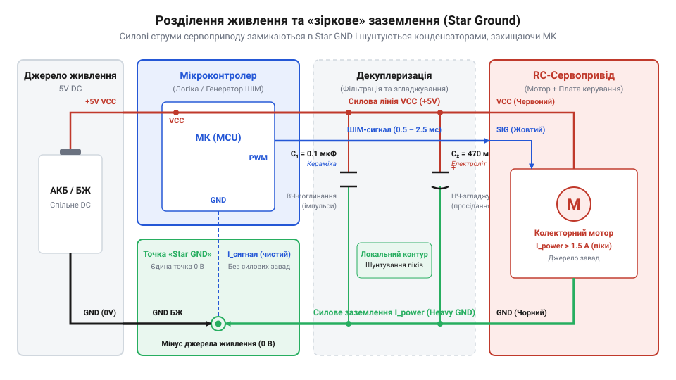
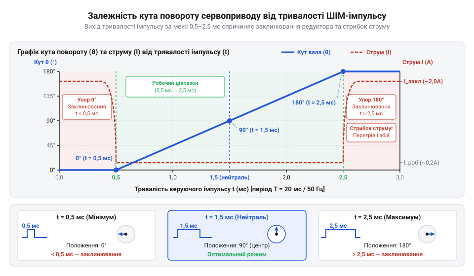
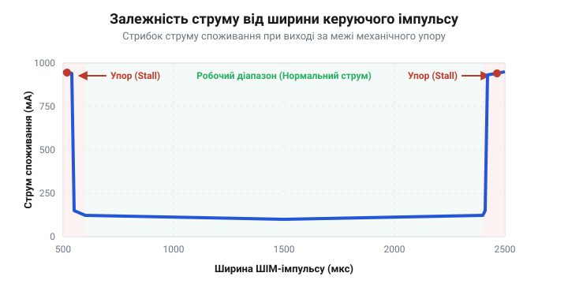

# Збирання автономного тестера сервоприводів із розділеним живленням та захистом від індуктивних завад

<preknowlist>
- [Tower Pro SG90 — мікросерво 9g](root:cat-hw-actuators/sg90-servo) — призначення трьох провідників живлення й сигналу та стандартні часові параметри керуючого імпульсу.
- [Лінійка 9-грамових мікросервоприводів Tower Pro (SG90, SG92R, MG90S, MG90D)](root:cat-hw-actuators/sg90-mg90-micro-servos-family) — робочі та пускові струми приводів різного класу й особливості навантаження редукторів.
</preknowlist>

## Чому сервопривод перезавантажує мікроконтролер

Підключення @@en|RC-сервоприводу@@ (від @@en|RC@@ — @@en|Radio Controlled@@, радіокерований, та @@latin|servus@@ — слуга, помічник) безпосередньо до однієї шини живлення з @@en|мікроконтролером@@ (від @@greek|mikros@@ — малий та @@en|controller@@ — управитель) — одна з найпоширеніших причин несподіваних програмних збоїв та хаотичного перезавантаження розроблюваних пристроїв. На етапі тестування схема може виглядати цілком працездатною, коли вал приводу перебуває в стані спокою. Однак у момент подачі команди на швидкий поворот або при виникненні механічного опору на валу @@en|мікроконтролер@@ раптово скидає свій стан за сигналом схеми @@en|BOD@@ (@@en|Brown-out Detect@@, детектор просідання напруги).

Фізична причина цього явища полягає в електричній природі колекторного двигуна постійного струму, який є силовим ядром будь-якого стандартного приводу з лінійки [9-грамових мікросервоприводів](root:cat-hw-actuators/sg90-mg90-micro-servos-family), таких як [мікросервоприводів SG90](root:cat-hw-actuators/sg90-servo). Коли ротор двигуна нерухомий, значення проти-@@en|ЕРС@@ (зворотної електрорушійної сили) дорівнює нулю. У момент подачі напруги через плату керування сервоприводу струм обмоток обмежується лише їхнім власним активним опором `R_a`, який для компактних двигунів становить від 2 до 5 Ом.

Виникає стартовий пусковий струм (@@en|inrush current@@), який можна вирахувати за законом Ома для ділянки кола:

```
I_start = V_cc ÷ R_a
        = 5.0 В ÷ 2.5 Ом    [застосування закону Ома для активного опору якоря]
        = 2.0 А
```

Такий короткочасний сплеск струму тривалістю від кількох мілісекунд до десятків мілісекунд суттєво перевищує номінальний робочий струм приводу (який зазвичай становить 100–250 мА). Якщо цифрова частина системи та силовий привід живляться від одного лінійного регулятора або USB-порту, внутрішній опір джерела живлення та опір з'єднувальних провідників `R_line` створюють падіння напруги:

```
ΔV = I_start × R_line
```

Коли опір лінії або джерела становить всього 0.5 Ом, падіння напруги `ΔV` сягає 1.0 В, через що напруга на шині `V_cc` миттєво просідає з 5.0 В до 4.0 В або нижче. Це миттєво активує внутрішній периферійний скидач @@en|мікроконтролера@@, перериваючи виконання алгоритму.

Другим деструктивним чинником є високовольтні імпульсні @@en|індуктивні завади@@ (від @@latin|inductio@@ — наведення). Обмотки колекторного двигуна мають відчутну @@en|індуктивність@@ `L`. Під час роботи плати внутрішній @@en|H-міст@@ (@@en|H-Bridge@@) сервоприводу комутує обмотки за допомогою @@en|ШІМ@@ (широтно-імпульсна модуляція, або @@en|PWM@@, @@en|Pulse-Width Modulation@@). У момент розмикання ключів транзисторів закон самоіндукції викликає сплеск зворотної @@en|ЕРС@@:

```
v_L = L × (di ÷ dt)
```

Оскільки швидкість вимикання струму `di/dt` є надзвичайно високою, на силових лініях виникають імпульсні викиди напруги з амплітудою в десятки вольт, які через паразитний ємнісний та індуктивний зв'язок на друкованій платі проникають у лінії скидання (@@en|RESET@@) та тактування @@en|мікроконтролера@@.

Третій чинник — паразитний зв'язок через спільний опір заземлення (@@en|Common Impedance Coupling@@). Коли силовий струм повернення сервоприводу протікає через тонку загальну доріжку заземлення (@@en|GND@@), на ній виникає різниця потенціалів `V_gnd = I_servo × R_gnd`. У результаті цифровий нуль @@en|мікроконтролера@@ зсувається відносно опорного нуля джерела, що призводить до спотворення логічних рівнів керуючого сигналу та фатальних помилок АЦП. Для усунення цих явищ необхідно застосовувати розділення силових і сигнальних кіл та спеціальний схемний @@en|декаплінг@@ (від @@en|de-@@ — роз'єднання та @@en|coupling@@ — зв'язок).

## Схема розділеного живлення та декуплеризація

Для забезпечення надійної роботи чутливої обчислювальної логіки тестера необхідно відмовитися від прямого паралельного підключення сервоприводу до лінії живлення @@en|мікроконтролера@@. Першим базовим правилом є побудова топології розділеного живлення (@@en|Split Power Supply Topology@@), де силова частина (сервоприводи) та сигнальна частина (обчислювальний блок і аналогові сенсори) живляться від окремих регуляторів або ізольованих гілок одного потужного джерела.

Ключовим елементом такої схеми є @@en|зіркоподібне заземлення@@ (@@en|Star Grounding@@). При такій топології силові провідники повернення струму від сервоприводу та сигнальні провідники заземлення @@en|мікроконтролера@@ не з'єднуються послідовно ланцюжком, а сходяться в одній-єдиній фізичній точці — безпосередньо на мінусовому виводі джерела живлення або накопичувального конденсатора фільтра. Завдяки цьому потужні пускові імпульси сервоприводу протікають виключно у своєму силовому контурі, не створюючи падіння напруги на чутливих земляних доріжках цифрової схеми.


*Принципова схема розділеного живлення тестера із зіркоподібним заземленням, де силовий струм сервоприводу й сигнальний струм мікроконтролера сходяться в одній точці на мінусі джерела, а паралельно лінії живлення розміщені керамічний та електролітичний конденсатори.*

Другим важливим рубежем захисту є схемна @@en|декуплеризація@@ (@@en|decoupling@@), яка реалізується парою паралельно ввімкнених конденсаторів різного типу безпосередньо біля роз'ємів підключення навантаження:

1. **Низькоімпедансний керамічний конденсатор** (наприклад, @@en|MLCC Ceramic Capacitor@@ ємністю від 100 нФ до 1 мкФ типу X7R). Він володіє мінімальним еквівалентним послідовним опором (@@en|ESR@@, @@en|Equivalent Series Resistance@@) та мінімальною власною індуктивністю виводів. Керамічний конденсатор ефективно шунтує високочастотні індуктивні імпульси та завади, створювані розмиканням ключів @@en|H-мосту@@. 2. **Буферний електролітичний конденсатор** (наприклад, @@en|Bulk Electrolytic Capacitor@@ ємністю від 220 мкФ до 1000 мкФ з низьким значенням @@en|ESR@@). Він виступає місцевим резервуаром електричної енергії, який миттєво віддає накопичений заряд під час стартового пускового струму, компенсуючи інерційність зовнішнього джерела чи лінійного регулятора напруги.

Необхідну мінімальну ємність накопичувального електролітичного конденсатора `C_min` для гасіння просідання напруги `ΔV_allowed` під час пускового сплеску тривалістю `Δt` можна розрахувати за формулою:

```
C_min = (I_surge × Δt) ÷ ΔV_allowed
```

**Обчислення ємності буферного конденсатора для тестувального стенда** — розрахуємо мінімальну ємність для компенсації пускового струму `I_surge = 1.5 А` тривалістю `Δt = 2.0 мс` (0.002 с) при максимально допустимому просіданні силової напруги `ΔV_allowed = 0.4 В`:

```
C_min = (1.5 А × 0.002 с) ÷ 0.4 В
      = 0.003 ÷ 0.4                  [виконання ділення в чисельнику та знаменнику]
      = 0.0075 Ф
      = 7500 мкФ
```

Оскільки значення 7500 мкФ є досить великим для компактного стенда, на практиці використовують комбінацію електролітичного конденсатора ємністю 470–1000 мкФ з активним імпульсним DCDC-перетворювачем живлення, що має високу швидкість відгуку на зміну навантаження. Розміщувати декуплювальні конденсатори слід якомога ближче до силових контактів роз'єму сервоприводу, мінімізуючи довжину друкованих доріжок.

## Генератор керуючого імпульсу тестера

Після створення захищеної силової частини електронного тестера можна переходити до формування сигнального потоку. Стандартний аналоговий та цифровий @@en|RC-сервопривод@@ очікує на вході широтно-імпульсний сигнал керування з періодом кадру `T_frame = 20 мс` (що відповідає частоті відновлення 50 Гц). Кутове положення вихідного вала визначається виключно тривалістю позитивного імпульсу `t_pulse`:

- `0.5 мс` (500 мкс) — мінімальний крайній кут (0°);
- `1.5 мс` (1500 мкс) — нейтральне положення (90°);
- `2.5 мс` (2500 мкс) — максимальний крайній кут (180°).


*Графік співвідношення тривалості керуючого імпульсу від 0,5 мс до 2,5 мс з періодом 20 мс і відповідного кутового положення вала сервоприводу від 0° до 180°.*

Створити такий генератор імпульсів можна як на основі аналогової мікросхеми [таймера 555](root:cat-hw-actuators/sg90-servo), так і за допомогою цифрового @@en|мікроконтролера@@. Аналогова схема на таймері NE555 використовує потенціометричний подільник і діоди для розділення шляхів заряду та розряду часозадавального конденсатора, однак вона схильна до температурного дрейфу й частотної нестабільності.

Набагато точнішим є цифровий тестер на @@en|мікроконтролері@@, який оцифровує положення ручного @@en|потенціометра@@ (від @@latin|potentia@@ — сила, напруга та @@greek|metron@@ — міра) за допомогою апаратного @@en|АЦП@@ (аналого-цифровий перетворювач, або @@en|ADC@@, @@en|Analog-to-Digital Converter@@) та мапує його відліки у значення регістрів порівняння таймера. Для усунення брязкоту ковзаючого контакту потенціометра (@@en|potentiometer jitter@@) застосовують програмну фільтрацію шляхом усреднення серії вибірок.

Нижче наведено модульну реалізацію тестера мовою C, що включає оцифрування напруги потенціометра та неблокуюче формування часових інтервалів ШІМ.

Заголовочний файл інтерфейсу АЦП описує конфігурацію модуля та функції фільтрації:

:::code proj-servo-tester-and-power-decoupling/c/adc.h

Модуль АЦП виконує усреднення відліків для придушення мікротріпотіння вала:

:::code proj-servo-tester-and-power-decoupling/c/adc.c

Інтерфейс драйвера сервоприводу визначає часові константи та структуру стану:

:::code proj-servo-tester-and-power-decoupling/c/servo.h

Реалізація C-драйвера здійснює лінійне мапування відліків АЦП у тривалість імпульсу та відліки таймера:

:::code proj-servo-tester-and-power-decoupling/c/servo.c

Головний файл демонструє циклічне мапування без блокування виконання програми:

:::code proj-servo-tester-and-power-decoupling/c/main.c

У складніших робототехнічних системах розробку тестера виконують об'єктно-орієнтованим стилем мовою C++. Це дозволяє відокремити низькорівневе керування регістрами від високорівневої кінематики та захисних бар'єрів.

Окремим критичним завданням сервотестера є захист механічного [редуктора](root:cat-hw-actuators/powerhd-family) та згладжування пускових струмів. Для цього застосовують трапецеїдальний профайлер руху (@@en|Motion Profiler@@), який обмежує кутову швидкість та прискорення вала, запобігаючи зрізанню пластикових чи металевих шестерень сервоприводів на кшталт [модель MG90S V2](root:cat-hw-actuators/mg90s-servo) або [сервоприводи HD-1370A](root:cat-hw-actuators/hd-1370a-servo).

Інтерфейс низькорівневого C++ драйвера сервоприводу гарантує валідацію безпечних меж тривалості імпульсу:

:::code proj-servo-tester-and-power-decoupling/cpp/include/servo_driver.hpp

Реалізація C++ драйвера керує розрахунком тактів таймера та обробкою помилок:

:::code proj-servo-tester-and-power-decoupling/cpp/src/servo_driver.cpp

Трапецеїдальний профайлер руху забезпечує плавну траєкторію позиціонування:

:::code proj-servo-tester-and-power-decoupling/cpp/include/motion_profile.hpp

Реалізація профайлера обчислює дистанцію гальмування та граничну швидкість:

:::code proj-servo-tester-and-power-decoupling/cpp/src/motion_profile.cpp

Сервотестер інтегрує драйвер і профайлер для реалізації режимів Neutral, Manual та AutoSweep:

:::code proj-servo-tester-and-power-decoupling/cpp/include/servo_tester.hpp

Реалізація логіки тестера перевіряє апаратні бар'єри безпеки та відключає ШІМ при критичних збоях:

:::code proj-servo-tester-and-power-decoupling/cpp/src/servo_tester.cpp

Головний тестовий файл C++ виконує автоматизований прогон режимів роботи:

:::code proj-servo-tester-and-power-decoupling/cpp/src/main.cpp

Під час випробувань сервоприводів за допомогою розробленого тестера критично важливо виявити реальний кутовий діапазон конкретного екземпляра. Фізичні механічні упори редуктора можуть бути обмежені кутом 160° замість 180°. Якщо згенерувати імпульс менше 500 мкс або більше 2500 мкс, монітор зафіксує заклинювання двигуна у крайній точці, струм зросте до замикання (до 2 А), що призведе до перегріву й згоряння плати керування.

Комплексна діагностика передбачає перевірку плавності ходу, виявлення мертвих зон потенціометра зворотного зв'язку та перевірку стану зубців шестерень перед встановленням механізму у фінальну конструкцію. Детальніші відомості про підбір комплектуючих та механічних насадок можна знайти у матеріалі про асортимент [серво-рогів та качалок](root:cat-hw-actuators/servo-horns), а специфіка використання приводів без обмежень за кутом висвітлюється у статті про [модифікацію на постійне обертання](root:cat-hw-actuators/continuous-rotation-servo-mod). Для важкої промислової автоматики замість малого тестера застосовують [промислові безколекторні серводрайвери](root:cat-hw-actuators/bldc-servo-controller).

## Визначення кутового діапазону та упорів

Паспортні характеристики більшості сервоприводів декларують діапазон обертання у 180° при зміні тривалості імпульсу від 1.0 мс (1000 мкс) до 2.0 мс (2000 мкс). Проте через технологічні допуски при виготовленні внутрішнього @@en|потенціометра@@ (від лат. *potentia* — сила та грец. *metron* — міра) та похибки збирання пластикових шестерень реальні фізичні межі механічного руху вала відрізняються. Кожен сервопривод має внутрішні механічні обмежувачі — @@en|end stop@@ (англ. *end stop* — крайній обмежувач). Якщо мікроконтролер формує керуючий імпульс, який вимагає повороту ротора за межі цих обмежувачів, мотор намагається здолати фізичну перешкоду. Виникає стан заклинювання, під час якого струм через обмотки зростає від номінальних 100–150 мА до @@en|stall current@@ (англ. *stall current* — струм заклинювання), що для [приводів Tower Pro SG90](root:cat-hw-actuators/sg90-servo) сягає 650–700 мА, а для [металевих редукторів MG90S](root:cat-hw-actuators/mg90s-servo) сягає 800–900 мА. Такий перевантажувальний струм викликає перегрів транзисторів @@en|H-bridge@@ (англ. *H-bridge* — Н-подібний міст) на платі керування сервоприводу, зрізає зуби редуктора та провокує глибоке просідання напруги живлення, що призводить до аварійного перезавантаження мікроконтролера.

Для безпечного визначення реальних робочих меж застосовують методику поступового зміщення від нейтралі. Спершу на сервопривод подають нейтральний сигнал 1.5 мс (1500 мкс), при якому вал гарантовано перебуває в середині робочого сектора без механічного напруження. Підключивши амперметр у коло силового живлення VCC_SERVO або осцилограф до вимірювального шунта, тривалість імпульсу плавно зменшують із кроком 10–20 мкс. У нормальному режимі споживання струму лишається низьким. У момент, коли внутрішній важіль впирається у механічний @@en|end stop@@, струм споживання стрибкоподібно зростає в кілька разів, а сервопривод починає характерно гудіти з частотою кадрів 50 Гц. Ця точка визначає нижню фізичну межу. Для гарантії надійності до знайденого значення додають захисний інженерний запас у 20–30 мкс (близько 2°), що формує безпечну мінімальну ширину імпульсу `min_pulse_us`. Аналогічну процедуру повторюють у бік збільшення тривалості імпульсу до 2.5 мс для фіксації верхнього порогу `max_pulse_us`. При випробуванні [лінійки 9-грамових сервомоторів](root:cat-hw-actuators/sg90-mg90-micro-servos-family) виявляється, що реальний кутовий діапазон часто становить від 160° до 175°, а тривалості імпульсів знаходяться в межах 540–2420 мкс.


*Залежність струму споживання від тривалості керуючого імпульсу ШІМ: при виході за межі безпечного кутового діапазону струм зростає від 150 мА до струму заклинювання 1.2 А.*

Знайдені індивідуальні межі програмно запікаються в конфігурації драйвера. Процедура обмеження — @@en|clamping@@ (англ. *clamping* — фіксація меж) — гарантує, що навіть при крайніх положеннях керуючого потенціометра АЦП або помилках розрахунку траєкторії імпульс не вийде за безпечний коридор. У низькорівневому C-коді драйвера функція `servo_set_pulse_us()` автоматично обтинає вхідне значення до встановленого діапазону:

:::code proj-servo-tester-and-power-decoupling/c/servo.c 92-113

У високорівневій архітектурі C++ система безпеки розширюється двохрівневим бар'єром. Клас `ServoDriver` перевіряє відповідність імпульсу робочим межам, а модуль `ServoTester` містить додатковий апаратний обмежувач `validateSafety()`, який при виявленні некоректного сигналу (наприклад, менше 450 мкс або більше 2550 мкс через збій пам'яті) негайно вимикає генерацію ШІМ, переводячи систему в аварійний стан:

:::code proj-servo-tester-and-power-decoupling/cpp/src/servo_tester.cpp 97-107

Це повністю усуває ризик термічного пошкодження обмоток та механічного руйнування редуктора навіть під час налагодження програмного забезпечення. Для [субмікросервомоделей Power HD HD-1370A](root:cat-hw-actuators/hd-1370a-servo) з тендітною механікою наявність такого захисту є критичною умовою збереження працездатності.

## Діагностика редуктора та потенціометра

Після налаштування безпечних часових меж сервотестер перетворюється на інструмент комплексної діагностики механічної та електронної частин приводу. Основне механічне навантаження сприймає понижувальний редуктор — @@en|gearbox@@ (англ. *gearbox* — коробка передач), який перетворює високу швидкість колекторного мотора постійного струму на значний крутний момент вихідного вала. Під час тривалої експлуатації або після ударних навантажень пластикові шестерні можуть втрачати зуби, проковзувати або деформуватися від перегріву. Виявлення дефектів редуктора здійснюється у режимі автоматичного сканування — @@en|sweep@@ (англ. *sweep* — сканування). У C++ реалізації тестера режим `TesterMode::AutoSweep` змушує вал безперервно здійснювати циклічні коливання між заданими кутами, використовуючи плавний профайлер руху — @@en|motion profiler@@ (англ. *motion profiler* — профайлер руху):

:::code proj-servo-tester-and-power-decoupling/cpp/src/servo_tester.cpp 71-95

Під час плавної зміни кута за допомогою обчислень у `MotionProfiler` відстежують акустичний шум та амплітуду струму споживання.

:::code proj-servo-tester-and-power-decoupling/cpp/src/motion_profile.cpp 32-72

Якщо шестерні редуктора справні, струм споживання під час руху залишається рівномірним (в межах 120–180 мА). Наявність зрізаного або деформованого зуба виражається у періодичних сплесках струму (до 400–600 мА) або заклинюванні вала у конкретній точці траєкторії, супроводжуваному клацанням. При підключенні насадок на вал і [запасних серворогів](root:cat-hw-actuators/servo-horns) опір обертанню зростає, що дає змогу виявити приховані тріщини у маточинах шестерень під робочим навантаженням.

Другим критичним вузлом є потенціометр зворотного зв'язку, графітова доріжка якого зношується під час постійного тертя ковзного контакту. Знос доріжки створює мертві зони — @@en|dead spot@@ (англ. *dead spot* — мертва точка) та контакти з високим опором, викликаючи хаотичні стрибки напруги на аналоговому вході внутрішнього компаратора сервоприводу. Фізично це проявляється як @@en|jitter@@ (від англ. *jitter* — тремтіння) — високочастотне мікроколівання й вібрація вала при намаганні утримати стаціонарну позицію, що супроводжується постійним писком мотора та підвищеним нагріванням. Для відрізнення зовнішніх завад керуючого потенціометра тестера від внутрішніх дефектів сервоприводу в модулі АЦП застосовують цифрове ковзне усереднення — @@en|averaging filter@@ (англ. *averaging filter* — усреднювальний фільтр):

:::code proj-servo-tester-and-power-decoupling/c/adc.c 50-65

Фільтрація усуває дребезг ручки тестера, накопичуючи серію вибірок `samples`. Якщо після подачі ідеально згладженого ШІМ-сигналу вал сервоприводу продовжує хаотично тремтіти або плавати навколо заданої точки, це свідчить про остаточний знос внутрішнього потенціометра зворотного зв'язку. Такий екземпляр підлягає бракуванню або переробці. Зокрема, для специфічних завдань приводи з несправним потенціометром можна модифікувати: якщо вам потрібне не кутове позиціонування, а безперервний рух, зверніться до матеріалу про [допрацювання сервоприводів](root:cat-hw-actуators/continuous-rotation-servo-mod) у мотори постійного обертання. Для відповідальних робототехнічних вузлів, де потрібна висока надійність без зносу контактних доріжок, використовують [безколекторні інтегральні контролери](root:cat-hw-actuators/bldc-servo-controller) із магнітними або оптичними енкодерами.