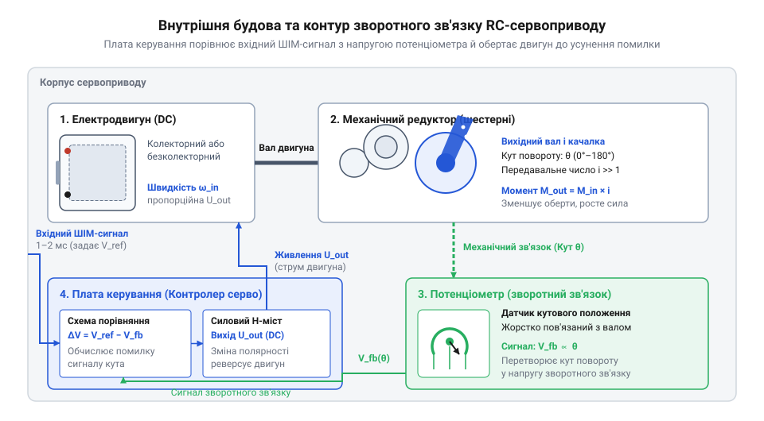
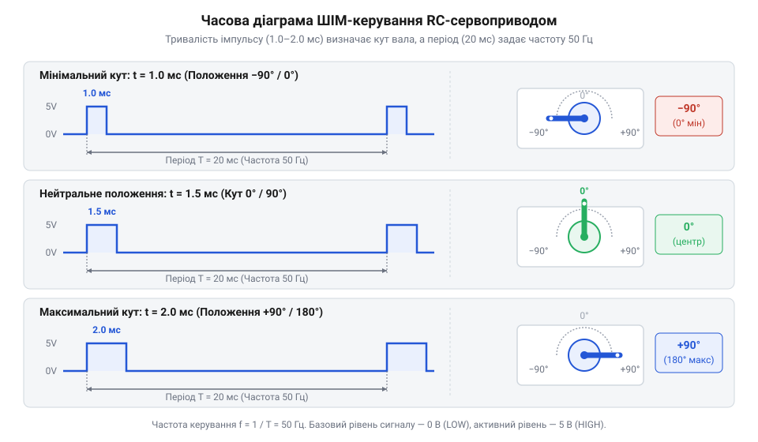
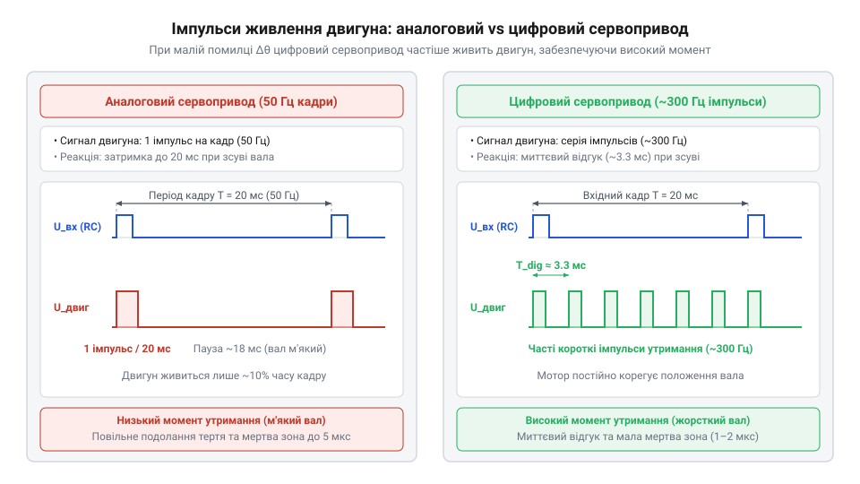
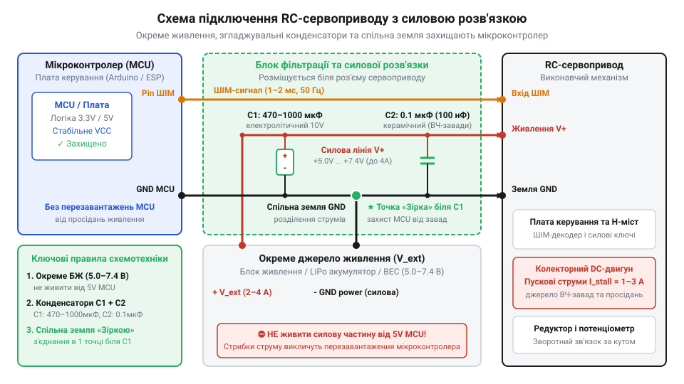
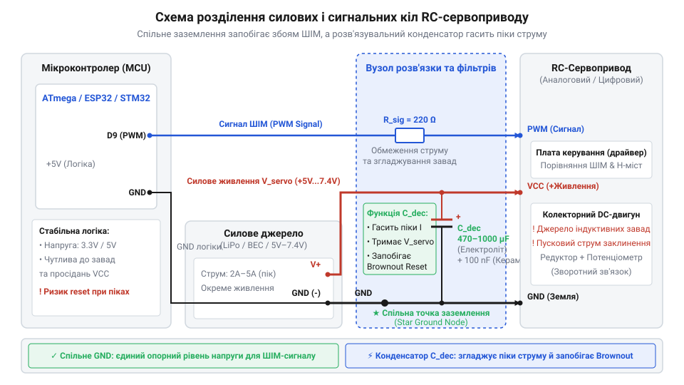

# Сервоприводи радіокерованих моделей: будова, редуктори та ШІМ-керування

## Проблема утримання кута вала під навантаженням

Припустимо, перед нами стоїть завдання повернути елерон крила радіокерованого літака, поворотний кулак моделі автомобіля або суглоб робототехнічного маніпулятора на чітко визначений кут — наприклад, рівно 45° — і непохитно утримувати його в цьому положенні. У реальному середовищі на цей керований орган безперервно діють зовнішні сили: аеродинамічний напір повітряного потоку, удари колеса об нерівності траси або гравітаційний момент від маси утримуваного вантажу.

Що відбудеться, якщо для виконання цього завдання використати звичайний колекторний @@en|DC-двигун@@ (від англ. *direct current* — постійний струм) із багатоступеневим @@en|редуктором@@ (від лат. *reducere* — повертати назад, зменшувати)? Коли ми подаємо електричну напругу на обмотки двигуна постійного струму, у роторі виникає електромагнітний момент, який долає внутрішнє тертя та прискорює вихідний вал. Як тільки подача живлення припиняється, двигун зупиняє активне обертання, проте інерція ротора та механічних шестерень змушує вал ще деякий час вибігати вперед. Але головна проблема полягає у поведінці системи під зовнішнім навантаженням: якщо зовнішнє зусилля прикласти до нерухомого вала, воно через зубчасту передачу проверне ротор двигуна, і початково виставлений кут буде безповоротно втрачено.

Таке побудування керування називається розімкненою системою (@@en|open-loop system@@). У розімкненому контурі керуючий пристрій (наприклад, мікроконтролер) може розрахувати тривалість подачі напруги `Δt`, сподіваючись, що вал повернеться на потрібний кут `θ`. Проте в реальних фізичних умовах цей розрахунок ніколи не буває точним через цілу низку змінних чинників:

1. Механічне тертя в зубчатому зачепленні та підшипниках змінюється залежно від температури, змащення та зносу. 2. Зовнішній момент опору `M_load` хаотично змінюється у часі під дією зовнішнього середовища. 3. Напруга джерела живлення `U_sup` просідає під навантаженням, змінюючи кутову швидкість обертання вала.

Кутова швидкість `ω` колекторного двигуна постійного струму описується рівнянням балансу напруг і моментів:

```
ω = (U_sup - I · R_a) / (k_e · Φ)
θ = ∫ ω dt
```

Оскільки розімкнена система взагалі не вимірює фактичний кут повороту вала `θ_actual`, керуючий контролер не має жодної інформації про наявність помилки позиціонування:

```
θ_err = θ_target - θ_actual
```

Оскільки значення `θ_err` контролеру невідоме, система не здатна сформувати компенсаційний електромагнітний момент `M_corr`. Коли зовнішня сила `F_ext`, прикладена до важеля довжиною `r`, створює зовнішній момент `M_ext = F_ext · r`, вихідний вал просто відхиляється на довільний кут. Навіть якщо встановити редуктор із величезним передавальним відношенням `i`, який ускладнює зворотне провертання (@@en|back-drivability@@), пасивний механічний опір не вирішує проблему: через механічний зазор між зубцями шестерень — @@en|люфт@@ (від нім. *Luft* — повітря) — вал усе одно зміщуватиметься у межах вільного ходу. Коли ж навантаження перевищує допустимі межі, класичні [мікросервоприводи серії SG90](root:cat-hw-actuators/sg90-servo) можуть втрачати точність або зазнавати механічних пошкоджень, якщо не забезпечено автоматичної корекції.

Для надійного та точного утримання кута вала під змінним навантаженням механізм мусить виконувати три обов'язкові умови:

1. Безперервно й з високою точністю вимірювати поточний реальний кут повороту вихідного вала `θ_actual`. 2. Миттєво порівнювати `θ_actual` із заданим цільовим значенням `θ_target`, обчислюючи поточну помилку `θ_err`. 3. Автоматично подавати на двигун струм відповідної полярності й величини, генеруючи активний протидіючий момент `M_corr`, який повертає вал у задане положення та зводить `θ_err` до нуля.

Ця фізична неминучість зумовила створення замкненої системи автоматичного керування — сервомеханізму (@@en|servomechanism@@, від лат. *servus* — слуга та грец. *mechane* — знаряддя, пристрій). Замість того, щоб будувати складні зовнішні схеми з окремими датчиками, громіздкими платами драйверів та обчислювальними циклами мікроконтролера для кожного окремого суглоба, у робототехніці та радіомоделізмі було створено моноблочний закончений привід — @@en|RC-сервопривод@@, у компактному корпусі якого інтегровано силове, вимірювальне та обчислювальне коло.

## Будова сервоприводу: контур зворотного зв'язку

Для перетворення розімкненого електродвигуна на автономну замкнену систему в єдиному корпусі стандартного RC-сервоприводу об'єднують чотири конструктивні блоки:

1. **Електродвигун постійного струму** — високооборотне джерело первинного механічного руху (колекторний, безсердечниковий або безколекторний). 2. **Багатоступеневий зубчастий редуктор** — механічний трансформер, який понижує швидкість обертання ротора у 100–300 разів і пропорційно збільшує крутний момент на вихідному валу. Для детального розрахунку зубчастих передач рекомендуємо звернутися до матеріалу про [зубчасті редуктори сервоприводів](root:hw-motion/servo-gearbox-mechanics), де описується їхня кінематика та способи зменшення люфтів. 3. **Датчик зворотного зв'язку** — пристрій вимірювання кута (найчастіше аналоговий @@en|потенціометр@@, від лат. *potentia* — сила та грец. *metron* — вимірювати, або магнітний енкодер), жорстко з'єднаний із вихідним валом. Фізичне зчитування позиції забезпечують [датчики кутового положення сервоприводів](root:cat-hw-sensors/servo-feedback-potentiometers-and-magnetic-encoders), які конвертують обертання у напругу. 4. **Внутрішня плата керування** — інтегральний сервопідсилювач, що містить схему порівняння сигналів та силовий @@en|H-місток@@ (від англ. *H-bridge* — H-подібна мостова схема транзисторів) для реверсивного живлення обмоток двигуна.

Ключовим елементом конструкції є механічний зв'язок між вихідним валом та датчиком позиції. На вихідний вал редуктора встановлюються керовані важелі — передача зусилля на керований орган здійснюється через [серво-роги та важелі](root:cat-hw-actuators/servo-horns), закріплені на шліцах вала. Проте з внутрішнього боку корпусу той самий вихідний вал жорстко або через направляючий штифт з'єднаний із рухомим контактом (повзунком) прецизійного потенціометра.


*Компоненти сервоприводу у спільному корпусі та механічна взаємодія між валом редуктора й потенціометром.*

Коли вихідний вал повертається на певний кут у межах робочого діапазону (зазвичай від 0° до 180°), повзунок потенціометра переміщується по резистивному доріжку. На крайні виводи потенціометра подається стабілізована напруга живлення `U_vcc` (наприклад, 5.0 В). Напруга, що знімається з центрального виводу потенціометра `U_fb`, лінійно залежить від поточного кута повороту вала `θ_actual`:

```
U_fb = U_vcc · (θ_actual / θ_max)
```

Завдяки цьому жорсткому механічному зв'язку будь-яке відхилення вала — як зумовлене роботою двигуна, так і спричинене зовнішньою силою — миттєво змінює напругу зворотного зв'язку `U_fb`.

Внутрішня плата керування приймає зовнішній командний сигнал від мікроконтролера, перетворює його на внутрішню опорну напругу `U_set` та подає обидва сигнали на аналоговий компаратор або цифровий мікропроцесор. Обчислення сигналу помилки `U_err` відбувається за формулою:

```
U_err = U_set - U_fb
```

Робота контуру зворотного зв'язку відбувається за наступним алгоритмом:

1. Якщо `U_err > 0` (кут вала менший за заданий): плата відкриває відповідні діагональні транзистори H-містку, подаючи на двигун напругу прямої полярності. Двигун обертає редуктор за годинниковою стрілкою, збільшуючи `θ_actual` та напругу `U_fb` доти, доки `U_fb` не зрівняється з `U_set`. 2. Якщо `U_err < 0` (кут вала більший за заданий): H-місток перемикає полярність живлення двигуна на протилежну. Двигун обертається проти годинникової стрілки, зменшуючи `θ_actual`. 3. Якщо `|U_err| < U_deadband`: абсолютна величина помилки лежить у межах так званої зони нечутливості (@@en|deadband@@, від англ. *dead band* — мертва смуга). У цьому стані плата керування повністю запирає транзистори H-містку, знімаючи живлення з двигуна. Це запобігає безперервному високочастотному коливанню (двохтінню) вала навколо точної точки рівноваги.

Історичний шлях розвитку сервомеханізмів у радіомоделізмі пролягав від громіздких електромеханічних дискових перемикачів (@@en|escapement@@, від франц. *échappement* — спускний механізм) та дискретних аналогових схем на окремих транзисторах до сучасних інтегральних та цифрових систем. Перші аналогові сервоприводи мали значний температурний дрейф та низьку точність порівняння напруг, що вимагало постійного ручного підлаштування. Поява наприкінці 1970-х років спеціалізованих мікросхем сервопідсилювачів (наприклад, NE544) дозволила вмістити весь контур порівняння та силовий драйвер у компактний корпус. Сучасні цифрові сервоприводи замінили аналогові компаратори мікроконтролерами, що підвищило частоту опитування та момент утримання.

Надійність і динаміка сервоприводу суттєво залежать від використаних матеріалів редуктора та типу електродвигуна:

- **Матеріали шестерень**: пластикові (нейлонові) шестерні забезпечують мінімальну масу та тиху роботу, але легко зрізаються при ударних навантаженнях. У випадках, коли ударні навантаження високі, краще застосовувати [мікросерво з металевим редуктором](root:cat-hw-actuators/mg90s-servo), які витримують значні механічні сплески. Для максимальних навантажень використовують титанові або загартовані сталеві редуктори. - **Тип двигуна**: класичні колекторні двигуни мають високу інерцію металевого ротора. Безсердечникові двигуни (@@en|coreless@@) мають легку самонесучу обмотку ротора, що забезпечує миттєвий розгін і гальмування. Безколекторні двигуни (@@en|brushless@@) відрізняються відсутністю механічного колектора, найвищим ККД та практично необмеженим ресурсом роботи.

## Часовий протокол ШІМ-керування позицією вала

Поширеною помилкою серед початківців є плутанина між силовим широтно-імпульсним регулюванням швидкості DC-двигунів та часовим протоколом ШІМ-керування позицією RC-сервоприводів.

У разі силового регулювання колекторного двигуна відносне значення коефіцієнта заповнення імпульсів (@@en|duty cycle@@) `D = t_on / T` безпосередньо визначає середню напругу `U_avg = D · U_sup`, яка подається на обмотки для зміни швидкості обертання. У керуванні ж RC-сервоприводом використовується імпульсно-позиційне кодування (@@en|pulse-position modulation@@): абсолютна тривалість високого імпульсу `t_pulse` вказує внутрішній платі сервоприводу не швидкість і не силову потужність, а **конкретний кут повороту вала**, у який він мусить переміститися й утримуватися.

Стандартний часовий протокол керування RC-сервоприводом має наступні фіксовані параметри:

- **Період повторення сигналів (`T`)**: 20 мілісекунд, що відповідає частоті оновлення `f = 50 Гц`. - **Тривалість позиціонуючого імпульсу (`t_pulse`)**:
  - `1.0 мс` — крайнє ліве положення вала (0°). - `1.5 мс` — нейтральне центральне положення вала (90°). - `2.0 мс` — крайнє праве положення вала (180°).


*Залежність кута повороту вихідного вала від тривалості високоімпульсної фази в межах періоду 20 мс.*

Залежність цільового кута повороту `θ` від тривалості імпульсу `t_pulse` у стандартному діапазоні є чітко лінійною. Математична модель цієї конверсії описується рівнянням:

```
θ = θ_min + (t_pulse - t_min) · (θ_max - θ_min) / (t_max - t_min)
```

Для стандартного діапазону `t_min = 1.0 мс`, `t_max = 2.0 мс`, `θ_min = 0°`, `θ_max = 180°` формула спрощується:

```
θ = 0 + (t_pulse - 1.0) · (180 - 0) / (2.0 - 1.0)
= (t_pulse - 1.0) · 180               [розрахунок кута у градусах]
```

Розрахуємо підсумковий кут вала для імпульсу тривалістю `t_pulse = 1.25 мс`:

```
θ = (1.25 - 1.0) · 180
= 0.25 · 180                          [підстановка значення тривалості імпульсу]
= 45°                                 [цільовий кут повороту вала]
```

Усередині аналогового сервопривод вхідний імпульс `t_pulse` надходить на генератор опорного внутрішнього імпульсу (одноразовий чекаючий мультивібратор). Тривалість внутрішнього опорного імпульсу `t_ref` регулюється поточним опором потенціометра зворотного зв'язку. Схема порівняння обчислює різницю тривалостей:

```
Δt = t_pulse - t_ref
```

Якщо величина відхилення перевищує ширину зони нечутливості `|Δt| > t_dead`, плата формує силовий імпульс на H-місток. Ширина зони нечутливості (@@en|deadband@@) визначає точність і стабільність сервоприводу. Занадто широка зона нечутливості (наприклад, `t_dead = 10 мкс`) призводить до люфту позиціонування: вал може "не доходити" до точного кута на 1–2°. Натомість надто тонка зона нечутливості (`t_dead < 1 мкс`) викликає високочастотне дрижання (@@en|jitter@@) та постійне гудіння сервопривод під навантаженням. Докладніше про фізичні причини виникнення високочастотного тремтіння та методи схемотехнічної й програмної фільтрації читайте у статті про [зону нечутливості та дрижання вала сервоприводів](root:cat-hw-actuators/servo-deadband-and-jitter).


*Висока частота подачі струму в цифровому сервоприводі забезпечує значно більший момент утримання при малих відхиленнях.*

Принципова відмінність між **аналоговими** та **цифровими** сервоприводами полягає в механізмі обробки сигналу помилки та частоті живлення двигуна:

1. **Аналоговий сервопривод**: отримує вхідний сигнал із частотою 50 Гц (раз на 20 мс). Внутрішній компаратор подає силовий імпульс на електродвигун також лише 50 разів на секунду. Якщо відхилення вала `θ_err` незначне, тривалість силового імпульсу струму на двигун виявляється дуже короткою. Через це аналоговий сервопривод розвиває слабкий момент утримання при малих відхиленнях і повільно реагує на мікрозміщення вала. 2. **Цифровий сервопривод**: також приймає стандартний командний ШІМ-сигнал 50 Гц (або вище), але вхідні імпульси зчитує високошвидкісний внутрішній мікроконтролер. Незалежно від частоти вхідного сигналу, цифровий мікропроцесор подає силові ШІМ-імпульси на H-місток із частотою 300–500 Гц або більше. Навіть при крихітному відхиленні вала двигун отримує сотні коротких силових поштовхів на секунду, що забезпечує колосальний момент утримання, високу точність позиціонування та швидкий відгук на зовнішнє зусилля.

Для завдань, що вимагають не кутового позиціонування, а безперервної зміни швидкості й напрямку обертання, використовуються спеціально модифіковані [сервоприводи постійного обертання](root:cat-hw-actuators/continuous-rotation-servo-mod), де потенціометр замінено фіксованим дільником напруги. У більш складних промислових системах застосовують [безколекторні інтегральні сервоконтролери](root:cat-hw-actuators/bldc-servo-controller), які працюють за цифровими інтерфейсними протоколами. Водночас для запобігання збоям мікроконтролера через пікові струми та індуктивні перешкоди сервоприводів обов'язково застосовують додаткові [модулі BEC та керування живленням](root:hw-power/bec-and-servo-power-management), які ізолюють та стабілізують лінії живлення.

## Аналогові та цифрові сервоприводи: відмінності керування

Уявімо робототехнічний маніпулятор або рульову поверхню швидкісного безпілотника, на яку діє різкий порив вітру чи випадковий механічний поштовх. Вихідний вал сервоприводу відхиляється від заданого положення всього на частку градуса. З точки зору вхідного командного сигналу нічого не змінилося: мікроконтролер продовжує передавати стандартні імпульси тривалістю `1.5 мс` із частотою `50 Гц`. Проте здатність сервоприводу протистояти цьому зовнішньому зсуву та утримати позицію принципово залежить від того, яка саме електроніка керує внутрішнім електродвигуном — аналогова чи цифрова.

Головне обмеження, яке має @@el|аналоговий сервопривод@@ (від грец. *analogos* — відповідний, пропорційний), полягає у жорсткій прив'язці частоти живлення двигуна до частоти вхідного сигнального кадру. Стандартний протокол керування постачає новий імпульс позиції лише один раз на `20 мс` (що відповідає частоті `f = 50 Гц`). Аналогова плата керування, побудована на аналогових компараторах чи спеціалізованих мікросхемах (як-от NE544), формує силовий імпульс струму на @@en|H-місток@@ виключно під час надходження вхідного сигналу.

Усередині аналогового сервоприводу вхідний імпульс порівнюється з опорним трикутним або прямокутним імпульсом внутрішнього чекаючого мультивібратора, тривалість якого задається потенціометром зворотного зв'язку. Якщо кутова помилка `θ_err` незначна, різниця між тривалістю вхідного імпульсу та внутрішнього опорного сигналу виявляється вкрай малою — наприклад, `Δt = 10 мкс`. У результаті аналогова плата відкриває силові транзистори драйвера на мізерний проміжок часу. 

Розрахуємо частку часу `D_power`, протягом якої двигун отримує електричну енергію в межах одного кадру тривалістю `T_frame = 20 мс`:

```
T_frame = 20.0 мс = 20000 мкс
t_pulse_motor = 10 мкс
D_power = t_pulse_motor / T_frame
= 10 мкс / 20000 мкс                     [співвідношення тривалості силового поштовху до кадру]
= 0.0005 = 0.05%                         [коефіцієнт заповнення живлення двигуна]
```

Протягом решти `19.99 мс` (понад `99.9%` часу кадру) електродвигун залишається повністю знеструмленим. Оскільки короткий силовий поштовх тривалістю `10 мкс` передає мінімальну електричну енергію, електромагнітний момент ротора виявляється занадто слабким, щоб подолати статичне тертя редуктора. Через це аналоговий сервопривод має значну зону нечутливості (@@en|deadband@@) у діапазоні `4–8 мкс`, володіє низьким моментом утримання при малих відхиленнях і здається податливим або "м'яким" під зовнішнім навантаженням.

Конструктивну революцію в галузі приводів здійснив @@la|цифровий сервопривод@@ (від лат. *digitus* — палець, лічба). Зовні він підключається через точнісінько такий самий трьохпровідний роз'єм і приймає ті самі імпульси `1.0–2.0 мс`. Повну специфікацію цього підключення розкрито у [довіднику залізного інтерфейсу](root:cat-hw-actuators/rc-servo-mechanisms-and-control/api-rc-servo-hardware-interface.md). Проте внутрішня схемотехніка цифрового приводу кардинально інша: замість аналогового компаратора в ньому встановлено високошвидкісний @@en|мікроконтролер@@ (від грец. *mikros* — малий та лат. *contrarotulus* — дублікат списку) з власним апаратно-програмним обчислювачем.

Внутрішній мікропроцесор цифрового сервоприводу безперервно зчитує стан потенціометра зворотного зв'язку за допомогою високошвидкісного аналого-цифрового перетворювача (@@en|ADC@@) та здійснює обчислення сигналів помилки з високою дискретністю. Незалежно від того, із частотою `50 Гц` чи `333 Гц` надходять зовнішні команди від мікроконтролера, внутрішній мікропроцесор самостійно формує високовольтні імпульси живлення двигуна з внутрішньою частотою від `300 Гц` до `500 Гц` або більше.

Обчислимо період подачі струму на обмотки мотора для цифрової плати з частотою `f_digital = 300 Гц`:

```
T_digital = 1 / f_digital
= 1 / 300 Гц                             [обчислення періоду внутрішніх імпульсів]
≈ 3.33 мс                                [період оновлення силового моменту]
```

За час одного зовнішнього кадру `20 мс` цифровий мікроконтролер встигає подати на двигун не один, а цілих 6 силових імпульсів струму:

```
N_pulses = T_frame / T_digital
= 20 мс / 3.33 мс                        [підрахунок кількості силових поштовхів]
= 6 імпульсів                            [кількість квантів моменту за кадр]
```

Навіть при найменшому відхиленні вала `θ_err` цифровий мікропроцесор миттєво обчислює помилку та генерує серію високочастотних силових поштовхів з оптимальною тривалістю. Завдяки цьому мотор отримує постійний сумарний момент, здатний долати сухе тертя шестерень без очікування наступного командного кадру.

Взаємозв'язок між шириною зони нечутливості, передавальним відношенням та кутовою точністю детально описано в [математичній моделі моменту](root:cat-hw-actuators/rc-servo-mechanisms-and-control/math-rc-servo-kinematics-and-torque.md). 

Переваги цифрових сервоприводів:
1. **Звуження зони нечутливості**: Зона нечутливості (@@en|deadband@@) зменшується до `0.5–1.0 мкс`, що забезпечує кутову точність позиціонування у частки градуса. 2. **Максимальний момент утримання**: Привод розвиває повний паспортний крутний момент практично миттєво при найменшій спробі провернути вихідний вал. 3. **Швидкість відгуку**: Динамічний лаг між зовнішнім відхиленням та реакцією електродвигуна скорочується у 6–10 разів.

Ціна високої точності — суттєві електричні й термічні навантаження:
- **Високе споживання струму**: Постійне високочастотне перемикання транзисторів H-містку змушує двигун споживати значний середньоквадратичний струм. - **Пікові імпульсні струми**: У момент пуску обмоток цифровий сервопривод створює кидки струму (@@en|peak current@@), які у 3–5 разів перевищують струм спокою та можуть досягати `2–3 А` для стандартних моделей. - **Акустичне гудіння й нагрів**: Постійне високочастотне утримання вала супроводжується характерним писком або дрижанням (@@en|jitter@@) під навантаженням та підвищеним виділенням тепла на корпусі.

Через пікові кидки струму спроба живити потужний цифровий сервопривод безпосередньо від виводу 5V плати мікроконтролера гарантовано призведе до просідання напруги, спрацьовування схеми скидання (@@en|brown-out reset@@) та перезавантаження керуючого процесора. З цієї причини для надійного функціонування силове коло живлення сервоприводів обов'язково відокремлюють від сигнального кола мікроконтролера.


*Схема розділеного живлення сервоприводу: окремий силовий блок, електролітичний конденсатор для згладжування пікових струмів та спільна земля GND.*

На схемі чітко видно, що силова лінія VCC сервоприводу підключається до окремого джерела живлення відповідної потужності (наприклад, імпульсного перетворювача в рамках [модулів BEC та керування живленням](root:hw-power/bec-and-servo-power-management)). Сигнальний провід підключається безпосередньо до ШІМ-виводу мікроконтролера (де деталі генерації описує [програмний інтерфейс керування](root:cat-hw-actuators/rc-servo-mechanisms-and-control/api-rc-servo-control-library.md)). Ключова вимога — об'єднання заземлюючих провідників (GND) усіх джерел у єдину точкову шину для забезпечення спільного відліку потенціалів. Для згладжування індуктивних кидків струму паралельно силовим шинам встановлюють керамічні та електролітичні конденсатори ємністю 470–1000 мкФ.

Для тестування сервоприводів на наявність дрижання та перевірки споживання струму розробляють практичні вимірювальні стенди, такі як [автономний тестер сервоприводів](root:cat-hw-actuators/rc-servo-mechanisms-and-control/proj-servo-tester-and-power-decoupling.md) із захистом від завад. А дізнатися більше про історичний шлях від простіших аналогових схем до сучасних цифрових систем можна в [огляді еволюції сервоприводів](root:cat-hw-actuators/rc-servo-mechanisms-and-control/hist-rc-servo-evolution.md).

## Механіка редуктора та види силових двигунів

Після обробки сигналів внутрішньою електронікою силова енергія передається на виконавчі механічні вузли. Електродвигун за своєю природою є високооборотним пристроєм: на холостому ходу його ротор обертається зі швидкістю `n_rot = 10000...20000 об/хв`, але створює мізерний крутний момент. Для перетворення цієї швидкості на низькооборотне обертання з високим моментним зусиллям використовується @@la|редуктор@@ (від лат. *reducere* — повертати назад, зменшувати) із загальним передавальним відношенням `i` від `100:1` до `300:1`.

Передавальне відношення багатоступеневого редуктора визначається як відношення швидкості ротора мотора до швидкості вихідного вала:

```
i = n_rot / n_out = ω_rot / ω_out
```

При цьому теоретичний крутний момент на вихідному валу `M_out` зростає пропорційно `i`, але зменшується на коефіцієнт механічного ККД редуктора `η_gear`:

```
M_out = M_rot · i · η_gear
```

Проте вибір матеріалу шестерень редуктора визначає не лише ККД, а й життєздатність всієї конструкції під час динамічних та ударних навантажень.

### Матеріали шестерень редуктора

1. **Пластикові (нейлонові) шестерні**:
   - *Переваги*: Мають мінімальну масу, вкрай низьку собівартість та низький рівень шуму під час обертання. Завдяки природній самозмащуваності нейлону такі редуктори забезпечують високий ККД `η_gear ≈ 0.85–0.90`. - *Недоліки*: Низька гранична міцність зубців на зріз. При виникненні шокових ударних навантажень (наприклад, при падінні літака або ударі колеса RC-моделі об перешкоду) перший зубчик першої ступені редуктора миттєво зрізається. - *Застосування*: Легкі авіамоделі, кімнатна робототехніка. Класичним прикладом є [мікросерво SG90](root:cat-hw-actuators/sg90-servo), що входить до відомої [родини 9-грамових мікросервоприводів](root:cat-hw-actuators/sg90-mg90-micro-servos-family).

2. **Металеві шестерні (латунь, алюміній, загартована сталь)**:
   - *Переваги*: Колосальна стійкість до ударних навантажень. Зубці не зрізаються при заклинюванні вала, що дозволяє передавати момент у десятки кілограм-сил на сантиметр (`кгс·см`). - *Недоліки*: Більша маса, вищий рівень шуму, знижений ККД (`η_gear ≈ 0.70–0.75`) через високе сухому тертя металу по металу. Основна пастка металевих редукторів — прискорений абразивний знос (@@en|wear@@). Зношування та металева стружка від тертя збільшують механічний мікрозазор між зубцями — @@de|люфт@@ (від нім. *Luft* — повітря). У результаті з часом вихідний вал набуває вільного кутового ходу у `1°–3°`, що унеможливлює прецизійне позиціонування. - *Застосування*: Навантажені кермові суглоби роботів, автомобілі. Представниками цього класу є [мікросерво з металевим редуктором MG90S V2](root:cat-hw-actuators/mg90s-servo), а також потужні моделі [родини Power HD](root:cat-hw-actuators/powerhd-family), такі як [сервопривод Power HD HD-1370A](root:cat-hw-actuators/hd-1370a-servo).

3. **Титанові та сталеві сплави**:
   - Сполучають ультрависоку міцність сталі з меншою масою титану та високою зносостійкістю. Використовуються у професійному спортивному моделізмі та промисловості, проте мають високу вартість.

Більш розлогий аналіз кінематичних схем та методів вибору зачеплення наведено у матеріалі про [зубчасті редуктори сервоприводів](root:hw-motion/servo-gearbox-mechanics). Докладніший фізико-механічний аналіз руйнування зубців від ударних навантажень та накопичення кутового люфту наведено у статті про [зсувні навантаження та абразивний знос шестерень сервоприводів](root:cat-hw-actuators/servo-gear-shear-and-wear).

### Класифікація силових електродвигунів

Другим ключовим фактором механічної динаміки є конструкція первинного електродвигуна, замонтованого у корпус сервоприводу.

1. **Колекторний двигун (Brushed DC Motor)**:
   - Традиційна конструкція з нерухомими постійними магнітами на статорі та важким залізним ротором з мідними обмотками. - *Проблема*: Момент інерції суцільного залізного ротора `J_rot` досить великий. При намаганні змінити напрямок обертання двигун витрачає дорогоцінний час на долання власної інерції. Термін служби обмежений механічним зносом вугільно-мідних щіток колектора.

2. **Безсердечниковий двигун (Coreless Motor)**:
   - Конструктори прибрали важке залізне осердя з ротора. @@en|безсердечниковий двигун@@ (від англ. *coreless* — без осердя) має ротор у вигляді легкого самонесучого циліндра, сплетеного безпосередньо з мідного дроту (беззалізна сітчаста обмотка), який обертається навколо центрального постійного магніту. - Обчислимо порівняльний момент інерції ротора `J_coreless` у порівнянні з колекторним `J_brushed`:

```
J_brushed ≈ 10 · J_coreless
α_accel = M_mot / J_rot
```

Зменшення моменту інерції ротора у 5–10 разів пропорційно збільшує кутове прискорення `α_accel`. Завдяки цьому сервоприводи з двигунами @@en|coreless@@ розганяються до максимальної швидкості всього за `1–2 мс`, забезпечуючи блискавичний відгук на команди та повну відсутність вібрацій від незбалансованого осердя.

3. **Безколекторний двигун (Brushless Motor / BLDC)**:
   - @@en|безколекторний двигун@@ (від англ. *brushless* — без щіток) має ротор з потужних неодимових магнітів, а обмотки розташовані на зовнішньому статорі. Електронна комутація фаз здійснюється безпосередньо платою керування. - Двигуни @@en|brushless@@ не мають механічного колектора й щіток, завдяки чому досягається максимальний ККД `η_motor > 90%`, відсутність іскріння, мінімальний нагрів та практично нескінченний механічний ресурс (обмежений лише підшипниками). Вони розвивають найвищий момент при компактних габаритах.

### Критерії свідомого вибору механічного виконання

Під час проектування механічного вузла інженер має збалансувати параметри за трьома критеріями:

1. **Для високодинамічних систем із прецизійним відгуком** (наприклад, стабілізуючі підвіси камер або акробатичні дрони): обирають цифрові сервоприводи з двигунами @@en|coreless@@ або @@en|brushless@@ та титаново-сталевими редукторами. 2. **Для вузлів із високим ризиком ударних навантажень** (рульові шасі моделей, маніпулятори): обов'язковим є вибір металевого редуктора (наприклад, [MG90S V2](root:cat-hw-actuators/mg90s-servo)) у поєднанні з серво-сейвером — демпфуючою пружиною на [серво-рогах та важелях](root:cat-hw-actuators/servo-horns). 3. **Для бюджетних та легких конструкцій із плавним рухом**: оптимальними залишаються нейлонові редуктори та стандартні колекторні мотори ([Tower Pro SG90](root:cat-hw-actuators/sg90-servo)).

## Живлення, пікові струми та захист кола

Розробники початкових робототехнічних проектів часто стикаються з дивною поведінкою системи: щойно сервопривод починає повертати важку важелеву систему або впирається у механічний обмежувач, керівний мікроконтролер раптово перезавантажується, скидає програму або втрачає зв'язок по послідовному порту. З точки зору логіки коду жодних помилок немає: мікроконтролер продовжує справно видавати ШІМ-імпульси керування позицією. Проблема криється в фізичній природі колекторного електродвигуна всередині сервоприводу. Під час зміни напрямку руху чи механічного гальмування вала електричне споживання приводу стрибає від кількох міліампер до кількох ампер, створюючи потужні просідання напруги та індуктивні імпульси завад у спільному колі живлення.

Електричну поведінку RC-сервоприводу визначають три принципово різні режими споживання струму:
1. **Струм спокою (Idle Current)**: Коли вихідний вал нерухомий і на нього не діють зовнішні сили, плата керування та потенціометр споживають мінімальний струм у межах `5–15 мА`. 2. **Робочий струм (Operating Current)**: Під час плавності обертання вала без суттєвого опору електродвигун споживає від `100 мА` до `300 мА` (для мікросервоприводів на кшталт [Tower Pro SG90](root:cat-hw-actuators/sg90-servo)) і до `500–800 мА` для стандартних моделей. 3. **Пусковий струм та струм заклинювання**: Найбільшу загрозу для стабільності схемотехніки становлять @@en|inrush current@@ (від англ. *inrush* — раптовий кидок) при різкій зміні позиції та @@en|stall current@@ (від англ. *stall* — зупинка, заклинювання та *current* — струм) при повній механічному блокуванні ротора.

У момент пуску ротор двигуна нерухомий, тому проти-ЕРС (проти-електрорушійна сила) дорівнює нулю. Електричний опір кола визначається виключно активним опором мідної обмотки `R_motor`.

Розрахуємо струм заклинювання `I_stall` для стандартного мікросервоприводів з опором обмотки `R_motor = 5.0 Ом` при напрузі живлення `V_cc = 5.0 В`:

```
I_stall = V_cc / R_motor
= 5.0 В / 5.0 Ом                        [підстановка напруги живлення та опору обмотки]
= 1.0 А                                 [значення струму заклинювання одного приводу]
```

Якщо ж у робототехнічному маніпуляторі або павукоподібному крокуючому роботі одночасно стартують чи заклинюють 6 потужних металевих сервоприводів [MG90S V2](root:cat-hw-actuators/mg90s-servo) із власним опором обмоток `R_motor = 2.0 Ом`, сумарний кидок струму обчислюється наступним чином:

```
I_single = 5.0 В / 2.0 Ом = 2.5 А      [струм заклинювання одного сервоприводу]
I_total = 6 · I_single
= 6 · 2.5 А                            [множення на кількість одночасно працюючих приводів]
= 15.0 А                               [пікове споживання всієї системи]
```

Коли піковий струм `I_peak` сягає `15 А`, будь-який внутрішній опір джерела живлення `R_src` або опір сполучених провідників й роз'ємів `R_wire` створює миттєве падіння напруги `ΔV`:

```
ΔV = I_peak · (R_src + R_wire)
```

При сумарному опорі ліній та джерела `R_total = 0.2 Ом` падіння напруги на лініях становить `ΔV = 15.0 А · 0.2 Ом = 3.0 В`. Напруга на шині живлення мікроконтролера миттєво просідає з `5.0 В` до `2.0 В`.

Більшість сучасних мікроконтролерів мають вбудований модуль захисту @@en|Brown-out Reset@@ (від англ. *brown-out* — просідання напруги та *reset* — скидання, скорочено BOD). Коли напруга живлення логіки падає нижче порогового значення (наприклад, `2.7 В` для системи `3.3V/5V`), модуль BOD примусово переводить мікроконтролер у стан перезавантаження. У результаті робот повністю втрачає керування, зупиняється, напруга повертається до норми, мікроконтролер стартує знову — і знову перезавантажується при спробі подати сигнал на сервоприводи.

Окрім просідання напруги, комутація котушок двигуна внутрішнім H-містком викликає зворотні індуктивні викиди. Обмотка двигуна володіє властивістю @@la|індуктивність@@ (від лат. *inductio* — наведення), через що струм у ній не може змінитися миттєво. Під час закриття транзисторів H-містка виникає високочастотний сплеск напруги `V_spike = -L · (di/dt)`. Ці високочастотні голчасті імпульси амплітудою в десятки вольт проникають крізь спільні шини живлення в чутливі цифрові кола мікроконтролера, спричиняючи збої в роботі внутрішніх таймерів та лічильників.

Для усунення просідань напруги та захисту схемотехніки застосовують чотири фундаментальні правила побудови силових кіл сервоприводів:

1. **Розділення силової та сигнальної ліній живлення**: Ніколи не живіть сервоприводи безпосередньо від виходу `5V` мікроконтролера чи вбудованого лінійного стабілізатора платформи. Для живлення приводів має використовуватися окрема силова шина від імпульсного [модуля керування живленням BEC](root:hw-power/bec-and-servo-power-management) або акумулятора. 2. **Спільний провідник заземлення (Common GND)**: Попри використання окремих джерел живлення для логіки та моторів, провідники заземлення (`GND`) мікроконтролера й силового джерела обов'язково мають бути з'єднані в одній точці. Без спільної точки відліку потенціалів сигнальний імпульс ШІМ не зможе коректно зчитуватися внутрішньою платою сервоприводу. 3. **Застосування розв'язувальних конденсаторів**: Безпосередньо біля силових роз'ємів підключення сервоприводів паралельно шині живлення встановлюють @@en|decoupling capacitor@@ (від англ. *decouple* — розв'язувати та лат. *capacitas* — місткість). Електролітичний конденсатор ємністю від `470 мкФ` до `2200 мкФ` (з низьким еквівалентним послідовним опором ESR) виступає в ролі локального буфера енергії. Під час кидка струму `di/dt` конденсатор миттєво віддає свій заряд у коло, компенсуючи просідання напруги джерела. 4. **Захисні діоди Шотткі**: Для запобігання протіканню зворотного струму індуктивних викидів від моторів у шину живлення мікроконтролера встановлюють високошвидкісні діоди Шотткі або захисні TVS-діоди.


*Принципова схема розділення силової та сигнальної ліній живлення: розв'язувальний конденсатор фільтрує пікові кидки струму, запобігаючи просіданню напруги на мікроконтролері.*

Повну фізичну конфігурацію розпіновки та кольорів дротів у трьохпровідному роз'ємі сервоприводів наведено у [специфікації залізного інтерфейсу](root:cat-hw-actuators/rc-servo-mechanisms-and-control/api-rc-servo-hardware-interface.md), а практичну розводку друкованої плати та схему включення розв'язки деталізовано у матеріалах [практичної розробки тестера з розділеним живленням](root:cat-hw-actuators/rc-servo-mechanisms-and-control/proj-servo-tester-and-power-decoupling.md).