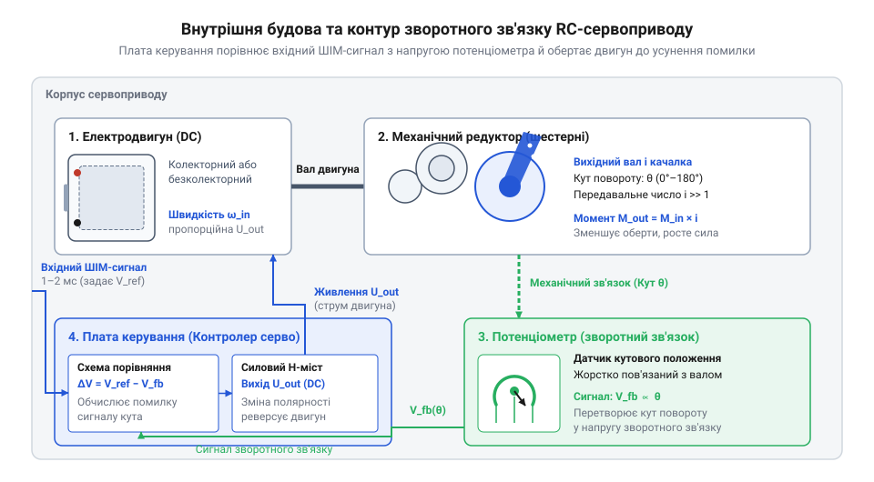
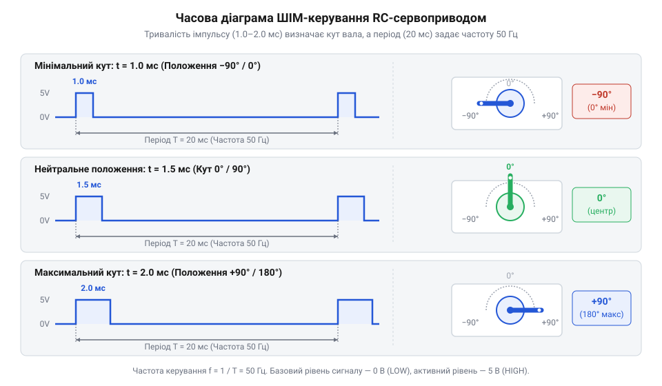
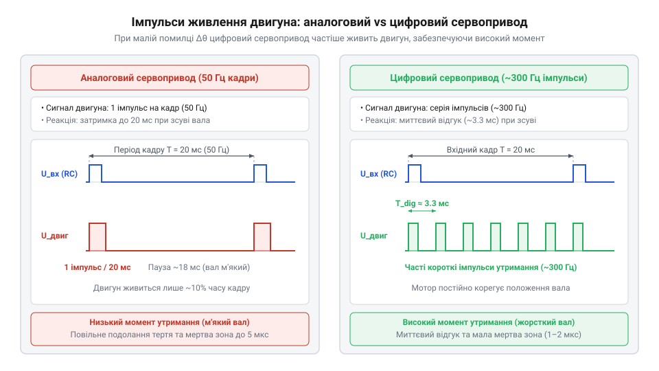
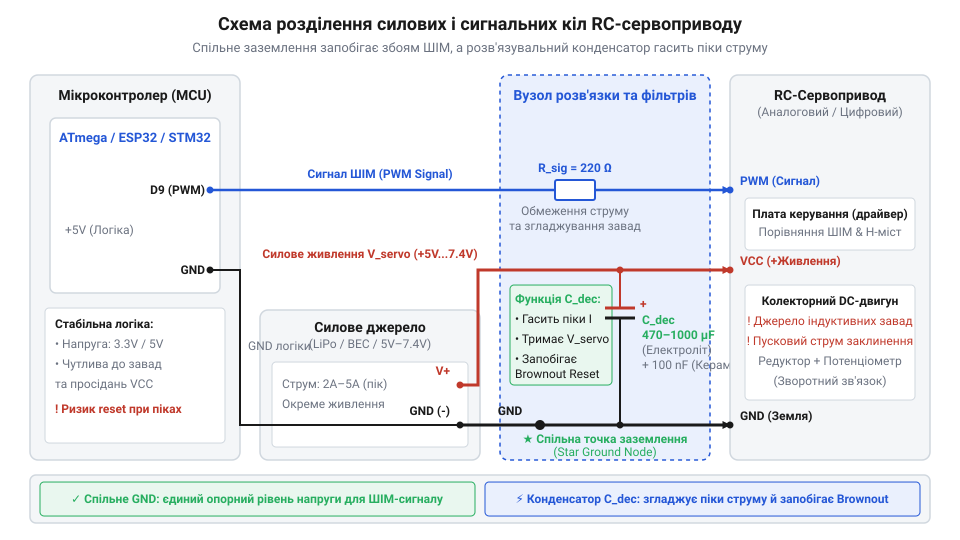

# Сервоприводи радіокерованих моделей: будова, редуктори та ШІМ-керування

## Проблема утримання кута під навантаженням

Кермо висоти авіамоделі під дією повітря зазнає змінного навантаження. Звичайний колекторний двигун у розімкненій системі керування (@@en|open-loop system@@) не має органів вимірювання кута: після вимкнення живлення зовнішнє зусилля легко провертає вал, оскільки двигун не створює відновильного моменту.

Для точного позиціонування необхідний сервомеханізм (від латинського *servus* — слуга та грецького *mechane* — пристрій) — замкнена система керування (@@en|closed-loop system@@). Вона постійно порівнює заданий кут із фактичним, обчислює сигнал помилки та подає струм на двигун для її компенсації. Цей принцип зворотного зв'язку утримує кут у сервоприводах радіокерованих моделей, як-от [мікросервопривід Tower Pro SG90](root:cat-hw-actuators/sg90-servo) чи пристрої [родини Power HD](root:cat-hw-actuators/powerhd-family).

## Будова сервоприводу та зворотний зв'язок

Двигун сервоприводу через редуктор (@@en|gearbox@@) обертає вал із [серво-рогами](root:cat-hw-actuators/servo-horns) і повзунок потенціометра (@@en|potentiometer@@), що знімає напругу зворотного зв'язку `V_fb`.


*Контур зворотного зв'язку сервоприводу.*

Плата порівнює `V_fb` із заданою `V_ref` і через @@en|H-bridge@@ подає струм для усунення різниці `ΔV = V_ref - V_fb`. Зона нечутливості (@@en|deadband@@) вимикає живлення при незначній `ΔV`, упереджуючи дрижання (@@en|dither@@) вала.

## Протокол широтно-імпульсного керування позицією

Для завдання кута вала мікроконтролер використовує протокол широтно-імпульсної модуляції (ШІМ, @@en|PWM@@). Сервопривод реагує не на коефіцієнт заповнення (@@en|duty cycle@@), а на абсолютну тривалість позиційного імпульсу в кадрі з періодом `T_frame = 20 мс` (50 Гц).


*Залежність кута повороту вала від тривалості імпульсу при періоді кадрів 20 мс.*

Тривалість імпульсу `t_pulse` становить від 1.0 мс (кут `θ = 0°`) до 2.0 мс (180°); нейтралі 90° відповідає 1.5 мс. Значення `t_pulse` для кута `θ` обчислюють так:

```
t_pulse = t_min + (θ ÷ θ_max) × (t_max - t_min)
        = 1.0 + (θ ÷ 180) × (2.0 - 1.0)        [підстановка граничних значень]
        = 1.0 + (θ ÷ 180)                      [вираз у мілісекундах]
```

Без керуючого сигналу плата не утримує вал під навантаженням. Для фіксації позиції мікроконтролер безперервно повторює кадри; помірні зміни їхньої частоти не впливають на кут.

## Відмінності аналогових і цифрових сервоприводів

Зовні сервоприводи однакові, але в аналогових моделях (як у [лінійці Tower Pro](root:cat-hw-actuators/sg90-mg90-micro-servos-family)) поштовхи йдуть на двигун з частотою 50 Гц. При малих відхиленнях цього замало для моменту утримання (@@en|holding torque@@).


*Імпульси живлення двигуна в аналоговому й цифровому сервоприводах.*

Цифровий мікроконтролер (@@en|microcontroller@@) керує @@en|H-bridge@@ із частотою 300–500 Гц. Частіші імпульси гарантують точність, але у [MG90S V2](root:cat-hw-actuators/mg90s-servo) це збільшує споживання та пікові сплески.

## Схемотехніка живлення та захист мікроконтролера

Під час підключення сервоприводів до мікроконтролера поширеною пасткою є спроба живити силові кола приводу напряму від 5-вольтової лінії керуючої плати. У момент пуску або механічного заклинювання ротора електродвигун споживає струм заклинювання (@@en|stall current@@), що у 5–10 разів перевищує струм холостого ходу (до 0.5–2 А у малопотужних моделях на кшталт [Power HD HD-1370A](root:cat-hw-actuators/hd-1370a-servo)). Цей піковий кидок струму разом із зворотною ЕРС індуктивних обмоток викликає глибоке просідання напруги (@@en|brownout@@), що призводить до спонтанного перезавантаження мікроконтролера.


*Схема підключення сервоприводу з розділеними лініями живлення, спільною точкою заземлення та фільтруючими конденсаторами.*

Для надійної роботи схемотехніка повинна мати жорстко розділені лінії живлення: мікроконтролер живиться від власного стабілізатора, а силовий дріт сервоприводу (@@en|VCC@@) — від окремого джерела струму. При цьому заземлюючі провідники (@@en|GND@@) обов'язково об'єднуються у спільній точці для створення єдиного опорного потенціалу сигнального імпульсу. Паралельно шині живлення сервоприводів встановлюють електролітичний розв'язувальний конденсатор (@@en|decoupling capacitor@@) ємністю 100–470 мкФ, який згладжує пульсації напруги та віддає заряд під час пікових кидків струму.

:::tabs
:::code rc-servo-mechanisms-and-control/c/esp-idf/init-servo-pwm.c
:::code rc-servo-mechanisms-and-control/cpp/arduino/setupservo.cpp
:::

Дотримання правил розділення живлення та фільтрації завад гарантує стабільну роботу мікроконтролера під навантаженням.