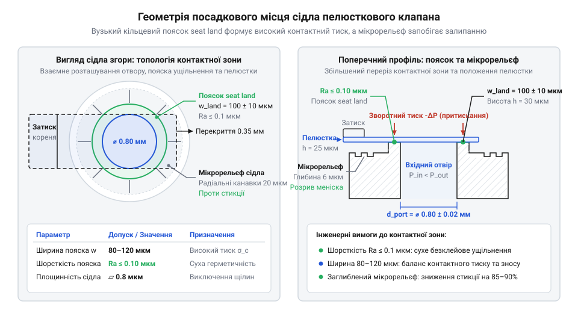
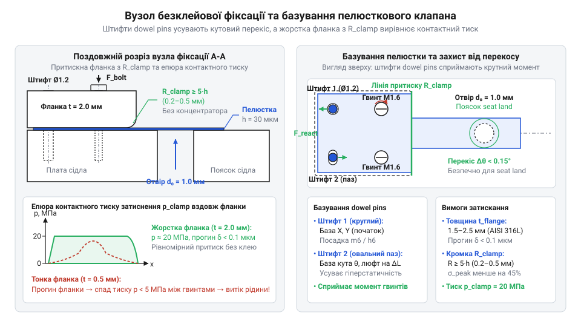
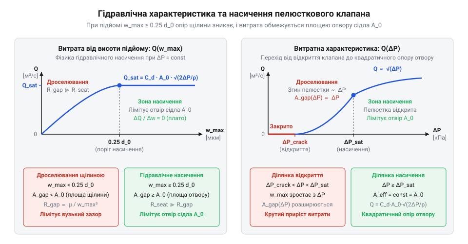

# Специфікація геометричного, гідравлічного та монтажного інтерфейсу пелюсткового мікроклапана

## Розгерметизація мікроклапана через помилки монтажу

Мікропомпа вібрує, але подачі немає: капілярні сили затягують клей у клапанну щілину (англ. @@en|valve gap@@, від англ. *gap* — щілина, зазор) між затвором і сідлом (англ. @@en|valve seat@@, від англ. *seat* — посадкове місце). Застиглий клей блокує пелюстку: зворотний потік (англ. @@en|backflow@@, від англ. *back* — назад, та *flow* — потік) нівелює нагнітання.

Точковий тиск гвинтів вигинає плату, перекошуючи сідло із зазором 0.5–1.0 мкм: пелюстка не перекриває вигин, і рідина витікає назад.

Без координатних баз затягування провертає корінь затвора. Зсув на 1–2° зміщує пелюстку: прохідний отвір (англ. @@en|orifice@@, від лат. *orificium* — отвір, гирло) відкривається або затвор зачіпає стінку камери.

## Геометрія сідла та пояска ущільнення

Надійна герметизація клапанного стику без застосування клею досягається точним проєктуванням контактної пари. Основу посадкового інтерфейсу становить поясок ущільнення (англ. @@en|seat land@@, від англ. *seat* — сідло, та *land* — контактна площадка), що концентрично охоплює центральний @@en|orifice@@ діаметром d_orifice. Ширина пояска w_land є розрахунковим компромісом між механічною міцністю матеріалу та контактною щільністю прилягання.


*Креслення контактної зони сідла визначає компроміс між герметизуючим контактним тиском на вузькому пояску та запобіганням капілярному залипанню пелюстки завдяки мікроструктурованому рельєфу.*

Якщо поясок спроєктовано занадто широким (w_land > 200 ... 250 мкм), контактна площа зростає, а питомий тиск від зворотного напору виявляється недостатнім для перекриття мікронерівностей. У рідині широка площадка провокує капілярне залипання (англ. @@en|stiction@@, від англ. *static* — статичний, та *friction* — тертя): меніск утримує пелюстку поверхневим натягом, блокуючи її відкриття під час нагнітання. Навпаки, вузький поясок (w_land < 30 ... 50 мкм) концентрує навантаження вище межі текучості: гостра кромка прорізає поліімід або деформує метал. Оптимальним є діапазон w_land = 60 ... 120 мкм.

До контактної площини сідла висувають вимоги щодо форми. Допуск площинності (англ. @@en|flatness tolerance@@, від англ. *flat* — плоский, та *tolerance* — допуск) для посадкового кільця не повинен перевищувати 0.2–0.5 мкм, інакше тонка пелюстка не компенсує хвилястість згином. Шорсткість поверхні (нім. @@de|Rauheit@@, від нім. *rauh* — нерівний) задають через середнє арифметичне відхилення профілю (англ. @@en|roughness average@@, позначуване Ra), яке має становити Ra ≤ 0.1 ... 0.2 мкм. 0.2 мкм. При Ra > 0.4 мкм зазори між мікровиступами утворюють мікроканали, крізь які рідина просочується назад.

Для усунення @@en|stiction@@ за межами пояска наносять мікрорельєф. Його виконують як лунки мікрорельєфу (англ. @@en|dimples@@, від англ. *dimple* — заглибинка) глибиною 0.5–1.0 мкм і діаметром 15–25 мкм, розташовані за 50–100 мкм від пояска. Рельєф розриває рідкий шар на краплі, знижуючи силу відриву пелюстки на 80–90% без порушення герметичності запірного кільця.

Контактну площу пояска ущільнення A_land визначають через діаметр отвору d_orifice та ширину пояска w_land як різницю площ зовнішнього та внутрішнього кіл.

**Розрахунок площі контакту пояска ущільнення для отвору діаметром 1.0 мм та ширини пояска 100 мкм:**
```
A_land
= π · w_land · (d_orifice + w_land)                      [площа кільцевого пояска через ширину та діаметр]
= 3.1416 · 0.1 мм · (1.0 мм + 0.1 мм)                    [підстановка d_orifice = 1.0 мм та w_land = 0.1 мм]
= 0.3456 мм²                                            [обчислення контактної площі]
```

Значення площі визначає питомий контактний тиск притискання затвора до сідла під дією зворотного перепаду тиску.

## Притискні фланки та безклейова фіксація

Для фіксації кореня затвора без клею використовують механічний затискач. Зусилля кріпильних гвинтів передає притискна фланка (англ. @@en|clamp flange@@, від англ. *clamp* — затискати, та старофр. *flanche* — боковина, край), яка розподіляє тиск уздовж лінії затиснення.


*Механічна безклейова фіксація базує пелюстку двома прецизійними штифтами, радіусна кромка усуває пік напружень у затисненні, а жорстка фланка рівномірно розподіляє тиск гвинтів.*

Недостатня жорсткість фланки викликає її вигин між гвинтами з падінням тиску та витоком крізь корінь клапана. Щоб усунути цей прогин, товщину фланки 	_flange обирають у межах 1.5–2.5 мм із нержавіючої сталі AISI 316L або титану, що забезпечує прогин площини менше 0.1 мкм.

Передню притискну кромку фланки, де починається вигин затвора, захищають від напружень. Гостра грань працює як концентратор напружень (англ. @@en|stress concentration@@, від лат. *concentratio* — зосередження), спричиняючи втомні мікротріщини при пульсаціях. Щоб виключити руйнування, кромку виготовляють із радіусним заокругленням R_clamp = 0.2 ... 0.5 мм за правилом R_clamp ≥ 5 · h, де h — товщина пелюстки. Плавний радіус знижує пікові напруження на 40–50%.

Позиціонування пелюстки, сідла та фланки забезпечують напрямні штифти (англ. @@en|dowel pins@@, від англ. *dowel* — чоповий стрижень, та *pin* — шпилька). Вузол базується на двох штифтах діаметром 1.0–1.5 мм із допуском m6 у платі та h6 на штифтах. У корені пелюстки виконують круглий отвір для координат центру та поздовжній овальний паз. Схема усуває надлишкові в'язі, компенсує теплове розширення та обмежує кутову похибку величиною менше 0.15°, сприймаючи момент від затягування гвинтів.

Герметичний стик без клею вимагає тиску p_clamp = 15 ... 25 МПа для полімерів (Kapton, PEEK) або 30 ... 50 МПа для металів. Момент затягування гвинтів T розраховують через повне зусилля F_total, площу контакту A_clamp, діаметр різьби d_thread та коефіцієнт тертя різьби k_torque.

**Розрахунок моменту затягування двох кріпильних гвинтів M1.6 для планки з контактною площею 20 мм² при тиску затиснення 20 МПа:**
```
F_total
= p_clamp · A_clamp                                      [загальне зусилля затискання]
= 20 × 10⁶ Па · 20 × 10⁻⁶ м²                             [підстановка тиску 20 МПа та площі 20 мм²]
= 400 Н                                                  [повна осьова сила]

F_bolt
= F_total / 2                                            [осьове зусилля на один із двох гвинтів]
= 200 Н                                                  [навантаження на гвинт]

T
= k_torque · d_thread · F_bolt                           [крутний момент різьбового з'єднання]
= 0.20 · 0.0016 м · 200 Н                                [коефіцієнт тертя 0.20 та діаметр M1.6]
= 0.064 Н·м                                              [обчислення моменту затягування]
```

Момент затягування T = 0.064 Н·м (64 мН·м) задають динамометричною викруткою, що гарантує збереження площинності сідла та надійну фіксацію затвора.

## Гідравлічні діапазони тиску й пропускність

Пропускну здатність клапанного вузла визначає узгодження механічного інтерфейсу з гідравлічними режимами. Робоче вікно клапана задають три параметри: початковий тиск відкриття, номінальний прямий перепад та граничне зворотне навантаження.

Початковий тиск відкриття (англ. @@en|cracking pressure@@, від англ. *crack* — тріскатися, відкриватися) P_crack — мінімальний прямий перепад тиску для подолання натягу пелюстки та капілярного зчеплення з сідлом. Для мікропомп значення P_crack оптимізують у межах 0.2–1.5 кПа: завищений поріг блокує сухе всмоктування, а занижений — викликає передчасне розмикання стику. Робочий діапазон прямих перепадів ΔP_fwd становить 5–30 кПа.

Гранично допустимий зворотний тиск (англ. @@en|maximum backpressure@@, від англ. *back* — назад, та *pressure* — тиск) P_back_max обмежує стійкість закритого клапана до зворотного навантаження без залишкової деформації чи руйнування. Під дією протитиску (типово 150–500 кПа для полімерів і до 1.5–2.0 МПа для сталей) пелюстка притискається до сідла і прогинається в отвір. При перевищенні P_back_max затвор продавлюється або зрізається на кромці. Для високих зворотних тисків в отвір сідла інтегрують захисні опорні перемички.

Гідравлічний опір (англ. @@en|hydraulic resistance@@, від лат. *resistere* — чинити опір) R_hyd = ΔP / Q утворюють циліндрична бічна щілина площею A_curtain та круглий отвір сідла площею A_orifice. Зі зростанням підйому краю пелюстки w_lift над сідлом діаметром d_orifice настає гідравлічне насичення (англ. @@en|hydraulic saturation@@, від лат. *saturatio* — насичення).

Насичення настає, коли площа бічної щілини зрівнюється з площею отвору:

```
A_curtain ≥ A_orifice
π · d_orifice · w_lift ≥ (π · d_orifice²) / 4
w_lift ≥ d_orifice / 4
```

Коли підйом затвора сягає чверті діаметра отвору (w_lift ≥ 0.25 · d_orifice), опір щілини зникає, а витрату лімітує виключно отвір сідла. Подальший підйом затвора лише подовжує час закриття та збільшує фазовий @@en|backflow@@. Для розрахунку прогину консолі застосовують [моделювання гідропружної взаємодії](root:cat-hw-actuators/reed-valves/math-reed-valve-hydrodynamics-and-bending.md).


*Графік залежності гідравлічної витрати від перепаду тиску та висоти підйому пелюстки демонструє перехід від дроселювання щілиною до гідравлічного насичення отвором сідла.*

Об'ємну витрату рідини Q у зоні насичення розраховують через площу отвору сідла A_orifice, перепад тиску ΔP, густину середовища ρ та коефіцієнт витрати C_d (типово 0.65–0.75 для отворів із плавними кромками).

**Розрахунок об'ємної витрати води у режимі гідравлічного насичення для отвору діаметром 1.0 мм під прямим перепадом тиску 10 кПа:**
```
A_orifice
= (π · d_orifice²) / 4                                   [площа круглого перерізу сідла]
= (3.1416 · (0.001 м)²) / 4                              [підстановка діаметра d_orifice = 1.0 мм]
= 7.854 × 10⁻⁷ м²                                        [обчислення площі отвору]

Q
= C_d · A_orifice · √(2 · ΔP / ρ)                        [витрата за формулою Торрічеллі з коефіцієнтом C_d = 0.70]
= 0.70 · 7.854 × 10⁻⁷ м² · √(2 · 10000 Па / 1000 кг/м³)   [підстановка перепаду 10 кПа та густини води 1000 кг/м³]
= 2.459 × 10⁻⁶ м³/с                                      [об'ємна витрата у системі SI]
= 147.5 мл/хв                                            [переведення у мілілітри за хвилину]
```

Отриманий результат задає теоретичну межу пропускної здатності порту при повному розкритті.

## Штуцерні порти та узгодження мікроканалів

Інтеграція клапанного блока у мікрофлюїдний контур вимагає узгодження портів із магістралями та внутрішніми каналами плати через стандартизовані типи штуцерних інтерфейсів.

Для гнучких трубок із силікону чи Tygon внутрішнім діаметром 0.8–2.0 мм застосовують ялинковий штуцер (англ. @@en|barbed fitting@@, від англ. *barb* — зазублина, та *fitting* — з'єднувач). Конічні зазублини з кутом 15–30° пружно розширюють трубку, а зворотний уступ заклинює еластомер під тиском, утримуючи напір до 200–300 кПа без хомутів.

Для лабораторного підключення шприців і капілярів використовують конічний порт Люера (англ. @@en|Luer taper@@, від імені німецького майстра медичних інструментів Германа Вюльфінга-Люера, нім. @@de|Lüer@@, та англ. *taper* — конусність) за стандартом ISO 80369-7 з конусністю 6%. Інтерфейс виготовляють у варіантах Luer-Slip для низьконапірної комутації та нарізному Luer-Lock із зовнішньою гільзою, що витримує тиск до 400–600 кПа без зриву.

Для жорстких капілярів діаметром 1/16 дюйма (1.59 мм) із PEEK або PTFE у високонапірних контурах застосовують порти 1/4-28 UNF або 10-32 Coned із конічними втулками (англ. @@en|ferrule fittings@@, від лат. *viriola* — кільце, обруч, та англ. *fitting* — з'єднувач), які тримають тиск до 2–5 МПа з нульовим мертвим простором.

Геометричне узгодження мікроканалів з отвором сідла вимагає плавного переходу перерізів. Раптовий перепад спричиняє відрив потоку та підвищений опір із коефіцієнтом втрат ζ = 0.5 ... 1.0. Канали профілюють у вигляді конічних конфузорів і дифузорів із кутом розкриття 7–12°, зберігаючи ламінарний рух.

Критичною вимогою є мінімізація параметра мертвий об'єм (англ. @@en|dead volume@@, від англ. *dead* — мертвий, та *volume* — об'єм) клапанної камери. Ступінь стиснення камери дорівнює ε = ΔV_stroke / V_dead, де ΔV_stroke — циклічний витиск, а V_dead — сумарний паразитичний об'єм камери й каналів. Завеликі пазухи під фланкою різко знижують ступінь стиснення. При потраплянні повітря виникає вловлювання бульбашок (англ. @@en|bubble trapping@@, від англ. *bubble* — бульбашка, та *trap* — пастка): газова порожнина пружно стискається на місці, тиск не досягає порогу P_crack, і помпа втрачає сухе всмоктування. Запобігають цьому планарним монтажем сідла у стінку камери та застосуванням [захисту від газових пробок](root:cat-hw-actuators/microfluidic-bubble-trapping-and-priming) у контурі. Конструкцію монолітної плати без паразитних об'ємів наведено у [проєктуванні мікрофлюїдної плати](root:cat-hw-actuators/reed-valves/proj-reed-valve-microfluidic-plate-design.md).