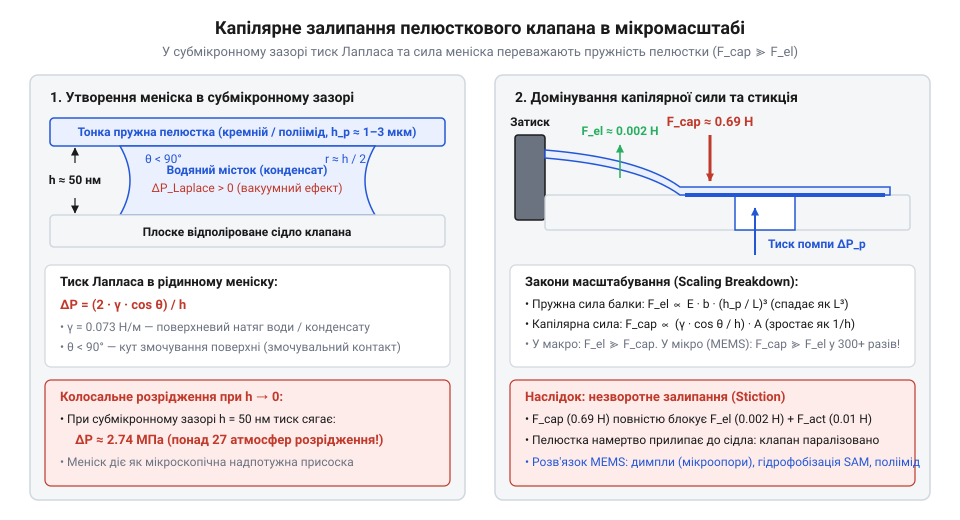
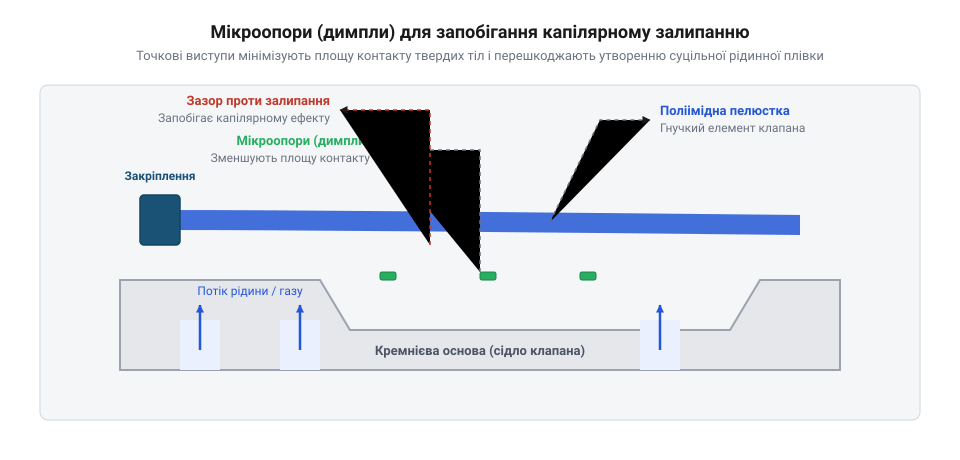

# Еволюція пелюсткових клапанів: від промислових компресорів і двотактних двигунів до мікрофлюїдики та MEMS

## Інерційний глухий кут масивних затворів

На початку XX століття компресори та двотактні двигуни вперлися в межу швидкодії: при високих обертах тарілчасті клапани (@@en|poppet valve@@, від англ. *poppet* — грибоподібний затвор на ніжці, та *valve* — клапан) мали надмірну масу `m`.

Силу інерції рухомого затвора `F` через його масу `m` та прискорення `a` задає другий закон Ньютона:

```
F = m · a
```

Через інерцію важкий затвор запізнювався на сідло в мертвій точці, спричиняючи зворотний витік (@@en|backflow@@, від англ. *back* — назад, та *flow* — потік) газу в колектор і падіння коефіцієнта корисної дії.

У 1895 році австрійський інженер Ганс Гьорбігер (@@de|Hanns Hörbiger@@) запропонував вільні сталеві пластини, започаткувавши пелюстковий клапан (@@en|reed valve@@, від англ. *reed* — очеретина або язичок музичного інструмента, та *valve* — клапан). Замість кулачкового механізму [газообміну двотактного двигуна](root:cat-hw-actuators/two-stroke-intake-gas-dynamics) канал перекрила автономна смужка зі шведської пружинної сталі (@@en|spring steel@@).

Вузол містив сідло, пластину товщиною `0.15–0.4 мм` та дугоподібний обмежувач підйому (@@en|valve stop@@, від англ. *valve* — клапан, та *stop* — упор чи обмежувач) проти втоми сталі. Перепад тиску відгинав пелюстку до упору, а пружність герметизувала канал до реверсу потоку.

Мала маса дала власну частоту в сотні герц і ресурс на сотні мільйонів циклів. У макромасштабі сили тиску легко долали жорсткість сталі, зробивши клапан промисловим стандартом XX століття.

## Криза масштабування та капілярне залипання

Наприкінці 1980-х років розвиток систем «лабораторія на чипі» (@@en|Lab-on-a-Chip@@, від англ. *laboratory on a chip* — лабораторія на кристалі) зажадав мікропомп для дозування нанолітрових об'ємів рідини. Розробники перших мікроелектромеханічних систем (@@en|MEMS@@, від англ. *Micro-Electro-Mechanical Systems*) спробували скористатися перевіреним досвідом: пропорційно зменшити сталеві пелюстки до кількох сотень мікрометрів. Проте клапани або не відкривалися приводом, або намертво блокувалися на сідлі після першого контакту.

Перша фізична межа виникла через закон масштабування жорсткості. Визначимо згинальну жорсткість консольної балки (@@en|cantilever@@, від англ. *cantilever* — затиснена на одному кінці балка) прямокутного перерізу `k` через модуль Юнга (@@en|Young's modulus@@) матеріалу `E`, ширину `w`, довжину `L` та товщину `t`:

```
k = (E · w · t³) / (4 · L³)
```

Кубічна залежність від довжини `L` та модуль сталі `E ≈ 210 ГПа` роблять навіть фольгу товщиною 10–20 мкм надмірно жорсткою. Інтегровані приводи, якими оснащуються [п'єзоелектричні мікропомпи](root:cat-hw-actuators/piezoelectric-micropump-actuation), створюють перепад лише в кілька кілопаскалів, тоді як для прогину сталевої мікропелюстки на один мікрометр потрібні сотні кілопаскалів.

Другою перепоною став фундаментальний зсув балансу сил. У макросвіті поведінкою механізмів керують об'ємні сили інерції, пропорційні кубу лінійного розміру `L³`. У мікромасштабі питоме відношення поверхні до об'єму стрімко зростає: об'ємна інерція практично зникає, а сили поверхневого натягу (`L¹`) та молекулярного зчеплення (`L²`) стають визначальними.

Рідина в протоці або конденсат вологого повітря формують між плоскою пелюсткою та сідлом капілярний місток. Викривлена поверхня меніска породжує катастрофічне капілярне залипання — стикцію (@@en|stiction@@, від англ. *static friction* — статичне тертя, поверхневе злипання тіл при безпосередньому контакті).

Знайдемо від'ємний капілярний тиск Лапласа (@@en|Laplace pressure@@) `P_cap` усередині рідинного меніска через коефіцієнт поверхневого натягу рідини `γ`, кут змочування поверхні `θ` та висоту зазору `h`:

```
P_cap = (2 · γ · cos(θ)) / h
```

Зменшення зазору `h` обернено пропорційно збільшує тиск Лапласа: у субмікронному проміжку утворюється сильне розрідження, яке притискає пелюстку до сідла.

**Розрахунок капілярної сили для мікропелюстки на водяній плівці:**
Обчислимо силу капілярного притискання `F_cap` для пелюстки площею `A = 0.5 мм × 0.5 мм = 2.5 × 10⁻⁷ м²` при зазорі `h = 50 нм = 50 × 10⁻⁹ м` для води (`γ = 0.0728 Н/м`) та сталі з кутом контакту `θ = 20°`:

```
F_cap = P_cap · A
      = ((2 · γ · cos(θ)) / h) · A                [тиск Лапласа, помножений на площу контакту]
      = ((2 · 0.0728 · cos(20°)) / (50 × 10⁻⁹)) · (2.5 × 10⁻⁷)   [підстановка числових значень величин]
      ≈ 2.74 × 10⁶ · 2.5 × 10⁻⁷                   [капілярний тиск у паскалях]
      ≈ 0.685 Н                                   [результуюча сила притискання]
```

Зусилля `0.685 Н` відповідає питомому тиску притискання `2.74 МПа` — понад 27 атмосфер. Сила притискання у сотні разів перевищила максимальне зусилля мікропривода, намертво блокуючи затвор.

Дзеркальне полірування сідла — канон макроінженерії — у мікрофлюїдиці стало головною пасткою. Ідеально гладкі поверхні мінімізували зазор `h` і максимізували площу контакту `A`. До капілярних менісків додавалися сили Ван дер Ваальса (@@en|van der Waals forces@@, міжмолекулярні сили притягання на нанометрових дистанціях), унеможливлюючи роботу клапана без зміни самої конструктивної парадигми.


*Формування викривленого меніска в субмікронному рідинному проміжку породжує гігантський від'ємний тиск Лапласа, який незворотно притискає пелюстку до сідла та блокує роботу мікроклапана.*

## Матеріальна революція кремнію та полімерів

Подолання кризи вимагало відмови від металу й переходу до планарних напівпровідникових технологій. Піоніри мікросистемної техніки — Гаральд ван Лінтел (@@en|Harald van Lintel@@) у 1988 році у Федеральній політехнічній школі Лозанни та Ян Смітс (@@en|Jan Smits@@) у 1990 році — запропонували формувати пелюсткові клапани безпосередньо з монокристалічного кремнію (@@en|single-crystal silicon@@) за допомогою фотолітографії та рідинного травлення в гідроксиді калію (@@en|KOH@@).

Кремній надав унікальні механічні переваги: у монокристалічній решітці відсутні міжзеренні границі та дислокаційне повзання, що усуває механічну втому й гістерезис аж до межі пружного руйнування. Проте його модуль пружності `E ≈ 130–169 ГПа` залишався завеликим для низьконапірних систем. Щоб зробити кремнієвий затвор податливим, його товщину доводилося зменшувати до кількох мікрометрів. Технологічним проривом стало впровадження процесу [глибокого реактивно-іонного травлення](root:cat-hw-actuators/mems-deep-reactive-ion-etching) (@@en|DRIE@@, від англ. *Deep Reactive-Ion Etching*): він дозволив протравлювати кремнієві пластини на всю товщину з майже ідеально вертикальними стінками, формуючи мікроконсолі складної форми з субмікронною точністю.

Радикальне зниження жорсткості відбулося з переходом до конструкційних полімерів. Дослідники звернулися до полііміду (@@en|polyimide@@), чий модуль пружності становить лише `E ≈ 3–5 ГПа` — у 40–50 разів нижче за сталь. Поліімідні плівки товщиною `1–3 мкм` формували центрифугуванням рідкого лаку з подальшим термічним запіканням. Клапани з такого матеріалу відкривалися за перепаду тиску менше 100 Па, витримуючи мільйони циклів вигину без розтріскування.

Для біологічних мікрофлюїдних пристроїв наприкінці 1990-х років група Джорджа Вайтсайдса (@@en|George M. Whitesides@@) у Гарвардському університеті впровадила полідиметилсилоксан (@@en|PDMS@@, від англ. *polydimethylsiloxane*). Володіючи крихітним модулем пружності `E ≈ 1–3 МПа`, затвори з @@en|PDMS@@ відхилялися навіть під дією слабких осмотичних потоків і забезпечували надійну герметичність сідла завдяки високій конформності еластомеру.

Однак заміна матеріалу не знімала загрози капілярної стикції. Щоб розірвати рідкий меніск, інженери змінили мікрогеометрію зони посадки затвора:
- Точкові мікроопори — димпли (@@en|dimple@@, від англ. *dimple* — ямочка або виступ). Масив виступів заввишки `0.2–0.5 мкм` на контактній поверхні скоротив площу контакту на 98%, що пропорційно знизило капілярну силу притискання. - Текстурування сідла концентричними кільцевими кромками: тонкі гребені навколо отвору перешкоджають утворенню суцільної рідинної плівки. - Гідрофобізація самовпорядкованими моношарами (@@en|SAM@@, від англ. *Self-Assembled Monolayer* — самовпорядкований молекулярний моношар). Нанесення фторованих силанових покриттів збільшує кут змочування до `θ > 105°`. За умови `θ > 90°` капілярний тиск Лапласа змінює знак і виштовхує пелюстку від сідла замість присмоктування.


*Конструкція мікроклапана з поліімідним затвором та інтегрованими в кремнієве сідло димплами мінімізує площу контакту і запобігає капілярному залипанню.*

Матеріальні та геометричні модифікації встановили нові критерії вибору затворів:
- Для високочастотних газових мікросистем стандартом залишається кремній або жорсткий поліімід із димплами та покриттям @@en|SAM@@. - Для рідинних чипів оптимальними є тонкі плівки з полііміду чи @@en|PDMS@@ на кільцевих сідлах, які відсікають зворотний потік без високого гідравлічного опору.

## Перехід від емпірики до FSI-моделювання

У макроскопічній інженерії клапан добирали емпірично: сталеві пластини вирізали та підганяли за день. У @@en|MEMS@@ метод проб і помилок зайшов у глухий кут: через крихкість кремнію ручне підганяння неможливе, а кожна зміна геометрії вимагала нового фотошаблона (@@en|photomask@@, від грец. *photos* — світло, та фр. *masque* — захисний трафарет) і місяців дорогого чистокімнатного виготовлення.

Виготовлені навмання клапани в рідині поводилися непередбачувано: статичний розрахунок прогину не враховував динаміки течії. Перепад тиску деформує тонку пластину, а її рух змінює поле течії в каналі. Цей зв'язаний процес змусив перейти до розрахунку взаємодії потоку та пружної конструкції (@@en|fluid-structure interaction@@, від англ. *fluid* — плинне середовище, *structure* — пружна конструкція, та *interaction* — взаємодія; скорочено @@en|FSI@@).

Головною динамічною перепоною стала приєднана гідродинамічна маса (@@en|hydrodynamic added mass@@, від грец. *hydro* — вода, *dynamis* — сила, та англ. *added mass* — додана маса): рухаючись у воді, мікропелюстка змушена розганяти прилеглий шар рідини, чия маса в десятки разів перевищує масу самої пластини.

Визначимо власну частоту коливань пелюстки в рідині `f_fluid` через резонансну частоту у вакуумі `f_vac`, масу пластини `m_reed` та приєднану гідродинамічну масу рідини `m_add`:

```
f_fluid = f_vac / √(1 + (m_add / m_reed))
```

Шар рідини діє як важкий інерційний баласт: для приєднаної маси, що перевищує масу кремнієвої пелюстки у 50 разів, власна частота падає більше ніж у сім разів, позбавляючи клапан швидкодії.

Рух затвора додатково гальмує @@en|squeeze-film damping@@: витискання рідинної плівки з мікрощілини біля сідла описує [рівняння змащування Рейнольдса](root:cat-hw-actuators/squeeze-film-damping-microstructures). Разом із @@en|hydrodynamic added mass@@ воно породжує фазову затримку (@@en|phase lag@@, від англ. *phase* — фаза, та *lag* — запізнення): запізніла посадка затвора під зворотним перепадом тиску призводить до @@en|backflow@@, зводячи об'ємну подачу помпи нанівець.

Наприкінці 1990-х років групи Роланда Ценгерле (@@de|Roland Zengerle@@) та Мартіна Ріхтера (@@de|Martin Richter@@) подолали кризу впровадженням [чисельного FSI-моделювання](root:cat-hw-actuators/fluid-structure-interaction-mems). Зв'язані розрахунки обчислювальної гідродинаміки (@@en|computational fluid dynamics@@, скорочено @@en|CFD@@) та методу скінченних елементів (@@en|finite element method@@, скорочено @@en|FEM@@) на деформівних сітках дозволили прогнозувати рух затвора й усунути @@en|backflow@@ оптимізацією форми пелюстки та перфораціями ще до виготовлення першого @@en|photomask@@.

## Спростування міфів проєктування мікроскопічних клапанів

Спроби прямого переносу макроскопічного досвіду в мікрофлюїдику породили три інженерні міфи, подолання яких сформувало сучасні правила конструювання.

Першим міфом була впевненість у працездатності мікроклапана шляхом простого масштабування макроскопічних прототипів. Розробники припускали, що зменшена у сто разів металева пелюстка збереже звичну динаміку. Проте в мікромасштабі інерційні сили спадають як куб розміру, тиск привода — як квадрат, а сили поверхневого натягу менісків — лише як перший степінь лінії змочування. У субміліметрових каналах молекулярні сили переважають пружність на порядки, тому зменшена копія макроклапана виявляється надмірно жорсткою для мікроприводів і намертво блокується стикцією (@@en|stiction@@, від англ. *static friction* — статичне злипання при контакті).

Другим міфом стала вимога дзеркального полірування сідла нібито задля зменшення адгезії. Якщо в макромашинобудуванні притирання гарантує герметичність, то в мікромасштабі дзеркальна гладкість максимізує фактичну площу контакту й мінімізує товщину зазору. За формулою тиску Лапласа (@@en|Laplace pressure@@), стягування нанометрового рідинного меніска породжує вакуумний тиск притискання в десятки атмосфер. На дистанціях менше десяти нанометрів виникають сили Ван дер Ваальса (@@en|van der Waals forces@@, міжмолекулярні сили притягання), спричиняючи пряме атомне схоплювання. Через це в мікроклапанах відмовилися від дзеркальних сідел на користь димплів (@@en|dimple@@, від англ. *dimple* — точковий виступ), які скорочують площу контакту на 98% і розривають рідинний меніск.

Третім міфом було упередження про нездатність пасивних пелюсток до сухого самовсмоктування та прокачування біосуспензій порівняно з безклапанними помпами. У 1993 році Ерік Стемме (@@en|Erik Stemme@@) запропонував конструкцію [безклапанних мікропомп](root:cat-hw-actuators/valveless-diffuser-micropumps) (@@en|valveless micropump@@, від англ. *valveless* — безклапанний, та *micropump* — мікропомпа) із соплами-дифузорами (@@en|nozzle-diffuser@@, від англ. *nozzle* — звужувальне сопло, та *diffuser* — розширювальний канал), де потік спрямовується без рухомих деталей завдяки різниці гідравлічного опору. Вважалося, що пелюстка нездатна до сухого самовсмоктування (@@en|self-priming@@, від англ. *self* — само, та *priming* — первинне заповнення тракту), бо без рідини затвор нібито не створить компресії.

Практика довела протилежне: при прокачуванні газу рідинний меніск відсутній, тому капілярна @@en|stiction@@ не діє. Завдяки малій масі кремнію чи полііміду пелюстка коливається в повітрі на частотах у кілогерци й створює високу компресію в камері, легко засмоктуючи рідину з резервуара. Натомість сопла-дифузори в газі втрачають спрямованість через низькі числа Рейнольдса і не здатні до сухого старту без попереднього заливання системи.

Так само розвіявся міф про забивання пелюсток клітинами крові. У безклапанних помпах рідина розганяється у вузькому соплі, викликаючи високі [зсувні напруження потоку](root:cat-hw-actuators/microfluidic-shear-stress-cell-viability) (@@en|shear stress@@, від англ. *shear* — зсув, та *stress* — механічне напруження), які призводять до гемолізу (@@en|hemolysis@@, від грец. *haima* — кров, та *lysis* — розчинення) еритроцитів. Пасивний затвор із зазором у 10–20 мікрометрів працює в ламінарному потоці й пропускає клітини без пошкоджень.

Межі застосовності пелюсток сьогодні чіткі: вони незамінні в мікродозаторах і медичних помпах, де потрібні високий вихідний тиск, відсутність @@en|backflow@@ та енергонезалежність затвора. Межею їхньої роботи є лише середовища надвисокої в'язкості, де @@en|squeeze-film damping@@ паралізує рух пластини, та суспензії з великими абразивними частками, що блокують закриття затвора.