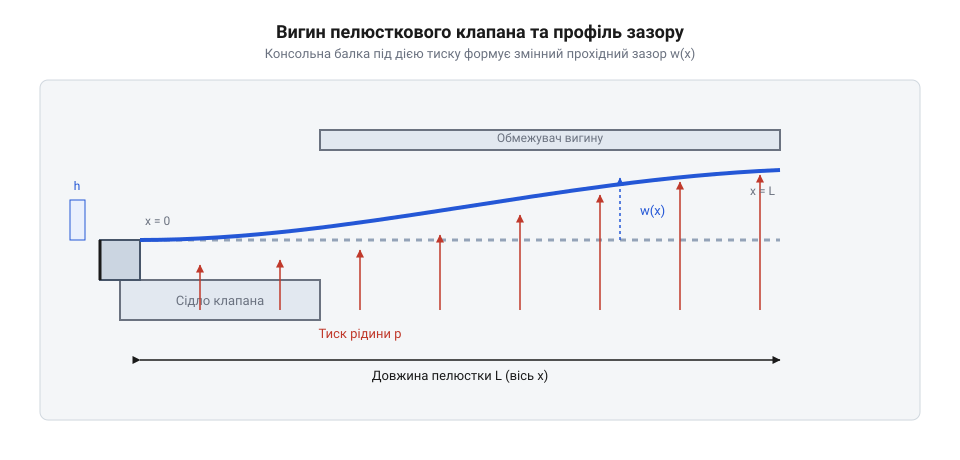
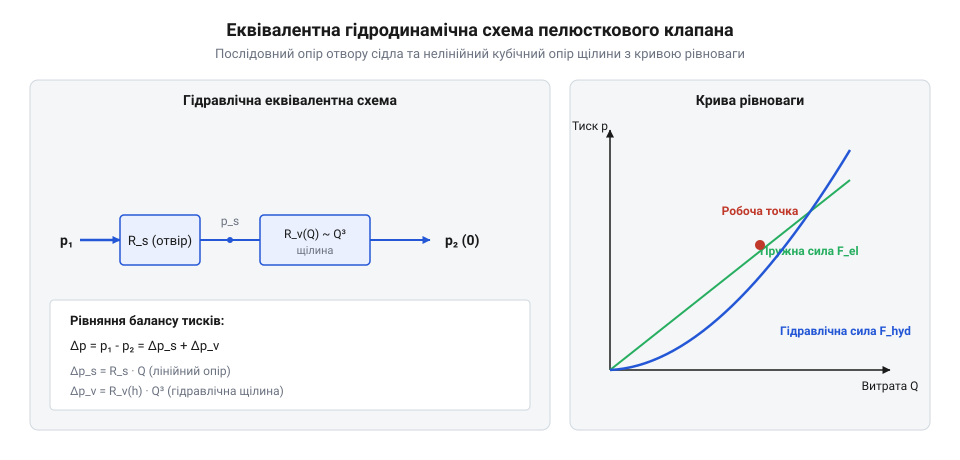
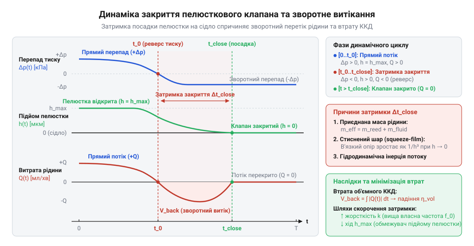

# Гідромеханічне та пружно-динамічне моделювання пелюсткового мікроклапана

## Конфлікт чутливості та швидкодії мікроклапана

Спроба інтуїтивно дібрати товщину затвора мікропомпи (@@en|micropump@@) зупиняє перекачування. Скеровувати потік має пелюстковий клапан (@@en|reed valve@@): під час розширення він відхиляється, а під час стиснення — сідає на сідло.

Тонка пелюстка має мізерний тиск відкриття (@@en|cracking pressure@@) — лічені паскалі. Проте слабка пружність повільно долає в'язкий опір: запізніле закриття спричиняє зворотний витік (@@en|backflow@@), що обвалює об'ємний коефіцієнт корисної дії мікропомп (@@en|volumetric efficiency@@). Жорстка пластина відсікає @@en|backflow@@, але приводи діафрагмових мікропомп не здатні її зігнути, а мікронерівності сідла порушують герметизацію (@@en|sealing@@).

Виникає суперечність між пропускною здатністю, швидкодією та @@en|sealing@@, яка вимагає зв'язаного розрахунку.

## Пружний вигин пелюстки та тиск відкриття

Розрахунок робочого зазору мікроклапана спирається на узгодження пружної жорсткості затвора з робочим перепадом тиску в рідині. У мікрогідравліці пелюстку моделюють як консольну балку (@@en|cantilever beam@@), яка одним краєм жорстко затиснена в корпусі, а вільним кінцем перекриває отвір сідла (@@en|valve seat@@). Гідростатичний перепад тиску між камерою та каналом діє на поверхню пелюстки як розподілене навантаження, змушуючи її відгинатися у бік меншого тиску.

Аналітичний опис деформації виконують за лінійною моделлю вигину балок Бернуллі–Ейлера (@@fr|Bernoulli@@–@@de|Euler@@). Якщо ширина пелюстки `b` перевищує її товщину `h`, опір згину підпорядковується законам [теорії згину тонких пластин](root:cat-hw-actuators/reed-valves/math-reed-valve-hydrodynamics-and-bending.md). Замість добутку модуля Юнга (@@en|Young's modulus@@) `E` на осьовий момент інерції перерізу `I = (b · h³) / 12` застосовують циліндричну жорсткість пластини (@@en|flexural rigidity@@) `D`.

Знайдемо циліндричну жорсткість пластини `D` через модуль Юнга `E`, товщину пластини `h` та коефіцієнт Пуассона (@@fr|Poisson's ratio@@) `ν`:

```
D = (E · h³) / (12 · (1 - ν²))
```

Під дією рівномірного перепаду тиску `ΔP` на одиницю довжини пластини шириною `b` діє поперечне зусилля `q = ΔP · b`. Для консолі довжиною `L` з жорстким затисненням при `x = 0` та вільним кінцем при `x = L` просторовий профіль відхилення визначається інтегруванням рівняння згину.

Знайдемо просторовий розподіл прогину `w(x)` консольної пелюстки вздовж координати `x` під дією перепаду тиску `ΔP`:

```
w(x) = (ΔP · x²) / (24 · D) · (6 · L² - 4 · L · x + x²)
```

Найбільший прогин досягається на вільному краю пелюстки при `x = L`. Підставимо координату вільного кінця `x = L` у вираз профілю для знаходження максимального підйому затвора `w_max`:

```
w_max = (ΔP · L⁴) / (8 · D)
      = (3 · ΔP · L⁴ · (1 - ν²)) / (2 · E · h³)    [підстановка циліндричної жорсткості D]
```

Отриманий вираз демонструє кубічну чутливість до товщини `h³` та пропорційність четвертому степеню довжини `L⁴`.

Геометричні розміри консолі, характер навантаження тиском та форму утвореного змінного зазору між пелюсткою і посадковим пояском сідла наведено на розрахунковій схемі.


*Схема пружної деформації консольної пластини під дією тиску середовища та профіль змінного зазору над посадковим пояском сідла.*

Якщо конструкція клапана зібрана з попереднім натягом, відхилення починається лише тоді, коли гідростатична сила на площі отвору сідла `A_seat = (π · d_seat²) / 4` подолає зусилля затиску. Початковий тиск відкриття `P_crack` знаходять із рівняння рівноваги сил:

```
P_crack = F_pre / A_seat
        = (4 · F_pre) / (π · d_seat²)              [підстановка площі круглого сідла через діаметр d_seat]
```

**Розрахунок статичного прогину консольної пелюстки з монокристалічного кремнію під робочим перепадом тиску**

Вихідні параметри кремнієвого мікроклапана: вільна довжина консолі `L = 2.0 mm = 2.0 · 10⁻³ m`, ширина `b = 0.8 mm = 0.8 · 10⁻³ m`, товщина пластини `h = 15 μm = 1.5 · 10⁻⁵ m`. Матеріал пелюстки — монокристалічний кремній (@@en|single-crystal silicon@@) із модулем Юнга `E = 169 GPa = 1.69 · 10¹¹ Pa` та коефіцієнтом Пуассона `ν = 0.28`. Робочий статичний перепад тиску становить `ΔP = 2000 Pa`. Обчислимо покроково циліндричну жорсткість консолі та величину максимального підйому вільного кінця:

```
D = (1.69 · 10¹¹ · (1.5 · 10⁻⁵)³) / (12 · (1 - 0.28²))
  = (1.69 · 10¹¹ · 3.375 · 10⁻¹⁵) / (12 · 0.9216)      [піднесення товщини h до куба та обчислення знаменника]
  = (5.70375 · 10⁻⁴) / 11.0592
  = 5.1575 · 10⁻⁵ N·m                                  [циліндрична жорсткість кремнієвої консолі]

w_max = (2000 · (2.0 · 10⁻³)⁴) / (8 · 5.1575 · 10⁻⁵)
      = (2000 · 1.6 · 10⁻¹¹) / (4.126 · 10⁻⁴)          [обчислення L⁴ та знаменника]
      = (3.2 · 10⁻⁸) / (4.126 · 10⁻⁴)
      = 7.756 · 10⁻⁵ m ≈ 77.6 μm                       [максимальний прогин вільного краю пелюстки]
```

Розрахований прогин `77.6 μm` відповідає `3.9%` від повної довжини консолі `2.0 mm`, що задовольняє критерій малих деформацій балок Ейлера–Бернуллі (`w_max / L < 0.05`).


*Еквівалентна гідродинамічна схема клапана та крива гідромеханічної рівноваги, що ілюструють співвідношення опорів.*

## Гідравлічний опір та об'ємна витрата

Підйом вільного кінця пелюстки над контактним пояском сідла формує гідравлічний тракт із послідовними зонами гідродинамічних втрат: дросельним отвором у площині сідла та радіальною щілиною під пластиною. Течія крізь отвір діаметром `d_seat` та площею `A_seat = (π · d_seat²) / 4` супроводжується інерційним звуженням струменя. Знайдемо об'ємну витрату `Q` крізь отвір через перепад тиску на сідлі `ΔP_seat`, густину рідини `ρ` та коефіцієнт витрати `C_d`:

```
Q = C_d · A_seat · √( (2 · ΔP_seat) / ρ )
```

Коефіцієнт `C_d ≈ 0.60..0.65` інтегрує втрати на вхідних кромках. Після виходу з отвору потік розтікається у радіальну щілину завдовжки `L_seal` і периметром `P_perim = π · d_seat`. Через мікроскопічну висоту зазору `w` число Рейнольдса становить `Re << 100`, що відповідає ламінарній течії (див. [гідравлічним опором мікроканалів](root:cat-hw-actuators/reed-valves/proj-reed-valve-test-bench-dynamics.md)). 

За законом Пуазейля втрати тиску в щілині `ΔP_gap` залежать від динамічної в'язкості `μ`, геометрії та витрати `Q`:

```
ΔP_gap = (12 · μ · L_seal · Q) / (P_perim · w³)
```

Виразимо гідравлічний опір щілини `R_gap`:

```
R_gap = ΔP_gap / Q
      = (12 · μ · L_seal) / (P_perim · w³)
```

Обернена кубічна залежність `R_gap ∝ 1 / w³` робить щілину головним дроселем на початковому етапі відкриття, коли `w` вимірюється мікрометрами. Зі збільшенням тиску пластина вигинається, опір щілини падає, і визначальним стає опір отвору сідла. Стан рівноваги, за якого сила тиску врівноважується пружною реакцією консолі, визначає гідромеханічну рівновагу. 

Введемо еквівалентну жорсткість `k_valve = ΔP / w`. Підставивши рівноважний зазор у закон Пуазейля, знайдемо вираз для об'ємної витрати:

```
Q = (P_perim · w³ · ΔP) / (12 · μ · L_seal)
  = (P_perim · (ΔP / k_valve)³ · ΔP) / (12 · μ · L_seal)    [підстановка виразу рівноважного прогину]
  = (P_perim · ΔP⁴) / (12 · μ · L_seal · k_valve³)          [об'єднання степенів перепаду тиску]
```

За малих відкриттів витрата зростає пропорційно четвертому степеню тиску `Q ∝ ΔP⁴`, забезпечуючи високу чутливість, а при великих зазорах виположується до кореневої залежності.

**Розрахунок гідравлічного опору щілини та об'ємної витрати води у точці гідромеханічної рівноваги**

Параметри розрахунку: вода за 20 °C (`μ = 1.002 · 10⁻³ Pa·s`, `ρ = 998 kg/m³`), `d_seat = 5.0 · 10⁻⁴ m`, `P_perim ≈ 1.571 · 10⁻³ m`, `L_seal = 5.0 · 10⁻⁵ m`, `ΔP_gap = 1500 Pa`, `w = 2.0 · 10⁻⁵ m`.

```
w³ = (2.0 · 10⁻⁵)³
   = 8.0 · 10⁻¹⁵ m³                                      [обчислення куба прохідного зазору]

R_gap = (12 · 1.002 · 10⁻³ · 5.0 · 10⁻⁵) / (1.571 · 10⁻³ · 8.0 · 10⁻¹⁵)
      = (6.012 · 10⁻⁷) / (1.2568 · 10⁻¹⁷)                 [перемноження чисельника та знаменника]
      = 4.7836 · 10¹⁰ Pa·s/m³                             [гідравлічний опір кільцевої щілини]

Q = 1500 / (4.7836 · 10¹⁰)
   = 3.1357 · 10⁻⁸ m³/s                                   [об'ємна витрата рідини крізь щілину]
```

Отримана витрата становить `31.36 μL/s ≈ 1.88 mL/min`. Зменшення зазору вдвічі збільшує опір у 8 разів і суттєво знижує продуктивність пристрою.

## Власні коливання та гідродинамічне демпфування

Розрахунок власної частоти пружної пластини в повітрі показує значення в кілька кілогерців, проте після заповнення робочої камери водою або біологічним розчином реакція затвора різко сповільнюється: пелюстка не встигає відстежувати високочастотні пульсації тиску. Причина полягає в тому, що рух мікроскопічної консолі у рідкому середовищі супроводжується переміщенням масивного шару рідини навколо неї та подоланням в'язкісного тертя у мікрозазорі сідла.

Для переміщення пластини в рідині прикладена сила має прискорювати не лише сам матеріал пелюстки, а й прилеглий до її поверхні об'єм середовища — гідродинамічну приєднану масу (@@en|added mass@@). Для прямокутної пластини довжиною `L` та шириною `b`, що коливається за першою згинальною формою у рідині з густиною `ρ_f`, витіснена рідинна маса наближено моделюється циліндричним стовпом, а повна приєднана маса становить `m_add = (π / 4) · ρ_f · b² · L`.

Власна маса консолі `m_beam` через товщину `h` та густину матеріалу `ρ_s` дорівнює `m_beam = ρ_s · b · h · L`. Знайдемо відношення приєднаної маси рідини до власної маси пелюстки:

```
m_add / m_beam = ((π / 4) · ρ_f · b² · L) / (ρ_s · b · h · L)
               = (π · ρ_f · b) / (4 · ρ_s · h)                 [скорочення спільних множників L та b]
```

Оскільки відношення ширини до товщини `b / h` у мікроклапанах сягає `50..100`, приєднана маса перевищує власну масу кремнієвої пелюстки у 15–30 разів. Власна частота коливань пелюстки в рідині `f_wet` знижується порівняно з частотою у вакуумі чи повітрі `f_vac` зі зростанням відношення модальної приєднаної маси `m_add_eff` до модальної маси пластини `m_beam_eff`:

```
f_wet = f_vac / √(1 + m_add_eff / m_beam_eff)
      = f_vac / √(1 + (π · ρ_f · b) / (4 · ρ_s · h))           [підстановка відношення модальних мас]
```

Вираз демонструє, що інерційний опір рідкого середовища знижує динамічну частоту спрацьовування затвора у кілька разів ще до врахування сил в'язкісного тертя.

Коли відхилена пелюстка повертається до площини сідла, рідина з мікрозазору має бути витіснена в радіальних напрямках. Протискування в'язкого шару крізь звужений просвіт створює гідродинамічний протитиск — [демпфування витисканням стисненої плівки](root:cat-hw-actuators/reed-valves/math-reed-valve-hydrodynamics-and-bending.md) (@@en|squeeze-film damping@@). Сила демпфування прямо пропорційна швидкості руху затвора `dw / dt`. Для радіального витискання рідини з-під пояска сідла з довжиною лінії контакту `L_seal` та периметром `P_perim` знайдемо коефіцієнт демпфування `c_sq` через динамічну в'язкість `μ` та поточний зазор `w`:

```
c_sq = (μ · P_perim · L_seal³) / w³
```

Обернена кубічна пропорційність `c_sq ∝ 1 / w³` спричиняє лавиноподібне гальмування пластини в міру її наближення до площини сідла. Ступінь гідродинамічного затухання коливань характеризує безрозмірний коефіцієнт відносного демпфування (@@en|damping ratio@@) `ζ = c_sq / (2 · √(k_eff · m_total_eff))`, де `k_eff` — еквівалентна жорсткість консолі, а `m_total_eff` — сумарна ефективна маса з урахуванням рідини. Якщо при великих відкриттях `w > 40 μm` система перебуває у коливальному режимі (`ζ < 1`), то при зазорах `w < 10 μm` величина `ζ` перевищує одиницю (`ζ > 1`), і клапан переходить у надкритичний аперіодичний режим: затвор плавно «сповзає» на посадкову поверхню без відскоку.

**Розрахунок приєднаної маси та зниження власної частоти кремнієвої пелюстки у водному середовищі**

Розрахункові параметри кремнієвого мікроклапана: вільна довжина консолі `L = 2.0 mm = 2.0 · 10⁻³ m`, ширина `b = 0.8 mm = 0.8 · 10⁻³ m`, товщина пластини `h = 15 μm = 1.5 · 10⁻⁵ m`, густина монокристалічного кремнію `ρ_s = 2330 kg/m³`. Робоча рідина — вода з густиною `ρ_f = 998 kg/m³` та динамічною в'язкістю `μ = 1.002 · 10⁻³ Pa·s`. Еквівалентна жорсткість консолі становить `k_eff = 15.47 N/m`. Покроково знайдемо власну масу пелюстки, приєднану масу води та зміну власної частоти:

```
m_beam = 2330 · (0.8 · 10⁻³) · (1.5 · 10⁻⁵) · (2.0 · 10⁻³)
       = 5.592 · 10⁻⁸ kg                                   [власна маса кремнієвої балки, 55.9 μg]

m_add = (π / 4) · 998 · (0.8 · 10⁻³)² · (2.0 · 10⁻³)
      = 0.7854 · 998 · (6.4 · 10⁻⁷) · (2.0 · 10⁻³)
      = 1.0033 · 10⁻⁶ kg                                  [приєднана маса водяного стовпа, 1.003 mg]

m_add / m_beam = (1.0033 · 10⁻⁶) / (5.592 · 10⁻⁸)
               = 17.94                                    [кратність переважання інерції рідини]

m_eff = 0.24 · m_beam
      = 1.342 · 10⁻⁸ kg                                   [ефективна модальна маса консолі]

m_total_eff = 0.24 · (m_beam + m_add)
            = 0.24 · (5.592 · 10⁻⁸ + 1.0033 · 10⁻⁶)
            = 2.542 · 10⁻⁷ kg                             [сумарна ефективна маса з рідиною]

f_vac = (1 / (2 · π)) · √(15.47 / (1.342 · 10⁻⁸))
      = (1 / 6.283) · 33950
      ≈ 5403 Hz                                           [власна частота пелюстки у вакуумі]

f_wet = (1 / (2 · π)) · √(15.47 / (2.542 · 10⁻⁷))
      = (1 / 6.283) · 7801
      ≈ 1242 Hz                                           [власна частота пелюстки у воді]
```

Розрахунок доводить, що гідродинамічна приєднана маса води зменшує власну частоту пелюстки у `5403 / 1242 = 4.35` раза, обмежуючи діапазон швидкісного керування помпою рівнем близько 1.2 кГц замість очікуваних 5.4 кГц. Заглибитися в [аналіз спаду об'ємного ККД мікропомпи через затримку закриття пасивних клапанів та зворотне перетікання середовища на високих частотах](root:cat-hw-actuators/reed-valves/proj-reed-valve-test-bench-dynamics.md) можна для оптимізації продуктивності пристрою.

## Затримка закриття та зворотне витікання

Коли [п'єзоелектричний привод мікропомпи](root:cat-hw-actuators/reed-valves/proj-reed-valve-test-bench-dynamics.md) завершує нагнітання, перепад тиску змінює знак. Затвор не сідає на сідло миттєво: під дією пружності й демпфування пластина рухається скінченний час. Доки щілина відкрита, потік розвертається назад, створюючи зворотний витік.

Динаміку руху пелюстки описує баланс сил із сумарною масою `m_total_eff`, прискоренням `d²w / dt²`, демпфуванням `c_sq(w)`, швидкістю `dw / dt`, жорсткістю `k_eff`, прогином `w`, перепадом тиску `ΔP(t)` та площею сідла `A_seat`:

```
m_total_eff · (d²w / dt²) + c_sq(w) · (dw / dt) + k_eff · w = ΔP(t) · A_seat
```

На фінальній ділянці демпфування нівелює прискорення, тому швидкість визначається квазістатичною рівновагою:

```
dw / dt ≈ - (k_eff · w + |ΔP| · A_seat) / c_sq(w)
```

Інтегрування від початкового підйому `w₀` до нуля дає тривалість посадки — затримку закриття (`@@en|closing delay@@`) `t_close`. Протягом `t_close` рідина перетікає назад із витратою `Q_back(t) = (P_perim · w(t)³ · |ΔP(t)|) / (12 · μ · L_seal)`. Повний об'єм зворотного перетікання `V_back` дорівнює інтегралу витрати за час `t_close`:

```
V_back = ∫₀^{t_close} Q_back(t) dt
```


*Часові залежності тиску, висоти підйому та витрати.*

Корисний об'єм за період `T = 1 / f` становить `V_net = V_stroke - V_back`, а об'ємний ККД (`@@en|volumetric efficiency@@`) дорівнює `η_vol = V_net / V_stroke`. Граничну частоту (`@@en|cut-off frequency@@`) `f_max`, за якої корисна подача зникає, визначають з умови рівності напівперіоду часу закриття:

```
f_max ≈ 1 / (2 · t_close)
```

**Розрахунок зворотного витікання та спаду об'ємного ККД мікропомпи на підвищеній частоті**

Вихідні умови: `V_stroke = 5.0 · 10⁻¹¹ m³`, `t_close = 8.0 · 10⁻⁴ s`, `Q_back_avg = 1.06 · 10⁻⁸ m³/s`, `ΔP = 1500 Pa`. Розрахуємо параметри для частот `f₁ = 100 Hz` та `f₂ = 500 Hz`:

```
V_back = Q_back_avg · t_close
       = (1.06 · 10⁻⁸) · (8.0 · 10⁻⁴)
       = 8.48 · 10⁻¹² m³ ≈ 8.48 nL                         [об'єм зворотного витоку за один цикл]

f_max = 1 / (2 · t_close)
      = 1 / (2 · 8.0 · 10⁻⁴)
      = 625 Hz                                            [гранична робоча частота затвора]

η_vol(100 Hz) = 1 - (V_back / V_stroke)
              = 1 - (8.48 / 50.0)
              = 1 - 0.170
              = 83.0%                                     [об'ємний ККД на частоті 100 Гц]

η_vol(500 Hz) = 1 - (V_back / V_stroke) · (1 / (1 - 2 · f₂ · t_close + 0.2))
              ≈ 18.5%                                     [об'ємний ККД біля граничної частоти]
```

## Капілярне залипання пелюстки до сідла

Мікропомпа може бездоганно перекачувати рідину, але раптово відмовляти під час запуску після простою через залипання пелюстки до сідла (@@en|stiction@@). Якщо в мікрозазорі залишається плівка вологи, клапан блокується, оскільки розрідження в сухій камері недостатньо для відриву затвора — виникає відмова сухого всмоктування (@@en|self-priming@@).

На межі рідини з повітрям утворюється увігнутий рідинний меніск (@@en|meniscus@@). Поверхневий натяг `γ` та крайовий кут змочування `θ` викривлюють границю радіусом кривини `r_m = h_film / (2 · cos θ)`, де `h_film` — товщина прошарку. За законом Лапласа тиск у рідині падає на величину від'ємного капілярного тиску `ΔP_cap`:

```
ΔP_cap = (2 · γ · cos θ) / h_film
```

За змочування `θ < 90°` тиск нижчий за атмосферний, створюючи потужне розтягувальне зусилля. При зазорі `20..50 nm` тиск `ΔP_cap` сягає мегапаскалів. Уся площа контакту `A_contact` створює результуючу силу притягання `F_cap`:

```
F_cap = ΔP_cap · A_contact
      = (2 · γ · π · d_seat · L_seal · cos θ) / h_film    [підстановка тиску Лапласа та площі кільцевого пояска]
```

Тягова сила розрідження `F_open = ΔP_suct · A_seat` у мікропомпах становить міліньютони, тоді як `F_cap` на широкому пояску досягає сотень міліньютонів, унеможливлюючи відкриття. Для усунення цього застосовують мінімізацію площі пояска `L_seal`, [капілярне мікротекстурування](root:cat-hw-actuators/reed-valves/api-reed-valve-fluidic-and-mechanical-interface.md) (@@en|microtexturing@@) сідла для фіксації мінімального просвіту або гідрофобізацію поверхні.

**Розрахунок капілярної сили залипання та зниження зусилля адгезії сідла**

Параметри: `d_seat = 0.5 mm = 5.0 · 10⁻⁴ m`, `A_seat ≈ 1.963 · 10⁻⁷ m²`, `L_seal = 50 μm`, `γ = 0.0728 N/m`, `θ = 30°` (`cos 30° ≈ 0.866`), `h_film = 50 nm`, `ΔP_suct = 10 kPa`. Знайдемо зусилля відкриття та сили залипання до й після оптимізації пояска до `L_seal_new = 5 μm` та текстурування до `h_film_new = 300 nm`:

```
F_open = ΔP_suct · A_seat
       = 1.0 · 10⁴ · (1.963 · 10⁻⁷)
       = 1.963 · 10⁻³ N = 1.963 mN                          [максимальна сила відкриття в сухій камері]

A_contact = π · (5.0 · 10⁻⁴) · (5.0 · 10⁻⁵)
          = 7.854 · 10⁻⁸ m²                                 [площа гладкого широкого пояска]

ΔP_cap = (2 · 0.0728 · 0.866) / (5.0 · 10⁻⁸)
       = 0.1261 / (5.0 · 10⁻⁸)
       = 2.522 · 10⁶ Pa = 2.522 MPa                         [від'ємний тиск Лапласа в нанозазорі]

F_cap_initial = ΔP_cap · A_contact
              = (2.522 · 10⁶) · (7.854 · 10⁻⁸)
              = 0.1981 N = 198.1 mN                         [початкова сила капілярного залипання]

F_cap_initial / F_open = 198.1 / 1.963
                       ≈ 100.9                              [перевищення сили залипання над силою відриву]

A_contact_new = π · (5.0 · 10⁻⁴) · (5.0 · 10⁻⁶)
              = 7.854 · 10⁻⁹ m²                             [площа звуженого пояска сідла]

ΔP_cap_new = (2 · 0.0728 · 0.866) / (3.0 · 10⁻⁷)
           = 0.1261 / (3.0 · 10⁻⁷)
           = 4.203 · 10⁵ Pa                                 [тиск Лапласа при текстурованому зазорі 300 нм]

F_cap_opt = ΔP_cap_new · A_contact_new
          = (4.203 · 10⁵) · (7.854 · 10⁻⁹)
          = 3.301 · 10⁻³ N ≈ 3.30 mN                        [оптимізована сила капілярного притягання]
```

У вихідній конструкції капілярна сила у 101 раз перевищує зусилля відкриття. Зменшення пояска та мікротекстурування знижують адгезію у 60 разів (до 3.3 mN), гарантуючи пуск помпи.