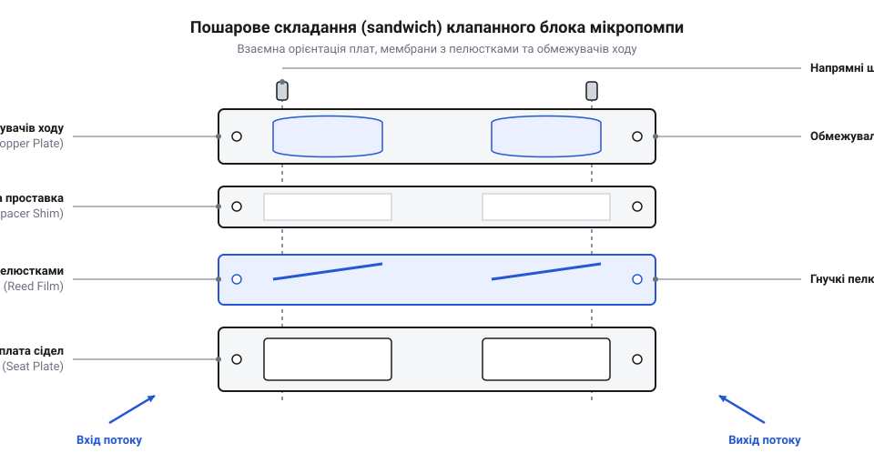
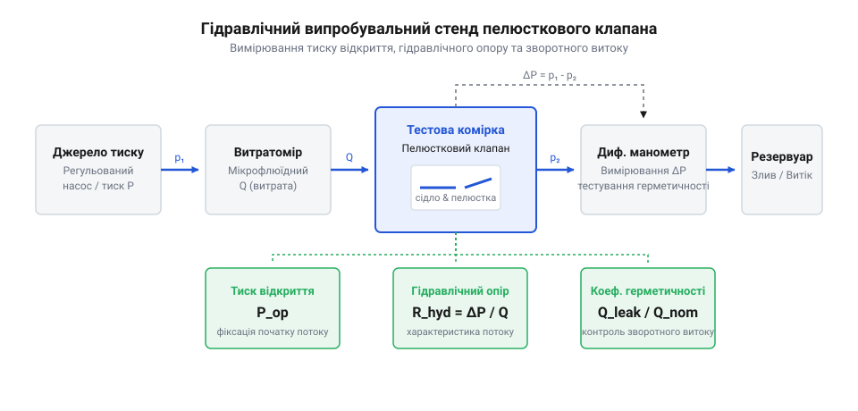

# Розробка та прототипування еластомерного пелюсткового клапанного вузла для мікропомпи

## Паразитний витік і вибір матеріалу

Циклічне зміщення пружної мембрани або п'єзоелемента в робочій камері мікропомпи періодично змінює її об'єм на величину `ΔV`. Під час розширення тиск усередині падає нижче тиску зовнішніх магістралей, а під час стиснення — перевищує його. Якщо камера сполучена з каналами однакової геометрії, гідравлічний опір обох проток виявляється симетричним. Рідина втягується однаково з обох портів під час розширення й симетрично виштовхується назад під час стиснення. Сумарний перенос за повний період залишається нульовим: потік лише коливається туди й назад. Якщо ж перед пуском камера заповнена повітрям, висока стисливість газу не дозволяє створити перепад тиску у відкритих протоках, унеможливлюючи сухе самовсмоктування (@@en|dry self-priming@@, від англ. *dry* — сухий, *self* — самостійно, та *prime* — заповнювати рідиною перед запуском).

Щоб перетворити коливання тиску на спрямований транзит рідини, канали перекривають пасивними зворотними затворами — пелюстковими клапанами (@@en|reed valve@@, від англ. *reed* — очеретина або язичок музичного інструмента, та *valve* — клапан). Пелюстка є тонкою гнучкою пластиною, консольно затисненою одним кінцем над прохідним отвором сідла. Прямий перепад тиску відгинає вільний кінець пластини, відкриваючи прохід, а зворотний градієнт притискає її до сідла, відтинаючи паразитний зворотний витік (@@en|backflow@@, від англ. *back* — назад, та *flow* — потік). Проте плівка чинить власний пружний опір згину. Мінімальний перепад тиску, за якого пелюстка відривається від контактної площини сідла, визначає початковий тиск відкриття (@@en|cracking pressure@@, від англ. *crack* — злегка привідкривати, та *pressure* — тиск). Якщо @@en|cracking pressure@@ перевищує напірні можливості привода, помпа втрачає продуктивність або взагалі блокується.

Знайдемо механічну жорсткість консольної пластини прямокутного перерізу `k` через модуль Юнга (@@en|Young's modulus@@) матеріалу `E`, ширину пелюстки `b`, її довжину `L` та товщину `t`:

```
k = (E · b · t³) / (4 · L³)
```

У цій залежності товщина `t` входить у кубі: подвоєння товщини підвищує механічну жорсткість у вісім разів, що пропорційно підіймає @@en|cracking pressure@@. Зменшення довжини `L` для мінімізації габаритів мікропомпи ще сильніше збільшує жорсткість через знаменник `L³`. Щоб утримати тиск спрацьовування на рівні одиниць кілопаскалів при довжині пелюстки `1.5–3.0 мм`, товщина матеріалу не повинна перевищувати десятків мікрометрів.

Інженерний вибір розгортається між двома типами гнучких плівок: поліімідом (@@en|polyimide@@, від грец. *polys* — численний, та *imide* — сполука з дикарбонільною амідною групою) марки @@en|Kapton@@ та силіконовим еластомером (@@en|silicone elastomer@@, від лат. *silex* — кремінь, грец. *elastos* — пружний, та *meros* — частка). Поліімід @@en|Kapton@@ має модуль Юнга `E ≈ 2.5–3.5 ГПа` і доступний у каліброваних плівках товщиною `12.5 мкм` та `25 мкм`. Поліімід позбавлений пружного гістерезису, тому клапан миттєво закривається на частотах до кількох сотень герц без фазового запізнення. Матеріал стійкий до органічних розчинників, спиртів та кислот. Натомість силіконовий еластомер має модуль пружності `E ≈ 1.0–3.0 МПа` — на три порядки нижчий за поліімід. Силіконова плівка товщиною `50–100 мкм` відкривається за мізерного тиску `ΔP < 0.3 кПа` і герметично охоплює мікронерівності сідла, проте зазнає в'язкопружного гальмування на частотах понад 50 Гц і руйнівно набухає в неполярних розчинниках.

Для інтеграції впускного та випускного каналів у компактній [діафрагмовій мікропомпі](root:cat-hw-actuators/diaphragm-micro-pumps) клапани об'єднують у двосторонню планку: обидва затвори розміщують на єдиній плоскій пластині, орієнтуючи впускний отвір у порожнину камери, а випускний — назовні. Плівка затвора не повинна мати залишкових напружень рулонного намотування: початковий вигин відриває кінець пелюстки від сідла або створює надмірний натяг, викликаючи витік або заклинювання клапана.

## Проєктування пелюсток, сідел та обмежувачів

Пелюстка працює як пружна консольна балка (@@en|cantilever@@, від англ. *cantilever* — балка, затиснена на одному кінці). Вільний край перекриває отвір сідла діаметром `d`, а корінь жорстко затиснений між пластинами корпусу. Гідравлічний напір згинає пластину, формуючи максимальний згинальний момент біля лінії затиску. Знайдемо найбільше напруження вигину `σ_max` у поверхневих волокнах защемленого кореня через згинальний момент `M`, товщину пелюстки `t` та осьовий момент інерції перерізу `I`:

```
σ_max = (M · t) / (2 · I)
```

Без обмеження ходу гідравлічний стрибок відгинає пелюстку на критичний кут. Напруження в корені перевищують границю пружності (@@en|yield strength@@, від давньоангл. *gieldan* — поступатися, механічна межа незворотної деформації). За мільйони циклів це породжує мікротріщини та втомне руйнування (@@en|fatigue failure@@, від лат. *fatigare* — виснажувати, руйнування матеріалу під циклічним навантаженням) у зоні затиску.

Для захисту пелюстки над нею встановлюють жорсткий обмежувач ходу (@@en|valve stop@@, від англ. *valve* — клапан, та *stop* — упор). Плоский упор непридатний: удар об пряму грань створює гострий злам і переносить руйнівний концентратор напружень у зону контакту. Поверхню стопора виконують дугоподібною з радіусом кривизни `R`. Під час відхилення пелюстка плавно вкладається на криволінійний профіль від затиску до вільного краю. Радіусний упор жорстко лімітує кривизну величиною `1 / R`, фіксуючи відносну деформацію зовнішнього шару на рівні `ε_max = t / (2 · R)`. Знайдемо граничне напруження на поверхні пелюстки, що оперлася на упор, через модуль Юнга `E`, товщину `t` та радіус `R`:

```
σ_max = (E · t) / (2 · R)
```

Рівняння показує: напруження більше не залежить від гідравлічного тиску чи швидкості потоку, оскільки його значення зафіксоване геометрією упору. Щоб напруження не перевищували циклічну границю витривалості `σ_allow`, радіус стопора обирають з умови `R ≥ (E · t) / (2 · σ_allow)`.

**Розрахунок мінімального радіуса обмежувача ходу для поліімідної пелюстки:**
Обчислимо мінімальний радіус кривизни `R_min` для пелюстки з матеріалу @@en|Kapton@@ товщиною `t = 25 мкм = 25 × 10⁻⁶ м` з модулем пружності `E = 3.0 ГПа = 3.0 × 10⁹ Па` при допустимому циклічному напруженні втоми `σ_allow = 60 МПа = 60 × 10⁶ Па`:

```
R_min = (E · t) / (2 · σ_allow)
      = (3.0 × 10⁹ · 25 × 10⁻⁶) / (2 · 60 × 10⁶)    [підстановка параметрів матеріалу та геометрії]
      = 75000 / (120 × 10⁶)                         [обчислення добутків у чисельнику й знаменнику]
      = 6.25 × 10⁻⁴ м                               [ділення чисельника на знаменник]
      = 0.625 мм                                    [переведення розрахункової величини в міліметри]
```

Висновок: вибір радіуса `R ≥ 0.70 мм` повністю запобігає втомному руйнуванню полііміду під час тривалої роботи помпи.

На стороні закриття геометрія контакту визначає герметичність. Широке плоске сідло розподіляє зворотну силу на значну площу, що занижує питомий тиск притискання й спричиняє витік. Навколо прохідного отвору формують кільцевий контактний поясок сідла (@@en|sealing land@@, від англ. *seal* — ущільнювати, та *land* — опорний контактний гребінь) шириною `w = 80–120 мкм` і висотою `h = 20–40 мкм`. Вузький поясок різко підвищує локальний контактний тиск, зминаючи мікронерівності та забезпечуючи герметичне відсікання потоку.

У рідкому середовищі притискання змоченої пелюстки до гладкого обмежувача створює зворотну проблему: рідинна плівка формує викривлений меніск. Виникає капілярне залипання — стикція (@@en|stiction@@, від англ. *static friction* — статичне поверхневе прилипання), керована від'ємним тиском Лапласа згідно з законами [механіки капілярного меніска](root:ph-mechanics/capillary-meniscus-force-mechanics). Залипла на упорі пелюстка запізнюється із закриттям, викликаючи масштабний @@en|backflow@@. Для подолання стикції поверхню обмежувача оснащують точковими рельєфними виступами — димплами (@@en|dimple@@, від англ. *dimple* — заглибина або ямочка) висотою `30–50 мкм`. Контакт по вершинах димплів скорочує площу дотику на 95%, послаблюючи силу меніска нижче пружного зусилля повернення пластини.

Цифрову тривимірну модель вузла розробляють у системі комп'ютерного проєктування (@@en|CAD@@, від англ. *Computer-Aided Design*). На єдиній платі поєднують сідло першого клапана та гніздо обмежувача другого клапана. Для безпомилкового пошарового складання навколо робочих камер закладають базувальні отвори під прецизійні штифти діаметром `1.0 мм` із квалітетом H7.

## Лазерна й штампова вирізка деталей

Плівки товщиною `12.5–50 мкм` не мають жорсткості в площині листа: механічні різці чи фрези заминають і рвуть тонкий полімер. Виготовлення деталей вимагає прецизійного лазерного розкрою (@@en|laser cutting@@) або штампової вирубки (@@en|die cutting@@, від англ. *die* — штамп або матриця, та *cut* — різати).

Якість лазерного різання визначається довжиною хвилі. Інфрачервоні CO₂-лазери (`λ = 10.6 мкм`) мають пляму фокусування `100–150 мкм` і створюють широку зону термічного впливу (@@en|heat-affected zone@@, @@en|HAZ@@). У плівці @@en|Kapton@@ перегрів спричиняє обвуглювання та утворення валика оплавлення (@@en|recast ridge@@, від англ. *recast* — повторно затверділий, та *ridge* — валик або гребінь) висотою `3–8 мкм`. Такий виступ на периметрі пелюстки унеможливлює її щільне прилягання до @@en|sealing land@@ сідла, перетворюючи клапан на постійне джерело витоку. У силіконі теплові напруження спричиняють незворотне жолоблення кромки.

Для бездеформаційного різання застосовують ультрафіолетові лазери (`λ = 355 нм`), де енергія квантів перевищує міцність зв'язків `C-C` та `C-N`. Матеріал випаровується шляхом прямої холодної фотоабляції (@@en|photoablation@@, від грец. *phos* — світло, та лат. *ablatio* — видалення) без утворення розплаву, як викладено в теорії [лазерної фотоабляції полімерів](root:ph-quantum/polymer-laser-photoablation-physics). Якщо УФ-лазер недоступний, а розкрій виконують промисловим волоконним або діодним випромінювачем, перегрів кромки усувають комплексом заходів. Замість одного повільного пропалювання наскрізь застосовують швидке багатопрохідне сканування на швидкості `200–400 мм/с` за зниженої потужності імпульсу, що розсіює тепло в часі. Одночасно в зону різу подають соосний струмінь сухого азоту під тиском `0.2–0.4 МПа`, який охолоджує зріз і видаляє продукти піролізу. Щоб сильний газовий потік не зміщував тонку невагому плівку, заготовку притискають до пористої керамічної вакуумної плити або попередньо накатують на термостійку клейову підкладку.

У багатосерійному виробництві альтернативою лазеру є прецизійна штампова вирубка @@en|die cutting@@ за допомогою твердосплавного пуансона та матриці (@@en|punch and die@@). Зазор між різальними кромками витримують у межах `1–2%` від товщини плівки (`0.3–0.5 мкм` для плівки `25 мкм`). Механічний зріз не зазнає термічних деформацій і не утворює @@en|recast ridge@@, але потребує високої точності інструменту за правилами [виробництва мікроштампів](root:cat-hw-instruments/microfluidic-die-cutting-tooling).

Жорсткі плати сідел та обмежувачів виготовляють із листового поліметилметакрилату, склотекстоліту FR-4 або поліефіркетону (@@en|PEEK@@) товщиною `1.0–1.5 мм` лазерним різанням або фрезеруванням мікрофрезами діаметром `0.5–1.0 мм`. Після виготовлення всі деталі очищають в ультразвуковій ванні з ізопропіловим спиртом і піддають оптичному контролю (@@en|optical inspection@@) під мікроскопом при 100-кратному збільшенні. Деталі бракують при виявленні задирок, валиків на кромці, короблення кутів або відхилення розмірів понад `±15 мкм`.

## Пошарове складання та герметична інтеграція

Виготовлені компоненти утворюють монолітний блок лише за умови бездоганної співвісності та рівномірного притискання шарів. Клапанний вузол є багатошаровим пакетом — сендвічем (@@en|sandwich assembly@@, від англ. *sandwich* — багатошарова конструкція, та *assembly* — вузол або складання). Конструкція містить нижню жорстку плату сідел з прохідними отворами впускного та випускного каналів, тонку плівкову мембрану з пелюстками з матеріалу @@en|Kapton@@ або силікону, дистанційну проставку (@@en|spacer@@, від англ. *space* — простір або зазор) та верхню плату обмежувачів ходу. Дистанційна проставка має вирізи під контур робочої зони пелюсток: вона надійно затискає корінь консолі, залишаючи вільний зазор для вигину рухомої частини затвора. Зміщення шарів навіть на `30–50 мкм` призводить до того, що край пелюстки зачіпає стінку камери або не перекриває кільцевий поясок @@en|sealing land@@ сідла, викликаючи постійний витік або блокування клапана.

Для гарантованого суміщення елементів пакет збирають на прецизійних напрямних штифтах (@@en|dowel pin@@, від середньоангл. *dowle* — циліндричний кілочок або штифт, та *pin* — шпилька). Застосовують щонайменше два загартовані циліндричні штифти діаметром `1.0 мм` з посадкою H7/g6, розташовані по діагоналі базової плати. Асиметричне розташування отворів унеможливлює дзеркально перевернуте встановлення плівки затворів. Усі шари послідовно нанизують на штифти без натягу й зусиль, що забезпечує взаємну співвісність отворів і пелюсток у межах допуску `±10 мкм`.


*Пошарова вибух-схема клапанного блока: взаємна орієнтація напрямних штифтів dowel pins, нижньої плати сідел, пелюсткової мембрани, дистанційної проставки та обмежувача ходу забезпечує точне суміщення затворів із гідравлічними каналами.*

Для герметизації міжшарових стиків застосовують два принципові підходи: клейовий бондинг або сухе механічне затискання. Рідкі клеї — епоксидні смоли чи ціанакрилати — застосовувати заборонено: капілярні сили неминуче затягують рідку фазу в робочий зазор пелюстки та на контактний поясок сідла, призводячи до незворотного браку. Замість них використовують тонкі плівкові адгезиви, чутливі до тиску (@@en|pressure-sensitive adhesive@@, @@en|PSA@@, від англ. *pressure* — тиск, *sensitive* — чутливий, та *adhesive* — клейкий матеріал) товщиною `10–25 мкм`. Процес нанесення таких плівок підпорядковується правилам [бондингу мікрофлюїдних пристроїв адгезивами](root:hw-pcb/microfluidic-pressure-sensitive-adhesive-bonding): контур адгезиву вирізають із відступом `0.2–0.3 мм` від гідравлічних вікон, наносять на проставку та прикочують під тиском `0.2–0.3 МПа`.

Альтернативою є розбірне сухе механічне стискання за допомогою жорстких притискних рамок — фланців (@@en|clamping flange@@, від англ. *clamp* — затискати, та *flange* — фланець або упорна кромка), розрахованих згідно з [інтерфейсом притискного фланця](root:cat-hw-actuators/reed-valves/api-reed-valve-fluidic-and-mechanical-interface.md). Щоб уникнути перекосу сідел і деформації тонких пластин під час монтажу, затягування кріпильних гвинтів М2 виконують хрест-навхрест. Момент затяжки контролюють прецизійною динамометричною викруткою (@@en|torque driver@@, від лат. *torquere* — скручувати, та англ. *driver* — викрутка) з кроком `0.02 Н·м`, доводячи кінцевий крутний момент до розрахункових `0.15–0.18 Н·м`.

Складений і стягнутий клапанний модуль інтегрують у гніздо корпусу мікропомпи. Зовнішній периметр модуля герметизують еластомірними кільцями круглого перерізу (@@en|O-ring@@, від англ. *O-ring* — ущільнювальне кільце кругового тороїдального перерізу) або пласкою силіконовою прокладкою, винесеною за межі робочих канатур. Сформований монолітний вузол повністю ізолює вхідну лінію від вихідної, не створюючи механічних напружень на пелюстках.

## Стендові гідравлічні випробування клапанного вузла

Після складання клапанний вузол підлягає обов'язковій перевірці на спеціалізованому стенді. Навіть дрібна мікродеформація, залишковий перекіс фланця або потрапляння пилинки на контактний поясок сідла здатні порушити герметичність затвора. Для вимірювання робочих характеристик модуль закріплюють у випробувальній комірці (@@en|test cell@@, від лат. *cella* — комірка або замкнена камера) гідравлічного стенда.

Стенд об'єднує регульоване джерело тиску (шприцевий насос або компресор із прецизійним редуктором), цифровий диференціальний манометр (@@en|differential manometer@@, від лат. *differentia* — різниця, грец. *manos* — розріджений, та *metron* — міра) та мікрофлюїдний витратомір (@@en|flow meter@@, від англ. *flow* — потік, та *meter* — вимірювач). Манометр підключають безпосередньо до вхідного та вихідного штуцерів тестової комірки клапана, що усуває вплив падіння тиску на з'єднувальних трубках. Витратомір реєструє об'ємну швидкість потоку в реальному часі в діапазоні від одиниць мікролітрів до десятків мілілітрів на хвилину.


*Комутація випробувального гідравлічного стенда: цифровий диференціальний манометр вимірює перепад тиску безпосередньо на тестовій комірці клапана, а мікрофлюїдний витратомір фіксує витрату рідини в прямому та зворотному напрямках.*

Випробування починають із визначення початкового тиску відкриття @@en|cracking pressure@@. Регулятор плавно підіймає прямий тиск зі швидкістю `0.1–0.2 кПа/с`. Доки сила гідравлічного напору не подолає власну пружність пелюстки, витратомір фіксує нуль. Точка стрибкоподібної появи стабільного потоку позначає @@en|cracking pressure@@. Для справних поліімідних клапанів цей тиск становить `1.2–2.5 кПа`, а для силіконових — менше `0.5 кПа`.

Подальше нарощування перепаду тиску дозволяє зняти повну характеристику прямої протоки. Знайдемо гідравлічний опір (@@en|hydraulic resistance@@, від грец. *hydor* — вода, *aulos* — трубка, та лат. *resistere* — чинити опір) `R_hyd` через диференціальний перепад тиску `ΔP` та об'ємну витрату `Q`:

```
R_hyd = ΔP / Q
```

На графіку залежності перепаду тиску від витрати на початковому етапі спостерігається нелінійне зниження гідравлічного опору, оскільки зі зростанням напору пелюстка все сильніше відгинається від сідла, розширюючи прохідний просвіт. Щойно пелюстка повністю лягає на радіусний обмежувач ходу, опір стабілізується на постійній величині, зумовленій виключно геометрією відкритого каналу.

Для вимірювання замикальної здатності напрямок потоку реверсують триходовим краном, подаючи зворотний перепад тиску `ΔP_rev = 10–50 кПа`. Навіть щільно притиснута до сідла пелюстка має мікроскопічний зворотний витік (@@en|leak rate@@, від середньоангл. *leken* — протікати, та лат. *rata* — розрахункова частка). Інтегральну якість затвора оцінюють безрозмірним коефіцієнтом діодності (@@en|diodicity@@, від грец. *dis* — двічі, та *hodos* — шлях). Знайдемо коефіцієнт діодності `Di` через пряму витрату `Q_fwd` та витрату зворотного витоку `Q_leak` за однакового перепаду тиску:

```
Di = Q_fwd / Q_leak
```

Чим вище значення діодності, тим ефективніше клапан блокує зворотне перетікання рідини. Для якісно виготовленого та зібраного клапанного модуля коефіцієнт @@en|diodicity@@ повинен перевищувати `1000`, що відповідає менше ніж `0.1%` зворотного витоку від номінальної прямої витрати.

Стендова діагностика дозволяє однозначно виявити причину дефекту за формою отриманої кривої. Завищений тиск відкриття свідчить про затікання адгезиву під корінь пелюстки, що скорочує робоче плече консолі, або про помилкове встановлення надмірно товстої плівки. Низький коефіцієнт @@en|diodicity@@ або лінійне зростання витоку вказує на потрапляння мікрочастинок під контактний поясок або перекіс площини сідла через нерівномірну затяжку кріплення. Якщо ж при скиданні тиску витрата падає із запізненням, виникає гістерезис через капілярну стикцію @@en|stiction@@ до обмежувача, спричинену браком або недостатньою висотою рельєфних димплів @@en|dimple@@. Після статичної діагностики клапанний вузол готовий до [осцилографічного аналізу часового відгуку клапана](root:cat-hw-actuators/reed-valves/proj-reed-valve-test-bench-dynamics.md) при високочастотних коливаннях тиску помпи.