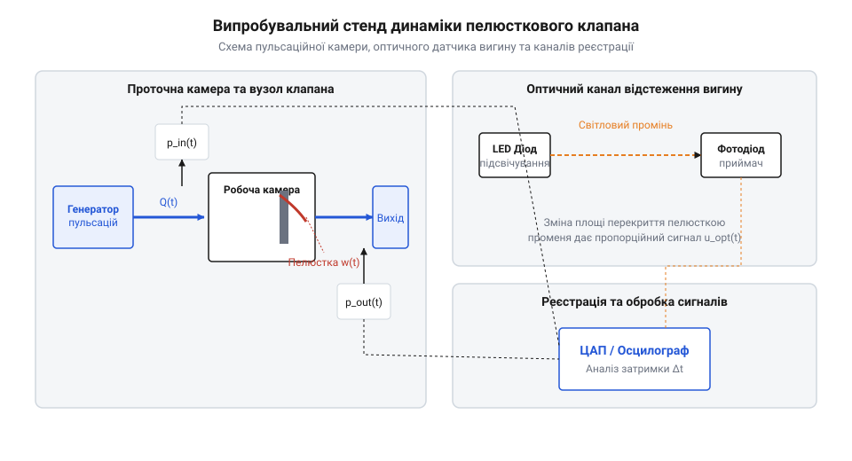
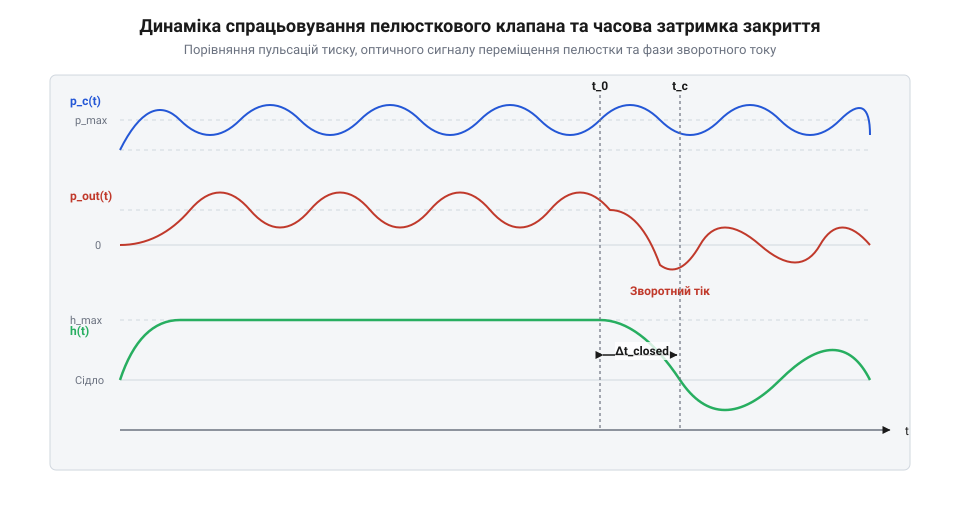

# Складання випробувального стенда для аналізу часового відгуку та зворотного току мікроклапанів

## Падіння подачі помпи на високих частотах

Під час розробки високочастотних мікрогідравлічних систем і мініатюрних помпових агрегатів розробники часто зіштовхуються з парадоксальним явищем: збільшення частоти коливань робочого органу понад 100 Гц не призводить до пропорційного зростання об'ємної подачі рідини. Навпаки, починаючи з певного порогового значення, продуктивність системи різко падає, супроводжуючись підвищеним нагрівом і гідравлічними ударами. Класичний гідравлічний розрахунок, заснований на квазістаціонарному припущенні, не здатний пояснити цей ефект, оскільки він ігнорує інерційні властивості рухомих елементів затвора та скінченний час релаксації пружної пелюстки.

Будь-який пелюстковий клапан є пасивним гідравлічним діодом, який відкривається під дією прямого перепаду тиску та закривається під дією зворотного потоку або пружних сил. У статичних умовах або на низьких частотах (до 10 Гц) перехід затвора з відкритого стану в закритий займає мізерну частку періоду. Проте з переходом у високочастотний діапазон (від 100 Гц до 1 кГц) тривалість одного циклу скорочується до мілісекунд і менше. У момент, коли поршень помпи змінює напрямок руху і починає створювати обернений перепад тиску, пелюстка клапана продовжує залишатися відкритою через власну масу та гідравлічне прилипання. 

Ця затримка закриття призводить до того, що значна частина щойно витісненої рідини безперешкодно повертається назад через усе ще відкритий прохідний перетин до входу камери. Таке явище має назву паразитний зворотний потік. Звичайні стрілочні манометри та статичні тести на герметичність, що проводяться при нульовій частоті, абсолютно не здатні виявити цей динамічний дефект. Вони показують лише інтегральний тиск, усреднений за часом, приховуючи миттєві провали. 

Для виявлення та кількісного вимірювання цього ефекту інженерам необхідно розгорнути спеціалізований вимірювальний комплекс. Основою такого підходу є спільна синхронна реєстрація миттєвого перепаду тиску безпосередньо в робочій камері та пряма оптична фіксація механічного вигину пелюстки в реальному часі. Наведена нижче блок-схема ілюструє структуру такої установки: . У результаті формується чітка інженерна задача побудови динамічного випробувального стенда з часовою роздільною здатністю на рівні мікросекунд, здатного зафіксувати фазовий розрив між зміною знака тиску та фактичною посадкою затвора на сідло.

Для оцінки інерційних сил пелюстки на частоті 500 Гц розглянемо сталеву консольну пластину завдовжки 5 мм, завширшки 2 мм і завтовшки 0.05 мм. Маса такої пелюстки становить приблизно 3.9 мг. Під час гармонічних коливань із частотою 500 Гц максимальне прискорення вільного кінця пелюстки досягає значень порядку 50 000 м/с^2, що породжує інерційні сили інерції близько 0.2 Н. У моменти зміни знака перепаду тиску ці інерційні сили суттєво перевершують відновлювальну пружну силу матеріалу, змушуючи пелюстку залишатися в похиленому відкритому стані протягом кількох мілісекунд після того, як гідравлічний перепад уже змінив свій знак.

## Складання тестової камери та генератора пульсацій

Конструювання випробувального стенда починається з виготовлення проточної гідравлічної комірки, яка повинна забезпечувати мінімальний паразитичний об'єм і водночас витримувати циклічні тиски до кількох мегапаскалів без пружних деформацій корпусу. Комірка виготовляється з прозорого оптичного полікарбонату або акрилу, що дозволяє організувати оптичний оглядовий віконний канал для підсвічування пелюстки мікроскопічним лазерним променем або світлодіодом. Через цей оптичний канал фотодіод фіксує мікроскопічні переміщення краю пелюстки з високою частотою дискретизації.

Для збудження контрольованих гідравлічних хвиль тиску в діапазоні від 10 Гц до 1 кГц звичайні електромеханічні кривошипно-шатунні механізми виявляються неефективними через великі люфти та механічні резонанси підвісу. Натомість використовують або високоточні п'єзоактуатори з малим ходом, здатні розвивати зусилля в сотні ньютонів на кілогерцових частотах, або електродинамічні пульсатори звукової котушки. П'єзоактуатор підключається до спеціалізованого високовольтного підсилювача потужності, керованого від цифрового генератора сигналів.

Процес складання та калібрування стенда вимагає поетапного контролю герметичності та амплітуди хвиль. Спочатку корпус комірки збирається із затискними фланцями, між якими затискається досліджуваний пелюстковий клапан. Потім до вхідного патрубка підключається збудник пульсацій, а внутрішній простір заповнюється робочою рідиною з контрольованою в'язкістю. За допомогою генератора задаються тестові синусоїдальні коливання на базових частотах, а амплітуда збудження підлаштовується до досягнення заданого розмаху тиску. Зібрана гідравлічна підсистема створює стабільні й повторювані робочі умови, необхідні для проведення точних динамічних вимірювань і подальшого аналізу поведінки мікроклапана.

## Монтаж високочастотних давачів динамічного тиску

Точність визначення затримки закриття клапана критично залежить від динамічних характеристик вимірювального тракту тиску. Використання виносних манометрів або датчиків, з'єднаних з робочою камерою через сполучні капіляри чи трубки, є неприпустимим. Будь-який капіляр утворює акустичний резонатор Гельмгольца, який вносить фазові спотворення, зсуває амплітудні піки та повністю руйнує мікросекундну синхронізацію сигналів.

Для уникнення цих ефектів мініатюрні п'єзорезистивні давачі тиску монтуються безпосередньо в стінках робочої камери та на вихідному каналі. Мембрани давачів мають бути встановлені суворо врівень зі стінками проточної зони, без заглиблень чи виступів, що могли б створити турбулентні зриви потоку. Корпуси датчиків ретельно герметизуються кільцевими ущільнювачами з фторкаучуку, а їх електричні виводи екрануються для захисту від електромагнітних наведень.

Електричні сигнали від датчиків надходять на багатоканальні малошумні підсилювачі з смугою пропускання не менше 100 кГц. Узгодження хвильового опору кабельних ліній здійснюється за допомогою термізуючих резисторів для запобігання відбиттям сигналів у високочастотному спектрі. Перед початком випробувань обов'язково проводиться апаратна калібровка нульової лінії та перевірка фазової ідентичності вхідного і вихідного каналів вимірювання за допомогою еталонного імпульсного генератора тиску. Для цього подається контрольний імпульс тиску одночасно на обидва канали через безпосередній жорсткий перехідник, а програмні цифрові фільтри та апаратні лінії затримки калібруються до повної кореляції фазових затримок з похибкою не більше 0.1 мс. Це забезпечує повну вимірювальну готовність апаратного тракту для синхронної фіксації мікросекундних перехідних процесів та аналізу за допомогою кодової бази `proj-reed-valve-test-bench-dynamics/c/reed_valve_analysis.c`.

## Світлодіодне оптичне відстеження деформації пелюстки

Для безконтактного та високошвидкісного відстеження механічного вигину пелюстки у високочастотних мікроклапанах застосовується оптичний метод перекриття світлового потоку. Конструктивно навколо оглядового вікна проточної гідравлічної комірки монтується прецизійний світлодіодний випромінювач у парі з швидкодіючим фотодіодом, який підключається до трансімпедансного підсилювача. Під час роботи клапана вільний край пелюстки частково перекриває світловий промінь, що дозволяє отримувати пропорційний електричний сигнал підйому затвора над сідлом без внесення додаткової інерційної маси у рухому рухливу систему.

Оптичний трак вимагає ретельного юстування для досягнення лінійної характеристики перетворення кута чи висоти підйому у напругу. Для обробки сигналів на низькому рівні та перевірки алгоритмів використовується спеціалізоване програмне забезпечення на мові C, наприклад, розробка [reed_valve_analysis.c](proj-reed-valve-test-bench-dynamics/c/reed_valve_analysis.c), яка забезпечує фільтрацію шумів та обчислення часових інтервалів спрацьовування.

## Синхронна осцилографічна реєстрація параметрів спрацьовування

Одночасна осцилографічна реєстрація перепаду тиску та переміщення затвора вимагає єдиної часової шкали для всіх вимірювальних каналів. Готовий апаратний стенд із п'єзорезистивними давачами та оптичною підсистемою підключається до цифрового осцилографа з підтримкою зовнішніх тригерів. Налаштування тригерів за фронтом перепаду тиску дозволяє стабільно захоплювати перехідні процеси у діапазоні робочих частот від 10 Гц до 1 кГц.

У процесі вимірювань критично важливо локалізувати момент зміни знака перепаду тиску, що відповідає початку зворотного току, та зафіксувати тривалість фази до повної посадки пелюстки на сідло. Для розширеного об'єктно-орієнтованого аналізу таких осцилограм на мові C++ застосовуються модулі [main.cpp](proj-reed-valve-test-bench-dynamics/cpp/main.cpp) та [reed_valve.hpp](proj-reed-valve-test-bench-dynamics/cpp/reed_valve.hpp), які реалізують потокову цифрову фільтрацію та розрахунок гідравлічних характеристик.

## Розрахунок затримки та оптимізація жорсткості

Математична обробка масивів осцилограм дозволяє не лише визначити часову затримку закриття, але й обчислити об'єм зворотного витоку та знайти критерії оптимізації жорсткості пелюстки. Програмний розрахунок реакції затвора на реверс тиску базується на інтегруванні миттєвої витрати, що формує частотну залежність гідравлічного ККД помпи.

 — на графіку чітко видно взаємозв'язок між падінням перепаду тиску, моментом нуль-переходу та затримкою спрацьовування затвора, зареєстрованими в єдиному часовому масштабі.

Для автоматизації цього процесу використовується комплекс на мові Python, зокрема скрипти [analyzer.py](proj-reed-valve-test-bench-dynamics/py/analyzer.py) та [visa_client.py](proj-reed-valve-test-bench-dynamics/py/visa_client.py), які забезпечують зчитування даних через VISA/SCPI та побудову підсумкових графіків відгуку. Правильний вибір товщини та пружності пелюстки мінімізує зворотний тік на цільовій частоті без надмірного гідравлічного опору, завершуючи цикл стендових випробувань.