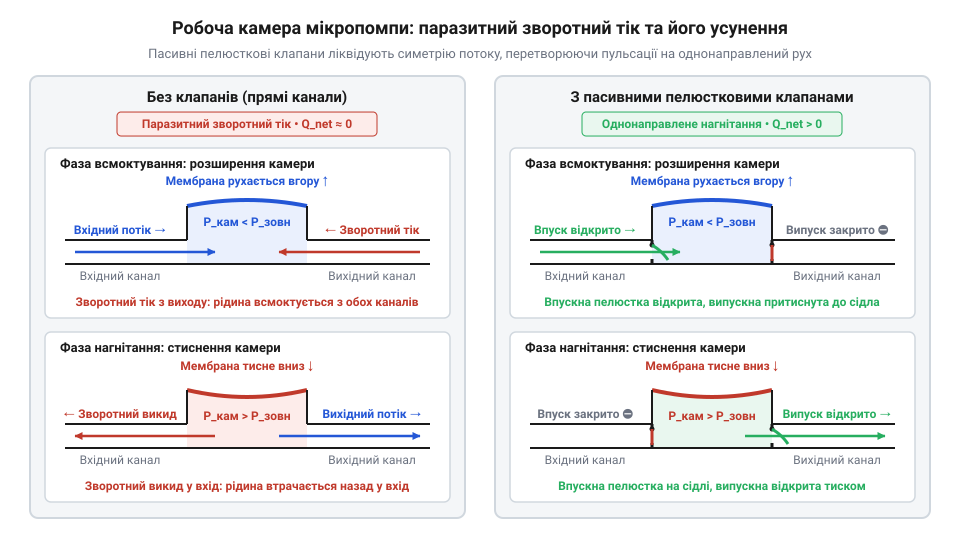
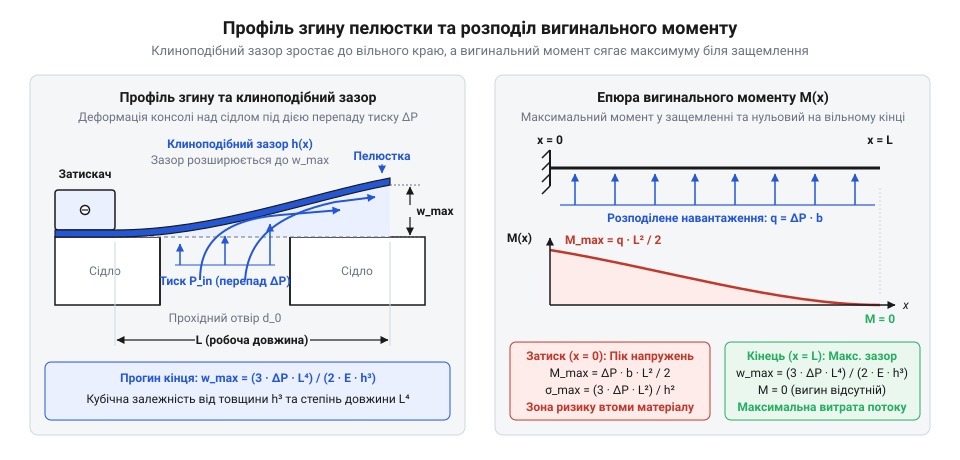
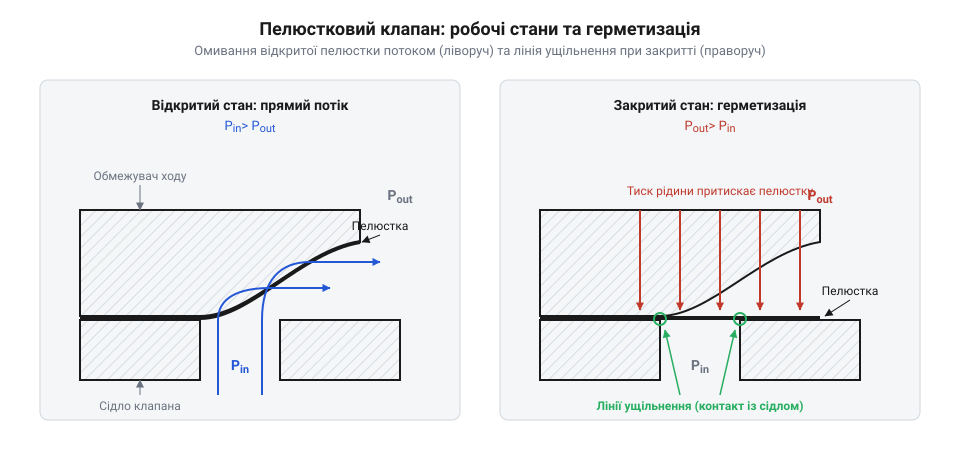
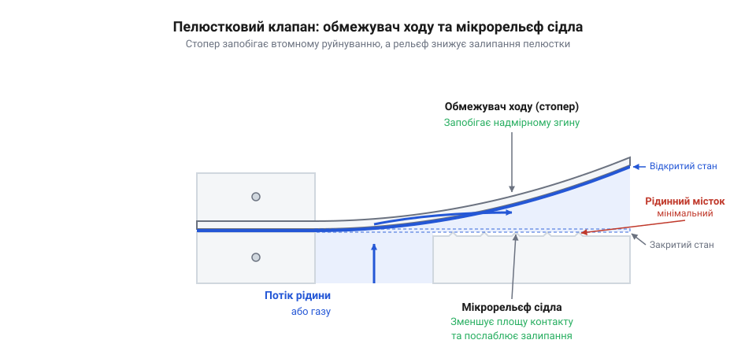
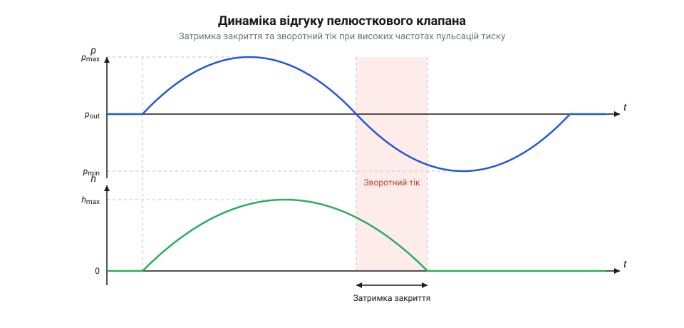

# Пелюсткові клапани мікрогідравліки

## Проблема зворотного току в мікропомпах

Робота будь-якої об'ємної мікропомпи (від англ. @@en|micropumps@@) — незалежно від того, побудована вона на основі п'єзоелектричного, електромагнітного, пневматичного чи електростатичного приводу — базується на циклічному зміщенні гнучкої мембрани або мікропоршня, які змінюють робочий об'єм замкненої камери. Під час розширення камери в ній створюється локальне розрідження тиску, а під час стиснення — надлишковий гідростатичний тиск. Проте сама по собі циклічна зміна об'єму не здатна створити направлене вимушене перекачування рідини або газу, якщо робоча камера з'єднана з вхідним і вихідним каналами без спрямувальних вирівнювальних елементів.

Коли мембрана зменшує об'єм камери, витіснена рідина під дією високого тиску прагне вийти через усі доступні відкриті отвори одночасно — як у вихідний канал нагнітання, так і назад у вхідний резервуар всмоктування. І навпаки: коли мембрана повертається назад і збільшує об'єм камери, розрідження примушує рідину всмоктуватися одночасно з вхідного та вихідного каналів. У результаті такого симетричного руху в мікроканалах виникає паразитна зворотна течія — зворотний тік (англ. @@en|backflow@@) та гідравлічне байпасування (від англ. @@en|bypassing@@). Замість поступального транзитного руху вздовж гідравлічного тракту рідина здійснює лише зворотньо-поступальні коливання всередині каналів, а корисна об'ємна продуктивність, що визначається об'ємним коефіцієнтом корисної дії (англ. @@en|volumetric efficiency@@), прямує до нуля. Чим вища частота пульсацій приводу камери, тим більша частка підведеної механічної енергії безповоротно дисипує у вигляді вихрового в'язкісного тертя рідини та локальних гідравлічних втрат.

Для усунення паразитного зворотного току в макроскопічній гідравліці традиційно застосовують активні клапанні системи з зовнішнім електричним, пневматичним або механічним керуванням. Проте у мікроелектромеханічних системах (від грец. μικρός — малий, ἤλεκτρον — янтар, μηχανή — пристрій; англ. @@en|microelectromechanical systems@@) використання активних приводів для кожного окремого клапана є неприйнятним. Додавання окремих силових елементів різко збільшує габарити, масу та енергоспоживання пристрою, а також вимагає складних електронних схем прецизійної фазової синхронізації між деформацією мембрани камери та відкриттям і закриттям затворів. У мікромасштабі будь-яка часова розсинхронізація тривалістю навіть у частки мілісекунди призводить до миттєвого скидання тиску та зворотного витоку середовища через невчасно закритий канал.

Фундаментальним розв'язком цієї проблеми є використання пасивних однонаправлених елементів — пелюсткових клапанів (від англ. @@en|reed valve@@). Пелюстковий клапан спрацьовує повністю безконтактно та автономно, реагуючи виключно на місцевий перепад тиску (від англ. @@en|pressure drop@@) `ΔP` між робочою камерою та прилеглим мікроканалом. Оскільки деформація пружної пластини відбувається під дією гідродинамічних сил самого середовища, такий клапан не потребує зовнішніх ліній живлення чи керуючих сигналів, що дозволяє інтегрувати весь клапанний вузол у вигляді єдиного планарного мікромодуля безпосередньо у корпус помпи.

Критично важливою функціональною властивістю пасивного пелюсткового клапана є забезпечення умов для сухого всмоктування (англ. @@en|dry priming@@ чи @@en|dry suction@@). На початковому етапі запуску мікропомпи її робоча камера заповнена не рідиною, а повітрям або іншим газом. Гази володіють високою стисливістю, тому під час деформації мембрани відносна зміна тиску в газовому об'ємі камери є вкрай малою і становить лише кілька десятків або сотень Паскалів. Класичні пасивні клапани гравітаційного чи кульково-пружинного типу володіють значною масою та високим тиском відкриття, через що газ у камері стискається та розширюється пружно, не здатний зрушити важкий затвор. Помпа потрапляє у режим «заповітрювання» і втрачає здатність затягувати рідину з підвідного капіляра. Натомість надтонкі пелюсткові клапани з малим модулем пружності або еластомерні мембранні пелюстки володіють мізерною власною масою та низьким пороговим тиском спрацьовування. Вони реагують навіть на слабкі пульсації стисненого газу, ефективно виштовхуючи його у вихідний канал і створюючи стійкий вакуум для самостійного затягування рідини з резервуара без попереднього ручного заповнення системи.

Ідея використання пружної пластини для однонаправленого руху робочого середовища має багату інженерну історію. Концепція пелюсткового клапана зародилася у промислових компресорах високого тиску та впускних трактах двотактних двигунів внутрішнього згоряння початку XX століття, де вимагалася висока частота спрацьовування та мінімальна інерційність затвора. Із розвитком технологій точного фотолітографічного травлення кремнію та лазерного різання пружинних сплавів у другій половині XX століття цей механізм був успішно масштабований до мікрорівня. Сучасні MEMS-пелюстки з полідиметилсилоксану (від грец. πολύς — численний, англ. @@en|polydimethylsiloxane@@), полііміду, нікелю чи пружинної сталі зберігають той самий фізичний принцип, проте працюють при мікронових силах і в умовах переважання в'язкісного тертя над інерційним. Детальніше про те, як макроскопічна конструкція адаптувалася до мікрофлюїдики, читайте в матеріалі про [історію розвитку пелюсткових клапанів](root:cat-hw-actuators/reed-valves/hist-reed-valves-evolution.md).

Механізм блокування зворотного току та забезпечення однонаправленого руху середовища в робочій камері мікропомпи наочно проілюстровано на системній схемі нижче.


*Динаміка перетікання рідини в робочій камері мікропомпи без клапанного розмежування та у випадку застосування пасивних впускного й випускного пелюсткових клапанів.*

Як видно зі схеми, за відсутності клапанів зміна об'єму камери викликає двосторонній симетричний потік, що робить перекачування повністю неефективним. Встановлення впускного та випускного пелюсткових клапанів уздовж напрямку течії розриває гідравлічну симетрію. На такті розширення (всмоктування) впускний клапан відкривається під дією від'ємного перепаду тиску, у той час як випускний клапан щільно притискається до сідла. На такті стиснення (виштовхування) зростаючий надлишковий тиск у камері закриває впускний клапан і примусово відкриває випускний.

Щоб повністю усунути байпасування рідини при високочастотній пульсації камери (від десятків герц до кількох кілогерц), клапанний вузол повинен володіти мінімальною часовою затримкою закриття та надійно працювати при високих швидкостях зміни тиску. Для експериментальної оцінки часового відгуку, оцінки зсуву фаз і вимірювання зворотного току використовується спеціалізований [стенд аналізу динаміки](root:cat-hw-actuators/reed-valves/proj-reed-valve-test-bench-dynamics.md).

## Фізика деформації пелюстки під тиском

З'ясувавши гідродинамічну потребу в пасивному розмежуванні впускного та випускного тактів, розглянемо мікромеханіку деформації самої пелюстки під дією тиску. У своїй базовій геометрії пелюстковий клапан являє собою пружну консольну балку (від англ. @@en|cantilever beam@@), яка одним кінцем жорстко защемлена на нерухомій корпусій деталі, а вільним кінцем перекриває прохідний отвір сідла клапана (від англ. @@en|valve seat@@).

У вихідному стані, коли перепад тиску на клапані дорівнює нулю, пелюстка перебуває у механічному контакті з поверхнею сідла. У багатьох конструкціях для забезпечення високої початкової герметичності пелюстці надають попереднього пружного натягу (англ. @@en|pre-stress@@) шляхом незначного геометричного згину при монтажі. Щоб клапан почав відкриватися, гідростатичний перепад тиску `ΔP` повинен перевищити певне порогове значення — тиск відкриття (англ. @@en|cracking pressure@@). Цей тиск визначається як зусиллям попереднього пружного натягу, так і силами поверхневого натягу та капілярного зчеплення рідинної плівки, яка утворюється у мікроскопічному зазорі між пелюсткою та площиною сідла.

Коли перепад тиску перевищує тиск відкриття, розподілене гідродинамічне навантаження починає відгинати вільний кінець пелюстки від сідла. Для опису цієї деформації скористаємося класичною теорією вигину тонких балок Бернуллі-Ейлера. Введемо фізичні величини, які визначають механічний та гідродинамічний стан системи:
- `w(x)` — вертикальний згин (прогин) пелюстки у точці з координатою `x` уздовж її довжини, виміряний від лінії защемлення [м];
- `q` — інтенсивність розподіленого поперечного навантаження на одиницю довжини пелюстки [Н/м], яка обчислюється як добуток ширини пелюстки `b` та перепаду тиску `ΔP` (`q = ΔP · b`);
- `ΔP` — гідродинамічний перепад тиску між нижньою та верхньою поверхнями пелюстки [Па];
- `b` — ширина прямокутної пелюстки [м];
- `L` — вільна робоча довжина пелюстки від точки защемлення до вільного краю [м];
- `h` — товщина пелюстки [м];
- `E` — модуль пружності першого роду або модуль Юнга (від англ. @@en|Young's modulus@@) матеріалу пелюстки [Па];
- `I` — осевий момент інерції прямокутного перерізу пелюстки відносно нейтральної осі [м⁴], який для прямокутника дорівнює `I = (b · h³) / 12`;
- `w_max` — максимальний прогин вільного кінця пелюстки в координаті `x = L` [м].

Під дією постійного розподіленого навантаження `q` диференціальне рівняння зігнутої осі консольної балки інтегрується чотириразово з урахуванням граничних умов защемлення на лівому кінці (`w(0) = 0`, `w'(0) = 0`) та відсутності моменту й зсувної сили на вільному правому кінці. Обчислення максимального прогину вільного кінця пелюстки виконується за наступним покроковим розрахунком:

```
w_max = (q · L⁴) / (8 · E · I)
      = (ΔP · b · L⁴) / (8 · E · (b · h³) / 12)    [підстановка розподіленого навантаження q = ΔP · b та моменту інерції I = (b · h³) / 12]
      = (3 · ΔP · L⁴) / (2 · E · h³)               [скорочення ширини b у чисельнику й знаменнику та спрощення коефіцієнтів]
```

З отриманого підсумкового виразу видно чітку фізичну закономірність: максимальний прогин пелюстки `w_max` прямо пропорційний перепаду тиску `ΔP` та четвертому степеню довжини `L⁴`, проте обернено пропорційний модулю Юнга `E` та кубу товщини `h³`. Зверніть увагу на степеневу залежність від товщини `h`: зменшення товщини пелюстки лише удвічі (наприклад, з 100 мкм до 50 мкм) при незмінних інших параметрах збільшує її гнучкість та кінцевий прогин у 8 разів! Тим часом збільшення довжини удвічі збільшує прогин у 16 разів. Це означає, що геометричні розміри пелюстки є значно потужнішим важелем регулювання жорсткості клапана, ніж підбір матеріалу з іншим модулем пружності.

Характер деформації консольної пелюстки та відповідний розподіл вигинального моменту вздовж її довжини проілюстровано на детальному профільному графіку.


*Геометрія вигину консольної пелюстки над прохідним отвором сідла під дією тиску та епюра вигинального моменту.*

Як видно з графічного профілю, деформація пелюстки є суттєво нерівномірною. Максимальний вигинальний момент виникає безпосередньо у зоні защемлення коріння пелюстки, у той час як на вільному кінці момент дорівнює нулю. Це означає, що саме біля защемлення зосереджені найбільші механічні напруження, що створює ризик втомного руйнування при багаторазових циклічних навантаженнях. Одночасно прохідний зазор між пелюсткою та поверхнею сідла набуває клиноподібної форми: площа прохідного перерізу плавно зростає від нуля біля защемлення до максимуму на вільному краї пелюстки.

Формування клиноподібного зазору безпосередньо визначає гідравлічний опір (англ. @@en|hydraulic resistance@@) клапана. На початковій стадії підйому, коли зазор є мікроскопічним, основний опір рухові рідини створюється в'язкісним зсувним тертям у вузькому ламінарному каналі. Проте в міру зростання перепаду тиску `ΔP` та збільшення прогину `w_max` площа прохідного перерізу швидко розширюється, і гідравлічний опір клапана падає за кубічним законом від величини прохідного зазору.

Коли перепад тиску змінює знак на протилежний (зворотний перепад тиску `-ΔP`), гідродинамічна сила діє у зворотному напрямку, примусово притискаючи пелюстку до сідла. Плоска нижня поверхня пелюстки вступає у механічний контакт із посадочною площиною сідла, формуючи замкнену контактну лінію ущільнення навколо прохідного отвору.


*Взаємодія пелюстки з потоком середовища: обтікання у повністю відкритому стані та контактна лінія ущільнення на сідлі при зворотному тиску.*

На конструкційному розрізі виразно видно два граничні режими роботи клапанного вузла. У повністю відкритому стані потік рідини плавно омиває зігнуту поверхню пелюстки, не утворюючи великомасштабних вихрових зон і мінімізуючи втрати тиску. У закритому стані зворотний тиск притискає пружний матеріал пелюстки до поверхні сідла, створюючи герметичне контактне ущільнення, яке унеможливлює паразитно байпасування рідини.

Для точного математичного розрахунку зв'язаної гідропружної динаміки клапана, що враховує додану масу рідини, розподілений опір та в'язкісне демпфування у вузьких щілинах, використовується [моделювання гідропружної динаміки](root:cat-hw-actuators/reed-valves/math-reed-valve-hydrodynamics-and-bending.md).

Практичні рекомендації щодо проектирування планарних клапанних матриць, вибору еластомерних або металевих матеріалів та виготовлення двосторонніх клапанних пластин викладені в посібнику про [проєктування клапанного вузла](root:cat-hw-actuators/reed-valves/proj-reed-valve-microfluidic-plate-design.md).

Повний перелік конструктивних допусків, вимог до шорсткості посадочного сідла та посадочних геометричних розмірів дивіться у матеріалі про [специфікацію геометричного інтерфейсу](root:cat-hw-actuators/reed-valves/api-reed-valve-fluidic-and-mechanical-interface.md).

## Геометрія сідла та гідравлічний опір

Аналіз статики згину пружної пелюстки під дією розподіленого тиску показує, як утворюється клиноподібний зазор. Проте у реальному клапанному вузлі рідина не витікає у безмежний простір: вона перш за все проходить крізь прохідний отвір у корпусій деталі — сідлі клапана (англ. @@en|valve seat@@), а потім розвертається і протікає крізь вузьку щілину між сідлом та відігнутим тілом пелюстки. Якщо прохідний отвір сідла занадто малий або має гострі прямокутні кромки, гідравлічний опір (англ. @@en|hydraulic resistance@@) всього вузла залишається високим навіть при значному відхиленні пелюстки. І навпаки: надмірне розширення отвору звужує опорну поверхню сідла, через що під дією зворотного тиску пелюстка втрачає підтримку і може прогинатися всередину каналу чи зазнавати локальних перенапружень. Геометрія сідла визначає фундаментальний компроміс між пропускною здатністю відкритого клапана та надійністю його герметичного запирання.

Загальний гідравлічний опір `R_h` повністю відкритого клапанного вузла складається з двох послідовних компонентів: гідравлічного опору самого отвору в платині сідла `R_seat` та опору клиноподібного зазору під пелюсткою `R_gap`. Об'ємна витрата рідини або газу `Q`, що проходить крізь прохідний отвір площею `A_0` під дією перепаду тиску `ΔP`, описується рівнянням Бернуллі з урахуванням гідродинамічного коефіцієнта витрати (від англ. @@en|discharge coefficient@@ `C_d`):

```
Q = C_d · A_0 · √(2 · ΔP / ρ)
```

Тут `Q` — об'ємна витрата середовища [м³/с], `C_d` — безрозмірний коефіціент витрати, `A_0` — площа прохідного отвору сідла [м²], `ΔP` — гідростатичний перепад тиску [Па], а `ρ` — густина робочої рідини або газу [кг/м³]. Звідси гідравлічний опір безпосередньо отвору сідла `R_seat` обчислюється як відношення перепаду тиску до об'ємної витрати:

```
R_seat = ΔP / Q
       = ΔP / (C_d · A_0 · √(2 · ΔP / ρ))    [підстановка рівняння витрати Q]
       = √(ρ · ΔP) / (C_d · A_0 · √2)        [спрощення дробу ΔP / √ΔP]
```

З отриманого співвідношення видно, що опір отвору сідла `R_seat` обернено пропорційний площі отвору `A_0` та коефіцієнту витрати `C_d`. У мікрофлюїдній технології геометрична форма країв отвору відіграє вирішальну роль: гострі прямокутні кромки, утворені після стандартного сухого або вологого травлення кремнію чи прямого свердління, викликають відрив потоку та формування локальних вихрових зон звуження. Це знижує значення `C_d` до 0.60–0.62. Прецизійне радіусне заокруглення або фаскування країв отвору сідла усуває паразитичні вихори, піднімаючи `C_d` до 0.85–0.90 та зменшуючи гідравлічні втрати напору на сідлі майже вдвічі при незмінній площі `A_0`.

Другий компонент — опір клиноподібного зазору `R_gap` — залежить від висоти підйому пелюстки `w(x)`. Потік, виходячи з отвору сідла, змінює напрямок на 90 градусів і розтікається вздовж периметра зазору. На початковій стадії відкриття, коли максимальний прогин вільного кінця пелюстки `w_max` є мікроскопічним (при тисках, ледь вищих за тиск відкриття англ. @@en|cracking pressure@@), течія у зазорі є суто в'язкісною та ламінарною. Гідравлічний опір зазору описується законом Пуазейля для плоского каналу та обернено пропорційний кубу висоти підйому: `R_gap ∝ μ / w_max³`, де `μ` — динамічна в'язкість середовища [Па·с]. У цьому режимі `R_gap >> R_seat`, і саме вузький зазор під пелюсткою лімітує загальну пропускну здатність клапана.

У міру зростання перепаду тиску `ΔP` пелюстка прогинається сильніше, значення `w_max` швидко збільшується, і опір зазору `R_gap` спадає за кубічним законом. Коли величина прогину `w_max` досягає приблизно 25–30% від еквівалентного діаметра прохідного отвору, опір зазору `R_gap` стає нехтовно малим порівняно з опором отвору `R_seat`. Подальше збільшення відхилення пелюстки вже не призводить до помітного зниження загального гідравлічного опору `R_h` — клапанний вузол переходить у стан гідравлічного насичення, де єдиним вузьким місцем потоку залишається геометрія отвору сідла `A_0`.

Для оптимізації цього компромісу у мікрофлюїдиці застосовують багатоотворні (ґратчасті) сідла, у яких один великий отвір замінюється матрицею з кількох дрібніших паралельних отворів з однаковою сумарною площею `A_0`. У такій геометрії еквівалентний діаметр кожного окремого мікроотвору є значно меншим, тому необхідний прогин пелюстки `w_max` для досягнення гідравлічного насичення зменшується у кілька разів. Це дозволяє клапану досягати мінімального опору при суттєво меншому згині пелюстки, що знижує механічні напруження та збільшує робочий ресурс.

Розглянемо тепер зворотний режим — герметичне запирання під дією зворотного перепаду тиску `-ΔP`. Для відсутності витоків середовища плоска поверхня пелюстки повинна притискатися до контактної поверхні сідла — посадочного пояска ущільнення (від англ. @@en|seat land@@). Ширина цього пояска `w_land` виступає критичним розрахунковим параметром. З одного боку, вузький поясок забезпечує високу локальну контактну напругу `σ_c` при відносно невеликому зворотному тиску, що гарантує деформацію дрібних шорсткостей і стабільну герметичність. Проте занадто вузький поясок створює ризик пластичної деформації або прорізання матеріалу пелюстки (особливо для м'яких еластомерів, як-от силікон чи полідеметилсилоксан).

З іншого боку, надмірне розширення посадочного пояска створює важку фізичну проблему у рідких середовищах — поверхневе зчеплення або залипання (від англ. @@en|stiction@@ — сполучення слів static та friction). При закритті клапана між широким пояском сідла та пелюсткою залишається надтонка плівка рідини. Сили поверхневого натягу та міжмолекулярної адгезії утворюють капілярний рідинний місток, який створює потужне притягувальне зусилля. Для відриву пелюстки від сідла на наступному такті всмоктування потрібен додатковий перепад тиску, що різко підвищує фактичний тиск відкриття `@@en|cracking pressure@@` і викликає затримку спрацьовування.

Для подолання ефекту залипання без втрати герметичності на поверхні посадочного пояска створюють спеціалізований мікрорельєф у вигляді точкових мікровиступів або сітки мікроканавок. Мікрорельєф розриває суцільний капілярний меніск на окремі ізольовані краплі, що зменшує площу рідинного контакту та знижує силу залипання на 80–90%, зберігаючи при цьому замкнену безперервну лінію периметрального ущільнення.


*Конструктивна геометрія клапанного вузла з обмежувачем ходу пелюстки та мікрорельєфом сідла для запобігання надмірному згину матеріалу та зменшення сил поверхневого зчеплення у рідкому середовищі.*

На наведеній схемі детально зображено взаємодію конструктивних елементів сідла та обмежувача ходу. Мікрорельєф на посадочному пояску запобігає утворенню суцільної капілярної плівки рідкого середовища, у той час як профільований верхній обмежувач ходу (стопер) задає максимальний допустимий радіус вигину пелюстки. Це виключає перевищення границі пружності матеріалу при раптових стрибках тиску та запобігає втомній деградації затисненого коріння.

Практичні рекомендації щодо формування мікрорельєфу на сідлах, розрахунку допусків площинності та технології виготовлення двосторонніх клапанних планок детально викладено в посібнику про [проєктування клапанного вузла](root:cat-hw-actuators/reed-valves/proj-reed-valve-microfluidic-plate-design.md). Конкретні чисельні значення ширини посадочних поясків, рекомендовані співвідношення площ та геометрію монтажних фасок наведено у [специфікації геометричного інтерфейсу](root:cat-hw-actuators/reed-valves/api-reed-valve-fluidic-and-mechanical-interface.md).

## Часова затримка та динаміка відгуку

У статичному або низькочастотному режимах роботи пелюстковий клапан відкривається й закривається квазістатично, точно слідуючи за поточним перепадом тиску. Проте сучасні мікропомпи (від англ. @@en|micropumps@@) на основі п'єзоелектричних, електромагнітних чи магнітострикційних приводів працюють при високих частотах пульсацій камери — від сотень герц до кількох кілогерц. При таких швидкоплинних процесах рух пелюстки перестає бути миттєвим: у гру вступають структурна інерція пружної пластини, гідродинамічна маса прилеглого середовища та в'язкісне демпфування. Якщо перепад тиску (англ. @@en|pressure drop@@) у робочій камері змінює знак швидше, ніж пелюстка встигає повернутися на сідло, виникає часова затримка спрацьовування. Клапан залишається частково відкритим на початку такту стиснення, викликаючи паразитно зворотний тік (англ. @@en|backflow@@) і призводячи до різкого падіння об'ємного коефіцієнта корисної дії (англ. @@en|volumetric efficiency@@).

Динамічний відгук клапана визначається власною частотою коливань пелюсткової конструкції. Для прямокутної консольної балки (англ. @@en|cantilever beam@@) довжиною `L`, товщиною `h`, шириною `b`, густиною матеріалу `ρ_m` та модулем Юнга (англ. @@en|Young's modulus@@ `E`) фундаментальна власна частота коливань у вакуумі (від англ. @@en|natural frequency@@ `f_0`) обчислюється з рівняння коливань суцільної пластини:

```
f_0 = (3.516 / (2 · π)) · √((E · I) / (ρ_m · b · h · L⁴))
```

Підставивши вираз для моменту інерції прямокутного перерізу `I = (b · h³) / 12`, дістаємо покроковий розрахунок фундаментальної частоти у вакуумі:

```
f_0 = (3.516 / (2 · π)) · √((E · (b · h³) / 12) / (ρ_m · b · h · L⁴))    [підстановка моменту інерції I = (b · h³) / 12]
    = (3.516 / (2 · π · L²)) · √((E · h²) / (12 · ρ_m))                 [скорочення ширини b та товщини h під коренем]
```

З отриманого виразу видно, що у вакуумі власна частота `f_0` прямо пропорційна товщині пелюстки `h` та обернено пропорційна квадрату довжини `L²`. Проте коли пелюстка занурена у рідке робоче середовище (воду, біологічний буфер чи паливо), вона не може здійснювати рух без витіснення прилеглих шарів рідини. Цей залучений у рух об'єм рідини коливається синхронно з пелюсткою і створює додаткове інерційне навантаження — приєднану масу рідини (від англ. @@en|added mass@@ `m_add`).

Для плоскої тонкої пелюстки шириною `b`, яка здійснює деформацію у незжимаємій рідині з густиною `ρ_f`, приєднана маса рідини на одиницю довжини пелюстки оцінюється масою рідкого циліндра охоплювального діаметра: `m_add = (π / 4) · ρ_f · b²`. Загальна ефективна маса коливальної системи на одиницю довжини `m_eff` дорівнює сумі власної маси пелюстки `m_reed = ρ_m · b · h` та приєднаної маси рідини `m_add`. Оскільки у мікрогідравліці товщина пелюстки `h` становить лише 10–50 мкм, а густина рідини `ρ_f` є порівнянною з густиною матеріалу пелюстки `ρ_m`, приєднана маса рідини `m_add` дуже часто перевищує власну масу пластини в кілька разів (`m_add / m_reed > 2...5`).

У результаті приєднання маси середовища волога власна частота коливань пелюстки в рідині `f_wet` суттєво знижується порівняно з вакуумним значенням `f_0`:

```
f_wet = f_0 / √(1 + m_add / m_reed)
      = f_0 / √(1 + ((π / 4) · ρ_f · b²) / (ρ_m · b · h))          [підстановка виразів для m_add та m_reed]
      = f_0 / √(1 + (π · ρ_f · b) / (4 · ρ_m · h))                   [скорочення ширини b у чисельнику та знаменнику]
```

Отримане співвідношення розкриває важливий конструктивний ефект: збільшення ширини пелюстки `b` при незмінній товщині `h` різко збільшує відносний вплив приєднаної маси, погіршуючи динамічну швидкодію клапана. Для досягнення максимальної робочої частоти у рідинах доцільно проєктувати не одну широку пелюстку, а гребінку з кількох вузьких паралельних пелюсток (гребінчастий або багатопелюстковий клапан), що зберігає загальну площу проходу, але суттєво знижує `m_add`.

Окрім інерційного сповільнення від приєднаної маси, на останній стадії закриття клапана виникає додатковий гальмівний ефект — демпфування стисненим шаром рідини (від англ. @@en|squeeze-film damping@@). Коли пелюстка наближається до площини сідла, рідина з вузького мікрозазору повинна витіснитися вбік. Гідродинамічний опір вискакування рідини у вузькій щілині створює потужну в'язкісну протидіючу силу, яка зростає пропорційно `1 / w³`. Це демпфування визначає безрозмірний коефіцієнт демпфування системи `ζ`. Якщо демпфування занадто слабке (`ζ < 1`), пелюстка випробовує брязкіт і високочастотні відскоки від сідла. При оптимальному демпфуванні (`ζ ≈ 0.6...0.7`) відскоки усуваються, проте в'язкісний опір затягує фазу прилягання, формуючи повну часову затримку закриття `τ_close`.

Повна часова затримка закриття клапана `τ_close` складається з інерційного часу розгону та часу в'язкісного видавлювання рідини і приблизно оцінюється як чверть періоду вологих коливань: `τ_close ≈ 1 / (4 · f_wet)`. Наслідком цієї затримки є те, що при частоті пульсацій камери `f_pump` виникає фазовий зсув `ϕ` між зміною тиску в камері та фізичним положенням затвора.


*Динаміка часового відгуку пелюсткового клапана при високочастотних пульсаціях тиску в камері: фазове розузгодження, затримка закриття та формування зони зворотного току.*

Як видно з графічного профілю, коли тиск у робочій камері зміщується від від'ємного (фаза всмоктування) до додатного (фаза нагнітання), зміщення пелюстки `w(t)` не обнуляється миттєво. Протягом часового інтервалу `τ_close` клапан лишається відкритим у зоні додатного тиску, створюючи заштриховану фазу зворотного току. Об'єм рідини `V_backflow`, витіснений назад у вхідний канал за один цикл, зменшує корисну об'ємну подачу помпи.

Для збереження високого об'ємного коефіцієнта корисної дії (`η_v > 80%`) робоча частота помпи `f_pump` повинна залишатися значно нижчою за граничну робочу частоту (від англ. @@en|cut-off frequency@@ `f_cut`), яка визначається умовою: `f_cut ≈ 0.2 ... 0.3 · f_wet`. При наближенні `f_pump` до `f_wet` затримка `τ_close` стає сумірною з півперіодом пульсацій, об'єм зворотного току зрівнюється з робочим об'ємом камери, і помпа повністю втрачає здатність до перекачування.

Строге математичне виведення диференціальних рівнянь зв'язаної гідропружності, розрахунок добавлених мас та моделювання профілю зсуву фаз містяться у матеріалі про [моделювання гідропружної динаміки](root:cat-hw-actuators/reed-valves/math-reed-valve-hydrodynamics-and-bending.md). Практичні методики побудови високошвидкісного лазерного стенда для вимірювання затримки спрацьовування та фази зворотного току наведено у матеріалі про [стенд аналізу динаміки](root:cat-hw-actuators/reed-valves/proj-reed-valve-test-bench-dynamics.md). Огляд того, як конструктори компресорів і двигунів історично долали інерційні обмеження клапанів, подано в матеріалі про [історію розвитку пелюсткових клапанів](root:cat-hw-actuators/reed-valves/hist-reed-valves-evolution.md).

## Обмежувачі ходу, втомність і залипання

Робота пасивного клапана в мікропомпі (англ. @@en|micropumps@@) супроводжується безперервними динамічними перепадами тиску (англ. @@en|pressure drop@@), які змушують консольну пелюстку (англ. @@en|cantilever beam@@) здійснювати мільйони та мільярди циклів вигину. У цьому високочастотному режимі пасивний пелюстковий клапан (англ. @@en|reed valve@@) зустрічається з двома крайніми руйнівними факторами. З одного боку, надмірний прогин під дією пікових питомих навантажень створює високі згинальні напруження у затисненій зоні коріння, що призводить до незворотної пластичної деформації або втомного зламу. З іншого боку, при контакті пелюстки з обмежувачем чи сідлом клапана (англ. @@en|valve seat@@) у рідкому середовищі виникають сили поверхневого натягу, які викликають залипання (англ. @@en|stiction@@) і блокують зворотний рух. Забезпечення довговічності мікроклапана вимагає узгодженого проєктування механічних обмежувачів та фізико-хімічного профілювання контактних поверхонь.

Розглянемо спочатку механіку згинальних напружень, що виникають у тілі консольної пелюстки при її відхиленні під дією потоку. Для прямокутної пластини довжиною `L`, товщиною `h` та модулем Юнга (англ. @@en|Young's modulus@@ `E`) максимальне механічне напруження `σ_max` виникає на самій поверхні пластини в районі затисненого кореневого перерізу. Якщо вільний кінець пелюстки відхиляється на величину `w_max`, напруження на зовнішньому волокні обчислюється через теорію згину тонких балок. Розрахуємо максимальне згинальне напруження `σ_max` через геометричні параметри пелюстки та прогин `w_max`:

```
σ_max = (M_max · (h / 2)) / I
      = ((3 · E · I · w_max / L²) · (h / 2)) / I    [підстановка вигинального моменту M_max = 3·E·I·w_max / L²]
      = (3 · E · h · w_max) / (2 · L²)             [скорочення моменту інерції I]
```

Тут `M_max` — максимальний вигинальний момент у затисненні [Н·м], `I` — момент інерції поперечного перерізу [м⁴], `E` — модуль пружності матеріалу [Па], `h` — товщина пелюстки [м], `L` — робоча довжина пелюстки [м], а `w_max` — прогин вільного кінця [м]. З отриманої формули видно, що максимальне напруження `σ_max` зростає прямо пропорційно прогину `w_max` та товщині пелюстки `h`, і є обернено пропорційним квадрату довжини `L²`.

Якщо в робочій камері виникає раптовий стрибок тиску або гідравлічний удар, незахищена пелюстка прогинається на величину, значно більшу за розрахунковий робочий хід. При цьому напруження `σ_max` може перевищити границю плинності (англ. @@en|yield strength@@) матеріалу, викликаючи залишкові вигини та втрату початкового попереднього натягу. Навіть якщо напруження під час одного циклу залишається у межах пружності, багаторазове повторення циклів (понад `10⁷–10⁹` спрацьовувань) викликає втомне руйнування (англ. @@en|fatigue failure@@, від лат. *fatigare* — виснажувати). Мікроскопічні дефекти кристалічної ґратки або поверхневі подряпини у затиснутому корені стають осередками концентрації напружень (англ. @@en|stress concentration@@), де зароджуються втомні мікротріщини, які згодом призводять до повного зламу пелюстки.

Щоб запобігти перевантаженню та досягти границі тривалої міцності (англ. @@en|endurance limit@@, від лат. *indurare* — зміцнювати), у конструкцію клапанного вузла вводять механічний обмежувач ходу (англ. @@en|stroke limiter@@, від англ. *stroke* — хід і *limit* — границя). Обмежувач являє собою жорстку профільовану упорну планку, змонтовану над пелюсткою. Найпростіший плоский стопер зупиняє рух кінця пелюстки, проте створює точковий перегин. Значно ефективнішим є криволінійний (радіусний або дугоподібний) обмежувач ходу, кривина якого `1 / R_limiter` описується радіусом `R_limiter`. Коли пелюстка під дією тиску повністю притискається до поверхні такого обмежувача, її радіус згину стає фіксованим і рівним `R_limiter`. Згинальне напруження у матеріалі пелюстки при цьому перестає залежати від тиску середовища і обчислюється як:

```
σ_lim = (E · h) / (2 · R_limiter)
```

Завдяки цьому конструктор може гарантовано обмежити максимальне напруження `σ_lim` на рівні, що становить не більше 30–40% від границі плинності матеріалу. Це повністю ліквідує ризик втомного руйнування незалежно від амплітуди пульсацій тиску в камері помпи. Крім того, кромку притискної планки у зоні затиснення пелюстки виконують із плавним радіусним заокругленням. Це усуває концентрацію напружень у корені й рівномірно розподіляє деформацію по довжині притиску.

Проте притискання пелюстки до обмежувача ходу створює нову фізичну проблему, аналогічну до ефекту на посадочному пояску ущільнення (англ. @@en|seat land@@). У рідкому середовищі між відкритою пелюсткою та гладкою поверхнею обмежувача утворюється тонка рідинна плівка. Сили міжмолекулярного притягання та поверхневого натягу формують капілярне зчеплення (англ. @@en|capillary adhesion@@, від лат. *adhaesio* — прилипання), яке утримує пелюстку у верхньому положенні. Оцінимо силу капілярного притягання `F_cap`, що діє між двома паралельними плоскими поверхнями, розділеними рідким прошарком товщиною `d_gap`:

```
F_cap = (2 · A_contact · γ · cos(θ)) / d_gap
```

Тут `A_contact` — площа контактної поверхні [м²], `γ` — коефіціент поверхневого натягу рідини [Н/м], `θ` — крайовий кут змочування матеріалу рідиною [рад або град], а `d_gap` — товщина рідинного зазору між поверхнями [м]. З отриманого виразу випливає, що при наближенні товщини прошарку `d_gap` до субмікронних значень сила капілярного притягання `F_cap` стрімко зростає і може перевищити власну повертальну пружну силу пелюстки `F_elastic = k · w_max`. У результаті виникає залипання у відкритому стані (англ. @@en|open-state stiction@@): коли тиск у камері змінює знак і починається такт нагнітання, пелюстка не повертається на сідло, викликаючи катастрофічний зворотний тік (англ. @@en|backflow@@) та повне падіння об'ємного коефіцієнта корисної дії (англ. @@en|volumetric efficiency@@).

Для подолання залипання як на сідлі, так і на обмежувачі ходу застосовують три групи конструктивних та фізико-хімічних заходів:

1. **Зменшення геометричної площі контакту.** Поверхню обмежувача ходу роблять не суцільною, а виконують у вигляді вузьких поздовжніх ребер або точкових мікростоперів (англ. @@en|dimpled stops@@). Це зменшує активну площу контакту `A_contact` у десятки разів, пропорційно знижуючи капілярну силу `F_cap` без зміни опорного радіуса `R_limiter`. 2. **Текстурування поверхні.** На поверхню сідла та обмежувача наносять мікрорельєф або контрольовану шорсткість (англ. @@en|surface texturing@@) за допомогою лазерного текстурування, хімічного травлення чи плазмового оброблення. Мікровершини рельєфу перешкоджають утворенню суцільної рідинної плівки `d_gap`, створюючи між поверхнями повітряні або рідинні кишені, що розривають капілярні містки. 3. **Модифікація поверхневої енергії.** На контактні деталі напилюють тонкі антиадгезійні покриття або вирощують гідрофобні самоскладальні моношари (англ. @@en|self-assembled monolayer@@, скорочено SAM). Збільшення крайового кута змочування до значень `θ → 90°` зменшує `cos(θ) → 0`, що повністю зводить нанівець капілярне притягання `F_cap`.

Вибір конкретних матеріалів пелюстки та обмежувача визначається хімічною агресивністю середовища та вимогами до циклічного ресурсу. Для високочастотних мікропомп традиційно використовують пружинні сплави (нержавіючу сталь AISI 301, берилієву бронзу, монокристалічний кремній у технологіях мікроелектромеханічних систем англ. @@en|microelectromechanical systems@@), а для низьконапірних медичних помпувальних систем — еластомери, такі як силікон або полідиметилсилоксан (англ. @@en|polydimethylsiloxane@@).

Детальний математичний апарат для розрахунку розподілу напружень вздовж пелюстки та моделювання втомного ресурсу подано у матеріалі про [моделювання згину пелюстки](root:cat-hw-actuators/reed-valves/math-reed-valve-hydrodynamics-and-bending.md). Конкретні стандарти шорсткості, геометрію точкових стоперів та специфікації матеріалів для інтеграції у мікросистеми викладено у [специфікації монтажного інтерфейсу](root:cat-hw-actuators/reed-valves/api-reed-valve-fluidic-and-mechanical-interface.md). Технологічні процеси виготовлення та формування мікрорельєфу на клапанних платинах наведено у посібнику про [проєктування клапанного вузла](root:cat-hw-actuators/reed-valves/proj-reed-valve-microfluidic-plate-design.md). Стендові методики прискорених випробувань на втомну довговічність та оцінку сил залипання описано у матеріалі про [стенд динамічних випробувань](root:cat-hw-actuators/reed-valves/proj-reed-valve-test-bench-dynamics.md). Огляд того, як еволюціонували обмежувачі ходу від масивних компресорних решіток до MEMS-стоперів, подано у матеріалі про [історію розвитку пелюсткових клапанів](root:cat-hw-actuators/reed-valves/hist-reed-valves-evolution.md).