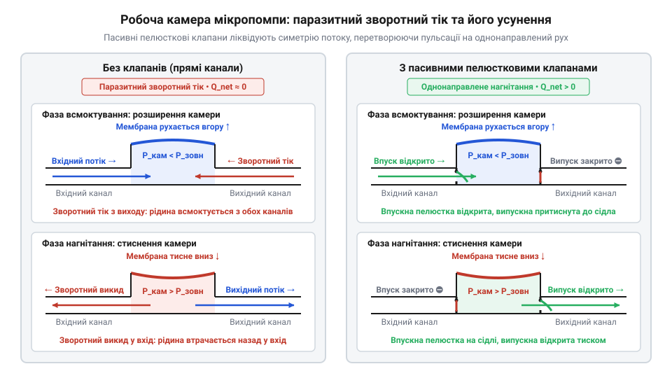
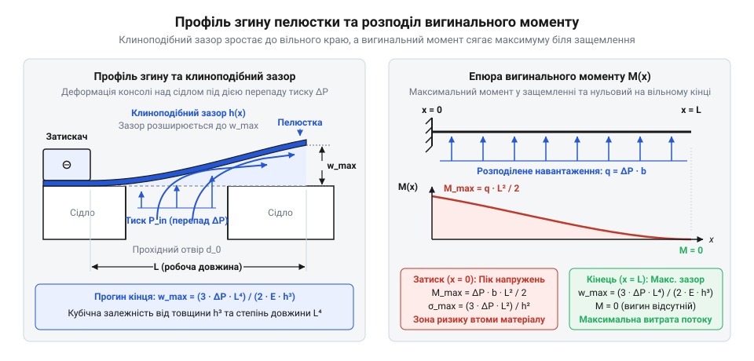
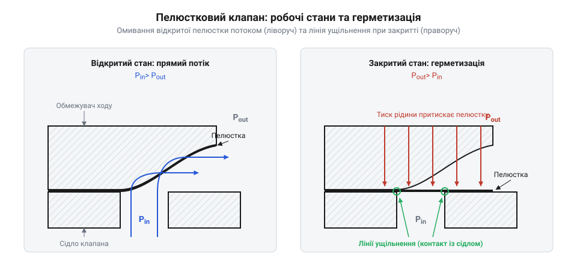
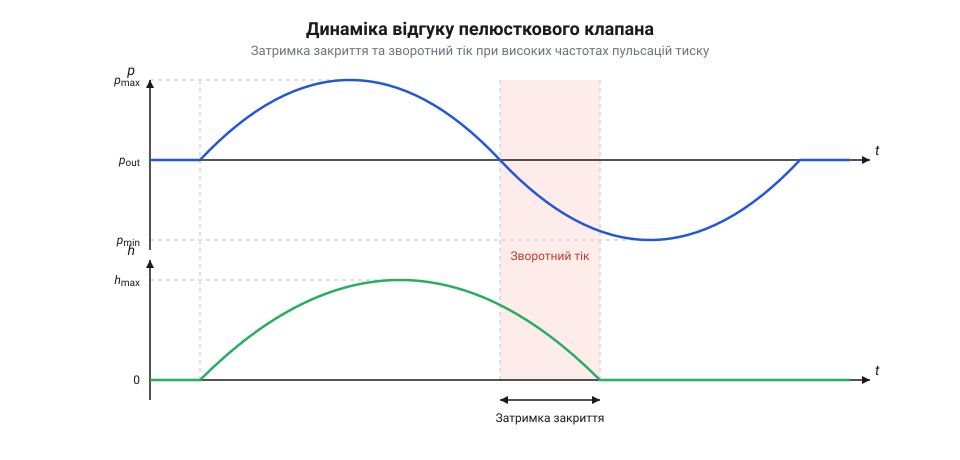
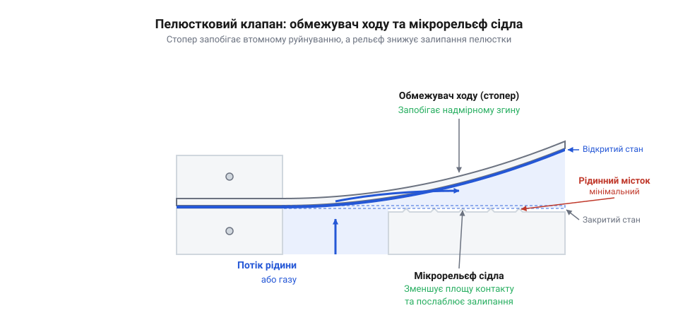

# Пелюсткові клапани мікрогідравліки

## Проблема зворотного току в мікропомпах

Без клапанів стиснення й розширення камери мікропомпи рухає рідину симетрично. Паразитний зворотний тік (англ. @@en|backflow@@, від англ. *back* — назад, та *flow* — потік) зводить об'ємний коефіцієнт корисної дії (англ. @@en|volumetric efficiency@@) до нуля.

Активні затвори в мікроелектромеханічних системах (англ. @@en|MEMS@@) громіздкі й не синхронізуються на високих частотах. Симетрію розриває пасивний пелюстковий клапан (англ. @@en|reed valve@@, від англ. *reed* — язичок, та *valve* — клапан), керований перепадом тиску (англ. @@en|pressure drop@@). Мала маса затвора забезпечує низький тиск відкриття (англ. @@en|cracking pressure@@) і сухе всмоктування (англ. @@en|dry suction@@): помпа виштовхує повітря на старті та затягує рідину без заливання.


*Симетричний перетік обнуляє подачу, а пасивні пелюстки спрямовують потік в один бік.*

## Фізика деформації пелюстки під тиском

Клапан працює як пружна консольна балка (англ. @@en|cantilever beam@@, від англ. *cantilever* — консоль) над сідлом клапана (англ. @@en|valve seat@@). Прогин кінця пелюстки `w_max` для довжини `L`, товщини `h` і модуля Юнга (англ. @@en|Young's modulus@@) `E` під дією перепаду тиску `ΔP` описує вираз:

```
w_max = (3 · ΔP · L⁴) / (2 · E · h³)
```

Кубічна залежність від товщини `h³` робить геометрію головним важелем: потоншення пелюстки вдвічі збільшує прогин увісім разів.


*Тиск розкриває клиноподібний зазор із максимальним прогином на краю та піковим моментом у затисненні.*

Прямий потік утворює клиноподібний зазор, а зворотний тиск притискає пластину до сідла вздовж лінії ущільнення. Для герметичності клапан монтують із попереднім пружним натягом (англ. @@en|pre-stress@@), що визначає початковий @@en|cracking pressure@@.


*Прямий потік омиває пластину, а зворотний тиск притискає її до сідла для ущільнення.*

## Геометрія сідла та гідравлічний опір

Гідравлічний опір (англ. @@en|hydraulic resistance@@) відкритого вузла складається з послідовного опору отвору сідла та щілини під пелюсткою. При підйомі понад 25–30% діаметра отвору настає гідравлічне насичення: опір щілини зникає, а витрату лімітує площа сідла.

Гострі кромки отвору збурюють вихори, знижуючи коефіцієнт витрати (англ. @@en|discharge coefficient@@) до `C_d ≈ 0.60`. Заокруглення кромок усуває зрив течії, підвищуючи `C_d` до `0.85–0.90`.

Ширина пояска ущільнення (англ. @@en|seat land@@) є компромісом: вузький пояс герметизує стик, але загрожує прорізанням пластини, а надто широкий провокує капілярне прилипання. Щоб скоротити хід до насичення, [під час проєктування сідла](root:cat-hw-actuators/reed-valves/proj-reed-valve-microfluidic-plate-design.md) формують ґратку з кількох дрібних отворів.

## Часова затримка та динаміка відгуку

На високих частотах пелюстка відстає від тиску. Рух у рідині захоплює прилеглі шари: приєднана маса рідини (англ. @@en|added mass@@) у кілька разів перевершує масу пелюстки, знижуючи її резонансну частоту в рідині `f_wet` у 2–3 рази.

Перед сідлом посадку гальмує демпфування стисненим шаром (англ. @@en|squeeze-film damping@@), створюючи часову затримку закриття `τ_close`.


*Запізнення посадки пелюстки утримує канал відкритим, спричиняючи фазовий зворотний витік.*

Якщо перепад тиску змінює знак до закриття, виникає фазовий @@en|backflow@@. Для збереження @@en|volumetric efficiency@@ частота помпи має бути нижчою за граничну частоту (англ. @@en|cut-off frequency@@) `f_cut ≈ 0.2 ... 0.3 · f_wet`, яку фіксують [на динамічному стенді](root:cat-hw-actuators/reed-valves/proj-reed-valve-test-bench-dynamics.md).

## Обмежувачі ходу, втомність і залипання

Мільйони циклів вигину викликають втомне руйнування (англ. @@en|fatigue failure@@, від лат. *fatigare* — виснажувати) у затисненому корені. Напруження обмежує профільований обмежувач ходу (англ. @@en|stroke limiter@@, від англ. *stroke* — хід, та *limit* — межа): на радіусі `R_limiter` напруження для товщини `h` і модуля Юнга `E` фіксується виразом:

```
σ_lim = (E · h) / (2 · R_limiter)
```

Це захищає корінь від втоми. Проте контакт у рідині породжує капілярне залипання (англ. @@en|stiction@@, від англ. *static* — статичний, та *friction* — тертя): рідинний меніск притягує пластину сильніше за її пружність, блокуючи клапан відкритим.


*Криволінійний упор обмежує згин пелюстки, а мікрорельєф розриває меніски проти залипання.*

Для високих частот обирають кремній або сталь, а для низького тиску — полідиметилсилоксан (англ. @@en|PDMS@@). Для розриву меніска на контактні площини наносять мікровершини (димпли), що знижують силу залипання на 80–90% за [вимогами монтажного інтерфейсу](root:cat-hw-actuators/reed-valves/api-reed-valve-fluidic-and-mechanical-interface.md).