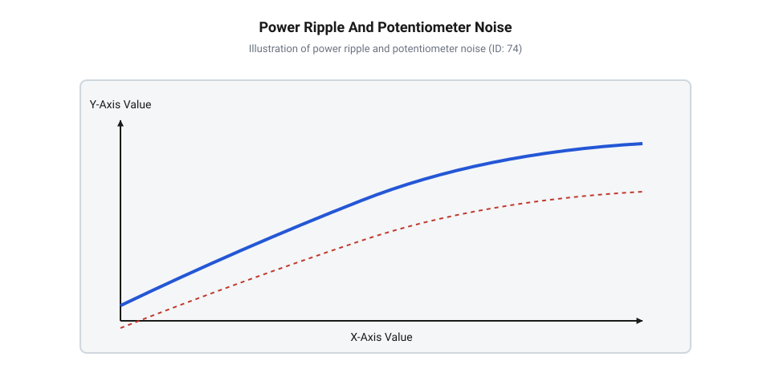
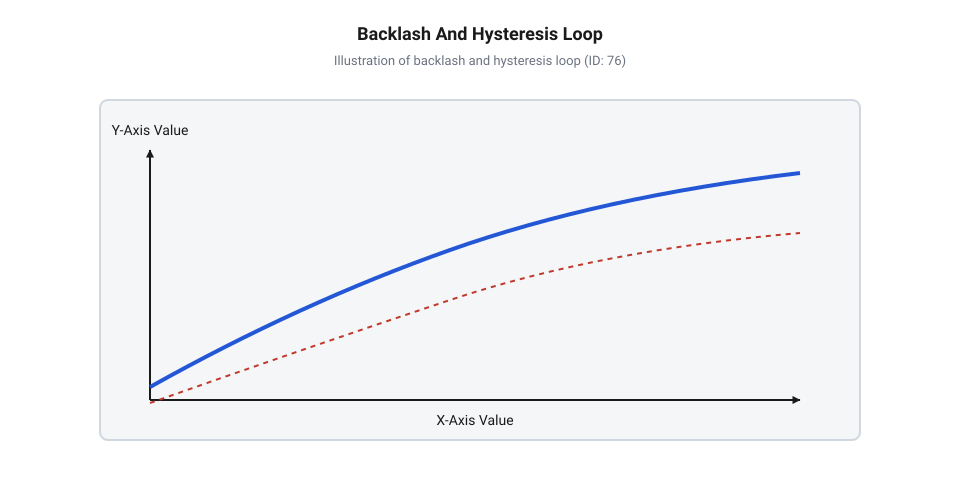
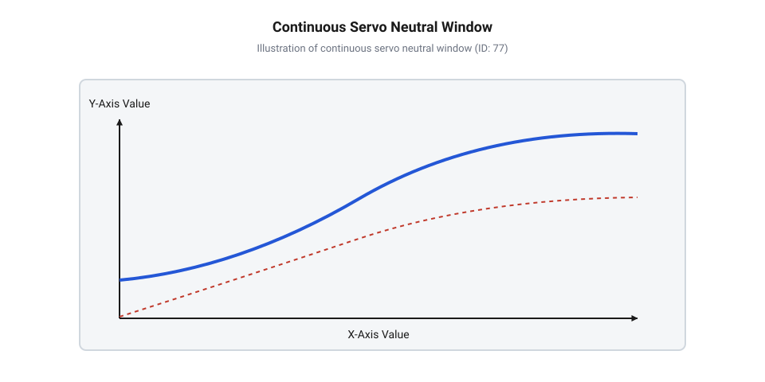

# Зона нечутливості та дрижання вала сервоприводів

<preknowlist>
- [Сервоприводи радіокерованих моделей: будова, редуктори та ШІМ-керування](root:cat-hw-actuators/rc-servo-mechanisms-and-control) — принципи пропорційного керування тривалістю імпульсу ШІМ та загальна будова замкненого контуру сервопривода.
- [Математика потенціометричного зворотного зв'язку сервоприводів](root:cat-hw-actuators/servo-feedback-potentiometer) — формування напруги похибки позиціонування на потенціометрі зворотного зв'язку.
- [Частота оновлення кадрів ШІМ і цикли позиціонування сервоприводів](root:cat-hw-actuators/servo-pwm-frame-rate) — часова структура кадрів керування ШІМ та періодичні цикли порівняння імпульсів у сервопідсилювачі.
</preknowlist>

## Неперервний гул та перегрів нейтралі

Змонтований у механічному вузлі сервопривід, такий як популярний @@en|micro-servo@@ [Tower Pro SG90](root:cat-hw-actuators/sg90-servo) або його версія з металевим редуктором [MG90S V2](root:cat-hw-actuators/mg90s-servo), стоїть у заданій позиції без підключення нових команд. Зовні вал здається абсолютно нерухомим, проте з корпусу пристрою чути характерне високочастотне дзижчання, гул або сухе тріскотіння. Якщо доторкнутися до корпусу руками, відчувається виразна дрібна вібрація, а через кілька хвилин стаціонарної роботи пластик чи метал редуктора відчутно нагріваються. Вмикання послідовного амперметра в коло живлення виявляє ще тривожніший симптом: замість очікуваного струму спокою у кілька міліампер сервопривід безперервно споживає значні імпульсні струми амплітудою в сотні міліампер.

Цей феномен паразитарних мікроколивань має назву @@en|jitter@@ (від англ. jitter — «тремтіння», «дрижання») або @@en|dither@@ (від англ. dither — «коливання», «дрижання»). На перший погляд здається дивним, що пристрій виснажує свій ресурс у стані спокою. Спрощені припущення часто зводять це до поломки шестерень або дефекту мотора, проте справжня причина лежить у самій природі замкненого контуру керування.

Усередині класичного сервопривода працює неперервний @@en|feedback loop@@ (від англ. feedback loop — «контур зворотного зв'язку»). Пристрій не просто відпрацьовує зовнішню ширину імпульсу, а постійно порівнює задане положення із поточним кутом повороту вихідного вала. Сигнал керування надходить у вигляді імпульсів @@en|pulse-width modulation@@ (від англ. pulse-width modulation, PWM — «широтно-імпульсна модуляція»), де тривалість імпульсу (зазвичай від 1000 до 2000 мікросекунд) визначає цільовий кут. Внутрішній потенціометричний датчик, закріплений на вихідному валу, формує аналогову напругу, пропорційну реальному куту. 

Коли сигнал надходить на [вхід аналогової схеми](root:cat-hw-actuators/rc-servo-mechanisms-and-control) сервопідсилювача, генератор імпульсів створює внутрішній опорний сигнал, тривалість якого задається потенціометром. Схема порівняння обчислює похибку позиціонування `e(t)` у мікросекундах як різницю між тривалістю вхідного керувального імпульсу `t_in(t)` та тривалістю внутрішнього імпульсу зворотного зв'язку `t_pot(t)`:

```
e(t) = t_in(t) - t_pot(t)
```

У цьому виразі символом `t_in(t)` позначено тривалість вхідного ШІМ-імпульсу в момент часу `t`, а `t_pot(t)` — тривалість імпульсу, згенерованого внутрішнім одновібратором на основі поточного опору потенціометра. Якщо вал знаходиться у заданому положенні, значення обох тривалостей збігаються, даючи нульову похибку.

Якщо вал сервопривода відхилився від заданої точки бодай на мікроскопічну частку градуса під дією сили тяжіння чи механічного пружного напруження [кінематика важільних механізмів](root:cat-hw-actuators/servo-pushrod-kinematics), виникає похибка `e(t) ≠ 0`. Схема підсилювача негайно відкриває силові ключі мостового драйвера (@@en|H-bridge@@, від англ. H-bridge — «H-міст»), подаючи напругу на обмотки мотора постійного струму. Мотор починає обертатися, намагаючись звести похибку до нуля.

Тут вступає в дію фізика механічного тертя та інерції мотора. Щоб зрушити зафіксований ротор і редуктор з місця, мотор повинен подолати статичне тертя (@@en|stiction@@, від англ. static friction — «статичне тертя») в опорних втулках та зачепленнях зубців. Підсилювач збільшує напругу доти, доки крутний момент не перевищить поріг статичного тертя. Проте щойно ротор зривається в рух, коефіцієнт тертя стрімко падає від статичного до нижчого кінематичного тертя. В результаті мотор робить занадто великий мікрокрок і за інерцією перескакує точку рівноваги.

Похибка `e(t)` миттєво змінює знак на протилежний. Схема порівняння фіксує перелітання і змінює полярність напруги на виході @@en|H-bridge@@, примушуючи мотор тягнути вал у зворотному напрямку. Процес повторюється: мотор знову долає статичне тертя, перелітає нейтраль в інший бік і входить у режим стійких автоколивань навколо заданого положення. У теорії автоматичного керування цей стан постійного пошуку рівноваги називається @@en|hunting@@ (від англ. hunting — «пошук рівноваги»).

Ситуація додатково ускладнюється електричними чинниками. Кожен такт увімкнення мотора викликає короткочасне кидкове споживання струму. Якщо лінія живлення сервопривода має відчутний омічний опір провідників або недостатню ємність фільтрувальних конденсаторів, виникає імпульсне просідання напруги живлення. Оскільки напруга живлення часто слугує опорною для аналогових компараторів або внутрішнього генератора, коливання шини живлення накладаються на вимірювальну напругу потенціометра. Виникає хибна напруга похибки навіть тоді, коли механічний вал залишається абсолютно нерухомим.

Крім того, сам потенціометр зворотного зв'язку піддається механічному зношуванню. Графітова струмопровідна доріжка під ковзним контактом з часом вкривається мікроскопічним пилом та оксидами. Під час мікрорухів виникає нестабільний перехідний опір контакту (@@en|contact resistance@@, від англ. contact resistance — «перехідний опір контакту»), який створює електричний шум. Підсилювач сприймає ці сплески як реальне зміщення вала.


*Часова діаграма напруги живлення та сигналу потенціометра при дрижанні вала: пульсації живлення та електричний шум стирання доріжки потенціометра створюють помилкову напругу похибки.*

Під час таких автоколивань мотор переключається з частотою [кадрів керування ШІМ](root:cat-hw-actuators/servo-pwm-frame-rate) (від 50 Гц в аналогових приводів до 300 Гц і вище у цифрових). Ротор не встигає розігнатися до повноцінного обертання, перетворюючись на електромеханічний вібратор. Оскільки електрична енергія подається на обмотки мотора регулярно, але механічна робота з переміщення корисною не є, вся підведена потужність розсіюється на активному опорі обмоток у вигляді тепла. Завдяки цьому активується небажана [теплова модель нагріву](root:cat-hw-actuators/servo-thermal-protection), яка за тривалої стаціонарної роботи здатна розплавити пластикові посадочні місця шестерень і викликати деградацію ізоляції мотора.

Для глибокого аналізу динаміки цих коливань застосовують метод [аналізу гармонічного балансу](root:cat-hw-actuators/servo-deadband-and-jitter/math-servo-jitter-limit-cycles-and-backlash.md), який розглядає фазову площину системи з урахуванням сухого тертя та люфту. На практиці виміряти амплітуду та спектральний склад цих коливань можна за допомогою [спеціального діагностичного стенда](root:cat-hw-actuators/servo-deadband-and-jitter/proj-servo-jitter-and-deadband-measurer.md) на базі мікроконтролера та струмового шунта.

Зменшити рівень електричних завад допомагають витримані [вимоги до ліній живлення](root:cat-hw-actuators/servo-deadband-and-jitter/api-servo-deadband-and-jitter-hardware-spec.md) та якісна [фільтрація шини живлення](root:hw-power/servo-power-distribution-and-filtering). Проте повністю усунути механічне тертя та дискретність позиціонування схемотехнічними фільтрами неможливо. Щоб розривати безупинне коло автоколивань у стані спокою, у контур керування сервопривода обов'язково впроваджують штучний бар'єр — зону нечутливості.

## Фізика й ширина зони нечутливості

Щоб зупинити нескінченні автоколивання та позбутися постійного нагріву мотора у нейтралі, керувальна електроніка сервопривода повинна ігнорувати мікроскопічні відхилення вала, які не перевищують заданого безпечного порогу. Цей поріг називається зоною нечутливості (@@en|deadband@@, від англ. dead band — «мертва смуга»).

Фізичний зміст зони нечутливості полягає у навмисному введенні нелінійності типу «вікно мовчання» у передавальну характеристику сервопідсилювача. Коли величина похибки позиціонування `|e(t)|` перебуває у межах заданого інтервалу, підсилювач повністю вимикає керувальну напругу на виході @@en|H-bridge@@. Мотор знеструмлюється, а вихідний вал залишається зафіксованим виключно за рахунок механічного тертя редуктора.

Залежність напруги живлення мотора `U_out` від величини похибки `e` описується кусково-лінійною функцією `f(e)`:

```
U_out(e) = 0,                        якщо |e| ≤ ε
U_out(e) = K_p × (e - ε × sgn(e)),   якщо |e| > ε
```

У цьому виразі символ `ε` означає півширину зони нечутливості, `K_p` — коефіцієнт пропорційного підсилення (@@en|proportional gain@@, від англ. proportional gain — «коефіцієнт пропорційного підсилення») сервопідсилювача, а `sgn(e)` — математична функція знака похибки, яка повертає `+1` для додатних значень та `-1` для від'ємних. Повна ширина зони нечутливості (@@en|deadband width@@, від англ. deadband width — «ширина зони нечутливості») становить `2ε`. З виразу чітко видно: поки абсолютне значення похибки `|e|` не перевищує поріг `ε`, напруга на виході силового моста дорівнює нулю.


*Графік передавальної характеристики сервопідсилювача з виділеною зоною нечутливості навколо точки рівноваги, у межах якої напруга на виході моста дорівнює нулю.*

Ширина зони нечутливості вимірюється в часових одиницях тривалості керувального імпульсу — мікросекундах (мкс, µs). Оскільки стандартний повний кут повороту сервопривода (наприклад, 180°) кодується діапазоном тривалості імпульсу від 1000 мкс до 2000 мкс (загальна ширина робочого вікна 1000 мкс), кожен 1 мкс імпульсу відповідає приблизно 0.18° повороту вала.

У традиційних аналогових сервоприводах, побудованих на базі [інтегральних аналогових сервопідсилювачів](root:cat-hw-actuators/analog-servo-amplifier-ic), ширина зони нечутливості визначається апаратними компонентами — параметрами внутрішніх часозадаючих RC-ланцюгів та порогами спрацьовування компараторів. Для більшості аналогових приводів типова ширина зони нечутливості становить від 5 мкс до 8 мкс. Це означає, що вал може відхилитися на `±0.45°`–`±0.72°` від ідеальної точки без жодної реакції з боку мотора.

Така порівняно широка зона нечутливості в аналогових системах є вимушеним компромісом. Оскільки аналоговий підсилювач оновлює стан моста лише один раз за кадр ШІМ (кожні 20 мс, тобто з частотою 50 Гц), звуження зони нечутливості нижче 4 мкс неминуче спричиняє розгойдування системи через запізнення зворотного зв'язку.

Натомість цифрові сервоприводи, налаштування регістрів яких здійснюється через [програмування регістрів цифрових](root:cat-hw-actuators/digital-servo-programmer-and-registers), оцифровують вхідний сигнал та сигнал потенціометра за допомогою швидкого мікроконтролера. Завдяки високій частоті обробки контуру зворотного зв'язку (від 300 Гц до 1 кГц) цифрові приводи дозволяють звузити зону нечутливості до 1 мкс або навіть 0.5 мкс. Це забезпечує виняткову кутову точність позиціонування та високий момент утримання (@@en|holding torque@@, від англ. holding torque — «момент утримання») нейтралі.

Проте звуження зони нечутливості ставить жорсткі вимоги до якості механічної передачі. Якщо у шестеренчастому редукторі є механічний люфт (@@en|backlash@@, від англ. backlash — «люфт»), взаємодія зони нечутливості з зазорами зубців може призвести до небезпечного динамічного ефекту — виникнення гістерезисної петлі (@@en|hysteresis loop@@, від англ. hysteresis loop — «петля гістерезису») та автоколивань.

Кутовий зазор між зубцями шестерень утворює мертвий хід редуктора `θ_b`. Коли мотор змінює напрямок обертання, ротор разом із первинними шестернями повертається на кут люфту без переміщення вихідного вала й потенціометра зворотного зв'язку. Потенціометр, встановлений на вихідному валу, «не бачить» вибірки зазору в редукторі.

Якщо повний кутовий люфт редуктора `θ_b`, виражений у мікросекундах еквівалентного імпульсу `t_b`, перевищує ширину зони нечутливості (тобто `t_b > 2ε`), замкнений контур втрачає стійкість. Мотор, намагаючись скоригувати похибку, швидко розганяється під час вибірки люфту, коли навантаження на роторі мінімальне. Пройшовши зазор, шестерні з ударом зачіплюють вихідний вал і за інерцією виштовхують потенціометр за протилежну межу зони нечутливості `+ε`. Підсилювач вимикає мотор, але кінетична енергія вала продовжує рух, знову створюючи похибку вже іншого знаку.


*Схема механічного зазору шестерень редуктора та його відображення на гістерезисній петлі зворотного зв'язку, що ілюструє втрату кінематичного зв'язку мотора з потенціометром.*

Для запобігання автоколиванням через люфт редуктора фундаментальна умова стійкості замкненого контуру визначається співвідношенням:

```
2ε > t_b
```

У цьому виразі величина `2ε` відповідає повній ширині зони нечутливості в мікросекундах, а `t_b` — еквівалентному часовому зазору механічного люфту редуктора. Якщо ця умова порушується, мотор буде неминуче розганятися під час вибірки механічного люфту й перелітати зону нечутливості.

Детальний аналіз таких станів наведено в [математичній моделі гістерезису](root:cat-hw-actuators/servo-deadband-and-jitter/math-servo-deadband-and-hysteresis-loop.md). У приводах із вуглеволоконним або металевим редуктором, як-от [SG92R](root:cat-hw-actuators/sg92r-servo) чи серіях від [Power HD](root:cat-hw-actuators/powerhd-family), деталі взаємодії люфту розкрито у матеріалі про [люфт і пружність редуктора](root:cat-hw-actuators/servo-gearboxes-and-backlash).

Еволюційний шлях від перших спроб стабілізації вала на базі [дискретних перемикачів](root:cat-hw-actuators/rc-escapement-mechanisms) до сучасних адаптивних цифрових алгоритмів розглядається в [історичному огляді розвитку](root:cat-hw-actuators/servo-deadband-and-jitter/hist-servo-deadband-and-jitter-evolution.md). Програмне ж керування часовими параметрами приводу здійснюється за допомогою функцій [програмного інтерфейсу C/C++](root:cat-hw-actuators/servo-deadband-and-jitter/api-servo-deadband-and-jitter-software-config.md).

Таким чином, зона нечутливості являє собою фундаментальний інженерний компроміс: вона захищає привід від перегріву, перевитрати енергії та прискореного зносу механіки, віддаючи натомість мікроскопічну частку абсолютної точності позиціонування.

## Люфт редуктора та гістерезис зворотного зв'язку

Коли сервопідсилювач подає керувальний струм на електродвигун, обертовий момент передається через каскад шестерень на вихідний вал. У будь-якій механічній колісній передачі між зубами шестерень завжди існує технологічний зазор — @@en|backlash@@ (від англ. @@en|backlash@@ — люфт, зазор). Через цей зазор вихідний вал сервопривода може повертатися на невеликий кут без найменшого зміщення вала самого мотора чи шестерень початкових ступенів. У зворотний бік відбувається те саме: мотор уже почав обертатися, а вихідний вал іще стоїть на місці, поки не вибрано механічний зазор. У сервоприводах з потенціометричним датчиком позицію зчитує @@en|potentiometer@@ (від лат. @@la|potentia@@ — сила + дав.-гр. μέτρον — вимірювач), який механічно жорстко зв'язаний із вихідним валом або проміжною шестернею. Проте зазори в зубах створюють невідповідність між кутом вала мотора та напругою на потенціометрі, формуючи в контурі зворотного зв'язку явний @@en|гістерезис@@ (від дав.-гр. ὕστερησις — запізнення, відставання).

Фізична природа цього гістерезису полягає в тому, що траєкторія змінення напруги похибки при русі за годинниковою стрілкою не збігається з траєкторією при русі проти годинникової стрілки. Кутовий люфт редуктора `t_b` (у мікросекундах еквівалентної тривалості імпульсу ШІМ або в градусах) створює нечутливий механічний інтервал. До цього додається осьове та радіальне биття валів, пружна деформація пластикових чи латунних зубів під навантаженням та сухе тертя — @@en|stiction@@ (від англ. @@en|stiction@@ — статичне тертя) — повзунка потенціометра об резистивну доріжку. Для опису цієї поведінки застосовують [математичну модель контуру](root:cat-hw-actuators/servo-deadband-and-jitter/math-servo-deadband-and-hysteresis-loop.md), де нелінійна функція `f(e)` враховує ширину зони нечутливості та петлю гістерезису.

Головна небезпека виникає тоді, коли ширина зони нечутливості `2ε` виявиться меншою за кутовий люфт редуктора `t_b` (`2ε < t_b`). У такому стані сервопривод потрапляє в замкнену пастку автоколивань — так званий @@en|hunting@@ (від англ. @@en|hunting@@ — пошук рівноваги). Процес розгортається за чітким ланцюжком:

1. На вхід сервопідсилювача надходить імпульс @@en|pulse-width modulation@@ (від англ. @@en|pulse-width modulation@@ — широтно-імпульсна модуляція). Сервопідсилювач відкриває ключі @@en|H-bridge@@ (від англ. @@en|H-bridge@@ — H-міст) і розганяє мотор до заданої позиції. 2. Потенціометр досягає точки рівноваги, і напруга похибки стає рівною нулю. Мотор знеструмлюється. 3. Сила інерції ротора та вихідного навантаження продовжує рухати вал далі. Шестерні проскочують через зазор `t_b`. 4. Оскільки ширина зони нечутливості `2ε` вужча за зазор люфту `t_b`, потенціометр встигає вийти за межу зони нечутливості `e < -ε` до того, як механічний люфт буде вибрано. 5. Сервопідсилювач фіксує похибку протилежного знака й вмикає реверс мотора. Мотор починає вибирати люфт у зворотному напрямку, знову пролітає точку рівноваги та повторює цикл.

У результаті виникає стаціонарний @@en|limit cycle@@ (від англ. @@en|limit cycle@@ — граничний цикл) автоколивань, який розгойдує вал із частотою механічного резонансу редуктора. Щоб уникнути цього явища, ширина зони нечутливості повинна суворо задовольняти умову стійкості:

```
2ε > t_b     [умова відсутності гістерезисних автоколивань]
```

Для аналізу таких режимів застосовують [аналіз фазової площини](root:cat-hw-actuators/servo-deadband-and-jitter/math-servo-jitter-limit-cycles-and-backlash.md), який визначає межі стійкості контуру за методом описових функцій. Історично розробники сервоприводів вирішували цю проблему розширенням аналогової зони нечутливості, проте це погіршувало точність позиціонування, про що свідчить [еволюція засобів стабілізації](root:cat-hw-actuators/servo-deadband-and-jitter/hist-servo-deadband-and-jitter-evolution.md) у сервоприводах.

На практиці інженеру важливо відрізняти автоколивання через занадто вузьку зону нечутливості від розгойдування через механічний люфт редуктора:

- **Вузька зона нечутливості (вузький @@en|deadband@@)**: Сервопривод видає високочастотне гудіння або дзижчання (100–300 Гц у цифрових і 50 Гц в аналогових моделях). Мотор споживає підвищений струм і гріється навіть у стані спокою. Якщо легенько торкнутися пальцем вала, дзижчання змінює тон, але не зникає. - **Механічний люфт редуктора (великий @@en|backlash@@)**: Вал здійснює низькочастотні видимі коливання або розгойдування (5–20 Гц) із великою амплітудою. Якщо прикласти до вала невеликий статичний зовнішній момент (притиснути палець в один бік), щоб повністю вибрати зазор між зубами шестерень, коливання миттєво припиняються. Щойно зовнішній момент знімається, розгойдування відновлюється.

При розрахунку кінематики робототехнічних систем необхідно враховувати, що [похибки пружності редуктора](root:cat-hw-actuators/servo-gearboxes-and-backlash) та знос зубів суттєво збільшують люфт із часом. Наприклад, у популярних [аналогових сервоприводах SG90](root:cat-hw-actuators/sg90-servo) із пластиковим редуктором початковий люфт становить 0.8–1.2°, тоді як у [мікросервоприводах MG90S](root:cat-hw-actuators/mg90s-servo) із металевим редуктором він складає 0.3–0.5°. Коли вал сервопривода з'єднаний із важелем, [кінематику важільних тяг](root:cat-hw-actuators/servo-pushrod-kinematics) розраховують так, щоб довжина плеча не підсилювала кутовий люфт редуктора.

Переведемо кутовий люфт редуктора `θ_b` у необхідну мінімальну ширину зони нечутливості `ε_min` у мікросекундах ШІМ-імпульсу.

**Розрахунок мінімальної зони нечутливості для металевого редуктора**

Розрахуємо еквівалентну тривалість імпульсу для сервопривода з робочим кутом 180° при діапазоні ШІМ від 500 до 2500 мкс (градієнт `S = 2000 мкс / 180° = 11.11 мкс/°`). Нехай кутовий люфт складає `θ_b = 0.5°`.

```
t_b = θ_b × S
    = 0.5° × 11.11 мкс/°     [переведення кута в тривалість імпульсу]
    = 5.55 мкс               [еквівалентний часовий люфт]

2ε_min > t_b                 [критерій стійкості]
ε_min > 5.55 / 2
ε_min > 2.78 мкс             [половина ширини зони нечутливості]
```

Отже, для запобігання автоколиванням ширина зони нечутливості `2ε` повинна становити щонайменше 6 мкс. Якщо прошивка цифрового сервопривода встановлена на значення 1 мкс, редуктор із люфтом 0.5° буде неминуче дрижати.

## Шуми живлення та коефіцієнт підсилення

Навіть за повної відсутності механічного люфту редуктора вал сервопривода може здійснювати паразитарне дрижання — @@en|dither@@ (від англ. @@en|dither@@ — дрижання, коливання) або @@en|jitter@@ (від англ. @@en|jitter@@ — високочастотне дрижання). Причиною цього є електрична нестабільність кіл зворотного зв'язку, просідання напруги живлення та завищений @@en|proportional gain@@ (від англ. @@en|proportional gain@@ — пропорційний коефіцієнт підсилення) контуру регулювання.

Першою електричною причиною дрижання є імпульсне просідання напруги на шині живлення VCC. Під час пуску або реверсу колекторного мотора пусковий струм сервопривода короткочасно зростає до 1.5–2.5 А. Якщо джерело живлення має високий внутрішній опір або підключене через тонкі провідники, напруга на силовій шині просідає на 0.5–1.0 В. Оскільки потенціометр зворотного зв'язку живиться від тієї ж шини або від спрощеного внутрішнього опорного джерела, зміна VCC викликає хибний зсув напруги на виході потенціометра `V_pot`. Для опису цих процесів використовують [специфікацію електричного живлення](root:cat-hw-actuators/servo-deadband-and-jitter/api-servo-deadband-and-jitter-hardware-spec.md), яка визначає допустимі рівні пульсацій напруги.

У результаті виникає позитивний зворотний зв'язок:

1. Мотор починає рухатися і створює пік споживання струму. 2. Напруга живлення VCC знижується, викличучи зміщення опорної напруги компаратора чи АЦП. 3. Схема керування інтерпретує це як раптову похибку позиції `e` і подає на мотор ще більший імпульс струму. 4. Після зупинки мотора напруга VCC відновлюється, похибка змінює знак, і мотор кидається у зворотний бік.

Для запобігання цим коливанням застосовують [фільтрацію імпульсних завад](root:hw-power/servo-power-distribution-and-filtering) у силових колах та розв'язувальні конденсатори. Застарілі сервопідсилювачі, побудовані на [аналогових сервопідсилювачах KC2462](root:cat-hw-actuators/analog-servo-amplifier-ic), були особливо вразливими до цього ефекту через відсутність внутрішнього нормалізатора опорної напруги.

Другою причиною є електричні шуми доріжки потенціометра. У процесі експлуатації струмознімач потенціометра протирає графітовий або металокерамічний шар. Опір контакту флуктує, створюючи високочастотні сплески напруги `ΔV_err`. У цифрових сервоприводах високошвидкісний аналогово-цифровий перетворювач (АЦП) зчитує ці шуми та генерує серію коротких мікроімпульсів на мікроконтролер. Вал при цьому макроскопічно стоїть на місці, але сервопривод видає характерне тріщання й інтенсивно гріється. Порівняно з резистивними датчиками, безконтактні сенсори, які описані в матеріалі про [магнітні енкодери зв'язку](root:cat-hw-actuators/servo-feedback-potentiometer), повністю позбавлені проблеми контактного шуму.

Третьою причиною є перевищення коефіцієнта підсилення пропорційної ланки `K_p`. Закон пропорційного керування має вигляд:

```
U_out = K_p × f(e)           [сформована напруга керування мотором]
```

Збільшення `K_p` дозволяє отримати високий @@en|holding torque@@ (від англ. @@en|holding torque@@ — утримувальний момент) та швидкий відгук. Проте в системі з інерційністю ротора мотора `J` та затримкою спрацьовування H-моста надмірний коефіцієнт `K_p` перетворює негативний зворотний зв'язок на позитивний на частоті зрізу контуру. Виникає незгасаючий граничний цикл: мотор перелітає точку рівноваги, зона нечутливості проскочується на високій швидкості, і гальмівний момент прикладається із запізненням.

Проводити дослідження та спектральний аналіз таких завад зручно на спеціальному [діагностичному вимірювальному стенді](root:cat-hw-actuators/servo-deadband-and-jitter/proj-servo-jitter-and-deadband-measurer.md), який дає змогу знімати осцилограми струму споживання та спектр дрижання вала. Для швидкої діагностики електричних першопричин використовують таку матрицю ідентифікації:

| Першопричина дрижання | Характерні ознаки | Спосіб усунення |
| :--- | :--- | :--- |
| **Просідання VCC** | Дрижання посилюється при одночасному русі кількох приводів або при збільшенні навантаження. | Встановлення low-ESR конденсатора (470–1000 мкФ) біля роз'єму сервопривода; товстіші провідники живлення. |
| **Шум потенціометра** | Дрижання виникає лише в певних кутових зонах вала; при зміні позиції на 5–10° дрижання зникає. | Заміна сервопривода або перехід на магнітний енкодер; програмна медіанна фільтрація сигналу АЦП. |
| **Завищений `K_p`** | Сонний сервопривод високочастотно дрижить і видає різкий металевий писк навіть при ідеальному живленні. | Зменшення `K_p` у [регістрах цифрових сервоприводів](root:cat-hw-actuators/digital-servo-programmer-and-registers) або розширення зони нечутливості. |

У сучасних мікроконтролерних системах для придушення електричного дрижання реалізують программну фільтрацію сигналів та гістерезисну зону нечутливості, що розглядає [програмний інтерфейс конфігурування](root:cat-hw-actuators/servo-deadband-and-jitter/api-servo-deadband-and-jitter-software-config.md).

Нижче наведено приклад реалізації програмного фільтра та зони нечутливості на мовах C та C++ для зчитування аналогового потенціометра та обчислення керувальної напруги:

:::tabs

@tab C
:::code servo-deadband-and-jitter-d/c/snippet-1.c

@tab C++
:::code servo-deadband-and-jitter-d/cpp/servocontrollercpp.cpp

:::

## Повзання нейтралі приводів постійного обертання

Коли робототехнічна платформа або мобільна колісна система має зупинитися на місці, мікроконтролер надсилає на привод керувальний імпульс тривалістю 1500 мкс. Для стандартного сервомотора це означає встановлення вихідного вала у середній кутовий стан 90°. Проте у колісній робототехніці надзвичайно поширені [сервоприводи постійного обертання](root:cat-hw-actuators/continuous-rotation-servo-mod) (від @@en|continuous rotation servo@@). У цих модифікованих приводах внутрішній потенціометр зворотного зв'язку механічно від'єднують від вихідного редуктора або замінюють на внутрішній стаціонарний резистивний дільник напруги. Через це внутрішній підсилювач сервопривода сприймає тривалість імпульсу широтно-імпульсної модуляції (від @@en|pulse-width modulation@@, @@en|PWM@@) не як вимогу повернути вал на певний кут, а як команду задати кутову швидкість і напрямок обертання ротора.

В ідеальній математичній моделі тривалість імпульсу 1500 мкс відповідає абсолютно нульовій швидкості обертання — повній зупинці. На практиці ж робототехніки постійно зіштовхуються з тим, що робот після команди зупинки продовжує повільно обертати колеса, виявляючи небажане явище, яке називають [повзанням нейтралі](root:cat-hw-actuators/continuous-servo-potentiometer-tuning) (від @@en|neutral drift@@ або @@en|neutral creep@@). 

Причина цього дрейфу полягає у фізичному влаштуванні внутрішнього порівняльного контуру, де працюють [аналогові сервопідсилювачі KC2462](root:cat-hw-actuators/analog-servo-amplifier-ic) (від @@en|analog servo amplifier@@) або їхні цифрові аналоги. Підсилювач безперервно вимірює різницю між опорною часовою тривалістю внутрішнього генератора та тривалістю вхідного імпульсу ШІМ. У модифікованому приваді зона нечутливості (від @@en|deadband@@) нейтралі формує «безпечне вікно» тривалості імпульсів навколо центрального значення `t_neutral`, у межах якого вихідний містковий підсилювач (від @@en|H-bridge@@) повністю знеструмлює обмотки двигуна.


*Часова шкала ширини імпульсу ШІМ для сервопривода постійного обертання з позначенням центральної зони нечутливості нейтралі.*

Ширина зони нечутливості нейтралі задає часовий інтервал `[t_neutral - ε, t_neutral + ε]`, де `ε` — половина ширини deadband у мікросекундах. Вихідна напруга `U_out`, яка подається на мостиковий драйвер мотора, визначається алгебраїчною залежністю від похибки тривалості `e`:

```
e = t_pulse - t_neutral       [похибка тривалості вхідного імпульсу]
```

```
U_out = 0                     [при |e| ≤ ε]
U_out = K_p × (e - ε)         [при e > ε, обертання за годинниковою стрілкою]
U_out = K_p × (e + ε)         [при e < -ε, обертання проти годинниковою стрілкою]
```

Тут `K_p` позначає коефіцієнт пропорційного підсилення внутрішнього контуру. Якщо виставлена ширина deadband `2ε` є надто вузькою (наприклад, 1–2 мкс), то навіть найменше часове відхилення керувального сигналу або мікроскопічний дрейф внутрішньої напруги виводить величину `|e|` за межі `ε`. Отриманої напруги `U_out` стає достатньо, щоб подолати тертя спокою (від @@en|stiction@@) у шестернях і змусити мотор повільно обертати вихідний вал.

Головними джерелами повзання нейтралі є три фізичні чинники:

1. **Температурний дрейф опору.** Внутрішній підлаштувальний потенціометр (від @@en|trimmer potentiometer@@) має температурний коефіцієнт опору. Коли мотор і підсилювач нагріваються під час роботи, опір резистивної доріжки змінюється. Це зсуває еквівалентну точку нейтралі `t_neutral` на 5–15 мкс, через що фіксований імпульс 1500 мкс опиняється поза межами вузької зони deadband. 2. **Просідання та шуми живлення.** Зміни напруги на силовій шині VCC викликають зсув опорних напруг внутрішнього компаратора. Якщо не оптимізована [схемотехніка живлення](root:hw-power/servo-power-distribution-and-filtering) та відсутня належна фільтрація завад, пороги компаратора плавають разом із навантаженням. 3. **Програмний дрижання (jitter) ШІМ-сигналу.** Мікроконтролер, який генерує ШІМ за допомогою обробників переривань таймерів, відчуває часову затримку (від @@en|jitter@@) через виконання інших системних задач. Якщо амплітуда дрижання імпульсів перевищує `ε`, колесо робота буде періодично смикатися або повільно повзти.

Для боротьби з повзанням нейтралі застосовують комплексні заходи. На фізичному рівні здійснюють первинне калібрування: звертаючись до специфікації, де описано [залізничний інтерфейс](root:cat-hw-actuators/servo-deadband-and-jitter/api-servo-deadband-and-jitter-hardware-spec.md) електричного підключення, обертають гвинт підлаштувального потенціометра до зупинки ротора при сигналі 1500 мкс. На програмному рівні ширину deadband у контролері навмисно розширюють до 15–20 мкс або тимчасово вимикають генерацію ШІМ (команда detach), позбавляючи мотор напруги у стані спокою.

## Методика діагностики та налаштування зони

Вибір оптимальної ширини зони нечутливості (від @@en|deadband@@) є ключовим інженерним завданням при проектуванні сервоприводних систем. Налаштування deadband являє собою фундаментальний компроміс між точністю позиціонування (від @@en|positioning accuracy@@) та кінематичною стійкістю контуру зворотного зв'язку. Якщо обрати зону нечутливості вужчою за механічний люфт (від @@en|backlash@@) редуктора чи електричний шум датчика, контур керування увійде в стан незгасаючих автоколивань. Вал почне високочастотно тремтіти (дзижчати від @@en|dither@@), спричиняючи прискорений [абразивний знос шестерень](root:cat-hw-actuators/servo-gear-shear-and-wear), підвищене споживання струму та небезпечне перегрівання мотора. Натомість надмірно широка зона створить значний кутовий люфт позиціонування, через який вихідний важіль буде відхилятися під дією зовнішнього навантаження без реакції з боку підсилювача.

При проведенні діагностики важливо чітко розрізняти три основні типи паразитарної поведінки вала в стані спокою:

1. **Високочастотне дзижчання (dither).** Мотор видає безперервний гуд, а струм споживання містить короткі високочастотні імпульси. Причина — занадто вузька зона `2ε`, яка реагує на мікроскопічні шуми контакту потенціометра або високий пропорційний коефіцієнт підсилення `K_p`. 2. **Низькочастотне розгойдування (hunting).** Вал здійснює повільні коливання відносно заданої позиції з амплітудою в кілька градусів. Причина — порушення умови стійкості, коли ширина deadband `2ε` є меншою за кутовий люфт редуктора `t_b` (`2ε < t_b`), що викликає перельоти точки рівноваги через тертя спокою (від @@en|stiction@@). 3. **Хаотичні ривки (jitter).** Неперіодичні смикання вала, викликані імпульсними завадами в колах живлення або часовим дрижанням вхідного імпульсу ШІМ від мікроконтролера.

Для точного вимірювання параметрів у лабораторних умовах збирають [діагностичний стенд](root:cat-hw-actuators/servo-deadband-and-jitter/proj-servo-jitter-and-deadband-measurer.md) на базі токового шунта, осцилографа та контролера вимірювань. Алгоритм діагностики та послідовного налаштування містить наступні кроки:

1. **Вимірювання струму спокою.** Привод підключають до лабораторного джерела живлення. Якщо струм спокою (від @@en|quiescent current@@) перевищує паспортне значення у кілька разів, це підтверджує наявність внутрішнього dither через вузький deadband. 2. **Оцінка кутового люфту редуктора.** Фіксують корпус сервопривода і прикладають до вала змінний механічний момент, вимірюючи кут вільного ходу. Отримане значення люфту перераховують у часовий еквівалент імпульсу `t_b` (у мікросекундах). 3. **Перевірка сили завад сигнальної лінії.** Осцилографом фіксують часовий дрижання `Δt_jitter` вхідного ШІМ-сигналу під навантаженням. 4. **Ітераційне визначення ширини deadband.** Застосовують покроковий алгоритм розширення зони:

```
Початкова установка: ε = 1.0 мкс (або паспортний мінімум)
Умова стійкості: перевірити 2ε > t_b + Δt_jitter

Крок 1: Подати імпульс заданої позиції t_target при робочому навантаженні.
Крок 2: Зафіксувати наявність dither або hunting.
Крок 3: Якщо коливання наявні → збільшити ε на 0.5–1.0 мкс. Повторити Крок 2.
Крок 4: Якщо коливання припинилися → виміряти статичну кутову похибку Δθ.
Крок 5: Якщо Δθ знаходиться у припустимих межах для кінематики → зафіксувати ε.
```

Для цифрових сервоприводів налаштування параметра `ε` здійснюють записом у конфігураційні регістри контролера, використовуючи [програмне налаштування регістрів](root:cat-hw-actuators/digital-servo-programmer-and-registers) цифрового блоку. Для аналогових моделей, де deadband визначається апаратно внутрішніми RC-ланцюжками, коригування проводять на рівні керуючого ПІД-регулятора мікроконтролера, підключаючи [програмний C++ API](root:cat-hw-actuators/servo-deadband-and-jitter/api-servo-deadband-and-jitter-software-config.md) з адаптивною фільтрацією.

Враховуючи специфіку обладнання, вибирають оптимальний тип привода та ширину зони:

- **Вузька зона (`2ε = 0.5–2.0` мкс):** Потребує жорсткої механіки та безконтактних сенсорів. Використовується у цифрових приводах, які представляє [родина Power HD](root:cat-hw-actuators/powerhd-family), для забезпечення прецизійного позиціонування у роботах-маніпуляторах та підвісах камер. - **Середня зона (`2ε = 2.0–5.0` мкс):** Оптимальна для сервоприводів із металевим редуктором, таких як [мікросерво MG90S](root:cat-hw-actuators/mg90s-servo). Вона забезпечує високий момент утримання (від @@en|holding torque@@), зберігаючи [люфт редуктора](root:cat-hw-actuators/servo-gearboxes-and-backlash) в допустимих межах без виникнення hunting. - **Широка зона (`2ε = 5.0–10.0` мкс):** Необхідна для бюджетних моделей, таких як класичне [мікросерво SG90](root:cat-hw-actuators/sg90-servo) або [вуглепластикове серво SG92R](root:cat-hw-actuators/sg92r-servo). Вона компенсує люфти пластикових шестерень та шуми доріжки потенціометра, запобігає гудінню й гарантує [тепловий захист](root:cat-hw-actuators/servo-thermal-protection) мотора при тривалій експлуатації.

Правильно налаштована зона нечутливості усуває паразитарне тремтіння вала, забезпечує високу енергоефективність та суттєво продовжує термін служби механіки й електроніки сервопривода.