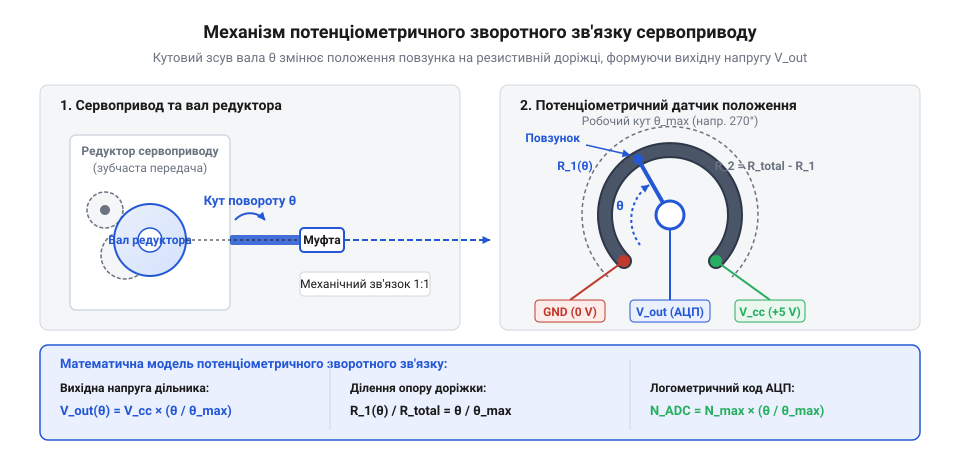
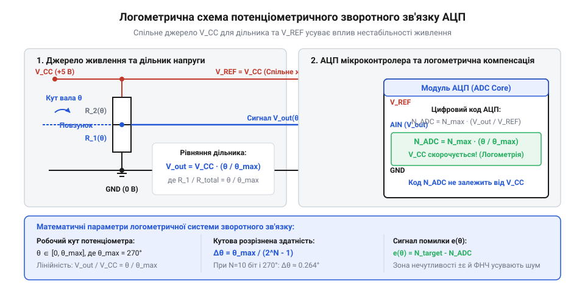
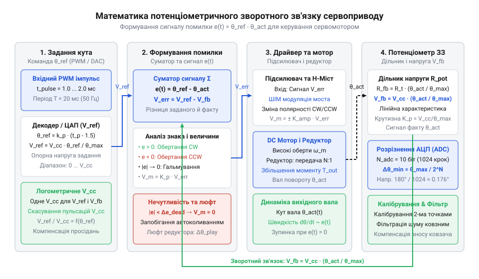
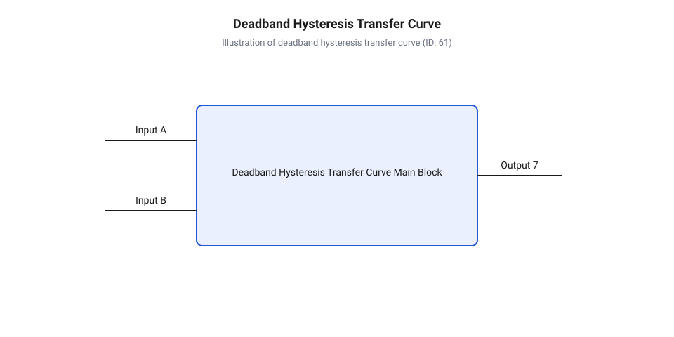
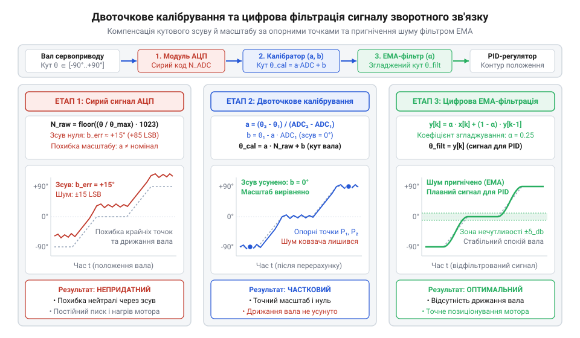

# Математика потенціометричного зворотного зв'язку сервоприводу

<preknowlist>
- [Сервоприводи радіокерованих моделей: будова, редуктори та ШІМ-керування](root:cat-hw-actuators/rc-servo-mechanisms-and-control) — базову будову сервоприводу, роль редуктора та принципи ШІМ-керування позиціонуванням вала
- [Інтегральні аналогові сервопідсилювачі KC2462 та AA51880](root:cat-hw-actuators/analog-servo-amplifier-ic) — принцип порівняння напруги зворотного зв'язку з тривалістю імпульсу в аналоговому контурі
- [Зона нечутливості та дрижання вала сервоприводів](root:cat-hw-actuators/servo-deadband-and-jitter) — механічні й електричні джерела шумів, що спричиняють дрижання вала біля точки рівноваги
</preknowlist>

## Проблема неконтрольованого обертання вала сервоприводу

Якщо подати напругу живлення на звичайний колекторний @@en|мотор постійного струму@@ (від англ. DC motor), його якір почне обертатися під дією електромагнітного моменту. Для переміщення вала на певний кут можна було б спробувати вмикати живлення на фіксований проміжок часу за допомогою таймера. Проте при керуванні у @@en|відкритий контур@@ (від англ. @@en|open loop control@@ — керування без вимірювання вихідного стану) кінцеве положення вала виявляється повністю невизначеним. Розрахована тривалість імпульсу не враховує динамічні зміни зовнішнього механічного навантаження, зміну сили тертя у підшипниках і @@en|редуктор@@ (від лат. *reductor* — той, що відводить назад), температурне коливання опору обмоток або падіння напруги джерела живлення.

Під підвищеним навантаженням мотор обертається повільніше, а на холостому ходу — швидше. Якщо пристрій повинен повернути вал на точний кут у 45 градусів, будь-яка зміна опору механічного середовища спричиняє значну @@en|похибка положення@@ (від англ. @@en|position error@@). Щонайгірше, при послідовних маневрах ця похибка неперервно накопичується: кожне наступне переміщення починається з помилкової позиції. У результаті реальне кутове положення вала повністю втрачає зв'язок із розрахованим значенням. Такий підхід робить неможливим побудову точних робототехнічних маніпуляторів чи рульових приводів.

Для подолання цієї проблеми необхідно перейти до @@en|замкнений контур@@ (від англ. @@en|closed loop@@) керування, у якому система неперервно порівнює заданий кут повороту із фактичним положенням вала. Це вимагає наявності вимірювального датчика, що безперервно зчитує поточний стан системи й формує сигнал @@en|зворотний зв'язок@@ (від англ. @@en|feedback@@). У виконавчих механізмах, таких як [сервоприводи радіокерованих моделей](root:cat-hw-actuators/rc-servo-mechanisms-and-control), ролі первинного перетворювача кутового переміщення в електричний сигнал виконує @@en|потенціометр@@ (від лат. *potentia* — сила, потенціал та грец. *metron* — вимірювання).

Використання змінних опорів у стежильних системах має тривалу інженерну історію. Еволюційний шлях від перших важких дротяних елементів до сучасних компактних композитних доріжок описано у статті про [історію виникнення потенціометрів](root:cat-hw-actuators/servo-feedback-potentiometer/hist-servo-potentiometer-history.md) у сервоприводах.

Фізична побудова @@en|сервопривід@@ (від нім. Servo, з лат. *servus* — слуга) вимагає жорсткого механічного зчеплення вихідного вала з вимірювальним елементом. У класичних конструкціях, таких як [мікросерво SG90](root:cat-hw-actuators/sg90-servo) або модифікаціях із [металевим редуктором MG90S](root:cat-hw-actuators/mg90s-servo), вихідна шестерня редуктора безпосередньо фіксується на валу потенціометра. Під час обертання мотора редуктор передає крутний момент на вихідний вал і одночасно повертає @@en|ковзний контакт@@ (від англ. @@en|wiper@@ — повзунок) вздовж нерухомої @@en|резистивна доріжка@@ (від англ. @@en|resistive track@@). Робочий кут обертання потенціометра фізично обмежують внутрішні механічні упори. Вони запобігають виходу контакту за межі провідного сектора, однак при надмірному зусиллі мотора створюють ризик зламу зубів редуктора. Крім того, постійний механічний тиск контакту спричиняє @@en|абразивний знос@@ (від лат. *abrasio* — зішкрібання) резистивного шару. Проходження струму через повзунок під час вимірювання прискорює ерозію покриття й викликає флуктуючий @@en|контактний опір@@ (від англ. @@en|contact resistance@@), який спотворює підсумкову напругу зворотного зв'язку. Для усунення проблеми механічного зносу та зчитування кута без обмежень обертання у прецизійних сервосистемах застосовують [оптичні та магнітні квадратурні енкодери у сервоприводах](root:hw-sensing/quadrature-rotary-encoders).


*Механічна передача від вала до потенціометра жорстко пов'язує кут повороту з положенням ковзного контакту.*

Завдяки цьому кожному механічному куту повороту вихідного вала відповідає унікальне положення ковзного контакту на резистивній доріжці, а отже — унікальне значення електричного опору між повзунком і крайніми виводами. У традиційних приладах на [аналогових сервопідсилювачах](root:cat-hw-actuators/analog-servo-amplifier-ic) цей опір використовується безпосередньо для формування внутрішнього часового інтервалу. У разі модифікації приводу під [знеструмлених приводах](root:cat-hw-actuators/continuous-rotation-servo-mod) або створення власного цифрового контролера опір потенціометра перетворюють на напругу, що формує вимірювальний сигнал для аналогово-цифрового перетворення.

## Математика логометричного перетворення кута в напругу

Для перетворення механічного повороту вала на електричний сигнал потенціометр підключають за схемою @@en|дільник напруги@@ (від англ. @@en|voltage divider@@). Два крайні виводи резистивної доріжки підключають відповідно до шини живлення `V_CC` та загальної шини `GND`, а вихідний сигнал `V_out` знімають із середнього ковзного контакту.

Позначимо повний опір резистивної доріжки між крайніми виводами як `R_total`, а максимальний електричний робочий кут потенціометра як `θ_max`. За умови ідеальної лінійності резистивного шару, при повороті вала на кут `θ` (де `0 ≤ θ ≤ θ_max`) опір нижнього плеча дільника `R_1(θ)` між повзунком і шиною `GND` дорівнює:

```
R_1(θ) = R_total × (θ / θ_max)
```

Відповідно, опір верхнього плеча дільника `R_2(θ)` між виводом `V_CC` і повзунком становить:

```
R_2(θ) = R_total × (1 - θ / θ_max)
```

За законом Ома для послідовного кола вихідна напруга `V_out(θ)` на повзунку ненавантаженого дільника обчислюється наступним чином:

```
V_out(θ) = V_CC × ( R_1(θ) / (R_1(θ) + R_2(θ)) )
= V_CC × ( (R_total × (θ / θ_max)) / R_total )    [підстановка виразів для опору плечей]
= V_CC × (θ / θ_max)                              [скорочення загального опору R_total]
```

З математичного виводу видно, що вихідна напруга `V_out` прямо пропорційна куту повороту `θ` і абсолютно не залежить від номінального опору потенціометра `R_total`. Це гарантує, що технологічний розкид опору потенціометрів (який може досягати ±20%) або загальний температурний дрейф опору доріжки не змінюють коефіцієнт передачі кута у напругу за умови рівномірного нагріву всього елемента.

Однак у реальних умовах експлуатації напруга живлення `V_CC` не є строго постійною величиною. При пуску мотора сервоприводу виникає значний кидок струму, який спричиняє просідання напруги на провідниках живлення та акумуляторі. Якщо напруга `V_CC` впаде на 5%, вихідна напруга `V_out(θ)` також зменшиться на 5%, хоча механічний кут `θ` залишиться незмінним. Мікроконтролер сприйняв би таке падіння напруги як реальний поворот вала, що призвело б до помилкового спрацьовування мотора та дрижання.

Для повного скасування впливу коливань живлення застосовують @@en|логометричне вимірювання@@ (від грец. *logos* — відношення та грец. *metron* — вимірювання). Його суть полягає у використанні тієї ж самої напруги живлення дільника `V_CC` як опорної напруги `V_ref` для аналогово-цифрового перетворювача (@@en|АЦП@@, від англ. @@en|ADC@@ — Analog-to-Digital Converter). Цифровий код `N_ADC`, який формується `n`-розрядним АЦП, визначається відношенням вхідної напруги до опорної:

```
N_ADC = floor( (V_out / V_ref) × (2ⁿ - 1) )
= floor( ( (V_CC × (θ / θ_max)) / V_CC ) × (2ⁿ - 1) )    [підстановка V_out та V_ref = V_CC]
= floor( (θ / θ_max) × (2ⁿ - 1) )                        [скасування коливань напруги живлення V_CC]
```

Оскільки напруга `V_CC` повністю скорочується у чисельнику й знаменнику дробу, результуючий цифровий код `N_ADC` стає інваріантним до будь-яких пропорційних коливань напруги живлення. Детально концептуальні основи та математичні переваги цього методу розкрито у матеріалі про [логометричні вимірювання](root:hw-sensing/ratiometric-measurement).

Абсолютна кутова @@en|роздільна здатність@@ (від англ. @@en|angular resolution@@) визначає найменший кут повороту вала `Δθ`, який спричиняє зміну цифрового коду АЦП на одиницю молодшого розряду (1 @@en|LSB@@, від англ. @@en|Least Significant Bit@@). Вона обчислюється як відношення робочого кута потенціометра `θ_max` до кількості дискретних відліків АЦП `2ⁿ`:

```
Δθ = θ_max / 2ⁿ
```

Нижче наведено порівняльний розрахунок кутової дискретності для 10-бітного та 12-бітного АЦП за умови використання потенціометра з робочим кутом `θ_max = 210°` (типова величина для сервоприводів серії [SG90](root:cat-hw-actuators/sg90-servo)):

**Обчислення кутової дискретності для 10-бітного та 12-бітного АЦП:**

Для 10-бітного АЦП (`n = 10`, `2¹⁰ = 1024` дискретні рівні):
```
Δθ_10 = 210° / 1024
= 0.205078...°      [ділення робочого кута на кількість відліків]
≈ 0.205° per LSB    [округлення значення]
```

Для 12-бітного АЦП (`n = 12`, `2¹² = 4096` дискретних рівнів):
```
Δθ_12 = 210° / 4096
= 0.051269...°      [ділення робочого кута на кількість відліків]
≈ 0.0513° per LSB   [округлення значення]
```

10-бітний АЦП забезпечує теоретичну дискретність близько 0.205°, що цілком достатньо для типових завдань робототехніки. Застосування 12-бітного АЦП покращує кутову дискретність до 0.0513°, дозволяючи фіксувати найменші кутові відхилення.

У реальних електричних колах на лінійність характеристики вимірювання вхідного кута впливає @@en|вхідний імпеданс@@ (від лат. *impedire* — перешкоджати, від англ. @@en|input impedance@@) `R_ADC` аналогового входу АЦП, який підключається паралельно до нижнього плеча дільника `R_1(θ)`. Еквівалентний опір нижнього плеча `R_1_eq(θ) = (R_1(θ) × R_ADC) / (R_1(θ) + R_ADC)` стає меншим за ідеальне значення, створюючи параболічне викривлення вихідної напруги `V_out_load(θ)`. Проте шунтування імпедансом — лише одна складова у загальному балансі похибок: реальний цифровий код викривляється також внутрішніми недосконалостями перетворювача. До них належать високочастотний @@en|шум опорного джерела@@ (від англ. @@en|reference voltage noise@@) `ΔV_ref / V_ref`, що модулює масштаб квантування, а також апаратурна @@en|інтегральна нелінійність@@ (від лат. *integrum* — ціле, від англ. @@en|Integral Non-Linearity@@, INL), яка задає максимальне статичне відхилення реальної характеристики перетворення від ідеальної прямої, і @@en|диференціальна нелінійність@@ (від лат. *differentia* — різниця, від англ. @@en|Differential Non-Linearity@@, DNL), що визначає відхилення ширини окремого відліку від 1 @@en|LSB@@. Сумарна @@en|системна похибка@@ (від грец. *systema* — ціле з частин, від англ. @@en|systematic error@@) нелінійності за кодом `ΔN_sys(θ)` обчислюється як найгірша суперпозиція відхилення від навантаження дільника, внутрішньої нелінійності INL та відносного шуму опорної напруги:

```
ΔN_sys(θ) = ΔN_load(θ) + INL + floor( N_ADC(θ) × (ΔV_ref / V_ref) )
= (2ⁿ - 1) × ( (θ / θ_max) - (R_1_eq(θ) / (R_1_eq(θ) + R_2(θ))) ) + INL + floor( (θ / θ_max) × (2ⁿ - 1) × (ΔV_ref / V_ref) )    [суперпозиція похибки навантаження дільника, INL та шуму джерела V_ref]
```

Переводячи обчислену похибку коду у кутові величини, максимальне відхилення виміряного кута `Δθ_sys(θ)` становить:

```
Δθ_sys(θ) = (ΔN_sys(θ) / (2ⁿ - 1)) × θ_max
```

Якщо вхідний опір `R_ADC` співмірний із опором потенціометра (наприклад, `R_total = 10 kΩ`, `R_ADC = 100 kΩ`), а шум `ΔV_ref` чи нелінійність INL перевищують 1–2 LSB, системна похибка `Δθ_sys` виходить за межі зони нечутливості сервоприводу. У результаті цифровий контур сприймає електричні завади й апаратурні викривлення АЦП як фізичне відхилення вала, викликаючи дрижання мотора, температурний дрейф і втрату точності позиціонування.

```
R_1_eq(θ) = (R_1(θ) × R_ADC) / (R_1(θ) + R_ADC)
```

Реальна вихідна напруга під навантаженням `V_out_load(θ)` обчислюється так:

```
V_out_load(θ) = V_CC × ( R_1_eq(θ) / (R_1_eq(θ) + R_2(θ)) )
```

Якщо вхідний опір АЦП `R_ADC` співмірний із опором потенціометра `R_total` (наприклад, `R_total = 10 kΩ`, а `R_ADC = 100 kΩ`), залежність `V_out(θ)` стає нелінійною. Максимальне системне відхилення спостерігається у середині діапазону (`θ ≈ 0.5 × θ_max`) і може сягати 1.5–2.5% від всієї шкали. Для усунення цього ефекту необхідно дотримуватися правила `R_ADC ≥ 100 × R_total` або використовувати повторювач напруги на операційному підсилювачі.


*Логометричне підключення потенціометричного дільника до АЦП забезпечує інваріантність цифрового коду відносно коливань живлення.*

Правила електричного монтажу та узгодження імпедансу детально розглянуто у довіднику про [схеми підключення потенціометра](root:cat-hw-actuators/servo-feedback-potentiometer/api-potentiometer-feedback-pinout-interface.md). Для розробки програмного забезпечення зчитування даних використовуйте [бібліотеки зчитування АЦП](root:cat-hw-actuators/servo-feedback-potentiometer/api-potentiometer-servo-reader-lib.md). Практичну методику вимірювання реальної нелінійності наведено в інструкції до [стенду калібрування потенціометра](root:cat-hw-actuators/servo-feedback-potentiometer/proj-servo-potentiometer-calibration-bench.md), а використання коду кута для регулювання викладено в описі [програмного контуру керування](root:cat-hw-actuators/servo-feedback-potentiometer/proj-software-servo-loop-controller.md).

## Формування сигналу помилки контуру позиціонування

Отримання точного цифрового коду поточного кута повороту вала є лише першою частиною завдання побудови сервоприводу. Самі по собі виміряні дані з @@en|АЦП@@ (від англ. @@en|ADC@@ — Analog-to-Digital Converter) не здатні привести мотор у рух чи зупинити його в потрібній точці. Для здійснення @@en|позиціонування@@ (від англ. @@en|positioning@@) виконавчий орган повинен знати не лише поточне положення вала, а й те, наскільки воно відхиляється від заданого значення. Серцем будь-якого @@en|замкнений контур@@ є неперервне порівняння двох величин: цільового кута та фактичного кута.

На основі цього порівняння обчислюється @@en|сигнал помилки@@ (від англ. @@en|error signal@@, також відомий як @@en|сигнал неузгодженості@@). Фізичний зміст сигналу помилки полягає у визначенні двох критично важливих параметрів для керування [мотором постійного струму](root:cat-hw-actuators/rc-servo-mechanisms-and-control): напрямку обертання та величини силового впливу. Знаковий плюс або мінус вказує, у який бік силовий міст повинен комутувати струм через обмотки мотора, а абсолютне значення помилки визначає, з якою інтенсивністю (тривалістю імпульсів @@en|ШІМ@@, від англ. @@en|PWM@@ — Pulse-Width Modulation) необхідно прискорювати вал.

У неперервному кутовому просторі математична модель сигналу помилки `e_θ(t)` виражається різницею між заданим кутом `θ_target(t)` та фактичним кутом `θ_actual(t)`:

```
e_θ(t) = θ_target(t) - θ_actual(t)
```

де `θ_target(t)` — цільовий кут повороту вала у градусах або радіанах (@@en|задане значення@@ або @@en|уставка@@, від англ. @@en|setpoint@@), а `θ_actual(t)` — реальний кут вала, виміряний за допомогою [потенціометра зворотного зв'язку](root:cat-hw-actuators/servo-feedback-potentiometer/api-potentiometer-feedback-pinout-interface.md).

У цифрових контролерах обчислення виконуються безпосередньо в дискретних кодах АЦП, що дозволяє уникнути зайвих операцій ділення з плаваючою крапкою на кожному циклі регулювання. Позначивши заданий код кута як `N_target`, а поточний прочитаний код як `N_actual`, цифровий @@en|сигнал помилки@@ `e_N` виражається у дискретах (1 @@en|LSB@@, від англ. @@en|Least Significant Bit@@):

```
e_N = N_target - N_actual
```

Зв'язок між цифровою помилкою `e_N` та реальним кутовим відхиленням `e_θ` задається через робочий кут потенціометра `θ_max` та розрядність АЦП `n`:

```
e_θ = e_N × (θ_max / (2ⁿ - 1))
```

В ідеальному пропорційному контурі позиціонування сигнал керування мотором `U_control` пропорційний величині помилки. Чим далі вал перебуває від цільової позиції, тим більша напруга подається на мотор для його швидкого переміщення. При наближенні до цільової точки помилка зменшується, що призводить до природного гальмування механізму:

```
U_raw = K_p × e_N
```

де `K_p` — @@en|пропорційний коефіцієнт@@ (від англ. @@en|proportional gain@@), який визначає жорсткість регулятора.

Проте фізичний драйвер мотора та джерело живлення мають чіткі електричні обмеження: вихідна напруга або коефіцієнт заповнення ШІМ не можуть перевищувати максимальне значення `U_max` (наприклад, 100% заповнення ШІМ або 255 у 8-бітному регістрі). При великих значеннях помилки відбувається @@en|насичення@@ (від англ. @@en|saturation@@) регулятора, коли вихідний сигнал обмежується на граничному рівні.

Математична модель формування підсумкового сигналу керування з урахуванням обмежувача (@@en|клампера@@, від англ. @@en|clamper@@) описується так:

```
U_control = clamp(K_p × e_N, -U_max, U_max)
```

де функція обмеження `clamp(x, min, max)` визначена як:

```
clamp(x, min, max) = min, якщо x < min
                   = max, якщо x > max
                   = x, в іншому разі
```


*Структурна схема контуру зворотного зв'язку показує обчислення різниці між заданим і поточним кодом АЦП для керування мотором.*

Як видно зі схеми контуру, різниця між заданим кутом `N_target` та зворотним зв'язком `N_actual` формує знак і амплітуду для керування силовим мостом. У класичних приладах на [аналогових сервопідсилювачах KC2462 та AA51880](root:cat-hw-actuators/analog-servo-amplifier-ic) це порівняння виконується аналоговим компаратором із генератором пилоподібної напруги. У мікроконтролерних системах обчислення виконуються програмно в циклі регулювання, описаному в інструкції до [програмного контуру регулювання](root:cat-hw-actuators/servo-feedback-potentiometer/proj-software-servo-loop-controller.md).

Розглянемо покроковий розрахунок сигналу керування на числовому прикладі.

**Обчислення вихідного сигналу керування мотором при заданому кутовому зсуві:**

Припустимо, у нас є сервопривід із 10-бітним АЦП (`n = 10`, діапазон від 0 до 1023 LSB) та максимальним робочим кутом потенціометра `θ_max = 210°`. Поточний кут вала становить `θ_actual = 45°`, а команда вимагає повернути вал у положення `θ_target = 90°`. Пропорційний коефіцієнт регулятора обрано рівним `K_p = 4.0` (одиниць ШІМ на 1 LSB помилки), а вихідний ШІМ обмежено 8-бітною величиною `PWM_max = 255`.

```
N_actual = floor( (45° / 210°) × 1023 )
= floor( 0.2142857 × 1023 )
= 219 LSB                                    [обчислення поточного коду АЦП]

N_target = floor( (90° / 210°) × 1023 )
= floor( 0.4285714 × 1023 )
= 441 LSB                                    [обчислення заданого коду АЦП]

e_N = 441 - 219
= 222 LSB                                    [обчислення цифрового сигналу помилки]

PWM_raw = K_p × e_N
= 4.0 × 222
= 888                                        [ненасичений сигнал керування]

PWM_out = clamp(888, -255, 255)
= 255 (100% ШІМ)                            [обмеження сигналу через насичення]
```

Оскільки початкова помилка є великою (222 LSB, що відповідає кутовому відхиленню 45°), розраховане значення `PWM_raw = 888` значно перевищує максимальну дискретність таймера. Регулятор входить у режим насичення й подає на мотор 100% напруги живлення, забезпечуючи максимальний крутний момент для прискорення редуктора. У міру наближення вала до цільової позначки 90° помилка `e_N` зменшуватиметься. Коли `e_N` стане меншим за 64 LSB (`64 × 4.0 = 256`), регулятор вийде з насичення, і напруга на моторі почне плавно знижуватись, забезпечуючи м'яке підведення вала до заданої точки.

Ця математична модель ідеально працює на папері, проте при практичній реалізації вступають у дію механічні та електричні дефекти реального заліза.

## Моделювання зони нечутливості та люфтів

На практиці спроба застосувати суто лінійну модель пропорційного регулятора призводить до виникнення безперервного дрижання вала (@@en|джитер@@, від англ. @@en|jitter@@), гучного високочастотного писку мотора та його швидкого перегріву. Причиною цього є механічні й електричні нелінійності, присутні в кожному фізичному сервоприводі.

Основними джерелами спотворень у замкненому контурі є @@en|механічний люфт@@ (від англ. @@en|backlash@@, від нім. *Luft* — зазор) між зубцями шестерень [редуктора](root:cat-hw-actuators/rc-servo-mechanisms-and-control), сухе тертя спокою у підшипниках та шуми ковзного контакту потенціометра. Коли вал наближається до точки рівноваги і помилка `e_N` стає дуже малою, напруга на моторі падає нижче порогу, необхідного для подолання сухого тертя. Мотор зупиняється, не дійшовши 1–2 LSB до цілі. Якщо пропорційний коефіцієнт `K_p` спробувати збільшити для подолання тертя, найменша зміна коду АЦП через шуми викликає різкий кидок струму, який штовхає вал за цільову точку. Після цього мотор змінює напрямок і штовхає вал назад, утворюючи незгасаючі @@en|автоколивання@@ (від англ. @@en|self-oscillations@@ або @@en|hunting@@).

Математичний опис контуру зворотного зв'язку сервоприводу описує формування сигналу помилки між заданим і поточним кутом повороту вала з урахуванням цих нелінійних ефектів. Зона нечутливості (@@en|deadband@@), гістерезис та механічний люфт редуктора описуються за допомогою кусочно-неперервних функцій. Це дозволяє розраховувати умови виникнення автоколивань та оцінювати стабільність контуру керування в умовах зовнішнього навантаження, що робить можливим коректний вибір параметрів зональної дискретизації для усунення небажаних високочастотних мікроколівань.

Для запобігання дрижанням у програмний або аналоговий контур регулятора штучно вводиться @@en|зона нечутливості@@ (від англ. @@en|deadband@@) — кутовий інтервал навколо цільової точки `[-δ_db, +δ_db]`, у межах якого сигнал помилки примусово вважається рівним нулю.

Математично кусочно-неперервна функція зони нечутливості `e_db(e_N)` виражається формулою:

```
e_db(e_N) = 0, якщо |e_N| ≤ δ_db
          = e_N - δ_db × sgn(e_N), якщо |e_N| > δ_db
```

де `sgn(x)` — функція знака (сигнум), яка повертає `+1` для `x > 0`, `-1` для `x < 0` та `0` для `x = 0`.

Усередині зони `|e_N| ≤ δ_db` напруга з мотора повністю знімається, ключ силового моста розмикається, і механізм залишається в стані спокою завдяки самогальмуванню редуктора.

Однак наявність механічного люфту у шестернях редуктора `B_gear` створює @@en|гістерезис@@ (від грец. *hysteresis* — відставання). Люфт означає, що при зміні напрямку обертання мотора його якір і первинні шестерні повертаються на певний кут `B_gear` перш ніж підхопити вихідний вал і ковзний контакт потенціометра. Позначивши реальний кут вихідного вала як `θ_shaft`, а кут, зчитаний потенціометром, як `θ_pot`, зв'язок між ними при русі в різні боки виражається нелінійним співвідношенням:

```
θ_pot(t) = θ_shaft(t) - (B_gear / 2), при обертанні за годинниковою стрілкою (dθ/dt > 0)
         = θ_shaft(t) + (B_gear / 2), при обертанні проти годинникової стрілки (dθ/dt < 0)
```

Для забезпечення стійкості контуру без автоколивань ширина зони нечутливості `Δθ_db` повинна строго задовольняти математичній умові стабільності:

```
Δθ_db ≥ (B_gear / 2) + Δθ_noise
```

де `B_gear` — повний кутовий люфт редуктора, виражений у градусах, а `Δθ_noise` — амплітуда високочастотного шуму АЦП та ковзного контакту. Якщо обрати зону нечутливості меншою за половину люфту, мотор буде нескінченно «вибирати люфт» вправо та вліво, що призведе до швидкого [абразивного зносу шестерень](root:cat-hw-actuators/servo-gear-shear-and-wear).


*Передавальна характеристика контуру регулювання демонструє зону нечутливості навколо нуля та петлю гістерезису, спричинену механічним люфтом редуктора.*

Графічна характеристика показує, як зона нечутливості створює плато нульового вихідного сигналу в околі нульової помилки, а механічний люфт розщеплює характеристику на дві паралельні гілки залежно від передісторії руху. Детальний аналіз джерел виникнення цих явищ наведено у матеріалі про [зону нечутливості та дрижання вала сервоприводів](root:cat-hw-actuators/servo-deadband-and-jitter).

Нижче наведено практичну реалізацію алгоритму обчислення сигналу керування із зоною нечутливості та обмеженням насичення для мікроконтролера.

:::tabs
@tab C
:::code servo-feedback-potentiometer-d/c/servo-loop-calculate.c
@tab C++
:::code servo-feedback-potentiometer-d/cpp/servoloopcontroller.cpp
:::

Зазначений алгоритм забезпечує стабільне утримання позиції без дрижання. Для побудови більш складних систем із компенсацією інерції навантаження застосовують [ПІД-регулятори у контурах позиціонування](root:com-signal/pid-controller-servo-actuator-tuning). Повний приклад програмного коду для мікроконтролерів розміщено у [бібліотеці зчитування потенціометра](root:cat-hw-actuators/servo-feedback-potentiometer/api-potentiometer-servo-reader-lib.md), а методики експериментального налаштування коефіцієнтів описано у статті про [калібрувальний стенд сервоприводу](root:cat-hw-actuators/servo-feedback-potentiometer/proj-servo-potentiometer-calibration-bench.md).

## Алгоритми калібрування та фільтрації сигналів

У реальному сервоприводі кутове положення вала передається на резистивну доріжку потенціометра через серію шестерень редуктора, проте ідеальної відповідності між геометричним кутом повороту та зчитаним кодом @@en|АЦП@@ не існує через механічні й електричні допуски виробництва. Потенціометр може мати невеликий кутовий зсув при монтажі в корпус, відхилення повного електричного опору від номіналу, а також нелінійність резистивного шару. Крім того, під час тривалої роботи виділення тепла мотором спричиняє @@en|температурний дрейф@@ (від нід. *drijven* — плавати, гнати) опору матеріалу, змінюючи кутовий масштаб і нульове положення вала. Якщо подавати сировий код @@en|АЦП@@ безпосередньо в регулятор, вихідний вал не зможе точно позиціонуватися в крайніх точках або матиме систематичне зміщення нейтралі. Для перетворення цифрових відліків у дійсне значення кута в радіанах або градусах застосовують процедуру первинної корекції.

Найпростішим і водночас достатньо точним методом компенсації лінійних викривлень є @@en|двоточкове калібрування@@ (від англ. *calibration*, від араб. *qālib* — шаблон, макет). Для його проведения сервопривід фіксують у двох відомих опорних кутових позиціях `θ₁` та `θ₂` (наприклад, у крайніх положеннях `-90°` та `+90°`), після чого зчитують відповідні їм усереднені коди @@en|АЦП@@: `ADC₁` та `ADC₂`. Оскільки залежність між кутом і кодом у межах робочого діапазону вважається лінійною, кут повороту `θ` описується рівнянням прямої лінії.

Двоточкова залежність кута від цифрового коду АЦП виводиться шляхом розрахунку кутового коефіцієнта масштабу та зсуву нейтралі:

        a = (θ₂ - θ₁) / (ADC₂ - ADC₁)      [розрахунок коефіцієнта масштабу за двома точками]
        b = θ₁ - a · ADC₁                  [розрахунок кутового зсуву нейтралі]
        θ = a · ADC + b                    [відновлення фізичного кута повороту]

Рівняння показує, що коефіцієнт `a` визначає ціну молодшого розряду @@en|АЦП@@ у градусах чи радіанах на одиницю коду (кутовий масштаб), тоді як `b` компенсує механічну похибку установки потенціометра відносно нейтралі (зсув). Для визначення цих коефіцієнтів зручно використовувати спеціалізовані інструменти, вимірявши первинні значення за допомогою [автоматизованого вимірювального стенда](root:cat-hw-actuators/servo-feedback-potentiometer/proj-servo-potentiometer-calibration-bench.md), що знімає характеристики залежності коду від кута.

Математичні алгоритми лінійного та двоточкового калібрування дозволяють обчислити коефіцієнти зсуву й масштабу потенціометра за результатами експериментальних вимірювань, перетворюючи сирі значення коду @@en|АЦП@@ у точні кутові величини. Для пригнічення високочастотної завади, викликаної мікроіскрінням та вібрацією ковзного контакту, застосовують цифрову обробку сигналів на основі алгоритмів рекурсивного фільтра @@en|ковзного середнього@@ та @@en|експоненційного згладжування@@ (EMA). Головною математичною задачею при виборі параметрів фільтрації є досягнення оптимального балансу між ступенем пригнічення шуму та мінімізацією @@en|фазової затримки@@, яку фільтр неминуче вносить у контур зворотного зв'язку і яка може погіршити запаси стійкості системи. Крім того, тривала стабільність позиціонування вимагає додаткового періодичного урахування та математичної компенсації @@en|температурного дрейфу@@ опору резистивної доріжки під час зміни температурного режиму сервоприводу.


*Структурна схема потоку даних цифрової обробки сигналу зворотного зв'язку: компенсація систематичного зсуву та масштабу за двома опорними точками з наступним пригніченням високочастотного шуму ковзного контакту за допомогою експоненційного фільтра EMA.*

Крім систематичних похибок, вихідний сигнал потенціометра містить високочастотні шуми, спричинені механічним дрижанням ковзного контакту (@@en|ковзний контакт@@) по резистивній доріжці та електричними наводками від ШІМ-підсилювача мотора. Ззвичайне просте @@en|ковзне середнє@@ (SMA) з вікном збудовано на накопиченні `N` відліків, проте воно потребує зберігання масиву даних у пам'яті й вносить фіксовану затримку в `(N - 1) / 2` тактів. У контурах реального часу це спричиняє фазове запізнення, що здатне перетворити негативний зворотний зв'язок на позитивний і викликати автоколивання. Значно ефективнішим є @@en|рекурсивний фільтр@@ (від лат. *recursio* — повернення та *filtrum* — повсть), що реалізує @@en|експоненційне згладжування@@ (від лат. *exponere* — виставляти назовні).

Математичне рівняння дискретного фільтра першого порядку (EMA) обчислює поточне згладжене значення як зважену суму нового вимірювання та попереднього виходу фільтра:

        y[k] = α · x[k] + (1 - α) · y[k-1]      [рівняння експоненційного згладжування першого порядку]

Тут `x[k]` — це поточний виміряний код @@en|АЦП@@ (або відкалібрований кут), `y[k]` — відфільтроване значення на покроковому ітераційному інтервалі `k`, а `y[k-1]` — результат фільтрації на попередньому такті. Дійсний коефіцієнт згладжування `α` знаходиться в діапазоні `0 < α ≤ 1`. Малі значення `α` (наприклад, `0.05`–`0.1`) забезпечують сильне пригнічення високочастотного шуму, але збільшують @@en|фазову затримку@@ відповіді на різке кутове переміщення вала. Значення `α ≈ 0.2`–`0.35` зазвичай є оптимальним компромісом для мікроконтролерних контурів керування сервоприводом, дозволяючи усунути [джерело високочастотного дрижання](root:cat-hw-actuators/servo-deadband-and-jitter) без порушення динаміки позиціонування.

:::tabs
:::code servo-feedback-potentiometer-d/c/esp-idf/calibration-init.c
:::code servo-feedback-potentiometer-d/cpp/arduino/servopotentiometerfilter.cpp
:::

Поєднання двоточкового калібрування та експоненційної фільтрації створює стійкий і завадозахищений вимірювальний тракт. Це дозволяє сформувати чистий сигнал кутового положення для побудови надійного [пропорційно-інтегрально-диференціального контуру](root:com-signal/pid-controller-servo-actuator-tuning) позиціонування. Для практичного впровадження розглянутого алгоритму у власних пристроях можна скористатися архітектурою [готового програмного модуля обробки](root:cat-hw-actuators/servo-feedback-potentiometer/api-potentiometer-servo-reader-lib.md), який об'єднує АЦП-зчитування, табличне калібрування та фільтрацію в єдиний API. Також для підключення аналогового сигналу потенціометра до обчислювальної плати варто враховувати [схему залізного інтерфейсу](root:cat-hw-actuators/servo-feedback-potentiometer/api-potentiometer-feedback-pinout-interface.md), що мінімізує вхідний імпедансний шум ще до цифрової обробки.