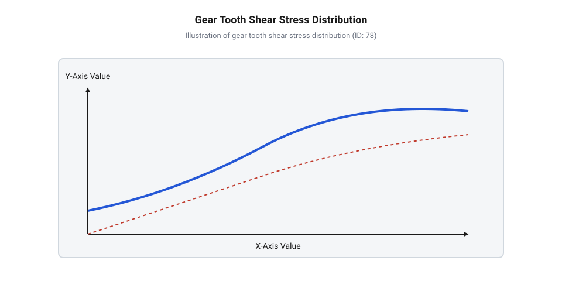
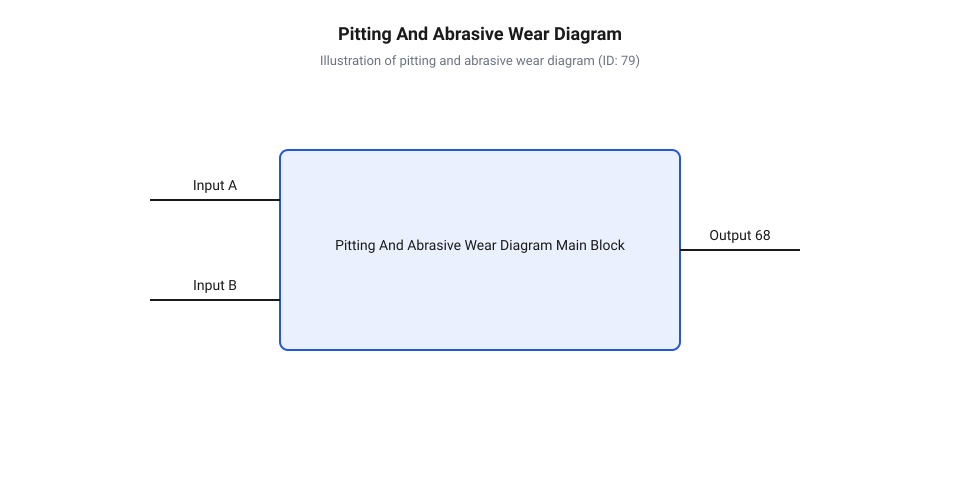
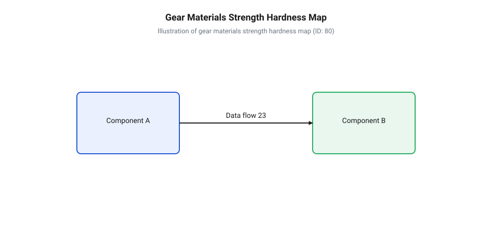
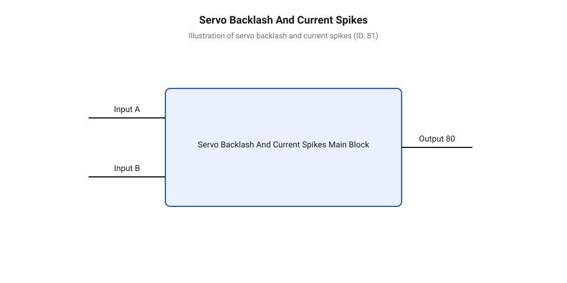
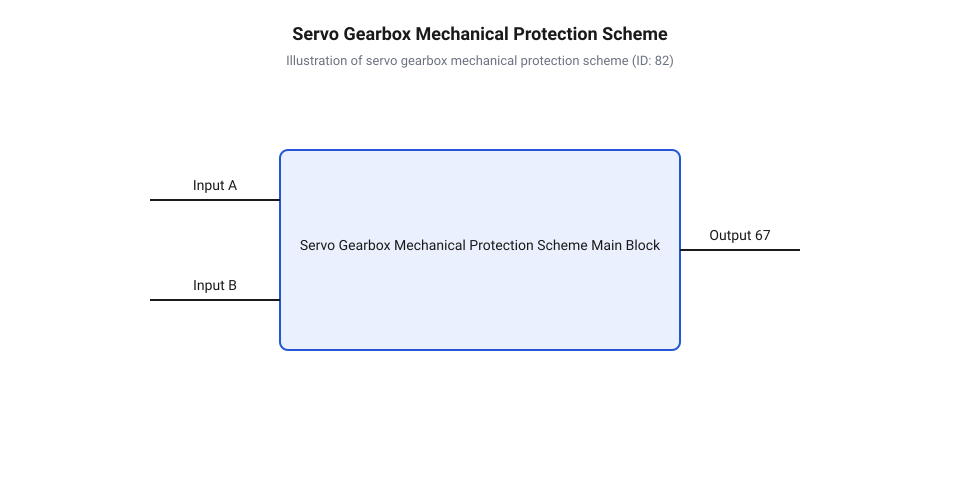

# Зсувні навантаження та абразивний знос шестерень сервоприводів

<preknowlist>
- [Сервоприводи радіокерованих моделей: будова, редуктори та ШІМ-керування](root:cat-hw-actuators/rc-servo-mechanisms-and-control) — Базова кінематична схема багатоступеневого зубчастого редуктора сервоприводу та принципи передачі крутного моменту від електродвигуна до вихідного вала
- [Кінематика важільних механізмів та тяг сервоприводів](root:cat-hw-actuators/servo-pushrod-kinematics) — Розрахунок зовнішніх динамічних силовиків та ударних навантажень, які передаються через важільну систему на вихідну шестерню
- [MG90S V2 — мікросерво з металевим редуктором](root:cat-hw-actuators/mg90s-servo) — Конструкція латунно-сталевого редуктора мікросервоприводів та особливості спряження металевих зубчастих коліс
</preknowlist>

## Механіка катастрофічного зрізу зубів редуктора

Зовнішній динамічний удар по виконавчому органу роботизованої системи чи радіокерованої моделі створює екстремальне механічне навантаження, яке через важільну систему передається безпосередньо на вихідний вал. Коли тяга зазнає раптового збурення від зіткнення чи аеродинамічного удару, вихідне плече передає цей імпульс на зуби крайнього ступеня передачі. У цей момент електромотор `@@lat|сервопривід@@ (лат. *servus* — слуга, раб)` працює в режимі активного утримання позиції, а його ротор має власну інерцію, яка підсилюється високим передавальним відношенням. Оскільки кінетична енергія ударного імпульсу не може миттєво розкрутити мотор у зворотному напрямку через великий зведений момент інерції, вся сила удару концентрується на вузькій лінії контакту зубчастої пари. У результаті виникає колосальний сплеск крутного моменту, який багаторазово перевищує номінальний розрахунковий рівень механізму.

При виникненні такого динамічного піку зубчасте зачеплення виходить із режиму нормальної пружної деформації. Вихідна @@de|шестерня@@ (від числівника *шість* — первісно шестизубе колесо) @@de|редуктор@@ (нім. *Reduktor*, від лат. *reducere* — повертати назад, зменшувати) сприймає прикладену колову силу вздовж лінії контакту зубця. Оскільки `@@fr|модуль@@ (фр. *module*, від лат. *modulus* — міра)` зачеплення в мікросервоприводах становить частки міліметра, ширина основи зубця виявляється надзвичайно малою. Навантаження створює у небезпечному перерізі два основні види внутрішніх напружень: вигинальне напруження, що намагається відломити зубець від геометричного вінця, та зсувне напруження, що прагне зрізати його вздовж основи. На межі переходу від робочого профілю до основи виникає геометричне звуження — радіусна @@de|галтель@@ (нім. *Hohlkehle* — жолобок, викружка), яка виконує роль локального @@lat|концентратор напружень@@ (лат. *con* + *centrum* — сходження до центру). Саме в цій зоні напруження зсуву досягають пікових значень.

Якщо максимально діюче зсувне напруження перевищує межу плинності матеріалу при зсуві, у структурі починається незворотна @@gr|пластична деформація@@ (грец. *plastikos* — ліпний, гнучкий). При досягненні граничної в'язкості руйнування вздовж критичної лінії галтелі миттєво зароджується макротріщина. Зріз відбувається по всій ширині зубчастого вінця за один динамічний цикл, позбавляючи вал механічного зв'язку з рештою кінетичного ланцюга. Наслідком стає катастрофічна втрата позиціонування: `@@lat|сервопривід@@` втрачає здатність утримувати навантаження, його вихідний вал вільно провертається під дією зовнішніх сил, а плата управління реєструє розрив зворотного зв'язку через розсогласування з потенціометром.

Для кількісного оцінювання механічної стійкості зачеплення до зрізу застосовують розрахунок зсувних та вигинальних напружень в основі зубця. Вихідними даними слугують піковий динамічний крутний момент `M_dyn`, ділильний діаметр шестерні `d_w`, ширина зубчастого вінця `b`, товщина основи зубця `s_r` та висота прикладання сили `h_F`. Розрахунок колової тангенціальної сили `F_t`, номінального зсувного напруження `τ`, максимального зсувного напруження з урахуванням концентратора `τ_max` та вигинального напруження `σ_b` виконують за такою послідовністю:

F_t = 2 · M_dyn / d_w                      [тангенціальна сила на ділильному діаметрі]
τ = F_t / (b · s_r)                        [номінальне зсувне напруження в основі]
τ_max = K_s · τ                            [максимальне зсувне напруження з урахуванням концентрації]
σ_b = (6 · F_t · h_F) / (b · s_r²)         [вигинальне напруження в критичному перерізі]

Отримані формульні залежності демонструють, що напруження вигину `σ_b` зростають обернено пропорційно квадрату товщини основи `s_r²`, тоді як зсувні напруження `τ` залежать від товщини основи лінійно. Це означає, що при зменшенні модуля зачеплення небезпека вигинального зламу зростає швидше, ніж небезпека чистого зрізу, проте при надкоротких зубцях із відношенням висоти до товщини менше одиниці саме зсувний руйнівний механізм стає домінуючим.

**Розрахунок зсувних напружень мікросервоприводу під час ударного навантаження**

Розглянемо вихідний ступінь прямозубої циліндричної шестерні з матеріалу `@@en|POM@@ (англ. *polyoxymethylene*)` з модулем `m = 0.3 мм`, ділильним діаметром `d_w = 6.0 мм`, шириною вінця `b = 1.2 мм`, товщиною основи зубця `s_r = 0.45 мм`, плечем прикладання сили `h_F = 0.4 мм` та коефіцієнтом концентрації напружень у галтелі `K_s = 1.6`. На вихідний вал діє зовнішній динамічний ударний момент `M_dyn = 1.08 Н·м`.

F_t = 2 · 1.08 / 0.006 = 360 Н             [колова сила на ділильному діаметрі]
τ = 360 / (1.2 · 0.45) = 666.7 МПа         [номінальне зсувне напруження в основі]
τ_max = 1.6 · 666.7 = 1066.7 МПа           [максимальне зсувне напруження з концентратором]
σ_b = (6 · 360 · 0.4) / (1.2 · 0.45²) = 7111.1 МПа [вигинальне напруження в критичному перерізі]

Обчислені значення напружень τ_max = 1066.7 МПа та σ_b = 3555.6 МПа катастрофічно перевищують межу міцності конструкційного полімеру POM на зріз (τ_y ≈ 55 МПа), що підтверджує неминучість негайного зрізання зубців за перший же цикл ударного нагруження.


*Розподіл вигинальних та зсувних напружень в основі зубця шестерні під дією динамічного ударного моменту.*

Вибір матеріалів зубчастих коліс безпосередньо визначає стійкість `@@de|редуктор@@` до описаних катастрофічних руйнувань. У найдешевших моделях, таких як [пластикові зубчасті колеса](root:cat-hw-actuators/sg90-servo) на основі `@@en|нейлон@@ (англ. *nylon*)` чи поліоксиметилену, границя плинності при зсуві є низькою. Полімерні зуби легко зрізаються при відносно невеликих ударних імпульсах, проте вони володіють високою демпфуючою здатністю і захищають мотори від згорання за рахунок власного самопожертвування. У свою чергу, [металеві зачеплення мікросервоприводів](root:cat-hw-actuators/mg90s-servo) на основі комбінацій латуні та загартованої сталі мають у кілька разів вищу межу зсувної міцності. Вони витримують суттєві динамічні піки, проте перенаправляють ударну хвилю глибше по кінематичному ланцюгу — на проміжні високошвидкісні ступені з меншою товщиною зубців або на зріз закладної шпонки вихідного вала.

Докладнішу [історію розвитку зачеплень](root:cat-hw-actuators/servo-gear-shear-and-wear/hist-servo-gearbox-evolution.md) висвітлено в окремому матеріалі, де розглянуто еволюційний шлях від перших термопластових конструкцій до гібридних металокерамічних та титанових передач. Для проведення точних проектних розрахунків повні [математичні рівняння зносу](root:cat-hw-actuators/servo-gear-shear-and-wear/math-gear-shear-and-wear-mechanics.md) надають формульний апарат із врахуванням динамічних коефіцієнтів зачеплення та долговічності. Під час аналізу зовнішніх силових факторів розрахунок [механіки ударних навантажень](root:cat-hw-actuators/servo-pushrod-kinematics) дозволяє визначити критичні плечі важелів, при яких ударне зусилля перевищує поріг зрізу. Щоб запобігти руйнуванню коштовних приводів у критичних вузлах, у передачу інтегрують [запобіжні фрикційні муфти](root:cat-hw-actuators/mechanical-torque-limiters-and-shock-absorbers), які прокручуються при досягненні граничного моменту і розривають силовий потік до моменту деформації зубців.

## Втомний пітинг та абразивна деградація

Якщо катастрофічний зріз руйнує `@@de|шестерня@@` за один динамічний пік, то під час тривалої штатної експлуатації відбувається прихована, поступова деградація зачеплення. Працюючи в режимі постійного позиціонування та мікрокоригувань, `@@de|редуктор@@` `@@lat|сервопривід@@` зазнає мільйонів циклів контактного нагруження. Навантаження між сопряженими зубцями передається через вкрай вузьку смужку контакту вздовж робочого профілю. За законами механіки суцільних середовищ у цій зоні виникають значні локальні `@@lat|контактні напруження Герца@@ (названі на честь фізика Генріха Герца)`. Прикочування одного зубця по іншому супроводжується періодичним стисканням і ковзанням, що викликає в поверхневих та підповерхневих шарах матеріалу пульсуючі напруження зсуву.

Особливість контактного навантаження полягає в тому, що максимальні амплітудні напруження зсуву діють не на самій поверхні зачеплення, а на деякій глибині під нею. Під дією багаторазово повторюваних циклів навантаження в мікроструктурі металу чи полімеру накопичуються зсувні дислокації та пластичні мікродеформації. Це призводить до виникнення явищ контактної втоми. З часом на підповерхневій глибині зароджуються втомні мікротріщини. Під час руху зачеплення консистентне мастило під високим тиском запресовується у відкриті поверхневі мікротріщини, діючи як гідравлічний клин. Під дією цього расклинюючого ефекту тріщини розростаються і виходять на поверхню під кутом. Від поверхні зубця відокремлюються мікроскопічні частки матеріалу, залишаючи після себе раковини та викришування — процес, що має назву `@@en|пітинг@@ (англ. *pitting*, від *pit* — ямка, раковина)`. Найінтенсивніше `@@en|пітинг@@` розвивається поблизу полюсної лінії, де чисте кочення змінюється ковзанням, а питомі контактні тиски сягають максимуму.

Розвиток раковин пітингу є лише першою фазою деградаційного ланцюга, яка негайно запускає прискорений `@@lat|абразивний знос@@ (лат. *abrasio* — зішкрібання)`. На початку експлуатації пластичне мастило створює між поверхнями зачеплення тонку розділювальну плівку. Проте з часом високі швидкості зсуву, локальне нагрівання та контактні тиски розривають полімерні молекулярні ланцюги консистентної основи, викликаючи механічну деструкцію мастила та втрату в'язкості. Відокремлені частки металу й твердих оксидів, утворені внаслідок `@@en|пітинг@@`, вимиваються деградованим мастилом і залишаються у зоні зачеплення. Крім того, крізь негерметичні зазори корпусу в `@@de|редуктор@@` потрапляють зовнішній пил та кварцеві піщинки.

Змішуючись із деградованим мастилом, тверді частки перетворюють його на високоефективну шліфувальну пасту. Під час відносного ковзання зубців абразивні частки шаржуються у м'якший матеріал і починають інтенсивно мікрорізати та дряпати поверхню сопряженого зубця. Цей процес швидко знищує правильний `@@lat|евольвентний профіль@@ (лат. *evolvens* — розгортальний)`. Бічні фланці зубців стоншуються, втрачають симетрію та початковий радіус кривини. У результаті матеріального зношування міжзубний зазор невідворотно розширюється, викликаючи прогресуюче зростання кутового `@@de|люфт@@ (нім. *Luft* — повітря)`. Робота зношеного зачеплення супроводжується підвищеним акустичним шумом, вібраціями та появою зон заклинювання під час зміни напрямку обертання.

Для кількісного опису втомного пітингу та абразивного зношення використовують математичні моделі контактного тиску Герца та закон абразивного зношування Арчарда. Максимальне контактне напруження `p_H`, що викликає підповерхневу втому, та об'єм зношеного матеріалу `V_w` розраховують за наступними формулами, де `F_n` — нормальна сила контакта, `b` — ширина зачеплення, `E_r` — приведений модуль пружності, `ρ_r` — приведений радіус кривини, `K_w` — коефіцієнт абразивного зносу, `L_s` — загальний шлях ковзання, `H_m` — поверхнева твердість матеріалу:

p_H = 0.418 · √[ (F_n · E_r) / (b · ρ_r) ]  [контактне напруження Герца]
V_w = K_w · (F_n · L_s) / H_m              [об'єм абразивного зносу за законом Арчарда]

Аналіз цих залежностей свідчить, що зменшення контактного напруження `p_H` вимагає збільшення приведеного радіуса кривини `ρ_r` або застосування матеріалів із меншим модулем пружності `E_r` для розширення контактної плями. Водночас інтенсивність абразивного зносу `V_w` прямо пропорційна шляху ковзання `L_s` і зворотно пропорційна твердості `H_m`, що пояснює надзвичайно швидку деградацію м'яких латунних шестерень у порівнянні із загартованими сталевими.

**Обчислення контактних напружень та абразивного зносу латунної шестерні**

Розглянемо зачеплення латунної шестерні зі сталевим піньйоном при нормальній силі `F_n = 120 Н`, ширині вінця `b = 1.5 мм`, приведеному модулі пружності `E_r = 140 ГПа`, приведеному радіусі кривини `ρ_r = 1.8 мм`, коефіцієнті абразивного зносу в деградованому мастилі `K_w = 2.5 · 10⁻⁴`, сумарному шляху ковзання `L_s = 500 м` та твердості латуні `H_m = 1.2 ГПа` (відповідає ~120 HV):

p_H = 0.418 · √[ (120 · 140 · 10⁹) / (0.0015 · 0.0018) ] = 1042 · 10⁶ Па = 1042 МПа [напруження Герца]
V_w = 2.5 · 10⁻⁴ · (120 · 500) / (1.2 · 10⁹) = 1.25 · 10⁻⁸ м³ = 12.5 мм³ [об'єм абразивного зносу]

Отримане контактне тиснення `p_H = 1042 МПа` суттєво перевищує межу контактної втоми латуні (`σ_H lim ≈ 350..400 МПа`), що гарантує швидке викришування раковин `@@en|пітинг@@`. Накопичений об'єм зносу `V_w = 12.5 мм³` при об'ємі зубця близько `0.8 мм³` означає повну втрату робочого профілю кількох зубців та критичне зростання `@@de|люфт@@`.


*Розвиток втомного пітингу та абразивного зносу на бічній поверхні зубця зачеплення.*

Для запобігання передчасній деградації зачеплення практичні рекомендації щодо [обслуговування та вибору мастил](root:cat-hw-actuators/servo-gear-shear-and-wear/proj-servo-gearbox-lubrication-and-overload-protection.md) визначають регламенти періодичної промивки редукторів від абразивної пасти та закладки синтетичних пластичних мастил із загусниками на основі літієвого комплексу та дисульфіду молібдену. Щоб контролювати поточний стан механічної передачі без розбирання приводу, [стенд діагностики зносу](root:cat-hw-actuators/servo-gear-shear-and-wear/proj-servo-backlash-and-wear-diagnostic-bench.md) дає змогу вимірювати статичний кутовий `@@de|люфт@@` та виявляти нелінійність передачі крутного моменту.

Фундаментальні фізико-хімічні процеси у контактній зоні описує розширене вчення про [трибологію та пластичні мастила](root:hw-motion/drive-lubrication-greases), де розкрито принципи вибору граничних присадок та антифрикційних покриттів. Раннє виявлення початкових стадій викришування зубців можливе шляхом застосування методів [віброакустичної діагностики приводів](root:hw-sensing/servo-actuator-acoustic-and-vibration-diagnostics), які фіксують появу ударних сплесків у високочастотній області спектра при проходженні пошкодженого зубця. У вузлах із підвищеними вимогами до зносостійкості замість класичних латунних передач застосовують [вуглеволоконні та композитні шестерні](root:cat-hw-actuators/sg92r-servo), чия матриця стійка до абразивного стирання та не схильна до крихкого пітингового викришування. Для ознайомлення з альтернативними типами редукторів, які розподіляють навантаження між багатьма точками контакту й уникають катастрофічного зрізу зубців, зверніться до матеріалу про [механіку зносу хвильових і циклоїдних редукторів](root:hw-motion/cycloidal-and-harmonic-drives-wear-mechanics).

## Поведінка матеріалів шестерень під зсувом

Коли зубчастий редуктор сервоприводу передає граничний крутний момент від високоефективного електродвигуна до робочого органа, основа кожного зубця зазнає максимальних вигинальних та зсувних напружень. Якщо матеріал шестерні дібрано без урахування характеру деформації та контактного навантаження, перше ж динамічне перевантаження або ударний зворотний імпульс спричиняє катастрофічний зріз зубців або прискорену пластичну течію поверхонь. Конструктор змушений постійно шукати компроміс між інерційністю передачі, довговічністю зачеплення та стійкістю до абразивного зносу. Щоб зробити цей вибір свідомим, необхідно оцінювати матеріали зубчастих коліс не за побічними характеристиками, а за чотирма фундаментальними механічними параметрами: питомою міцністю, поверхневою твердістю, границею плинності на зсув та в'язкістю руйнування.

Питома міцність (відношення границі плинності `σ_y` до густини матеріалу `ρ`) визначає масу та момент інерції редуктора. Чим легша шестерня, тим менше енергії витрачає сервопривід на прискорення й гальмування власної кінематичної мережі. Поверхнева твердість (вимірювана за шкалами Віккерса `HV` або Роквелла `HRC`) відповідає за чинення опору абразивному мікрорізанню під дією твердих частинок пилу чи накопичених продуктів зношування. Границя плинності на зсув `τ_y` визначає поріг, за яким у матеріалі основи зубця виникають незворотні пластичні деформації. Нарешті, в'язкість руйнування `K_1c` (від @@en|fracture toughness@@) показує здатність матеріалу гасити поширення мікротріщин під дією циклічного контактного навантаження та ударних хвилинних перевантажень.

Полімерні матеріали — @@en|POM@@ (від @@gr|polyoxymethylene@@, поліоксиметилен) та @@en|nylon@@ (від @@en|nylon@@, нейлон) — приваблюють низькою густиною (близько 1.4 г/см³) та низьким коефіцієнтом сухого тертя. Завдяки відносно низькому модулю пружності полімерний зуб здатний пружно згинатися під навантаженням, збільшуючи пляму контакту й перерозподіляючи зусилля одразу на кілька суміжних зубців. Це суттєво демпфує динамічні удари. Проте границя плинності на зсув у полімерів вкрай мала (`τ_y ≈ 40–60` МПа), а поверхнева твердість недостатня для роботи у запиленому середовищі. Навіть незначне перегрівання через тертя призводить до втрати формостійкості евольвентного профілю. Застосування високотехнологічних композитів на кшталт @@en|PEEK@@ (від @@en|polyether ether ketone@@, поліетеретеркетон) із додаванням вуглеволокна дозволяє суттєво підвищити температурну стійкість та границю міцності. Коли вирішальним чинником є [найменша маса приводу](root:cat-hw-actuators/sg90-servo), цільнополімерні редуктори лишаються єдиним економічно виправданим вибором, але використання вуглеволоконних композитів у [легких мікросервоприводах](root:cat-hw-actuators/sg92r-servo) дозволяє суттєво підвищити жорсткість зубців без збільшення вагових параметрів.

Кольорові метали, зокрема @@en|brass@@ (від @@en|brass@@, латунь) та бронзові сплави, посідають проміжне місце. Вони добре обробляються різанням, мають високу теплопровідність і протизадирні властивості під час спряження зі сталевими валами. Поверхнева твердість латуні (`120–150` HV) суттєво перевищує твердість полімерів, що сповільнює абразивний знос. Однак границя плинності на зсув (`τ_y ≈ 150–200` МПа) виявляється недостатньою при тривалих пікових навантаженнях. Під дією контактних напружень Герца на поверхнях латунних зубців виникають мікроскопічні зони пластичного видавлювання, що призводить до повільного, але безперервного зростання кутового люфту. Спряження різних металів вдало демонструє [латунно-сталевий редуктор мікросервопривода](root:cat-hw-actuators/mg90s-servo), де компроміс між вартістю й міцністю досягається комбінуванням матеріалів.

Загартовані конструкційні та леговані сталі (наприклад, 4140, 8620 або хромонікелеві сплави після цементації чи азотування) забезпечують максимальну стійкість до зрізу та контактної втоми. З об'ємним або поверхневим загартуванням до твердості `58–62` HRC сталевий зуб демонструє границю плинності на зсув `τ_y > 600–800` МПа та в'язкість руйнування `K_1c ≈ 50–80` МПа·м⁰·⁵. Це унеможливлює пластичний зсув основи навіть під час різкого блокування вихідного вала. Головні обмеження сталі — висока густина (близько 7.8 г/см³), яка збільшує момент інерції швидкохідних ступенів, та схильність до зношування за відсутності мастильної плівки.

Титанові сплави (зокрема Ti-6Al-4V) пропонують найвищу питому міцність серед металів при густині 4.43 г/см³, що дає змогу зменшити інерційність редуктора майже удвічі порівняно зі сталевим аналогом. Границя плинності титанових зубців сягає `σ_y ≈ 900–1000` МПа. Проте титан має високу хімічну спорідненість до самозадирання — @@en|galling@@ (від @@en|gall@@, стирання чи задир), через що незахищені титанові шестерні під дією тертя моментально схоплюються й руйнують контактні поверхні. Для використання титанових редукторів обов'язковим є нанесення спеціальних покриттів (твердого анодування, оксидування чи PVD-напилення нітриду титану).

Для кількісної оцінки міцності основи зубця на зсув обчислюють діюче напруження зсуву `τ` та визначають коефіцієнт запасу міцності `S_s`. Позначимо колову силу в полюсі зачеплення як `F_t`, передаваний крутний момент як `M`, ділильний діаметр шестерні як `d`, кількість зубців як `z`, модуль зачеплення як `m`, ширину зубчастого вінця як `b`, а небезпечну товщину основи зубця як `s_f`.

Розрахункове напруження зсуву в основі зубця виражають через геометрію зачеплення та діючий момент:

```
τ = F_t / (b · s_f)
= (2 · M) / (d · b · s_f)      [вираження окружної сили через момент і ділильний діаметр]
= M / (0.5 · z · m · b · s_f)  [заміна ділильного діаметра d = z · m]
```

Знаючи границю плинності матеріалу на зсув `τ_y`, розраховують коефіціент запасу міцності `S_s`:

```
S_s = τ_y / τ
```

Порівняльний аналіз отриманих значень свідчить, що при однакових геометричних розмірах модуля `m` та ширини вінця `b`, заміна @@en|POM@@ (`τ_y ≈ 45` МПа) на загартовану сталь (`τ_y ≈ 650` МПа) підвищує зсувний запас міцності `S_s` понад 14 разів. Це дає змогу конструкторові точково підбирати матеріал під локальні навантаження кожного ступеня передачі.


*Діаграма розподілу механічних характеристик матеріалів шестерень показує компроміс між масою, твердістю та опірністю втомному руйнуванню.*

На практиці проектування сучасних робототехнічних приводів рідко спирається на один матеріал для всього редуктора. Найбільш раціональною є комбінована схема: перша шестерня на валу електродвигуна виконується з полімеру для зниження шуму й інерції, проміжні ступені — з латуні, а піддана найбільшому моменту вихідна шестерня — із загартованої сталі або зміцненого титанового сплаву. Історичні передумови та еволюційні етапи, через які проходили [гібридні зачеплення сервоприводів](root:cat-hw-actuators/servo-gear-shear-and-wear/hist-servo-gearbox-evolution.md), детально розібрано в супровідному огляді. Крім того, специфіка взаємодії металевих і полімерних поверхонь вимагає ретельно підбирати [пластичні мастила редукторів](root:hw-motion/drive-lubrication-greases), щоб не допустити хемічного руйнування полімерних зубців та мінімізувати абразивне зношування металів.

## Діагностика зносу та зворотного удару

Редуктор сервоприводу працює всередині закритого корпусу, тому початкові етапи руйнування зубчастих коліс залишаються непомітними для візуального огляду. У відповідальних вузлах робототехнічних маніпуляторів, рульових поверхнях БПЛА чи суглобах крокуючих роботів поступова деградація зачеплення проявляється у втраті точності позиціонування, виникненні автоколивань та підвищенні акустичного шуму. Навіть мікроскопічний знос поверхні зубців призводить до геометричної зміни профілю, що під навантаженням викликає небезпечні динамічні явища. Без неруйнівного контролю оператор ризикує зіткнутися з раптовим зрізом зубів або заклинюванням передачі безпосередньо під час виконання робочої місії.

Ключовим первинним індикатором механічного зношення передачі є @@en|кутовий люфт@@ (англ. *angular backlash*, від *angle* — кут та *backlash* — мертвий хід) — коловий зазор між боковими поверхнями спряжених зубців у зачепленні. На початковому етапі експлуатації заводський зазор забезпечує компенсацію теплового розширення та запобігає заклинюванню. Проте під дією циклічних навантажень @@en|контактна втома@@ та @@en|абразивний знос@@ поступово зменшують товщину зуба вздовж @@lat|евольвентного профілю@@. У результаті мертвий хід вихідного вала зростає. При зміні напрямку обертання двигун змушений спочатку повернути шестерні на кут люфту без передачі зусилля, і лише після вибору зазору відбуваються контакт і передача моменту. Збільшення мертвого ходу призводить до виникнення [зони нечутливості та дрижання](root:cat-hw-actuators/servo-deadband-and-jitter) вихідного вала при зміні напрямку руху.

Для кількісної оцінки зношення профілю обчислюють приріст кутового люфту `Δθ` (у радіанах) залежно від глибини поверхневого зносу `h_w` (в мм), ділильного радіуса шестерні `r_p` (в мм) та кута зачеплення `α`. Розрахунок виконують за такою послідовністю:

```
Δθ = (2 · h_w) ÷ (r_p · cos(α))
   = (2 · 0.05) ÷ (10.0 · cos(20°))    [підстановка глибини зносу h_w = 0.05 мм та радіуса r_p = 10 мм]
   = 0.1 ÷ (10.0 · 0.9397)            [обчислення косинуса кута зачеплення 20°]
   = 0.01064 rad                       [отримання кута в радіанах]
   ≈ 0.61°                             [переведення в градуси: 0.01064 × 180 / π]
```

Отримане значення `0.61°` показує, що навіть незначне стирання поверхні зуба на `0.05 мм` створює помітний кутовий мертвий хід. При вимірюванні зміщення використовують [математику потенціометричного зворотного зв'язку](root:cat-hw-actuators/servo-feedback-potentiometer), що дозволяє відстежувати кут поворотного вала відносно ротора електродвигуна.

Зміни геометричної форми зубців безпосередньо впливають на віброакустичну картину роботи @@en|сервоприводу@@. Ідеально виготовлене зачеплення генерує гладкий акустичний сигнал, зумовлений плавною зміною жорсткості зубців. Коли ж на поверхнях з'являються мікрораковини від @@en|пітингу@@ або локальні викривлення профілю від @@en|зсувних напружень@@, вхід у зачеплення кожної наступної пари зубів супроводжується мікроударом. @@en|Акустичний спектр@@ (англ. *acoustic spectrum*, від *acoustics* — акустика та *spectrum* — спектр) зношеного редуктора демонструє сплески амплітуди на зубочастоті зачеплення `f_gmf` та її вищих гармоніках, а також появу бокових смуг, що відповідають частоті обертання валів. Аналіз вібрацій та шуму спирається на [віброакустичну діагностику механічних передач](root:hw-sensing/servo-actuator-acoustic-and-vibration-diagnostics), яка фіксує появу мікрораковин ще до помітного росту люфту.

Особливо небезпечним діагностичним маркером є поведінка приводу під дією зовнішніх силових факторів. @@en|Зворотний удар@@ (англ. *back-drive shock*, від *back* — назад, *drive* — привід та *shock* — удар) виникає, коли зовнішнє динамічне зусилля передається з вихідного органу назад у редуктор. Зворотний удар виникає при прикладанні зусилля через [важелі та серво-роги](root:cat-hw-actuators/servo-horns), які передають моменти на вихідну шестерню. Якщо зачеплення має значний @@en|кутовий люфт@@, зовнішнє зусилля спочатку вільно розганяє вихідну шестерню в межах зазору. При досягненні протилежного фланку зуба відбувається жорсткий удар, що викликає миттєве гальмування та спробу ротора електродвигуна утримати позицію.

Під час такого механічного удару ротор двигуна зазнає короткочасного заклинювання або різкого прискорення в протилежний бік. Проти-ЕРС електродвигуна стрімко падає, що викликає @@en|реактивний сплеск струму@@ (англ. *current spike*, від *current* — струм та *spike* — пік) у колі живлення. Чим більша деградація зубців і кутовий зазор, тим вища кінетична енергія нагромаджується під час вільного ходу в зазорі, і тим амплітуднішим є сплеск струму споживання під час контакту. Вимірювання струму за допомогою вимірювального шунта дозволяє оцінити стан редуктора без його розбирання.


_*Часові графіки збільшення кутового люфту та сплесків струму споживання двигуна під час зворотного ударного навантаження.*_

Для автоматизованого зняття цих характеристик застосовують спеціалізовані діагностичні стенди. Вони дозволяють синхронно фіксувати кутове зміщення вихідного вала за допомогою оптичного енкодера високої роздільної здатності та реєструвати осцилограми струму споживання двигуна при нанесенні контрольованих зворотних ударів. Детальний порядок побудови вимірювального вузла висвітлює [практичний проєкт діагностичного стенда](root:cat-hw-actuators/servo-gear-shear-and-wear/proj-servo-backlash-and-wear-diagnostic-bench.md), у якому зібрано алгоритми вимірювання. Водночас аналітичні вирази для розрахунку втоми зачеплення розкривають [математичні моделі механічної міцності](root:cat-hw-actuators/servo-gear-shear-and-wear/math-gear-shear-and-wear-mechanics.md), де наведено детальний апарат розрахунків.

## Конструктивний захист та регламент мастила

Рання діагностика дозволяє виявити знос, але головна інженерна задача полягає в тому, щоб запобігти катастрофічному руйнуванню зачеплення в умовах високих експлуатаційних навантажень. У реальних умовах робототехнічні системи постійно зазнають непередбачуваних зовнішніх ударів — від зачіпання перешкод кінцівками маніпуляторів до аеродинамічних ударів по рулях БПЛА. Без спеціальних конструктивних заходів пікові моменти зворотної дії здатні перевищити межу текучості матеріалу зубців та спричинити їхній миттєвий зріз.

Ефективним методом захисту внутрішніх шестерень від руйнівних сплесків моменту є застосування механічних елементів обмеження навантаження. @@en|Запобіжна фрикційна муфта@@ (англ. *friction torque limiter*, від *friction* — тертя та *torque limiter* — обмежувач моменту) вбудовується між вихідним валом @@en|редуктора@@ та кінцевим важільним елементом. Муфта складається з двох фрикційних дисків, притиснутих тарілчастою пружиною із заданим зусиллям попереднього натягу. Коли зовнішній момент перевищує критичне значення `T_slip`, фрикційні диски проковзують, розриваючи жорсткий кінетичний зв'язок і захищаючи зубці шестерень від катастрофічного зсуву.

Поряд із муфтами проковзування високу ефективність демонструє @@en|пружний демпфер@@ (англ. *elastomeric damper*, від *elastomer* — еластомер та *damper* — гасник), виготовлений з високостійкого поліуретану або силіконового еластомеру. Демпфер встановлюється в розрив силового потоку вихідного вала. Розрахунок переданих ударних сил вимагає аналізувати [кінематику важільних механізмів](root:cat-hw-actuators/servo-pushrod-kinematics) та тяг приводу. Під дією раптового зворотного удару еластомер пружно деформується, збільшуючи час імпульсу впливу `Δt` та знижуючи амплітуду пікової сили. Конструктивна ліквідація сплесків моментів реалізується через [запобіжні фрикційні муфти](root:cat-hw-actuators/mechanical-torque-limiters-and-shock-absorbers) та демпфери, які розсіюють кінетичну енергію удару.

Зниження пікового зусилля `F_peak` при застосуванні пружного демпфера обчислюють на основі збереження кінетичної енергії удару `E_kin`, робочого ходу демпфера `Δx` та коефіцієнта жорсткості `k_d`. Покрокове обчислення пікового зусилля виглядає так:

```
F_peak = (2 · E_kin) ÷ (k_d · Δx)
       = (2 · 0.45) ÷ (1.5 · 0.003)    [підстановка кінетичної енергії E_kin = 0.45 Дж та ходу демпфера Δx = 3 мм]
       = 0.90 ÷ 0.0045                 [спрощення знаменника з урахуванням коефіцієнта жорсткості k_d]
       = 200 N                         [значення пікового ударного зусилля]
```

Отриманий результат показує, що розтягнення часу удару та збільшення ходу деформування дозволяє знизити пікові напруження зсуву в основі зубів нижче межі міцності матеріалу.


_*Конструктивна схема захисту редуктора із вбудованою фрикційною муфтою перевантаження та еластомірним демпфером.*_

Другим фундаментальним фактором довговічності є правильний добір мастильних матеріалів та захист від зовнішнього середовища. @@en|В'язкість мастила@@ (англ. *lubricant viscosity*, від *lubricant* — мастило та *viscosity* — в'язкість) визначає товщину масляної плівки між контактними поверхнями зубців. При виборі мастила слід суворо враховувати матеріал шестерень. Для пластикових елементів, як у [мікросерво з вуглеволоконним редуктором](root:cat-hw-actuators/sg92r-servo), мінеральні оливи є згубними, оскільки вони викликають розбухання полімеру та розтріскування під напруженням. Тут застосовують синтетичні силіконові або поліальфаолефінові (PAO) мастила з додаванням мікрочастинок тефлону (PTFE).

Натомість металеві колеса, що застосовані в [серво з металевим редуктором](root:cat-hw-actuators/mg90s-servo), потребують пластичних мастил із протизадирними добавками на основі дисульфіду молібдену (`MoS2`) або дитіофосфату цинку (ZDDP), які витримують високі контактні напруження Герца. Не менш небезпечним є пилове забруднення: потрапляння абразивних частинок кварцу всередину корпусу перетворює мастило на притиральну пасту, яка прискорює @@en|абразивний знос@@ у 10-15 разів. Використання ущільнювальних кілець O-ring та герметичних корпусів є обов'язковою умовою експлуатації у запилених середовищах. Детальний підбір хімічного складу висвітлює [трибологія та пластичні мастила](root:hw-motion/drive-lubrication-greases) для роботизованих редукторів.

Для забезпечення максимального ресурсу розробляється @@en|регламент обслуговування@@ (англ. *maintenance schedule*, від *maintenance* — обслуговування та *schedule* — графік). Враховуючи, що тривала робота приводу під навантаженням призводить до розігріву корпусу, підвищена температура зачеплення вимагає розглядати [теплову модель та захист](root:cat-hw-actuators/servo-thermal-protection) приводних систем. При підвищенні температури базова олива в мастилі розріджується й виполіскується, що прискорює знос. Регламент передбачає періодичне вимивання дегенеративного мастила із продуктами зношування ізопропіловим спиртом, інспекцію стану поверхонь та закладання свіжого консистентного мастила через визначені інтервали мотогодин.

Покрокові регламентні процедури переборки описує [практичне керівництво з обслуговування](root:cat-hw-actuators/servo-gear-shear-and-wear/proj-servo-gearbox-lubrication-and-overload-protection.md), де подано специфікації мастил. Разом з тим, історичний контекст впровадження нових типів захисту та матеріалів висвітлює [еволюція матеріалів та конструкцій](root:cat-hw-actuators/servo-gear-shear-and-wear/hist-servo-gearbox-evolution.md) сервоприводних редукторів.