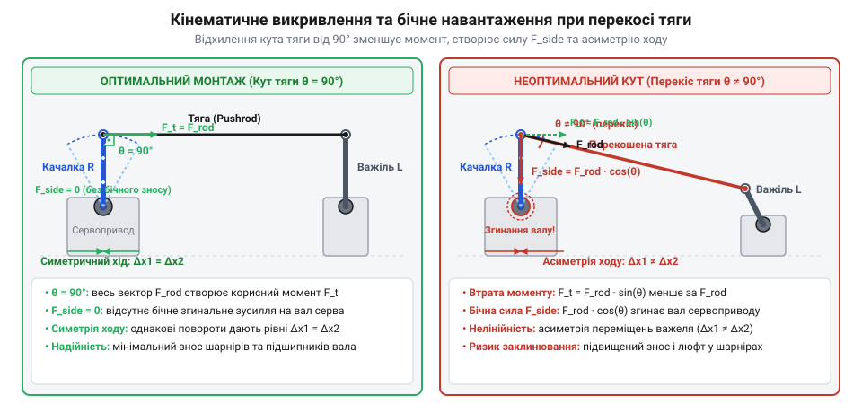
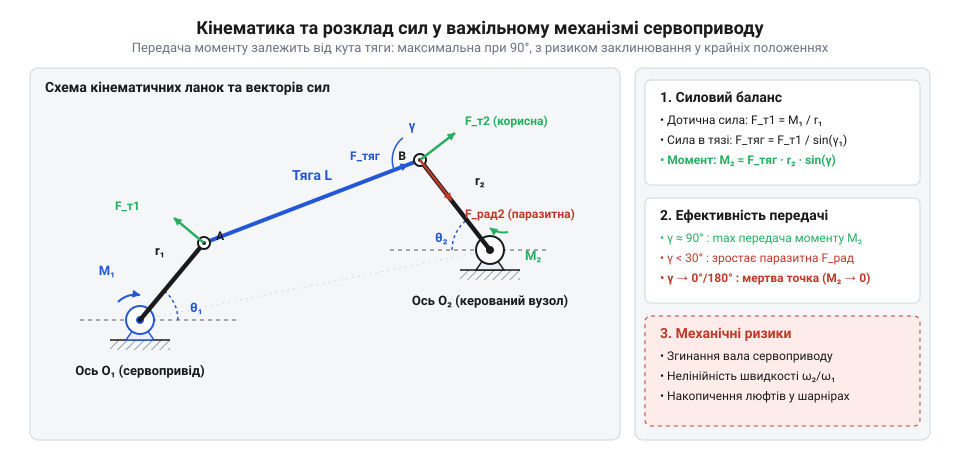
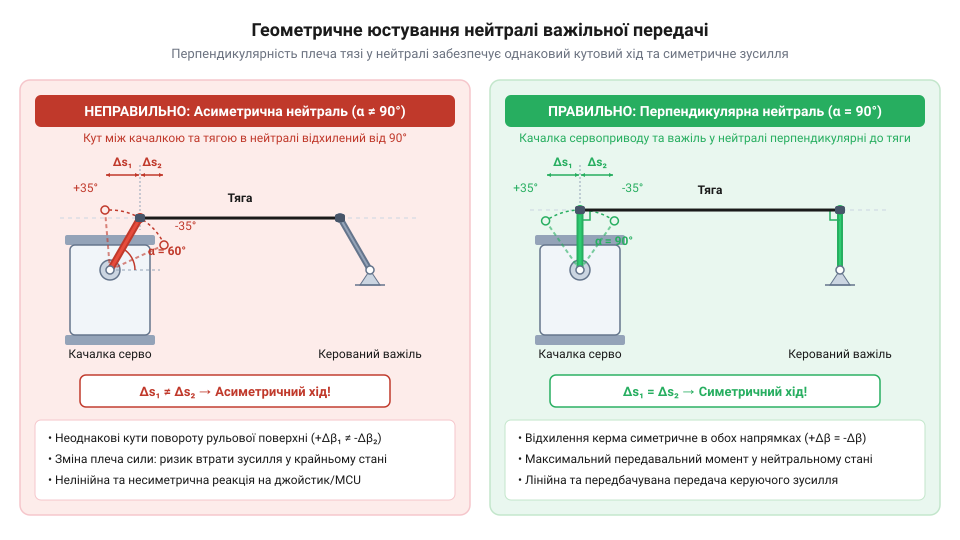
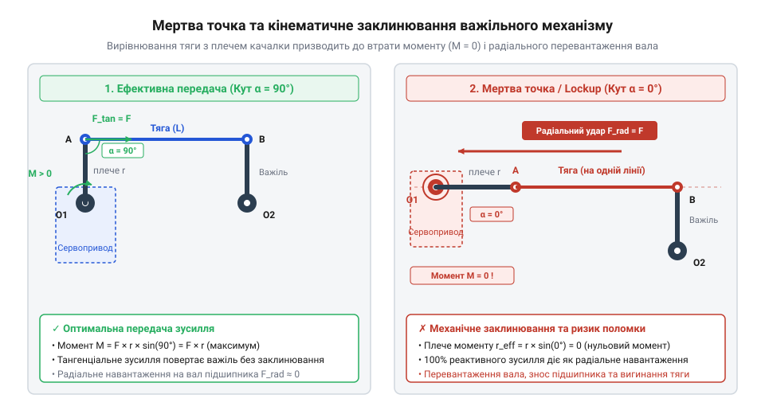
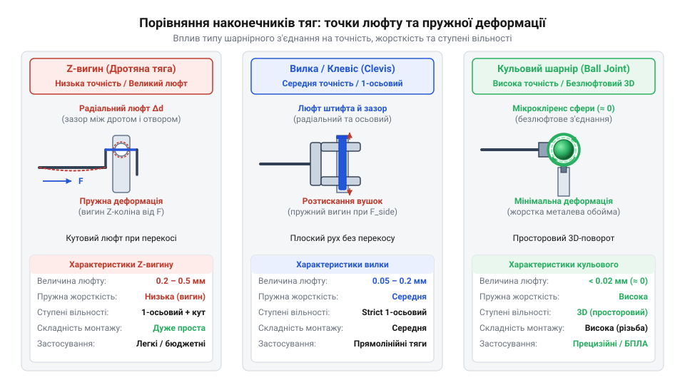
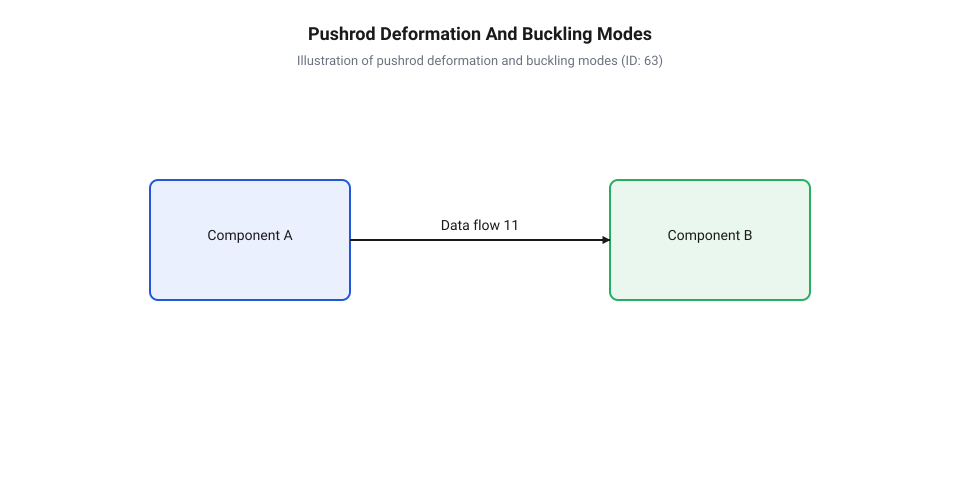

# Кінематика важільних механізмів та тяг сервоприводів

<preknowlist>
- [Сервоприводи радіокерованих моделей: будова, редуктори та ШІМ-керування](root:cat-hw-actuators/rc-servo-mechanisms-and-control) — принцип позиціонування вихідного вала та стандартні кути повороту сервоприводу
- [Серво-роги (запасні)](root:cat-hw-actuators/servo-horns) — конструкція та геометрія комплектних качалок, розташованих на вихідному валу
- [Зсувні навантаження та абразивний знос шестерень сервоприводів](root:cat-hw-actuators/servo-gear-shear-and-wear) — вплив механічних перекосів і бокових сил на знос шестерень та підшипників
</preknowlist>

## Нелінійність прямого зв'язку та перекоси

При проектуванні робототехнічних маніпуляторів, моделей безпілотних апаратів або поворотних механізмів розробник постійно стикається з потребою перетворити обертальний рух вихідного вала сервоприводу у переміщення керованого вузла чи кермової поверхні. Найпростішим конструктивним рішенням здається безпосереднє з'єднання вихідної (від англ. *servo horn*, де *horn* означає ріг або радіальний виступ важеля): @@en|качалки сервоприводу@@ із веденим важелем за допомогою (від англ. *pushrod*, де *push* — штовхати, а *rod* — стрижень): @@en|жорсткої тяги@@. На перший погляд передбачається, що повертання вала на певний кут спричиняє пропорційне переміщення тяги та еквівалентний поворот керованого елемента. Проте при фізичному випробуванні зібраного вузла розробник виявляє суттєву нерівномірність швидкості, зміну передаваного зусилля вздовж робочого ходу та навіть раптове заклинювання механізму у крайніх положеннях. Хоча внутрішній [принцип позиціонування вихідного вала](root:cat-hw-actuators/rc-servo-mechanisms-and-control) електронного сервоприводу гарантує точне пропорційне утримання кута ротора відповідно до тривалості керуючого імпульсу, сама геометрія механічної важільної передачі принципово викривляє підсумковий рух.

Фізична причина кінематичного спотворення криється у траєкторії руху кінця качалки: точка кріплення тяги рухається не по прямій лінії, а по дузі кола радіуса `r₁`. Коли качалка повертається на кут `θ`, поздовжня проекція її зміщення вздовж головної осі дії описується синусоїдальною залежністю `r₁ · sin(θ)`, тоді як поперечна проекція зміщення змінюється за косинусоїдальним законом `r₁ · (1 - cos(θ))`. Оскільки жорстка тяга має фіксовану довжину між своїми шарнірами, її поперечне відхилення змушує тягу нахилятися під кутом `γ` до початкової осі. Через це миттєве (від англ. *transmission ratio*, від латинського *transmissio* — передача): @@en|передаточне відношення@@ між кутовим зміщенням вала та лінійним ходом штовхача не залишається сталим, а безперервно змінюється в кожній точці траєкторії. Поблизу перпендикуляра до тяги малий поворот вала дає максимальне лінійне переміщення, тоді як при наближенні кута повороту качалки до 90 градусів лінійний приріст на кожен градус обертання прямує до нуля.

Історично важільні системи керування пройшли тривалий шлях удосконалення: від перших авіаційних тросових проводянок, які працювали лише на розтяг і вимагали складних замкнених контурів для двосторонньої дії, до сучасних шарнірних штовхачів робототехнічних приводів. Докладніше про цей розвиток розкриває [еволюція важільних механізмів](root:cat-hw-actuators/servo-pushrod-kinematics/hist-pushrod-linkages.md), де описано виклики компенсації люфтів та прогинів у просторових системах керування.


*Виникнення поперечного зсуву та згинального моменту на валу сервоприводу при відхиленні тяги від перпендикуляра.*

Окрім геометрії траєкторії, нахил тяги на кут `γ` відносно перпендикуляра до качалки створює важкі паразитні механічні навантаження. Осьова сила `F_push`, що діє вздовж тяги при подоланні опору веденого вузла, розкладається на дві векторні складові: тангенціальну складову `F_tan = F_push · cos(γ)`, яка створює корисний обертальний момент `M_servo = F_tan · r₁` на плечі качалки `r₁`, та перпендикулярну складову `F_trans`, яка діє як бокове поперечне зусилля безпосередньо на шарнір кріплення. Обчислимо поперечну силу `F_trans` та спричинений нею згинальний момент `M_bend` на консольному вилеті вала висотою `h` від опорного підшипника до площини качалки:

```
F_trans = F_push · sin(γ)                    [розкладання осьової сили тяги на поперечну складову]
M_bend = F_trans · h                         [згинальний момент на консольному вилеті вала]
       = F_push · h · sin(γ)                 [підстановка поперечного зусилля залежно від кута перекосу]
```

З одержаної залежності видно, що в ідеальній нейтралі при `γ = 0` синус дорівнює нулю (`sin(0) = 0`), тому поперечне зусилля `F_trans` та згинальний момент `M_bend` відсутні. Проте при відхиленні тяги на кут `γ` бокова сила зростає пропорційно `sin(γ)`, перетворюючи значну частку зусилля штовхача на шкідливий (від англ. *bending moment*, від *bend* — гнути): @@en|згинальний момент@@ та створюючи високе (від англ. *radial load*, від латинського *radialis* — променевий): @@en|радіальне навантаження@@ на опорні підшипники та втулки вала приводу.

У компактних пристроях, де застосовується [мікросервопривод SG90](root:cat-hw-actuators/sg90-servo) із пластиковими втулками ковзання, регулярна дія бокової сили швидко виробляє посадкове гніздо вала, спричиняючи радіальний люфт та перекошування шестерень редуктора. Навіть якщо вузол комплектується більш міцним [сервоприводом з металевим редуктором](root:cat-hw-actuators/mg90s-servo) MG90S, постійні бокові згинальні навантаження створюють нерівномірний плямистий контакт у зубчастих зачепленнях. Нехтування цими силами приводить до прискореного [зношування шестерень та підшипників](root:cat-hw-actuators/servo-gear-shear-and-wear), підвищення механічного шуму, виникнення зон нечутливості й заклинювання зубців під навантаженням.

## Геометрія перетворення кута в переміщення

Щоб усунути нелінійні викривлення траєкторії та запобігти заклинюванню, розробник має перейти від інтуїтивного складання до аналітичного геометричного розрахунку важільного вузла. Основою цього розрахунку є тригонометрична модель перетворення кутового відхилення качалки у поздовжній та поперечний хід шарніра тяги. За точку відліку зручно обрати стан нейтралі, коли качалка сервоприводу розташована суворо перпендикулярно до осі симетрії штовхача.

Для опису руху важільного вузла відстежимо траєкторію веденого кінця качалки радіуса `r₁` при її повороті на кут `θ`. Рух по дузі кола розкладається на два ортогональні вектори: корисну поздовжню складову переміщення `x(θ)` вздовж основної осі штовхача та паразитичний поперечний зсув `y(θ)`. Оскільки жорстка тяга довжиною `L` приєднана до цього шарніра, її поперечне відхилення на величину `y(θ)` викликає нахил самого штовхача, формуючи (від англ. *skew angle*, від *skew* — косий, похилий): @@en|кут перекосу@@ `γ(θ)`. З прямокутного трикутника, де гіпотенузою є довжина тяги `L`, а протилежним катетом — поперечне зміщення `y(θ)`, синус кута перекосу дорівнює відношенню `y(θ) ÷ L`. Для оцінки кінематики в зоні малих кутів повороту (`θ < 15°` або `θ ≪ 1` рад) застосуємо розклад тригонометричних функцій у ряд Тейлора (`sin(θ) ≈ θ`, `cos(θ) ≈ 1 - θ² ÷ 2`), що дозволяє отримати спрощені квадратичні наближення для зсуву та перекосу:

```
x(θ) = r₁ · sin(θ)                           [поздовжня проекція дуги обертання]
y(θ) = r₁ · (1 - cos(θ))                     [поперечна проекція зміщення точки]
sin(γ(θ)) = y(θ) ÷ L
          = r₁ · (1 - cos(θ)) ÷ L            [синус кута перекосу тяги]
γ(θ) = arcsin((r₁ · (1 - cos(θ))) ÷ L)       [точне геометричне значення кута перекосу]
y_approx(θ) ≈ (r₁ · θ²) ÷ 2                  [параболічне наближення зсуву для малих кутів]
γ_approx(θ) ≈ (r₁ · θ²) ÷ (2 · L)            [параболічне наближення кута перекосу для малих кутів]
```

З одержаних виразів видно, що при малих кутах поперечний зсув `y(θ)` і кут перекосу `γ(θ)` є квадратичними величинами другого порядку малості (пропорційні `θ²`), завдяки чому в межах ±15° нахилом тяги можна знехтувати, а поздовжній хід вважати практично лінійним (`x(θ) ≈ r₁ · θ`). Проте при більших кутах поворот качалки спричиняє прогресуючий нахил тяги, що стрімко викривляє траєкторію і створює додатковий [абразивний знос шестерень](root:cat-hw-actuators/servo-gear-shear-and-wear) через зростання поперечних механічних зусиль.

Обчислимо кут відхилення тяги `γ(θ)` та підсумкове поздовжнє положення веденого шарніра `s(θ)` для тяги довжиною `L`.

```
sin(γ(θ)) = y(θ) ÷ L
          = r₁ · (1 - cos(θ)) ÷ L            [синус кута перекосу тяги]
s(θ) = x(θ) + L · cos(γ(θ))
     = r₁ · sin(θ) + L · √(1 - sin²(γ(θ)))   [тригонометрична тотожність]
     = r₁ · sin(θ) + L · √(1 - (r₁ · (1 - cos(θ)) ÷ L)²)  [точна координата веденого шарніра]
```

Отримана залежність описує точне положення веденої точки з урахуванням нахилу тяги на кут `γ(θ)`. З формули видно, що при збільшенні довжини тяги `L` відношення `r₁ ÷ L` прямує до нуля, завдяки чому підкореневий вираз наближається до одиниці, а кут нахилу `γ(θ)` стає мізерно малим. Отже, використання довгої тяги дозволяє практично повністю нівелювати поперечні викривлення.

З'єднання качалки радіуса `r₁` через тягу довжиною `L` із веденим важелем радіуса `r₂` утворює плоский (від англ. *four-bar linkage*, де *link* означає ланку механізму): @@en|чотириланковий механізм@@. У цій кінематичній схемі кут повороту веденого важеля `ϕ` зв'язаний із кутом повороту качалки `θ` через замкнений тригонометричний контур.


*Геометрія чотириланкового важільного механізму та взаємозв'язок кутових і лінійних параметрів.*

Для комплексного моделювання цієї залежності застосовується аналітичний апарат, де [розрахунок кінематики чотириланкового механізму](root:cat-hw-actuators/servo-pushrod-kinematics/math-four-bar-kinematics.md) описує трансформування кутових координат із урахуванням довжин усіх чотирьох ланок ланцюга.

Окрім геометрії переміщень, важливим фактором є трансформація моменту й зусилля. Обчислимо миттєве передаточне відношення моменту `i_M(θ)` між вихідним валом сервоприводу та веденим важелем з урахуванням миттєвих кутів нахилу тяги.

```
i_M(θ) = M_out ÷ M_in
       = (F_pushrod · r₂ · cos(γ₂)) ÷ (F_pushrod · r₁ · cos(γ₁))  [співвідношення моменту сили]
       = (r₂ · cos(γ₂)) ÷ (r₁ · cos(γ₁))                          [скорочення зусилля в тязі]
```

Виведений вираз підтверджує, що передача моменту залежить від плечей діючих сил, визначених кутами `γ₁` та `γ₂` між тягою та відповідними важелями. Для побудови точного силового профілю механізму застосовується [векторний розрахунок передачі моменту](root:cat-hw-actuators/servo-pushrod-kinematics/math-force-torque-leverage.md), який дає змогу розрахувати корисне зусилля у будь-якій точці траєкторії.

Вирішальне значення для забезпечення симетрії ходу має початкова настройка нейтралі `θ₀`. Для отримання однакових кутів повороту веденого важеля у зворотному й прямому напрямках (`+ϕ_max` та `-ϕ_max`) при симетричній зміні керуючого ШІМ-сигналу, качалка сервоприводу та ведений важіль у нейтральному положенні мають бути виставлені суворо перпендикулярно до лінії тяги.


*Вплив перпендикулярності встановлення качалки у нейтралі на симетрію робочого ходу тяги.*

Якщо ж качалку змонтовано із початковим зсувом (наприклад, `θ₀ = 30°`), поворот у бік 75 градусів дасть лінійне переміщення `r₁ · (sin(75°) - sin(30°)) = 0.466 · r₁`, тоді как аналогічний поворот у зворотний бік до -15 градусів дасть переміщення `r₁ · (sin(30°) - sin(-15°)) = 0.759 · r₁`. Це призводить до катастрофічної асиметрії відгуку кермової поверхні, коли при однакових відхиленнях джойстика керування вузол повертається на суттєво різні кути.

Зміна співвідношення радіусів плечей `r₁ ÷ r₂` дозволяє цілеспрямовано змінювати механічні характеристики вузла:

1. Співвідношення `r₁ < r₂` працює як механічний редуктор (підсилювач моменту). Ведений важіль повертається на менший кут, ніж вал сервоприводу (`ϕ < θ`), проте момент на веденому валу зростає. Це знижує чутливість вузла до механічного (від нім. *Luft* — зазор у шарнірах): @@de|люфту@@ та підвищує точність дискретного позиціонування.
2. Співвідношення `r₁ > r₂` працює як мультиплікатор швидкості. Воно збільшує кутовий хід веденого важеля (`ϕ > θ`), але пропорційно зменшує переданий момент та погіршує роздільну здатність керування.

Для вибору потрібного плеча зручно використовувати [комплектні пластикові качалки](root:cat-hw-actuators/servo-horns), які мають кілька отворів на різній відстані від центру обертання. Для автоматизації проектування та перевірки механізму на відсутність мертвих точок розроблено [інструмент розрахунку геометричних параметрів](root:cat-hw-actuators/servo-pushrod-kinematics/proj-pushrod-kinematics-calculator.md). Після розрахунку плечей проводиться підгонка й механічна юстировка, де [покроковий процес фізичного складання](root:cat-hw-actuators/servo-pushrod-kinematics/proj-servo-linkage-assembly-bench.md) забезпечує точний збіг розрахункової та реальної нейтралей.

## Мертві точки та механічне заклинювання

Коли важільний механізм приводу проектують без урахування геометричних меж повороту, сервопривід може раптово втратити здатність передавати зусилля або повністю заклинити в крайньому положенні. Ця проблема виникає не через брак потужності мотора чи збій електроніки, а через чисто геометричний ефект, коли кут між напрямком стрижня тяги (від англ. *pushrod*, де *push* — штовхати та *rod* — стрижень): @@en|pushrod@@ та плечем качалки сервоприводу (від англ. *servo horn*, де *servo* — сервопривід та *horn* — ріжок): @@en|servo horn@@ наближається до нуля або ста вісімдесяти градусів.

Фізична сутність передачі моменту полягає в тому, що корисне обертальне зусилля створюється лише тією складовою вектора сили, яка перпендикулярна до плеча важеля. Ефективне плече сили визначається геометричним співвідношенням:

```
r_eff = r × sin(θ)
```

де `r` — фізична довжина плеча качалки від осі обертання до отвору кріплення шарніра, а `θ` — кут між лінією плеча качалки та вектором вздовж тяги @@en|pushrod@@.

Обертальний момент, що передається на керований важіль через тягу, обчислюється через крок перетворення сили:

```
M_eff = F × r_eff
      = F × r × sin(θ)           [залежність ефективного моменту від кута]
      = F × r × 0                [значення при куті θ = 0° або θ = 180°]
      = 0                        [повна втрата обертального моменту]
```

При куті `θ = 0°` або `θ = 180°` вектор сили тяги @@en|pushrod@@ проходить точно через вісь обертання вихідного вала сервоприводу. У цьому стані ефективне плече `r_eff` дорівнює нулю, а отже, ефективне обертальне зусилля повністю зникає. Становище механізму, в якому плече важеля та тяга складають єдину пряму лінію, називається (від англ. *dead center* або *dead point*, де *dead* — нерухомий та *center* — центр): @@en|мертва точка@@.

Якщо механізм опиняється в мертвій точці, виникає небезпечний режим, який називається (від англ. *toggle lockup*, де *toggle* — важільний затвор та *lockup* — блокування): @@en|механічне заклинювання@@. Коли сервопривід намагається вивести ведений важіль із граничного стану, необхідне зусилля в тязі обчислюється за зворотною залежністю:

```
F = M_driven ÷ (r_driven × sin(θ_driven))
```

Оскільки `sin(θ_driven)` прямує до нуля, необхідна сила `F` прямує до нескінченності. Сервопривід розвиває максимальний утримувальний момент, проте замість повороту веденого важеля вся сила мотора перетворюється на колосальне (від англ. *radial load*): @@en|радіальне навантаження@@, що діє уздовж плеча качалки @@en|servo horn@@ безпосередньо на вихідний вал приводу.

Це викликає небезпечний (від англ. *bending moment*): @@en|згинальний момент@@ на вихідному валу та корпусі редуктора. Сильне радіальне стискання перекошує осі шестерень, знищує масляну плівку на зубцях і провокує швидке [абразивне зношування шестерень](root:cat-hw-actuators/servo-gear-shear-and-wear) та деформацію корпусу. Особливо чутливими до такого заклинювання є [мікросервоприводи з металевими редукторами](root:cat-hw-actuators/mg90s-servo), де згинальні зусилля легко ламають тонкі опорні штифти шестерень.


*Мертва точка та механічне заклинювання важільного механізму при виконанні геометрично граничного повороту.*

Історично склалося, що [перші механічні тяги](root:cat-hw-actuators/servo-pushrod-kinematics/hist-pushrod-linkages.md) у тросових і важільних системах керування авіацією стикалися з подібними заклинюваннями під час максимальних відхилень рулів. Для запобігання критичним режимам у сучасній робототехніці суворо обмежують робочий кутовий діапазон.

Щоб визначити (від англ. *transmission ratio*): @@en|передаточне відношення@@ та (від англ. *mechanical advantage*): @@en|виграш у силі@@ на всьому шляху руху, застосовується [математична модель чотириланковика](root:cat-hw-actuators/servo-pushrod-kinematics/math-four-bar-kinematics.md), яка дозволяє обчислити миттєві кути між усіма ланками. Додатково [векторний розрахунок моментів](root:cat-hw-actuators/servo-pushrod-kinematics/math-force-torque-leverage.md) показує, як саме змінюється корисне зусилля при відхиленні від перпендикуляра.

Практичне правило безпечної кінематики вимагає, щоб кут `θ` між тягою @@en|pushrod@@ і будь-яким із важелів ніколи не виходив за межі діапазону від 30° до 150° (тобто відхилення від перпендикулярної нейтралі 90° не повинно перевищувати ±60°):

```
30° ≤ θ ≤ 150°
```

При куті `θ = 30°` значення `sin(30°) = 0.5`, що означає падіння ефективності передачі моменту на 50%. Хоча корисне зусилля зменшується вдвічі, механізм зберігає достатній запас ходу та повністю захищений від @@en|toggle lockup@@. Якщо ж кут `θ` стає меншим за 30°, ефективність падає катастрофічно стрімко, а радіальна сила на вал починає перевищувати корисну дотичну силу в кілька разів.

Для попереднього проектування вузла та швидкого розрахунку граничних кутів повороту зручно використовувати [інтерактивний калькулятор геометрії](root:cat-hw-actuators/servo-pushrod-kinematics/proj-pushrod-kinematics-calculator.md), який будує графіки ефективного моменту залежно від довжин плечей та геометричного вильоту.

## Геометричне юстування та симетрія ходу

Навіть якщо важільний механізм працює в безпечних кутових межах і не досягає мертвих точок, неправильний монтаж важелів може призвести до вираженої несиметрії руху. У такому разі при однаковому куті повороту вала сервоприводу праворуч і ліворуч керований вузол повертатиметься на різні кути, а зусилля в протилежних напрямках буде суттєво відрізнятися.

Основою забезпечення симетричного відгуку є правило механічної перпендикулярності в нейтральному стані. Коли на сервопривід подається електронний сигнал нейтралі (зазвичай тривалість імпульсу ШІМ становить 1500 мкс), (від англ. *neutral position*): @@en|механічна нейтраль@@ має відповідати суворо перпендикулярному розташуванню плечей відносно напрямку тяги @@en|pushrod@@. Тобто кут між качалкою сервоприводу @@en|servo horn@@ та тягою, а також кут між веденим важелем та тягою у вихідному стані повинні дорівнювати точно 90°.

Математична причина такої вимоги криється в симетрії тригонометричної функції синуса відносно точки 90°. При симетричному відхиленні качалки на кут `±Δα` від нейтралі ефективні плечі сили обчислюються так:

```
r_eff_pos = r × sin(90° + Δα)
          = r × cos(Δα)          [зведення кута для позитивного відхилення]

r_eff_neg = r × sin(90° - Δα)
          = r × cos(Δα)          [зведення кута для негативного відхилення]
```

Оскільки `cos(Δα) = cos(-Δα)`, ефективні плечі сили та корисні моменти для однакових кутів повороту в обидва боки залишаються абсолютно рівними (`r_eff_pos = r_eff_neg`).

Якщо ж качалку встановлено з початковим зсувом, наприклад, під кутом `α₀ = 60°` до тяги @@en|pushrod@@, відхилення на `±30°` дасть катастрофічну несиметрію:

```
r_eff_pos = r × sin(60° + 30°)
          = r × sin(90°)
          = 1.000 × r            [максимальне ефективне плече]

r_eff_neg = r × sin(60° - 30°)
          = r × sin(30°)
          = 0.500 × r            [ефективне плече зменшене вдвічі]
```

У результаті виникає (від англ. *differential throw*): @@en|диференціальний хід@@: в один бік керована поверхня рухається швидко й з малим зусиллям, а в інший — повільно й з подвійним моментом.

Поширеною помилкою є спроба компенсувати механічний перекіс важелів програмним шляхом через налаштування сервоконтролера — так званий (від англ. *sub-trim*, де *sub* — додатковий та *trim* — підстроювання): @@en|програмний зсув нейтралі@@. Програмний @@en|sub-trim@@ лише зміщує електричну точку відліку ШІМ-сигналу, але не змінює фізичного кута між плечем качалки та тягою @@en|pushrod@@ у просторі. При цьому зменшується доступний кутовий діапазон повороту сервоприводу в один із боків, а нелінійність передачі моменту залишається некомпенсованою. Механічне юстування завжди має передувати будь-якому електронному калібруванню.

Для механічного налаштування перш за все обирають правильне кутове положення качалки на валу. Для цього враховують [тип шліцового з'єднання](root:cat-hw-actuators/servo-horns), яке має фіксований крок зубців (наприклад, 21, 24 або 25 шліців). Якщо зубчастий крок не дозволяє виставити качалку точно під 90°, використовують регулювання фізичної довжини самої тяги за допомогою різьбових наконечників.

Коли довжини плеча качалки `r_horn` та веденого важеля `r_driven` не рівні, кутові переміщення двох важелів відрізняються відповідно до геометричного відношення плечей:

```
Δβ ≈ Δα × (r_horn ÷ r_driven)
```

Щоб змінити передаточне відношення @@en|transmission ratio@@ або збільшити кутовий хід веденого вузла, шарнір переставляють в інші отвори, які мають стандартні [пластикові качалки сервоприводів](root:cat-hw-actuators/servo-horns). Для складних просторових або паралельних траєкторій використовують [паралелограмні важільні системи](root:cat-hw-actuators/pantograph-and-parallel-linkage-mechanisms), а якщо жорстка тяга не може бути прокладена по прямій — застосовують [гнучкі боуденівські троси](root:cat-hw-actuators/flexible-pushrods-and-bowden-cables).

На якість юстування та точність позиціонування критично впливає вибір конструкції шарнірних з'єднань, оскільки в них накопичується механічний (від англ. *backlash*, від *back* — назад та *lash* — удар): @@en|люфт@@.


*Конструктивні типи наконечників тяг визначають рівень механічного люфту та пружної деформації вузла під навантаженням.*

Вибір наконечника визначається вимогами до жорсткості та ступенів вільності:

1. (від англ. *Z-bend*): @@en|Z-подібний вигин@@ — найпростіший варіант із вигнутого сталевого дроту. Він не потребує додаткового кріплення, але дріт контактує з отвором качалки лише по вузьких лініях. Під навантаженням сталевий дріт розробляє пластиковий отвір, утворюючи значний @@en|backlash@@. Таке з'єднання застосовують лише в легких моделях із бюджетними [мікросервоприводами SG90](root:cat-hw-actuators/sg90-servo).
2. (від англ. *clevis joint*, від *clevis* — скоба): @@en|вилковий шарнір@@ — має П-подібну вилку із циліндричним пальцем, що проходить через качалку. Забезпечує високу жорсткість та мінімальний люфт, проте працює виключно в одній площині. Найменший перекіс осей обертання спричиняє механічне підклинювання.
3. (від англ. *ball joint*): @@en|кульовий шарнір@@ — складається зі сталевої кульки на стійці та охоплювального полімерного або металевого наконечника. Це найкраще рішення для високоточних приводів, оскільки кульове з'єднання дає змогу важелям повертатися в трьох площинах без підклинювання та забезпечує практично нульовий @@en|backlash@@. Його застосовують у відповідальних вузлах з силовими сервоприводами або [версій із вуглеволокном](root:cat-hw-actuators/sg92r-servo).

Будь-який сумарний люфт у шарнірах розширює [зону нечутливості приводу](root:cat-hw-actuators/servo-deadband-and-jitter) та змушує систему дрижати в нейтралі. Покрокову інструкцію з вимірювання люфтів та виставляння механічної нейтралі на практиці наведено на [стенді складання тяг](root:cat-hw-actuators/servo-pushrod-kinematics/proj-servo-linkage-assembly-bench.md).

## Конструкція тяг та мінімізація люфтів

Після теоретичного розрахунку кінематичної геометрії, важелів та кутів повороту розробник переходить до фізичного виготовлення тягового вузла. Ідеальна математична модель чотириланкового механізму втрачає точність позиціонування, якщо жорстка тяга @@en|pushrod@@ під навантаженням прогинається, а в її шарнірних з'єднаннях накопичується механічний люфт @@en|backlash@@. Фізичне конструювання тяги вимагає збалансованого вибору матеріалу стержня, геометрії його перерізу та конструкції шарнірних наконечників під конкретні робочі навантаження.

Головною механічною проблемою при роботі тяги @@en|pushrod@@ є асиметрія її поведінки під дією силових чинників. Коли сервопривід тягне ведений важіль, стержень працює на чисте розтягнення, і його деформація визначається лише міцністю матеріалу на розрив. Однак коли сервопривід штовхає важіль, тонкий і довгий стержень піддається дію стискального зусилля й стрімко втрачає механічну стійкість.

Явище раптової втрати стійкості тонкого стержня під дією стискального навантаження називається (від англ. *buckling*, від *buckle* — вигинатися): @@en|поздовжній згин@@. Якщо стискальна сила перевищує критичний поріг, стержень вигинається вбік і діє як пружина. У результаті кутовий хід качалки сервоприводу @@en|servo horn@@ витрачається на пружне деформування тяги, а ведений важіль залишається недоповерненим.

Критична сила стискання, при якій виникає @@en|buckling@@, обчислюється за класичною формулою Ейлера для шарнірно закріпленого стержня:

```
F_crit = (π² × E × I) ÷ L²            [критичне навантаження поздовжнього згину за Ейлером]
```

де `E` — модуль пружності матеріалу (модуль Юнга), `I` — мінімальний осьовий момент інерції поперечного перерізу стержня, а `L` — вільна робоча довжина тяги між центрами шарнірів.

Для суцільного круглого стержня діаметром `d` момент інерції прямо пропорційний четвертому степеню діаметра:

```
I = (π × d⁴) ÷ 64            [осьовий момент інерції суцільного круглого перерізу]
```

З формули видно, що стійкість тяги до поздовжнього згину спадає зворотно пропорційно квадрату її довжини `L²`. Якщо довжину тяги збільшити вдвічі при збереженні товщини, її максимальне стискальне зусилля зменшиться в чотири рази. Згинальна (від англ. *compliance*, від *comply* — підкорятися): @@en|піддатливість@@ стержня призводить до виникнення силового гістерезису: зусилля повороту в напрямку штовхання стає суттєво меншим, ніж у напрямку тягнення.


*Поздовжній згин тяги при стисканні призводить до пружних втрат ходу та виникнення гістерезису позиціонування.*

Для запобігання @@en|buckling@@ та мінімізації маси конструкції добирають відповідні матеріали й профілі тяг:

1. Сталевий дріт або велосипедна спиця. Сталь володіє високим модулем пружності (`E ≈ 200–210 GPa`), але має велику питому густину (`7800 kg/m³`). Дріт діаметром 1.2–1.5 мм є чудовим рішенням для коротких тяг довжиною до 100 мм у легких приводах з [мікросервоприводами SG90](root:cat-hw-actuators/sg90-servo). Проте на довжинах понад 150 мм сталевий дріт стає занадто гнучким або надміру важким.
2. Тонкостінна алюмінієва трубка. Алюмінієві сплави мають менший модуль пружності (`E ≈ 70 GPa`), але трубчастий переріз забезпечує високий момент інерції при мінімальній вазі:

```
I_tube = (π × (D⁴ - d⁴)) ÷ 64            [момент інерції тонкостінної трубки]
```

де `D` — зовнішній діаметр, а `d` — внутрішній діаметр трубки. Алюмінієва трубка зовнішнім діаметром 4 мм із товщиною стінки 0.5 мм витримує в кілька разів більше стискальне зусилля, ніж суцільний сталевий дріт рівної маси.

3. Вуглеволокно або карбоновий пруток. Композитні карбонові стержні й трубки мають модуль пружності `E ≈ 130–230 GPa` при низькій густині (`1500–1600 kg/m³`). Вони володіють найвищою питомою жорсткістю, не піддаються залишковій пластичній деформації та є ідеальним вибором для швидкісних [9-грамових мікросервоприводів](root:cat-hw-actuators/sg90-mg90-micro-servos-family) та силових важільних вузлів.

Поряд із пружними деформаціями стержня другою критичною проблемою є накопичення механічного люфту в шарнірних з'єднаннях. Сумарний люфт складається із зазорів між пальцями наконечників та отворами важелів, а також виробітки в осях обертання.

Наявність люфту @@en|backlash@@ розширює [зону нечутливості приводу](root:cat-hw-actuators/servo-deadband-and-jitter). Коли сервопривід змінює напрямок обертання вала, качалка @@en|servo horn@@ повертається на певний кут ухолосту, поки зазори в шарнірах не виберуться. Ведений важіль при цьому залишається нерухомим, що знижує роздільну здатність позиціонування.

Найнебезпечнішим наслідком люфту є виникнення динамічної нестабільності під дією зовнішніх інерційних або аеродинамічних сил. Вільне переміщення веденого вузла в межах люфтового зазору провокує автоколивання або (від англ. *flutter*, від *flutter* — тріпотіти): @@en|флатер@@. При @@en|flutter@@ ведена деталь починає швидко дрижати й резонувати. Ці ударні коливання передають руйнівні [зсувні навантаження шестерень](root:cat-hw-actuators/servo-gear-shear-and-wear) назад на редуктор сервоприводу, швидко знищуючи зубці та підшипники.

Вибір типів наконечників тяг прямо визначає рівень люфту та надійність вузла:

1. @@en|Z-подібний вигин@@ — вигнутий кінець дроту. Має мінімальну вагу, але отвір у пластиковій качалці @@en|servo horn@@ з часом розбивається, створюючи помітний @@en|backlash@@.
2. @@en|вилковий шарнір@@ — забезпечує високу жорсткість у площині обертання, проте вимагає суворої паралельності осей, інакше виникає підклинювання.
3. @@en|кульовий шарнір@@ — складається зі сталевої кульки та охоплювальної головки. Це єдине рішення, яке забезпечує роботу в трьох площинах з майже нульовим люфтом і відсутністю підклинювання.

Для прецизійного налаштування довжини тяги без демонтажу шарнірів застосовують регульовану різьбову стяжку або (від англ. *turnbuckle*, від *turn* — повертати та *buckle* — стягувати): @@en|талреп@@. Стяжка @@en|turnbuckle@@ має протилежні різьби (ліву й праву) з двох кінців. Обертання центрального шестигранника стяжки подовжує або вкорочує тягу з точністю до десятих часток міліметра, забезпечуючи ідеальне налаштування нейтралі. Якщо ж жорстка тяга не може бути прокладена по прямій лінії, проектувальники застосовують [гнучкі боуденівські троси](root:cat-hw-actuators/flexible-pushrods-and-bowden-cables).

[Еволюція важільних і тягових механізмів](root:cat-hw-actuators/servo-pushrod-kinematics/hist-pushrod-linkages.md) демонструє розвиток від важких сталевих роликових проводянок початку XX століття до сучасних карбонових тяг із прецизійними шарнірами. Для успішного вибору параметрів вузла дотримуються наступного алгоритму:

1. Оцінюють максимальне робоче зусилля `F_max` за допомогою [калькулятора кінематики](root:cat-hw-actuators/servo-pushrod-kinematics/proj-pushrod-kinematics-calculator.md).
2. Обчислюють критичну силу Ейлера `F_crit` для обраного матеріалу й діаметра тяги, забезпечуючи коефіцієнт запасу міцності `F_crit ÷ F_max ≥ 2.5`.
3. Застосовують кульові шарніри @@en|ball joint@@ з різьбовими стяжками @@en|turnbuckle@@ для усунення люфту @@en|backlash@@ та попередження @@en|flutter@@.
4. Проводять остаточне юстування нейтралі й перевірку натягу на [стенді складання тяг](root:cat-hw-actuators/servo-pushrod-kinematics/proj-servo-linkage-assembly-bench.md).

Повний цикл проектування та збирання кінематичного тягового вузла вважається завершеним, коли геометрична симетрія перетворення кутового руху поєднується з достатньою поздовжньою жорсткістю стержня та нульовим люфтом у шарнірах.