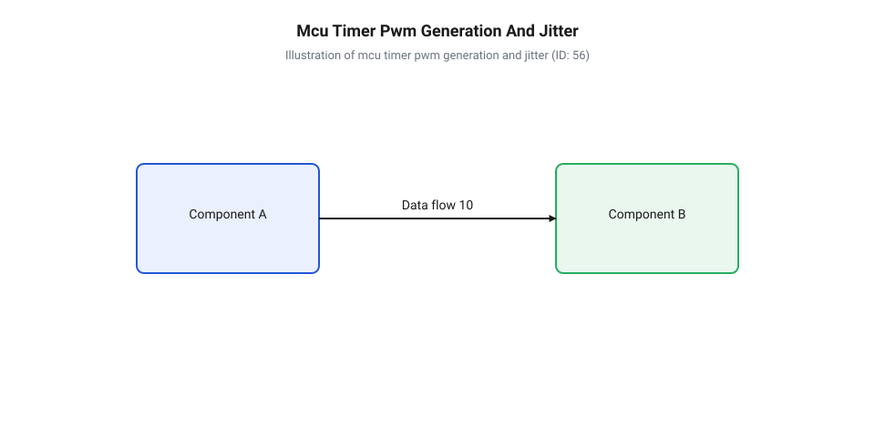
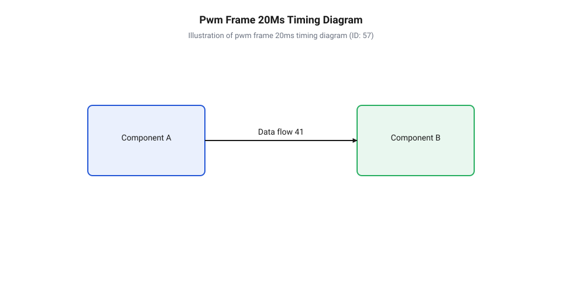
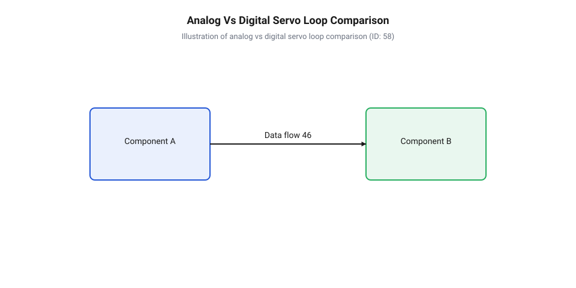
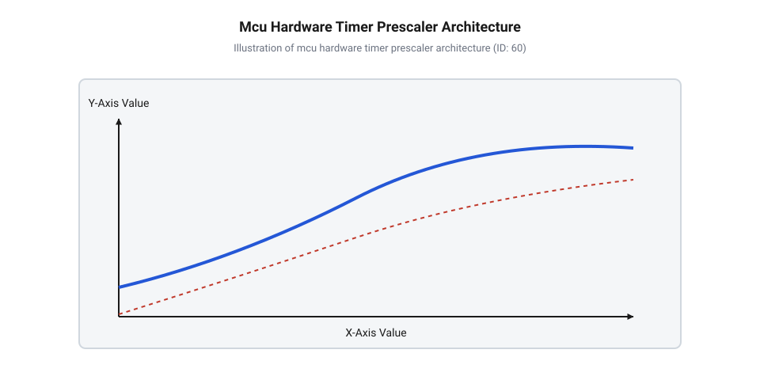

# Частота оновлення кадрів ШІМ і цикли позиціонування сервоприводів

<preknowlist>
- [Сервоприводи радіокерованих моделей: будова, редуктори та ШІМ-керування](root:cat-hw-actuators/rc-servo-mechanisms-and-control) — Базові принципи ШІМ-керування тривалістю імпульсу 1–2 мс та механічна будова сервоприводу.
- [Інтегральні аналогові сервопідсилювачі KC2462 та AA51880](root:cat-hw-actuators/analog-servo-amplifier-ic) — Схема генерації внутрішнього порівняльного імпульсу та логіка роботи аналогового H-моста.
- [Зона нечутливості та дрижання вала сервоприводів](root:cat-hw-actuators/servo-deadband-and-jitter) — Механізми виникнення зони нечутливості (deadband) та її роль у запобіганні автоколиванням вала.
</preknowlist>

## Дрижання та перегрів сервоприводу від кадрів

Уявіть типову ситуацію під час розробки роботизованого маніпулятора або системи стабілізації: ви налаштовуєте вихідний @@en|PWM@@ (від англ. *Pulse-Width Modulation* — широтно-імпульсна модуляція) сигнал на тривалість імпульсу 1.5 мс, сподіваючись утримувати вал приводу точно в нейтральному положенні. Проте під зовнішнім динамічним навантаженням вал починає дрижати, втрачає момент утримання, пропускає кутові позиції або аномально нагрівається вже за кілька хвилин роботи. Розробник зазвичай шукає помилку в тривалості самого імпульсу, перевіряючи межі від 1.0 мс до 2.0 мс відповідно до [принципів ШІМ-керування сервоприводами](root:cat-hw-actuators/rc-servo-mechanisms-and-control). Однак поза увагою лишається фундаментальний часовий параметр — період кадру `T_frame` (або частота кадрів @@en|frame rate@@), який задає часовий інтервал між послідовними імпульсами керування.

Головна причина нестабільної поведінки приводу полягає у порушенні синхронізації між частотою подачі вхідних ШІМ-кадрів та внутрішнім робочим циклом сервопідсилювача. Якщо керуючий сигнал формується програмно за допомогою затримок або обробника переривань @@en|ISR@@ (від англ. *Interrupt Service Routine* — процедура обробки переривань), високорівневі задачі мікроконтролера викликають фазове @@en|jitter@@ (від англ. *jitter* — фазове дрижання) часового кадру. Коли часовий інтервал між сусідніми імпульсами випадково коливається (наприклад, від 15 мс до 30 мс), внутрішня вимірювальна схема приводу сприймає цю нестабільність як постійну зміну цільової позиції, що спричиняє автоколивання вала.

Невідповідність частоти кадрів призводить до двох крайніх деструктивних режимів:

1. **Занижена частота кадрів або пропуск імпульсів (< 30 Гц):** Внутрішній @@en|analog servo@@ (від англ. *analog servo* — аналоговий сервопривід) із сервопідсилювачем на зразок [аналогових сервопідсилювачів KC2462](root:cat-hw-actuators/analog-servo-amplifier-ic) відкриває силові ключі @@en|H-bridge@@ (від англ. *H-bridge* — Н-міст) і подає струм на обмотки мотора виключно в момент надходження фронту вхідного ШІМ-імпульсу. Якщо частота кадрів падає або імпульси випадають через часові затримки в програмі, мотор лишається без живлення протягом довгої паузи між кадрами. Під дією зовнішнього механічного моменту вал фізично зміщується. Коли наступний імпульс нарешті надходить, накопичена помилка позиції стає великою, і сервопідсилювач подає на мотор максимально можливий імпульс струму. Мотор різко ривкає, проскочує нейтраль і створює важкі механічні коливання, що безпосередньо посилюється впливом [зони нечутливості та дрижання](root:cat-hw-actuators/servo-deadband-and-jitter) вала.

2. **Завищена частота кадрів (> 70–90 Гц для аналогових приводів):** Внутрішній порівняльний генератор аналогової серви використовує часозадаючий конденсатор для формування внутрішнього еталонного імпульсу. Якщо вхідні кадри надходять частіше, ніж конденсатор встигає повністю розрядитися, тривалість внутрішнього порівняльного імпульсу спотворюється. Крім того, силові ключі @@en|MOSFET@@ (від англ. *Metal-Oxide-Semiconductor Field-Effect Transistor* — польовий транзистор із ізольованим затвором) працюють у режимі безперервного високочастотного перемикання без необхідних паузових інтервалів для охолодження. Це викликає лавиноподібне перегрівання силового каскаду та вихід з ладу обмоток мотора, порушуючи межі [теплового захисту сервоприводів](root:cat-hw-actuators/servo-thermal-protection).

Щоб повністю усунути @@en|jitter@@ вхідного кадру, керуючий ШІМ-сигнал необхідно формувати виключно через апаратний @@en|timer@@ (від англ. *hardware timer* — апаратний таймер) мікроконтролера з використанням внутрішнього регістра порівняння @@en|compare register@@ (від англ. *compare register* — регістр порівняння). Апаратний блок порівняння перемикає логічний рівень виводу автономно за тактовими імпульсами тактового генератора, повністю виключаючи затримки процесорного ядра та програмних переривань.


*Порівняння генерації ШІМ-сигналу апаратним таймером мікроконтролера та програмним обробником переривань: апаратний порівняльний регістр гарантує відсутність часового дрижання кадрів.*

Глибокі архітектурні засади функціонування периферійних блоків таймерів розкрито в матеріалі про [апаратні таймери мікроконтролерів](root:hw-arch/hardware-pwm).

Для практичної реалізації прецизійного ШІМ-сигналу без часового дрижання застосовують пряме налаштування апаратного таймера МК.

:::tabs
:::code servo-pwm-frame-rate-d/c/esp-idf/init-hardware-servo-pwm.c
:::code servo-pwm-frame-rate-d/cpp/arduino/setuphardwareservo.cpp
:::

Практичні розрахунки та приклади тестування стабільності імпульсів представлено у матеріалах про розробку [прецизійного апаратного ШІМ-генератора](root:cat-hw-actuators/servo-pwm-frame-rate/proj-jitter-free-hardware-servo-pwm.md) та низкорівневим [інтерфейсом C/C++ драйвера](root:cat-hw-actuators/servo-pwm-frame-rate/api-servo-pwm-hardware-timer-driver.md).

## Структура 20-мілісекундного кадру та внутрішні цикли

Стандартний часовий кадр керування сервоприводом триває 20.0 мс, що відповідає частоті оновлення 50 Гц. Анатомія кадру складається з двох послідовних фаз: активного керуючого імпульсу високого логічного рівня `t_high` та пасивного інтервалу низького логічного рівня `t_low` (міжкадрової паузи).

Тривалість активного імпульсу `t_high` варіюється у стандартному діапазоні від 1.0 мс (крайня ліва позиція, 0°) до 2.0 мс (крайня права позиція, 180°), де імпульс тривалістю 1.5 мс відповідає точній геометричній нейтралі. Сумарний період кадру `T_frame` розраховується за балансовим співвідношенням:

```text
T_frame = t_high + t_low
        = 1.5 мс + 18.5 мс        [підстановка для нейтрального стану 1.5 мс]
        = 20.0 мс                 [сумарний період кадру при частоті 50 Гц]
```

Частота оновлення кадрів `f_frame` виражається через період кадру:

```text
f_frame = 1 ÷ T_frame
        = 1 ÷ 0.020 с             [переведення періоду в секунди]
        = 50 Гц                   [розрахована частота оновлення кадрів]
```


*Анатомія стандартного часового кадру ШІМ 20 мс (50 Гц): співвідношення тривалості керуючого імпульсу (1–2 мс) та міжкадрової паузи (18–19 мс).*

Повний математичний апарат розрахунку роздільної здатності регістрів та таймаутів деталізовано у матеріалі з [математичним розрахунком таймерів](root:cat-hw-actuators/servo-pwm-frame-rate/math-servo-pwm-timer-and-frame-calculations.md), а часові допуски сигнальних ліній зведено в [специфікації часових параметрів](root:cat-hw-actuators/servo-pwm-frame-rate/api-servo-pwm-electrical-and-timing-spec.md).

Внутрішній механізм вибірки сигналу в аналоговому сервопідсилювачі працює за принципом асинхронного стробування:
1. Вихідний спадний фронт вхідного ШІМ-імпульсу запускає внутрішній одновібратор підсилювача. 2. Одновібратор генерує внутрішній еталонний імпульс `t_ref`, тривалість якого визначається поточним опором [потенціометричного зворотного зв'язку](root:cat-hw-actuators/servo-feedback-potentiometer), жорстко з'єднаного з вихідним валом редуктора. 3. Логічний компаратор мікросхеми вираховує різницю тривалостей `Δt = t_high - t_ref`. Якщо `t_high > t_ref`, підсилювач відкриває ключі @@en|H-bridge@@ для обертання мотора в один бік; якщо `t_high < t_ref` — в протилежний. 4. Тривалість силового імпульсу, що подається на мотор, пропорційна величіні помилки `Δt`.

Критична особливість аналогової схеми полягає у тому, що порівняння тривалості імпульсів виконується **лише один раз за кадр** — у момент приходу спадного фронту вхідного ШІМ-сигналу. Протягом решти 18.0–19.0 мс пасивної паузи `t_low` ключі @@en|H-bridge@@ повністю закриті, і мотор не отримує жодного силового струму. Вал утримується в заданій точці виключно за рахунок механічного тертя редуктора та інерції ротора.

Історично стандарт 20-мілісекундного кадру сформувався в епоху перших аналогових систем радіокерування. У передавачах того часу використовувалася передача кадрів @@en|PPM@@ (від англ. *Pulse-Position Modulation* — позиційно-імпульсна модуляція), де один загальний часовий кадр тривалістю 20 мс ділився на 8 послідовних канальних імпульсів тривалістю по 1–2 мс із синхронізаційною паузою наприкінці. Приймач послідовно розподіляв ці імпульси між декодерами окремих каналів, забезпечуючи оновлення кожної серви з частотою 50 Гц. Згодом еволюція радіоапаратури та перехід від дискретних елементів і спеціалізованих мікросхем до мікроконтролерного керування в цифрових приводах дозволили відійти від жорсткої часової прив'язки 50 Гц. Використання вузькоімпульсних режимів та високошвидкісних цифрових обробників дозволило підняти частоту кадрів до 333–560 Гц у спеціалізованих системах стабілізації, про що детальніше йдеться у матеріалах про еволюцію [історичних дискретних перемикачів](root:cat-hw-actuators/rc-escapement-mechanisms) та сучасних [стандартах вузькосмугового імпульсу](root:cat-hw-actuators/servo-pulse-center-and-narrow-band-standards).

## Аналогові та цифрові цикли позиціонування сервоприводів

Фундаментальна відмінність між аналоговими та цифровими сервоприводами полягає у ступені залежності частоти силового керування мотором від частоти вхідного ШІМ-кадру.

В аналоговому сервоприводі частота подачі силових імпульсів на мотор жорстко дорівнює частоті вхідного кадру ШІМ (50 Гц). Якщо зовнішній механічний відхиляючий момент зміщує вал аналогової серви на початку міжкадрової паузи `t_low`, підсилювач «дізнається» про виникнення помилки позиції лише через 18–19 мілісекунд, коли надійде наступний вхідний ШІМ-імпульс. Через це аналоговий привід має низький момент утримання при малих відхиленнях, уповільнену реакцію на динамічні завади та відносно широку зони нечутливості.

Цифровий сервопривід усуває цю залежність за допомогою вбудованого мікроконтролера @@en|microcontroller@@ (від англ. *microcontroller* — мікроконтролер) або спеціалізованого цифрового обробника:

1. Вхідний ШІМ-сигнал зчитується апаратним каналом захоплення таймера МК серви. Мікроконтролер декодує тривалість `t_high` і оновлює внутрішнє значення цільової позиції в оперативній пам'яті. 2. Незалежно від частоти вхідного кадру (навіть при класичних 50 Гц на вході), внутрішній програмний регулятор @@en|PID controller@@ (від англ. *Proportional-Integral-Derivative controller* — пропорційно-інтегрально-диференціальний регулятор) виконує розрахунок помилки позиції з власною високою частотою — **від 300 до 400 Гц** (а в окремих моделях до 1 кГц). 3. Вбудований аналого-цифровий перетворювач @@en|ADC@@ (від англ. *Analog-to-Digital Converter* — аналого-цифровий перетворювач) зчитує поточну напругу потенціометра сотні разів на секунду. 4. Внутрішній ШІМ-генератор мікроконтролера подає силові імпульси на ключі @@en|H-bridge@@ мотора з частотою 300–400 Гц.

В результаті мотор цифрового сервоприводу отримує силовий імпульс підживу корекції кожні 2.5–3.3 мс замість 20 мс в аналоговій серві. Навіть при найменшому відхиленні вала цифровий контролер миттєво подає коротку серію високочастотних силових імпульсів, забезпечуючи високий момент утримання та абсолютну точність позиціонування.


*Порівняння часових циклів подачі живлення на мотор у аналоговій (1 силовий імпульс на вхідний кадр 50 Гц) та цифровій серві (300–400 внутрішніх силових імпульсів на кадр).*

Деталізований опис роботи фонових алгоритмів та внутрішніх контурів регулювання висвітлено у матеріалі про [цикли аналогово-цифрового перетворення](root:cat-hw-actuators/analog-vs-digital-servo-control-loop).

Завдяки автономності внутрішнього циклу цифрові сервоприводи здатні приймати від польотних контролерів вхідний ШІМ-сигнал підвищеної частоти (до 333 Гц). Проте висока частота оновлення внутрішнього циклу має свої технічні компроміси:
- **Підвищене енергоспоживання:** Оскільки мотор отримує імпульси струму 300–400 разів на секунду, цифровий привід споживає значно вищий середній струм. - **Тепловий режим:** У компактних мікросервоприводах на кшталт [мікросервоприводів SG90](root:cat-hw-actuators/sg90-servo) або [металевих сервоприводів MG90S](root:cat-hw-actuators/mg90s-servo) тривала робота під навантаженням вимагає ефективної системи розсіювання тепла. - **Вимоги до шини живлення:** Високочастотні імпульси струму створюють потужні просідання напруги та високочастотні завади в колі живлення, що вимагає застосування схемних рішень з [придушенням імпульсних завад](root:hw-power/servo-power-distribution-and-filtering).

Використання висококласних цифрових сервоприводів серії [продукції Power HD](root:cat-hw-actuators/powerhd-family) дозволяє будувати високопрецизійні приводи з мінімальним часом відгуку та високою стійкістю до зовнішніх механічних збурень.

## Розрахунок граничних частот та теплових ризиків

Уявіть практичну задачу підвищення динамічної точності маніпулятора: прагнучи прискорити реакцію приводу на зовнішні збурення, розробник збільшує частоту генерації @@en|PWM@@ кадрів у програмі мікроконтролера з 50 Гц до 200 Гц або 400 Гц. На перший погляд, вал починає реагувати швидше, однак уже через хвилину корпус [сервоприводу HD-1370A](root:cat-hw-actuators/hd-1370a-servo) відчутно нагрівається, з'являється характерний запах перегрітої ізоляції, а сам привід раптово виходить з ладу через пробій силового каскаду драйвера. Причина цієї аварії полягає у перевищенні верхньої граничної частоти оновлення кадрів @@en|frame rate@@ (від англ. *frame rate* — частота кадрів ШІМ), що викликає динамічне перевантаження силових транзисторів та накладання часових інтервалів у внутрішній схемі.

Верхня межа частоти оновлення `f_max` визначається мінімально допустимою тривалістю часового кадру `T_frame_min`. У часовій анатомії кадру керуючий імпульс тривалістю `t_pulse_max` (зазвичай 2.0 мс для стандартного діапазону) обов'язково повинен супроводжуватися гарантованою технологічною паузою `t_dead` низького логічного рівня. Для аналогових приводів ця пауза необхідна для повного розряду внутрішнього часозадаючого конденсатора одновібратора та завершення силового імпульсу підживу мотора. Якщо вхідні імпульси надходять занадто часто, спадний фронт попереднього кадру зливається з наростаючим фронтом наступного, спричиняючи збій компаратора. У цифрових сервоприводах пауза `t_dead` потрібна для виконання циклу аналого-цифрового перетворення та оновлення регістрів вбудованого мікроконтролера.

Для визначення максимальної допустимої частоти кадрів розраховують найменший період кадру `T_frame_min`, який складається з максимальної ширини імпульсу `t_pulse_max` та захисного інтервалу `t_dead`:

```text
T_frame_min = t_pulse_max + t_dead
            = 2.0 мс + 1.0 мс          [підстановка максимального імпульсу 2 мс та паузи 1 мс]
            = 3.0 мс                   [найменший припустимий період кадру]

f_max = 1 ÷ T_frame_min
      = 1 ÷ 0.003 с                [переведення періоду в секунди]
      = 333.3 Гц                   [гранична частота оновлення кадрів]
```

Для стандартних сервоприводів із нейтраллю 1520 мкс граничне значення частоти кадрів становить близько 330 Гц. Спроба подати частоту 400 Гц призведе до того, що період кадру `T_frame = 2.5 мс` виявиться коротшим за імпульс 2.0 мс плюс необхідна пауза, спричиняючи втрату керування. Більш високі частоти (до 560 Гц) можливі лише при переході на вузькосмуговий режим з нейтраллю 760 мкс, що детально описано у [стандартах нейтральної ширини](root:cat-hw-actuators/servo-pulse-center-and-narrow-band-standards).

Крім часового накладання імпульсів, завищення частоти кадрів створює високі теплові ризики для силових ключів @@en|H-bridge@@, виконаних на польових транзисторах @@en|MOSFET@@. Сумарна теплова потужність `P_total`, що розсіюється на кожному транзисторі, складається з статичних втрат провідності `P_cond` та динамічних втрат на комутацію `P_sw`. Під час кожного переходу з закритого стану у відкритий і навпаки транзистор проходить через лінійну область, де на ньому одночасно присутні висока напруга та великий струм обмотки мотора.

Енергія втрат за одне перемикання `E_sw` залежить від напруги живлення `V_cc`, пікового струму мотора `I_peak` та часу переходу `t_on + t_off`. Потужність динамічних втрат `P_sw` прямо пропорційна частоті перемикання ключів `f_sw`:

```text
E_sw = 0.5 × V_cc × I_peak × (t_on + t_off)
     = 0.5 × 6.0 В × 1.2 А × (50 нс + 50 нс)    [підстановка напруги, струму та часу перемикання]
     = 3.6 × 10⁻⁷ Дж                             [енергія втрат на одне перемикання]

P_sw = E_sw × f_sw
     = 3.6 × 10⁻⁷ Дж × 400 Гц                    [обчислення динамічної потужності при 400 Гц]
     = 1.44 × 10⁻⁴ Вт                            [потужність комутаційних втрат одного ключа]
```


*Залежність втрат на комутацію MOSFET-транзисторів Н-моста від частоти оновлення кадрів: перевищення критичної частоти призводить до перегріву силового каскаду.*

В аналогових сервоприводах частота комутації мотора `f_sw` прямо дорівнює вхідній частоті кадрів `f_frame`. Збільшення частоти з 50 Гц до 300 Гц зростає комутаційні втрати у 6 разів. У малогабаритних корпусах [мікросервоприводу SG90](root:cat-hw-actuators/sg90-servo) або [сервоприводу SG92R](root:cat-hw-actuators/sg92r-servo) корпус транзистора SOT-23 не здатний відвести таке тепло, що викликає тепловий пробій кристала.

Повний алгоритм аналізу навантажень розраховують відповідно до [теплового захисту сервоприводів](root:cat-hw-actuators/servo-thermal-protection), а практичний математичний апарат викладено у [математичному розрахунку ШІМ](root:cat-hw-actuators/servo-pwm-frame-rate/math-servo-pwm-timer-and-frame-calculations.md).

## Апаратні таймери та усунення дрижання кадрів

Навіть якщо частоту оновлення кадрів обрано в межах допустимого діапазону, сервопривід може поводитися нестабільно через часове дрижання @@en|jitter@@ фронтів імпульсу. Якщо розробник формує ШІМ-сигнал програмно за допомогою програмних затримок або викликів процедури обробки переривань @@en|ISR@@, будь-яке інше переривання мікроконтролера (наприклад, зчитування датчика по шині I2C або обробка затримки системою RTOS) відкладає момент виконання ISR на 2–15 мкс. Для сервоприводу відхилення ширини імпульсу на 10 мкс означає помилку позиціювання вала майже на 1°, що під динамічним навантаженням викликає постійне смикання та хаотичне дрижання.

Щоб повністю ліквідувати часове дрижання, керування сервоприводом покладають на апаратний дільник частоти @@en|prescaler@@ (від англ. *prescaler* — дільник частоти) та лічильник апаратного таймера мікроконтролера. Апаратний таймер тактується від системної шини з частотою `f_mcu`. Дільник частоти знижує її до робочої частоти лічильника `f_timer`, забезпечуючи необхідну дискретність вимірювання часу `T_tick`. Для сервоприводів оптимальною є дискретність `T_tick = 1.0 мкс`, оскільки робочий діапазон імпульсу 1000–2000 мкс у цьому випадку точно відповідає 1000 дискретним крокам лічильника, забезпечуючи високу кутову точність.

Значення регістра автоматичного перезавантаження @@en|auto-reload register@@ `ARR` задає період кадру `T_frame`, а регістр порівняння @@en|compare register@@ `CCR` визначає тривалість активного імпульсу `t_pulse`. Розрахунок регістрів таймера при системній частоті 16 МГц та бажаній частоті кадрів 50 Гц виконується за ланцюжком виразів:

```text
f_timer = f_mcu ÷ (N_prescaler + 1)
        = 16 000 000 Гц ÷ (15 + 1)               [ділення тактової частоти 16 МГц на дільник 16]
        = 1 000 000 Гц                          [частота тактування лічильника таймера 1 МГц]

T_tick = 1 ÷ f_timer
       = 1 ÷ 1 000 000 Гц                        [обчислення періоду одного такту лічильника]
       = 1.0 мкс                                 [дискретність вимірювання 1 мікросекунда]

ARR = (T_frame ÷ T_tick) - 1
    = (20 000 мкс ÷ 1.0 мкс) - 1                 [розраховане значення регістру періоду для 50 Гц]
    = 19 999                                     [значення регістру автоматичного перезавантаження]

CCR = t_pulse ÷ T_tick
    = 1 500 мкс ÷ 1.0 мкс                        [обчислення значення регістру порівняння для нейтралі]
    = 1 500                                      [значення регістру порівняння]
```


*Структурна схема апаратного таймера мікроконтролера: тактування від системної шини через прескалер гарантує точне формування межі імпульсу без затримок центрального процесора.*

Вибір 16-бітного таймера забезпечує максимальне значення лічильника до 65 535, що з запасом перекриває період 20 000 мкс. Якщо ж використати 8-бітний таймер (максимум 255), то для покриття періоду 20 мс дискретність `T_tick` доведеться збільшити до 78 мкс. У такому разі діапазон 1000–2000 мкс вмістить лише 13 дискретних кроків, що зруйнує плавність ходу, посилюючи вплив [зони нечутливості та дрижання](root:cat-hw-actuators/servo-deadband-and-jitter).

При апаратному ШІМ вихідний контакт мікроконтролера перемикається безпосередньо цифровою логікою таймера в момент збігу лічильника зі значенням `CCR`. Процесорне ядро МК взагалі не бере участі у формуванні фронтів сигнала, що гарантує нульове дрижання кадрів навіть при 100% завантаженні процесора іншими задачами. Глибоку архітектуру таймерних блоків висвітлено в розділі про [апаратні таймери мікроконтролерів](root:hw-arch/hardware-pwm), а механічну взаємодію з редуктором розкрито у матеріалі про [будову та редуктори сервоприводів](root:cat-hw-actuators/rc-servo-mechanisms-and-control).

Для реалізації стабільного генератора кадрів без дрижання використовують апаратне налаштування таймерів МК.

:::tabs
:::code servo-pwm-frame-rate-d/c/esp-idf/setup-hardware-pwm-timer.c
:::code servo-pwm-frame-rate-d/cpp/arduino/setuphardwaretimerpwm.cpp
:::

Практична побудова описана у матеріалі про [апаратний ШІМ-генератор](root:cat-hw-actuators/servo-pwm-frame-rate/proj-jitter-free-hardware-servo-pwm.md), електричні допуски представлено у [специфікації часових параметрів](root:cat-hw-actuators/servo-pwm-frame-rate/api-servo-pwm-electrical-and-timing-spec.md), а функції низькорівневого виклику містяться у [програмному інтерфейсі драйвера](root:cat-hw-actuators/servo-pwm-frame-rate/api-servo-pwm-hardware-timer-driver.md).

З використанням приводів з металевим редуктором [серії MG90S](root:cat-hw-actuators/mg90s-servo) ця схема забезпечує точне утримання позиції під високим динамічним навантаженням.