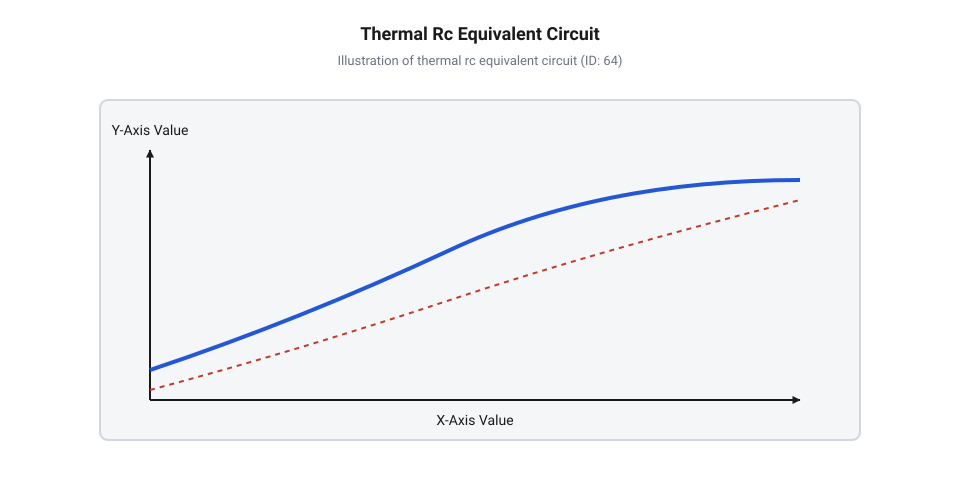
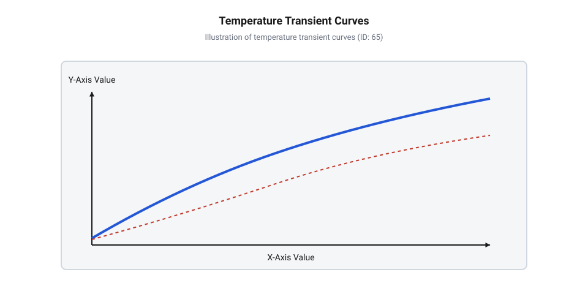
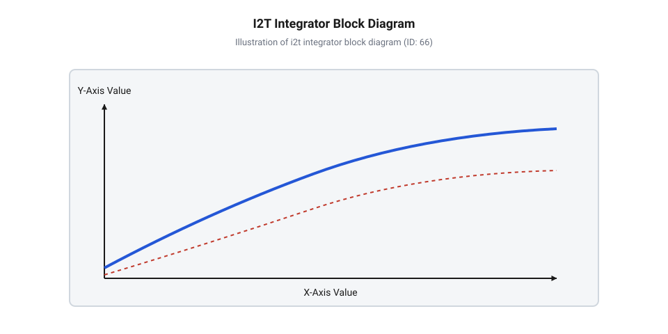
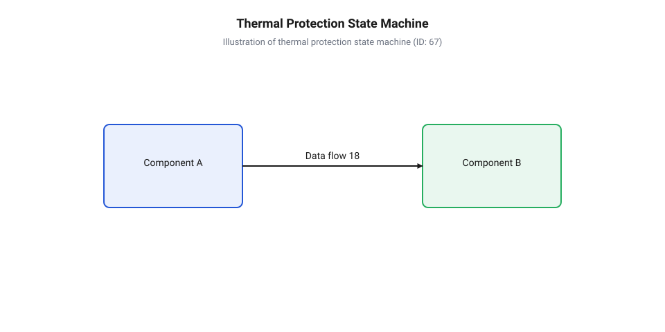
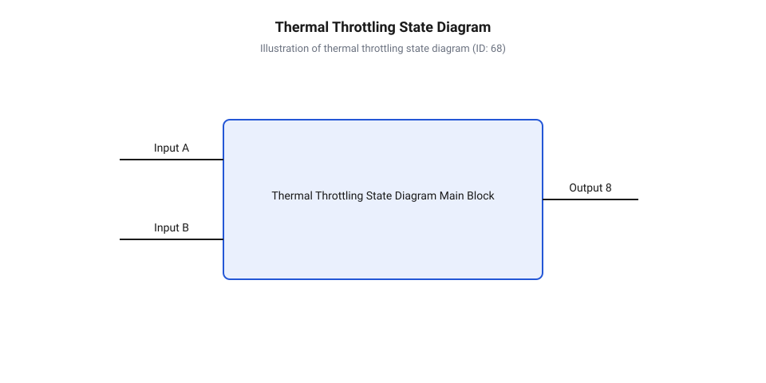

# Теплова модель та активний захист сервоприводів

<preknowlist>
- [Сервоприводи радіокерованих моделей: будова, редуктори та ШІМ-керування](root:cat-hw-actuators/rc-servo-mechanisms-and-control) — принцип роботи електродвигуна, мостового драйвера та формування теплових втрат Джоуля під час передачі моменту.
- [Безколекторні інтегральні сервоконтролери](root:cat-hw-actuators/bldc-servo-controller) — концепція вимірювання струму у фазах та принципи цифрового керування силового каскаду.
- [Зсувні навантаження та абразивний знос шестерень сервоприводів](root:cat-hw-actuators/servo-gear-shear-and-wear) — вплив додаткового механічного тертя й заклинювання редуктора на різке зростання струму споживання.
</preknowlist>

## Тепловий перегрів і руйнування сервоприводу

Коли робототехнічний маніпулятор тримає важкий вантаж у статичній позиції або вал приводу впирається в нездоланну перешкоду, зовнішнє механічне переміщення припиняється, але електрична робота всередині пристрою продовжується. Компактний @@en|сервопривод@@ (лат. *servus* — слуга) у цей момент перетворюється на мініатюрний електричний нагрівач. Усі ампери струму, які електроніка посилає в обмотки для створення протидіючого крутного моменту, більше не виконують корисної механічної роботи, а повністю розсіюються у вигляді тепла. Безперервне виділення теплової енергії всередині герметичного корпусу швидко піднімає внутрішню температуру до критичних позначок, створюючи загрозу безповоротного руйнування як електричних, так і механічних вузлів.

Генерація тепла в електродвигуні сервоприводу відбувається внаслідок проходження струму через опір мідного дроту обмоток. У режимі утримання позиції під навантаженням контур керування подає на двигун @@en|струм утримання@@, необхідний для компенсації зовнішнього моменту. За законами електродинаміки теплова потужність пропорційна квадрату струму:

```
P_loss = I² · R_w
```

Де `P_loss` — теплова потужність втрат Джоуля (Ват), `I` — діючий струм у фазах двигуна (Ампер), а `R_w` — активний електричний опір мідної обмотки (Ом). У режимі нормального руху струм змінюється динамічно, а тепло встигає частково відводитися через конструкційні елементи. Проте найнебезпечнішим режимом є @@en|заклинювання вала@@ (англ. *rotor stall*). Коли механічний стопор або зовнішня перешкода блокують обертання ротора, помилка позиціонування досягає максимуму, і PID-регулятор серводрайвера збільшує коефіцієнт заповнення ШІМ до ста відсотків. У результаті через обмотки протікає максимальний пусковий струм, який може перевищувати номінальний робочий струм у п'ять-десять разів. Оскільки теплові @@en|втрати Джоуля@@ (англ. *Joule heating*, від прізвища *Joule*) зростають квадратично від струму, виділення тепла під час заклинювання збільшується у 25–100 разів порівняно з нормальним режимом, викликаючи вибухоподібне зростання температури мідного дроту зі швидкістю у десятки градусів за секунду.

Якщо цей процес не зупинити, надмірний нагрів прискорює деструкцію матеріалів не лінійно, а експоненційно, провокуючи ланцюгову реакцію руйнування кількох критичних елементів конструкції. Першим у цьому ланцюгу деградує @@en|полімерний лак@@ (фр. *laque*, від перс. *lak* — смола), яким ізольовано мідний дріт обмоток статора. Швидкість його @@en|термічного старіння@@ (англ. *thermal aging*, від грец. *therme* — тепло) підпорядковується кінетичному рівнянню Арреніуса. В інженерному розрахунку ізоляції це описує правило Монтзінгера: кожне підвищення температури обмотки на 8–10 °C понад допустимий клас подвоює швидкість хімічного розпаду полімеру й удвічі скорочує строк його служби. Перегрів усього на 20 °C прискорює руйнування лаку в чотири рази, перетворюючи роки розрахованої експлуатації приводу на кілька годин. У результаті емалеве покриття втрачає еластичність, укривається мікротріщинами й відлущується, оголюючи дріт і запускаючи послідовне руйнування всіх вузлів:

* **Деградація та пробій ізоляції обмоток.** Мідний дріт статора вкритий тонким шаром полімерного лаку. Залежно від обраного матеріалу, ізоляція належить до певного класу теплостійкості, який визначає максимально допустиму тривалу температуру. При перевищенні цієї межі лаковий шар розм'якшується, обвуглюється та втрачає діелектричну міцність. Виникають міжвиткові короткі замикання, що різко зменшують індуктивність обмотки, викликають ще більше зростання струму та остаточний пробій ізоляції. Детальніше межі витриманні лакових покриттів розглядають [класи теплостійкості ізоляції](root:hw-components/bldc-motor-insulation-classes-and-thermal-limits), де описано температурні пороги полімерних матеріалів. * **Термічна деградація мастила та шестерень.** Тепло від гарячого статора через вал і стінки корпусу передається в редуктор. Мастило на силіконовій або літієвій основі під дією високої температури втрачає в'язкість, розріджується та витікає з робочої зони зубчастого зачеплення. Працездатність без мастила призводить до того, що виникає [абразивний знос шестерень](root:cat-hw-actuators/servo-gear-shear-and-wear), під час якого зростає сухе тертя, зрізаються зубці та виникає остаточне механічне заклинювання. * **Терморозмагнічування ротора.** У сучасних серводвигунах застосовують високоенергетичні постійні магніти на основі сплаву неодим-залізо-бор (NdFeB). При нагріванні магнітна індукція неодиму зменшується. Якщо температура магніту перевищує критичну точку (для стандартних марок це 80–120 °C), відбуваються незворотні зміни магнітної доменної структури — матеріалу досягає @@en|коерцитивна сила@@ (лат. *coercitio* — примус) протилежного розмагнічувального поля статора, і магніт втрачає силу. Зниження магнітного потоку зменшує коефіцієнт моменту двигуна, через що драйвер змушений подавати ще більший струм для утримання позиції, прискорюючи термічну катастрофу. * **Перегрів силового каскаду electronics.** Силові ключі мостового драйвера (MOSFET) розташовані на друкованій платі всередині або поруч із корпусом приводу. Підвищення температури напівпровідникового кристала збільшує опір відкритого каналу транзистора `R_DS(on)`, що призводить до зростання втрат провідності. Як показує [тепловий розрахунок MOSFET](root:cat-hw-drivers/servo-driver-mosfet-thermal-design-and-heatsinks), без належного охолодження виникає тепловий розгін кристала, який закінчується пробоєм p-n переходу та вигоранням силового мосту.

Історично методи захисту електроприводів пройшли тривалу еволюцію: від перших пасивних біметалевих термозахисників (типу Klixon) та плавких запобіжників до вбудованих аналогових терморезисторів (NTC/PTC) і сучасних програмних оцінювачів температури на базі обчислення інтеграла нагріву `I²t`. Пасивні @@en|біметалеві реле@@ (фр. *bimetallique*, від лат. *bi-* — подвійний та *metallum* — метал) відключили живлення при механічному вигині пластини від нагріву, проте вони мали величезну теплову інерційність і не могли захистити тонкі обмотки при швидких струмових перевантаженнях. З появою напівпровідників у корпус почали вбудовувати @@en|терморезистор@@ (від грец. *therme* — тепло та лат. *resisto* — опираюся), але вимірювання температури зовнішнього корпуса або плати драйвера не відображає миттєвого стану мідного дроту всередині статора. Відсутність прямих датчиків безпосередньо на фазних обмотках малогабаритних приводів та ризик розмагнічування неодимових магнітів спонукали розробників до переходу від простого апаратного вимкнення за порогом до активного цифрового спостереження за тепловим станом. Зростання обчислювальної потужності мікроконтролерів дозволило впровадити динамічні алгоритми, у яких @@en|тротлінг@@ (англ. *throttling*, від *throttle* — удушення) фазного струму виконується до досягнення руйнівних температур.

У [класичних сервоприводах радіокерованих моделей](root:cat-hw-actuators/rc-servo-mechanisms-and-control) зазвичай відсутній вбудований захист від перегріву, що робить їх вразливими до заклинювання. У той же час у сучасних промислових та робототехнічних приводах відсутність системи захисту неминуче призводить до виходу обладнання з ладу. Щоб побудувати ефективний активний захист, необхідно навчитися точно розраховувати та моделювати процес накопичення тепла всередині приводу в реальному часі.

## Фізика теплопередачі та еквівалентні ланцюги

Перетворення електричної енергії на теплову в сервоприводі описується законами термодинаміки та електродинаміки. Теплова енергія, що виділяється в мідному дроті, не залишається локалізованою в місці виникнення: вона починає поширюватися крізь конструкцію пристрою до навколишнього середовища. Швидкість цього поширення та кінцева температура елементів залежать від трьох фізичних механізмів теплообміну: @@en|теплопровідність@@ через тверді тіла (пазну ізоляцію, статорне залізо, корпус), @@en|конвекція@@ (лат. *convectio* — перенесення) повітряного потоку навколо корпуса та @@en|випромінювання@@ інфрачервоних хвиль із зовнішніх поверхонь.

Для математичного опису цього складного динамічного процесу використовують метод електро-теплової аналогії. Оскільки диференціальні рівняння теплопровідності тотожні рівнянням протікання електричного струму через R-C ланцюги, кожен тепловий параметр приводу зіставляється з відповідним електричним еквівалентом:

* **Тепловий опір `R_th` (К/Вт)** відповідає електричному опору `R` (Ом) і характеризує здатність матеріалу чи межі розділу середовищ чинити опір тепловому потоку. * **Теплова ємність `C_th` (Дж/К)** відповідає електричній ємності `C` (Фарад) і визначає кількість теплоти, яку необхідно додати тілу для зміни його температури на один Кельвін. * **Тепловий потік / втрати потужності `P_loss` (Ват)** відповідають джерелу електричного струму `I` (Ампер). * **Температура `T` (°C або Кельвін)** та температурний перепад `ΔT` відповідають електричному потенціалу та різниці потенціалів / напрузі `V` (Вольт).

Найпростішою моделлю теплової динаміки є одновузлова @@en|еквівалентна схема заміщення@@ (1-RC), у якій весь сервопривод розглядається як єдина усереднена теплова маса з ємністю `C_th`, з'єднана з навколишнім середовищем через загальний тепловий опір `R_th`. Рівняння теплового балансу для такої моделі має вигляд:

```
C_th · (dT/dt) + (T - T_amb) / R_th = P_loss
```

Де `T` — поточна температура приводу, `T_amb` — температура навколишнього середовища, а `dT/dt` — швидкість зміни температури з часом. Якщо подати постійну потужність втрат `P_loss`, то з часом система досягає термодинамічної рівноваги, коли всі виділені вати тепла повністю відводяться в навколишнє середовище (`dT/dt = 0`). При цьому температура досягає значення, яке називають @@en|усталений режим@@:

```
T_ss = T_amb + P_loss · R_th
```

Час, необхідний для досягнення усталеної температури, визначається величиною, яка називається @@en|часова константа@@ нагріву `τ` (секунди). Вона обчислюється як добуток теплового опору на теплову ємність:

```
τ = R_th · C_th
```

Розв'язок диференціального рівняння нагріву при стрибкоподібному включенні постійного навантаження описує @@en|перехідний процес@@ зміни температури від початкового стану `T_amb`:

```
T(t) = T_amb + P_loss · R_th · (1 - e^(-t / τ))
```

Для аналізу процесів у сервоприводі важливо розуміти фізичний зміст константи `τ`: за час `t = τ` температура досягає 63.2% від свого максимального приросту `ΔT_ss = P_loss · R_th`, за час `t = 3 · τ` — 95%, а за `t = 5 · τ` процес вважається повністю завершеним (99.3%).

Розглянемо практичний розрахунок нагріву для малогабаритного приводу.

**Обчислення часової константи та температури обмотки при заклинюванні вала:**

```
[Умова]: R_w = 4.5 Ом, I_stall = 1.8 А, R_th = 15 К/Вт, C_th = 2.4 Дж/К, T_amb = 25 °C. Час заклинювання t = 30 с.

P_loss = I_stall² · R_w
       = (1.8)² · 4.5             [квадрат струму на опір]
       = 3.24 · 4.5
       = 14.58 Вт                 [теплова потужність втрат]

τ = R_th · C_th
  = 15 · 2.4                      [добуток опору на ємність]
  = 36.0 с                        [теплова часова константа]

ΔT_ss = P_loss · R_th
      = 14.58 · 15                [усталений перепад температури]
      = 218.7 °C

T_ss = T_amb + ΔT_ss
     = 25 + 218.7                 [усталена температура]
     = 243.7 °C

T(30) = T_amb + ΔT_ss · (1 - e^(-30 / 36))
      = 25 + 218.7 · (1 - e^(-0.8333))    [експоненційний розрахунок]
      = 25 + 218.7 · (1 - 0.4346)
      = 25 + 218.7 · 0.5654
      = 25 + 123.6
      = 148.6 °C                  [температура обмотки через 30 секунд]
```

Розрахунок показує, що вже через 30 секунд заклинювання температура мідного дроту перевищує 148 °C, що наближається до межі руйнування лакової ізоляції класів A та B.

Однак одновузлова модель 1-RC є суттєво спрощеною, оскільки вона не враховує конструктивної неоднорідності приводу. У реальному пристрої мідна обмотка має малу масу і розташована всередині, тоді як алюмінієвий або пластиковий корпус має значно більшу масу та площу поверхні. Тому для точних застосувань використовується @@en|двовузлова модель@@ (2-RC), яка розділяє систему на два вузли: обмотку (`T_w`, `C_w`) та корпус (`T_h`, `C_h`). Втім, внутрішній вузол нагрівається не лише джоулевими втратами міді: шихтований статорний пакет генерує додаткові @@en|втрати в сталі@@ `P_iron` через перемагнічування — @@en|гістерезис@@ (грец. *hysteresis* — запізнення) — та індуковані @@en|вихрові струми@@ (англ. *eddy currents*). Оскільки мідний дріт укладений безпосередньо в пази статора через тонку пазну ізоляцію, це тепло виділяється в безпосередній близькості до обмотки й впорскується у той самий внутрішній вузол `T_w`. При високій частоті ШІМ або високій швидкості обертання ротора втрати в сталі стрімко зростають, зменшуючи температурний перепад між міддю та статором і перешкоджаючи відведенню тепла від дроту, через що температура `T_w` зростає ще швидше, ніж передбачає розрахунок лише за струмом навантаження.


*Еквівалентна електро-теплова RC-схема сервоприводу, що описує двовузлову модель теплопередачі від мідної обмотки до корпусу та навколишнього середовища.*

У двовузловій схемі джерело втрат `P_loss` підключене безпосередньо до вузла обмотки `T_w`. Тепло від обмотки спочатку долає внутрішній опір `R_w_h` (опір між дротом, статором та корпусом), нагріваючи масу корпусу `C_h`, і лише потім через зовнішній опір `R_h_a` виходить у повітря. Оскільки ємність обмотки `C_w` на порядок менша за ємність корпуса `C_h`, обмотка нагрівається з малою часовою константою `τ_w = R_w_h · C_w` (одиниці секунд), а корпус — з набагато більшою константою `τ_h = R_h_a · C_h` (хвилини).


*Перехідні криві температури мідної обмотки та корпусу приводу під час стрибкоподібного й циклічного навантаження, що демонструють часову затримку нагріву зовнішніх поверхонь.*

З перехідних кривих видно головну проблему фізичного вимірювання: датчик температури, встановлений на платі або корпусі приводу, реєструє температуру `T_h` із суттєвою часовою затримкою. Під час короткочасних струмових сплесків або серії швидких розгонів мідний дріт `T_w` може розжаритися до небезпечних 150 °C, тоді як плата чи корпус показуватимуть помірні 45 °C.

Складніші диференціальні системи та їх матричний розв'язок детально висвітлює [диференціальні рівняння теплообміну](root:cat-hw-actuators/servo-thermal-protection/math-servo-equivalent-thermal-rc-network.md), де наведено чисельні методи розрахунку динаміки для довільних профілів струму.

Для практичного використання цих моделей на контролері необхідно точно знати значення теплових опорів та ємностей конкретного сервоприводу. Оскільки паспорти сервомоторів рідко містять такі дані, вимірювання параметрів здійснюється експериментально. Методику зняття характеристик розглядає [калібрування теплових параметрів](root:cat-hw-actuators/servo-thermal-protection/proj-servo-thermal-bench-testing), де описано побудову стенда для вимірювання `R_th` та `C_th`.

У [цифрових безколекторних сервоконтролерах](root:cat-hw-actuators/bldc-servo-controller) інформація про коефіцієнти `R_th` і `C_th` закладається у пам'ять мікроконтролера, де обчислювальний алгоритм у реальному часі розраховує поточну температуру обмоток за виміряним струмом. Для цього застосовують суперавтоматичні [методи вимірювання фазних струмів](root:cat-hw-sensors/bldc-pmsm-phase-current-sensing-methods), що забезпечують дискретну математичну модель точними первинними даними про втрати потужності.

## Динаміка нагріву під різнорідним навантаженням

У реальних робототехнічних системах — від багатоланкових маніпуляторів до крокуючих платформ — @@en|сервопривод@@ майже ніколи не працює в умовах постійного, рівномірного навантаження. Його режим роботи складається із послідовності різнорідних фаз: утримання важеля під дією сили тяжіння, швидкого переміщення виконавчого органу з прискоренням, зупинки у заданій точці або зустрічі з механічним опором. Для опису таких змінних режимів використовують @@en|робочий цикл@@ (англ. *duty cycle*, від *duty* — служба та *cycle* — цикл), який визначає співвідношення часу роботи під навантаженням до загальної тривалості робочого періоду.

Виділення тепла в мідному дроті статора визначається середньоквадратичним значенням фазного струму. Під час циклічного навантаження теплова потужність втрат змінюється скачкоподібно. У момент розгону ротора або компенсації зовнішнього удару струм досягає пікових значень, через що теплові втрати Джоуля короткочасно зростають у квадратичній пропорції. Якщо сервопривод виконує швидкі позиційні маневри з високою частотою, імпульсні сплески струму накладаються один на одного, і середньозважена швидкість виділення тепла перевищує відводячу здатність корпусу. На це додатково впливає [частота оновлення кадрів ШІМ](root:cat-hw-actuators/servo-pwm-frame-rate), яка визначає високу частоту комутації силових ключів і динамічних зміщень ротора. При виникненні механічного підклинювання в передавальному механізмі [зсувні навантаження та абразивний знос шестерень](root:cat-hw-actuators/servo-gear-shear-and-wear) створюють додатковий опір обертанню, змушуючи контур керування підтримувати високий струм навіть при малих кутових швидкостях.

Завдяки відмінності в теплоємностях і опорах окремих вузлів приводу, динаміка зміни температур різних елементів конструкції істотно різниться. Мідний дріт обмотки має незначну масу й безпосередньо контактує з джерелом виділення втрат, тому його теплова часова константа становить одиниці секунд. Водночас масивний алюмінієвий або пластиковий корпус приводу має значну теплоємність і розсіює тепло в довкілля з часовою константою в сотні секунд. У результаті виникає значний @@en|температурний градієнт@@ (від лат. *gradiens* — той, що крокує) — різниця температур між внутрішніми гарячими обмотками та зовнішньою оболонкою.

Часова затримка передачі тепла створює небезпечний ефект для систем моніторингу. Коли робототехнічна система зазнає короткочасного серійного перевантаження, температура мідного дроту стрімко зростає до критичних позначок, тоді як температура корпусу та друкованої плати драйвера залишається практично незмінною. Датчик температури, встановлений на платі контролера або на зовнішній стінці, реєструє лише згладжений запізнілий відгук. Орієнтація виключно на показання платного терморезистора призводить до того, що захист спрацьовує із запізненням, коли пробій лакової ізоляції обмотки вже відбувся.

Розглянемо приклад обчислення температурного градієнта та підсумкової температури мідного дроту за відомими показаннями датчика корпусу під час динамічного навантаження.

**Обчислення динамічного температурного градієнта та оцінки температури обмотки:**

```
[Умова]: I_rms = 2.4 А, R_w = 3.5 Ом, R_w_h = 6.0 К/Вт (опір обмотка-корпус), T_h = 48.0 °C (виміряна температура корпусу).

P_loss = I_rms² · R_w
       = (2.4)² · 3.5             [квадрат середньоквадратичного струму на опір]
       = 5.76 · 3.5
       = 20.16 Вт                 [миттєва теплова потужність втрат]

ΔT_w_h = P_loss · R_w_h
       = 20.16 · 6.0              [усталений температурний градієнт обмотка-корпус]
       = 120.96 °C

T_w_max = T_h + ΔT_w_h
        = 48.0 + 120.96           [пікова температура мідного дроту]
        = 168.96 °C
```

Результат обчислення демонструє, що при помірній температурі корпусу 48.0 °C реальна температура мідного дроту досягає майже 169 °C. Такий температурний рівень перевищує межі витривалості більшості стандартних ізоляційних лаків і створює загрозу незворотного пошкодження приводу. Точний аналіз багатовузлових схем заміщення та перехідних характеристик нагріву висвітлюють [еквівалентні RC-ланцюги та динаміка нагріву](root:cat-hw-actuators/servo-thermal-protection/math-servo-equivalent-thermal-rc-network.md), де наведено систему диференціальних рівнянь теплообміну.

Для компактних приводів типу [мікросерво Tower Pro SG90](root:cat-hw-actuators/sg90-servo) або комерційних модулів [родини Power HD](root:cat-hw-actuators/powerhd-family) пряме встановлення датчиків усередину статора є конструктивно неможливим. Для запобігання перегріву в таких умовах необхідно перейти від пасивного вимірювання температури корпуса до активного розрахунку стану обмоток за допомогою математичної моделі.

## Алгоритм цифрового інтеграла нагріву I2t

Для усунення ризиків, пов'язаних із часовою затримкою передачі тепла, у сучасних серводрайверах застосовують непряме програмне вимірювання. Вбудований мікроконтролер реалізує @@en|спостерігач стану@@ (англ. *state observer*) — обчислювальний алгоритм, який неперервно оцінює тепловий стан обмотки двигуна за виміряним фазним струмом та часом його протікання.

В основу алгоритму покладено @@en|інтеграл нагріву I²t@@ (англ. *I²t thermal integral*). Оскільки теплова потужність втрат Джоуля пропорційна квадрату струму, кількість виділеного тепла за квант часу `dt` обчислюється як добуток `I² · dt`. Для врахування охолодження приводу під час пауз або зменшення навантаження до рівняння додають член природного теплового розсіювання, пропорційний поточній перевищеній температурі та зворотному значенню теплової часової константи `τ`.

У дискретному виконанні на мікроконтролері обчислення виконуються на кожному такті переривання контуру струму або за фіксованим інтервалом `dt`. Формула оновлення оцінки температури обмотки має вигляд:

```
T_est[k] = T_est[k-1] + ( (I[k]² · R_w · R_th - (T_est[k-1] - T_amb)) / τ ) · dt
```

Де `T_est[k]` — оновлена оцінка температури обмотки на кроці `k`, `T_est[k-1]` — оцінка з попереднього кроку, `I[k]` — поточний виміряний струм, `R_w` — активний опір обмотки, `R_th` — сумарний тепловий опір, `T_amb` — температура навколишнього середовища, а `τ` — теплова часова константа. У паузах, коли `I[k] = 0`, значення `T_est` експоненціально зменшується до `T_amb`, що тотожно фізичному охолодженню пристрою.

Розглянемо покрокове обчислення дискретного оновлення оцінювача температури на конкретному прикладі.

**Обчислення дискретного кроку накопичення та розсіювання теплового інтеграла I²t:**

```
[Умова]: I[k] = 3.2 А, R_w = 2.5 Ом, R_th = 8.0 К/Вт, τ = 15.0 с, dt = 0.05 с, T_est[k-1] = 55.0 °C, T_amb = 25.0 °C.

P_loss = I[k]² · R_w
       = (3.2)² · 2.5             [квадрат струму на електричний опір]
       = 10.24 · 2.5
       = 25.6 Вт                  [теплова потужність на поточному кроці]

ΔT_target = P_loss · R_th
             = 25.6 · 8.0            [цільовий приріст усталеної температури]
             = 204.8 °C

dT_est = (ΔT_target - (T_est[k-1] - T_amb)) / τ · dt
       = (204.8 - (55.0 - 25.0)) / 15.0 · 0.05   [дискретна зміна температури за dt]
       = (204.8 - 30.0) / 15.0 · 0.05
       = 174.8 / 15.0 · 0.05
       = 11.653 · 0.05
       = 0.583 °C

T_est[k] = T_est[k-1] + dT_est
         = 55.0 + 0.583           [оновлена температура обмотки]
         = 55.583 °C
```

Структура обчислювального контуру оцінювача наведена на блок-схемі дискретного алгоритму.


*Блок-схема дискретного алгоритму оцінювача I²t, що ілюструє накопичення теплового еквівалента з урахуванням розсіювання тепла в паузах між навантаженнями.*

Отримана обчислювальна оцінка температури `T_est` передається в модуль логіки термозахисту. Замість бінарного аварійного відключення сучасні приводи реалізують багаторівневу діаграму станів.


*Двовимірна діаграма станів та температурних порогів активного захисту сервоприводу, що ілюструє пороги застереження, плавного обмеження струму та аварійного вимкнення.*

Логіка управління термозахистом ділить робочий діапазон на три основні зони:

1. **Нормальний режим (Normal Operational State):** Температура `T_est` перебуває нижче порогового значення застереження `T_warn` (наприклад, 85 °C). Контур струму працює без обмежень, @@en|сервопривод@@ забезпечує повний паспортний момент. 2. **Плавне обмеження струму (Throttling State):** При перевищенні `T_warn` запускається @@en|тротлінг струму@@ (англ. *current throttling*, від *throttle* — удушення). Максимально дозволена амплітуда фазного струму `I_max` пропорційно зменшується залежно від наближення температури до критичного порогу `T_crit`:

```
I_max(T_est) = I_nominal · (1 - (T_est - T_warn) / (T_crit - T_warn))
```

Це дозволяє зберегти керованість приводу та позиціонування вала, але зменшує теплові втрати Джоуля, зупиняючи подальший нагрів. 3. **Критичне апаратне вимкнення (Emergency Shutdown State):** Якщо температура досягає `T_crit` (наприклад, 125 °C), силова мостова схема переводиться у високоімпедансний стан (Hi-Z). Струм повністю відключається для запобігання пробою лакової ізоляції, пошкодженню силових ключів та розмагнічуванню магнітів ротора.

Нижче наведено практичну реалізацію дискретного оцінювача `I²t` та алгоритму тротлінгу для мікроконтролерів.

:::tabs
:::code servo-thermal-protection-d/cpp/stm32/thermalestimator.cpp
:::code servo-thermal-protection-d/c/esp-idf/thermal-estimator-init.c
:::

Теоретичні виведення та спрощення математичної моделі висвітлює [математичний апарат I²t оцінювача](root:cat-hw-actuators/servo-thermal-protection/math-i2t-thermal-integration-algorithm.md). Практичні деталі складання бібліотечного модуля подано у матеріалі [проєкт вбудованого модуля захисту](root:cat-hw-actuators/servo-thermal-protection/proj-embedded-i2t-thermal-estimator.md).

Для інтеграції алгоритму у керуюче ПЗ розроблено стандартний [інтерфейс програмного модуля](root:cat-hw-actuators/servo-thermal-protection/api-servo-thermal-protection-firmware-api.md). Якщо ж @@en|сервопривод@@ підключений через цифрову шину RS-485 або CAN, значення поточного теплового стану та конфігурація порогів доступна через [карту регістрів телеметрії](root:cat-hw-actuators/servo-thermal-protection/api-servo-thermal-telemetry-register-map.md).

У сучасних [безколекторних інтегральних сервоконтролерах](root:cat-hw-actuators/bldc-servo-controller) інформація від алгоритму `I²t` синхронізується з точними [методами вимірювання фазних струмів](root:cat-hw-sensors/bldc-pmsm-phase-current-sensing-methods). Використання програмного оцінювача дає змогу надійно захистити [класи теплостійкості ізоляції](root:hw-components/bldc-motor-insulation-classes-and-thermal-limits) та розраховувати додатковий нагрів, який створюють [теплові ефекти ослаблення поля](root:cat-hw-actuators/field-oriented-control-field-weakening-thermal-effects) під час роботи двигуна на надномінальних швидкостях.

## Багаторівневий активний захист і тротлінг

Раптове вимкнення живлення сервоприводу при досягненні граничної температури є неприпустимим у більшості робототехнічних систем. Якщо сервопривод відповідає за утримання маніпулятора, балансування крокуючого робота чи відхилення рульової поверхні безпілотного літального апарата, миттєве знеструмлення двигуна спричиняє падіння вантажу, втрату керування або механічне руйнування всієї конструкції. Традиційне біметалеве реле чи простий програмний поріг аварійного вимкнення діють бінарно, залишаючи систему без можливості завершити критичний маневр. Для збереження керованості пристрій мусить застосовувати гнучку багаторівневу архітектуру захисту, яка контролює тепловий стан і запобігає перегріву без різкої зупинки руху.

Ключовим інструментом активного теплового захисту є зниження фазного струму — тротлінг (en. @@en|thermal throttling@@, від англ. throttle — заслонка). Фізика виділення тепла описується законом Джоуля — Ленца: потужність втрат на нагрів обмоток статора пропорційна квадрату струму `P_loss = I² · R_w`, де `I` — ефективне значення фазного струму, а `R_w` — активний опір мідного дроту. Оскільки тепловиділення залежить від струму квадратично, навіть незначне обмеження максимального струму дає помітний результат. Якщо знизити граничний струм приводу всього на 20% (`I = 0.8 · I_max`), електричні втрати на нагрів зменшуються до `0.8² = 0.64` від початкового рівня — тобто тепловиділення падає на 36%. Обмеження струму на 50% зменшує генерацію тепла на 75%. Це дає змогу стабілізувати температуру обмоток на безпечному рівні, зберігши при цьому здатність сервоприводу тримати позицію та виконувати рух зі зменшеним моментом.

Багаторівневий захист будується на послідовній зміні трьох режимів роботи контролера залежно від розрахованої або виміряної температури мідних обмоток `T_w`:

1. **Номінальний режим (Level 0)**. Працює при `T_w < T_warn`. Контролер не обмежує струм споживання, дозволяючи мотору видавати повний піковий момент `I_max`. Оцінювач теплового стану безперервно підраховує інтеграл нагріву `I²t` та моніторить динаміку зміни температури. 2. **Динамічний тротлінг (Level 1)**. Активується при досягненні попереджувального порогу `T_warn ≤ T_w < T_crit`. Контролер плавно розраховує максимально дозволений граничний струм `I_limit` як функцію від поточного перегріву. При зростанні температури від `T_warn` до `T_crit` струмовий ліміт зменшується від `I_max` до мінімального робочого значення `I_min`:

```
I_limit = I_max - (I_max - I_min) · ((T_w - T_warn) / (T_crit - T_warn))
```

Зменшення граничного струму автоматично обмежує максимальний крутний момент сервоприводу. Якщо зовнішнє механічне навантаження перевищує новий ліміт моменту, вал приводу почне сповільнюватися або зміщуватися під дією зовнішньої сили, проте виділення тепла в обмотках різко скоротиться, що зупинить подальше зростання температури й запобіжить розплавленню ізоляції.

3. **Аварійне апаратне вимкнення (Level 2)**. Спрацьовує при досягненні критичної температури `T_w ≥ T_crit`. Це останній бар'єр захисту, покликаний урятувати мотор від безповоротного руйнування — пробою міжвиткової ізоляції або незворотного терморозмагнічування неодимових магнітів ротора (en. @@en|neodymium magnets@@). У цьому режимі контролер негайно переводить ключі мостового силового каскаду в високоімпедансний стан (High-Z), повністю знеструмлюючи обмотки.

Для запобігання високочастотним осциляціям між режимами під час роботи на межі температурних порогів у логіку захисту обов'язково закладається гістерезис (англ. @@en|hysteresis@@, від грец. ὕстеρησις — запізнення). Якщо контролер перейшов у режим тротлінгу або аварійного вимкнення, повернення до попереднього штатного стану відбувається лише після охолодження обмоток нижче відповідного порогу на величину гістерезису `ΔT_hyst` (зазвичай від 5 °C до 10 °C).


*Схема станів та температурних порогів багаторівневого захисту сервоприводу, що ілюструє залежність ліміту струму від температури обмотки та наявність гістерезису для запобігання осциляціям при переходах.*

Схема взаємодії захисних алгоритмів реалізується безпосередньо у прошивці [безколекторних сервоконтролерів](root:cat-hw-actuators/bldc-servo-controller). Для конфігурування порогів спрацювання та передачі параметрів теплового стану між мікроконтролером та верхнім рівнем керування використовується стандартний [інтерфейс конфігурації захистів](root:cat-hw-actuators/servo-thermal-protection/api-servo-thermal-protection-firmware-api.md). Усі поточні значення температури, інтеграла нагріву та статусні прапорці доступні для зчитування через [карту регістрів телеметрії](root:cat-hw-actuators/servo-thermal-protection/api-servo-thermal-telemetry-register-map.md) цифрового приводу.

Нижче наведено приклад реалізації конечного автомата активного теплового захисту з динамічним тротлінгом струму та гістерезисом:

:::tabs
@tab C
:::code servo-thermal-protection-d/c/esp-idf/thermal-protection-update.c
@tab C++
:::code servo-thermal-protection-d/cpp/stm32/thermalstate.cpp
:::

Алгоритм активного тротлінгу зв'язаний з практичною бібліотекою прошивки в [програмному модулі захисту](root:cat-hw-actuators/servo-thermal-protection/proj-embedded-i2t-thermal-estimator.md). Додатково границя `T_crit` визначається технічними межами матеріалів, розкритими у статті про [класи теплостійкості ізоляції](root:hw-components/bldc-motor-insulation-classes-and-thermal-limits), де вихід за межі допустимої температури призводить до незворотного руйнування емалевого покриття дроту.

## Калібрування параметрів та випробування приводу

Надійність роботи програмного спостерігача температури та алгоритмів тротлінгу повністю залежить від точності параметрів теплової моделі: еквівалентного теплового опору `R_th` (К/Вт) та теплоємності `C_th` (Дж/К). У специфікаціях на комерційні сервоприводи, як-от [мікросервоприводах з металевим редуктором](root:cat-hw-actuators/mg90s-servo), виробники вказують лише електричну потужність та механічний момент, оминаючи теплові константи. Більш того, механічні фактори — погіршення мастила та додаткове тертя, викликане [абразивним зносом шестерень](root:cat-hw-actuators/servo-gear-shear-and-wear), — змінюють рівень тепловиділення під час експлуатації. Тому точні значення `R_th` та `C_th` визначають експериментально на випробувальному стенді.

Експериментальне калібрування базується на зніманні перехідної теплової характеристики приводу при подачі контрольованого ступеня навантаження. Оскільки пряме встановлення датчика температури безпосередньо на обмотку статора малогабаритного сервоприводу є технічно складним, для вимірювання температури міді `T_w` використовують метод вимірювання активного опору обмотки постійному струму. Залежність опору мідного дроту від температури описується лінійним співвідношенням:

```
R_w(T) = R_w0 · (1 + α · (T_w - T_0))
```

де `R_w0` — опір обмотки при базовій температурі `T_0` (зазвичай 20 °C), а `α` — температурний коефіціент опору міді (`α ≈ 0.00393 K⁻¹`). Вимірявши опір обмотки `R_w(T)` під час зупинки або за допомогою високочастотного тестового імпульсу струму, обчислюють поточну температуру міді:

```
T_w = T_0 + (R_w(T) / R_w0 - 1) / α
```

Для визначення параметрів одновузлової еквівалентної схеми заміщення сервопривод закріплюють на [стенді для випробувань](root:cat-hw-actuators/servo-thermal-protection/proj-servo-thermal-bench-testing.md) та заклинюють його вал або прикладають постійний гальмівний момент. Потім подають фіксований струм `I_test` та фіксують зростання температури `T_w(t)` від часу `t`.

Динаміка нагріву обмотки при постійній потужності втрат `P_loss = I_test² · R_w` описується експоненційним рівнянням:

```
ΔT(t) = T_w(t) - T_amb
= P_loss · R_th · (1 - exp(-t / τ_th))      [розв'язок диференціального рівняння теплового балансу]
```

де `T_amb` — температура навколишнього середовища, а `τ_th = R_th · C_th` — теплова часова константа.

Розрахунок параметрів виконують у два кроки:

1. **Визначення теплового опору `R_th`**. Очікують виходу системи на тепловий усталений режим (`t > 5 · τ_th`), при якому температура стабілізується на максимальному значенні `T_ss`. У цьому стані вся виділена потужність розсіюється в довкілля:

```
R_th = (T_ss - T_amb) / P_loss
```

2. **Визначення теплоємності `C_th`**. З експериментальної кривої нагріву знаходять часову константу `τ_th` — це час, за який перегрів `ΔT(t)` досягає `63.2%` від усталеного значення `ΔT_ss = T_ss - T_amb`. Після цього обчислюють теплову ємність:

```
C_th = τ_th / R_th
```

Розрахунок теплових параметрів та їх верифікацію детально розглянуто в [еквівалентній схемі заміщення](root:cat-hw-actuators/servo-thermal-protection/math-servo-equivalent-thermal-rc-network.md), де одновузлова модель розширюється до двовузлової для роздільного врахування теплоємності корпуса та обмотки.

Отримані значення `R_th` та `C_th` записують в енергонезалежну пам'ять контролера через [карту регістрів телеметрії](root:cat-hw-actuators/servo-thermal-protection/api-servo-thermal-telemetry-register-map.md). Після калібрування виконують тестовий прогін приводу зі змінним профілем навантаження, де програмний спостерігач порівнюється з реальними показами інфрачервоного тепловізора чи виміряного опору обмоток. Збіг розрахованих та фактичних графіків температури з похибкою менше ніж 5% підтверджує готовність сервоприводу до надійної експлуатації в умовах пікових навантажень.