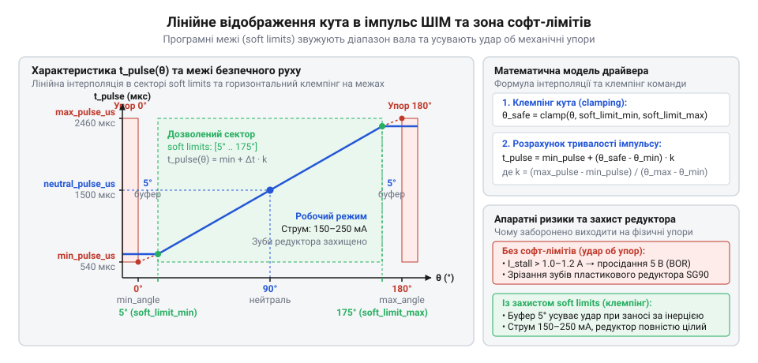
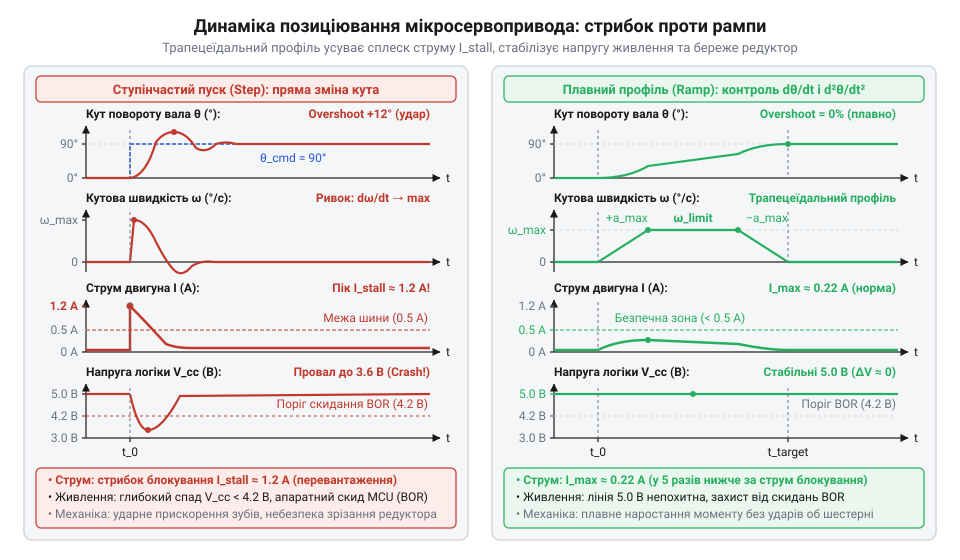

# Програмний C/C++ інтерфейс керування мікросервоприводами

<preknowlist>
- [Tower Pro SG90 — мікросерво 9g](root:cat-hw-actuators/sg90-servo) — базові часові параметри керувального сигналу ШІМ (частота 50 Гц, період 20 мс, номінальний діапазон 1000–2000 мкс) та механічні обмеження пластикового редуктора при ударах об внутрішні упори
- [MG90S V2 — мікросерво з металевим редуктором](root:cat-hw-actuators/mg90s-servo) — динамічні характеристики мікроприводів під навантаженням, стрибки пускового струму понад 1 А при ступінчастій зміні команди та наслідки просідання напруги живлення мікроконтролера
</preknowlist>

## Пастки наївного керування та архітектура драйвера

Коли мікроконтролер підключають до мікросервопривода безпосередньо, першим імпульсом часто стає наївне надсилання стандартних значень тривалості імпульсу від 1000 до 2000 мкс прямо з головного циклу програми затримками. Проте для бюджетного [мікросервопривода SG90](root:cat-hw-actuators/sg90-servo) паспортний діапазон не відповідає дійсності. Через заводський розкид резистивного шару внутрішнього потенціометра крайні положення вимагають сигналів від 540 до 2460 мкс, а номінальна команда 1000 мкс може змусити вал фізично вдарятися у внутрішній механічний обмежувач. Коли качалка впирається в пластиковий упор, внутрішня схема сервопривода подає на двигун повну напругу, намагаючись усунути неузгодженість. Струм двигуна миттєво підскакує до струму блокування понад 1.0–1.2 А.

Такий стрибок струму викликає просідання шини 5 В і аварійне перезавантаження процесора за механізмом @@en|Brown-out Reset@@. Одночасно зусилля двигуна зрізає тендітні пластикові зуби редуктора. Навіть для міцнішого пристрою з [металевим редуктором MG90S](root:cat-hw-actuators/mg90s-servo) такий режим спричиняє швидкий перегрів та вигорання колектора. Щоб усунути механічні й електричні аварії, керування відокремлюють у модульний @@en|драйвер@@ (англ. @@en|driver@@ — те, що керує, веде) для @@la|сервоприводів@@ (лат. @@la|servus@@ — виконавець наказу, слуга).

Архітектура драйвера організована за трирівневим модульним принципом:
1. Рівень калібрування та безпеки: переводить фізичний кут у мікросекунди сигналу @@en|ШІМ@@ (англ. @@en|pulse-width modulation@@ — зміна ширини імпульсу за незмінного періоду) з перевіркою апаратних меж конкретного зразка.
2. Генератор траєкторії: згладжує стрибки цільової координати, обмежуючи кутову швидкість і прискорення для захисту живлення та зубів шестерень.
3. Апаратний шар таймерів: генерує стабільні прямокутні імпульси частотою 50 Гц на рівні периферії без затримок у центральному процесорі.

## Структура конфігурації та апаратне калібрування

Кожен екземпляр @@la|сервопривода@@ вимагає індивідуального калібрування через технологічний розкид аналогового потенціометра. Тому параметри привода не зашивають у магічні константи, а описують конфігураційною структурою, яка фіксує безпечний робочий коридор вала. Щоб запобігти зіткненню пристрою з корпусом механізму, де встановлені [штатні серво-роги](root:cat-hw-actuators/servo-horns), структура визначає програмні межі — @@en|софт-ліміти@@ (англ. @@en|soft limits@@ — програмні обмеження ходу):

:::tabs
:::code api-micro-servo-driver-cpp/c/servo-init.c
:::code api-micro-servo-driver-cpp/cpp/servoconfig.cpp
:::

Функція `servo_init()` валідує конфігурацію: якщо межі переплутані, нейтраль виходить за допустимий сектор або програмний ліміт перевищує фізичний хід вала, @@en|драйвер@@ відмовляється від ініціалізації та повертає код помилки. Щоб безпечно визначити робочий діапазон у [поширеному пластиковому мікроприводі](root:cat-hw-actuators/sg90-servo), калібрування починають строго з нейтральної точки 1500 мкс. Тривалість сигналу змінюють малими кроками по 5–10 мкс у напрямку упору, доки вал рухається вільно, і зупиняються в момент появи характерного гудіння двигуна та різкого стрибка струму. Від цієї крайньої точки відступають усередину діапазону на 20–30 мкс або 3–5 градусів і записують отримане значення як @@en|софт-ліміт@@, що захищає редуктор від силового удару об внутрішній упор через температурний дрейф потенціометра чи переліт вала за інерцією. Початковий нейтральний кут за замовчуванням функція розраховує як середнє арифметичне програмних меж. Аналоговий @@la|сервопривід@@ не має зворотного зв'язку за положенням, тому мікроконтролер не знає реальної орієнтації вала до першої подачі імпульсів. Геометричний центр дозволеного діапазону скорочує максимальну довжину неминучого початкового ривка вала, вдвічі зменшує ударне навантаження на зубці шестерень і захищає лінію живлення від глибокого просідання напруги.

## Позиціювання вала в кутах і мікросекундах

Після успішної ініціалізації @@en|драйвер@@ надає функції завдання положення в кутових градусах і безпосередньо в мікросекундах. Щоб унеможливити механічний удар качалки об упори, цільовий кут спочатку проходить жорстке обмеження — @@en|клемпінг@@ (англ. @@en|clamping@@ — затискання в рамки) за діапазоном між `soft_limit_min_deg` та `soft_limit_max_deg`.

Після клемпінгу тривалість імпульсу розраховується методом лінійної інтерполяції:

```
t_pulse
= min_pulse + (θ - θ_min) × (max_pulse - min_pulse) ÷ (θ_max - θ_min)   [лінійна інтерполяція]
```

Тут `θ` — запитаний кут вала, `θ_min` і `θ_max` — фізичний сектор обертання, а `min_pulse` і `max_pulse` — калібровані межі імпульсу.


*Залежність тривалості імпульсу від кута: вихід за калібровані межі відсікається захисним коридором soft limits.*

Програмна реалізація розраховує мікросекунди й оновлює стан вихідного каналу @@en|ШІМ@@:

:::tabs
:::code api-micro-servo-driver-cpp/c/clampf.c
:::code api-micro-servo-driver-cpp/cpp/snippet-4.cpp
:::

Автоматичний @@en|клемпінг@@ унеможливлює вихід вала за межі рухомості конструкції, захищаючи шестерні від зрізання навіть при програмних помилках високого рівня.

## Контроль швидкості та плавний рух

Ступінчаста зміна цільового кута змушує внутрішній підсилювач @@la|сервопривода@@ розганяти вал на повній потужності двигуна. Це призводить до механічного удару в зачепленні шестерень та сплеску струму споживання понад 1 А, що спричиняє падіння напруги на клемах джерела.


*Ступінчаста зміна команди спричиняє ударний стрибок струму, тоді як трапецеїдальний профіль згладжує навантаження.*

Щоб розвантажити механіку й утримати стабільну напругу, @@en|драйвер@@ реалізує генератор траєкторії за алгоритмом @@en|рампінгу@@ (англ. @@en|ramping@@ — плавний похилий підйом). Просте обмеження кутової швидкості відсікає надструм під час тривалого руху, проте залишає стрибок швидкості на старті й під час зупинки. Нескінченне прискорення в ці моменти створює ударний крутний момент, здатний зрізати зуби в [редукторі мікропривода SG90](root:cat-hw-actuators/sg90-servo). Щоб усунути динамічний удар, @@en|драйвер@@ обмежує прискорення величиною `max_accel_deg_s2`, формуючи трапецеїдальний профіль швидкості з фазами розгону, рівномірного руху та гальмування. Генератор траєкторії працює дискретно: функція оновлення `servo_update()` викликається періодично з фіксованим кроком часу `dt_s`. На кожній ітерації розгону поточна швидкість зростає на величину `max_accel_deg_s2 · dt_s` до досягнення межі `max_speed_deg_s`. Для своєчасного гальмування алгоритм на кожному кроці порівнює залишок кута до цілі з розрахунковим гальмівним шляхом `v² / (2 · max_accel_deg_s2)` для поточної швидкості `v`. Щойно залишок кута зрівнюється з гальмівним шляхом, швидкість починає спадати до нуля з тим самим темпом уповільнення. Кут вала на кожному виклику змінюється на величину `v · dt_s`. Такий розрахунок вимагає збереження змінної поточної швидкості між викликами та виконання операцій із рухомою комою на кожному кроці таймера. Алгоритм ламається за нестабільного періоду виклику: затримка виклику `servo_update()` непередбачувано збільшує `dt_s`, дискретний крок стає надто великим, і вал проскакує цільову точку з появою автоколивань навколо неї. Коли обчислювальні ресурси мікроконтролера обмежені, профіль спрощують до лінійного рампінгу, де кут на кожному кроці зміщується з постійною граничною швидкістю:

:::tabs
:::code api-micro-servo-driver-cpp/c/servo-update.c
:::code api-micro-servo-driver-cpp/cpp/servoprofiler.cpp
:::

Дискретне нарощування координати розподіляє зусилля в часі, що знижує споживання струму до стабільних 150–250 мА і захищає зуби редуктора від руйнівного динамічного удару.

## Керування активністю та усунення джитеру

Коли @@la|сервопривід@@ завершує переміщення й утримує положення, безперервне надходження імпульсів може викликати паразитну вібрацію — @@en|джитер@@ (англ. @@en|jitter@@ — тремтіння, нервове смикання), що супроводжується акустичним писком. Внутрішній компаратор привода безперервно смикає ротор двигуна вперед і назад, намагаючись утримати аналоговий потенціометр у межах апаратної зони нечутливості — @@en|дедбенду@@ (англ. @@en|deadband@@ — смуга нечутливості). Через це обмотки двигуна гріються й споживають струм навіть за повної відсутності зовнішнього корисного моменту на валу.

Для зняття теплового навантаження та тиші @@en|драйвер@@ реалізує керування станами активності:

:::tabs
```c
void servo_attach(servo_t *servo) {
    if (!servo || servo->is_attached) return;
    servo->is_attached = true;
    servo_set_angle(servo, servo->current_angle);
}

void servo_detach(servo_t *servo) {
    if (!servo || !servo->is_attached) return;
    servo->is_attached = false;
    servo->cfg.set_pwm_us(0); // Знімає генерацію імпульсів із сигнального виводу
}
```
```cpp
void MicroServo::attach() {
    if (is_attached_) return;
    is_attached_ = true;
    setAngle(current_angle_);
}

void MicroServo::detach() {
    if (!is_attached_) return;
    is_attached_ = false;
    set_pwm_us_(0); // Знімає імпульси
}
```
:::

Коли мікроконтролер припиняє генерацію керувальних імпульсів, внутрішня схема сервопривода розмикає ключі транзисторного @@en|H-моста@@. Двигун повністю знеструмлюється, споживання лінії живлення падає до нуля, а вібрація та писк зникають. Для утримання легких конструкцій на базі [мікропривода HD-1370A](root:cat-hw-actuators/hd-1370a-servo), де достатньо тертя редуктора, @@en|драйвер@@ автоматично викликає `servo_detach()` за тайм-аутом після завершення руху.

## Апаратні таймери та граничні випадки

Надійність кутового позиціювання вала залежить від якості часових інтервалів сигналу @@en|ШІМ@@. Стандартний період імпульсів становить 20 мс (частота 50 Гц), з тривалістю активного рівня від 540 до 2460 мкс.

Спроба формувати сигнал програмними затримками (@@en|бітбенгінг@@, англ. @@en|bit-banging@@ — пряме смикання виводів у кодовому циклі) є критичною помилкою проєктування. Будь-яке переривання мікроконтролера розтягує тривалість імпульсу на кілька мікросекунд, викликаючи різке хаотичне смикання вала. Генерація повинна здійснюватися виключно апаратними таймерами мікроконтролера. Принципи конфігурації переддільників, регістрів автоперезавантаження та каналів захоплення/порівняння для формування стабільних імпульсів без навантаження процесора детально розглядають [апаратні таймери генерації ШІМ у мікроконтролерах](root:hw-arch/hardware-pwm).

Дискретність тактування таймера визначає кутову роздільну здатність системи. При частоті лічильника 1 МГц ціна одного відліку дорівнює 1 мкс. За діапазону від 500 до 2500 мкс (2000 дискретних відліків на кутовий сектор 180°) мінімальний крок повороту становить:

```
Δθ_min
= 180° ÷ 2000 мкс
= 0.09°/мкс                                                             [дискретність каналу]
```

Оскільки внутрішній @@en|дедбенд@@ мікросервоприводів становить близько 4–5 мкс, крок таймера в 1 мкс забезпечує плавне позиціювання без виходу сигналу за межі чутливості привода.

Для забезпечення переносності коду між платформами STM32, ESP32 та AVR взаємодія з таймерами ізолюється в шарі апаратної абстракції — @@en|HAL@@ (англ. @@en|hardware abstraction layer@@ — рівень абстракції апаратури). Для багатоосьових маніпуляторів альтернативою є застосування модулів на [безколекторних сервоконтролерах](root:cat-hw-actuators/bldc-servo-controller), які беруть на себе часову генерацію. На відміну від [сервоприводів постійного обертання](root:cat-hw-actuators/continuous-rotation-servo-mod), де тривалість імпульсу задає швидкість та напрямок, кутовий @@en|драйвер@@ гарантує точне просторове положення вала з апаратним контролем цілісності.
