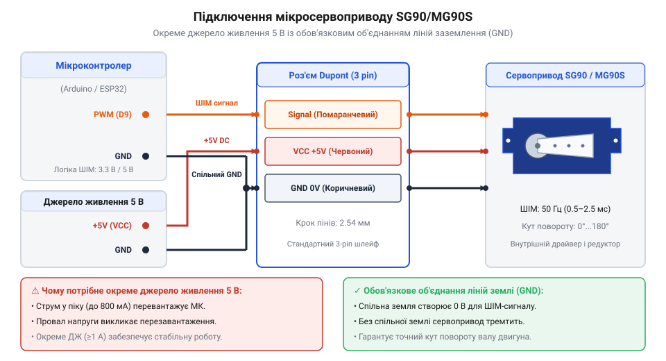
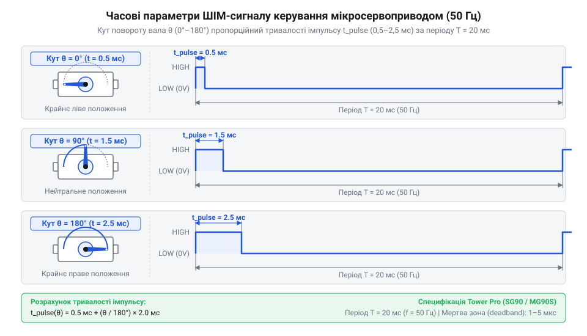

# Апаратний та електричний інтерфейс 9-грамових мікросервоприводів Tower Pro

<preknowlist>
- [Сервоприводи радіокерованих моделей: будова, редуктори та ШІМ-керування](root:cat-hw-actuators/rc-servo-mechanisms-and-control) — Базові принципи роботи сервомеханізмів, роль потенціометра зворотного зв'язку та загальну концепцію широтно-імпульсного керування.
- [Tower Pro SG90 — мікросерво 9g](root:cat-hw-actuators/sg90-servo) — Загальні фізичні параметри, призначення та механічні обмеження базової пластикової моделі.
</preknowlist>

## Проблема живлення та просідання напруги

Підключаючи компактний 9-грамовий мікросервопривід @@en|Tower Pro@@ @@en|SG90@@ безпосередньо до виводу живлення `5 В` плати мікроконтролера, розробники часто стикаються з раптовими апаратними перезавантаженнями системи. На етапі ініціалізації пристрій працює стабільно, проте в момент подачі команди на зміну положення вала мікроконтролер раптово вимикається або скидає поточне виконання програми. Така поведінка спричинена не програмною помилкою, а різким електродинамічним стрибком струму в обмотках колекторного двигуна постійного струму, що знаходиться всередині корпусу сервоприводу.

У стані спокою внутрішня схема керування мікросервоприводу споживає незначний струм спокою в межах від `10` до `20 мА`. Під час плавного руху без зовнішнього механічного навантаження струм зростає до `100`–`250 мА`. Однак у момент старту з нульової швидкості ротор двигуна долає інерцію редуктора, що створює короткочасний пусковий струм @@en|inrush current@@ (від англ. *inrush current* — пусковий струм). Якщо ж на вал діє механічний опір або важіль упирається в перешкоду, виникає струм заклинювання @@en|stall current@@ (від англ. *stall current* — струм заклинювання вала). Для базової пластикової моделі @@en|SG90@@ піковий струм досягає `500`–`700 мА`, а для цифрових модифікацій із металевим редуктором @@en|MG90S@@ перевищує `1.0 А`.

Вбудовані на плату мікроконтролера лінійні стабілізатори напруги та шини живлення `USB` не здатні миттєво віддати такий високий струм без падіння вихідної напруги. У результаті напруга в загальній лінії живлення `5 В` короткочасно просідає нижче критичного порогу роботи мікроконтролера. Вбудована в мікросхему схема просідання живлення @@en|brownout@@ (від англ. *brownout* — часткове знеструмлення) або модуль [скидання при просіданні живлення](root:hw-arch/brownout) сприймає цей спад напруги як загрозу спотворення даних у пам'яті та примусово перезапускає процесор.

Для запобігання апаратним скиданням лінію живлення мікросервоприводів повністю відокремлюють від кола живлення мікроконтролера. Приводи підключають до окремого силового джерела постійного струму — імпульсного стабілізатора або акумуляторного блоку з робочою напругою від `4.8 В` до `6.0 В`, здатного забезпечувати пікові струмові імпульси до `1.5`–`2.0 А`.

Відокремлення позитивних ліній живлення вимагає обов'язкового з'єднання їхніх від'ємних виводів у спільну лінію заземлення @@en|GND@@ (від англ. *ground* — земля). Електричний сигнал керування вимірюється як різниця потенціалів між сигнальним виводом і землею. Якщо мікроконтролер та зовнішнє джерело живлення сервоприводу не мають спільної точки відліку потенціалу, рівень напруги на сигнальному проводі стає невизначеним, що призводить до спотворення ШІМ-імпульсів, хаотичного тремтіння вала або повної втрати керованості.

## Електричне підключення та колірна цокольовка

Підключення 9-грамових мікросервоприводів родини @@en|Tower Pro@@ (@@en|SG90@@, @@en|SG92R@@, @@en|MG90S@@, @@en|MG90D@@) здійснюється за допомогою стандартного трипінового роз'єму @@en|Dupont@@ (від назви компанії-розробника *DuPont*) із кроком контактів `2.54 мм`. Гнучкий трижильний шлейф сервоприводу має сувору колірну цокольовку, яка визначає призначення кожного провідника:

1. **Темно-коричневий або чорний провід:** Земля @@en|GND@@. Підключається до мінусового полюса зовнішнього джерела живлення та об'єднується із виводом `GND` мікроконтролера. 2. **Червоний провід:** Позитивна напруга живлення @@en|VCC@@ (від англ. *Voltage at the Common Collector*). Підключається виключно до плюсового виводу окремого джерела напругою `4.8`–`6.0 В`. 3. **Помаранчевий або жовтий провід:** Сигнальний провід @@en|Signal@@. Підключається до цифрового виводу мікроконтролера або ШІМ-драйвера, який ґенерує прямокутні керуючі імпульси.

Розташування контактів у колодці @@en|Dupont@@ забезпечує фізичний захист від помилок підключення. Позитивний вивід живлення @@en|VCC@@ завжди розміщений на центральному піні роз'єму. Якщо користувач помилково вставить роз'єм у гребінку зворотною стороною, центральний контакт `VCC` залишиться на своєму місці, а лінії @@en|GND@@ та @@en|Signal@@ лише поміняються місцями. Оскільки сигнальний вхід мікроконтролера має високий вхідний опір, така переполюсовка не створює короткого замикання й захищає внутрішні компоненти сервоприводу та мікроконтролера від виходу з ладу.

Номінальний діапазон напруги живлення @@en|VCC@@ становить від `4.8 В` до `6.0 В`. При напрузі `6.0 В` сервопривід забезпечує максимальний крутний момент і вищу швидкість повертання вала, тоді як при `4.8 В` зменшується нагрів двигуна та струмоспоживання.

Сигнальний вхід @@en|Signal@@ узгоджується з логічними рівнями @@en|TTL@@ (від англ. *Transistor-Transistor Logic* — транзисторно-транзисторна логіка) `5 В` та `3.3 В` CMOS. Внутрішній компаратор плати керування сервоприводу розпізнає високий логічний рівень при напрузі понад `1.8`–`2.0 В`. Це дозволяє підключати сигнальний провід сервоприводу безпосередньо до 3.3-вольтових виводів сучасних мікроконтролерів без використання додаткових конвертерів логічних рівнів.


*Електрична розводка контактів Dupont: сигнальний провід підключається до виводу мікроконтролера, а лінії живлення та землі живляться від зовнішнього блоку із заземленням спільної шини.*

Послідовність монтажу електричного кола включає наступні кроки:
1. З'єднати від'ємну клему зовнішнього джерела живлення з виводом `GND` мікроконтролера для формування спільної шини заземлення. 2. Підключити темно-коричневий (або чорний) провід роз'єму @@en|Dupont@@ сервоприводу до спільної лінії `GND`. 3. Підключити червоний провід сервоприводу до позитивного виводу `+5 В` зовнішнього джерела живлення. 4. Підключити помаранчевий (або жовтий) сигнальний провід сервоприводу до обраного цифрового виводу мікроконтролера з підтримкою генерації @@en|PWM@@.

## Параметри ШІМ-сигналу та часові інтервали

Позиціонування вихідного вала мікросервоприводів @@en|Tower Pro@@ здійснюється за допомогою широтно-імпульсної модуляції @@en|PWM@@ (від англ. *Pulse Width Modulation* — широтно-імпульсна модуляція, @@uk|ШІМ@@). На відміну від синергетичного @@en|PWM@@ керування звичайними колекторними двигунами, де коефіцієнт заповнення змінює середнє значення напруги для регулювання швидкості, у сервоприводах кутове положення вала задається точною тривалістю (шириною) високого логічного імпульсу.

Базова частота повторення керуючих імпульсів `f` для сервоприводів становить `50 Гц`. Обчислимо період повторення керуючих імпульсів `T` на основі стандартної частоти `f` рівної `50 Гц`.

```
T = 1 / f
  = 1 / 50 Гц
  = 0.02 с              [переведення частоти у період]
  = 20 мс               [переведення секунд у мілісекунди]
```

Отримане значення `20 мс` визначає повний часовий інтервал одного циклу керування, у межах якого генерується один позиціонуючий імпульс.

Стандартний робочий діапазон тривалості імпульсу для сервоприводів @@en|Tower Pro@@ @@en|SG90@@ та @@en|MG90S@@ становить від `0.5 мс` до `2.5 мс` для кутів повороту від `0°` до `180°`. Імпульс тривалістю `1.5 мс` відповідає нейтральному центральному положенню вала `90°`. Для розрахунку необхідної тривалості позиціонуючого імпульсу `t_pulse` за заданого кута повороту вала `θ` скористаємося лінійною інтерполяцією між мінімальним значенням `t_min` та максимальним значенням `t_max`.

```
t_pulse = t_min + (θ / θ_max) × (t_max - t_min)
        = 0.5 мс + (θ / 180°) × (2.5 мс - 0.5 мс)      [підстановка меж тривалості Tower Pro]
        = 0.5 мс + (θ / 180°) × 2.0 мс                  [обчислення робочого діапазону]
```

У цій формулі `θ` означає цільовий кут повороту в градусах, `θ_max` відповідає максимальному куту `180°`, а величина `2.0 мс` є повним діапазоном зміни ширини імпульсу.

Розрахуємо тривалість імпульсу `t_pulse` для повороту вала на кут `θ` рівний `45°`.

```
t_pulse = 0.5 мс + (45° / 180°) × 2.0 мс
        = 0.5 мс + 0.25 × 2.0 мс                        [ділення поточного кута на максимальний]
        = 0.5 мс + 0.5 мс                               [масштабування робочого діапазону]
        = 1.0 мс                                        [підсумкове додавання базового зсуву]
```

Знайдене значення `1.0 мс` показує, що для встановлення сервоприводу під кутом `45°` таймер мікроконтролера повинен тримати високий логічний рівень протягом точно однієї мілісекунди.

Подача керуючих імпульсів із тривалістю менше `0.5 мс` або більше `2.5 мс` створює небезпеку механічного пошкодження приводу. У цьому випадку внутрішній потенціометр зворотного зв'язку досягає крайнього физичного упору раніше, ніж внутрішня схема керування зафіксує досягнення узгодженого кута. Двигун продовжує силом тиснути на механічні обмежувачі редуктора, внаслідок чого струм споживання зростає до максимального значення @@en|stall current@@ (`700`–`1000 мА`). Неперервний перегрів обмоток призводить до розплавлення пластикових шестерень у [базовому сервоприводі](root:cat-hw-actuators/sg90-servo) або пробою транзисторів внутрішнього моста.


*Часова залежність положення ротора від ширини керуючого імпульсу при сталому періоді 20 мс.*

## Відмінності аналогових і цифрових модифікацій

Родина 9-грамових мікросервоприводів @@en|Tower Pro@@ поділяється на аналогові модифікації (@@en|SG90@@, @@en|SG92R@@) та цифрові модельні варіанти (@@en|MG90S@@, @@en|MG90D@@). Незважаючи на однакові зовнішні габарити корпусу та ідентичний зовнішній інтерфейс @@en|PWM@@ керування частотою `50 Гц`, принципи внутрішньої обробки сигналу та реакції на відхилення вала в цих двох класах істотно відрізняються.

В аналогових сервоприводах @@en|SG90@@ обробку сигналу виконує аналогова мікросхема порівняння. Вона подає коригуючі імпульси живлення на внутрішній H-міст @@en|H-bridge@@ (від англ. *H-bridge* — Н-міст) силового керування двигуном з частотою вхідного сигналу `50 Гц` (один раз на `20 мс`). Якщо зовнішнє механічне навантаження відхиляє вал між імпульсами, аналогова система не реагує на це зсунення до надходження наступного тактового імпульсу. Через це аналогові приводи мають відносно велику зону нечутливості @@en|deadband@@ (від англ. *deadband* — мертва зона або зона нечутливості), яка становить `5`–`10 мкс` (близько `1°`–`2°`). Невеликі кутові відхилення нижче цього порогу не викликають активного протидійного зусилля двигуна.

У цифрових сервоприводах @@en|MG90S@@ та @@en|MG90D@@ вбудований внутрішній мікроконтролер приймає зовнішній імпульс @@en|PWM@@ частотою `50 Гц`, проте внутрішній контур керування двигуном працює з власною високою частотою `300`–`500 Гц`. Внутрішня схема подає імпульси на мостовий драйвер двигуна до 500 разів на секунду. Завдяки цьому цифрові сервоприводи володіють звуженою зоною нечутливості @@en|deadband@@ в межах `1`–`2 мкс` (менше `0.2°`), забезпечують утримання позиції з високою жорсткістю та реагують на найменші зовнішні відхилення вала без затримок.

Застосування цифрових модифікацій з металевим редуктором доречне у вузлах із високими вібраційними навантаженнями та вимогами до точності утримання положення. Для таких завдань використовують [моделі з металевим редуктором](root:cat-hw-actuators/mg90s-servo). У простих навчальних проектах або механізмах із низьким навантаженням достатньо застосувати базовий [пластиковий мікросервопривід](root:cat-hw-actuators/sg90-servo). Якщо ж проект вимагає безперервного обертання без обмеження кута, слід звернутися до матеріалу про [модифікації постійного обертання](root:cat-hw-actuators/continuous-rotation-servo-mod).