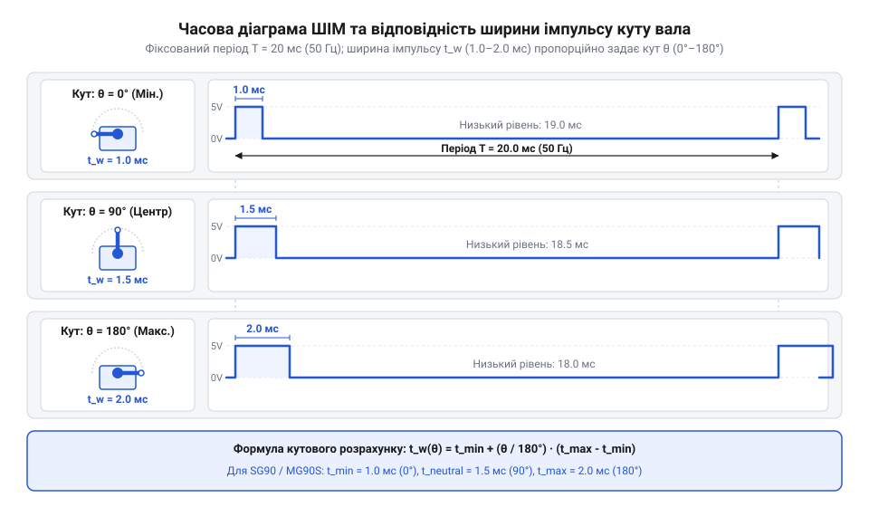
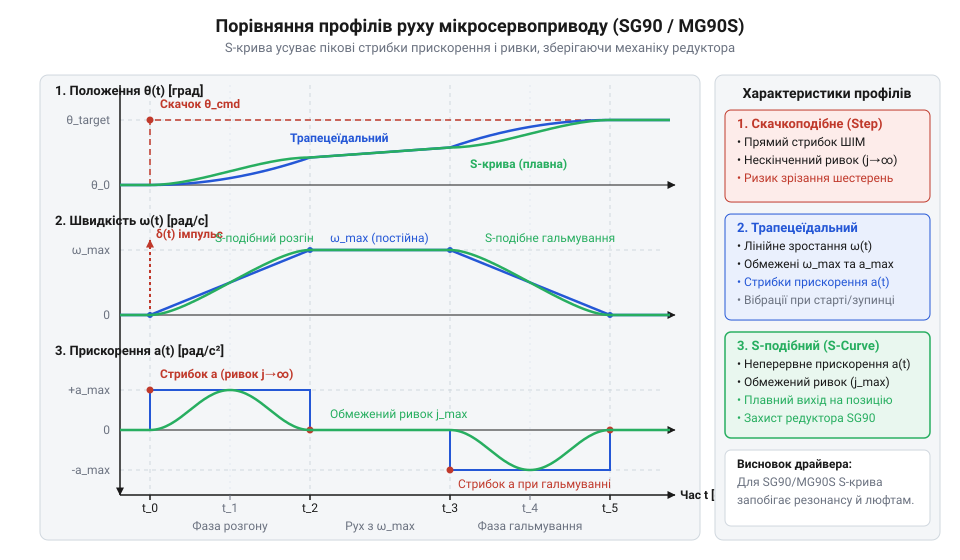

# Програмний інтерфейс драйвера керування сервоприводом через апаратний ШІМ

<preknowlist>
- [Сервоприводи радіокерованих моделей: будова, редуктори та ШІМ-керування](root:cat-hw-actuators/rc-servo-mechanisms-and-control) — базовий принцип фізичного устрою сервоприводу та пропорційного керування тривалістю імпульсу
- [Tower Pro SG90 — мікросерво 9g](root:cat-hw-actuators/sg90-servo) — електричні специфікації, діапазон кутів та базові часові межі керуючих імпульсів мікросервоприводів
</preknowlist>

## Неконтрольовані ривки та перегрів сервоприводів

Уявіть типову розробницьку ситуацію: ви підключаєте керуючий провід сервоприводу до виводу мікроконтролера й пишете простий цикл генерації прямокутного сигналу софтверними затримками. При подачі живлення вал з брязкотом злітає в крайнє положення, впирається у корпус та гуде, а за кілька хвилин пластикові шестерні зрізаються або обмотки двигуна згоряють від перегріву. Керування силовим актуатором без програмного драйвера неминуче призводить до апаратних аварій.

Щоб зрозуміти джерело проблеми, слід розібрати архітектуру пристрою. Сервопривід або сервомотор (від лат. *servus* — слуга та лат. *motor* — той, що рухає) є замкненою електромеханічною системою з колекторного двигуна постійного струму, понижувального редуктора, потенціометра зворотного зв'язку та плати керування. Зовнішнє керування здійснюється через широтно-імпульсну модуляцію — ШІМ (від англ. @@en|PWM@@, @@en|Pulse Width Modulation@@, від лат. *pulsus* — поштовх та *latitudo* — ширина). Внутрішній підсилювач помилки порівнює тривалість вхідного імпульсу високого рівня з опором потенціометра на вихідному валу й за наявності розбіжності подає максимальну напругу живлення на мотор для зменшення помилки.

Головна небезпека програмного формування ШІМ-сигналу (англ. @@en|software bit-banging@@) полягає у відсутності жорсткої апаратної прив'язки до часу. Коли мікроконтролер відволікається на обробку переривань периферії (наприклад, @@en|UART@@ чи бездротовий зв'язок), тривалість імпульсу плаває від кадру до кадру, створюючи часове тремтіння — джитер (від англ. @@en|jitter@@ — тремтіння). Нестабільність високого логічного рівня навіть на 10–50 мікросекунд сприймається платою як постійна зміна цільової координати. В результаті мотор безупинно відпрацьовує хибні відхилення, випромінює характерне дрижання та споживає високий струм у стані спокою.

Ще більшу загрозу становить відсутність нормування часових меж. Стандарти для [сервоприводів радіокерованих моделей](root:cat-hw-actuators/rc-servo-mechanisms-and-control) передбачають тривалість імпульсу від 1000 мкс (1 мс) до 2000 мкс (2 мс) для діапазону від 0° до 180°. Проте реальні мотори, як-от [мікросервоприводи SG90](root:cat-hw-actuators/sg90-servo) чи модифікації з [металевим редуктором MG90S](root:cat-hw-actuators/mg90s-servo), мають технологічні відхилення й розширені фізичні кути (від 500 мкс до 2500 мкс). Формування імпульсу поза можливим ходом екземпляра (наприклад, 400 мкс) призводить до повертання вала до упору й механічного блокування.

У момент блокування вала електродвигун переходить у стан заклинювання (англ. @@en|stall condition@@). Через неможливість досягти заданої точки зворотний зв'язок змушує H-міст подавати на обмотки повну напругу. Струм зростає від номінальних 30–50 мА до струму заклинювання (англ. @@en|stall current@@, який для сервоприводів 9g сягає 0.8–1.4 А). За відсутності захисту обмотки мотора й силові ключі розігріваються понад 100°C, спричиняючи руйнування ізоляційного лаку, оплавлення посадочних місць шестерень та вихід пристрою з ладу.

Пряме скачкоподібне перемикання ШІМ-сигналу також викликає руйнівні механічні удари. При миттєвому зміщенні цільового значення від 0° до 180° підсилювач відкриває ключі на 100%, викликаючи максимальне кутове прискорення та зрізне навантаження на шестерні редуктора. Для усунення цих явищ необхідний програмний драйвер (від англ. @@en|driver@@, від *to drive* — керувати, вести), який ізолює додаток від низькорівневих регістрів, здійснює контроль часових меж, забезпечує апаратну точність таймерів та адаптує кутову швидкість.

## Апаратна генерація ШІМ та перетворення

Для усунення часового джитеру генерація прямокутного сигналу покладається на апаратний таймер (від англ. @@en|timer@@, від *time* — час) — автономний периферійний блок, який лічить імпульси системного тактування незалежно від процесорного ядра.

Протокол керування вимагає опорної частоти 50 Гц із періодом кадру `T_period = 20 мс`. У межах кожного кадру сигнальний вивід утримується у високому логічному рівні протягом тривалості `t_pulse`, після чого переводиться в низький рівень на час `T_period - t_pulse`.

Конфігурування апаратного таймера починається з налаштування дільника тактової частоти — прескалера (від англ. @@en|prescaler@@, від *pre-* — перед та *scale* — шкала). Щоб знизити частоту шини периферії `f_clk` до дискретності в 1 мікросекунду (`f_cnt = 1 МГц`), коефіцієнт ділення `PSC` обчислюється як:

```
f_cnt = 1000000                        [бажана частота лічильника 1 МГц, 1 крок = 1 мкс]
PSC   = (f_clk ÷ f_cnt) - 1            [розрахунок значення регістра прескалера]
```

Значення регістра автоматичного перезавантаження `ARR` (від англ. @@en|Auto-Reload Register@@), яке задає період повторення сигналу 20 мс (20 000 мкс) при частоті лічильника 1 МГц, розраховується за формулою:

```
T_us  = 20000                          [тривалість періоду 20 мс у мікросекундах]
ARR   = (T_us × (f_cnt ÷ 1000000)) - 1 [розрахунок значення регістра періоду таймера]
      = (20000 × 1) - 1                [підстановка значення частоти лічильника 1 МГц]
      = 19999                          [значення регістра ARR для частоти 50 Гц]
```

При такій конфігурації кожен відлік дорівнює 1 мкс, а тривалість високого рівня визначається регістром порівняння каналу `CCR` (від англ. @@en|Capture/Compare Register@@). Запис числа `N` у регістр `CCR` формує імпульс тривалістю `N` мікросекунд без залучення переривань центрального процесора.

Для переведення цільового кута повороту вала `theta` у тривалість імпульсу `t_pulse` драйвер застосовує лінійне мапування між кутовими межами `theta_min`, `theta_max` та часовими межами імпульсу `t_min`, `t_max`:

```
t_span   = t_max - t_min               [ширина діапазону тривалості імпульсів]
ang_span = theta_max - theta_min       [ширина кутового діапазону приводу]
t_pulse  = t_min + ((theta - theta_min) × t_span ÷ ang_span) [лінійне перетворення кута в тривалість імпульсу]
```

Отримане значення `t_pulse` у мікросекундах передається в регістр `CCR` для генерації відповідного ШІМ-сигналу.


*Часові діаграми керуючого імпульсу ШІМ із періодом 20 мс: залежність тривалості високого рівня t_pulse від кута повороту вала.*

Завдяки апаратній генерації та точному лінійному перетворенню драйвер отримує детермінований механізм позиціонування, стійкий до затримок у виконанні прикладного коду.

## Конфігурування та ініціалізація драйвера сервоприводу

Програмний інтерфейс (англ. @@en|API@@, від @@en|Application Programming Interface@@) драйвера приховує регістри мікроконтролера за конфігураційною абстракцією. Для керування мотором, як-от [сервоприводом HD-1370A](root:cat-hw-actuators/hd-1370a-servo) з [родини Power HD](root:cat-hw-actuators/powerhd-family), структура `servo_config_t` описує:
- `gpio_pin` — вивід мікроконтролера;
- `us_min`, `us_max` — безпечні межі імпульсу (500–2500 мкс);
- `angle_min`, `angle_max` — робочі кути (0°–180°);
- `trim_offset_us` — калібрувальний зсув нейтралі для компенсації похибки вала.

Ініціалізація виконує кроки:
1. **Валідація:** перевіряє `us_min < us_max` і межі 400–2600 мкс; повертає `SERVO_ERR_INVALID_ARG` при відхиленні. 2. **Початковий стан:** обчислює нейтральний імпульс зі зсувом `trim_offset_us` і заносить у регістр порівняння таймера до активації виходу, упереджуючи стартовий ривок. 3. **Активація:** вмикає ШІМ-канал і повертає `SERVO_OK`.

Практична реалізація модуля ініціалізації мовами C та C++:

:::tabs
@tab C
:::code api-micro-servo-pwm-driver-interface/c/esp-idf/servo-init.c
@tab C++
:::code api-micro-servo-pwm-driver-interface/cpp/arduino/servoerror.cpp
:::

Перевірка коду повернення виявляє помилки конфігурації до виходу ШІМ-сигналу на мотор.

## Керування положенням та профілювання швидкості

Миттєва зміна тривалості імпульсу `t_pulse = t_target` створює ступенчасте завдання. Якщо на валу закріплено [серво-роги та механічні кріплення](root:cat-hw-actuators/servo-horns), ротор різко прискорюється й зупиняється ударом у цільовій точці. Це викликає перерегулювання (англ. @@en|overshoot@@), затухаючі механічні коливання та прискорене зношення редуктора.

Для гладкого руху драйвер обчислює часову траєкторію кутової координати `θ(t)` та кутової швидкості `ω(t)`.

Поширеним методом є **трапецеїдальний профіль швидкості** (англ. @@en|trapezoidal speed profile@@). Процес переміщення розбивається на три фази:
1. **Фаза розгону:** кутове прискорення є постійним `α(t) = +α_max`, а кутова швидкість лінійно зростає від `0` до максимуму `ω_max`. 2. **Фаза крейсерського руху:** прискорення дорівнює нулю `α(t) = 0`, а вал обертається з постійною швидкістю `ω_max`. 3. **Фаза гальмування:** прискорення від'ємне `α(t) = -α_max`, а швидкість лінійно зменшується до `0`.

Графік швидкості має форму трапеції. Скачки прискорення на межах фаз створюють незначні ударні мікронавантаження (ривки).

Для максимальної плавності застосовують **S-подібний профіль руху** (англ. @@en|S-curve profile@@). У S-кривій обмежують не лише прискорення, а й його першу похідну — ривок (англ. @@en|jerk@@, від англ. *jerk* — поштовх, `j = dα/dt`). Завдяки цьому прискорення змінюється без стрибків, а механічні вібрації зупинки повністю гасяться.


*Динаміка зміщення вала та кутової швидкості при ступенчастому завданні, трапецеїдальному профілі з постійним прискоренням та S-кривій з обмеженим ривком.*

У фоновому циклі драйвера профілювання реалізують дискретним перерахунком поточного кута `current_angle` до цільового `target_angle` із кроком `Δt`.

:::tabs
@tab C
:::code api-micro-servo-pwm-driver-interface/c/esp-idf/servo-profile-step.c
@tab C++
:::code api-micro-servo-pwm-driver-interface/cpp/arduino/motionprofile.cpp
:::

Профілювання позбавляє механіку вібраційних ударів, а споживання струму залишається в межах безпечного номіналу.

## Обробка помилок та керування станом

Мікросервоприводи не мають вбудованого зворотного зв'язку по струму чи температурі, на відміну від [сервоприводів постійного обертання](root:cat-hw-actuators/continuous-rotation-servo-mod) чи [безколекторних сервоконтролерів](root:cat-hw-actuators/bldc-servo-controller). Безпека роботи пристрою повністю покладається на програмний драйвер.

Під час виклику API встановлення кута драйвер перевіряє вхідні аргументи. Якщо значення виходить за межі `angle_min`...`angle_max`, драйвер застосовує клемпінг (англ. @@en|clamping@@ — затискання в лещата) і повертає код помилки `SERVO_ERR_OUT_OF_BOUNDS`:

```
angle_clamped = max(angle_min, min(angle_max, target_angle)) [обмеження кута в безпечному діапазоні]
```

Вищий рівень ПЗ отримує код помилки й може відповідно скоригувати алгоритм керування.

Для заощадження енергії та захисту від перегріву застосовують функцію @@en|detach@@ (англ. *detach* — відокремлювати). У стані спокою без зовнішнього навантаження постійний ШІМ-сигнал змушує підсилювач реагувати на шуми потенціометра, спричиняючи високочастотне дрижання та витрату заряду.

Виклик `servo_detach()` припиняє генерацію ШІМ-сигналу на виводі мікроконтролера. Плата сервоприводу знімає напругу з двигуна, зменшуючи споживання струму з 50–100 мА до менше ніж 1 мА.

Для відновлення руху чи утримання вала викликають `servo_attach()` (англ. @@en|attach@@ — приєднувати), яка відновлює генерацію ШІМ зі збереженим значенням `t_pulse`.

Реалізація обробки помилок та керування станом на C і C++:

:::tabs
@tab C
:::code api-micro-servo-pwm-driver-interface/c/esp-idf/servo-set-angle.c
@tab C++
:::code api-micro-servo-pwm-driver-interface/cpp/arduino/safeservodriver.cpp
:::

Перевірка меж аргументів та вчасне використання `servo_detach()` забезпечують енергоефективну й надійну роботу сервоприводу.