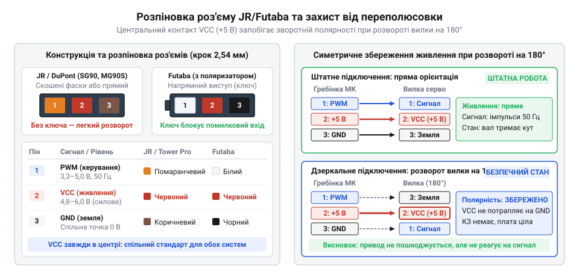
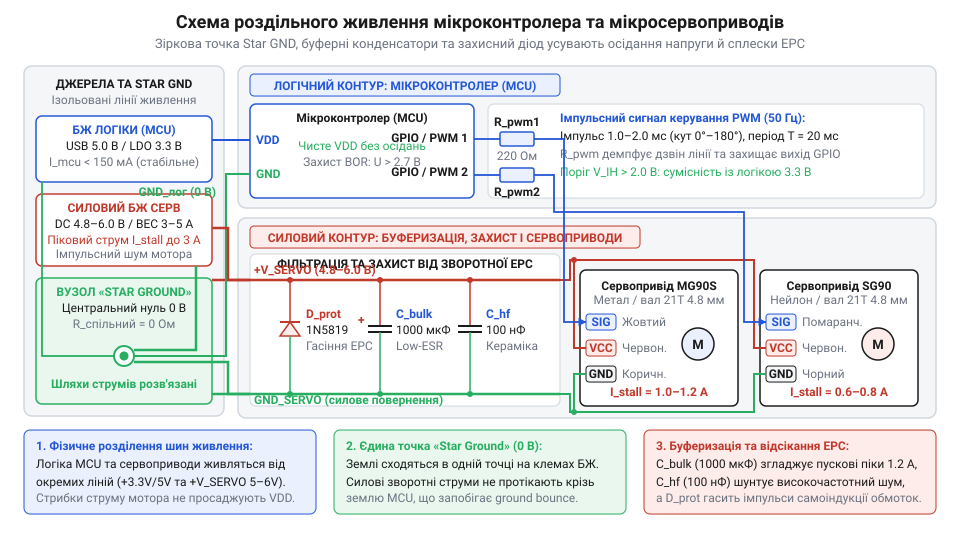
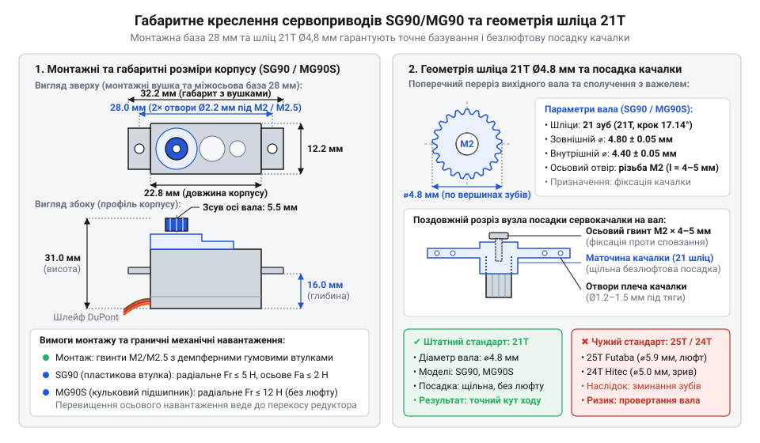

# Залізний інтерфейс і схема підключення 9-грамових мікросервоприводів лінійки Tower Pro

<preknowlist>
- [Tower Pro SG90 — мікросерво 9g](root:cat-hw-actuators/sg90-servo) — Базовий електромеханічний устрій аналогового привода (колекторний двигун, редуктор, потенціометр зворотного зв'язку) та класичний принцип позиціювання імпульсами ШІМ 50 Гц із тривалістю 1–2 мс
- [MG90S V2 — мікросерво з металевим редуктором](root:cat-hw-actuators/mg90s-servo) — Конструктивні особливості посиленої версії мікросервопривода: металевий редуктор, верхній кулькопідшипник вихідного вала та значно вищі пікові струми блокування понад 1 А
- [Серво-роги (запасні)](root:cat-hw-actuators/servo-horns) — Призначення та конструкція насадних важелів (сервокачалок), механізм передачі крутного моменту через шліцьове з'єднання та залежність сумісності від діаметра й кількості зубів вала
</preknowlist>

## Пастка наївного підключення мікросервопривода

Підключення мікросервопривода (лат. @@la|servus@@ — слуга, раб) лінійки @@en|Tower Pro@@ безпосередньо до виводів живлення й сигнальних ніжок мікроконтролера виглядає найпростішим шляхом, проте миттєво паралізує всю систему. Як тільки керуюча програма подає перший імпульс на зміну положення вала, нерухомий колекторний двигун починає рушати з місця. У момент пуску проти-ЕРС обмоток дорівнює нулю, а електричний опір якоря становить лише кілька ом, через що споживання струму стрибає до 0.8–1.2 А за частки мікросекунди. Бортовий лінійний стабілізатор мікроконтролера або лінія живлення шини USB неспроможні віддати такий струм без глибокого падіння вихідної напруги. Напруга на шині +5 В просідає нижче критичних 4.3–4.5 В, активуючи вбудовану схему захисту процесора — скидання через просідання живлення (англ. @@en|brown-out@@ — спад освітлення через брак напруги, @@en|Brown-out Reset@@, @@en|BOR@@).

Процесор перезавантажується, скидає стан своїх периферійних блоків і знеструмлює вихід керування. Оскільки навантаження зникає, напруга живлення відновлюється, процесор знову завантажує прошивку й повторно надсилає імпульс на сервопривід. Система потрапляє в замкнене коло безперервних циклічних перезапусків. Ситуацію загострює колекторне іскріння: під час ковзання металевих щіток по мідних ламелях ротора утворюються мікродуги, які випромінюють високочастотні завади безпосередньо в шину живлення та навколишні провідники.

Під час перезавантаження та ініціалізації платформи цифрові виводи мікроконтролера перебувають у стані високого вихідного імпедансу (лат. @@la|impedire@@ — ставати на заваді, @@en|Hi-Z@@). Довгий сигнальний дріт починає працювати як антена й уловлює електромагнітні наведення від іскріння та сусідніх кіл. Внутрішній компаратор [класичного аналогового привода](root:cat-hw-actuators/sg90-servo) сприймає ці спонтанні наведення за наддовгі імпульси керування, внаслідок чого сервокачалка з максимальною кутовою швидкістю б'є у внутрішній механічний упор. Надійне інтегрування сервоприводів вимагає ізольованого силового контуру та захищеного сигнального тракту.

## Цоколівка роз'єму та колірне маркування

Фізичний інтерфейс 9-грамових приводів виконано у вигляді триконтактного рознімно-штекерного з'єднання стандарту @@en|DuPont@@ / @@en|JR@@ з кроком контактів 2.54 мм (0.1 дюйма). Цоколівка (італ. @@it|zoccolo@@ — черевик, підніжжя) визначає призначення трьох жил плаского шлейфа: спільний нульовий провідник, шину силового живлення та лінію передачі широтно-імпульсного сигналу.

Виробники застосовують два стандарти колірного забарвлення шлейфа, які повністю збігаються за електричним призначенням контактів, але відрізняються барвниками ізоляції:
1. Стандарт @@en|Tower Pro@@ (також сумісний із системою Graupner/JR):
   - коричневий провідник — спільний мінус (@@en|GND@@);
   - червоний провідник — позитивна лінія живлення (@@en|VCC@@);
   - помаранчевий провідник — імпульсна лінія керування (@@en|Signal@@).
2. Альтернативний стандарт @@en|Futaba@@:
   - чорний провідник — спільний мінус (@@en|GND@@);
   - червоний провідник — позитивна лінія живлення (@@en|VCC@@);
   - білий провідник — імпульсна лінія керування (@@en|Signal@@).

Центральний контакт роз'єму завжди відведено під силову лінію @@en|VCC@@. Таке симетричне компонування є навмисним захистом від помилок монтажу: якщо колодку помилково під'єднати зворотною стороною («дзеркально»), контакт @@en|VCC@@ однаково потрапляє на шину живлення. Місцями міняються лише лінії @@en|GND@@ та @@en|Signal@@. Оскільки вхідний опір сигнального каскаду внутрішньої мікросхеми сервопривода становить десятки кілоом, зворотні слабкострумові витоки через вхідний транзистор не створюють аварійного нагріву, а мікросхема драйвера не зазнає згубної переполюсовки живлення й повністю захищена від електричного вигоряння.


*Схема розводки триконтактного роз'єму стандартів JR і Futaba та збереження полярності живлення при дзеркальному підключенні: симетричне центральне положення контакту VCC унеможливлює переполюсовку та захищає мікросхему привода від електричного вигоряння.*

## Роздільне живлення та спільна земля

Мікросервоприводи серії @@en|Tower Pro@@ вимагають стабілізованої постійної напруги в діапазоні 4.8–6.0 В. Падіння напруги нижче 4.8 В критично знижує швидкість обертання та крутний момент редуктора (лат. @@la|reducere@@ — відводити назад), а перевищення рівня 6.0 В прискорює електричне руйнування щіток двигуна й перегріває внутрішній лінійний стабілізатор сервоконтролера.

Струмовий апетит мікросервопривода залежить від механічного навантаження й різко змінюється за трьома характерними станами:
- стан спокою (утримання позиції без зовнішнього навантаження): споживання становить 10–20 мА на один привід;
- плавний рух важеля під штатним зусиллям: споживання зростає до 150–250 мА;
- пуск з місця та повне механічне зупинення вала (англ. @@en|stall current@@, струм блокування): моделі @@en|SG90@@ і @@en|SG92R@@ короткочасно беруть 0.6–0.8 А, тоді як версії з [металевим редуктором](root:cat-hw-actuators/mg90s-servo) @@en|MG90S@@ та цифрові @@en|MG90D@@ вимагають від 0.9 до 1.2 А на кожен привід.

Спільне живлення мікроконтролера та електродвигунів від однієї шини неприпустиме через неминучі просідання напруги під навантаженням. Топологія системи має чітко розділяти кола: мікроконтролер живиться від власного стабілізатора логіки, а сервоприводи під'єднуються до виділеної силової шини від окремого стабілізатора або імпульсного перетворювача, розрахованого на сумарний струм блокування всіх одночасно рухомих приводів.

Силова земля сервоприводів і логічна земля мікроконтролера обов'язково об'єднуються, інакше керуючий сигнал не матиме базового опорного потенціалу. Об'єднання виконують за топологією «зірка» (англ. @@en|star ground@@) — строго в одній спільній точці безпосередньо біля вихідних клем силового джерела живлення. Послідовне шлейфове з'єднання земель неприпустиме: сильний зворотний струм двигуна, протікаючи крізь тонкий земляний провідник логіки, створює падіння потенціалу на його паразитному опорі, викликаючи зсув рівня нуля (@@en|ground bounce@@) і збої в роботі процесора.


*Роздільне живлення логічної та силової шин зі спільним заземленням «зіркою» усуває зворотні струмові петлі та спонтанні перезавантаження мікроконтролера.*

## Буферна фільтрація та захист від індуктивності

Навіть за наявності потужного зовнішнього стабілізатора паразитний опір та індуктивність провідників живлення спричиняють короткочасні провали напруги в моменти різкої зміни швидкості обертання вала. Для компенсації перехідних процесів безпосередньо біля силових роз'ємів сервоприводів встановлюють локальні фільтрувальні конденсатори (лат. @@la|condensare@@ — згущувати): електролітичний або танталовий накопичувальний конденсатор ємністю 100–470 мкФ із низьким еквівалентним послідовним опором (англ. @@en|Low ESR@@) та керамічний конденсатор ємністю 0.1 мкФ (100 нФ). Керамічна ємність шунтує на землю високочастотні завади від іскріння колектора, а електролітична ємність віддає накопичену енергію під час динамічного пуску, запобігаючи просіданню напруги на силовій шині.

Необхідну ємність накопичувального конденсатора `C` обчислюють через піковий пусковий струм сервопривода `I`, тривалість пускового сплеску `Δt` та максимально допустиме просідання напруги на силовій шині `ΔV`:

```
C = I · Δt ÷ ΔV
  = 1.0 · 0.02 ÷ 0.1   [підстановка пікового струму 1 А, тривалості сплеску 20 мс і спаду 100 мВ]
  = 0.0002             [обчислення ємності у фарадах]
  = 200                [переведення у мікрофаради, мкФ]
```

Отримане значення 200 мкФ округлюють у більший бік до стандартного номіналу 220 мкФ або 470 мкФ на кожні один-два підключені мікросервоприводи.

Крім просідань напруги, перемикання двигуна викликає сплески небезпечної напруги зворотної полярності. Обмотки ротора мають власну індуктивність (лат. @@la|inductio@@ — наведення). При раптовій зупинці або реверсі вала миттєвий обрив струму породжує імпульс зворотної електрорушійної сили (ЕРС) самоіндукції, амплітуда якого може сягати 15–25 В. Для захисту внутрішніх ключів сервопідсилювача та стабілізатора паралельно силовій лінії живлення вмикають захисний діод Шотткі або напівпровідниковий обмежувач перенапруг — супресор (лат. @@la|supprimere@@ — пригнічувати, стримувати, @@en|TVS@@-діод) з порогом спрацьовування 6.5–6.8 В, який миттєво відводить високовольтні імпульси в землю.

## Узгодження логічних рівнів і захист сигналу

Сервоприводи лінійки @@en|Tower Pro@@ керуються імпульсним сигналом фіксованої частоти 50 Гц із тривалістю активного імпульсу від 1 до 2 мс. Хоча сам сервопривід живиться напругою 5 В, [спеціалізована мікросхема сервоконтролера](root:cat-hw-drivers/servo-analog-driver-ic) усередині корпусу має порогові рівні вхідного компаратора, сумісні зі стандартами транзисторно-транзисторної логіки:
- гранична напруга логічного нуля (`V_IL`) становить не більше 0.8 В;
- поріг фіксації логічної одиниці (`V_IH`) лежить у діапазоні 1.5–2.0 В.

Оскільки мікроконтролери з робочою напругою 3.3 В (платформи STM32, ESP32 чи RP2040) формують високий рівень сигналу амплітудою близько 3.3 В, цей потенціал із великим запасом перевищує вхідний поріг 2.0 В. Отже, сервоприводи під'єднуються до виводів 3.3-вольтової логіки безпосередньо, без застосування активних перетворювачів рівнів напруги.

Для забезпечення завадостійкості сигнальний тракт оснащують пасивними захисними компонентами. Безпосередньо біля вихідного піна мікроконтролера послідовно вмикають демпферний резистор номіналом 100–220 Ом. Цей резистор пригнічує хвильові відбиття («дзвін») у довгому гнучкому кабелі та захищає цифровий вивід процесора від пробою струмом у разі випадкового замикання сигнального проводу на шину +5 В.

Між лінією сигналу та землею встановлюють зовнішній стягувальний резистор (англ. @@en|pull-down@@) опором 10–47 кОм. Під час апаратного перезапуску, подачі живлення або оновлення прошивки виводи мікроконтролера переходять у стан @@en|Hi-Z@@. Стягувальний резистор утримує на сигнальній лінії стабільний потенціал нуля, запобігаючи неконтрольованому стартовому ривку важеля від випадкових наведень. Програмне формування часових інтервалів таймерами та [програмне керування таймерами](root:cat-hw-actuators/sg90-mg90-micro-servos-family/api-micro-servo-driver-cpp.md) спираються на [розрахунок мертвої зони](root:cat-hw-actuators/sg90-mg90-micro-servos-family/math-servo-pwm-resolution-and-deadband.md) у спеціалізованих матеріалах.

## Механічний монтаж, шліци та позаштатні режими

Вихідний вал редуктора мікросервоприводів серії @@en|SG90@@ та @@en|MG90S@@ має 21 шліц (нім. @@de|Schlitz@@ — щілина, поздовжній паз) із зовнішнім діаметром по вершинах зубів 4.8 мм. Насадні важелі — сервокачалки — фіксуються осьовим металевим гвинтом із метричною різьбою M2 завдовжки 4–5 мм. Обираючи [змінні сервокачалки](root:cat-hw-actuators/servo-horns), необхідно суворо дотримуватися відповідності: використання насадок іншого стандарту (наприклад, 25-зубих для сервоприводів Futaba) призводить до зминання дрібних шліців вала вже під час першого затягування гвинта.


*Геометрія кріпильних вушок корпусу з отворами під гвинти M2 та поперечний переріз 21-зубого шліцьового вала діаметром 4.8 мм визначають механічну посадку.*

Монтаж корпусу виконують через два симетричні вушка, міжосьова відстань між кріпильними отворами яких становить 28 мм. Для кріплення використовують гвинти M2 або M2.5. У механізмах із високою вібрацією (рамах безпілотників чи колісних шасі) між вушками привода й монтажною площиною обов'язково встановлюють комплектні гумові демпфери (нім. @@de|Dämpfer@@ — глушник, утихомирювач) із розпірними латунними втулками. Демпфер гасить структурні вібрації, захищаючи пластиковий корпус від розтріскування, а внутрішній потенціометр (лат. @@la|potentia@@ — сила + грец. @@el|metron@@ — міра) зворотного зв'язку — від передчасного стирання резистивного шару.

Конструкція підшипникового вузла вихідного вала визначає граничні механічні навантаження:
- У базових моделях @@en|SG90@@ вал спирається безпосередньо на пластикову втулку ковзання в кришці корпусу. Допустиме радіальне зусилля обмежене 3–5 Н, а осьове навантаження вздовж осі вала не має перевищувати 2 Н. Перевищення цих меж викликає перекіс осі, зміщення плям контакту зубчастих коліс і подальше заклинювання редуктора.
- У моделях @@en|MG90S@@ та @@en|MG90D@@ верхня опора вихідного вала містить мініатюрний кульковий підшипник кочення, що дозволяє приймати радіальні навантаження до 10–12 Н без люфту та перекосу шестерень.

Позаштатна аварійна ситуація виникає під час спроби програмно повернути вал за межі фізичного сектора обертання (180°–200°), де внутрішній штифт редуктора впирається в пластиковий або металевий обмежувач. Коли мотор намагається подолати упор, споживання струму стрибає до рівня блокування 0.8–1.2 А. Оскільки ротор не обертається, споживана електрична потужність повністю перетворюється на тепло: температура обмоток за 15–30 секунд досягає 120–150 °C, лакова ізоляція плавиться, виникає міжвиткове замикання й двигун безповоротно виходить із ладу. Якщо проект потребує неперервного обертання механізму, застосовують апаратну [модифікацію на повний оберт](root:cat-hw-actuators/continuous-rotation-servo-mod).

Матеріал редуктора визначає характер руйнування привода під позаштатним перевантаженням:
- Нейлонові шестерні @@en|SG90@@: дешеві й тихі, але мають малу жорсткість на згин. При ударі або заклинюванні вала зуби малої вихідної шестерні миттєво зрізаються, захищаючи мотор від перегріву ціною виходу з ладу механіки.
- Вуглепластикові шестерні @@en|SG92R@@ (карбоніт): мають високу втомну міцність і не стираються під тривалим навантаженням, проте мають підвищену крихкість при різких ударних імпульсах.
- Металеві шестерні @@en|MG90S@@ і @@en|MG90D@@ (латунь та алюмінієві сплави): практично неможливо зрізати зовнішнім навантаженням, проте при механічному заклинюванні зусилля блокування передається на двигун і вихідні транзистори H-моста, призводячи до їхнього теплового вигоряння за відсутності струмового захисту.
