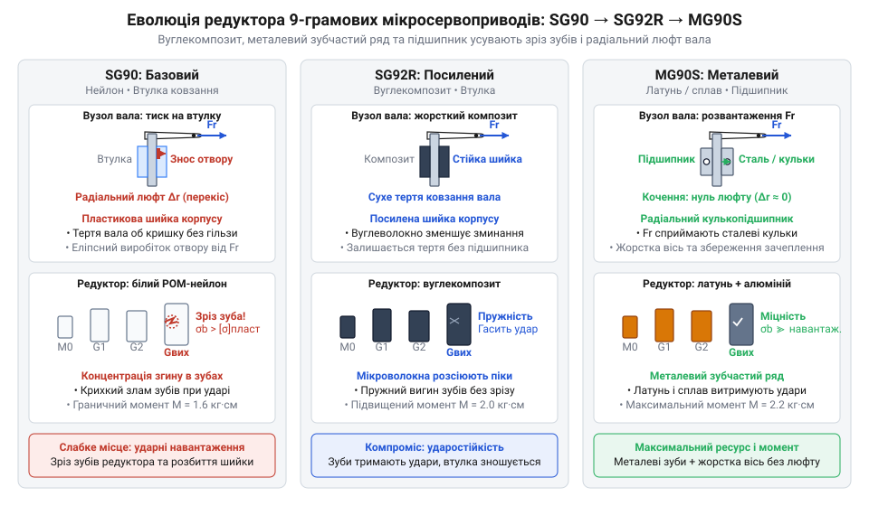
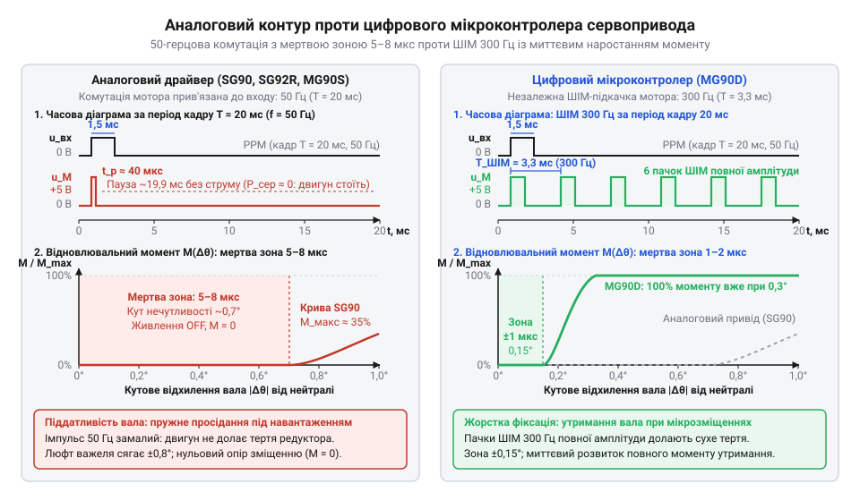

# Еволюція 9-грамових мікросервоприводів та формування стандарту Tower Pro

<preknowlist>
- [Tower Pro SG90 — мікросерво 9g](root:cat-hw-actuators/sg90-servo) — Базовий принцип будови та кутового позиціювання мікросервопривода: наявність електродвигуна, багатоступеневого редуктора, потенціометра зворотного зв'язку та керування пропорційними імпульсами ШІМ тривалістю 1–2 мс із періодом 20 мс
</preknowlist>

## Авіамодельна криза ваги та сорокаграмові приводи

На зламі 1990-х і 2000-х років в авіамоделізмі стався якісний стрибок: мініатюрні безколекторні електродвигуни та легкі літій-полімерні акумулятори (англ. @@en|LiPo@@) дали змогу створювати компактні літаки масою всього 150–250 грамів для польотів у парках та закритих приміщеннях. Проте стрімкий розвиток мікроавіації раптово вперся в механічний глухий кут.

Єдиним доступним засобом відхилення кермових поверхонь залишалися стандартні сервоприводи (від лат. @@la|servus@@ — слуга, виконавець), створені для великих літаків із двигунами внутрішнього згоряння. Еталоном галузі був [стандартний сервопривід Futaba S3003](root:cat-hw-actuators/futaba-s3003-servo) або його аналоги масою 40–45 грамів кожен. Для керування елеронами, кермом висоти та напрямку мініатюрному літаку були потрібні три або чотири такі машинки. Їхня сукупна маса сягала 120–180 грамів і фактично подвоювала вагу всієї конструкції.

Фізика польоту не пробачає зайвого баласту. Додаткові півтораста грамів катастрофічно збільшували питоме навантаження на крило, зміщували центр мас і руйнували поздовжнє центрування планера. Замість стійкого ширяння легкий апарат зривався у штопор, перетворюючись на некеровану важку конструкцію.

Альтернатива існувала лише у вигляді поодиноких мікросервоприводів напівкустарного збирання. Вони важили менше десяти грамів, але коштували по 30–50 доларів за штуку. Комплект із чотирьох приводів виявлявся дорожчим за двигун, акумулятор і корпус літака разом узяті. Масова радіокерована мікроавіація опинилася заблокованою між фізичною непридатністю сорокаграмових механізмів і фінансовою недосяжністю наявних мініатюрних розв'язків.

## Поява Tower Pro SG90: новий стандарт

На початку 2000-х років технологічний вихід із глухого кута запропонувала тайванська компанія @@en|Tower Pro@@. Замість дорогого напівкустарного збирання інженери зробили ставку на агресивне спрощення конструкції під великосерійне лиття пластмас і створили [культовий дев'ятиграмовий мікросервопривід](root:cat-hw-actuators/sg90-servo) під маркуванням @@en|SG90@@.

В єдиному напівпрозорому пластиковому корпусі масою рівно 9 грамів вдалося скомпонувати повний замкнений контур керування:
- мініатюрний колекторний електродвигун постійного струму;
- п'ятиступеневий знижувальний редуктор (від лат. @@la|reducere@@ — повертати назад, зменшувати) з литого під тиском нейлону;
- датчик зворотного зв'язку за положенням на базі мініатюрного потенціометра (від лат. @@la|potentia@@ — сила та грец. @@el|metron@@ — міра), зв'язаного з вихідним валом;
- просту аналогову мікросхему сервопідсилювача (англ. @@en|ASIC@@), що порівнює вхідний керівний імпульс із напругою потенціометра та живить двигун струмом потрібної полярності. Вхідний імпульс керування тривалістю 1–2 мс запускає внутрішній одновібратор (від лат. @@la|vibrare@@ — коливатися). Тривалість його опорного імпульсу задає потенціометр зворотного зв'язку. Різниця між шириною вхідного та опорного імпульсів формує струм для зсуву двигуна. Якщо керівний імпульс довший за опорний, двигун обертається в один бік; якщо коротший — полярність струму змінюється на протилежну. Редуктор повертає вихідний вал і потенціометр доти, доки тривалості обох імпульсів не зрівняються.

Оптимізація деталей під термопластавтомати опустила собівартість пристрою нижче трьох доларів. Роздрібна ціна привода впала в рази, що остаточно зняло фінансовий бар'єр для масового авіамоделізму.

Разом із доступністю модель @@en|SG90@@ зафіксувала інженерні пропорції: геометрію корпусу 22,8 × 12,2 × 28,5 мм, бічні монтажні вушка під два гвинти, вихідний вал із 21-зубцевим шліцом (від нім. @@de|Schlitz@@ — проріз) під [змінні пластикові важелі](root:cat-hw-actuators/servo-horns) та стандартний трипровідний інтерфейс керування. Ці розміри закріпилися як світовий де-факто стандарт 9-грамового класу. Дешевий і легкий привід швидко вийшов за межі авіамоделей, відкривши шлях для доступного аматорського конструювання та вибухового розвитку робототехніки.

## Еволюція редуктора: нейлон, карбон і метал

Масове застосування дев'ятиграмових приводів у маніпуляторах і крокохідних платформах виявило несумісність авіаційних компромісів із наземною робототехнікою. В авіамоделях рулі зазнають плавного тиску повітряного потоку, який пом'якшує ривки. У роботах вал постійно витримує жорсткі ударні перевантаження під час кроку, утримання статичної ваги та раптові зупинки.

Редуктор базового @@en|SG90@@ не витримував таких умов. Тонкі нейлонові зуби перших ступенів передачі зрізалися при першому ж заклинюванні важеля, а консольні згинальні сили швидко розбивали пластикову втулку вихідного вала в овал. Вал перекошувався, контакт між зубцями порушувався, і механізм заклинював.

*Кінематичні вузли трьох поколінь привода: вуглепластиковий композит захищає зуби від зрізання, а металеві шестерні з радіальним кулькопідшипником компенсують згинальні сили в робототехнічних суглобах.*

Інженерною відповіддю @@en|Tower Pro@@ на крихкість нейлону стала модель @@en|SG92R@@. У ній пластикові шестерні виготовили з поліоксиметилену (англ. @@en|POM@@), армованого вуглецевим волокном — карбоном (від лат. @@la|carbo@@ — вугілля). Новий композит підвищив межу міцності зубів та опір стиранню без збільшення дев'ятиграмової маси.

Для навантажених силових суглобів виробник розробив [посилену модель MG90S](root:cat-hw-actuators/mg90s-servo). Її редуктор отримав суцільнометалевий ряд із латунних та алюмінієвих шестерень, а пластикову шийку корпусу замінив мініатюрний радіальний кулькопідшипник на вихідному валу. Підшипник приймає радіальні зусилля від важеля на кришку, рятуючи зуби передачі від перекосу й зламу.

## Цифровий стрибок: поява мікроконтролерного MG90D

Під дією статичного навантаження аналоговий сервопривід помітно пружинить і зміщується. Його внутрішня аналогова мікросхема містить компаратор (від лат. @@la|comparare@@ — порівнювати), який зіставляє керівний імпульс із сигналом потенціометра. Різниця цих напруг вмикає живлення двигуна лише синхронно із вхідним сигналом — раз на 20 мс із частотою 50 Гц. При малих зміщеннях вала компаратор формує закороткий імпульс струму: двигун не встигає подолати тертя спокою редуктора. Виникає зона нечутливості (англ. @@en|deadband@@ — мертва смуга) завширшки 3–5 мкс, де відновлювальний крутний момент дорівнює нулю.

Щоб усунути піддатливість, у приводі @@en|Tower Pro MG90D@@ застарілу мікросхему замінили на цифровий мікроконтролер (від грец. @@grc|mikros@@ — малий та фр. @@fr|contrôle@@ — перевірка). Чип відокремив вимірювання вхідного сигналу від керування двигуном: він живить обмотки через транзисторний @@en|H-міст@@ (англ. @@en|H-bridge@@, за схожістю топології з літерою H) за допомогою власної широтно-імпульсної модуляції (@@uk|ШІМ@@) на частоті 250–300 Гц. Отримуючи пачки високочастотних імпульсів повної амплітуди, двигун звужує мертву зону до 1 мкс і миттєво віддає максимальний момент утримання.

*Аналоговий контур подає імпульси частотою 50 Гц із мертвою зоною 3–5 мкс, тоді як цифровий драйвер частотою 300 Гц забезпечує жорстке утримання вала вже при відхиленні в 1 мкс.*

Жорстке позиціювання має експлуатаційну ціну. Безперервне відпрацювання мікрозміщень істотно підвищує середній струм споживання та спричиняє нагрівання компактного двигуна всередині корпусу. Крім того, швидка комутація обмоток створює гострі просідання напруги, тому заміна [аналогової моделі MG90S](root:cat-hw-actuators/mg90s-servo) на цифрову вимагає обов'язкового встановлення фільтрувальних конденсаторів на шині живлення.

## Епідемія клонування та деградація дешевих копій

Світовий успіх дев'ятиграмового стандарту спричинив неконтрольовану хвилю підробок: десятки безіменних фабрик налагодили масовий випуск реплік лінійки @@en|Tower Pro@@, збивши роздрібну ціну нижче одного долара. Збереження звичних синіх корпусів і фірмових маркувань приховує кардинальне спрощення конструкції та приховану деградацію матеріалів.

Найбільш критичною стала підміна деталей у копіях [металевої моделі MG90S](root:cat-hw-actuators/mg90s-servo). Замість надійного суцільнометалевого ряду виробники встановлюють лише вихідну шестерню з дешевого силуміну, тоді як найнавантаженіші проміжні передачі відливають із крихкого вторинного пластику. Радіальний кулькопідшипник у верхній кришці підміняють порожнистою пластиковою втулкою. Під час роботи консольні сили швидко розбивають м'яку втулку, зуби перекошуються, і редуктор заклинює від найменшого механічного опору.

Здешевлення торкнулося й вузла зворотного зв'язку. У репліках використовують копійчані потенціометри з тонким шаром сажового напилення замість зносостійкого струмопровідного пластику. Металевий повзунок продирає напилений резистивний шар до основи вже за кілька годин роботи. Порушення електричного контакту спотворює сигнал кута, викликаючи хаотичне тремтіння вала — джитер (від англ. @@en|jitter@@ — тремтіння), під час якого привід марно смикається на місці та розжарює обмотки.

Економія на електроніці завершує ланцюг деградації: виробники застосовують ультратонкі сталеві проводи шлейфа та відмовляються від фільтрувальних конденсаторів. Пусковий струм низькоякісного колекторного двигуна породжує сильні електромагнітні завади й глибоке імпульсне просідання напруги на загальній шині живлення. Таке осідання перетинає мінімальний поріг стабілізації, провокуючи раптове перезавантаження керівного мікроконтролера всього робота.

## Розвінчання міфів та свідомий інженерний вибір

Присутність дев'ятиграмових сервоприводів у кожному навчальному стартовому наборі породила хибне уявлення, нібито @@en|SG90@@ створювали спеціально для платформи @@it|Arduino@@ чи навчальної робототехніки. Насправді його проєктували як гранично дешевий витратний привід для легких авіамоделей із пінопласту. В авіації кермові поверхні відхиляються на короткі проміжки часу, робочий цикл рідко перевищує кілька відсотків, а зустрічний потік повітря постійно охолоджує пластиковий корпус. Спроба змусити такий механізм безперервно утримувати вагу ланки маніпулятора всередині закритого корпуса робота гарантовано призводить до термічного перегріву та зрізання шестерень.

Поширеним є й міф про те, що всі мікросерва у схожих синіх корпусах однакові за параметрами та взаємозамінні. Однакова геометрія маскує кардинальні конструктивні відмінності між версіями. Щоб механізм працював надійно, привід призначають суворо під характер навантаження:
- [оригінальний SG90](root:cat-hw-actuators/sg90-servo) підходить виключно для ненавантажених вузлів: повороту сенсорів відстані, легких камерних підвісів чи відкривання стулок;
- посилений @@en|SG92R@@ із вуглепластиковими шестернями обирають для вузлів із ризиком ударних навантажень, коли неприпустимо збільшувати масу конструкції;
- металевий @@en|MG90S@@ встановлюють в опорні шарніри та рухомі суглоби, що сприймають відчутні радіальні зусилля від важелів.

Для завдань із жорсткими вимогами до точності позиціювання та стабільності утримання кута під статичним навантаженням використовують цифровий @@en|MG90D@@. Якщо ж конструкція потребує неперервного обертання коліс чи котушок, використовують спеціалізовані [сервоприводи постійного обертання](root:cat-hw-actuators/continuous-rotation-servo-mod), а для важких маніпуляторів із високим ресурсом обирають [безколекторні інтегральні приводи](root:cat-hw-actuators/bldc-servo-controller). Тверезе врахування авіаційного походження мікроприводів рятує розробника від фатальних конструктивних прорахунків.
