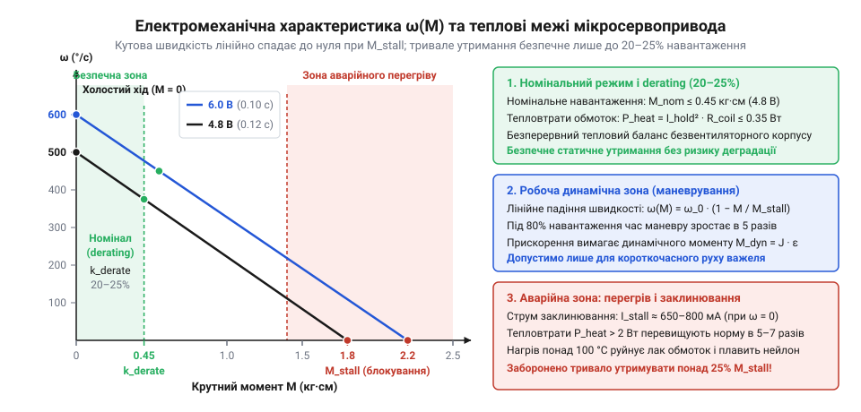

# Розрахунок статичного й динамічного моменту та швидкості мікросервоприводів

<preknowlist>
- [Tower Pro SG90 — мікросерво 9g](root:cat-hw-actuators/sg90-servo) — Конструктивна будова дев'ятиграмового сервопривода (колекторний мікромотор, багатоступеневий редуктор, вихідний потенціометр), паспортні значення моменту блокування 1.8 кг·см та швидкості холостого ходу 0.1 с/60° при напрузі 4.8 В
- [Серво-роги (запасні)](root:cat-hw-actuators/servo-horns) — Геометрія важільних серво-качалок, радіальне розташування монтажних отворів для зачеплення тяги та механічна посадка на шліцьовий вихідний вал мікросервопривода
- [MG90S V2 — мікросерво з металевим редуктором](root:cat-hw-actuators/mg90s-servo) — Конструктивні особливості суцільнометалевого редуктора порівняно з пластиковим, наявність опорного кулькопідшипника вихідного вала та специфіка підвищеного моменту утримання при напрузі живлення до 6.0 В
</preknowlist>

## Чому паспортні характеристики сервоприводів оманливі

Спроба підібрати привод за паспортом часто веде до аварії. Якщо на важіль завдовжки 5 см закріпити вантаж масою 300 г, статичний момент складе 1.5 кг·см. Паспорт [мікросервопривода Tower Pro SG90](root:cat-hw-actuators/sg90-servo) обіцяє 1.8 кг·см і 0.1 с/60° при напрузі 4.8 В. Здається, що запас є, але під навантаженням вал ледь рухається, обмотки за хвилини згорають від струму, а різкий маневр зрізає пластикові зуби редуктора.

Паспортний момент — це аварійний момент заклинювання (англ. *stall* — зупинка; @@en|stall torque@@), коли ротор зупинено під повною напругою з максимальним виділенням тепла. Паспортна швидкість вимірюється лише на холостому ході. Під навантаженням кутова швидкість спадає лінійно до нуля, а динамічний розгін маси багаторазово перевершує вагу вантажу. Для безпечного тривалого утримання позиції застосовують коефіцієнт зниження навантаження (англ. *de-* — зниження, *rate* — номінал; @@en|derating factor@@), обмежуючи момент на рівні 20–25% від блокування.


*Зі зростанням моменту кутова швидкість падає до нуля, а тривале утримання безпечне лише до чверті моменту блокування.*

## Розрахунок статичного крутного моменту важеля

Розрахунок починають із сил тяжіння на важелі. Навантаження складається із зосередженої маси вантажу `m_load` на робочому плечі `L_load` та розподіленої маси [серво-рога](root:cat-hw-actuators/servo-horns) `m_arm` у його центрі ваги на відстані `L_cg`. При відхиленні на кут `θ` від горизонталі під дією прискорення вільного падіння `g` плече сили масштабується через косинус.

Сумарний статичний крутний момент `M_stat(θ)` складається з моменту вантажу `M_load(θ)` та моменту качалки `M_arm(θ)`:

```
M_stat(θ)
= M_load(θ) + M_arm(θ)                                 [додавання моментів зосередженого вантажу й балки]
= (m_load · L_load + m_arm · L_cg) · g · cos(θ)        [проєкція плечей сили тяжіння на горизонталь]
```

Момент максимальний у горизонталі (`θ = 0°`, де `cos(θ) = 1`) і спадає до нуля у вертикальних точках мертвого центру (`θ = ±90°`). Орієнтація осі змінює картину: у горизонтальному поворотному столі сила тяжіння спрямована вздовж осі обертання, гравітаційний момент дорівнює нулю, і привод долає лише тертя. У вертикальному підйомі важіль постійно навантажує привод повною вагою.

## Динамічний момент інерції під час прискорення

Під час різкої зміни цільового кута сервопривод долає динамічний опір розгону маси, через що заклинює навіть із запасом статичного моменту. Момент інерції (лат. *inertia* — бездіяльність; @@en|moment of inertia@@) `J` за теоремою Гюйгенса–Штейнера об'єднує точковий вантаж масою `m_load` на плечі `L_load` та балку [важеля серво-рога](root:cat-hw-actuators/servo-horns) масою `m_arm` завдовжки `L_arm`:

```
J
= m_load · L_load² + (1/3) · m_arm · L_arm²            [теорема Гюйгенса–Штейнера для осі на кінці важеля]
```

Квадратична залежність від довжини робить плече критичним: збільшення вильоту важеля вдвічі підвищує інерційний опір розгону вчетверо.

Паспортні специфікації мікросервоприводів, зокрема [мікросервопривода SG90](root:cat-hw-actuators/sg90-servo), указують швидкість не в радіанах за секунду, а часом повороту вихідного вала на 60 градусів під час холостого ходу `t_60` (зазвичай `0.10–0.12 с/60°`). Проте другий закон Ньютона для обертання та розрахунок динамічного моменту працюють строго в системі СІ, де кутове прискорення `ε` вимірюють у радіанах за секунду в квадраті (`рад/с²`), а момент інерції `J` — у `кг·м²`. Оскільки кут `60°` у радіанній мірі становить `60° · (π / 180°) = π / 3 ≈ 1.047 рад`, перерахунок паспортної кутової швидкості в радіани за секунду (`рад/с`) виконують за співвідношенням `ω = (π / 3) / t_60` (для `t_60 = 0.10 с` це дає `ω ≈ 10.47 рад/с`). Якщо підставити паспортну тривалість `t_60` напряму чи обчислювати прискорення в градусах за секунду, розмірність рівняння руйнується, а розрахований момент спотворюється в десятки разів, приховуючи справжнє пікове перевантаження редуктора. Для кутового прискорення `ε` за час розгону мікромотора `t_acc ≈ 10–20 мс` до робочої кутової швидкості `ω` потрібен динамічний крутний момент (грец. *dynamis* — сила; @@en|dynamic torque@@) `M_dyn`:

```
M_dyn
= J · ε                                                [другий закон Ньютона для обертання]
= J · (ω / t_acc)                                      [кутове прискорення через тривалість розгону]
```

Через стрімкий старт прискорення сягає сотень радіанів на секунду в квадраті, тому піковий динамічний момент пуску чи екстреного гальмування нерідко в рази перевершує вагу вантажу.

## Корекція моменту за напругою та ККД

Сумарний механічний запит `M_total = M_stat + M_dyn` зіставляють із реальними можливостями привода. Паспортний @@en|stall torque@@ задано для еталонної напруги `V_ref` (4.8 В або 6.0 В), але напруга шини живлення `V` під навантаженням просідає.

Крутний момент мікродвигуна пропорційний магнітному потоку й струму якоря. Оскільки струм заклинювання за законом Ома лінійно залежить від напруги, вихідний момент заклинювання `M_stall(V)` масштабується пропорційно живленню. Втрати в редукторі на тертя ковзання зубців і втулок визначають коефіцієнт корисної дії `η`. Корисний момент на вихідному валу `M_out_real(V)` обчислюють із поправкою на напругу та втрати:

```
M_out_real(V)
= M_stall(V) · η                                       [корекція на механічний ККД редуктора]
= M_stall(V_ref) · (V / V_ref) · η                     [масштабування за напругою та ККД]
```

Матеріал шестерень задає величину `η`: пружний нейлон [мікросервопривода SG90](root:cat-hw-actuators/sg90-servo) забезпечує `η ≈ 0.70–0.75`, вуглепластик SG92R дає `η ≈ 0.65–0.70`, а метал [редуктора MG90S](root:cat-hw-actuators/mg90s-servo) через шорсткість і масу коліс знижує ККД до `η ≈ 0.55–0.65`.

## Механічний компроміс швидкості й крутного моменту

Паспортний час маневру, як-от 0.1 с/60° у [мікросервопривода SG90](root:cat-hw-actuators/sg90-servo), фіксує лише швидкість холостого ходу (@@en|no-load speed@@) `ω_0` без навантаження. За квазістаціонарною електромеханічною характеристикою двигуна корисний момент опору `M_load` лінійно зменшує робочу кутову швидкість `ω(M)` відносно реального моменту блокування `M_out_real`:

```
ω(M)
= ω_0 · (1 - M_load / M_out_real)                      [лінійна характеристика електродвигуна]
```

Зі зростанням механічного опору вал сповільнюється, а при `M_load = M_out_real` рух повністю зупиняється.

Під час маневру кутова швидкість вала змінюється не миттєво, утворюючи трапецієподібний профіль швидкості (@@en|trapezoidal velocity profile@@): ротор розганяється впродовж `t_acc` до робочої швидкості `ω(M)`, обертається зі сталою швидкістю й сповільнюється перед зупинкою за час `t_dec`. На ділянках розгону й гальмування вал повертається на сумарний критичний кут `Δθ_crit = (1/2) · ω(M) · (t_acc + t_dec)`. За умови малого кута повороту `Δθ ≤ Δθ_crit` рух переходить у трикутний профіль швидкості (@@en|triangular velocity profile@@): сервопривод не встигає вийти на сталу швидкість `ω(M)` і весь час перебуває у фазах розгону й гальмування, досягаючи лише проміжного піку `ω_peak < ω(M)`. Для таких малих зміщень (зазвичай менше `5–10°`) розрахунок через сталу швидкість втрачає фізичний зміст, оскільки тривалість переміщення визначається динамічним прискоренням механізму. Лише за достатнього повороту `Δθ > Δθ_crit`, коли сервопривод устигає вийти на сталу швидкість `ω(M)`, дійсний час переміщення на цільовий кут `Δθ` за паспортного часу холостого ходу `t_0 = Δθ / ω_0` доповнюють тривалістю розгону `t_acc` і гальмування `t_dec`:

```
t_move
= Δθ / ω(M) + t_acc + t_dec                            [рух на кут із динамічними фазами]
= t_0 / (1 - M_load / M_out_real) + t_acc + t_dec      [підстановка спадання кутової швидкості]
```

Під навантаженням 80% від блокування маневр триває вп'ятеро довше. Коли сервоприводи утворюють кінематичний ланцюг (грец. *kinema* — рух; @@en|kinematic chain@@), запізнення навантаженої ланки спотворює просторову траєкторію інструмента.

## Тепловий режим утримання та derating factor

Під час нерухомого утримання вантажу механічна робота дорівнює нулю, проте обмотки двигуна перебувають під напругою і споживають струм утримання `I_hold`. Зі зростанням моменту утримання `M_hold` відносно моменту заклинювання `M_stall` струм зростає лінійно: `I_hold = I_stall · (M_hold / M_stall)`, де `I_stall` — струм заклинювання. Уся споживана електрична енергія перетворюється на тепло.

Теплову потужність `P_heat`, що розсіюється на активному опорі обмотки ротора `R_coil`, визначають за законом Джоуля–Ленца:

```
P_heat
= I_hold² · R_coil                                     [закон Джоуля–Ленца для омічних втрат]
= I_stall² · (M_hold / M_stall)² · R_coil              [квадратична залежність тепла від частки моменту]
```

Квадратична залежність робить високе навантаження нищівним: корпус [мікросервопривода SG90](root:cat-hw-actuators/sg90-servo) позбавлений вентиляції й розсіює лише 0.3–0.5 Вт. Тривале перевищення цієї межі розігріває обмотки понад 100 °C, руйнує лакову ізоляцію та необоротно розмагнічує ротор. Для тривалого спокою граничний момент `M_hold_max` обмежують коефіцієнтом зниження навантаження (@@en|derating factor@@) `k_derate` відносно корисного моменту `M_out_real`:

```
M_hold_max
= k_derate · M_out_real                                [граничний тривалий статичний момент]
```

Для пластикових корпусів встановлюють `k_derate = 0.20–0.25`, тоді як [модель MG90S](root:cat-hw-actuators/mg90s-servo) завдяки металевому редуктору й підшипнику розсіює тепло краще та витримує `k_derate = 0.30`. Сервопривод допускає короткочасні пікові зусилля під час руху, але постійно утримувати понад чверть паспортного моменту неприпустимо.

## Верифікація пікових зусиль і захист редуктора

Найнебезпечнішим для редуктора є не підйом вантажу, а раптовий удар об перешкоду чи миттєвий реверс. Кінетична енергія важеля з моментом інерції `J` при зупинці за час `Δt_stop` у кілька мілісекунд від зміни швидкості `Δω` породжує ударний момент `M_impact` через кутове гальмівне прискорення `ε_stop`:

```
M_impact
= J · ε_stop                                           [другий закон Ньютона для обертання]
= J · (Δω / Δt_stop)                                   [кутове прискорення екстреного гальмування]
```

Через швидкоплинність зупинки ударний момент `M_impact` багаторазово перевершує пусковий і зрізає шестерні. Нейлонові зуби [привода SG90](root:cat-hw-actuators/sg90-servo) витримують граничний згинний момент `M_yield_gear` не більше 2.0–2.2 кг·см, вуглепластик SG92R — до 2.5–2.8 кг·см, а суцільнометалевий [редуктор MG90S](root:cat-hw-actuators/mg90s-servo) — до 4.0–4.5 кг·см (де слабким місцем залишається латунна шестерня двигуна з модулем зубців `m ≈ 0.2 мм`).

Стійкість передачі оцінюють за найгіршим сценарієм, визначаючи піковий крутний момент `M_peak`:

```
M_peak
= max(M_stat + M_dyn, M_impact)                        [вибір найгіршого пікового навантаження]
```

Зубці захищені від руйнування за умови `M_peak ≤ M_yield_gear / k_safety`, де коефіцієнт запасу міцності (англ. *safety* — безпека, *factor* — чинник; @@en|safety factor@@) становить `k_safety ≥ 1.5–2.0`. Повний алгоритм верифікації перевіряє вузол на трьох бар'єрах: спершу за масою й геометрією плеча оцінюють статичну й теплову безпеку утримання `M_stat ≤ k_derate · M_out_real`; далі за динамікою розгону `M_stat + M_dyn` обчислюють дійсну швидкість `ω(M)`; наостанок за піковим навантаженням `M_peak` підтверджують запас міцності редуктора.
