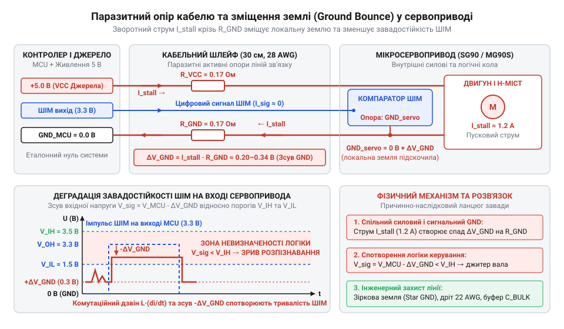
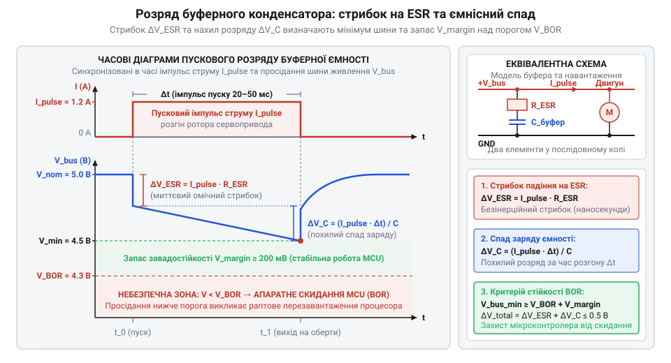

# Розрахунок пікових струмів, падіння напруги та ємності буферних конденсаторів

<preknowlist>
- [Tower Pro SG90 — мікросерво 9g](root:cat-hw-actuators/sg90-servo) — Базовий устрій мікросервопривода з внутрішнім колекторним мікродвигуном, призначення контактів трипровідного кабелю живлення і керування та номінальний робочий діапазон напруг 4,8–6,0 В
- [MG90S V2 — мікросерво з металевим редуктором](root:cat-hw-actuators/mg90s-servo) — Електричні параметри посилених мікросервоприводів із металевим редуктором: типовий опір обмотки якоря мікродвигуна та граничні величини струму блокування понад 1,2 А
</preknowlist>

## Апаратне скидання контролера під час пуску

Коли в мехатронному вузлі або маніпуляторі об'єднують чотири [мікросервоприводи SG90](root:cat-hw-actuators/sg90-servo), інженер зазвичай живить їх від спільної п'ятивольтової шини разом із керівним мікроконтролером. Паспортний номінальний струм споживання такого привода під час плавного руху становить близько 100–200 мА. На перший погляд, для живлення системи цілком достатньо стандартного джерела живлення з напругою 5 В та вихідним струмом 2 А.

Сумарний номінальний струм споживання `I_nom_total` для кількості приводів `N = 4` за їхнього паспортного струму `I_nom = 200 мА` обчислюють множенням:

```
I_nom_total
= N · I_nom                      [сумарний струм за паралельного з'єднання приводів]
= 4 · 0.2                        [підстановка кількості приводів та струму 200 мА]
= 0.8 А                          [розрахунковий номінальний струм споживання]
```

Вихідної здатності джерела у 2 А мало б вистачати з більш ніж двократним запасом. Проте щойно програма відправляє команду синхронного повороту на всі осі або важіль зустрічає механічний опір, система зазнає раптової відмови: мікроконтролер циклічно перезавантажується або зависає, а сервоприводи починають неконтрольовано сіпатися.

Цей збій спричиняє вбудований захист мікроконтролера — апаратне скидання через просідання живлення (англ. @@en|Brown-out Reset@@, BOR, від *brownout* — падіння напруги в мережі + *reset* — скидання). Коли напруга на шині опускається нижче критичного порога (зазвичай 2.7–4.3 В залежно від моделі чипа), внутрішній компаратор примусово скидає процесорне ядро, щоб запобігти спотворенню регістрів і псуванню пам'яті. У момент скидання керівні імпульси зникають, мотори знеструмлюються, напруга живлення відновлюється, мікроконтролер перезапускається, знову віддає команду руху — і процес зациклюється, спричиняючи неперервне тремтіння вала (англ. @@en|jitter@@, від *jitter* — нервове тремтіння).

Причина криється в динаміці перехідних процесів: у мить пуску з місця або під час механічного зупинення ротора виникає короткочасний струм блокування вала (англ. @@en|stall current@@, від *stall* — спинятися через перевантаження), який для одиничного привода сягає 1.0–1.2 А. Одночасний старт чотирьох моторів створює імпульсний сплеск струму понад 4 А. Внутрішній опір джерела живлення та сполучних дротів перетворює цей імпульс на глибоке мілісекундне просідання напруги, яке неможливо передбачити за статичним законом Ома. Розрахунок надійної системи живлення вимагає переходу від паспортних середніх струмів до аналізу миттєвих пікових навантажень.

## Фізика пускового струму та блокування

Усередині класичного сервопривода встановлений мініатюрний колекторний двигун постійного струму. Його еквівалентну електричну схему утворюють три послідовні компоненти: активний опір мідної обмотки якоря `R_m`, її індуктивність `L` та внутрішня протиелектрорушійна сила (проти-ЕРС, англ. @@en|back-EMF@@, від *back* — зворотний + *electromotive force* — електрорушійна сила) `e`. Коли ротор обертається з кутовою швидкістю `ω` в магнітному полі статора, у витках якоря генерується напруга `e = K_e · ω`, де `K_e` — коефіцієнт проти-ЕРС. Ця напруга спрямована назустріч напрузі шини живлення `V_bus` і перешкоджає наростанню струму.

Миттєве значення напруги шини живлення `V_bus` урівноважується сумою спадів напруг на активному опорі якоря, індуктивності та внутрішній проти-ЕРС:

```
V_bus
= R_m · i(t) + L · (di / dt) + e     [баланс напруг у замкненому колі якоря]
```

Оскільки власна індуктивність `L` мініатюрних двигунів становить лише кілька мікрогенрі, електрична стала часу кола якоря `τ_e = L / R_m` (англ. @@en|electrical time constant@@) не перевищує 2–10 мкс, і електромагнітна складова перехідного процесу згасає за частки мікросекунди. За цей крихітний час струм майже миттєво наростає до піку, тому подальшу амплітуду струму в перехідних процесах визначає кутова швидкість обертання ротора `ω`. Щоб споживаний струм спав від початкового сплеску до номінального рівня холостого ходу, двигун має розігнатися й навести зустрічну проти-ЕРС `e = K_e · ω`. Проте швидкість обертання ротора не може зрости стрибком через механічну інерцію самого ротора та кінематичного ланцюга редуктора. Тривалість розгону ротора визначає механічна стала часу (англ. @@en|mechanical time constant@@) електромеханічного вузла `τ_m`, яка для мініатюрних сервоприводів становить 20–50 мс. Оцінка тривалості перехідного процесу розгону до усталеної швидкості сягає приблизно трьох сталих часу (`3 · τ_m`), тобто триває від 60 до 150 мс. Поки ротор розганяється протягом перших 20–50 мс, проти-ЕРС залишається мізерною, і двигун продовжує споживати струм, близький до максимального струму блокування. Розрив між мікросекундною електричною сталою `τ_e` та мілісекундною механічною сталою `τ_m` сягає трьох-чотирьох порядків величини, і саме тут криється головна інженерна пастка: якщо розраховувати захист шини лише під швидку індуктивну складову обмотки, встановивши типові розв'язувальні керамічні конденсатори на 0.1–1 мкФ, вони повністю розряджаються за перші ж мікросекунди, після чого затяжний мілісекундний струмовий удар безперешкодно обвалює напругу живлення нижче порога спрацьовування апаратного скидання @@en|Brown-out Reset@@ (BOR).

Залежно від стану ротора виникають три критичні режими навантаження шини живлення:

1. Початковий пуск із місця: ротор нерухомий (`ω = 0`), тому проти-ЕРС тотожно дорівнює нулю (`e = 0`).
2. Повне механічне блокування вала: коли важіль [мікросервопривода SG90](root:cat-hw-actuators/sg90-servo) зустрічає механічну перешкоду чи впирається в упор, обертання припиняється (`ω = 0`), і проти-ЕРС знову зникає (`e = 0`).

В обох випадках струм обмежується виключно омічним опором дроту обмотки якоря `R_m`. За робочої напруги `V_bus = 5 В` та активного опору якоря `R_m = 4.2 Ом` струм блокування (@@en|stall current@@) `I_stall` обчислюють за законом Ома:

```
I_stall
= V_bus / R_m                        [закон Ома для кола якоря за нульової проти-ЕРС]
= 5.0 / 4.2                          [підстановка робочої напруги 5 В та опору якоря 4.2 Ом]
≈ 1.19 А                             [піковий струм блокування вала]
```

Замість струму холостого ходу у 10–20 мА джерело живлення отримує стрибок понад 1 А. Для посиленого [мікропривода MG90S V2](root:cat-hw-actuators/mg90s-servo) опір обмотки ще менший, а струм блокування сягає 1.4–1.5 А.

3. Динамічна реверсивна перекладка: коли напруга на виводах двигуна раптово змінює знак на протилежний, інерція ротора продовжує крутити його в попередньому напрямку. У цей момент залишкова проти-ЕРС збігається за знаком із новою напругою шини. Напруги сумуються, спричиняючи надкороткий сплеск струму `(V_bus + e) / R_m`, амплітуда якого майже вдвічі перевищує статичний струм блокування.

## Коефіцієнт одночасності та сумарний струм

У багатоосьових роботах — маніпуляторах чи гексаподах із 6–18 вузлами на базі [популярних приводів SG90](root:cat-hw-actuators/sg90-servo) або потужніших [моделей MG90S V2](root:cat-hw-actuators/mg90s-servo) — розрахунок живлення стикається з дилемою двох крайнощів. Наївне сумування струмів блокування (@@en|stall current@@) усіх `N` моторів вимагає джерела на 15–25 А, що робить стабілізатор важким і надлишковим. Проєктування ж за середнім струмом руху спричиняє перезавантаження контролера під час першого синхронного маневру.

У реальній системі приводи не зупиняються одночасно. Розрахунковий випадок передбачає механічне блокування лише однієї найбільш навантаженої ланки, тоді як решта осей долає штатний динамічний опір руху. Ступінь їхньої одночасної активності враховує коефіцієнт одночасності (англ. @@en|simultaneity factor@@, від лат. *simul* — водночас) `k_sim ∈ [0.2 ... 1.0]`. Для гексапода з почерговим переставлянням ніг `k_sim ≈ 0.3–0.5`, а програмне фазування пусків дає змогу знизити його до `0.2`.

Розрахунковий піковий струм шини `I_peak_total` отримують додаванням струму блокування найважчої осі `I_stall_max` та масштабованої коефіцієнтом `k_sim` суми робочих струмів решти осей `I_run_i`:

```
I_peak_total
= I_stall_max + ∑(k_sim · I_run_i)       [сумування струму блокування однієї осі та робочих струмів решти]
= 1.2 + 5 · (0.4 · 0.2)                  [оцінка для 6 приводів: один у блокуванні, п'ять у русі за k_sim = 0.4]
= 1.6 А                                  [піковий струм шини замість наївних 7.2 А]
```

Ця величина визначає поріг спрацьовування апаратного захисту стабілізатора та розрахунковий запас до порога апаратного скидання (@@en|Brown-out Reset@@, BOR).

Проте вибір тривалої потужності джерела за піковим струмом призводить до надмірних габаритів, адже теплове нагрівання обмоток і ключів перетворювача визначає середньоквадратичний струм (англ. @@en|Root Mean Square@@, RMS, від *root* — корінь + *mean* — середнє + *square* — квадрат) `I_RMS`.

Для робочого циклу тривалістю `T` з інтервалом активного руху `t_move` під струмом `I_move` та паузою `t_idle` зі струмом спокою `I_idle`, тепловий струм обчислюють інтегруванням квадрата навантаження:

```
I_RMS
= √( (1 / T) · (I_move² · t_move + I_idle² · t_idle) ) [середньоквадратичний струм імпульсного навантаження]
= √( (1 / 2.0) · (1.6² · 0.5 + 0.1² · 1.5) )          [рух 0.5 с зі струмом 1.6 А та спокій 1.5 с зі струмом 0.1 А]
≈ 0.80 А                                               [тепловий еквівалент тривалого струму шини]
```

Отриманий струм `I_RMS` слугує критерієм теплового розрахунку радіаторів стабілізатора та кабельних жил, тоді як `I_peak_total` гарантує стійкість системи до імпульсних просідань напруги.

## Опір провідників і зміщення землі

Реальні кабельні лінії та роз'єми мають омічний опір, що перетворює імпульсні струми на відчутне падіння напруги. Шлейфи [поширених сервоприводів SG90](root:cat-hw-actuators/sg90-servo) виготовляють із тонкого мідного дроту калібру 28 @@en|AWG@@ (англ. @@en|American Wire Gauge@@, від *gauge* — калібр, міра) із площею перерізу жили `S ≈ 0.08 мм²`. Разом із перехідним опором контактів (@@en|contact resistance@@) роз'ємів Dupont `R_cont ≈ 0.05 Ом` активний опір провідника `R_line` за його довжини `L` та питомого опору міді `ρ = 0.0175 Ом · мм² / м` обчислюють як:

```
R_line
= (ρ · L / S) + 2 · R_cont               [питомий опір провідника та два перехідні контакти]
= (0.0175 · 0.3 / 0.08) + 2 · 0.05       [шлейф 30 см із двома контактами]
≈ 0.17 Ом                                [активний опір одного проводу лінії]
```

Отриманий опір у десяті долі ома стає критичним під час протікання пускових струмів. Під час розгону або блокування піковий струм `I_peak` повертається до джерела через замкнений контур із прямим проводом живлення `R_VCC` та зворотним проводом землі `R_GND`. Сумарне омічне падіння напруги лінії `ΔV_line` визначають за законом Ома:

```
ΔV_line
= I_peak · (R_VCC + R_GND)               [закон Ома для контуру живлення]
= 2.0 · (0.17 + 0.17)                    [піковий струм 2.0 А за однакового опору провідників]
= 0.68 В                                 [сумарна втрата напруги вздовж кабелю]
```

Ця втрата віднімається від напруги джерела 5 В, залишаючи приводу лише 4.32 В, що знижує динамічний момент мотора.


*Зворотний струм мотора через опір земляного проводу R_GND створює паразитний потенціал ΔV_GND, що деформує амплітуду керуючого ШІМ-сигналу відносно логічних порогів.*

Найнебезпечнішим наслідком є зміщення потенціалу землі (англ. @@en|ground bounce@@, від *ground* — земля + *bounce* — відскок). Протікання зворотного струму крізь `R_GND` створює напругу `ΔV_GND = I_peak · R_GND`, яка піднімає потенціал локальної землі сервопривода відносно землі мікроконтролера. Проте омічний опір описує лише постійну складову цього зміщення. Насправді будь-який кабельний шлейф має власну паразитну індуктивність (від лат. @@la|inductio@@ — наведення; англ. @@en|parasitic inductance@@) `L_GND`. Для типового трипровідного шлейфа сервопривода завдовжки 30 см розподілена індуктивність земляної жили становить `L_GND ≈ 0.3–0.4 мкГн` (приблизно 1 нГн на кожен міліметр довжини). Внутрішній електронний драйвер сервопривода керує двигуном не постійним струмом, а комутує якірне коло за допомогою широтно-імпульсної модуляції (ШІМ) ключами H-моста з частотою 20–50 кГц. Під час кожного такту комутації транзистори перемикають струм 1–2 А за лічені наносекунди — типовий час наростання чи спаду `Δt` становить лише 50–100 нс. Швидкість зміни струму в провіднику досягає велетенських значень: `di / dt ≈ 1.5 А / 75 нс = 2 · 10⁷ А/с` (або 20 А/мкс). За законом електромагнітної індукції стрімка зміна струму через власну індуктивність проводу наводить ЕРС самоіндукції, генеруючи імпульсний стрибок напруги `V_L = L_GND · (di / dt)`. Для шлейфа з індуктивністю `0.3 мкГн` амплітуда цього сплеску сягає `V_L = 0.3 · 10⁻⁶ Гн · 2 · 10⁷ А/с = 6.0 В`. Спроба придушити цей ефект лише збільшенням перерізу жили кабелю зазнає краху: товстіший дріт зменшує активний опір `R_GND`, але майже не впливає на індуктивність `L_GND`, яка визначається довжиною траси та площею контуру між провідниками. У результаті повне динамічне зміщення землі є суперпозицією активної та індуктивної складових: `ΔV_GND(t) = i(t) · R_GND + L_GND · (di / dt)`. Якщо омічний опір дає квазістатичне зміщення в 0.34 В, то паразитна індуктивність шлейфа під час комутації ШІМ мотора накладає на нього короткочасні високочастотні викиди напруги (англ. @@en|voltage spikes@@) та згасаючий дзвін (англ. @@en|ringing@@) у кілька вольтів, утворюючи сумарний стрибок потенціалу `ΔV_GND`.

Цей стрибок віднімається від амплітуди керуючого ШІМ-сигналу на вході сервопривода: `V_sig = V_MCU - ΔV_GND`. Якщо мікроконтролер видає логічний рівень 3.3 В, спад на 0.34 В опускає напругу нижче порога розпізнавання високого рівня `V_IH` (типово 0.7 · `V_bus` ≈ 3.5 В за живлення серва 5 В), або спричиняє хибні спрацьовування відносно порога низького рівня `V_IL`. Внутрішній компаратор спотворює тривалість керівного імпульсу, викликаючи неконтрольоване тремтіння (@@en|jitter@@) вала.

Для запобігання зміщенню калібр силових ліній збільшують до 22–20 AWG (`S ≥ 0.3–0.5 мм²`) і розводять живлення за топологією «зірка» з окремими зворотними провідниками для кожного вузла.

## Ємність та еквівалентний послідовний опір

Віддалене джерело живлення не здатне миттєво зреагувати на стрибок навантаження: скінченна смуга пропускання стабілізатора та паразитна індуктивність кабельної траси обмежують швидкість наростання струму `di / dt`. У перші мікросекунди єдиним локальним резервуаром енергії виступає буферний конденсатор (від англ. @@en|buffer@@ — пом'якшувач поштовхів), установлений безпосередньо біля силових контактів привода.

Зв'язок між струмом розряду ємності `C` та швидкістю спаду напруги задає диференціальне рівняння `I = C · (dV / dt)`. Під час пускового розгону ротора тривалістю `Δt` (зазвичай 20–50 мс для малопотужних моторів на кшталт [мікросервоприводів SG90](root:cat-hw-actuators/sg90-servo)) сервопривод споживає струм `I_pulse`. Для обмеження ємнісного падіння напруги допустимою величиною `ΔV_C` мінімальну буферну ємність знаходять за формулою:

```
C
≥ (I_pulse · Δt) / ΔV_C                   [диференціальне рівняння розряду ємності I = C · (ΔV / Δt)]
= (1.2 · 0.02) / 0.3                      [пусковий струм 1.2 А, час розгону 20 мс, спад 0.3 В]
= 0.08 Ф = 80 000 мкФ                     [номінал автономної ємності без підтримки віддаленого джерела]
```

Проте самої лише високої ємності недостатньо. Реальний конденсатор має внутрішній еквівалентний послідовний опір (англ. @@en|Equivalent Series Resistance@@, ESR, від лат. *aequus* — рівний + *valere* — мати значення) `R_ESR`. Пусковий струм `I_pulse` створює на ньому миттєвий безінерційний стрибок падіння напруги `ΔV_ESR = I_pulse · R_ESR`. Якщо звичайний оксидно-електролітичний конденсатор має `R_ESR = 0.5 Ом`, то за струму `1.2 А` напруга шини просідає на `0.6 В` у першу ж наносекунду, ще до початку розряду самої ємності.

Сумарне динамічне просідання напруги на буферному вузлі утворюють обидва доданки:

```
ΔV_drop
= ΔV_C + ΔV_ESR                          [сумарне динамічне просідання напруги шини]
= 0.30 + 0.60                            [ємнісний спад розряду та резистивний стрибок ESR]
= 0.90 В                                 [загальна динамічна втрата напруги живлення]
```


*Розподіл сумарного просідання напруги живлення між еквівалентним послідовним опором і ємністю буфера та збереження безпечного запасу над порогом апаратного скидання.*

Для мінімізації просідання застосовують паралельне комбінування конденсаторів: твердотілий полімерний конденсатор з ультранизьким опором `R_ESR ≤ 0.03 Ом` ємністю 470–2200 мкФ демпфує мілісекундний імпульс розгону, а багатошаровий керамічний конденсатор (англ. @@en|Multi-Layer Ceramic Capacitor@@, MLCC) ємністю 0.1–1.0 мкФ усуває високочастотні комутаційні голки колектора.

## Поріг скидання BOR та алгоритм

Вбудований апаратний супервізор живлення мікроконтролера запобігає збоям обчислень за допомогою системи скидання при зниженні напруги (@@en|Brown-out Reset@@, BOR). Для п'ятивольтових мікроконтролерів апаратні конфігураційні біти дозволяють обрати поріг спрацьовування на рівні `V_BOR = 4.3 В` або `2.7 В`. Через технологічний розкид напівпровідників поріг має верхню межу `V_BOR_max`. Щоб уникнути хибних спрацьовувань через температурний дрейф і залишковий шум, у розрахунок закладають інженерний запас завадостійкості (від англ. @@en|margin@@ — запас, край) `V_margin ≥ 200–300 мВ`.

Критерій безперебійної роботи вимагає, щоб мінімальна напруга живлення під час пускового сплеску перевищувала поріг BOR із запасом:

```
V_bus_min
= V_bus_nom - (ΔV_line + ΔV_C + ΔV_ESR)   [віднімання сумарних динамічних втрат від напруги джерела]
≥ V_BOR_max + V_margin                   [критерій перевищення максимального порога BOR із запасом]
```

За номіналу `V_bus_nom = 5.0 В`, порога `V_BOR_max = 4.3 В` і запасу `V_margin = 0.2 В` допустиме просідання становить лише:

```
ΔV_total_max
= V_bus_nom - (V_BOR_max + V_margin)     [гранично допустиме сумарне динамічне просідання]
= 5.0 - (4.3 + 0.2)                      [номінал 5.0 В, поріг BOR 4.3 В та запас 200 мВ]
= 0.50 В                                 [бюджет усіх втрат у кабелі, ємності та ESR]
```

Якщо втрати в кабелі становлять `ΔV_line = 0.4 В`, а стрибок на конденсаторі `ΔV_drop = 0.3 В`, сумарний провал у 0.7 В опускає напругу нижче допустимої межі та спричиняє перезавантаження.

Проєктування системи зводять у замкнений інженерний алгоритм:

1. Визначення струму якоря: виміряти опір `R_m` мультиметром або знайти паспортний струм блокування обраного вузла — від [ультрамікроприводів HD-1370A](root:cat-hw-actuators/hd-1370a-servo) до [сервоприводів MG90S V2](root:cat-hw-actuators/mg90s-servo) чи [приводів постійного обертання](root:cat-hw-actuators/continuous-rotation-servo-mod).
2. Агрегація пікового навантаження: розрахувати сумарний піковий струм `I_peak_total = I_stall_max + ∑(k_sim · I_run_i)` з урахуванням коефіцієнта одночасності руху `k_sim`.
3. Розрахунок кабельних ліній: обрати калібр AWG і довжину силових дротів за законом Ома так, щоб втрати `ΔV_line` не перевищували 5% від номіналу, а зміщення землі `ΔV_GND` не спотворювало пороги керуючого сигналу ШІМ.
4. Добір буферних ємностей: встановити біля кожного вузла полімерний або Low-ESR конденсатор ємністю `C ≥ (I_pulse · Δt) / ΔV_C` паралельно з керамічним конденсатором MLCC.
5. Перевірка критерію стійкості: підставити сумарні втрати в нерівність запасу BOR для найгіршого випадку синхронного пуску. Якщо критерій порушено — збільшити переріз проводів, знизити ESR ємності або перемкнути апаратний конфігураційний біт BOR мікроконтролера на 2.7 В.
