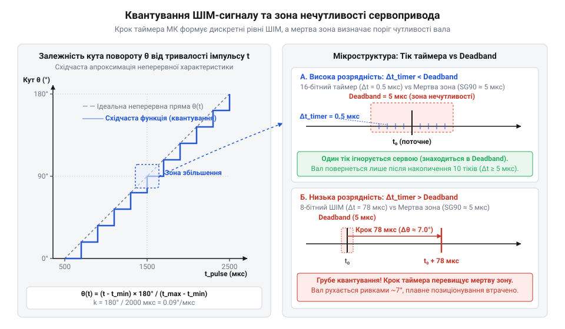

# Математична модель перетворення ШІМ-імпульсу в кут повороту вала

<preknowlist>
- [Сервоприводи радіокерованих моделей: будова, редуктори та ШІМ-керування](root:cat-hw-actuators/rc-servo-mechanisms-and-control) — базовий принцип керування сервоприводом за допомогою ШІМ-сигналу з періодом 20 мс та типові межі тривалості імпульсу
</preknowlist>

## Неточності позиціонування при прямому керуванні

Спроба позиціонувати вал сервопривода шляхом прямого запису стандартних "паспортних" значень у регістр мікроконтролера часто завершується небажаною поведінкою механізму: вал недовертається до потрібного кута, або ж у крайніх положеннях привід починає гудіти, сильно грітися й споживати граничний струм. Інженер розраховує на точне кутове переміщення в 90°, але фактичний поворот становить лише 78°, а при спробі встановити 0° мотор впирається у внутрішній механічний обмежувач.

У сервоприводах радіокерованих моделей позиціонування здійснюється за допомогою сигналу широтно-імпульсної модуляції (ШІМ, @@en|PWM@@, англ. *Pulse-Width Modulation*, від *pulse* — імпульс, *width* — ширина, *modulation* — зміна) з фіксованим періодом повторення імпульсів (зазвичай 20 мс, що відповідає частоті 50 Гц). Кутовий стан вала визначається не коефіцієнтом заповнення (@@en|duty cycle@@, англ. від *duty* — робота, *cycle* — цикл), а абсолютною тривалістю високого рівня імпульсу.

Документація на класичний [сервопривід радіокерованих моделей](root:cat-hw-actuators/rc-servo-mechanisms-and-control) зазвичай декларує стандартні номінальні параметри: тривалість імпульсу 1.0 мс (1000 мкс) відповідає крайньому лівому положенню (0°), 1.5 мс (1500 мкс) — нейтральному положенню (90°), а 2.0 мс (2000 мкс) — крайньому правому положенню (180°). Однак реальні сервоприводи мають значні технологічні розкиди внутрішніх компонентів. Наприклад, популярні бюджетні [сервоприводи Power HD](root:cat-hw-actuators/powerhd-family) чи масове [мікросерво SG90](root:cat-hw-actuators/sg90-servo) для повного розмаху вала в 180° нерідко потребують діапазону імпульсу від 500 мкс до 2500 мкс. Якщо ж подати імпульс тривалістю 1000 мкс на привід, розрахований на розширений діапазон, вал повернеться лише на 45° замість 0°.

Пряме використання фіксованих констант без попереднього калібрування створює три ключові проблеми:
1. **Зрізання робочого діапазону**: механізм використовує лише 60–70% свого потенційного кута обертання, втрачаючи корисний хід. 2. **Механічний стопор та перевантаження**: спроба подати тривалість імпульсу, що виходить за межі фізичного ходу внутрішнього потенціометра, змушує мотор тиснути на механічний упор. Це призводить до вигорання транзисторів внутрішнього H-моста або зрізання зубців у пластиковому редукторі. 3. **Викривлення кінематики**: у робототехнічних маніпуляторах недотримання точної пропорції між імпульсом і кутом накопичує похибку, перетворюючи розраховані траєкторії руху на викривлені лінії.

Для усунення цих неточностей внутрішня схема — аналоговий або цифровий @@en|servo controller@@ — повинна отримувати імпульс, обчислений за точною математичною моделлю, що враховує реальні фізичні межі конкретного екземпляра приводу.

## Математична модель лінійного відображення імпульсу

Внутрішній аналоговий інтегратор або мікроконтролер сервопривода порівнює тривалість вхідного керуючого імпульсу з еталонним імпульсом внутрішньої схеми порівняння. Оскільки вимірювальний потенціометр зворотного зв'язку має лінійну кутову характеристику, залежність між тривалістю керуючого імпульсу `t_pulse` (вираженою в мікросекундах, мкс) та кутом повороту вала `θ` (у градусах, °) описується лінійною функцією.

Для побудови математичної моделі необхідно визначити два крайні калібрувальні точки: мінімальну тривалість імпульсу `t_min`, яка відповідає мінімальному куту `θ_min`, та максимальну тривалість `t_max` для кута `θ_max`. Кутовий коефіцієнт (@@en|slope@@, англ. від *slope* — нахил) `k` визначає чутливість кута до зміни тривалості імпульсу в градусах на мікросекунду (°/мкс):

```
k
= (θ_max - θ_min) ÷ (t_max - t_min)                                  [обчислення кутового коефіцієнта]
```

Зсув характеристики (@@en|offset@@, англ. від *offset* — зміщення) `b` показує екстрапольований кут при нульовій тривалості імпульсу:

```
b
= θ_min - k × t_min                                                 [обчислення зсуву прямої]
```

Пряме перетворення дозволяє розрахувати теоретичний кут повороту вала `θ` за відомою тривалістю імпульсу `t_pulse`:

```
θ(t_pulse)
= k × t_pulse + b                                                   [рівняння прямої]
= θ_min + (t_pulse - t_min) × (θ_max - θ_min) ÷ (t_max - t_min)    [лінійне масштабування інтервалів]
```

Для керування сервоприводом з боку мікроконтролера застосовується обернена функція. Вона обчислює необхідну тривалість імпульсу `t_pulse` за заданим цільовим кутом `θ`:

```
t_pulse(θ)
= t_min + (θ - θ_min) × (t_max - t_min) ÷ (θ_max - θ_min)          [обернене відображення кута в імпульс]
```


*Графік лінійного відображення тривалості імпульсу в кут повороту вала, що демонструє неперервну пряму перетворення, дискретні кроки квантування таймера та поріг нечутливості приводу.*

Розглянемо практичний приклад для приводу з металевим редуктором, такого як [мікросерво MG90S V2](root:cat-hw-actuators/mg90s-servo). Під час вимірювання зафіксовано, що вал досягає кута `θ_min = 0°` при `t_min = 550` мкс, а кута `θ_max = 180°` — при `t_max = 2450` мкс. Розрахуємо необхідну тривалість імпульсу для встановлення вала в кут `θ = 45°`.

**Обчислення тривалості імпульсу для кута 45°**
```
t_pulse(45°)
= 550 + (45 - 0) × (2450 - 550) ÷ (180 - 0)                         [підстановка параметрів у формулу]
= 550 + 45 × 1900 ÷ 180                                              [обчислення різниць межевих значень]
= 550 + 85500 ÷ 180                                                 [множення кутового відхилення]
= 550 + 475                                                         [ділення на кутовий діапазон]
= 1025 мкс                                                          [підсумкова тривалість імпульсу]
```

Отримана тривалість 1025 мкс є неперервною величиною. Для її фізичного формування апаратурою мікроконтролера необхідно перевести часовий інтервал у дискретне значення регістрів таймера.

## Дискретизація таймера та квантування сигналу

Сучасні мікроконтролери (@@en|microcontroller@@, англ. *microcontroller*) формують @@en|PWM@@-сигнали за допомогою апаратних таймерів (@@en|timer@@, англ. *timer*). Таймер є дискретним лічильником, який тактується від системної опорної частоти `f_CLK`. Щоб одержати необхідну частоту повторення імпульсів 50 Гц, частота тактування знижується за допомогою преддільника (@@en|prescaler@@, англ. від *pre-* — попередньо, *scale* — масштабувати) з коефіцієнтом ділення `PSC + 1`.

Частота лічильника таймера `f_timer` та тривалість одного елементарного часового тіка (@@en|tick@@, англ. *tick* — цокання) `t_tick` визначаються за формулами:

```
f_timer
= f_CLK ÷ (PSC + 1)                                                 [частота лічильника після преддільника]

t_tick
= 1 ÷ f_timer                                                       [тривалість одного тіка таймера]
= (PSC + 1) ÷ f_CLK                                                 [вираження через системну частоту]
```

Ширина згенерованого імпульсу задається значенням, записаним у регістр порівняння (@@en|compare register@@, англ. *compare register*, позначуваний як `CCR`). Тривалість імпульсу визначається як ціле число тіків:

```
t_pulse
= CCR × t_tick                                                     [дискретна тривалість імпульсу]
```

Оскільки значення `CCR` може бути лише цілим числом, неперервна тривалість імпульсу піддається процесу квантування (@@en|quantization@@, лат. *quantus* — скільки). Мінімальна кутова зміна, яку здатна сформувати керувальна система, визначається теоретичною кутовою роздільною здатністю (@@en|resolution@@, англ. *resolution*) `Δθ_tick`:

```
Δθ_tick
= k × t_tick                                                        [переведення тіка в кут]
= (θ_max - θ_min) × t_tick ÷ (t_max - t_min)                        [розрахунок через кутовий діапазон]
```

Розглянемо практичний розрахунок для 16-бітного таймера мікроконтролера з тактовою частотою `f_CLK = 16` МГц при значенні преддільника `PSC = 7` (коефіцієнт ділення 8).

**Обчислення кутової роздільної здатності 16-бітного таймера**
```
f_timer
= 16 000 000 ÷ (7 + 1)                                              [формула частоти таймера]
= 16 000 000 ÷ 8
= 2 000 000 Гц                                                      [частота лічильника 2 МГц]

t_tick
= 1 ÷ 2 000 000                                                     [тривалість одного тіка]
= 0.5 мкс                                                           [дискретність таймера 0.5 мікросекунди]

N_steps
= (2450 - 550) ÷ 0.5                                                [кількість дискретних кроків таймера]
= 1900 ÷ 0.5
= 3800 кроків                                                       [доступна кількість рівнів квантування]

Δθ_tick
= (180 - 0) ÷ 3800                                                  [кутовий крок на один тік]
= 0.04737°                                                          [теоретична роздільна здатність]
```

Якщо ж використати грубий 8-бітний @@en|timer@@ із преддільником, де `t_tick = 16` мкс, кількість кроків у діапазоні 1900 мкс становитиме лише `1900 ÷ 16 ≈ 118` дискретних рівнів. Це дасть кутовий крок `Δθ_tick ≈ 1.516°`, що призведе до видимого ривкоподібного руху вала.

Для розрахунку точного значення регістру порівняння `CCR` у програмному забезпеченні використовується функція перетворення з округленням до найближчого цілого значення:

:::tabs
@tab C
```c|embedded
#include <stdint.h>

uint16_t servo_angle_to_ccr(float angle_deg, float min_deg, float max_deg,
                            uint32_t min_us, uint32_t max_us,
                            float tick_duration_us) {
    if (angle_deg < min_deg) angle_deg = min_deg;
    if (angle_deg > max_deg) angle_deg = max_deg;

    float pulse_us = (float)min_us + (angle_deg - min_deg) * 
                     (float)(max_us - min_us) / (max_deg - min_deg);
    
    return (uint16_t)(pulse_us / tick_duration_us + 0.5f);
}
```
@tab C++
:::code math-servo-pwm-angle-mapping-and-quantization/cpp/embedded/servoquantizer.cpp
:::

Висока апаратна дискретність @@en|timer@@ задає теоретичну межу точності, проте реальна точність позиціонування обмежується фізичними параметрами самого приводу.

## Фізичні обмеження та мертва зона

Навіть за умови високої роздільної здатності апаратного таймера (наприклад, при `t_tick = 0.1` мкс, що відповідає дискретності `0.009°`), реальний вал приводу не буде реагувати на кожну зміну лічильника `CCR`. Фізичну точність позиціонування визначає внутрішній поріг нечутливості електронної схеми керування — мертва зона (@@en|deadband@@, англ. від *dead* — нерухомий, *band* — смуга).

Мертва зона `t_db` являє собою мінімальну різницю між тривалістю вхідного @@en|PWM@@-імпульсу та внутрішнім імпульсом зворотного зв'язку, необхідну для подачі напруги на обмотки мотора. Вона навмисно вводиться у схему аналогового або цифрового @@en|servo controller@@ для запобігання постійному автоколивальному дрижанню (@@en|hunting@@, англ. *hunting* — полювання/пошук) вала навколо цільової точки через шуми вимірювального потенціометра чи дрібні зовнішні механічні навантаження.

Фізична кутова чутливість системи `Δθ_deadband` обчислюється через кутовий коефіцієнт `k`:

```
Δθ_deadband
= k × t_db                                                          [мінімальний фізично відчутний кутовий крок]
```

Поріг мертвої зони суттєво відрізняється залежно від класу та принципу побудови сервопривода:
- **Аналогові сервоприводи**: у класичних моделях, таких як [мікросерво SG90](root:cat-hw-actuators/sg90-servo) або компактний [Power HD HD-1370A](root:cat-hw-actuators/hd-1370a-servo), внутрішня аналогова схема порівняння працює з частотою оновлення мотора 50 Гц. Ширина мертвої зони `t_db` становить від 4 мкс до 8 мкс. При робочому діапазоні 1900 мкс на 180° поріг чутливості дорівнює `4 × (180 ÷ 1900) ≈ 0.38°`. Зміни значення `CCR`, що викликають відхилення тривалості імпульсу менше ніж на 4 мкс, ігноруються приводом і не приводять вал у рух. - **Цифрові сервоприводи**: оснащені високошвидкісним мікропроцесором, який обробляє сигнал із частотою 300–400 Гц. Це дозволяє звузити мертву зону `t_db` до 1–2 мкс, забезпечуючи реальну фізичну кутову чутливість до `0.09°`.

Узгодження дискретності керуючого сигналу з фізичною чутливістю серводвигуна базується на порівнянні тривалості тіка `t_tick` із шириною `t_db`. Якщо `t_tick > t_db`, розрядність апаратного таймера стає обмежувальним фактором, і привід пересувається східчасто, не реалізуючи свою потенційну точність. Якщо ж `t_tick ≪ t_db` (наприклад, `t_tick = 0.05` мкс при `t_db = 5` мкс), керування стає надлишковим: мікроконтролер витрачає обчислювальні ресурси на формування кроків, які привід фізично ігнорує. Оптимальним співвідношенням вважається умова `t_tick ≈ t_db ÷ 2`.

Окрім мертвої зони, підсумкова похибка позиціонування залежить від механічних чинників. Люфт (@@en|backlash@@, нім. *Backlash* / англ. *backlash*) зубчастих передач редуктора та пружна деформація, яку демонструють пластикові [запасні серво-роги](root:cat-hw-actuators/servo-horns), додають механічний люфт порядку 0.5°–1.5°. Результуюча кутова похибка системи `Δθ_total` є сумою квантування таймера, мертвої зони та механічного люфту:

```
Δθ_total
= Δθ_tick + Δθ_deadband + Δθ_mech                                    [підсумкова кутова похибка позиціонування]
```

Таким чином, побудова точної системи керування вимагає комплексного балансу між частотою тактування апаратного таймера мікроконтролера, внутрішньою мертвою зоною серводвигуна та механічною люфтовістю приводу.