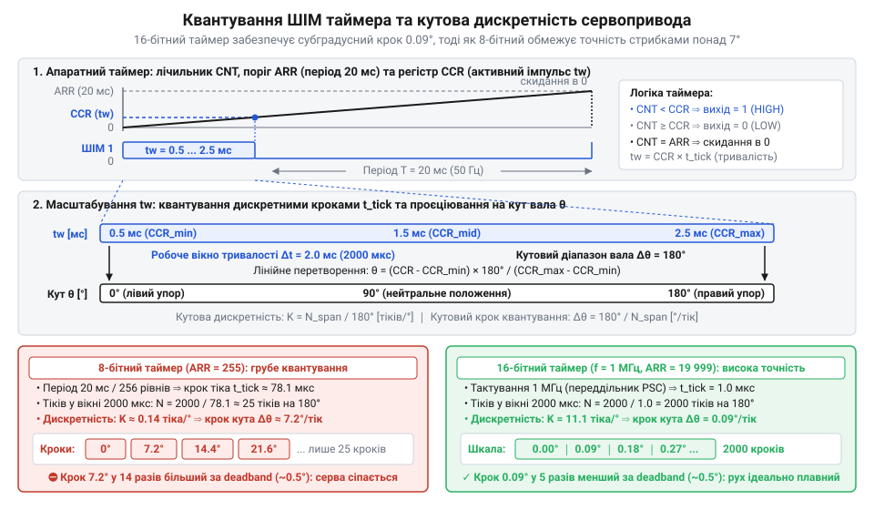
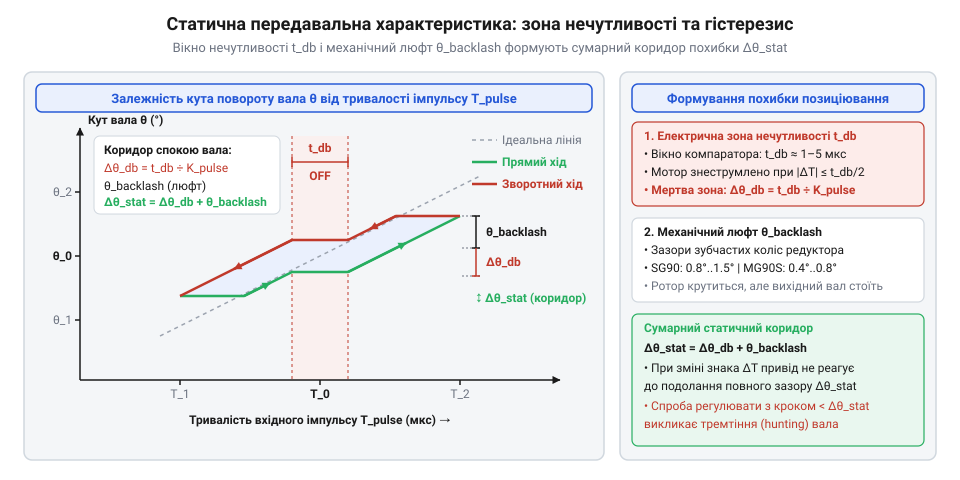

# Математична дискретність позиціювання, розрахунок таймера ШІМ та зона нечутливості

<preknowlist>
- [Tower Pro SG90 — мікросерво 9g](root:cat-hw-actuators/sg90-servo) — Базова конструктивна будова 9-грамового аналогового сервопривода (колекторний мікромотор, багатоступеневий редуктор, вихідний потенціометр зворотного зв'язку), стандартне трипровідне підключення та паспортні параметри керуючого сигналу 50 Гц (період 20 мс, номінальний імпульс 1–2 мс для повороту на 0°–180°).
- [MG90S V2 — мікросерво з металевим редуктором](root:cat-hw-actuators/mg90s-servo) — Конструктивні відмінності посиленого мікросервопривода: наявність суцільнометалевого редуктора з кулькопідшипником, менший механічний люфт зачеплення порівняно з нейлоновими шестернями та застосування цифрового контролера з підвищеною частотою оновлення моста.
</preknowlist>

## Пастка наївного ШІМ та похибки позиціювання

Підключення мікросервопривода до виводу мікроконтролера здається простою задачею: бібліотеки обіцяють плавний поворот вала на кут 0°–180° викликом функції, яка формує прямокутний імпульс тривалістю 1–2 мс із періодом 20 мс. Якщо ж увімкнути керування без розрахунку — запустити типовий 8-бітний апаратний широтно-імпульсний модулятор (від лат. @@la|modulatio@@ — мірність, узгодженість) або подати паспортні межі 1000–2000 мкс без калібрування екземпляра, привід поводиться непередбачувано. Замість плавного руху важіль рухається стрибками по 7°–14°, дрібні корекції на частки градуса ігноруються, а на краях сектора редуктор жорстко б'ється в механічні упори. Двигун заклинює, струм живлення перевищує 1 А, напруга живлення логіки аварійно просідає, а пластикові шестерні в [мікросервоприводах лінійки SG90](root:cat-hw-actuators/sg90-servo) ризикують зрізатися.

Такий провал зумовлений комплексом фізичних чинників, які наївна модель ігнорує.
Перший — апаратна дискретність лічильника: 8-бітний таймер ділить кадровий інтервал 20 мс на 256 станів, тому на активне вікно 1–2 мс припадає лише десяток кроків квантування.
Другий — технологічний розкид потенціометра (від лат. @@la|potentia@@ — сила та грец. @@grc|metron@@ — міра) зворотного зв'язку й упорів вала: реальний хід відповідає імпульсам від 500–600 мкс до 2400–2500 мкс, тож межі 1000 мкс і 2000 мкс не відповідають фізичним краям.
Третій — внутрішня зона нечутливості (від англ. @@en|deadband@@, з @@en|dead@@ — мертвий та @@en|band@@ — смуга) сервоконтролера: схема навмисно відкидає неузгодженість менше 1–5 мкс, аби запобігти неперервному тремтінню (від англ. @@en|jitter@@ — сіпатися) вала в спокої.
Четвертий — механічний люфт (від нім. @@de|Luft@@ — проміжок) зубчастих передач: зазор між зубами створює вільний хід вихідного вала ще до обертання ротора мотора. Навіть привід із [металевим редуктором MG90S](root:cat-hw-actuators/mg90s-servo) зберігає люфт зачеплення.
П'ятий — низька частота оновлення аналогового моста (50 Гц): силовий імпульс надходить на двигун лише раз на 20 мс, тому під зовнішнім моментом вал зміщується, породжуючи пружне просідання.

Тому точне позиціювання вимагає відмови від здогадок. Щоб важіль рухався точно й плавно, необхідно аналітично описати перетворення кута в мікросекунди імпульсу, розрахувати таймер мікроконтролера під субмікросекундну дискретність та узгодити апаратний крок із мертвою зоною й люфтом редуктора.

## Калібрування та інтерполяція тривалості імпульсу

Кутове переміщення вихідного вала мікросервопривода обмежене механічними упорами всередині корпусу, а поточний кут відстежується резистивним датчиком. Через виробничі похибки опору доріжки потенціометра й геометричні допуски лиття корпусів однаковий імпульс на різних приводах викликає помітно відмінне кутове положення. У сервоприводах SG90 та MG90 крайні кутові положення від мінімального кута `θ_min` до максимального `θ_max` (зазвичай від 0° до 180°) відповідають тривалостям імпульсу від `T_min ≈ 500..600 мкс` до `T_max ≈ 2400..2500 мкс`, що суттєво ширше за паспортний діапазон 1000–2000 мкс. Спроба подати імпульс за межами цього індивідуального інтервалу змушує мотор штовхати шестерні в упор, викликаючи небезпечний струм блокування.

Для точного керування будують двоточкову лінійну інтерполяцію (від лат. @@la|interpolatio@@, з @@la|interpolare@@ — оновлювати, вставляти між) за виміряними координатами крайніх точок `(θ_min, T_min)` та `(θ_max, T_max)`. Спочатку знаходять кутову чутливість `K_pulse` — коефіцієнт нахилу передавальної характеристики, який визначає приріст тривалості імпульсу на один градус повороту вала:

```
K_pulse
= ΔT ÷ Δθ                            [визначення кутової чутливості]
= (T_max - T_min) ÷ (θ_max - θ_min)  [підстановка граничних значень діапазону]
```

Отримана величина `K_pulse` має розмірність мкс/°. Знаючи чутливість і базову точку `(θ_min, T_min)`, формують пряме перетворення цільового кута `θ` в активну ширину імпульсу `T_pulse(θ)`:

```
T_pulse(θ)
= T_min + K_pulse · (θ - θ_min)      [пряме лінійне перетворення]
```

Зворотне перетворення дозволяє відновити кут повороту `θ(T_pulse)` за відомою тривалістю імпульсу:

```
θ(T_pulse)
= θ_min + (T_pulse - T_min) ÷ K_pulse [зворотне лінійне перетворення]
```

Щоб виключити ризик програмного виходу імпульсу за фізичні межі редуктора, вхідний кут обов'язково піддають попередньому обмеженню (від англ. @@en|clamping@@, з @@en|clamp@@ — затискати):

```
θ_safe
= max(θ_min, min(θ, θ_max))          [обмеження цільового кута]
```

Підстановка безпечного значення `θ_safe` гарантує, що результуючий імпульс не вийде за межі `[T_min, T_max]` за жодних умов.

**Розрахунок калібрувальних коефіцієнтів для екземпляра SG90.** При калібруванні конкретного екземпляра упор 0° зафіксовано при тривалості `T_min = 540 мкс`, а упор 180° — при `T_max = 2430 мкс`. Знайдемо кутову чутливість і тривалість імпульсу для кута `θ = 45°`:

```
K_pulse
= (2430 - 540) ÷ (180 - 0)           [підстановка виміряних меж]
= 1890 ÷ 180                         [обчислення різниці інтервалів]
= 10.5 мкс/°                         [кутова чутливість екземпляра]

T_pulse(45°)
= 540 + 10.5 · (45 - 0)              [пряме перетворення кута 45°]
= 540 + 472.5                        [додавання кутового зсуву]
= 1012.5 мкс                         [цільова тривалість імпульсу]
```

Кожен градус повороту цього вала потребує зміни тривалості імпульсу рівно на 10.5 мкс, що дає математичну основу для точного налаштування лічильника таймера.

## Розрахунок апаратного таймера та дискретності

Формування активного імпульсу мікроконтролером виконує апаратний таймер. Його робота базується на лічильнику, який тактується системною частотою шини `f_clk` через апаратний переддільник (від лат. @@la|praescalaris@@, з @@la|prae@@ — попереду та @@la|scala@@ — шкала) `PSC`. Межу рахунку визначає регістр автоперезавантаження `ARR`, а момент перемикання вихідного логічного рівня — регістр захоплення-порівняння `CCR`. Лічильник інкрементується від 0 до значення `ARR`, після чого скидається в 0, задаючи період повторення кадру `T_frame = 20 мс` (частота 50 Гц). Тривалість одного лічильного кванта часу `t_tick` залежить від тактової частоти та коефіцієнта `PSC`:

```
t_tick
= (PSC + 1) ÷ f_clk                  [тривалість лічильного кроку таймера]
```

Повний кадровий період `T_frame` задається числом у регістрі `ARR`:

```
T_frame
= (ARR + 1) · t_tick                 [тривалість кадру ШІМ]
= (PSC + 1) · (ARR + 1) ÷ f_clk      [розгортання кроку таймера]
```

Поки лічильник менший за число в регістрі `CCR`, на вихідній ніжці утримується високий логічний рівень, що утворює активний імпульс тривалістю `T_pulse = CCR · t_tick`.

Зіставлення тривалості лічильного кванта `t_tick` із кутовою чутливістю сервопривода `K_pulse` визначає апаратну кутову дискретність `R_θ` — кількість тіків таймера на один градус переміщення вала:

```
R_θ
= K_pulse ÷ t_tick                   [кількість лічильних кроків на градус]
```

Обернена величина задає кутовий крок квантування (від лат. @@la|quantum@@ — скільки) молодшого розряду таймера `Δθ_LSB`, що є теоретичною межею апаратної роздільної здатності мікроконтролера:

```
Δθ_LSB
= t_tick ÷ K_pulse                   [кутовий крок одного тіка таймера]
= 1 ÷ R_θ                            [обернена дискретність позиціювання]
```


*Часова діаграма роботи апаратного таймера ШІМ: розподіл лічильних кроків усередині кадру 20 мс, поріг скидання ARR, формування активного імпульсу через регістр CCR та проєкція дискретного кроку таймера t_tick на кутову шкалу привода.*

Розглянемо, чому стандартний 8-бітний таймер непридатний для сервоприводів. Максимальне значення 8-бітного лічильника становить `ARR = 255`. Щоб на 256 лічильних станах отримати період `T_frame = 20 мс` (20 000 мкс), крок лічильника має дорівнювати `t_tick = 20000 ÷ 256 = 78.125 мкс`. Якщо робочий розмах імпульсу становить 1000 мкс (типовий паспортний сектор 180°), на весь сектор обертання припадає лише `1000 ÷ 78.125 ≈ 12.8` кроків. У результаті найменший можливий стрибок кута дорівнює:

```
Δθ_LSB(8-bit)
= 180° ÷ 12.8                        [розподіл кутового сектора на кількість кроків]
≈ 14.06°                             [кутовий крок 8-бітного таймера]
```

Кожен апаратний крок такого таймера обертає вал на 14°, створюючи смиканий рух замість плавного позиціювання. Навіть при повному діапазоні 2000 мкс крок квантування перевищує 7°.

На противагу цьому 16-бітний таймер із межею `ARR ≤ 65535` дозволяє обрати тривалість кванта `t_tick = 1 мкс`. За такого вибору період 20 мс потребує значення `ARR = 19999`, а робочий сектор 1890 мкс містить 1890 індивідуальних лічильних станів.

**Розрахунок регістрів 16-бітного таймера для мікроконтролера з f_clk = 16 МГц.** Налаштуємо таймер мікроконтролера на крок `t_tick = 1 мкс` для керування приводом із каліброваною чутливістю `K_pulse = 10.5 мкс/°`:

```
PSC
= (f_clk · t_tick) - 1               [визначення коефіцієнта переддільника]
= (16·10⁶ · 1·10⁻⁶) - 1              [підстановка тактової частоти 16 МГц]
= 16 - 1 = 15                        [числове значення регістру PSC]

ARR
= (T_frame ÷ t_tick) - 1             [визначення межі перезавантаження]
= (20000 мкс ÷ 1 мкс) - 1            [підстановка тривалості кадру 20 мс]
= 20000 - 1 = 19999                  [числове значення регістру ARR]

R_θ
= 10.5 мкс/° ÷ 1 мкс                 [обчислення дискретності на градус]
= 10.5 тіків/°                       [кількість лічильних кроків на градус]

Δθ_LSB
= 1 ÷ 10.5 тіків/°                   [обчислення кутового кроку кванта]
≈ 0.095°                             [апаратна похибка квантування]
```

Отриманий крок `Δθ_LSB ≈ 0.095°` суттєво менший за типову зону нечутливості мікросервопривода (0.2°–0.5°), що повністю усуває апаратні посмикування та гарантує гладке відпрацювання кутових траєкторій.

## Вплив зони нечутливості на позиціювання

Навіть якщо апаратний таймер мікроконтролера налаштовано на формування імпульсів із субмікросекундною дискретністю, поворот вала на мізерну частку градуса не дає результату: важіль завмирає. Рух починається лише тоді, коли приріст імпульсу перевищує певний поріг. Причина криється у схемотехніці привода. Компаратор (від лат. @@la|comparator@@, з @@la|comparare@@ — порівнювати) сервопідсилювача безперервно зіставляє вхідний імпульс керування `T_pulse` з опорним імпульсом зворотного зв'язку `T_fb` від вихідного потенціометра вала. Якби двигун вмикався при будь-якій різниці `|T_pulse - T_fb| > 0`, інерція ротора та шум змушували б мотор безперервно сіпатися навколо точки рівноваги. Щоб запобігти автоколиванням у спокої, у схему закладають часове вікно нечутливості `t_db`, яке в приводах лінійки SG90 та MG90 становить від 1 до 5 мкс.

Знаючи кутову чутливість `K_pulse`, кутову зону нечутливості `Δθ_db` визначають із відношення вікна нечутливості до крутизни характеристики:

```
Δθ_db
= t_db ÷ K_pulse                         [кутова зона нечутливості]
```

Для каліброваного екземпляра з чутливістю `K_pulse = 10.5 мкс/°` вікно нечутливості `t_db = 4 мкс` дає мертву зону `Δθ_db = 4 ÷ 10.5 ≈ 0.38°`. Менша зміна кута не змусить сервопідсилювач відкрити ключі моста, і вал залишиться нерухомим.

До електричного порогу додається механічний люфт `θ_backlash` зубчастих передач. При зміні напрямку руху ротор спершу вибирає міжосьовий зазор шестерень, і лише потім рухає вихідний вал. У пластиковому редукторі [сервоприводів SG90](root:cat-hw-actuators/sg90-servo) люфт сягає `θ_backlash ≈ 0.8°..1.5°`, а в [металевих шестернях MG90S](root:cat-hw-actuators/mg90s-servo) становить `0.4°..0.8°`. Поєднання часового порогу `t_db` та люфту утворює петлю гістерезису (від грец. @@grc|hysteresis@@ — відставання, запізнення), формуючи повну статичну похибку позиціювання `Δθ_stat`:

```
Δθ_stat
= Δθ_db + θ_backlash                     [сумарна статична похибка позиціювання]
```


*Статична передавальна характеристика сервопривода: симетричне вікно зони нечутливості t_db задає кутову зону спокою Δθ_db, а механічний люфт шестерень θ_backlash розгортає петлю гістерезису, утворюючи коридор похибки Δθ_stat.*

Спроба зовнішнього контуру регулювати кут із кроком, меншим за `Δθ_stat`, спричиняє пошукове тремтіння (від англ. @@en|hunting@@ — безперервний пошук рівноваги). Якщо регулятор поступово нарощує сигнал і долає поріг `t_db`, транзистори різко подають струм на мотор. Ротор розганяється, за інерцією перелітає зазор люфту та вискакує за протилежну межу нечутливості. Схема негайно вмикає реверс, і вал впадає в циклічні автоколивання, що перегрівають обмотки та розбивають шестерні.

## Частота оновлення та жорсткість утримання

У стані спокою вал лишається в межах коридору нечутливості, але під дією зовнішнього механічного моменту важіль просідає. Причина криється в запізненні реакції та дозуванні енергії підживлення мотора. В аналогових сервоприводах SG90 мікросхема комутує силовий міст синхронно із зовнішнім ШІМ: струм на двигун подається лише раз на кадр тривалістю `T_frame = 20 мс` (частота оновлення `f_upd = 50 Гц`). Якщо зовнішнє збурення зміщує вал одразу після активного імпульсу, привід не реагує до початку наступного кадру. Максимальне часове запізнення аналогового контуру `t_delay` дорівнює цілому кадровому періоду:

```
t_delay(аналоговий)
= T_frame                                [максимальне запізнення аналогового контуру]
= 20 мс                                  [тривалість кадру на частоті 50 Гц]
```

Середнє запізнення становить близько 10 мс. Протягом цього часу обмотки знеструмлені, і вал під навантаженням вільно просідає.

У цифрових сервоприводах класу [MG90S V2](root:cat-hw-actuators/mg90s-servo) частота комутації мотора відв'язана від кадрової частоти. Внутрішній процесор зчитує вхідний ШІМ 50 Гц, але керує двигуном на частоті `f_upd = 250..300 Гц`. Часове запізнення реакції скорочується до тривалості одного внутрішнього циклу:

```
t_delay(цифровий)
= 1 ÷ f_upd                              [період внутрішнього циклу регулювання]
= 1 ÷ 300 Гц                             [підстановка робочої частоти 300 Гц]
≈ 3.33 мс                                [час реакції цифрового привода]
```

Затримка зменшується в 6 разів: щойно вал виходить із мертвої зони, цифровий контролер миттєво посилає високочастотну серію імпульсів, не чекаючи наступного кадру ШІМ.

Опір привода зовнішньому зміщенню визначає динамічна жорсткість (від грец. @@grc|dynamis@@ — сила) утримання `k_τ` — відношення приросту відновлювального моменту `ΔM` до спричиненого кутового відхилення `Δθ`:

Проте багаторазове зростання динамічної жорсткості має високу енергетичну ціну: тривале утримання зовнішнього моменту на високій частоті ШІМ породжує безперервні втрати енергії в обмотках двигуна. Під час нерухомого утримання важеля ротор зупинений (`ω = 0`), тому корисна механічна потужність дорівнює нулю (`P_mech = 0`), а в обмотках не виникає проти-електрорушійна сила (проти-ЕРС `e = 0`). За відсутності зустрічної ЕРС струм у колі обмежується виключно активним омічним опором мідного дроту котушок ротора `R_coil`. Для компенсації зовнішнього номінального моменту `M_nom` відносно моменту заклинювання вала `M_stall` внутрішній сервоконтролер на частоті `f_upd = 250..300 Гц` формує імпульси з коефіцієнтом заповнення (від англ. @@en|duty cycle@@, де @@en|duty@@ — робота та @@en|cycle@@ — цикл) `D = M_nom ÷ M_stall`. Висока частота комутації згладжує пульсації струму на індуктивності мотора: через обмотки протікає майже сталий середній струм утримання `I_hold = D · I_stall`, де `I_stall = U_supply ÷ R_coil` — струм блокування за напруги живлення `U_supply`.

Теплову потужність втрат `P_loss`, що безперервно виділяється в обмотках під час утримання моменту, визначають за законом Джоуля–Ленца:

```
P_loss
= I_hold² · R_coil                       [закон Джоуля–Ленца для омічних втрат]
= (D · I_stall)² · R_coil                [вираження струму через коефіцієнт заповнення]
= D² · (U_supply² ÷ R_coil)              [розгортання струму блокування через закон Ома]
```

Квадратична залежність теплових втрат від коефіцієнта заповнення `D²` показує непропорційне зростання нагріву: подвоєння моменту утримання вимагає вдвічі більшого коефіцієнта заповнення, але збільшує виділення тепла вчетверо.

**Розрахунок теплових втрат привода MG90S при утриманні номінального навантаження.** Для [цифрового привода MG90S](root:cat-hw-actuators/mg90s-servo) з напругою живлення `U_supply = 5 В`, активним опором обмотки `R_coil = 6.2 Ом` та робочим коефіцієнтом заповнення `D = 0.3` (утримання 30 % моменту заклинювання `M_stall`) обчислимо струм блокування та теплову потужність втрат:

```
I_stall
= U_supply ÷ R_coil                      [струм заблокованого ротора за законом Ома]
= 5 В ÷ 6.2 Ом                           [підстановка напруги живлення 5 В]
≈ 0.806 А                                [максимальний струм заклинювання]

P_loss
= D² · (U_supply² ÷ R_coil)              [потужність теплових втрат в обмотках]
= 0.3² · (5² ÷ 6.2)                      [підстановка коефіцієнта заповнення 30 %]
= 0.09 · (25 ÷ 6.2)                      [обчислення квадратичної частки напруги]
≈ 0.363 Вт                               [теплові втрати під час утримання]
```

Закритий пластиковий чи алюмінієвий корпус 9-грамового привода без вентиляції розсіює в навколишнє середовище лише 0.3–0.4 Вт тепла. Потужність втрат `P_loss ≈ 0.36 Вт` під номінальним моментом тримає температуру обмоток на верхній межі допустимої норми. Зростання навантаження до половини моменту заклинювання (`D = 0.5`) збільшує тепловіддачу до `0.5² · (25 ÷ 6.2) ≈ 1.01 Вт`. За такого тепловиділення температура обмоток за кілька секунд долає 100 °C: ізоляційний лак дроту плавиться, спричиняючи міжвиткове замикання та руйнування ключів силового моста. Тому жорстке цифрове утримання навантажених вузлів вимагає вибору сервоприводів із дво- чи трикратним запасом за крутним моментом. Електромеханічну модель динамічного моменту, зв'язок кутової швидкості вала з навантаженням та розрахунок нагріву обмоток детально розкриває [розрахунок крутного моменту, кутової швидкості та нагріву мікросервоприводів](root:cat-hw-actuators/sg90-mg90-micro-servos-family/math-micro-servo-torque-and-speed-calculation.md).

```
k_τ
= ΔM ÷ Δθ                                [визначення динамічної жорсткості утримання]
```

В аналоговому приводі через рідкісні імпульси середня напруга на двигуні при малих відхиленнях лишається низькою, роблячи важіль пружним і податливим. У цифровому сервоприводі висока частота комутації швидко насичує обмотки струмом, підвищуючи жорсткість `k_τ` у 3–5 разів. Тому навантажені шарніри потребують цифрових контролерів, тоді як для простих ненавантажених заслінок достатньо [аналогових SG90](root:cat-hw-actuators/sg90-servo).

## Синтез алгоритму та узгодження параметрів

Побудова стабільного керування вимагає узгодження лічильного кроку таймера `t_tick` із вікном нечутливості `t_db`. Якщо квант таймера перевищує ширину зони (`t_tick > t_db`), зміна значення регістру порівняння навіть на 1 тік перекидає сигнал через поріг спрацьовування, породжуючи квантизаційне збудження та тремтіння. Щоб уникнути автоколивань, лічильний крок має становити щонайбільше половину зони нечутливості:

```
t_tick
≤ t_db ÷ 2                               [критерій узгодження дискретності з зоною нечутливості]
```

При типовому вікні `t_db = 2..4 мкс` крок `t_tick = 1 мкс` забезпечує щонайменше два лічильні стани всередині мертвої напівзони, усуваючи паразитне сіпання вала.

Повний бюджет похибки (від лат. @@la|error@@ — блукання, помилка) позиціювання `ϵ_total` об'єднує крок квантування таймера `Δθ_LSB`, кутову зону нечутливості `Δθ_db` та люфт редуктора `θ_backlash`:

```
ϵ_total
= Δθ_LSB + Δθ_db + θ_backlash            [повний бюджет похибки позиціювання]
```

**Розрахунок сумарної похибки для привода SG90.** Для привода з чутливістю `K_pulse = 10.5 мкс/°`, кроком таймера `t_tick = 1 мкс` (`Δθ_LSB = 0.095°`), вікном `t_db = 4 мкс` (`Δθ_db = 0.38°`) та люфтом `θ_backlash = 0.8°` обчислимо результуючу похибку:

```
ϵ_total
= 0.095° + 0.38° + 0.8°                  [підстановка апаратної та механічної складових]
= 1.275°                                 [сумарна статична похибка позиціювання]
```

Розрахунок доводить, що за субмікросекундної дискретності таймера реальна точність обмежена значенням близько 1.3° через фізику редуктора та контролера. Подрібнення кванта таймера менше 1 мкс не покращує кутову точність.

При одночасному керуванні кількома приводами виникає небезпека струмового перевантаження: спільний старт імпульсів утворює сумарний пік струму 4–8 А, що спричиняє просідання шини живлення (проти якого застосовують методику [розрахунку розв'язувальних конденсаторів](root:hw-power/servo-power-distribution-and-filtering)). Щоб згладити навантаження програмно, застосовують фазовий зсув (від грец. @@grc|phasis@@ — поява) імпульсів у межах кадру `T_frame = 20 мс`. Для `N_channels = 8` приводів із максимальною тривалістю імпульсу `T_max = 2.5 мс` тривалість незалежного слота `t_slot` дорівнює:

```
t_slot
= T_frame ÷ N_channels                   [тривалість часового слота]
= 20 мс ÷ 8                              [розподіл кадру 20 мс на 8 каналів]
= 2.5 мс                                 [інтервал слота без перекриття імпульсів]
```

Канал з індексом `i` (від 1 до 8) запускає імпульс із часовою затримкою `t_shift(i) = (i - 1) · t_slot`, завдяки чому передні фронти розносяться в часі, виключаючи накладання пускових струмів.

Загальний інженерний алгоритм керування виконує такі кроки:
1. Безпечне обмеження кута: приведення вхідного значення `θ` до меж `[θ_min, θ_max]`.
2. Лінійна інтерполяція: розрахунок тривалості імпульсу `T_pulse` за каліброваним коефіцієнтом `K_pulse`.
3. Квантування таймера: обчислення регістру порівняння `CCR = round(T_pulse ÷ t_tick)` з дотриманням умови `t_tick ≤ t_db ÷ 2`.
4. Фазовий зсув каналів: рознесення моментів старту імпульсів на інтервал `t_slot` для вирівнювання струму споживання.
