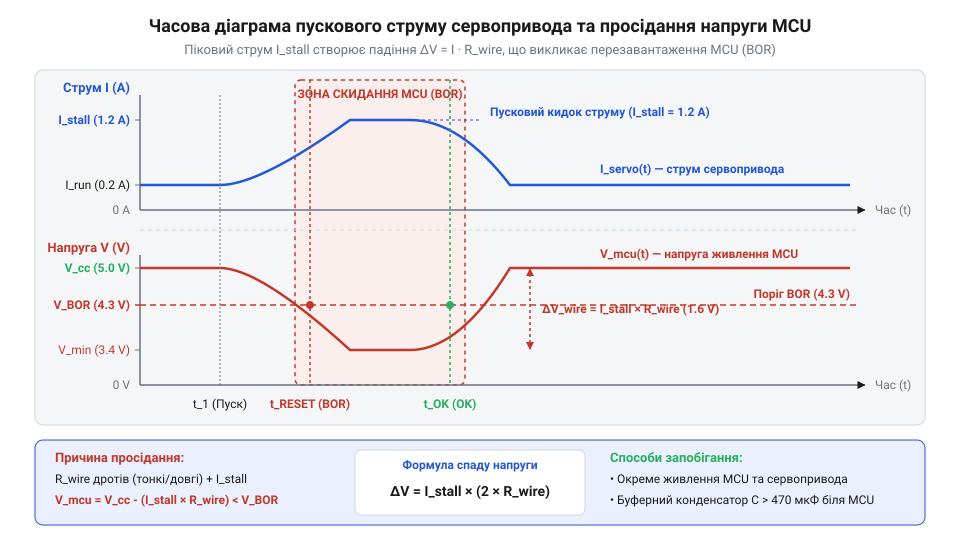

# Розрахунок механічного моменту, пускового струму та спаду напруги

<preknowlist>
- [Сервоприводи радіокерованих моделей: будова, редуктори та ШІМ-керування](root:cat-hw-actuators/rc-servo-mechanisms-and-control) — внутрішня будова колекторного двигуна, передавальне відношення редуктора та принцип керування позицією через ШІМ-сигнал
- [Tower Pro SG90 — мікросерво 9g](root:cat-hw-actuators/sg90-servo) — номінальні значення робочої напруги, статичного моменту та пікового струму заклинювання класичного аналогового мікросервопривода
- [MG90S V2 — мікросерво з металевим редуктором](root:cat-hw-actuators/mg90s-servo) — відмінності електричних характеристик та вищі значення струму заклинювання приводів із підвищеною механічною потужністю
</preknowlist>

## Чому сервопривод скидає мікроконтролер під навантаженням

Типова ситуація при побудові макету робототехнічної системи: до однієї шини живлення 5 В підключено @@en|microcontroller@@ (мікроконтролер, від грец. *mikros* — малий, та лат. *contra* — проти) і компактний @@en|servomotor@@ (сервопривод, від лат. *servus* — слуга, та англ. *motor* — рушій). Поки привід перебуває у стані спокою або повільно змінює позицію без механічного опору, система працює стабільно. Проте щойно на важіль подається навантаження або керувальна шина передає сигнал @@en|Pulse-Width Modulation@@ (широтно-імпульсна модуляція, @@en|PWM@@, від лат. *pulsus* — поштовх, та *modulatio* — розміреність) з вимогою стрибкоподібно змінити кут, @@en|microcontroller@@ миттєво перезавантажується, а привід втрачає позицію або хаотично посмикується.

Розробники-початківці часто помилково шукають причину в програмних помилках генерації @@en|PWM@@, дефектах прошивки чи несправності самого виконавчого механізму. Проте справжня причина лежить у нерозривному фізичному зв'язку між механікою та електрикою. Для подолання механічного опору або інерції спокою колекторний двигун привода вимагає миттєвого зростання @@en|torque@@ (крутний момент, від лат. *torquere* — крутити). Оскільки крутний момент прямо пропорційний струму ротора, електричне споживання привода в момент старту стрибає від кількох міліампер до пікового значення @@en|stall current@@ (струм заклинювання, від англ. *stall* — зупинка через перевантаження, та *current* — струм), яке перевищує робоче споживання в 5–10 разів.

Цей короткий імпульс струму амплітудою в 1–2 А протікає крізь з'єднувальні дроти та контакти макетної плати. Фізичні провідники мають власний активний опір `R_{wire}`. Згідно із законом Ома, струмовий пік створює на лініях живлення падіння напруги `ΔU = I_{peak} · R_{wire}`. В результаті потенціал на виводах живлення @@en|microcontroller@@ падає нижче критичної межі, і спрацьовує апаратна система захисту від просідання живлення (проти-просідальне скидання, @@en|Brown-Out Reset@@, @@en|BOR@@, від англ. *brownout* — часткове просідання живлення, та *reset* — скидання), яка примусово перезапускає процесор.


*Графік динаміки струму споживання привода та просідання напруги на шині живлення під час пускового імпульсу з виходом на поріг перезавантаження мікроконтролера.*

Розуміння внутрішньої кінематики та редукторів, про які йдеться в описі [будови сервоприводів радіомоделей](root:cat-hw-actuators/rc-servo-mechanisms-and-control), пояснює механічну природу опору. Однак розрахунок стабільності системи живлення потребує математичного опису кожного етапу: від механічного навантаження на валу до електричних параметрів провідників та буферних ємностей.

## Розрахунок механічного моменту на валу

Електричне навантаження двигуна визначається механічним зусиллям, яке він повинен розвинути на вихідній осі. Виробники вказують у паспортах пристроїв, таких як класичний аналоговий [мікросервопривод SG90](root:cat-hw-actuators/sg90-servo), величину утримувального моменту в одиницях `кг·см`. Фізично ця величина означає максимальну масу вантажу в кілограмах, яку привід здатний утримати на горизонтальному важелі довжиною 1 см.

Для проведення точних фізико-математичних розрахунків у системі SI @@en|torque@@ вимірюють у Ньютон-метрах (`Н·м`). Переведення паспортних `кг·см` у `Н·м` виконують множенням на прискорення вільного падіння `g ≈ 9.80665 м/с²` та діленням на 100 (переведення сантиметрів у метри): `1 кг·см ≈ 0.09807 Н·м`.

Статичний крутний момент `M_{stat}` виникає під дією постійної сили ваги вантажу або опору середовища, коли важіль перебуває в нерухомому стані або рухається з постійною швидкістю. Величезне значення має кут нахилу важеля `θ` відносно вертикальної осі дії сили тяжіння. Означимо символи перед формулою:
`M_{stat}` — статичний крутний момент на валу (Н·м),
`m` — маса навантаження на кінці важеля (кг),
`g` — прискорення вільного падіння (м/с²),
`r` — довжина плеча важеля від осі обертання до точки прикладання сили (м),
`θ` — кут між вектором плеча важеля та напрямком дії сили.

Розрахунок статичного моменту описується рівнянням:

```
M_stat = F · r · sin(θ)
       = m · g · r · sin(θ)      [заміна сили вагою маси]
```

Найбільший статичний момент виникає у горизонтальному положенні важеля (`θ = 90°`, `sin(90°) = 1`), а у вертикальному положенні (`θ = 0°`) статичний момент дорівнює нулю.

Під час різкого старту або зміни напрямку руху до статичного моменту додається динамічна складова `M_{dyn\_add}`, зумовлена необхідністю надати масі кутового прискорення `α`. Означимо нові величини:
`I` — момент інерції вантажу відносно осі обертання (кг·м²),
`α` — кутове прискорення важеля (рад/с²),
`Δω` — зміна кутової швидкості (рад/с),
`Δt` — час розгону важеля (с).

Для точкової маси на кінці легкого важеля момент інерції дорівнює `I = m · r²`. Повний динамічний крутний момент `M_{dyn}` розраховують за формулою:

```
M_dyn = M_stat + M_dyn_add
      = m · g · r · sin(θ) + I · α      [додавання інерційного моменту]
      = m · g · r · sin(θ) + m · r² · (Δω ÷ Δt) [підстановка моменту інерції та прискорення]
```

**Розрахунок моменту важеля маніпулятора з точковим вантажем:**
Умови: маса вантажу `m = 0.15 кг`, довжина важеля `r = 0.08 м`, кут нахилу `θ = 90°`. Важіль розганяється від стану спокою до кутової швидкості `300°/с` (`≈ 5.236 рад/с`) за час `Δt = 0.05 с`.

```
M_stat = 0.15 × 9.80665 × 0.08 × 1.0
       = 0.11768 N·m             [статичний момент ваги]

α = 5.236 ÷ 0.05
  = 104.72 rad/s²                [кутове прискорення]

I = 0.15 × (0.08)²
  = 0.15 × 0.0064
  = 0.00096 kg·m²                [момент інерції]

M_dyn_add = 0.00096 × 104.72
          = 0.10053 N·m          [динамічний інерційний момент]

M_dyn = 0.11768 + 0.10053
      = 0.21821 N·m              [сумарний динамічний момент]

M_dyn_kgcm = 0.21821 ÷ 0.0980665
           = 2.225 kg·cm         [переведення в паспортні одиниці]
```

Висновок: Сумарний динамічний момент `2.225 кг·см` перевищує граничне значення `1.8 кг·см`, яке гарантує пластиковий редуктор @@en|Tower Pro SG90@@. У цьому режимі привід увійде в стан заклинювання. Для стабільної роботи слід обрати сервопривод із [металевим редуктором MG90S V2](root:cat-hw-actuators/mg90s-servo), який забезпечує утримувальний момент понад `2.2 кг·см`.

## Моделювання пускового струму та струму заклинювання

Механічний момент на валу безпосередньо зумовлює електричні параметри колекторного двигуна постійного струму, який слугує силовим ядром @@en|servomotor@@. Електричний опір обмоток ротора `R_m` та швидкість обертання ротора `ω_{rotor}` є головними чинниками, що визначають миттєве споживання струму.

Під час обертання ротора у магнітному полі статора в обмотках індукується протиелектрорушійна сила (проти-ЕРС, @@en|back EMF@@, від англ. *back electromotive force*), яка протидіє зовнішній напрузі живлення `U`. Величина @@en|back EMF@@ прямо пропорційна кутовій швидкості ротора: `e_{back} = k_e · ω_{rotor}`, де `k_e` — конструктивна коефіцієнтна стала двигуна.

Миттєве значення струму якоря `I(t)` визначається за законом Ома для замкненого кола:

```
I(t) = (U - e_back(t)) ÷ R_m
     = (U - k_e · ω_rotor(t)) ÷ R_m [урахування проти-ЕРС від обертання]
```

У момент подачі напруги живлення (`t = 0`) або при повному механічному заклинюванні валу швидкість обертання ротора дорівнює нулю (`ω_{rotor} = 0`). Відповідно, @@en|back EMF@@ відсутня (`e_{back} = 0`). У цей короткий проміжок часу струм споживання обмежений виключно активним опором обмоток `R_m` і досягає свого абсолютного піку — @@en|stall current@@:

```
I_stall = (U - 0) ÷ R_m
        = U ÷ R_m               [струм заклинювання за відсутності проти-ЕРС]
```

Зв'язок між механічним моментом двигуна `M_{motor}` та струмом якоря `I` описується константою моменту `k_t`: `M_{motor} = k_t · I`. З урахуванням передавального відношення редуктора `N` та його механічного ККД `η`, момент на вихідному валу привода дорівнює `M_{shaft} = N · η · k_t · I`. Відповідно, струм, необхідний для подолання поточного навантаження:

```
I(M_shaft) = M_shaft ÷ (N · η · k_t) [необхідний струм залежно від моменту]
```

Аналоговий привід @@en|Tower Pro SG90@@ має опір обмоток двигуна близько `R_m ≈ 6.2 Ом`. При напрузі живлення `U = 5.0 В` піковий @@en|stall current@@ становить:

```
I_stall = 5.0 ÷ 6.2
        = 0.806 A                [піковий пусковий струм SG90]
```

Для потужніших моделей, таких як [компактний сервопривод HD-1370A](root:cat-hw-actuators/hd-1370a-servo) або модифікації з металевим редуктором @@en|MG90S V2@@, встановлюють двигуни з меншим опором обмоток (`R_m ≈ 3.5 Ом`). При напрузі `5.0 В` це викликає піковий @@en|stall current@@ `I_{stall} = 5.0 / 3.5 ≈ 1.43 А`.

Таке високе значення струму триває від 5 до 20 мілісекунд — доки ротор не розігнеться й не згенерує компенсаційну @@en|back EMF@@. Якщо механічне навантаження перевищує граничний момент привода, ротор зупиняється, і @@en|stall current@@ протікає через обмотки безперервно, спричиняючи їх перегрів та створюючи тривале просідання напруги в колі живлення.

## Розрахунок спаду напруги в провідниках живлення

Отримане значення пікового струму @@en|stall current@@ дозволяє обчислити фактичне падіння напруги на лінії живлення, яка з'єднує джерело струму з сервоприводом та @@en|microcontroller@@.

З'єднувальні провідники, шлейфи та перехідні контакти макетних плат володіють електричним опором `R_{line}`. Струм живлення протікає по замкненому контуру: від позиційного виводу джерела живлення через провідник VCC до навантаження і повертається назад через провідник заземлення GND. Тому загальний опір лінії живлення враховує довжину обох провідників.

Означимо величини перед розрахунком:
`R_{line}` — сумарний активний опір шини живлення (Ом),
`ρ` — питомий електричний опір матеріалу провідника (Ом·мм²/м, для міді `ρ ≈ 0.0175`),
`L` — фізична довжина одного з'єднувального провідника (м),
`S` — площа поперечного перерізу жили провідника (мм²),
`R_{contacts}` — опір переходів контактних роз'ємів та клем (Ом).

Формула сумарного опору лінії та викликаного ним спаду напруги `ΔU` має вигляд:

```
R_line = 2 · ρ · L ÷ S + R_contacts [сумарний опір провідників VCC, GND та контактів]

ΔU = I_peak · R_line
   = I_peak · (2 · ρ · L ÷ S + R_contacts) [падіння напруги за законом Ома]
```

Типовий безпаяльний макетний дріт (28 AWG) має переріз `S ≈ 0.08 мм²` і довжину `L = 0.2 м`. Опір пружинного контакту макетної плати становить близько `0.1 Ом` на один перехід (усього 2 контакти на VCC і 2 на GND, разом `R_{contacts} ≈ 0.2 Ом`).

Обчислимо опір такої лінії живлення:

```
R_cond = 0.0175 × 0.2 ÷ 0.08
       = 0.04375 Ohm            [опір одного дрітока]

R_line = 2 × 0.04375 + 0.2
       = 0.2875 Ohm             [сумарний опір шини живлення]
```

При пуску привода @@en|MG90S V2@@ з імпульсним струмом `I_{peak} = 1.4 А` спад напруги на дрітовому шлейфі становить:

```
ΔU = 1.4 × 0.2875
   = 0.4025 V                   [падіння напруги на лінії]
```

Якщо початкова напруга джерела живлення становила `4.8 В`, то під час пускового імпульсу напруга безпосередньо на виводах @@en|microcontroller@@ впаде до `U_{mcu} = 4.8 - 0.4025 = 4.397 В`. Якщо ж застосовано тонші провідники (30 AWG, `S ≈ 0.05 мм²`) або довший шлейф (`L = 0.5 м`), опір `R_{line}` досягає `1.0 Ом`. У цьому випадку спад напруги сягає `ΔU = 1.4 А × 1.0 Ом = 1.4 В`, а напруга на мікроконтролері просідає до `3.4 В`.

Оскільки більшість 5-вольтових мікроконтролерів мають поріг спрацьовування апаратної [схеми Brown-Out Reset](root:hw-arch/mcu-brownout-reset) на рівні `4.3 В` або `4.5 В`, таке просідання викликає негайне скидання процесора.

## Обчислення буферної ємності для компенсації просідань

Для запобігання просіданню напруги нижче допустимого порогу паралельно шині живлення безпосередньо біля роз'ємів @@en|servomotor@@ та @@en|microcontroller@@ встановлюють накопичувальні буферні конденсатори. Під час імпульсу струму конденсатор віддає накопичений електричний заряд `Q`, компенсуючи недостатність струму від віддаленого джерела живлення.

Необхідна буферна ємність `C` визначається з балансу електричного заряду. Позначимо величини:
`C` — ємність буферного конденсатора (Ф),
`ΔI` — дефіцит струму, який не може віддати лінія живлення без перевищення спаду напруги (А),
`Δt` — тривалість пускового імпульсу струму (с),
`ΔU_{allowable}` — максимально допустима амплітуда просідання напруги на шині (В).

Формула розрахунку необхідної ємності:

```
C = Q ÷ ΔU_allowable
  = (ΔI · Δt) ÷ ΔU_allowable     [розрахунок ємності за балансом заряду]
```

Крім номінальної ємності, критичне значення має еквівалентний послідовний опір (еквівалентний послідовний опір, @@en|Equivalent Series Resistance@@, @@en|ESR@@, від лат. *aequivalens* — рівноцінний) конденсатора. Під час протікання імпульсного струму `ΔI` на внутрішньому опорі `R_{esr}` виникає миттєвий стрибок напруги `ΔU_{esr} = ΔI · R_{esr}`.

Сумарне падіння напруги на буферному вузлі визначається як сума розрядного падіння та стрибка на @@en|ESR@@:

```
ΔU_total = ΔU_cap + ΔU_esr
         = (ΔI · Δt) ÷ C + ΔI · R_esr [сумарне просідання напруги з урахуванням ESR]
```

**Обчислення параметрів буферної ємності для сервопривода:**
Умови: піковий струм `I_{peak} = 1.2 А`, джерело живлення здатне безпечно віддавати `I_{supply} = 0.4 А` без просідання. Дефіцит струму `ΔI = 1.2 - 0.4 = 0.8 А`. Тривалість пускового імпульсу `Δt = 0.01 с` (10 мс). Максимально допустиме просідання напруги `ΔU_{allowable} = 0.3 В`.

```
C_min = (0.8 × 0.01) ÷ 0.3
      = 0.008 ÷ 0.3
      = 0.02667 F                [мінімальна ємність у Фарадах]
      = 26670 uF                 [переведення в мікрофаради]
```

Якщо тривалість пускового мікро-імпульсу первинного замикання обмоток становить `Δt = 0.001 с` (1 мс):

```
C_min = (0.8 × 0.001) ÷ 0.3
      = 0.0008 ÷ 0.3
      = 0.00267 F                [мінімальна ємність]
      = 2670 uF                  [переведення в мікрофаради]
```

Для обмеження стрибка `ΔU_{esr}` величиною не більше `0.1 В` при струмі `0.8 А`, еквівалентний опір конденсатора повинен задовольняти умову:

```
R_esr_max = 0.1 ÷ 0.8
          = 0.125 Ohm            [максимально допустимий ESR]
```

Звичайні алюмінієві електролітичні конденсатори великої ємності мають `R_{esr} ≈ 0.5 – 2.0 Ом`, тому вони не здатні самостійно компенсувати швидкі імпульсні просідання. Практичним рішенням є паралельне увімкнення електролітичного конденсатора ємністю 470–1000 мкФ (для покриття довготривалого дефіциту заряду) та керамічного конденсатора ємністю 10 мкФ з низьким @@en|ESR@@ (менше 0.05 Ом, для придушення високочастотних піків).