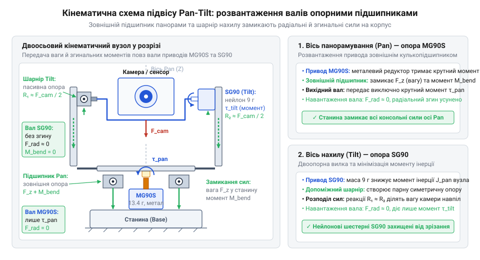
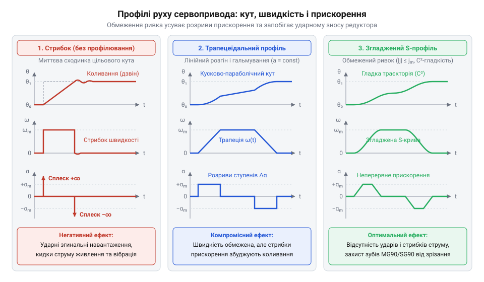

# Двоосьовий опорно-поворотний модуль із вибором приводів під навантаження осей

<preknowlist>
- [Tower Pro SG90 — мікросерво 9g](root:cat-hw-actuators/sg90-servo) — трипровідний інтерфейс керування імпульсами ШІМ 50 Гц, електричні характеристики споживання та межі міцності пластикового редуктора під радіальним навантаженням
- [MG90S V2 — мікросерво з металевим редуктором](root:cat-hw-actuators/mg90s-servo) — конструкція редуктора з латунними шестернями й підшипником, пускові струми блокування вала та здатність утримувати підвищений статичний момент
</preknowlist>

## Чому ламається примітивний поворотний підвіс

Коли для орієнтації камери або сенсора складають наївний двоосьовий підвіс @@en|Pan-Tilt@@ (панорамування й нахил, від грецького @@el|pan@@ — усе, огляд та англійського @@en|tilt@@ — нахил), зазвичай з'єднують два однакові мікроприводи каскадом: корпус першого кріплять до нерухомої бази, на його качалку ставлять корпус другого, а до верхнього вала прикручують плату сенсора. Така конструкція ламається під час перших випробувань. Вона страждає від трьох фундаментальних проблем: руйнівного консольного зусилля на вихідний вал, гальмівного опору сигнальних дротів та аварійного колапсу шини живлення.

Вихідний вал [дешевого мікросервопривода SG90](root:cat-hw-actuators/sg90-servo) спирається на тонку пластикову втулку в кришці корпусу. Коли маса верхнього вузла винесена вперед на плече кронштейна, сила тяжіння створює постійний згинальний момент (від латинського @@la|momentum@@ — рушійна сила, поштовх). Консольний важіль перекошує вал усередині втулки. Зубчасті вінці мініатюрних нейлонових шестерень виходять із правильного зачеплення й контактують лише краями верхівок. Перший же різкий старт або випадковий поштовх зрізає тендітні пластикові зуби базової осі.

Ситуацію погіршує кабельний шлейф, що з'єднує сенсор із базовою платою. Звичайні дроти в полівінілхлоридній ізоляції мають власну механічну жорсткість. Під час повороту шлейф перекручується й натягується, створюючи паразитний пружний опір. Намагаючись подолати цей натяг, внутрішній колекторний двигун переходить у режим важкого навантаження, споживає граничний струм, розхитує [заводські сервокачалки](root:cat-hw-actuators/servo-horns) і зношує редуктор (від латинського @@la|reductor@@ — той, що відводить назад).

Якщо живити обидва сервоприводи безпосередньо від 5-вольтової шини мікроконтролера, настає схемотехнічний колапс. Одночасний пуск двох моторів створює стартовий кидок струму до 1.5 А. На внутрішньому опорі джерела живлення та тонких доріжках плати виникає глибоке осідання напруги нижче 4.2 В. Вбудована схема [скидання при осіданні живлення](root:sf-devices/mcu-brown-out-reset) (@@en|Brown-out Reset@@, BOR: від англійського @@en|brownout@@ — падіння напруги та @@en|reset@@ — скидання) негайно перезавантажує мікроконтролер. Процесор перезапускається, знову ініціалізує початкове положення осей, мотори повторно стартують водночас — і пристрій зациклюється у нескінченних перезавантаженнях.

Спроба побудувати підвіс на двох однакових нерозвантажених приводах фізично хибна. Механічно стійкий модуль вимагає трьох інженерних рішень: розвантаження валів від згинальних зусиль зовнішніми опорними елементами, диференціації моторів під різне навантаження осей та схемотехнічного розділення кіл живлення цифрової частини й силових приводів.

## Механіка підвісу та розвантаження валів

Осі двоосьового модуля навантажені принципово несиметрично. Нижня вісь панорамування несе вагу всієї рухомої рамки, сервопривода нахилу, кронштейна та корисного навантаження. Момент інерції (від латинського @@la|inertia@@ — нерухомість) усієї цієї конструкції пропорційний квадрату радіуса обертання, тому кожен додатковий грам на вильоті кронштейна різко підвищує опір під час розгону й гальмування. Натомість вісь нахилу несе лише сам сенсор із власною монтажною площадкою.

Через таку несиметрію приводи підбирають диференційовано:
- Для тримальної осі панорамування застосовують посилений [привод з металевим редуктором](root:cat-hw-actuators/mg90s-servo) @@en|MG90S@@. Його латунні шестерні витримують крутний момент до 2.2 кг·см, а вихідний кулькопідшипник стійкий до динамічних вібрацій важкої платформи. Через потужніший двигун пусковий струм @@en|MG90S@@ під динамічним навантаженням сягає 1.0–1.2 А. Сплеск струму такої сили на тонкому дроті спричиняє осідання напруги понад 0.3 В, тому лінія живлення цієї осі вимагає провідника з поперечним перерізом не менше ніж 0.20–0.25 мм² (калібр @@en|AWG@@ 24, від англійського @@en|American Wire Gauge@@ — американський калібр дротів).
- Для рухомої осі нахилу використовують полегшений [мікросервопривод SG90](root:cat-hw-actuators/sg90-servo) вагою 9 грамів із пластиковим редуктором. Низька маса мотора нахилу критично зменшує момент інерції, який долає нижній привод @@en|MG90S@@. Пусковий струм @@en|SG90@@ під час обертання сенсора становить лише 0.5–0.65 А — удвічі менше за струм нижньої осі. Таке помірне навантаження дозволяє живити привод нахилу гнучким тонким дротом перерізом 0.05–0.08 мм² (калібр @@en|AWG@@ 30): він утримує спад напруги в безпечних межах і не створює паразитного пружного опору під час руху кронштейна.

Якщо закріпити кронштейн безпосередньо на валу привода, маса навантаження створює постійний згинальний момент на консолі. Обчислимо це навантаження для платформи з сенсором масою `m = 0.06` кг, зміщеною від осі обертання на виліт `L = 0.035` м:

Згинальний момент обчислюємо через добуток сили тяжіння вантажу та довжини плеча кронштейна:
        M_bend
        = F_g · L                [формула сили тяжіння]
        = (m · g) · L            [підстановка маси й прискорення вільного падіння]
        = (0.06 · 9.81) · 0.035  [числові значення для кронштейна з камерою]
        ≈ 0.0206 Н·м             [обчислення моменту сили]
        ≈ 0.21 кг·см             [переведення в сантиметр-кілограми]

Для пластикового вала діаметром лише 4.8 мм цей важіль діє безперервно, відгинає вісь, спричиняє механічний @@de|люфт@@ (від німецького @@de|Luft@@ — повітря, зазор) і призводить до викришування шестерень.

Щоб зберегти редуктори, конструкцію кінематично розвантажують: радіальне навантаження (від латинського @@la|radius@@ — промінь) та згинальні зусилля повністю замикають на каркас модуля. В осі панорамування поворотний стіл установлюють на зовнішній упорний кулькопідшипник великого діаметра, закріплений на нерухомій станині. Вал привода @@en|MG90S@@ передає на стіл лише чистий крутний момент навколо своєї осі, позбувшись ваги платформи.

В осі нахилу застосовують двозв'язну шарнірну рамку. З одного боку кронштейн з'єднується з валом сервопривода @@en|SG90@@, а з протилежного боку монтують допоміжну пасивну піввісь із кулькопідшипником або полімерною втулкою. Щоб уникнути появи нових люфтів у самому підшипнику, допоміжну піввісь монтують із посадкою з натягом та осьовою фіксацією: її хвостовик щільно входить у внутрішнє кільце підшипника й стягується торцевим гвинтом із шайбою, що вибирає вільний хід кульок, тоді як зовнішнє кільце глухо фіксується в нерухомій стійці основи. Сенсор спирається на дві незалежні точки, завдяки чому згинальний момент розвантажується на жорсткі щоки кронштейна, а вал мікросервопривода повертає навантаження без перекосу.

*Розподіл навантаження в підвісі: зовнішній кулькопідшипник основи замикає вагу на корпус, а допоміжна піввісь рамки усуває згинальний момент з вала нахилу.*

## Трасування кабелів із компенсаційними петлями

Навіть у підвісі з ідеально розвантаженими валами рухливість часто спотворюється прокладеними дротами живлення й передачі сигналів. Якщо кабель від сенсора натягнутий по прямій лінії між рухомою платформою та корпусом приладу, під час кутових поворотів виникає пружна механічна реакція ізоляції. Цей паразитний пружний опір створює зустрічний гальмівний момент, який змінюється залежно від кута повороту.

Паразитний опір кабелю призводить до трьох неприємних наслідків:
- сервопривод отримує постійну позиційну помилку, бо пружність дротів і кронштейна перевищує зону нечутливості внутрішнього компаратора;
- мотор споживає підвищений струм утримання, намагаючись втримати заданий кут проти пружини натягнутого дроту;
- циклічний перегин пучка дротів на малому радіусі швидко ламає мідні жили всередині ізоляції.

Щоб нейтралізувати цей опір, прокладання кабелів виконують за правилом геометричної осі через компенсаційні петлі (від латинського @@la|compensare@@ — зрівноважувати). Головний принцип: точка переходу джгута між рухомою та нерухомою деталями мусить збігатися з геометричною віссю обертання цього шарніра. При цьому жорсткі фабричні шлейфи з ПВХ-ізоляцією варто замінити на надгнучкі силіконові дроти калібру 28–30 AWG: завдяки великій кількості мікроскопічних мідних жил і м'якій силіконовій оболонці вони майже не чинять пружного спротиву на згин і дозволяють петлі вільно згортатися без зустрічного гальмівного моменту на валу.

Трасування організовують у два роздільні каскади з проміжними точками жорсткої фіксації:
1. Каскад панорамування: кабель від нерухомої бази виводять у центр обертання під опорним підшипником, формують широку кругову петлю під поворотною платформою та закріплюють хомутом на поворотному кронштейні. Під час повороту петля плавно згортається або розгортається без зміни радіуса вигину.
2. Каскад нахилу: від точки фіксації на кронштейні панорамування дріт підводять до горизонтальної лінії допоміжної осі нахилу. Тут формують вільну S-подібну петлю з радіусом вигину не менше ніж п'ять діаметрів джгута й жорстко притискають біля роз'єму сенсора.

Завдяки S-подібній формі під час нахилу кабель зазнає м'якої крутильної деформації на довгій ділянці, а не зосередженого перегину. Пучок поміщають у текстильну захисну обплітку (@@en|snake skin@@), яка ковзає об конструктивні елементи без зачепів. При такому трасуванні опір дротів стає практично нульовим у всьому діапазоні від 0° до 180°, а механіка працює плавно й без паразитних струмових сплесків.

## Розділення шин живлення та LC-фільтрація

На вході ми маємо рухомий механічний каркас із виведеними проводами, які необхідно підключити до джерела живлення та мікроконтролера без взаємного впливу. Відпрацювання сервоприводами команд супроводжується перехідними комутаційними процесами. Колекторні двигуни постійного струму генерують високочастотний іскровий шум, а їхній синхронний пуск провокує глибокі імпульсні осідання напруги. Ці явища здатні викликати збої цифрової логіки й спонтанні перезавантаження мікроконтролера.

Для усунення цього впливу застосовують фізичне розділення силової шини сервоприводів і логічної шини контролера. Заземлення розводять за схемою «зірка», з'єднуючи спільні дроти обох підсистем в одній точці безпосередньо біля джерела живлення. Додатково для кожного привода розраховують індивідуальні LC-фільтри, які згладжують стрибки струму й ізолюють шум. Розрахунок параметрів фільтра базується на характеристиках споживання мікросервоприводів: ємність конденсатора вибирають у межах 470–1000 мкФ (електролітичний з низьким ESR) для компенсації пускових струмів блокування (до 1–1,2 А) та запобігання просіданню напруги, паралельно шунтуючи його керамічним конденсатором на 0,1 мкФ для придушення високочастотного іскрового шуму колектора; індуктивність дроселя підбирають у діапазоні 10–100 мкГн, звертаючи особливу увагу на мінімальний опір постійному струму (DCR), щоб уникнути паразитного падіння напруги на самій котушці під навантаженням. Така підсистема живлення усуває імпульсні осідання та гарантує безперебійну роботу логіки за максимальних динамічних навантажень.

## Кінематичне згладжування траєкторії руху приводів

Після надійного заживлення модуля постає проблема різких механічних ударів і стрибків струму під час відпрацювання стандартних ступінчастих команд зміни шпаруватості ШІМ. Необмежений ривок (@@en|jerk@@) руйнівно впливає на зубчасті передачі редуктора. Для захисту механіки застосовують кінематичне згладжування за допомогою трапецеїдального та S-подібного профілів швидкості, де прискорення лімітовано.

*Графіки зміни координати, швидкості та прискорення показують плавність профілів швидкості, що усувають різкі реверси та механічні удари.*

Алгоритм дискретної інтерполяції кутового положення в часі, реалізований на базі апаратного таймера мікроконтролера, перетворює стрибкоподібне завдання в плавний траєкторний рух.

:::tabs
:::code proj-pan-tilt-turret-multi-servo/c/servo_driver.c
:::code proj-pan-tilt-turret-multi-servo/cpp/joint_controller.cpp
:::

Драйвер інкапсулює цю логіку, запобігаючи викришуванню шестерень і зрізаючи пікові стартові струми. Неблокувальне скоординоване переміщення осей у суперциклі не потребує викликів затримок.

:::tabs
:::code proj-pan-tilt-turret-multi-servo/c/main.c
:::code proj-pan-tilt-turret-multi-servo/cpp/joint_controller.hpp
:::

## Калібрування лімітів і вимірювання струму

Діючий модуль потребує точного налаштування нейтралі та перевірки безпеки електричних режимів. Упор рухомої частини в конструктивні механічні обмежувачі призводить до струму блокування двигуна (@@en|stall current@@), що спричиняє перегрів обмоток і вихід з ладу силових ключів.

Експериментальне вимірювання струму споживання під навантаженням дозволяє виявити небезпечні режими. Програмне юстування нейтрального положення усуває технологічний люфт та перекіс качалок. Конфігурація захисних кутових лімітів (@@en|soft limits@@) у коді обмежує робочий хід приводів.

:::code proj-pan-tilt-turret-multi-servo/c/servo_driver.h

Завдяки цим методам пусконалагодження ми отримуємо надійний, точно відкалібрований опорно-поворотний модуль із захистом механіки та електроніки.
