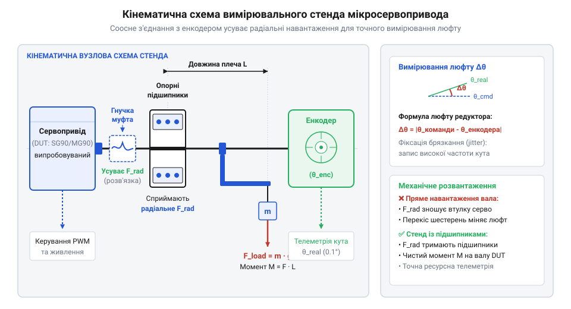
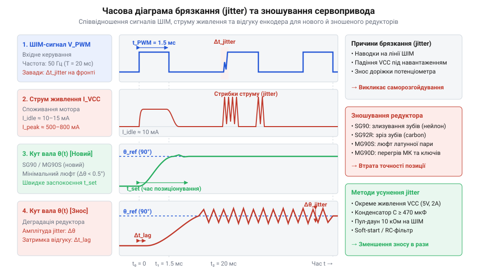
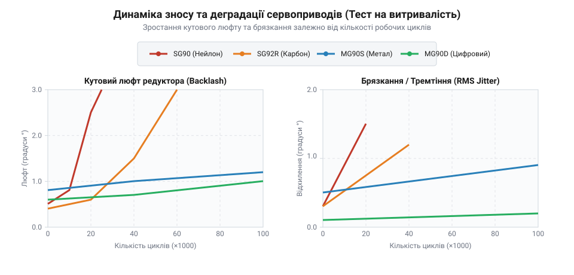

# Стенд для випробування довговічності редуктора та вимірювання брязкання вала

<preknowlist>
- [Tower Pro SG90 — мікросерво 9g](root:cat-hw-actuators/sg90-servo) — Конструкція пластикового редуктора та базові електричні характеристики SG90.
- [MG90S V2 — мікросерво з металевим редуктором](root:cat-hw-actuators/mg90s-servo) — Будова металевого редуктора та граничні навантаження MG90S.
- [Сервоприводи радіокерованих моделей: будова, редуктори та ШІМ-керування](root:cat-hw-actuators/rc-servo-mechanisms-and-control) — Принцип формування ШІМ-сигналу керування та робота внутрішньої петлі зворотного зв'язку.
</preknowlist>

## Непередбачувані відмови та брязкання сервоприводів

У робототехнічних проєктах малого масштабу розробники часто стикаються з ситуацією, коли маніпулятор або поворотно-похилий механізм починає лихоманити: вал виконавчого приводу безперервно вібрує в точці зупинки, а під час виходу на робочий момент шестерні повністю втрачають зубці. Проблема полягає у суттєвій розбіжності між паспортними характеристиками бюджетних мікросервоприводів та їхньою дійсною витривалістю в умовах реальної експлуатації. Паспортний утримуючий момент вимірюється у статиці за максимальної напруги, але він нічого не каже про динамічну втому матеріалів під циклічними змінами напрямку руху.

Серцевиною бюджетного приводу є колекторний двигун постійного струму, що обертає вихідний вал через багатоступеневий підвищувальний по моменту @@la|редуктор@@ (від лат. @@la|reductio@@ — «зменшення»). У конструкції [популярного мікросервопривода SG90](root:cat-hw-actuators/sg90-servo) застосовуються шестерні з поліоксиметилену. Під дією пікових ударних навантажень пластикові зубці першого та другого ступенів піддаються пластичній деформації, що призводить до швидкого зрізання зубців. Модель @@en|SG92R@@ використовує вуглеволоконне посилення пластику, що підвищує міцність, але не рятує від стирання профілю при тривалій роботі. Сервоприводи з [металевим редуктором MG90S](root:cat-hw-actuators/mg90s-servo) та @@en|MG90D@@ демонструють значно вищу стійкість до поломки зубців, проте латунні та алюмінієві шестерні піддаються швидкому абразивному зношуванню, утворюючи механічний @@de|люфт@@ (від нім. @@de|Luft@@ — «повітря»).

Другою критичною відмовою є виникнення хаотичних високочастотних коливань вала — джиттер (від англ. @@en|jitter@@ — «тремтіння»). Механіка виникнення @@en|джиттера@@ має як електричну, так і механічну природу. Внутрішній аналоговий потенціометр (від лат. @@la|potentia@@ та грец. @@el|metron@@), який виконує роль датчика зворотного зв'язку позиції, зношується під час безперервного ковзання струмознімального важеля по вугільній доріжці. Утворюється графітовий пил, з'являються мікротріщини та зони нестабільного контакту. Коли внутрішній мікроконтролер приводу отримує [ШІМ-сигналом керування](root:cat-hw-actuators/rc-servo-mechanisms-and-control) задану позицію, шум на аналоговій лінії зворотного зв'язку сприймається мостовою схемою як помилка позиціонування. Контролер починає миттєво змінювати напрямок струму через мостовий @@en|H-міст@@ (від англ. @@en|H-bridge@@), змушуючи двигун сіпатися в обох напрямках.

Ручне випробовування не дозволяє оцінити точну швидкість деградації редуктора чи відстежити виникнення мікроскопічного @@en|джиттера@@ на початкових стадіях. Людина не здатна прикладати стабільний вимірюваний момент і одночасно фіксувати відхилення кута в частки градуса протягом сотен тисяч циклів. Для об'єктивного оцінювання реального ресурсу приводів сімейства @@en|SG90@@ та @@en|MG90S@@ необхідний спеціалізований вимірювальний стенд із безперервною автоматичною фіксацією телеметрії.

## Механічна конструкція стенда та енкодер

Щоб отримати точні дані про деградацію механіки сервоприводу, вимірювальна платформа повинна зчитувати реальний кут повороту вала незалежно від внутрішніх датчиків приводу. При цьому кріплення випробовуваного зразка має виключати паразиційне радіальне навантаження на його вихідний вал. Якщо закріпити важіль безпосередньо на качалку сервоприводу, гравітаційна сила вантажу почне згинати вал у бічному напрямку. Це призведе до вигину пластикового корпусу та передчасного руйнування втулок ковзання, викривляючи результати тестування довговічності шестерень.

Механічна платформа стенда будується на жорсткій металевій або акриловій підставі. Випробовуваний привід фіксується у затискачі, а його вихідний вал з'єднується з проміжним валом стенда через гнучку спіральну або кулачкову муфту. Проміжний вал спирається на дві кулькові підшипникові опори, які повністю сприймають радіальні та осьові зусилля від навантажувального плеча. Для передачі обертання від вала приводу до муфти використовується адаптер з [комплекту стандартних качалок](root:cat-hw-actuators/servo-horns), що гарантує відсутність прослизання. Завдяки такій соосній кінематиці внутрішній @@en|редуктор@@ приводу зазнає лише чистого крутного моменту.


*Кінематична схема випробувального стенда: соосне з'єднання вала сервоприводу через гнучку муфту з енкодером та навантажувальним важелем.*

Навантаження створюється за допомогою відкаліброваного важеля зі змінними важками. Гравітаційний крутний момент `M_load`, що протидіє обертанню вала при відхиленні на кут `θ`, обчислюється за формулою:

```
M_load = m · g · L · sin(θ)
```

Де `m` — маса вантажу на важелі, `g` — прискорення вільного падіння (9.81 м/с²), `L` — відстань від осі обертання до центра мас вантажу, `θ` — поточний кут відхилення важеля від вертикалі.

Для безперервної фіксації кута застосовується зовнішній квадратурний оптичний енкодер (від англ. @@en|encoder@@) або безконтактний магнітний сенсор Холла (наприклад, [магнітний енкодер AS5048](root:cat-hw-sensors/as5048-magnetic-encoder)). Зовнішній датчик позиції не вносить механічного тертя і дає змогу вимірювати фактичний кут із роздільною здатністю до 0.05°.

Чистий механічний @@de|люфт@@ `Δθ_play` вимірюється як кутова різниця між крайніми точками вибірки зазору під підтягувальним навантаженням в обох напрямках при фіксованій позиції ротора:

```
Δθ_play = θ_cw - θ_ccw               [різниця крайніх кутових положень під реверсивним навантаженням]
```

Де `θ_cw` — кут, зафіксований енкодером при навантаженні за годинниковою стрілкою, а `θ_ccw` — кут при навантаженні проти годинникової стрілки. Порівняльні випробування малих пристроїв, як-от [мікропривода HD-1370A](root:cat-hw-actuators/hd-1370a-servo), вимагають застосування зменшеного навантажувального плеча, проте загальний кінематичний принцип соосного підвісу лишається незмінним.

## Схема комутації та завадозахищене живлення

Апаратне забезпечення випробувального стенда вимагає ретельного проектування електричних кіл. Колекторний мікродвигун у момент пуску або різкого реверсу під навантаженням споживає піковий струм до 0.8 А для @@en|SG90@@ та понад 1.2 А для @@en|MG90S@@. Якщо випробовуваний привід і вимірювальна мікроконтролерна система живляться від одного нерозв'язаного джерела, високий внутрішній опір провідників призводить до імпульсних просідань напруги живлення (@@en|brownout@@).

Коли напруга на шині живлення контролера просідає нижче критичного порогу, відбуваються збої генерації сигналів таймера або скидання мікросхеми. Крім того, під час перемикання ламелей колектора двигуна виникає дугове іскріння, яке випромінює високочастотні електромагнітні завади на сигнальну лінію ШІМ (від англ. @@en|PWM@@, @@en|pulse-width modulation@@ — «широтно-імпульсна модуляція»). Ці завади спотворюють тривалість керуючого імпульсу, спричиняючи штучний ложний @@en|джиттер@@.


*Діаграма часових співвідношень ШІМ-імпульсу керування, кутового відгуку енкодера та сплесків струму живлення під час виникнення джиттера.*

Для нейтралізації електричних завад схема комутації стенда будується за принципом розділення силової та вимірювальної шин:

1. Двоканальне джерело живлення: сервоприводи живляться від окремого силового блоку з напругою 5.0–6.0 В, а мікроконтролер та енкодер — від стабілізованої лінії 3.3 В або 5.0 В через лінійний регулятор із високим коефіцієнтом пригнічення завад. 2. Фільтрація силової шини: безпосередньо біля силого роз'єму сервоприводу встановлюється електролітичний конденсатор ємністю 470–1000 мкФ для компенсації струмових кидків, а також керамічний конденсатор 0.1 мкФ для шунтування високочастотних імпульсів на землю. 3. Захист ліній телеметрії: виходи оптичного або магнітного енкодера підключаються до входів лічильника мікроконтролера через RC-фільтри низьких частот (100 Ом та 1 нФ) та підтягувальні резистори 4.7 кОм до лінії живлення датчика. 4. Гальванічна та логічна розв'язка: керуюча лінія ШІМ передається через швидкісний оптрон або буферний тригер Шмітта з підтяжкою до землі резистором 10 кОм, що унеможливлює виникнення плаваючого стану при завантаженні прошивки.

На відміну від того, як влаштовані [промислові безколекторні сервоконтролери](root:cat-hw-actuators/bldc-servo-controller) зі вбудованими LC-фільтрами та цифровою обробкою завад, бюджетні мікросервоприводи абсолютно незахищені від пульсацій живлення. Зіставивши параметри стенда з моделями з [лінійки приводів Power HD](root:cat-hw-actuators/powerhd-family) чи специфікою модифікованих [сервоприводів постійного обертання](root:cat-hw-actuators/continuous-rotation-servo-mod), стає очевидно, що завадозахищене живлення та гальванічна розв'язка є обов'язковою передумовою для отримання об'єктивних часових діаграм зносостійкості.

## Алгоритм циклічних випробувань та телеметрії

Ручне тестування або просте перемикання крайніх положень сервоприводу за допомогою затримок не дозволяє виявити динамічні дефекти механіки та перехідні процеси в електронії. Щоб об'єктивно оцінити деградацію редуктора та появу брязкання, мікроконтролер стенда повинен виконувати жорстко детермінований тестовий @@it|профіль@@ (від італ. @@it|profilo@@ — «обрис, контур») руху з одночасним високочастотним опитуванням зовнішнього датчика позиції. На вхід алгоритму надходять стабільна силова напруга й вимірювальні імпульси енкодера, а на виході формується впорядкований масив часових рядів — @@el|телеметрія@@ (від грец. @@el|tele@@ — «далеко» та @@el|metron@@ — «вимірювання»).

Тестовий цикл складається з трьох послідовних фаз: гармонічного хитання для оцінки динамічної відгукливості, ступінчастого реверсу під максимальним навантаженням та фази статичного утримання заданого кута. Під час ступінчастого реверсу мікроконтролер подає на [лінію керування сервоприводом](root:cat-hw-actuators/rc-servo-mechanisms-and-control) широтно-імпульсний сигнал з імпульсами від 1000 мкс до 2000 мкс, що відповідає кутам від 0° до 180°. Фаза статичного утримання триває 500–1000 мс і слугує для вимірювання паразитного брязкання вала — @@en|джиттера@@ (від англ. @@en|jitter@@ — «тремтіння»).

Для усунення часового тремтіння самого вимірювача опитування енкодера здійснюється за строго фіксованим інтервалом `Δt = 1 мс` (частота 1000 Гц) через апаратне переривання таймера або апаратний декодер квадратурного сигналу. На кожному кроці вимірювання `t_k` контролер обчислює миттєву кутову похибку `e(t_k)`. Позначимо через `θ_enc(t_k)` фактичний кут повороту вала, виміряний зовнішнім енкодером у момент `t_k`, а через `θ_target(t_k)` — заданий програмний кут.

        e(t_k) = θ_enc(t_k) - θ_target(t_k)               [обчислення миттєвої кутової похибки]

Визначена таким чином похибка описує як динамічне відставання ротора під час розгону, так і кутовий @@de|люфт@@ вала при зміні напрямку обертання.

Прямий запис телеметрії у повільну енергонезалежну пам'ять або відправка текстових рядків через послідовний порт під час виконання руху викликає затримки переривань і спотворює інтервали опитування. Тому виміряні значення записуються у швидкий оперативний @@en|буфер@@ (від англ. @@en|buffer@@ — «пом'якшувач»), збудований за принципом кільцевої черги у пам'яті @@en|MCU@@ (від англ. @@en|microcontroller unit@@). Передавання накопичених даних на комп'ютер відбувається у фоновому режимі або під час коротких пауз між фазами руху.

:::tabs
@tab C++ | Arduino
:::code proj-servo-gearbox-durability-and-jitter-test-bench/cpp/arduino/telemetryframe.cpp
@tab C | ESP-IDF
:::code proj-servo-gearbox-durability-and-jitter-test-bench/c/esp-idf/log-telemetry-point.c
:::

Згенерований у такий спосіб масив телеметричних кадрів містить повну історію поведінки механізму й слугує вхідними даними для математичного аналізу зносу та деградації внутрішніх вузлів приводу.

## Аналіз телеметрії та порівняння приводів

Сирі часові ряди, накопичені контролером стенда, вимагають математичної обробки для виокремлення двох незалежних факторів деградації: механічного зношування редуктора та електричного брязкання вала. Кутовий @@de|люфт@@ редуктора (від лат. @@la|reductio@@ — «зменшення») визначається за відхиленням позиції вала при реверсі під стаціонарним моментом. Для оцінки чисельного значення @@en|джиттера@@ аналізується стаціонарна ділянка телеметрії, де керуючий сигнал залишається незмінним.

Позначимо через `N` кількість вибірок кута на інтервалі статичного утримання, через `θ_i` — значення кута із зовнішнього енкодера у вибірці `i`, а через `θ_avg` — математичне сподівання кута позиціонування. Середньоквадратична @@la|дисперсія@@ (від лат. @@la|dispersio@@ — «розсіювання») `σ_jitter` розраховується за формулою:

        θ_avg = (1 / N) · ∑ θ_i                           [обчислення середнього кута у фазі спокою]
        σ_jitter = √ ( (1 / N) · ∑ (θ_i - θ_avg)² )       [середньоквадратична дисперсія брязкання вала]

Величина `σ_jitter` показує ступінь амплітудного тремтіння вала, викликаного зношуванням потенціометра або електрозвадами в колі зворотного зв'язку.


*Залежність кутового люфту (ліворуч) та брязкання вала (праворуч) від кількості випробувальних циклів для SG90, SG92R, MG90S та MG90D.*

Порівняльні циклічні випробування чотирьох поширених моделей мікросервоприводів під 50% номінальним навантаженням виявляють принципові відмінності у характерах їхнього зношування:

1. [Бюджетний мікросервопривод SG90](root:cat-hw-actuators/sg90-servo): має початковий люфт `Δθ_play ≈ 0.4°`. Після 15 000–20 000 циклів відбуваються втоминні мікротріщини зубців першого ступеня редуктора з поліоксиметилену, що призводить до зрізання зубців і повної механічної відмови. Зношування доріжки @@la|потенціометра@@ (від лат. @@la|potentia@@ — «сила» та грец. @@el|metron@@ — «вимірювання») провокує різке зростання брязкання до `σ_jitter > 1.8°` вже після 25 000 циклів. 2. Модель @@en|SG92R@@: завдяки вуглеволоконному наповнювачу пластику шестерень зрізання зубців відстрочується до 50 000–60 000 циклів. Однак абразивне зношування профілю зубців збільшує люфт до `Δθ_play > 1.2°`, а вугільний @@la|потенціометр@@ деградує з такою ж швидкістю, як і у базової версії. 3. [Сервопривод MG90S з латунним редуктором](root:cat-hw-actuators/mg90s-servo): латунні та алюмінієві шестерні повністю виключають катастрофічне зрізання зубців навіть при 150 000 циклів. Проте відсутність загартування викликає викривлення профілю та наклеп металу, через що люфт зростає з 0.3° до 1.6°. Аналоговий графітовий @@la|потенціометр@@ залишається слабким місцем і спричиняє виникнення аналогового брязкання. 4. Цифровий привод @@en|MG90D@@: поєднує металевий редуктор із внутрішнім цифровим контролером. Завдяки високочастотній цифровій обробці сигналу потенціометра та вужчій зоні нечутливості значення брязкання залишається низьким (`σ_jitter < 0.15°`) протягом усього терміну служби. При цьому накопичення механічного люфту через тертя металевих шестерень відповідає показникам моделі @@en|MG90S@@.

Для проєктування робототехнічних систем із розрахованим ресурсом добір приводу має спиратися на критичний параметр. Якщо у проєкті вирішальною є стійкість до ударних перевантажень при обмеженому бюджеті, вибір утилітарно падає на металевий редуктор. Якщо ж вимагається тривала точність утримання позиції без джиттера під час радіомодельного чи робототехнічного керування, перевагу слід надавати цифровим моделям із металевим редуктором. Обробка телеметрії автоматизованого стенда дозволяє точно визначити межу надійності приводу задовго до його критичного виходу з ладу на реальному об'єкті.