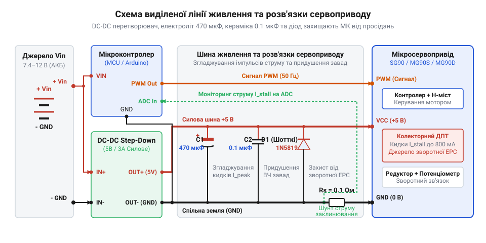
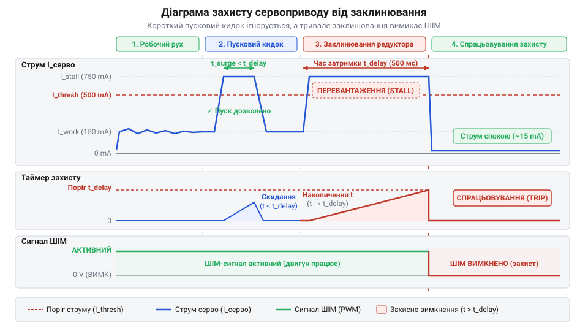
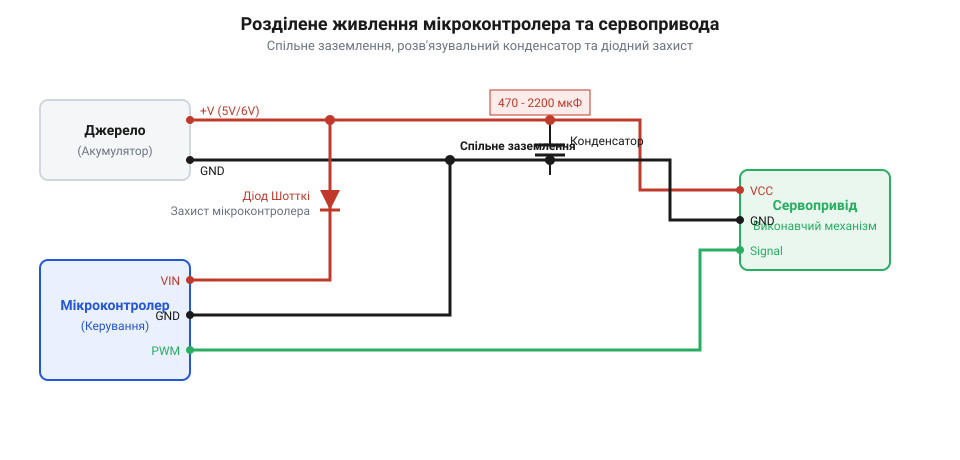

# Побудова схеми живлення та захисту від заклинювання сервоприводів SG90/MG90

<preknowlist>
- [Tower Pro SG90 — мікросерво 9g](root:cat-hw-actuators/sg90-servo) — Конструкція, електромеханічні характеристики та електричні параметри струмоспоживання пластикового мікросервоприводу.
- [MG90S V2 — мікросерво з металевим редуктором](root:cat-hw-actuators/mg90s-servo) — Особливості струмових навантажень, механічна міцність та відмінності металевого редуктора від пластикового під час заклинювання.
- [Сервоприводи радіокерованих моделей: будова, редуктори та ШІМ-керування](root:cat-hw-actuators/rc-servo-mechanisms-and-control) — Принцип генерації ШІМ-сигналу керування положенням вала та внутрішня схема зворотного зв'язку.
</preknowlist>

## Причини перезавантажень та збоїв сервоприводів

Пряме підключення ліній живлення компактного сервоприводу до тієї ж шини 5 В, від якої працює мікроконтролер, майже завжди призводить до раптових самочинних перезавантажень обчислювача та хаотичного сіпання вала двигуна. Проблема маніфестується у момент, коли керуюча програма видає команду змінити кут вала [мікросервоприводу Tower Pro SG90](root:cat-hw-actuators/sg90-servo) або моделі з [металевим редуктором MG90S](root:cat-hw-actuators/mg90s-servo). Замість плавного повороту мікроконтролер скидається в початковий стан, а сервопривід зупиняється в проміжному положенні.

В основі цього явища лежить фізика роботи колекторного двигуна постійного струму, який слугує силовим приводом у мікросервоприводах. У нерухомому стані обмотки ротора не перетинають магнітні лінії статора, тому проти-ЕРС (зворотна електрорушійна сила, англ. *Back Electromotive Force*, @@en|Back-EMF@@) дорівнює нулю. Електричний опір мідного дроту обмоток становить лише 3.3 Ом. У момент подачі напруги живлення через двигун протікає максимальний пусковий струм, який визначається законом Ома для ділянки кола.

Значення пускового струму при напрузі живлення 5 В дістаємо з співвідношення напруги та опору обмотки:

I_start = U_supply ÷ R_winding
= 5.0 V ÷ 3.3 Ohm                      [законом Ома для ділянки кола]
= 1.515 A                              [обчислення максимального пускового струму]

Такий кидок струму триває від 10 до 50 мілісекунд, поки ротор не розгониться і @@en|Back-EMF@@ не обмежить струмоспоживання до штатного робочого рівня 100–150 мА. Аналогічний струмовий сплеск амплітудою 0.5–1.2 А виникає під час механічного заклинювання вала, коли зовнішнє навантаження повністю зупиняє обертання двигуна.

Будь-яка лінія живлення та з'єднувальні провідники мають власний омічний опір та індуктивність. Коли через з'єднувальні дроти, контакти макетної плати або тонкі доріжки друкованої плати протікає пусковий струм 1.5 А, на цьому паразитному опорі виникає суттєве падіння напруги.

Падіння напруги на провідниках лінії живлення при опорі кіл 0.8 Ом розраховується так:

U_drop = I_start × R_line
= 1.5 A × 0.8 Ohm                      [законом Ома для опору провідників]
= 1.2 V                                [обчислення втрати напруги]

У результаті напруга на шині живлення мікроконтролера миттєво просідає з 5.0 В до 3.8 В. Якщо це значення падає нижче порогу спрацьовування внутрішнього апаратного компаратора скидання при просіданні напруги (англ. *Brown-out Reset*, @@en|Brown-out Reset@@ або @@en|BOR@@), який у більшості мікроконтролерів налаштований на рівень 4.3 В або 2.7 В, апаратний блок @@en|BOR@@ негайно примусово скидає процесор у стан перезавантаження. Детальніше принцип дії таких компараторів висвітлює [апаратна система скидання мікроконтролера Brown-out Reset](root:hw-arch/mcu-brownout-reset).

Додаткову деструктивну роль відіграє @@en|зворотна ЕРС@@ самоіндукції обмоток двигуна. Під час швидкої комутації обмоток транзисторами внутрішнього моста сервоприводу при керуванні через [сигнал ШІМ-керування](root:cat-hw-actuators/rc-servo-mechanisms-and-control) струм в індуктивності обмоток не може змінитися миттєво. Згідно з законом самоіндукції, на виводах двигуна виникають високовольтні імпульсні сплески зворотної полярності амплітудою до десятків вольт:

U_L = -L × (dI ÷ dt)
= -L × (ΔI ÷ Δt)                       [законом електромагнітної індукції]

Ці високовольтні голчасті імпульси проникають у спільні кола живлення та заземлення, створюючи високочастотні завади, які здатні спотворити вміст регістрів мікроконтролера або викликати збій виконання команд. Для усунення цих явищ необхідне фізичне розділення кіл живлення логіки та силових приводів із застосуванням спеціалізованих фільтрів.

## Проектування виділеної лінії живлення DC-DC

Для виключення впливу потужних імпульсних навантажень на чутливе цифрове ядро мікроконтролера лінію живлення сервоприводів необхідно фізично відокремити від шини живлення логіки. Використання лінійних параметричних стабілізаторів (LDO) для живлення сервоприводів від вищої вхідної напруги (наприклад, 12 В від акумулятора) є неефективним через високе тепловиділення, яке обчислюється як добуток спаду напруги на струм навантаження.

Натомість силовий вузол будується на основі імпульсного понижувального перетворювача (англ. *buck converter*, @@en|Buck-перетворювач@@ або @@en|DC-DC@@ перетворювач). Принцип роботи та розрахунок таких схем викладено у статті [імпульсні понижувальні DC-DC перетворювачі топології Buck](root:hw-power/buck). Перетворювач забезпечує ККД на рівні 85–92%, знижуючи вхідну напругу 9–12 В до стабільних 5.0 В для живлення приводів. При цьому мікроконтролер живиться від власного стабілізатора, а обидві системи об'єднуються лише по спільній шині заземлення (@@en|GND@@), підключеній в одній точці за топологією «зірка».

Для компенсації короткочасних пускових струмів безпосередньо біля роз'ємів підключення сервоприводів встановлюється комбінований фільтр, що складається з електролітичного та керамічного конденсаторів. Електролітичний конденсатор виступає локальним накопичувачем енергії. Оскільки звичайні електролітичні конденсатори мають помітний еквівалентний послідовний опір (англ. *Equivalent Series Resistance*, @@en|ESR@@), для кіл живлення сервоприводів слід обирати низькоімпедансні конденсатори серії @@en|Low-ESR@@.

Необхідну ємність електролітичного конденсатора C_bulk для утримання просідання напруги ΔU в межах 0.2 В під час пускового кидку струму I_surge = 1.0 A тривалістю t_surge = 20 ms розраховують за базовим співвідношенням заряду та напруги:

C_bulk = I_surge × t_surge ÷ ΔU
= 1.0 A × 0.02 s ÷ 0.2 V                [формулою зв'язку струму, часу та ємності]
= 0.1 F ÷ 0.2                          [обчислення проміжного значення]
= 0.0001 F                             [переведення у Фаради]
= 100 uF                               [переведення у мікрофаради]

На практиці з урахуванням розкиду параметрів та старіння ємності рекомендується обирати електролітичний конденсатор ємністю 470–1000 мкФ з робочою напругою не менше 10 В.

Електролітичний конденсатор не здатний фільтрувати високочастотні завади через власну паразитну індуктивність обкладок. Тому паралельно йому якомога ближче до виводів живлення сервоприводу підключають керамічний конденсатор C_bypass ємністю 0.1–1.0 мкФ. Керамічний конденсатор має мінімальний @@en|ESR@@ та паразитна індуктивність, що дозволяє йому ефективно шунтувати на землю високочастотні голчасті імпульси комутації.

Захист від високовольтних сплесків @@en|зворотної ЕРС@@ реалізується встановленням напівпровідникового захисного елемента. Для цього застосовують @@en|діод Шотткі@@ (англ. *Schottky diode*), який підключають паралельно виходу @@en|DC-DC@@ перетворювача у зворотному напрямку, або супресор (англ. *Transient Voltage Suppressor*, @@en|TVS-діод@@). Низьке пряме падіння напруги на діоді Шотткі (U_f ≈ 0.3 V) забезпечує швидке замикання імпульсів зворотної полярності на шину живлення до того, як вони досягнуть критичних для електроніки значень.

Принципова схема збудованого вузла живлення та фільтрації наведена на рисунку нижче:

*Принципова схема виділеної лінії живлення сервоприводу з імпульсним DC-DC перетворювачем, згладжувальним електролітичним конденсатором, шунтувальною керамікою та діодом захисту від зворотної ЕРС.*

Таке узгодження компонентів гарантує, що просідання напруги на логічній шині мікроконтролера не перевищуватиме 50 мВ навіть під час одночасного старту кількох приводів.

## Вимірювання струму через вимірювальний шунт

Створення стабілізованого вузла живлення вирішує проблему збоїв мікроконтролера, але не захищає механіку та обмотки сервоприводів від перегріву та руйнування при механічному заклинюванні. Для виявлення аварійного стану необхідно реалізувати апаратний моніторинг струмоспоживання в реальному часі.

Найпростішим та найстійкішим інструментом вимірювання є струмовимірювальний @@en|шунт@@ (англ. *shunt* — паралельне відгалуження) — прецизійний низькоомний резистор R_shunt, який вмикається послідовно в коло живлення сервоприводу. Залежно від точки включення розрізняють дві топології вимірювання:
- Вимірювання у від'ємному плечі (англ. *low-side sensing*, @@en|low-side@@) — шунт встановлюється між виводом @@en|GND@@ сервоприводу та спільною землею схеми. Перевагою є вимірювання напруги відносно землі, що дозволяє підключати сигнал безпосередньо до аналогово-цифрового перетворювача (англ. *Analog-to-Digital Converter*, @@en|АЦП@@ або @@en|ADC@@). Недоліком є зміщення потенціалу землі сервоприводу на величину падіння напруги U_shunt, що може спотворити пороги логічного сигналу @@en|ШІМ@@. - Вимірювання у додатному плечі (англ. *high-side sensing*, @@en|high-side@@) — шунт вмикається між позитивним виводом живлення +5 В та сервоприводом. Земля приводу залишається нерозривною, проте вимірювана напруга перебуває під високим потенціалом шини живлення, що вимагає застосування диференційного операційного підсилювача або спеціалізованої мікросхеми токового монітора.

Падіння напруги на шунті опором 0.1 Ом при протіканні робочого струму 150 мА обчислюється за законом Ома:

U_shunt = I_load × R_shunt
= 0.15 A × 0.1 Ohm                      [законом Ома для ділянки кола]
= 0.015 V                              [обчислення падіння напруги]
= 15 mV                                [переведення у мілівольти]

При прямому підключенні напруги 15 мВ до 12-бітного @@en|АЦП@@ з опорною напругою 3.3 В вимірюваний сигнал займатиме лише 18 відліків із 4096 можливих, що дає незадовільну точність. Для підвищення чутливості сигнал з шунта підсилюють за допомогою операційного підсилювача з коефіцієнтом підсилення A_v = 10.0. Напруга на вході @@en|АЦП@@ набуває значення 15 mV × 10.0 = 150 mV, що відповідає приблизно 186 відлікам @@en|АЦП@@.

Динаміка зміни струмоспоживання сервоприводу в різних режимах роботи та часові межі спрацьовування захисту представлені на часовій діаграмі:

*Часова діаграма струмоспоживання сервоприводу при робочому русі, короткочасному пусковому кидку та тривалому заклинюванні редуктора з показаним порогом спрацьовування та часовою затримкою вимкнення ШІМ.*

Імпульсний характер роботи колекторного двигуна створює значний рівень шумів у вимірювальному тракті. Для отримання достовірного значення струму застосовують цифрову фільтрацію методом ковзного середнього (англ. *Moving Average*, @@en|Moving Average@@) та розрахунок середньоквадратичного значення (англ. *Root Mean Square*, @@en|RMS@@).

Практична реалізація накопичення вибірок та цифрової фільтрації у кільцевому буфері мовами C та C++ представлена нижче:

:::tabs
@tab C
:::code proj-servo-power-decoupling-and-stall-protection/c/include/adc_current_sensor.h 16-35
:::code proj-servo-power-decoupling-and-stall-protection/c/src/adc_current_sensor.c 37-84
@tab C++
:::code proj-servo-power-decoupling-and-stall-protection/cpp/include/adc_current_sensor.hpp 13-33
:::code proj-servo-power-decoupling-and-stall-protection/cpp/src/adc_current_sensor.cpp 30-70
:::

Накопичені та відфільтровані значення @@en|RMS@@-струму дозволяють програмі точно відрізнити короткочасний пусковий кидок тривалістю до 50 мс від небезпечного механічного заклинювання вала, що триває понад 300–500 мс.

## Програмний алгоритм захисту від заклинювання

Коли електричний серводвигун починає рух або різко змінює напрямок обертання, у його обмотках виникає короткочасне перевантаження — @@en|inrush current@@ (пусковий струм), який у 3–5 разів перевищує струм холостого ходу. Для сервоприводів [пластикової серії Tower Pro SG90](root:cat-hw-actuators/sg90-servo) амплітуда цього сплеску досягає 500–600 мА і триває від 20 до 50 мілісекунд, поки ротор не набере робочу швидкість. Якщо просто порівнювати миттєвий струм із вимірювача @@en|ADC@@ з фіксованим порогом, будь-який старт приводу викликатиме хибне аварійне спрацьовування.

Справжня небезпека для механіки та обмоток виникає при тривалому механічному блокуванні вала. У стані заклинювання @@en|stall current@@ (струм заклинювання) підтримується на максимальному рівні безперервно. Оскільки електрична енергія більше не перетворюється на механічну роботу, 100% споживаної потужності виділяється у вигляді тепла на обмотках ротора, що швидко призводить до оплавлення ізоляції та зрізання пластикових або металевих зубців.

Щоб надійно відрізнити безпечний пусковий імпульс від небезпечного заклинювання, застосовують комбінований алгоритм часового порогу та цифрової фільтрації @@en|RMS@@ (середньоквадратичного струму):

1. **Цифрова фільтрація**: Вибірки АЦП накопичуються у кільцевому буфері, де метод @@en|moving average@@ (ковзного середнього) згладжує високочастотні шуми колектора. 2. **Перевірка струмового порогу**: Відфільтроване значення порівнюється з паспортним лімітом моделі `stall_current_limit_ma`. 3. **Часова витримка**: При перевищенні порогу запускається внутрішній таймер. Якщо струм залишається високим довше за безпечний інтервал `stall_timeout_ms` (зазвичай 300–500 мс), стан фіксується як аварійне заклинювання. 4. **Аварійне зняття напруги**: Програма виконує функцію @@en|detach@@ — апаратно вимикає генерацію @@en|PWM@@ (ШІМ-сигналу) на виході таймера мікроконтролера, знеструмлюючи мостову схему драйвера сервоприводу.

Для моделей із [металевим редуктором MG90S](root:cat-hw-actuators/mg90s-servo) пороговий струм встановлюють вищим (близько 750 мА), оскільки їхній двигун має менший внутрішній опір обмоток.

У наведених реалізаціях мовами C та C++ неблокуючий обробник `towerpro_servo_process` (або `update`) виконується у кожному циклі програмування та викликає аварійний @@en|callback@@ при фіксації затору.

:::tabs
@tab C
:::code proj-servo-power-decoupling-and-stall-protection/c/src/towerpro_servo.c 117-160
@tab C++
:::code proj-servo-power-decoupling-and-stall-protection/cpp/src/towerpro_servo.cpp 122-153
:::

Після усунення механічної перешкоди систему необхідно повернути до штатного стану. Для цього реалізовано функцію скидання аварії (`towerpro_servo_reset_fault` / `resetEmergency`), яка очищує буфер вибірок АЦП, знімає прапорець заклинювання та відновлює @@en|attach@@ ШІМ-сигналу.

:::tabs
@tab C
:::code proj-servo-power-decoupling-and-stall-protection/c/src/towerpro_servo.c 163-183
@tab C++
:::code proj-servo-power-decoupling-and-stall-protection/cpp/src/towerpro_servo.cpp 177-183
:::

Завдяки такій логіці сервопривод зберігає повну динаміку позиціонування під час швидких переходів, але гарантовано знеструмлюється до того, як температура обмоток досягне критичної межі.

## Збирання та верифікація захищеного вузла

Апаратна реалізація завадостійкого вузла живлення вимагає об'єднання обчислювального ядра мікроконтролера, імпульсного перетворювача, виділеної шинної розв'язки та кола вимірювання струму в єдину узгоджену систему.

*Принципова структура захищеного приводного вузла із розділеними контурами живлення та вимірювальним шунтом.*

Покроковий процес збирання та налагодження виконується у такій послідовності:

1. **Монтаж силового контуру**: Підключіть вхід імпульсного перетворювача @@en|Buck DC-DC@@ до джерела живлення (наприклад, Li-ion 7.4 В або 12 В). Налаштуйте вихідну напругу точно на 5.0 В. 2. **Встановлення фільтрів та захисту**: Розмістіть електролітичний конденсатор @@en|low-ESR@@ (470–1000 мкФ) поруч із силовим роз'ємом сервоприводу для компенсації низькочастотних просідань. Паралельно йому підпаяйте керамічний конденсатор (0.1 мкФ) для шунтування високочастотних завад колектора. Встановіть захисний діод Шотткі або @@en|TVS-diode@@ у зворотній полярності паралельно лініям живлення сервоприводу для гасіння зворотної ЕРС. 3. **Підключення вимірювального шунта**: У розрив заземлювальної лінії (low-side sensing) або лінії живлення (high-side sensing) встановіть прецизійний резистор опором 0.05–0.1 Ом. Сигнал із шунта через операційний підсилювач подайте на аналоговий вхід мікроконтролера. 4. **Об'єднання земель**: З'єднайте силову землю DC-DC перетворювача з цифровою землею мікроконтролера в одній точці поруч із шунтом, щоб уникнути проходження силових струмів через логічні провідники.

Для перевірки стійкості вузла підключають @@en|oscilloscope@@ (осцилограф) до лінії 3.3 В / 5 В мікроконтролера та виконують тестування у двох режимах:

* **Динамічний тест**: Сервопривод здійснює серію швидких переміщень на кути 0°–180° відповідно до стандартів [ШІМ-керування сервоприводами](root:cat-hw-actuators/rc-servo-mechanisms-and-control). На екрані осцилографа контролюють амплітуду просідання напруги. При правильно підібраній ємності просідання не перевищує 150–200 мВ, що повністю запобігає спрацьовуванню @@en|Brown-out Reset@@ (BOR) мікроконтролера. * **Тест заклинювання**: Вал сервоприводу штучно блокують важелем. Програма фіксує зростання RMS-струму понад задану межу та через 400–500 мс відключає ШІМ-сигнал.

Програмна верифікація демонструє точну синхронізацію струмового моніторингу та спрацьовування захисного відключення при штучному заклинюванні ротора:

:::tabs
@tab C
:::code proj-servo-power-decoupling-and-stall-protection/c/src/main.c 64-118
@tab C++
:::code proj-servo-power-decoupling-and-stall-protection/cpp/src/main.cpp 49-88
:::

Результати випробувань підтверджують, що пропонована апаратно-програмна архітектура повністю усуває перезавантаження мікроконтролера від імпульсних завад і захищає електродвигун від теплового руйнування при блокуванні редуктора.