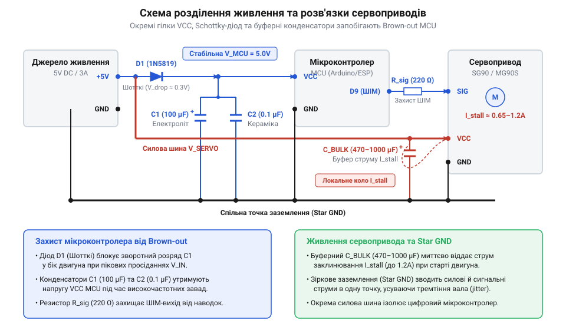
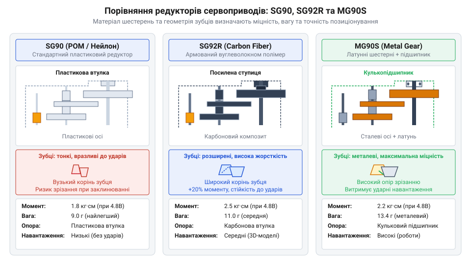
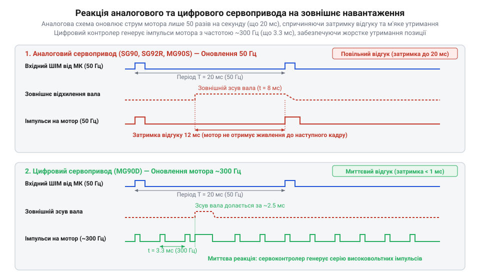
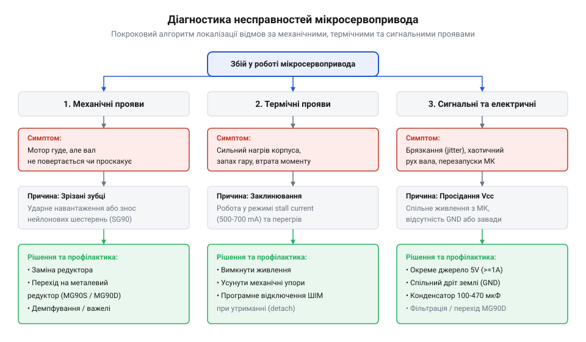

# Лінійка 9-грамових мікросервоприводів Tower Pro (SG90, SG92R, MG90S, MG90D)

<preknowlist>
- [Сервоприводи радіокерованих моделей: будова, редуктори та ШІМ-керування](root:cat-hw-actuators/rc-servo-mechanisms-and-control) — Базові принципи роботи серводвигунів, призначення потенціометра зворотного зв'язку та стандарт тривалості ШІМ-імпульсу від 1 до 2 мілісекунд.
- [Tower Pro SG90 — мікросерво 9g](root:cat-hw-actuators/sg90-servo) — Базові технічні характеристики базової моделі SG90, стандартне призначення проводів та габарити корпусу.
</preknowlist>

## Причини збоїв 9-грамових мікросервоприводів у робототехніці

Розробка компактного робототехнічного пристрою — маніпулятора, чотиринога чи поворотного підвісу камери — зазвичай починається з вибору легких і бюджетних виконавчих механізмів. Найтиповішим рішенням у аматорській та навчальній робототехніці є застосування 9-грамових мікросервоприводів серії @@en|Tower Pro SG90@@. У лабораторних умовах без механічного навантаження такі приводи працюють бездоганно: вал точно повертається на заданий кут, а електроніка споживає мінімальний струм. Однак варто зібрати робота в суцільну конструкцію та прикласти реальне статичне чи динамічне зусилля, як розробник стикається з трьома критичними симптомами збоїв. Вал починає хаотично тремтіти в крайніх положеннях, керуючий мікроконтролер циклічно перезавантажується під час старту руху, а після кількох годин роботи вал сервопривода взагалі втрачає зв'язок із двигуном через руйнування внутрішніх шестерень.

Для розуміння природи цих несправностей важливо усвідомити, що 9-грамовий @@en|сервопривод@@ (від англ. *servo*, з лат. *servus* — слуга, виконавчий механізм із зворотним зв'язком) являє собою замкнену електромеханічну систему з високою щільністю компонування. У тісному пластиковому корпусі розмірами всього 22 × 12 × 29 мм об'єднано колекторний двигун постійного струму, багатоступеневий уповільнювальний редуктор, аналоговий або цифровий контролер позиціонування та потенціометр зворотного зв'язку. Будь-який відхил від розрахованих режимів експлуатації миттєво провокує ланцюгову реакцію апаратних збоїв, оскільки електричні та механічні процеси в такому малому об'ємі тісно пов'язані.

Першою та найпоширенішою причиною перезавантаження керуючої плати є падіння напруги в колі живлення через виникнення пускових струмів заклинювання. Маленький колекторний двигун сервопривода у стаціонарному режимі обертання споживає струм у межах 50–100 мА. Проте у момент пуску з місця, при різкій зміні напрямку обертання або при механічному блокуванні вала ротор зупиняється. У цьому стані проти-ЕРС (проти-електрорушійна сила) обмоток падає до нуля, і споживаний струм досягає значення @@en|stall current@@ (з англ. *stall* — зупинка, заклинювання, та *current* — струм; струм заклинювання). Розрахунок цього струму описується класичним виразом:

```
I_stall = (V_cc - E_emf) / R_motor
        = V_cc / R_motor         [E_emf = 0 при заклинюванні]
```

Оскільки активний опір обмоток `R_motor` у мікродвигунах становить лише кілька Ом, піковий струм `I_stall` для базової моделі @@en|Tower Pro SG90@@ досягає 650–800 мА, а для модифікацій із металевим редуктором на кшталт @@en|Tower Pro MG90S@@ може перевищувати 1.2 А. Якщо групу з 4–6 таких сервоприводів підключено до тієї ж шини 5 В, від якої живиться мікроконтролер, одночасний пуск моторів створює імпульсний кидок струму до 4–6 А. Це спричиняє швидкий спад напруги на лінії живлення. Коли напруга падає нижче порогу спрацьовування схеми скидання мікроконтролера @@en|brown-out reset@@ (з англ. *brown-out* — просідання напруги, та *reset* — скидання), процесор негайно перезавантажується. Щоб уникнути цього, необхідно використовувати спеціалізовану [схемотехніку живлення індуктивних навантажень](root:hw-power/power-supplies-inductive-loads-decoupling), яка передбачає розв'язувальні конденсатори великої ємності та окремі силові лінії. Детальні формули для вимірювання механічного моменту та [розрахунку пускових струмів](root:cat-hw-actuators/sg90-mg90-micro-servos-family/math-servo-stall-torque-and-power-calculations.md) винесено у відповідну математичну вставку, а практична реалізація захисного модуля описана в проєкті [апаратного модуля розв'язки](root:cat-hw-actuators/sg90-mg90-micro-servos-family/proj-servo-power-decoupling-and-stall-protection.md) живлення.


*Підпис: Схема апаратного розділення живлення контролера та мікросервопривода для усунення просідань напруги при пікових струмах.*

Другий типовий збій — брязкання чи тремтіння вихідного вала @@en|jitter@@ (з англ. *jitter* — тремтіння, брязкання). Воно виникає тоді, коли внутрішній аналоговий підсилювач помилки сервопривода не може заспокоїти вал у заданій точці й починає постійно перерегульовувати положення ротора вліво та вправо. Причинами @@en|jitter@@ є:
- високочастотні імпульсні перешкоди на керуючій лінії ШІМ та просідання опорної напруги внутрішнього потенціометра;
- механічний люфт у зубчастому зачепленні редуктора, через який потенціометр не відчуває мікропереміщень двигуна в межах мертвої зони @@en|deadband@@ (з англ. *deadband* — мертва зона, зона нечутливості);
- знос струмознімних доріжок внутрішнього потенціометра зворотного зв'язку під дією вібрацій;
- наведення завад на довгий сигнальний провід при відсутності спільного екранування.

Підключення приводів через [стандартний апаратний інтерфейс](root:cat-hw-actuators/sg90-mg90-micro-servos-family/api-micro-servo-hardware-interface.md) вимагає суворого дотримання правил заземлення, адже будь-яка різниця потенціалів між землею сигналу та силовою землею викликає викривлення зчитуваного кута. Глибше збої регулювання описані у матеріалі про [контурі зворотного зв'язку](root:hw-motion/servo-feedback-potentiometers-and-control-loops) та загальні принципи побудови [механізмів радіокерованих сервоприводів](root:cat-hw-actuators/rc-servo-mechanisms-and-control).

Третя за чергою, але найважча за наслідками проблема — механічне зрізання зубців редуктора. Колекторний двигун мікросервопривода розвиває високу швидкість обертання (понад 15 000 об/хв), яка знижується редуктором з передаточним відношенням близько 1:400. Згідно з законом збереження енергії, зменшення швидкості у 400 разів пропорційно збільшує крутний момент на вихідному валу. Однак при інерційних ударах або спробі повернути вал вручну зворотний механічний імпульс передається від великої вихідної шестерні до маленьких проміжних шестерень. Оскільки момент інерції ротора двигуна заважатиме йому миттєво розігнатися у зворотний бік, виникає колосальне динамічне зусилля на зріз зубців. Нейлонові зубці під дією зсувного напруження вигинаються й зрізаються, перетворюючи сервопривод на непридатний для експлуатації вузол.

Історія виникнення та розвитку сімейства 9-грамових сервоприводів від компанії @@en|Tower Pro@@ стала поворотним моментом у любительській робототехніці та радіокерованому моделюванні. До появи стандарту @@en|9g@@ розробникам доводилося використовувати важкі та громіздкі 40-грамові приводи стандарту @@en|standard servo@@, які суттєво обмежували польотну масу авіамоделей та габарити компактних роботів. Масовий випуск базової бюджетної моделі @@en|Tower Pro SG90@@ із пластиковим нейлоновим редуктором створив новий де-факто стандарт ринку, однак експлуатація виявила вразливість нейлонових зубців до зрізання при ударних навантаженнях. У відповідь на це виробник розробив модифікацію @@en|Tower Pro SG92R@@ із вуглеволоконним підсиленням редуктора для підвищення міцності без збільшення ваги. Подальший запит на силові приводи призвів до створення моделей @@en|Tower Pro MG90S@@ із суцільнометалевим редуктором та цифрової версії @@en|Tower Pro MG90D@@, у якій аналоговий контролер замінили на мікропроцесор для забезпечення вищої утримувальної сили та швидкості відгуку. Ця хронологія вдосконалення матеріалів та електроніки демонструє еволюцію компромісів між масою, ціною, механічною міцністю та точністю позиціонування.

Усвідомлення причин виникнення електричних та механічних збоїв підводить розробника до необхідності детального аналізу внутрішньої будови редукторів та фізики матеріалів шестерень 9-грамового сімейства.

## Механіка редукторів та матеріал шестерень

Внутрішня механіка 9-грамового мікросервопривода є прикладом екстремальної компонувальної оптимізації. Усі моделі сімейства @@en|Tower Pro@@ — від класичної @@en|Tower Pro SG90@@ до металевої @@en|Tower Pro MG90S@@ — мають схожу кінематичну схему. Обертальний момент від високооборотного мікродвигуна постійного струму передається на вихідний вал через багатоступеневу циліндричну зубчасту передачу @@en|reduction gear train@@ (з англ. *reduction* — зменшення, зниження, та *gear train* — зубчаста передача). Редуктор складається з чотирьох або п'яти послідовних ступенів зведення швидкості, які компонуються у обмеженому просторі корпусу.

Щоб вмістити чотири ступені передачі у корпус завширшки 12 мм, інженери застосовують зубчасті колеса з надзвичайно малим модулем зубців (порядку `m = 0.2 ... 0.35` мм). Кожен проміжний ступінь містить двоярусну шестерню, де на одному штифті об'єднано велике зубчасте колесо веденого ярусу та малий триб ведучого ярусу. Загальне передаточне відношення кінематичного ланцюга `i` обчислюється як добуток передаточних відношень усіх ступенів:

```
i = i_1 × i_2 × i_3 × i_4
  = (z_2 / z_1) × (z_4 / z_3) × (z_6 / z_5) × (z_8 / z_7)
  ≈ 400 ... 600
```

Завдяки такому великому передаточному відношенню вихідний крутний момент досягає значень від 1.8 до 2.5 кг·см, незважаючи на те, що сам мікродвигун розвиває момент лише у кілька грам-сантиметрів. Проте механічні напруження розподіляються вздовж кінематичного ланцюга вкрай нерівномірно:
- На першому ступені (триб вала двигуна) швидкість обертання максимальна (до 18 000 об/хв), а колове зусилля на зубець мінімальне. Тут головною вимогою до матеріалу є низький коефіцієнт тертя та стійкість до абразивного зношування при високих колових швидкостях. - На проміжних ступенях швидкість знижується, а коловий момент зростає у десятки разів. - На останньому ступені (вихідний вал з осьовим кріпленням серво-рога) швидкість становить близько 83–100 об/хв (0.1–0.12 с / 60°), а статичний крутний момент досягає максимуму. Зубці вихідного колеса та передостанньої шестерні зазнають колосальних згинних та зсувних напружень.

Вибір матеріалу шестерень визначає механічну надійність усієї системи. Розглянемо детально три базові матеріали, що застосовуються у лінійці @@en|Tower Pro@@.

1. **Нейлон (Поліамід PA / Поліоксиметилен POM)** у [базовій моделі SG90](root:cat-hw-actuators/sg90-servo):
Нейлон володіє чудовими антифрикційними властивостями, має низьку питому масу та не потребує постійного рідкого змащення завдяки ефекту самозмащування. Нейлонові шестерні виготовляються методом високоточного лиття під тиском, що робить їх надзвичайно дешевими у масовому виробництві. Гнучкість молекулярної структури нейлону дозволяє зубцям деформуватися в межах пружної зони при невеликих вібраціях, гасячи ударні імпульси. Однак при перевищенні межі плинності матеріалу (наприклад, під час ударного зупинення робо-руки об перешкоду) пластичність нейлону стає його слабкістю: зубці вихідного або передостаннього ступеня легко зрізаються. Крім того, при тривалій роботі з високим коефіцієнтом заповнення @@en|duty cycle@@ (з англ. *duty cycle* — робочий цикл, коефіцієнт заповнення) тертя розігріває пластик вище 60 °C, що суттєво зменшує його границю міцності.

2. **Вуглеволоконний полімер (PA + Carbon Fiber)** у приводі @@en|Tower Pro SG92R@@:
Для усунення проблеми зрізання зубців без збільшення маси привода у модифікації @@en|Tower Pro SG92R@@ виготовляють редуктор із композитного матеріалу — поліаміду, армованого короткими вуглецевими мікроволокнами. Вуглеволокно створює всередині пластикової матриці міцний просторовий каркас. Це підвищує межу міцності на зсув та згин у 1.5–2 рази порівняно з чистим нейлоном. Завдяки цьому крутний момент @@en|Tower Pro SG92R@@ зростає до 2.5 кг·см при збереженні маси 9 грамів. Композитні шестерні набагато стійкіші до ударних навантажень, але є більш крихкими при екстремальних точкових ударах і вимагають застосування спеціальних густих силіконово-тефлонових мастил, оскільки абразивність вуглеволокна збільшує тертя на сталевих осях. Для детального ознайомлення з апаратною структурою та характеристиками цієї модифікації перегляньте огляд про [мікросервопривод SG92R із вуглеволоконним редуктором](root:cat-hw-actuators/sg92r-servo).

3. **Металеві сплави (Латунь, Алюміній, Сталь)** у приводі [моделі MG90S](root:cat-hw-actuators/mg90s-servo) та @@en|Tower Pro MG90D@@:
У серводвигунах серії @@en|MG90S@@ та @@en|MG90D@@ редуктор повністю або частково виконано з металевих сплавів: малі проміжні триби виготовляються з випресованої латуні, а вихідна шестерня — з анодованого алюмінієвого сплаву або фрезерованої сталі. Металевий редуктор здатний витримувати короткочасні перевантаження, які у кілька разів перевищують номінальний момент, без ризику зрізання зубців. Проте використання металу створює нові інженерні компроміси:
- Маса привода зростає з 9 грамів до 13.4 грама (на 50%), що є критичним для авіамоделей та легких безпілотників. - Збільшується механічний люфт @@en|backlash@@ (з англ. *backlash* — люфт, зазор зубчастої передачі) через допуски фрезерування дрібних металевих зубців (до 1–2° на вихідному валу). - При відсутності густого мастила металеві зубці зношуються з утворенням дрібної металевої стружки, яка може викликати підклинювання редуктора або коротке замикання на платі електроніки. - Збільшується акустичний шум під час обертання та зростає знос посадкових гнізд сталевих осей у пластикових стінках корпусу.

Порівняння механічних характеристик лінійки підсумовано нижче на схемі розрізу редукторів. Аналогічні компроміси застосовуються й у приводах інших виробників, таких як [сервопривод Power HD HD-1370A](root:cat-hw-actuators/hd-1370a-servo) та сервомеханізми з [родини Power HD](root:cat-hw-actuators/powerhd-family).


*Підпис: Порівняльний розріз редукторів SG90, SG92R та MG90S, що ілюструє різницю в матеріалах шестерень та їхню стійкість до зрізання.*

Співвідношення параметрів моделей 9-грамової лінійки:
- **SG90**: редуктор нейлон, момент 1.8 кг·см, маса 9 г, низький шум, низька ціна, високий ризик зрізання зубців під ударом. - **SG92R**: редуктор вуглеволокно (PA+CF), момент 2.5 кг·см, маса 9 г, середня ціна, висока стійкість до зсуву, помірний шум. - **MG90S**: редуктор метал (латунь/алюміній), аналогова електроніка, момент 2.2–2.5 кг·см, маса 13.4 г, максимальна стійкість до ударів, підвищений люфт @@en|backlash@@. - **MG90D**: редуктор метал, цифрова електроніка, момент 2.4–2.6 кг·см, маса 13.4 г, максимальна стійкість та утримувальне зусилля, найвища ціна у лінійці.

Тривала експлуатація редукторів неминуче призводить до розширення зони нечутливості через зношування зачеплення. Збільшення люфту @@en|backlash@@ призводить до того, що підсилювач сервопривода починає працювати в режимі автоколивань, намагаючись компенсувати механічну затримку між поворотом мотора та поворотом потенціометра. Для оцінки ресурсу та вимірювання динамічного тремтіння розроблено спеціальний [випробувальний стенд довговічності](root:cat-hw-actuators/sg90-mg90-micro-servos-family/proj-servo-gearbox-durability-and-jitter-test-bench.md) редукторів. Крім того, при виборі сервопривода під механічний вузол важливо правильно підбирати та підключати відповідні типи [комплектних серво-рогів](root:cat-hw-actuators/servo-horns) та враховувати [загальну архітектуру та класифікацію](root:cat-hw-actuators/rc-servo-mechanisms-and-control) виконавчих механізмів.

Таким чином, вибір конкретної моделі 9-грамового сервопривода завжди є результатом зваженого компромісу між масою конструкції, стійкістю до ударних навантажень та допустимим рівнем люфту вихідного вала.

## Аналогове та цифрове керування позиціонуванням

Коли важіль роботизованого маніпулятора піддається зовнішньому навантаженню, реакція сервопривода повністю визначається архітектурою його внутрішньої електроніки. Якщо відхилити вал звичайного аналогового мікросервопривода, привод часто починає податливо прогинатися, гудіти або розгойдуватися з виразним брязканням. У той самий час цифровий привод аналогічного розміру чинить жорсткий, майже миттєвий опір, утримуючи заданий кут із точністю до часток градуса. Різниця між ними полягає не в редукторі й не в мотузках тяги, а у частоті та алгоритмах обробки сигналу зворотного зв'язку.

Стандартний керуючий сигнал для 9-грамових сервоприводів — це @@en|PWM@@ (англ. *Pulse-Width Modulation* — широтно-імпульсна модуляція, від латинського *modulatio* — розміреність) з частотою повторення кадру `50 Hz` (період `20 ms`). Тривалість високого рівня вхідного імпульсу задає кутове положення вала: `1.0 ms` відповідає крайньому лівому положенню (`0°`), `1.5 ms` — нейтральному центру (`90°`), а `2.0 ms` — крайньому правому положенню (`180°`).

В аналогових сервоприводах, таких як @@en|SG90@@, @@en|SG92R@@ та @@en|MG90S@@, вхідний ШІМ-сигнал надходить на спеціалізовану аналогову мікросхему керування (наприклад, аналог @@en|NE544@@ або @@en|AA51880@@). Усередині цієї мікросхеми працює власний генератор одиночного імпульсу, тривалість якого пропорційна поточному опору потенціометра зворотного зв'язку, жорстко зв'язаного з вихідним валом редуктора.

Принцип аналогового порівняння є суто апаратним: аналоговий компаратор віднімає тривалість внутрішнього генераторного імпульсу від тривалості вхідного керуючого імпульсу. Отримана різниця утворює так званий «імпульс помилки» (error pulse). Довжина цього імпульсу визначає, на який час відкриються силові транзистори внутрішнього @@en|H-bridge@@ (англ. *H-bridge* — містова схема Н-форми для реверсу струму мотора) для подачі напруги живлення на обмотки колекторного двигуна.

Головне обмеження аналогової схеми полягає у прив'язці силового відгуку до частоти вхідного кадру. Силові транзистори Н-моста в аналоговому [мікросервоприводі SG90](root:cat-hw-actuators/sg90-servo) відкриваються для подачі напруги на мотор **лише один раз за період вхідного кадру** — тобто 50 разів на секунду (кожні 20 мс).

Якщо вихідний вал зміщується зовнішньою силою у проміжку між вхідними імпульсами (наприклад, на 5-й мілісекунді кадру), аналоговий контролер не реагує на це зміщення до приходу наступного керуючого імпульсу на 20-й мілісекунді. Крім того, при малих кутових відхиленнях (менше `1°`) імпульс помилки виходить надзвичайно коротким — всього кілька мікросекунд. Енергії одного такого короткого імпульсу, що подається на мотор раз на 20 мс, недостатньо для подолання тертя спокою в редукторі та інерції ротора.

Через це в аналогових сервоприводах виникає відчутна зона нечутливості — @@en|Deadband@@ (англ. *deadband* — мертва зона, від англійського *dead* — нерухомий, та *band* — смуга). У бюджетних аналогових моделях вона становить від `5` до `10 µs`. Якщо керуючий сигнал змінюється на величину, меншу за ширину мертвої зони, сервопривод узагалі не порушує статичного стану.

Наслідком цього стає низька утримувальна сила — @@en|holding torque@@ (англ. *holding torque* — момент утримання). Вал під статичним навантаженням зміщується на кілька градусів, перш ніж імпульс помилки зросте достатньо для виклику реакції мотора. На межі зсуву вала виникає брязкання — @@en|Jitter@@ (англ. *jitter* — тремтіння, від англійського *chitter* — тремтіти, сіпатися), коли вал починає хаотично сіпатися навколо точки рівноваги через розряджання фільтруючих конденсаторів та шуми графітового шару потенціометра.

Цифрова модель @@en|MG90D@@ кардинально змінює цей принцип. Зовні вона має такі ж габарити корпусу та суцільнометалевий редуктор, як і в аналогового [сервопривода MG90S](root:cat-hw-actuators/mg90s-servo), проте всередині замість аналогового компаратора встановлено високошвидкісний мікроконтролер.

Цифровий сервопривод приймає вхідний ШІМ-сигнал частотою 50 Гц від зовнішнього контролера та оцифровує його тривалість за допомогою апаратного таймера. Одночасно внутрішній мікроконтролер зчитує поточне положення потенціометра зворотного зв'язку через швидкісний аналогово-цифровий перетворювач — @@en|ADC@@ (англ. *Analog-to-Digital Converter*).

Замість чекання наступного вхідного кадру протягом 20 мс, мікроконтролер сервопривода @@en|MG90D@@ генерує **власну внутрішню ШІМ для живлення мотора** з частотою від `250 Hz` до `300 Hz` (у 5–6 разів вищою за частоту вхідного сигналу).


*Порівняльний часовий графік подачі силових імпульсів на колекторний двигун в аналоговій (50 Гц) та цифровій (300 Гц) системах керування.*

Як видно з часової діаграми, цифровий сервопривод передає силові імпульси живлення на колекторний двигун значно частіше. Протягом одного вхідного періоду тривалістю 20 мс цифрова схема встигає подати на обмотки мотора від 5 до 6 коригувальних імпульсів живлення замість одного.

Завдяки такій високій частоті оновлення навіть при найменшому кутовому зміщенні вала цифрова схема негайно генерує серію частих силових імпульсів високої амплітуди. Зона нечутливості в @@en|MG90D@@ зменшується до `1`–`2 µs` (у 5 разів вужча, ніж в @@en|SG90@@). Вихідний вал цифрового сервопривода реагує на найменші відхилення миттєво, демонструючи високу плавність ходу та виняткову жорсткість фіксації положення.

Однак цифрове керування має свої технологічні компроміси. Оскільки колекторний мотор у @@en|MG90D@@ отримує коригувальні імпульси 300 разів на секунду, він постійно перебуває в мікровібрації для підтримання заданого кута. Це викликає характерний високочастотний звук (писк) під навантаженням та призводить до збільшеного споживання струму у стані спокою. Обмотки мотора та силові ключі Н-моста в цифрових сервоприводах нагріваються сильніше, ніж у аналогових аналогів.

Для практичного застосування важливо правильно налаштовувати джерело керуючого сигналу. Проаналізувати [математичну модель перетворення ШІМ](root:cat-hw-actuators/sg90-mg90-micro-servos-family/math-servo-pwm-angle-mapping-and-quantization.md) у кутове положення можна у відповідній вставці. Для розробки програмного забезпечення спираються на [інтерфейс драйвера апаратного ШІМ](root:cat-hw-actuators/sg90-mg90-micro-servos-family/api-micro-servo-pwm-driver-interface.md), який описує процедури конфігурації таймерів. Оцінити стійкість привода до механічних коливань дозволяє [стенд вимірювання брязкання](root:cat-hw-actuators/sg90-mg90-micro-servos-family/proj-servo-gearbox-durability-and-jitter-test-bench.md) під навантаженням.

Для розширення знань корисно вивчити [контури зворотного зв'язку](root:hw-motion/servo-feedback-potentiometers-and-control-loops) та принципи алгоритмічної корекції помилки. При проєктуванні контролерів також зважають на можливості [апаратних таймерів мікроконтролерів](root:hw-arch/hardware-pwm) для генерації часових інтервалів з точністю до мікросекунди.

Нижче наведено приклад програмної конфігурації генерації ШІМ-сигналу з високоточним мікросекундним таймером для керування сервоприводами лінійки @@en|Tower Pro@@.

:::tabs
== C (ESP-IDF)
:::code sg90-mg90-micro-servos-family-d/c/esp-idf/init-servo-pwm.c
== C++ (Arduino)
:::code sg90-mg90-micro-servos-family-d/cpp/arduino/setup.cpp
:::

## Пікові струми живлення та заклинювання

Масові апаратні збої в роботі робототехнічних систем — несподівані перезавантаження керуючого мікроконтролера, хаотичні здригання валів сервоприводів та вихід із ладу стабілізаторів живлення — найчастіше спричинені електричними процесами всередині колекторних моторів. Маленький 9-грамовий сервопривод настільки легкий, що легко ввестися в оману щодо його електричної потужності. Проте у динамічних режимах пуску та заклинювання його струмове споживання зростає у десятки разів від номінального.

Усередині сервоприводів @@en|SG90@@, @@en|SG92R@@, @@en|MG90S@@ та @@en|MG90D@@ працює колекторний двигун постійного струму. Під час обертання ротора у його мідних обмотках генерується проти-електрорушійна сила — @@en|Back-EMF@@ (англ. *Back Electromotive Force* — зворотна електрорушійна сила, від німецького *Elektromotorische Kraft*). Напруга проти-ЕРС виникає внаслідок перетину обмотками магнітного поля статора та спрямована назустріч зовнішній напрузі живлення `U_supply`.

Завдяки проти-ЕРС результуюча напруга на обмотці обертового мотора дорівнює різниці між напругою живлення та проти-ЕРС. Струм через мотор у сталому режимі обертання залишається низьким — від `100` до `150 mA` (а на холостому ході без редуктора — усього `10`–`20 mA`).

Однак фізика роботи двигуна створює дві граничні ситуації, у яких проти-ЕРС стає **рівною нулю**:
1. **Пусковий момент (вмикання або швидка зміна напрямку)**: ротор ще не обертається, його швидкість дорівнює нулю, тому проти-ЕРС відсутня. 2. **Заклинювання вала (механічний стоп або перевантаження)**: зовнішнє навантаження або упертий обмежувач повністю зупиняють обертання якоря. Швидкість дорівнює нулю, і проти-ЕРС зникає.

Коли ротор зупинений, єдиним фізичним обмежником струму у колі залишається активний омічний опір мідного дроту обмотки ротора `R_winding` та опір контактної групи щіток. У 9-грамових мікросервоприводах цей опір становить всього від `4.0` до `5.5 Ohm`.

Виникає режим струму заклинювання — @@en|Stall current@@ (англ. *stall current* — струм заклинювання, від давньоанглійського *steall* — стойло, зупинка). Згідно з законом Ома, піковий струм заклинювання визначається виразом:

```
I_stall = U_supply / R_winding
        = 5.0 / 4.2           [підстановка напруги живлення 5.0 В та опору обмотки 4.2 Ом]
        = 1.19 A              [розрахунок пікового струму заклинювання одного сервопривода]

P_heat = U_supply × I_stall
       = 5.0 × 1.19           [підстановка напруги 5.0 В та струму заклинювання 1.19 А]
       = 5.95 W               [розрахунок теплової потужності розсіювання на обмотці]
```

Як видно з покрокового обчислення, один сервопривод у стані заклинювання споживає струм `1.19 A` та розсіює у своєму корпусі `5.95 W` у вигляді чистого тепла. Для моделей @@en|SG90@@ з нейлоновим редуктором пусковий струм становить близько `650 mA`, тоді як для металевих @@en|MG90S@@ та цифрових @@en|MG90D@@ під великим моментом утримання він сягає від `900 mA` до `1.2 A`.

Якщо у робототехнічній системі використовується група з 4 сервоприводів, їхній сумарний піковий пусковий струм може миттєво сягнути від `3.5` до `4.8 A`.

Коли сервоприводи підключені до тієї ж 5-вольтової шини живлення, що й керуючий мікроконтролер (наприклад, @@en|ESP32@@, @@en|STM32@@ або @@en|Arduino@@), виникає важка ланцюгова реакція. Внутрішній опір джерела живлення, тонких з'єднувальних проводів та контактів роз'ємів @@en|Dupont@@ викликає глибокий спад напруги живлення.

Напруга на 5-вольтовій шині миттєво просідає до `3.0`–`3.5 V`. У цей момент спрацьовує внутрішній детектор зниження напруги мікроконтролера — @@en|BOD@@ (англ. *Brown-out Detector*), який ініціює аварійне скидання — @@en|Brownout reset@@ (англ. *brownout* — часткове знеструмлення, скидання при спаді напруги, від англійського *brown* — темніти).

Під час скидання мікроконтролера виходи генерації ШІМ переходять у високоімпедансний стан. Керуючий сигнал на сервоприводи зникає, Н-мости вимикають мотори, споживання струму падає, напруга живлення відновлюється до `5.0 V`. Мікроконтролер успішно завантажується, знову ініціалізує периферію та відновлює подачу ШІМ-сигналу. Сервоприводи знову починають рух, знову створюють пусковий сплеск струму — і система входить у безкінечний цикл циклічних перезавантажень.

Поряд із системними збоями електроніки тривале заклинювання вала неминуче руйнує сам сервопривод. Виділення `5.95 W` тепла всередині невеликого корпусу призводить до стрімкого нагріву обмотки якоря до температури понад `130°C` вже за 10–15 секунд. Оплавлення лакової ізоляції мідного дроту викликає міжвиткове коротке замикання. Це призводить до подальшого падіння опору `R_winding`, вигорання транзисторів Н-моста та термічного розплавлення пластикових деталей корпусу.

Для запобігання цим апаратним аваріям у робототехнічних схемах застосовують комплексний апаратний та схемотехнічний захист:
* **Розділення кіл живлення**: Силове коло сервоприводів (`VCC_SERVO`) та цифрове коло мікроконтролера (`VCC_MCU`) живляться від окремих джерел або від окремих каналів імпульсного перетворювача. * **Зіркоподібне заземлення**: Спільна шина @@en|GND@@ з'єднується в одній точці поруч із джерелом живлення, запобігаючи проходженню силових струмів через земляні провідники мікроконтролера. * **Буферні розв'язувальні конденсатори**: Безпосередньо біля колодок підключення сервоприводів встановлюють електролітичні та тантові конденсатори — @@en|Decoupling capacitor@@ (англ. *decoupling* — розв'язка, від франко-латинського *copula* — зв'язок) ємністю від `470 µF` до `1000 µF` з низьким еквівалентним послідовним опором — @@en|Low ESR@@ (англ. *Low Equivalent Series Resistance*). Конденсатори віддають накопичену енергію під час мікросекундних пускових сплесків, згладжуючи спад напруги на шині. * **Самовідновлювані запобіжники**: У коло живлення кожного сервопривода послідовно вмикають @@en|PTC@@-термістор (англ. *Positive Temperature Coefficient*), який при заклинюванні та нагріванні різко збільшує свій опір, обмежуючи струм до безпечних десятків міліампер.

Щоб провести точний [розрахунок пускового струму](root:cat-hw-actuators/sg90-mg90-micro-servos-family/math-servo-stall-torque-and-power-calculations.md) для конкретної конфігурації навантаження, звертаються до математичних формул у відповідній вставці. Побудувати працездатний модуль із буферними конденсаторами та захистом допоможе [схеми живлення та захисту](root:cat-hw-actuators/sg90-mg90-micro-servos-family/proj-servo-power-decoupling-and-stall-protection.md) від заклинювання.

При електричному монтажі та розводці плати враховують [апаратний електричний інтерфейс](root:cat-hw-actuators/sg90-mg90-micro-servos-family/api-micro-servo-hardware-interface.md) роз'ємів та розпіновку. Поглибити розуміння фільтрації завад у колах живлення можна у матеріалі про [схемотехніку живлення індуктивних навантажень](root:hw-power/power-supplies-inductive-loads-decoupling).

Нижче наведено приклад реалізації програмного обмеження швидкості наростання кута (траєкторії розгону) для зменшення пускових струмових сплесків при каскадному керуванні кількома сервоприводами.

:::tabs
== C (ESP-IDF)
:::code sg90-mg90-micro-servos-family-d/c/esp-idf/set-servo-angle-smooth-c.c
== C++ (Arduino)
:::code sg90-mg90-micro-servos-family-d/cpp/arduino/powerawareservo.cpp
:::

## Діагностика несправностей та вибір моделі

Під час експлуатації робототехнічних систем мікросервоприводи серії Tower Pro піддаються інтенсивним механічним, електричним та сигнальним навантаженням. Передчасний вихід з ладу або нестабільна робота вихідного вала найчастіше є наслідком невідповідності обраної моделі реальним умовам застосування. Систематизована діагностика симптомів дозволяє чітко встановити вузол відмови — багатоступеневий редуктор, колекторний мотор, потенціометр зворотного зв'язку чи керувальну плату електроніки.


*Блок-схема діагностики несправностей ілюструє послідовний алгоритм перевірки механічних, термічних та сигнальних симптомів для локалізації вузла відмови мікросервопривода.*

Механічні несправності редуктора виявляються у вигляді вільного прокручування вихідного вала, характерного клацання під навантаженням або повної втрати здатності утримувати заданий кут при виразному гудінні працюючого моторчика. У базовій моделі SG90 шестерні виготовлені з неармованого нейлону, який має високу еластичність, але низьку граничну міцність на зсув. Найбільш уразливим місцем є перша ступінь редуктора — найменша шестерня, з'єднана безпосередньо з валом високооборотного двигуна, де площа контакту зубців мінімальна. Якщо важіль привода (важіль зворотного зв'язку або комплектні [серво-роги](root:cat-hw-actuators/servo-horns)) зазнає зовнішнього ударного навантаження, зубці пластикових шестерень зістригаються (від @@en|shearing failure@@ — зрізання під дією зсуву).

Модифікація SG92R вирішує цю проблему шляхом додавання вуглецевих волокон у полімерну матрицю шестерень. Вуглеволоконний композит значно підвищує руйнівне напруження матеріалу при зсуві та згинанні, запобігаючи зрізанню зубців під час динамічних ривків і зберігши при цьому ультралегку масу привода (9 г). Для систем із постійними механічними ударами та високими інерційними навантаженнями призначені моделі MG90S та MG90D із суцільнометалевим редуктором на основі латунних та алюмінієвих сплавів. Металеві шестерні повністю виключають зрізання зубців, однак піддаються природному абразивному зносу поверхні контакту. З часом це призводить до накопичення кутового люфту (від @@en|backlash@@ — мертвий хід редуктора), через який вихідний вал отримує вільний хід навіть при заблокованому роторі. Виміряти точні параметри люфту та оцінити зносостійкість редуктора під навантаженням дозволяє спеціальний [випробувальний стенд](root:cat-hw-actuators/sg90-mg90-micro-servos-family/proj-servo-gearbox-durability-and-jitter-test-bench.md).

Електричні та термічні несправності пов'язані з механічним заклинюванням вала або його роботою в режимі перевантаження. Коли вихідний вал блокується зовнішньою перешкодою, ротор колекторного двигуна зупиняється, і в ньому повністю припиняється генерація проти-ЕРС (від @@en|back-EMF@@ — протиелектрорушійна сила). За відсутності проти-ЕРС струм споживання привода обмежується виключно низьким активним опором мідного дроту обмоток і досягає пікового значення заклинювання (від @@en|stall current@@ — струм зупинки ротора). Для моделей із металевим редуктором (MG90S, MG90D) струм заклинювання досягає 800–1200 мА при напрузі 6.0 В.

Пластиковий корпус привода має вкрай низьку теплопровідність, унаслідок чого тепло від заклиненого мотора не розсіюється в довкілля. Протягом 20–30 секунд роботи в стані заклинювання температура обмоток перевищує 100 °C, спричиняючи розплавлення захисного лакового покриття, міжвиткове замикання та термічне руйнування двигуна (що супроводжується характерним запахом горілої ізоляції). Одночасно з цим високий пусковий струм створює падіння напруги на опорі провідників живлення, що призводить до апаратного скидання мікроконтролера (від @@en|brownout reset@@ — перезавантаження через просідання напруги VCC). Для захисту схеми застосовують [кола розв'язки живлення](root:cat-hw-actuators/sg90-mg90-micro-servos-family/proj-servo-power-decoupling-and-stall-protection.md) із додаванням самовідновлюваних полімерних запобіжників (від @@en|polyfuse@@ — запобіжник із позитивним температурним коефіцієнтом) та розв'язувальних конденсаторів. Математичні формули розрахунку теплового виділення та пікового струму наведено у [математичному розрахунку моменту](root:cat-hw-actuators/sg90-mg90-micro-servos-family/math-servo-stall-torque-and-power-calculations.md), електричні межі — в [апаратному інтерфейсі приводів](root:cat-hw-actuators/sg90-mg90-micro-servos-family/api-micro-servo-hardware-interface.md), а загальні правила розв'язки — у [схемотехніці живлення навантажень](root:hw-power/power-supplies-inductive-loads-decoupling).

Сигнальні несправності виявляються у формі високочастотного брязкання та хаотичного тремтіння вала (від @@en|to jitter@@ — тремтіти), що супроводжується підвищеним нагріванням та неточною відпрацовкою кута. Діагностика брязкання вимагає розрізнення трьох основних причин:

1. **Нестабільність ШІМ-сигналу від мікроконтролера**: Якщо керуючий імпульс формується програмно через затримки або переривання з нестабільним часом виконання, тривалість імпульсу флуктуює на 2–10 мкс. Внутрішній аналоговий компаратор сервопривода сприймає ці зміни як команду на зміну кута, викликаючи постійне тремтіння вала. Для усунення сигналу помилки слід задіяти [апаратні таймери мікроконтролера](root:hw-arch/hardware-pwm) та оптимізований [програмний драйвер позиціонування](root:cat-hw-actuators/sg90-mg90-micro-servos-family/api-micro-servo-pwm-driver-interface.md), налаштований за розрахунками з [моделі дискретизації ШІМ](root:cat-hw-actuators/sg90-mg90-micro-servos-family/math-servo-pwm-angle-mapping-and-quantization.md). 2. **Знос потенціометра зворотного зв'язку**: Руйнування графітового шарiв потенціометра створює електричні шуми та випадання сигналу на аналоговому вході мікросхеми керування. Контур зворотного зв'язку отримує викривлене значення поточного кута і починає неперервно розгойдувати двигун навколо заданої точки. Принципи роботи таких контурів деталізовано в [контурах зворотного зв'язку](root:hw-motion/servo-feedback-potentiometers-and-control-loops). 3. **Висока чутливість цифрової електроніки MG90D**: У цифровому сервоприводі MG90D мікроконтролер опитує датчик положення та оновлює стан мостового драйвера (від @@en|H-bridge@@ — Н-міст) із частотою 300 Гц і більше, а ширина мертвої зони (від @@en|deadband@@ — зона нечутливості за кутом) становить лише 1 мкс (проти 5 мкс у аналогових SG90/MG90S). Будь-який мінімальний люфт редуктора або пульсація живлення спричиняють активну генерацію протилежно спрямованих імпульсів корекції, викликаючи характерне високочастотне акустичне дзижчання та підвищене споживання струму в стані спокою.

Покрокова діагностика брязкання виконується подачею ШІМ-сигналу від еталонного апаратного генератора з живленням привода від лабораторного джерела. Якщо брязкання зникає, причиною є шуми сигнальної лінії або просідання VCC у робочому контролері. Якщо брязкання зберігається — несправність криється у зносі потенціометра або механічному люфті редуктора.

Синтез технічних характеристик дозволяє сформувати чітку матрицю свідомого вибору сервопривода сімейства Tower Pro під конкретне інженерне завдання:

- **Tower Pro SG90** ([базова модель SG90](root:cat-hw-actuators/sg90-servo)): Найкращий вибір для бюджетних навчальних проєктів, кінематичних макетів та статичних платформ орієнтації датчиків. Вимагає обережності у розрахунку механічних навантажень через низьку міцність нейлонових шестерень (крутний момент 1.8 кг·см при 4.8 В). - **Tower Pro SG92R**: Оптимальне рішення для ультралегких авіамоделей, планерів та мультироторних систем, де маса привода не повинна перевищувати 9 грамів, але кермові поверхні зазнають динамічних аеродинамічних ударів. Вуглеволоконний редуктор запобігає зрізанню зубців під час різких маневрів. - **Tower Pro MG90S** ([металевий сервопривод MG90S](root:cat-hw-actuators/mg90s-servo)): Вибір де-факто для мобільних роботів, суглобів гексаподів, роботизованих маніпуляторів та кермових механізмів моделей. Суцільнометалевий редуктор витримує систематичні механічні удари й забезпечує підвищений момент (до 2.2 кг·см при 6.0 В) за ціною збільшення маси до 13.4 грамів. - **Tower Pro MG90D**: Модель для високоточних робототехнічних систем із вимогами до швидкого відгуку, високого моменту утримання (від @@en|holding torque@@ — сила утримання вала в заданій позиції) та мінімальної кутової похибки. Вимагає обов'язкової апаратної розв'язки живлення та стабільного джерела енергії.

У разі, коли параметри системи виходять за межі можливостей 9-грамової лінійки (потрібен необмежений кутовий рух або момент понад 2.5 кг·см), застосовують модифіковані [сервоприводи постійного обертання](root:cat-hw-actuators/continuous-rotation-servo-mod), потужніші приводи серії [продукти компанії Power HD](root:cat-hw-actuators/powerhd-family) (включаючи надлегкі [мікросерво HD-1370A](root:cat-hw-actuators/hd-1370a-servo)), або промислові [безколекторні інтегральні сервоконтролери](root:cat-hw-actuators/bldc-servo-controller). Загальні фундаментальні принципи побудови та функціонування таких механізмів викладено у публікаціях [будова та класифікація RC-сервоприводів](root:cat-hw-actuators/rc-servo-mechanisms-and-control) та [принципи ШІМ-керування](root:cat-hw-actuators/rc-servo-mechanisms-and-control).