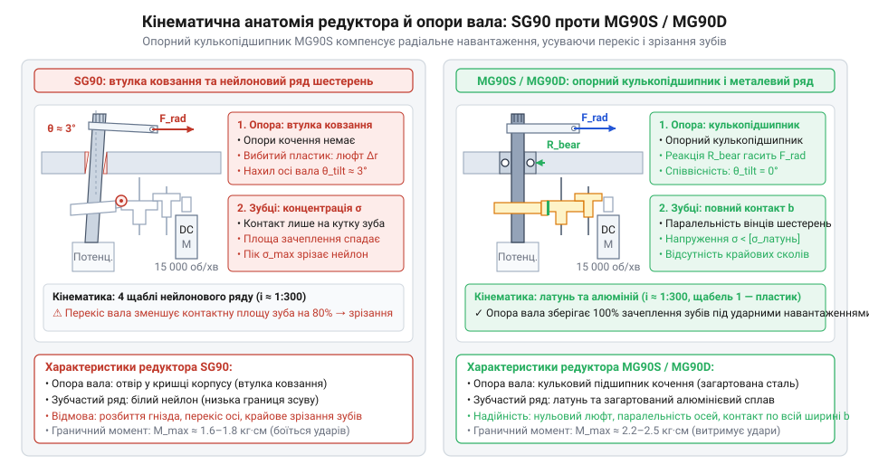
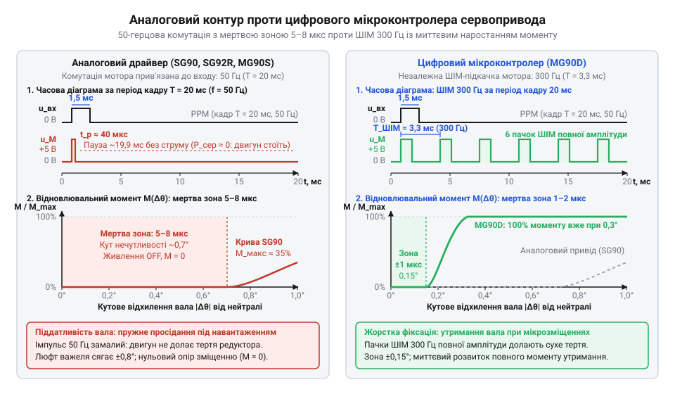
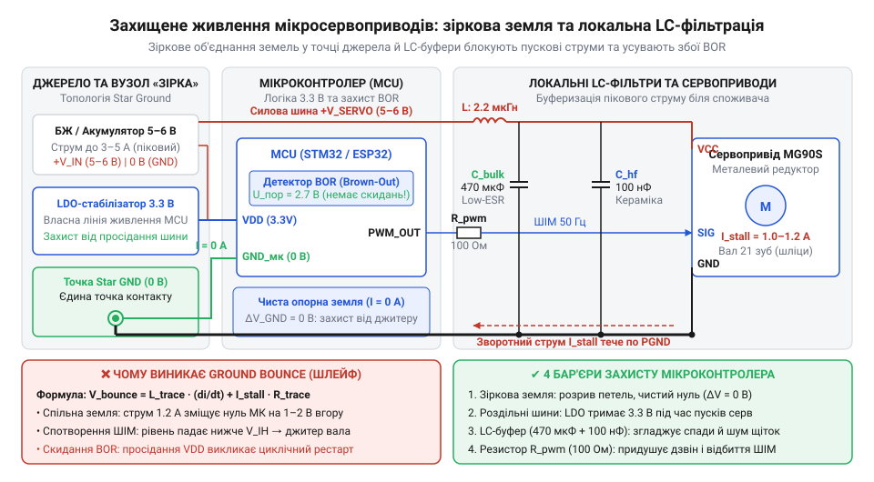
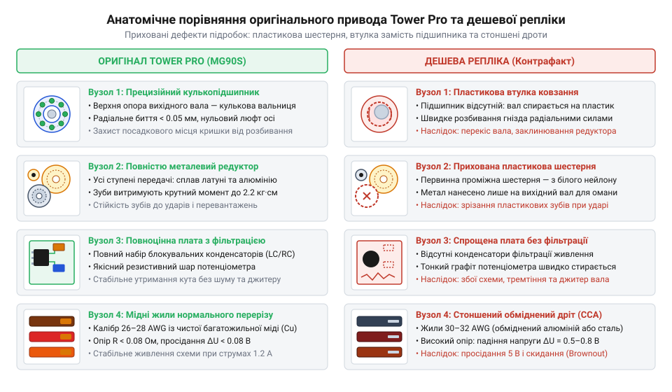
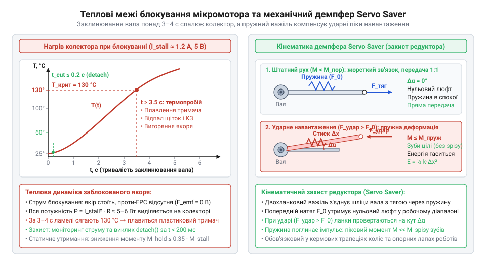

# Лінійка 9-грамових мікросервоприводів Tower Pro (SG90, SG92R, MG90S, MG90D)

<preknowlist>
- [Tower Pro SG90 — мікросерво 9g](root:cat-hw-actuators/sg90-servo) — базовий принцип кутового позиціювання через ШІМ-імпульси тривалістю 1–2 мс та призначення контактів стандартного трипровідного кабелю
- [Серво-роги (запасні)](root:cat-hw-actuators/servo-horns) — механіка передачі крутного моменту через важільні роги та геометричні параметри 21-зубцевого шліцьового вала мікросервопривода
</preknowlist>

## Чому ламаються типові дев'ятиграмові сервоприводи

Коли в роботизованому вузлі потрібно повертати легке корисне навантаження в обмеженому об'ємі — орієнтувати камеру, нахиляти ультразвуковий далекомір чи стуляти мініатюрний захоплювач, — природним вибором здається дев'ятиграмовий мікросервопривід (англ. @@en|micro servo@@; від лат. *servus* — слуга, виконавець). Цей механізм приваблює малою масою, доступністю та простотою інтеграції: він живиться від стандартної напруги 5 В і повертає вихідний вал на заданий кут за сигналами широтно-імпульсної модуляції від звичайного цифрового виводу мікроконтролера. Проте на практиці спрощене підключення базового привода обертається раптовою відмовою конструкції вже під час перших випробувань або за найменшого позаштатного навантаження.

Перша вразливість виникає в механічній передачі під час зіткнення важеля з перешкодою. Щоб крихітний колекторний мікромотор створив помітне зусилля на вихідному валу, швидкість його обертання сповільнює багатоступеневий редуктор (від лат. *reducere* — відводити назад, зменшувати) з передавальним числом близько 1:300. Зворотним боком такого виграшу в моменті стає висока концентрація механічних напружень на зубах шестерень при зустрічному ударі. У класичній моделі [мікросервопривода SG90](root:cat-hw-actuators/sg90-servo) зубчасті колеса відлито з нейлону. Цей термопласт добре поглинає шум під час плавної роботи, проте має низьку межу міцності на зріз. Коли вихідний важіль натрапляє на механічний упор або зазнає удару від інерції робочого органа, тонкі пластикові зуби первинних проміжних шестерень миттєво зрізаються. Двигун продовжує обертатися, але вихідний вал зупиняється або безконтрольно провертається під власною вагою.

Друга проблема полягає в стрибках струму живлення та електричній несумісності з логічними колами. Початківці зазвичай підключають сервопривід безпосередньо до шини 5 В плати мікроконтролера. У стані спокою мікросервопривід споживає лише 10–20 мА, однак під час різкого пуску або механічного гальмування вала виникає стрибок струму блокування (англ. @@en|stall current@@ від англ. *stall* — глухнути, застрягати). Для компактного дев'ятиграмового двигуна цей струм сягає 500–800 мА, а в системі з кількома приводами перевищує кілька амперів. Джерело живлення контролера та тонкі провідники плати не розраховані на таке імпульсне навантаження, тому напруга живлення різко падає. Щойно напруга просідає нижче допустимого порога, апаратна схема захисту від зниження живлення (англ. @@en|Brown-Out Reset@@) перезавантажує процесор. Контролер починає циклічно скидатися під час кожного старту мотора, доки в систему не буде впроваджена [розподілена фільтрація силового живлення](root:hw-power/servo-power-distribution-and-filtering) з окремими лініями та буферними конденсаторами.

Третя типова відмова — хаотичне тремтіння вала під навантаженням, відоме як джитер (англ. @@en|jitter@@ — тремтіння, нервове смикання). Внутрішній контур керування постійно порівнює заданий кут із реальним положенням повзунка потенціометра (від лат. *potentia* — сила та грец. *metron* — міра). Якщо зовнішнє статичне навантаження зміщує вал, підсилювач подає коригувальні імпульси струму на мотор. У бюджетних сервоприводах вихідний вал тримається лише на пластиковій втулці ковзання, яка швидко розбивається, створюючи радіальний люфт (від нім. *Luft* — повітря, зазор між деталями). Разом із падінням напруги на загальному земляному провіднику цей люфт руйнує стабільність зворотного зв'язку: привід постійно проскакує цільову точку, реверсує мотор і починає гучно вібрувати. Такий [паразитний джитер вала](root:hw-analog/servo-jitter-and-ground-bounce) не лише спричиняє похибку позиціювання, а й перегріває двигун та прискорює стирання резистивного шару потенціометра.

Ці відмови зумовлені походженням самого стандарту. Конструкція дев'ятиграмового привода формувалася на початку 2000-х років для надлегких пінопластових авіамоделей, про що розповідає [авіамодельна еволюція стандарту](root:cat-hw-actuators/sg90-mg90-micro-servos-family/hist-9g-micro-servo-evolution.md). У повітрі літаковий привод переміщував невагомі кермові площини проти пружного потоку повітря й не зазнавав жорстких механічних ударів об тверді перешкоди, а живлення забезпечував ємний силовий акумулятор. Спроба використати ту саму дешеву авіаційну конструкцію в робототехнічних суглобах, маніпуляторах чи колісних шасі виявляє її граничні компроміси. Щоб побудувати надійний виконавчий механізм, інженеру необхідно розібратися у внутрішній анатомії привода: оцінити стійкість шестерень із різних матеріалів, жорсткість кулькопідшипникових опор та точність цифрових контурів регулювання.

## Редуктори лінійки: нейлон, вуглепластик, метал

Коли в робототехнічному вузлі виникає потреба підвищити механічну надійність без збільшення габаритів привода, інженер насамперед змінює конструкцію редуктора. Малогабаритний колекторний мікромотор обертається з високою частотою (10 000–15 000 об/хв), тому для отримання корисного зусилля на валу його швидкість знижує багатоступеневий зубчастий ряд із загальним передавальним числом близько 1:300. У міру переходу від первинної шестерні мотора до вихідного вала кутова швидкість спадає, а крутний момент пропорційно зростає. Оскільки всі щаблі редуктора упаковано в мініатюрний корпус, модуль зубчастого зачеплення становить частки міліметра. Тангенційні та згинальні сили, що діють на контактні поверхні зубів, сягають максимуму саме на вихідних ступенях передачі. Під час раптового гальмування чи удару важеля об перешкоду помножений момент концентрується в основах зубів, спричиняючи їхнє зрізання або пластичну деформацію.

Опір цим навантаженням визначає матеріал шестерень. У [базовому мікросервоприводі SG90](root:cat-hw-actuators/sg90-servo) усі зубчасті колеса відлито з нейлону. Цей термопласт має низький коефіцієнт тертя, працює тихо й завдяки пружності згладжує мікроудари під час плавної зміни позиції, проте має низьку границю міцності на зсув. У разі зустрічі важеля з жорстким упором або спроби провернути вихідний вал уручну тонкі пластикові зуби зрізаються безповоротно. Детальний опис нейлонового редуктора, електричні параметри мотора та межі застосування розкриває [9-грамовий мікросервопривід Tower Pro SG90](root:cat-hw-actuators/sg90-servo).

Щоб підвищити міцність без збільшення маси привода, розроблено [модифікацію з вуглепластиковим редуктором](root:cat-hw-actuators/sg92r-carbon-micro-servo). Її шестерні виготовлено з композиту на основі термопласту, армованого вуглецевими мікроволокнами — вуглепластику (англ. @@en|carbon fiber reinforced polymer@@; від лат. *carbo* — вугілля та грец. *plastikos* — придатний для ліплення). Вуглецеві волокна підвищують модуль пружності, міцність на зсув і стійкість до стирання, зберігаючи загальну масу сервопривода на рівні 9 грамів. Зуби з вуглепластику не деформуються під статичним навантаженням і значно довше витримують циклічні реверсивні рухи, хоча від наджорстких динамічних ударів композит усе ж схильний до крихкого сколювання.

Найвищу витривалість до ударів забезпечує металевий редуктор. У [металевому приводі MG90S](root:cat-hw-actuators/mg90s-servo) та його [цифровій версії MG90D](root:cat-hw-actuators/mg90d-digital-micro-servo) шестерні проміжних і вихідного ступенів виготовлено з латуні та загартованого алюмінієвого сплаву. Металевий зубчастий ряд витримує крутний момент до 2.2–2.5 кг·см і не руйнується при зіткненні важеля з механічним упором. Водночас у редукторах MG90S перша проміжна шестерня від вала двигуна часто залишається пластиковою. На вході редуктора мотор обертається з найвищою швидкістю за найменшого крутного моменту. Металева пара на таких обертах створювала б різкий вереск і швидко зношувалася, тоді як пластик ефективно демпфує високочастотний шум зачеплення. Пружність пластикових зубів поглинає зворотні ударні імпульси під час раптових реверсів чи зупинок вала, оберігаючи тонкі пелюсткові щітки колектора від вібраційного відриву й підгоряння. Крутний момент на цьому ступені мізерний, тому за штатного руху зуби не зрізаються, проте під час аварійного удару на повній швидкості саме ця пластикова шестерня виявляється найслабшою ланкою і руйнується першою. Платою за механічну міцність силових металевих ступенів стає збільшення маси привода до 13.4 грама (майже на 50%), відчутніший акустичний шум і зниження ККД передачі через вище тертя металевих пар. Через ці втрати [розрахунок моменту й швидкості](root:cat-hw-actuators/sg90-mg90-micro-servos-family/math-micro-servo-torque-and-speed-calculation.md) вимагає перевірки коефіцієнта корисної дії та фактичної напруги живлення для збереження динаміки вузла.

Однак довговічність редуктора залежить не лише від матеріалу зубів, а й від способу фіксації вихідного вала. Коли закріплений на ньому [важільний серво-ріг](root:cat-hw-actuators/servo-horns) переміщує тягу або утримує незрівноважену масу, на вал діє радіальне навантаження (англ. @@en|radial load@@; від лат. *radius* — промінь, спиця колеса). У моделях SG90 та SG92R опорою вала слугує циліндричний отвір у пластиковій кришці корпусу — найпростіша втулка ковзання (англ. @@en|sleeve bushing@@; від нід. *bus* — коробка, гільза). Під дією бічних зусиль вал поступово розбиває пластикове гніздо, утворюючи радіальний люфт. Вал перекошується, і зачеплення вихідної пари зубчастих коліс втрачає паралельність: контакт між зубами зміщується на крайовий кут, площа зачеплення падає в кілька разів, і зуби зрізаються через локальну концентрацію напружень навіть без перевищення номінального моменту.

Щоб усунути цей перекіс, у моделях MG90S та MG90D у верхню кришку корпусу встановлено мініатюрний кулькопідшипник (англ. @@en|ball bearing@@; від англ. *bear* — нести, витримувати навантаження). Загартовані сталеві кульки жорстко фіксують вал від радіальних зміщень, перетворюючи тертя ковзання на тертя кочення. Опора зберігає сувору співвісність вала з корпусом під значними згинальними навантаженнями, гарантуючи повний контакт зубів по всій їхній ширині.

*Конструктивна відмінність опор вихідного вала: опорний кулькопідшипник компенсує радіальне навантаження від важеля, запобігаючи перекосу вала та руйнівній крайовій концентрації напружень на зубах шестерень.*

Вибір модифікації привода визначається характером механічних зусиль у вузлі. Нейлоновий редуктор (SG90) придатний лише для легких сенсорів і камер, де відсутні удари та згинальні сили. Вуглепластиковий варіант (SG92R) доцільний у динамічних безконтактних механізмах із частими реверсами, де критично зберегти масу 9 грамів за підвищеної зносостійкості. Металевий редуктор з опорним кулькопідшипником (MG90S, MG90D) є обов'язковим для шарнірів роботів, кермових приводів і опорних кінцівок. Реальні межі витривалості різних шестерень під впливом ударних реакцій розкриває [динамічне тестування шарнірної кінцівки](root:cat-hw-actuators/sg90-mg90-micro-servos-family/proj-hexapod-leg-dynamic-tester.md) під час ходьби по жорсткій поверхні.

## Аналоговий драйвер проти цифрового мікроконтролера

Навіть якщо редуктор привода витримує навантаження завдяки металевим шестерням, інженер нерідко стикається з недостатньою жорсткістю: вихідний важіль пружно просідає під статичною вагою або реагує на малі відхилення із запізненням. Така податливість навколо нейтрального положення зумовлена не механікою, а електронікою. Стабільність фіксації вала та динамічна точність визначаються тим, як внутрішня схема обробляє сигнал неузгодженості, що демонструє [архітектура замкненого контуру](root:hw-motion/servo).

Будь-який сервопривод порівнює заданий зовнішній кут із реальним положенням вихідного вала за допомогою потенціометра зворотного зв'язку. В аналогових моделях — [нейлоновому SG90](root:cat-hw-actuators/sg90-servo), SG92R та [металевому MG90S](root:cat-hw-actuators/mg90s-servo) — цим керує спеціалізована аналогова мікросхема. Вона формує внутрішній імпульс, тривалість якого пропорційна поточному куту потенціометра, і порівнює його з вхідним імпульсом керування. Різниця тривалостей визначає похибку та тривалість подачі живлення на мікромотор. Проте частота оновлення цього контуру жорстко прив'язана до вхідного сигналу і становить лише 50 Гц (період 20 мс).

Якщо зовнішнє зусилля відхиляє важіль лише на частку градуса, похибка є мізерною. Аналоговий драйвер виробляє вкрай вузький імпульс напруги тривалістю кілька десятків мікросекунд. Оскільки мотор отримує цей сплеск енергії лише раз на 20 мілісекунд, середня потужність виявляється надто малою, щоб подолати тертя спокою редуктора — мотор навіть не рушає. Щоб запобігти хаотичним автоколиванням від шумів потенціометра, в аналогові схеми закладають апаратну зону нечутливості (англ. @@en|deadband@@; від англ. *dead* — нерухомий, мертвий та *band* — смуга) завширшки 5–8 мкс. Усередині цієї смуги живлення на мотор не подається, тому момент утримання (англ. @@en|holding torque@@; від англ. *hold* — утримувати та лат. *torquere* — скручувати) падає до нуля, спричиняючи відчутний кутовий люфт. Як підтверджує [розрахунок таймера ШІМ та мертвої зони](root:cat-hw-actuators/sg90-mg90-micro-servos-family/math-servo-pwm-resolution-and-deadband.md), усунути це без зміни схемотехніки неможливо.

У [цифровому мікросервоприводі MG90D](root:cat-hw-actuators/mg90d-digital-micro-servo) аналоговий компаратор замінено цифровим мікроконтролером, який відокремлює зовнішній інтерфейс від внутрішнього керування мотором. Вимірявши параметри вхідного сигналу та напругу на потенціометрі через аналогово-цифровий перетворювач, процесор генерує коригувальні імпульси на мотор із власною високою частотою 250–300 Гц. Замість очікування наступного вхідного кадру кожні 20 мс, цифровий контур підживлює обмотки кожні 3–4 мс короткими пачками напруги. Для дозування потужності мікроконтролер виконує ПІД-алгоритм (пропорційно-інтегрально-диференціальний; англ. @@en|proportional-integral-derivative@@, @@en|PID@@; від лат. *proportio* — співрозмірність, *integrare* — відновлювати та *differentia* — різниця), який адаптивно регулює шпаруватість (англ. @@en|duty cycle@@; від англ. *duty* — робота та *cycle* — цикл) ШІМ залежно від швидкості наближення вала до цільового кута. Пропорційна складова задає базове зусилля відповідно до кутової похибки, формуючи максимальне заповнення для динамічного розгону важеля. Коли мотор набирає швидкість, диференційна складова відстежує темп наростання напруги зворотного зв'язку й завчасно зменшує шпаруватість імпульсів, електрично пригальмовуючи редуктор перед зупинкою. Без такого випереджального демпфування висока частота комутації неминуче викликала б перерегулювання (англ. @@en|overshoot@@; від англ. *shoot* — пролітати, кидатись): через інерцію ротора важіль проскакував би задану точку, змушуючи контур давати зворотний удар і зриватися в автоколивання. Така математична адаптація вимагає безперервного обчислення різницевих рівнянь і перемикання силових ключів сотні разів на секунду, що збільшує обчислювальне навантаження на процесор і спричиняє додаткові комутаційні втрати в ключах драйвера. Контур утрачає стабільність, якщо механічне навантаження має завеликий власний момент інерції: фабричні коефіцієнти демпфування розраховані на легкий важіль, тому важка деталь перелітає точку зупинки й змушує привод безперервно гудіти у спробах спіймати нейтраль. Схожий зрив провокують абразивний знос і бруд на доріжці потенціометра: мікроскопічні стрибки напруги на повзунку сприймаються диференційною ланкою як шалена швидкість вала, викликаючи хаотичні сплески шпаруватості та вібраційне тремтіння редуктора. Проте за штатного навантаження інтегральна складова поступово накопичує вплив і вибирає залишкову похибку тертя, завдяки чому високочастотна підкачка розвиває повний відновлювальний момент навіть за мінімальних кутових відхилень. Це дозволяє звузити @@en|deadband@@ до 1–2 мкс (менше 0.2°), забезпечуючи жорстку фіксацію вала та миттєву реакцію на зовнішнє збурення.

*Конструктивні часові діаграми контуру: цифровий мікроконтролер генерує імпульси з частотою 250–300 Гц незалежно від вхідної частоти 50 Гц, усуваючи зону нечутливості та багаторазово підвищуючи момент утримання.*

Висока точність цифрового привода має зворотний бік. Безперервна високочастотна підкачка змушує мотор постійно перебувати в мікрорусі. Через це MG90D споживає відчутно більший струм спокою та сильніше гріється навіть під час простого статичного навантаження. Постійна робота контуру супроводжується характерним акустичним дзижчанням і прискорює зношування колекторних щіток мікромотора. Тому тип керування обирають під динамічні вимоги: аналогові моделі (SG90, SG92R, MG90S) оптимальні для повільних або статичних вузлів, де важливі мале енергоспоживання, тиша та відсутність перегріву, тоді як цифровий MG90D незамінний у контурах швидкої стабілізації та робототехнічних шарнірах, де критичні максимальний @@en|holding torque@@ і мінімальне запізнення відгуку.

## Електричні пастки живлення та джитер

Правильно дібраний редуктор і тип внутрішнього контролера не врятують роботизований пристрій від збоїв, якщо привід живиться абияк. Спроба приєднати навіть один дев'ятиграмовий механізм безпосередньо до 5-вольтової шини плати мікроконтролера зазвичай спричиняє хаотичну поведінку: у мить старту мікроконтролер раптово перезавантажується, а вихідний важіль починає дрібно вібрувати. Причина криється у стрибкоподібній динаміці струму, що його споживає колекторний мікромотор під час зміни режимів роботи.

У стані спокою внутрішня плата привода бере лише 10–20 мА. Під час вільного обертання вала споживання зростає до 100–250 мА, однак у момент рушання з місця або притискання важеля до упору картина різко змінюється. Доки якір мотора не набрав обертів, у його обмотках відсутня проти-ЕРС, тому струм обмежується виключно малим активним опором мідного дроту. Виникає стрибок струму блокування — @@en|stall current@@, який у [металевому приводі MG90S](root:cat-hw-actuators/mg90s-servo) сягає 0.8–1.0 А, а для [цифрової моделі MG90D](root:cat-hw-actuators/mg90d-digital-micro-servo) перевищує 1.2–1.5 А. Якщо сервопривод живиться від тієї самої лінії, що й логіка, джерело живлення не витримує такого сплеску й вихідна напруга різко просідає. Вбудована схема захисту процесора від падіння напруги живлення — @@en|Brown-Out Reset@@ — миттєво перезавантажує мікроконтролер. Після рестарту керуюча програма знову подає сигнал на поворот вала, мотор знову створює струмовий удар, і система зависає в нескінченному циклі перезавантажень. Щоб усунути цю вразливість, силове живлення приводів фізично відокремлюють від логічного живлення мікроконтролера, живлячи їх від незалежних стабілізаторів або окремих каналів.

Однак навіть окреме джерело живлення не позбавляє збоїв, якщо припуститися помилки в комутації спільних провідників. Коли імпульсний струм блокування повертається до джерела крізь спільний земляний дріт, на його активному опорі та паразитній індуктивності виникає короткочасне падіння напруги. У результаті електричний потенціал локальної землі привода підстрибує вгору відносно землі мікроконтролера. Це явище — паразитне зміщення потенціалу землі (англ. @@en|ground bounce@@; від англ. *ground* — земля та *bounce* — відскок, стрибок) — миттєво спотворює амплітуду керівного ШІМ-сигналу та зміщує опорну напругу потенціометра зворотного зв'язку. Внутрішній підсилювач сприймає зміщення як раптову кутову помилку й подає коригувальний імпульс на мотор, провокуючи автоколивальне тремтіння вала — @@en|jitter@@. Щоб усунути [паразитні коливання потенціалу землі](root:hw-analog/servo-jitter-and-ground-bounce), інженери дотримуються суворого правила монтажу: усі земляні провідники мають сходитися в єдиному вузлі. Таку конфігурацію називають зіркоподібною топологією (англ. @@en|star topology@@; від грец. *topos* — місце та *logos* — вчення), де силові й логічні зворотні лінії об'єднуються виключно на мінусовій клемі первинного джерела живлення.

*Схема захищеного живлення: зіркоподібне об'єднання землі в одній точці та роздільні силові шини захищають мікроконтролер від падіння напруги та паразитного зсуву потенціалів.*

Навіть за зіркоподібної топології різкі фронти комутації двигуна потребують локальних накопичувачів енергії поруч із роз'ємами приводів. Тонкі дроти сполучного шлейфу мають помітну індуктивність, яка перешкоджає миттєвій передачі заряду від джерела під час мікросекундних стрибків струму. Тут критичну роль відіграє не лише ємність, а й еквівалентний послідовний опір (англ. @@en|equivalent series resistance@@, @@en|ESR@@; від лат. *resistere* — чинити опір) накопичувача. Звичайні оксидні конденсатори з високим @@en|ESR@@ не здатні швидко віддати струм, тому напруга на виводах мотора все одно встигає просісти. Проте навіть за низького активного опору миттєвій віддачі енергії перешкоджає еквівалентна послідовна індуктивність (англ. @@en|equivalent series inductance@@, @@en|ESL@@; від лат. *inductio* — наведення). Класичні вивідні електролітичні конденсатори мають довгі дротяні виводи, кожен міліметр яких додає близько 1 нГн паразитної індуктивності. Під час різкого наростання струму комутації ця індуктивність чинить опір швидким змінам струму. На частотах понад сотні кілогерців конденсатор втрачає ємнісні властивості й поводиться як дросель, пропускаючи високочастотні завади від іскріння щіток далі в спільну лінію. Тому захист будують двома ешелонами безпосередньо біля кожного привода: електролітичний конденсатор з низьким @@en|ESR@@ ємністю 220–470 мкФ згладжує мілісекундне просідання шини під час старту мотора, а паралельний керамічний конденсатор на 0.1 мкФ шунтує високочастотний шум. Для високочастотної фільтрації вирішальну перевагу мають компоненти поверхневого монтажу (англ. @@en|surface-mount device@@, @@en|SMD@@; від англ. *surface* — поверхня та *mount* — монтувати). Завдяки відсутності довгих дротяних виводів керамічні @@en|SMD@@-конденсатори мають паразитну індуктивність у частки наногенрі. Це зміщує їхню частоту власного резонансу далеко за межі десятків мегагерців і дає змогу миттєво зрізати наносекундні комутаційні піки прямо на контактах роз'єму. Метод визначення цих величин розкриває [розрахунок буферних конденсаторів](root:cat-hw-actuators/sg90-mg90-micro-servos-family/math-servo-power-and-decoupling-sizing.md).

Завершальним бар'єром стає узгодження логічних рівнів керування. Сучасні мікроконтролери працюють із напругою логіки 3.3 В, тоді як приводи живляться напругою 4.8–6.0 В. Вхідний компаратор сервопривода зазвичай розпізнає логічну одиницю за напруги понад 2.0–2.4 В, тому в спокійних лабораторних умовах сигнал 3.3 В сприймається без додаткових схем. Проте під навантаженням навіть залишковий сплеск завади або мікрозсув землі з'їдає цей вузький запас завадостійкості. Щойно рівень імпульсу потрапляє в зону невизначеності, привід втрачає синхронізацію або починає смикатися. Для надійної роботи на лініях зв'язку завдовжки понад 20 см логічний вихід мікроконтролера узгоджують із 5-вольтовим входом привода за допомогою буферного формувача або перетворювача рівнів, як демонструє [залізна схема підключення](root:cat-hw-actuators/sg90-mg90-micro-servos-family/api-micro-servos-hardware-interface.md). Комплексна [організація живлення та фільтрації](root:hw-power/servo-power-distribution-and-filtering) усуває апаратні скидання процесора та гарантує точне утримання заданого кута.

## Вибір моделі та розпізнавання підробок

В однакових габаритах корпусу 23 × 12.2 × 29 мм лінійка містить чотири приводи, невідповідність яких завданню призводить або до швидкої механічної поломки, або до зайвого обтяження та перевитрати енергії. Зведена матриця характеристик визначає інженерний компроміс між масою, міцністю редуктора, динамікою та вартістю:
- [Базовий мікросервопривід SG90](root:cat-hw-actuators/sg90-servo) важить 9 г, розвиває крутний момент до 1.8 кг·см за напруги 4.8 В та має повністю нейлоновий редуктор. Його мінімальна ціна та вага роблять модель виправданим вибором для легких стулок, заслінок або ненавантажених індикаторів, проте низька ударна стійкість пластикових зубів виключає використання у силових зчленуваннях.
- [Модель SG92R із вуглепластиком](root:cat-hw-actuators/sg92r-carbon-micro-servo) зберігає масу 9 г, але завдяки шестерням із вуглепластику розвиває крутний момент до 2.5 кг·см. Вона переважає базову модель за стійкістю до викришування зубів і призначена для легких поворотних голівок сенсорів або камер, де критичний кожен грам рухомої маси.
- [Модифікація MG90S](root:cat-hw-actuators/mg90s-servo) важить 13.4 г, видає крутний момент 1.8–2.2 кг·см і містить редуктор зі сплаву латуні й алюмінію, а її вихідний вал спирається на кулькопідшипник. Додаткова маса компенсується здатністю витримувати радіальні удари та вібрації, що необхідно для кермових механізмів колісних шасі та важільних маніпуляторів.
- [Цифровий привод MG90D](root:cat-hw-actuators/mg90d-digital-micro-servo) за маси 13.4 г та моменту до 2.4 кг·см забезпечує мінімальну ширину мертвої зони @@en|deadband@@ та вп'ятеро вищу частоту оновлення контуру керування. Його обирають для вузлів із динамічною стабілізацією положення та опорних кінцівок крокуючих роботів, де потрібна висока жорсткість утримання цільового кута.

Поєднуючи різні моделі лінійки в одному виробі, оптимізують розподіл маси й навантаження. Наприклад, [двоосьовий поворотний модуль](root:cat-hw-actuators/sg90-mg90-micro-servos-family/proj-pan-tilt-turret-multi-servo.md) використовує MG90S або MG90D на нижній осі панорамування для опору радіальному навантаженню від ваги всієї конструкції, тоді як на верхню вісь нахилу встановлюють полегшений SG90 або SG92R, зменшуючи сумарний момент інерції рухомої частини.

Формування цього єдиного форм-фактора та причини масової появи підробок розкриває [еволюція дев'ятиграмових приводів](root:cat-hw-actuators/sg90-mg90-micro-servos-family/hist-9g-micro-servo-evolution.md): розроблений понад два десятиліття тому для авіамоделей стандарт став де-факто основою аматорської робототехніки, що спричинило появу безлічі неліцензійних копій із деградованою якістю внутрішніх вузлів.

Поширені на ринку дешеві репліки здатні вийти з ладу навіть за помірного навантаження через приховані конструктивні спрощення. У репліках із маркуванням металевого редуктора виробники часто ставлять первинну проміжну шестерню з білого пластику, яка руйнується першою під час контакту зі сталевою шестірнею двигуна. Замість якісного опорного підшипника верхню опору вала виконують у вигляді пластикового кільця, від чого під дією радіальних сил швидко розбивається посадкове гніздо кришки й виникає заклинювання. Сполучний кабель фальсифікату містить стоншені жили зі сталі чи обмідненого алюмінію, на яких під час стрибка струму падає до 0.5–0.8 В напруги живлення, провокуючи апаратні скидання схеми. Внутрішній потенціометр низької якості має нерівномірний резистивний шар, стирання якого повзунком призводить до шуму зворотного зв'язку та безперервного смикання вала.

*Конструктивні дефекти копій: пластикова проміжна шестерня, відсутність опорного підшипника та стоншені дроти знижують надійність і руйнують привод під навантаженням.*

Діагностувати підробку перед монтажем у критичний вузол дозволяє [автоматизований випробувальний стенд](root:cat-hw-actuators/sg90-mg90-micro-servos-family/proj-servo-characterization-testbed.md): вимірювання струму спокою, фіксація реального моменту блокування, реєстрація зони нечутливості та аналіз шуму потенціометра під час плавного руху дають змогу відсіяти неякісні екземпляри без розбирання корпусу.

## Граничні навантаження й тепловий захист

Навіть оригінальний сервопривод деградує або виходить із ладу за лічені секунди, якщо умови експлуатації виходять за межі теплових та механічних розрахунків. Основні причини відмов криються у фізиці колекторного двигуна, редуктора та датчика кута:
- Теплове руйнування щіткового вузла: під час механічного заклинювання або надмірного навантаження споживання струму підскакує до граничного значення @@en|stall current@@ (0.8–1.5 А). Оскільки якір не обертається, охолодження відсутнє, а вся електрична потужність виділяється у вигляді тепла на обмотках ротора й колекторі. Через крихітний об'єм двигуна колекторні пластини нагріваються до 120–150 °C за 3–5 секунд. Тонкі пелюсткові щітки втрачають пружність або розплавляють пластиковий тримач, спричиняючи коротке замикання та незворотне вигоряння двигуна.
- Руйнування механічних обмежувачів ходу: вихідна шестерня має конструктивний стопорний упор, що обмежує кут повороту діапазоном 180°–200° для захисту потенціометра від провертання. Якщо контролер формує імпульс ШІМ за межами фізичного ходу вала, двигун намагається провернути шестерню крізь упор із максимальним моментом. У нейлоновому редукторі зрізається сам стопор, а в металевому ламаються зуби ведених коліс або згинається проміжна вісь.
- Абразивний знос резистивного шару: тривале утримання важеля в одній точці під дією вібрації або мікроколивань змушує повзунок потенціометра (англ. @@en|potentiometer wiper@@; від англ. *wipe* — ковзати, витирати) стирати графітове напилення до дірок. Утворений контактний розрив руйнує зворотний зв'язок: внутрішній контур фіксує максимальну кутову помилку й розганяє двигун в упор на повній швидкості. Принцип перероблення кутового привода на реверсивний рушій для колісних роботів із видаленням механічного упору описує [модифікація сервоприводів для неперервного обертання](root:cat-hw-actuators/continuous-rotation-servo-mod).

*Теплова межа та механічний демпфер: заклинювання понад чотири секунди спалює колектор, а пружний важіль компенсує ударні піки навантаження.*

У робототехніці кінематичні вузли постійно зазнають динамічних ударів, коли кінцівка ступає на тверду поверхню або рухоме колесо наїжджає на перешкоду. Кінетична енергія удару через важіль миттєво передається на редуктор, де інерція ротора перетворює її на нищівне згинальне зусилля. Механічним захистом слугує пружна захисна ланка — @@en|servo saver@@ (від англ. *servo* — сервопривод та *save* — рятувати, оберігати). Цей двохланковий важіль із вбудованою пружиною передає зусилля без люфту в штатному режимі, проте під час ударного перевантаження пружина стискається, дозволяючи зовнішній тязі провернутися без передачі імпульсу на шліци вихідного вала. Такий кінематичний демпфер реалізує [шарнірна кінцівка робота](root:cat-hw-actuators/sg90-mg90-micro-servos-family/proj-hexapod-leg-dynamic-tester.md), де пружні елементи компенсують реакцію опори під час кожного кроку.

Поряд із демпфуванням ударів ресурс вузла визначається тепловим запасом. Щоб обмотки не перегрівалися під час тривалого утримання статичного зусилля, застосовують коефіцієнт зниження навантаження — @@en|derating factor@@ (від англ. *rate* — номінальна межа з префіксом *de-* — зниження). Робочий крутний момент утримання не повинен перевищувати 30–40% від максимального паспортного значення блокування. Правило вибору тривалого силового навантаження визначає [розрахунок крутного моменту](root:cat-hw-actuators/sg90-mg90-micro-servos-family/math-micro-servo-torque-and-speed-calculation.md).

Коли механічний вузол досяг потрібної точки й перебуває у стані спокою без впливу перекидних сил, постійне утримання позиції лише марнує енергію та підігріває двигун. У таких паузах викликають програмне відключення імпульсів — @@en|detach@@ (від англ. *detach* — від'єднувати, вимикати), яке припиняє генерацію ШІМ на сигнальному проводі. Внутрішній мікроконтролер перестає комутувати напругу на обмотки, споживання струму падає до базових 10–15 мА плати, а положення зберігається завдяки самогальмуванню редуктора. Цей алгоритм підтримує [програмний C++ драйвер](root:cat-hw-actuators/sg90-mg90-micro-servos-family/api-micro-servo-driver-cpp.md).

Для комплексного запобігання перегріву під час заклинювання реалізують алгоритмічний моніторинг струму живлення. Якщо вимірювальний шунт фіксує струм блокування тривалістю понад 150–200 мс, прошивка визначає аварійну зупинку вала, автоматично знеструмлює привід функцією @@en|detach@@ або відводить важіль назад на безпечний кут, рятуючи колектор від термічного руйнування.
