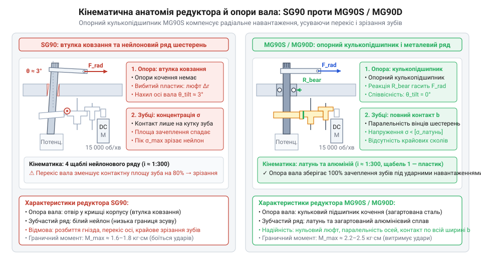
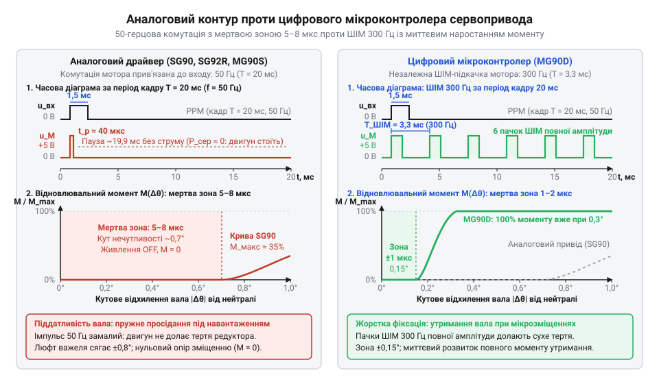
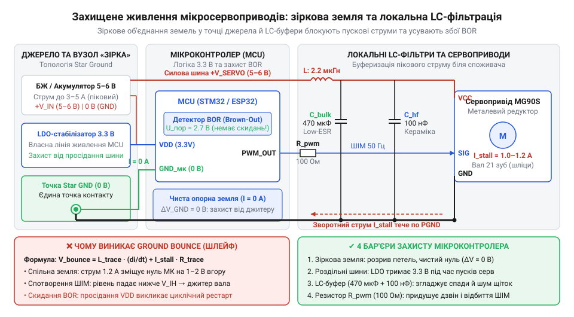

# Лінійка 9-грамових мікросервоприводів Tower Pro (SG90, SG92R, MG90S, MG90D)

<preknowlist>
- [Tower Pro SG90 — мікросерво 9g](root:cat-hw-actuators/sg90-servo) — базовий принцип кутового позиціювання через ШІМ-імпульси тривалістю 1–2 мс та призначення контактів стандартного трипровідного кабелю
- [Серво-роги (запасні)](root:cat-hw-actuators/servo-horns) — механіка передачі крутного моменту через важільні роги та геометричні параметри 21-зубцевого шліцьового вала мікросервопривода
</preknowlist>

## Вразливості типових дев'ятиграмових сервоприводів

Мікросервоприводи часто виходять з ладу під час перших спроб інтеграції у рухомі платформи. Головна причина поломок полягає в тому, що механіка та електрика дешевих моделей не розраховані на жорсткі удари й тривалі перевантаження. Коли важіль стикається з перешкодою, мотор продовжує тиснути, намагаючись досягти заданого кута. Цей тиск миттєво зрізає пластикові зубці шестерень усередині редуктора. Електрична частина страждає не менше: під час старту або заклинювання мотор споживає струм, що в кілька разів перевищує робочий. Такий стрибок різко знижує напругу на лінії, змушуючи мікроконтролер керування перезавантажуватись або втрачати сигнал.

Попри ці вразливості, клас 9-грамових сервоприводів — механізмів із масою близько дев'яти грамів — залишається основним вибором там, де економія ваги й місця важливіша за велике зусилля. Їхнє пряме призначення полягає в позиціюванні легких деталей без жорсткого опору: повороті невеликих датчиків, керуванні рулями висоти в авіамоделях або русі суглобів дрібних крокуючих роботів. Завдяки стандартному формфактору вони дозволяють швидко будувати рухомі прототипи, якщо розробник пам'ятає про межі їхньої міцності та не використовує їх як силові тягачі.

## Матеріали редуктора та опорні підшипники

Вибір матеріалу для редуктора визначає, наскільки механізм стійкий до ударних навантажень. Базові версії, як-от [Tower Pro SG90](root:cat-hw-actuators/sg90-servo), використовують нейлонові шестерні, які добре гасять вібрацію та працюють тихо, але легко ламаються від різких зупинок вала. Для конструкцій, що зазнають ударів, застосовують моделі на зразок [MG90S V2](root:cat-hw-actuators/mg90s-servo), де редуктор виконано з металу. Металеві шестерні витримують значно вищий крутний момент, проте швидше зношуються.

*Схема редуктора та підшипника, де видно, як вал спирається на підшипник для зменшення перекосу.*

Щоб вал не перекошувався під дією радіальних навантажень, у надійних моделях встановлюють опорний підшипник. Він бере на себе бічний тиск від тяги, розвантажуючи корпус і подовжуючи термін служби всього вузла.

## Аналогове та цифрове керування

Точність утримання позиції залежить від типу керуючої електроніки всередині сервопривода. Аналогові приводи не реагують на малі відхилення вала через закладену апаратну зону нечутливості. Це призводить до помітного люфту, коли важіль можна злегка зрушити рукою, перш ніж мотор почне чинити опір.

*Цифровий контролер частіше опитує датчик і формує імпульси для мотора, забезпечуючи жорстке утримання позиції.*

Цифрові моделі розв'язують цю проблему завдяки мікропроцесору, який обробляє сигнал із високою частотою. Він постійно подає короткі імпульси струму на мотор, усуваючи мертву зону і жорстко фіксуючи [серво-роги](root:cat-hw-actuators/servo-horns) в заданій точці. Зворотним боком такої точності є підвищене енергоспоживання: цифровий привод завжди в напрузі, тому швидше нагрівається та вимагає потужнішого джерела струму.

## Роздільне живлення та усунення джитера

Нестабільна робота та довільне тремтіння вала (@@en|jitter@@) найчастіше виникають через спільне живлення моторів і логіки. Високі пускові струми двигуна спричиняють просідання напруги, яке спотворює керуючий сигнал. Щоб уникнути цього, силове живлення сервоприводів необхідно фізично відокремлювати від живлення мікроконтролера, використовуючи окреме джерело або потужний стабілізатор.

*Правильне підключення силових і сигнальних ліній із загальною точкою заземлення, що запобігає перешкодам.*

Навіть за наявності окремого джерела, паразитні струми можуть проникати через спільний провід заземлення. Зіркоподібна топологія землі, де всі мінусові контакти сходяться в одній точці біля джерела, блокує ці перешкоди й забезпечує чистий сигнал для стабільного кутового позиціювання.
