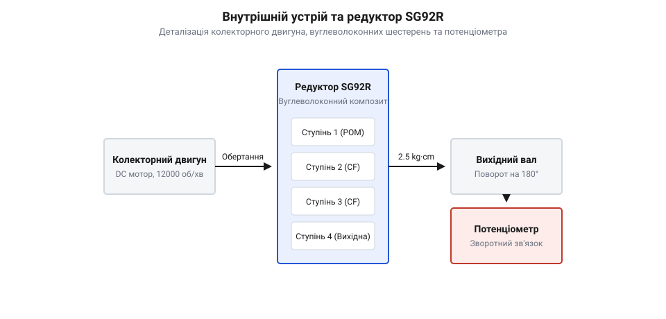
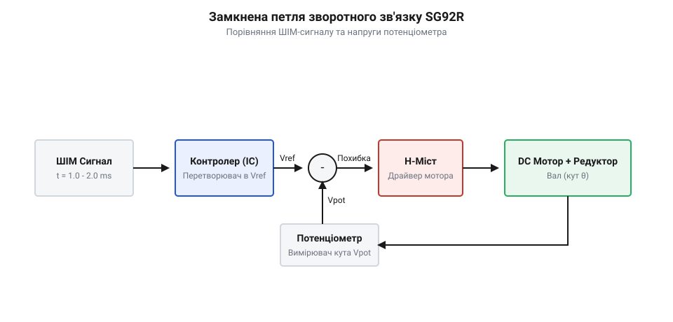
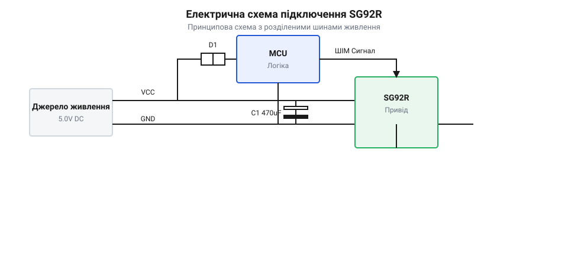
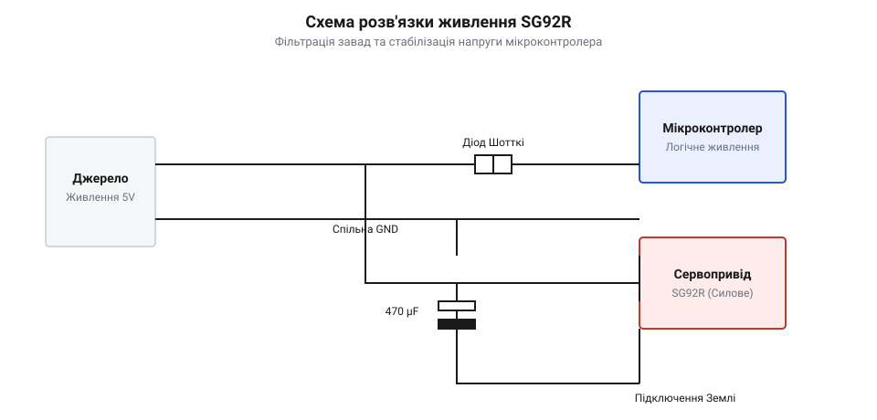
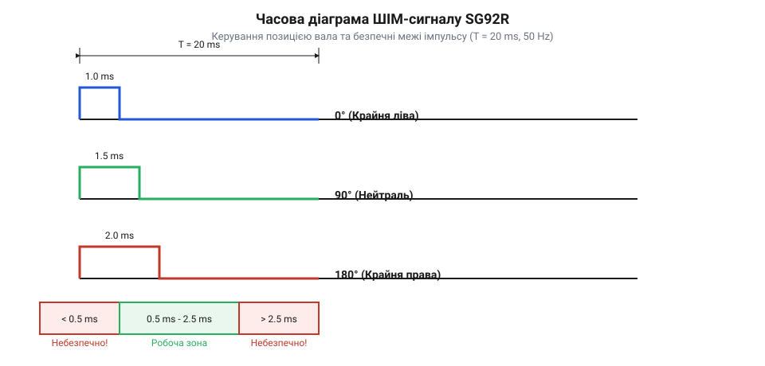

# SG92R — мікросерво з вуглеволоконним редуктором

<preknowlist>
- [Tower Pro SG90 — мікросерво 9g](root:cat-hw-actuators/sg90-servo) — Базову будову та стандартні габарити класичного 9-грамового мікросервоприводу з нейлоновим редуктором.
- [Сервоприводи радіокерованих моделей: будова, редуктори та ШІМ-керування](root:cat-hw-actuators/rc-servo-mechanisms-and-control) — Принцип керування позиціонуванням через тривалість ШІМ-імпульсу та призначення внутрішніх вузлів.
- [Зсувні навантаження та абразивний знос шестерень сервоприводів](root:cat-hw-actuators/servo-gear-shear-and-wear) — Механіку виникнення зсувних напружень у пластикових зубчастих передачах.
</preknowlist>

## Руйнування нейлонових редукторів під навантаженням

Під час роботи компактного робототехнічного вузла — будь то малогабаритний захоплювач маніпулятора чи поворотний підвіс давача — сервопривід періодично стикається з фізичними перешкодами. Коли вихідний вал зупиняється через зовнішній опір, а електродвигун продовжує подавати зусилля, зсередини пластикового корпусу лунає характерний хрускіт. Вал починає вільно прокручуватися, і пристрій повністю втрачає здатність утримувати позицію. Причиною цієї поширеної аварії є механічне руйнування зубчастих коліс внутрішнього редуктора.

Більшість класичних 9-грамових мікросервоприводів, таких як @@en|Tower Pro@@ @@en|SG90@@, оснащено багатоступеневими редукторами з нейлону (від англ. @@en|nylon@@ — поліамідне синтетичне волокно). Цей полімер популярний у серійному виробництві завдяки низькій собівартості лиття, малій масі та безшумній роботі при зачепленні. Проте нейлон має обмежену граничну міцність на зсув, яка для дрібномодульних шестерень (модуль зубця `m_t ≈ 0.25-0.3 мм`) становить приблизно `τ_ult ≈ 40-45 MPa`. Під час блокування вала (стан @@en|stall@@ — заклинювання двигуна) струм обмоток двигуна стрибає до максимального пікового значення `I_stall ≈ 0.65-0.8 A`. Електродвигун починає генерувати максимальний момент `M_motor`, який багаторазово підсилюється зубчастими ступенями. Найбільше зсувне напруження виникає в основі зубців передостаннього та вихідного ступенів редуктора, де обертальний момент досягає максимальних значень при мінімальній площі зачеплення.

Додатковим руйнівним чинником є ударні навантаження (від англ. @@en|shock load@@ — інерційний удар). Коли робототехнічна деталь або кінцева ланка маніпулятора на швидкості вдаряється об тверду перешкоду, кінетична енергія рухомої маси миттєво перетворюється на зсувне зусилля в зачепленні зубців. Виникає короткочасне пікове напруження `τ_max`, яке обчислюється через колову силу `F_t`, ширину зубця `b` та модуль `m_t`:

```
τ_max = F_t / (b × m_t)
      = 42 / (1.2 × 0.3)  [обчислення зсувного напруження при піковому зусиллі 42 N]
      = 116.6 MPa         [перевищення межі міцності нейлону 45 MPa в 2.5 раза]
```

Оскільки `116.6 MPa` суттєво перевищує допустиму межу `45 MPa`, основа нейлонового зубця миттєво зрізається. Крім того, тривала робота під високим утримувальним моментом викликає локальне розігрівання пластикових шестерень. При температурі понад `60 °C` нейлон втрачає жорсткість, що прискорює [зсувні навантаження та абразивний знос](root:cat-hw-actuators/servo-gear-shear-and-wear) і призводить до пластичної деформації зубців навіть без повного заклинювання.

Просте збільшення товщини нейлонових коліс або модуля зубців для підвищення міцності вимагає збільшення діаметрів шестерень і міжосьових відстаней. Це неминуче виходить за межі стандартного 9-грамового корпусу (габарити `22.8 × 12.2 × 28.5 мм`) та збільшує масу пристрою, унеможливлюючи його монтаж у стандартні робототехнічні кронштейни. Для вирішення цієї проблеми знадобилася зміна матеріалознавчої структури зубчастого зачеплення без збільшення геометрії. Докладно про шлях вдосконалення цієї лінійки можна прочитати в описі [еволюції від нейлонового SG90](root:cat-hw-actuators/sg92r-servo/hist-sg90-to-sg92r-evolution.md) до вуглеволоконних редукторів. Саме потреба зберегти габарити й масу класичного [сервоприводу SG90](root:cat-hw-actuators/sg90-servo), підвищивши міцність зубців у кілька разів, зумовила появу приводу @@en|SG92R@@.

## Внутрішній устрій та механіка SG92R

Конструктивно мікросервопривід @@en|SG92R@@ (від англ. @@en|SG92 Reinforced@@ — посилений мікросервопривід) повністю зберігає зовнішній формфактор і посадкові розміри класичного 9-грамового приводу, проте його внутрішні вузли зазнали суттєвої модернізації. Основу пристрою становить високооборотний колекторний електродвигун постійного струму (від англ. @@en|brushed DC motor@@ — електродвигун із щітково-колекторним вузлом), чотириступеневий знижувальний редуктор із композитного матеріалу, аналоговий потенціометр зворотного зв'язку та плата керування з H-мостовим драйвером.


*Внутрішня компоновка мікросервоприводу SG92R, що демонструє послідовне передавання обертання від колекторного двигуна через чотириступеневий редуктор з вуглеволоконними шестернями на вихідний вал і потенціометр.*

Ключова відмінність @@en|SG92R@@ полягає в застосуванні композиту на основі вуглецевого волокна (від англ. @@en|Carbon Fiber@@ — вуглець та волокно). Матеріал шестерень утворений термопластичною полімерною матрицею, армованою короткими дискретними волокнами вуглецю (вміст волокон становить `15-20%` за масою). Під час формування шестерень мікроволокна орієнтуються вздовж напрямку потоку розплаву, створюючи внутрішній просторовий каркас. Волокна сприймають на себе основні зсувні та розтягувальні напруження під час зачеплення. Це підвищує межу міцності композиту на зсув до `τ_ult ≈ 110-130 MPa`, що майже втричі перевищує показники нейлону. Детальніше трибологічні властивості таких структур висвітлено у темі про [вуглеволоконні композити у дрібномодульних шестернях](root:hw-motion/carbon-fiber-composites-in-micro-gears).

Густина вуглеволоконного композиту становить лише `ρ ≈ 1.35 г/см³`, завдяки чому загальна маса @@en|SG92R@@ залишається на рівні `9.1 г`. Для порівняння, сервоприводи з [металевим редуктором MG90S](root:cat-hw-actuators/mg90s-servo) мають масу близько `13.4 г` через високу густину латуні та сталі (`7.8-8.5 г/см³`). Вуглеволокно також збільшує модуль пружності Юнга (`E ≈ 8.5 GPa` проти `2.5 GPa` у нейлону), що мінімізує пружну деформацію зубців під навантаженням. Це запобігає перескокам зачеплення та забезпечує надійну передачу сили на [серво-роги різної конфігурації](root:cat-hw-actuators/servo-horns).

Обертальний момент від вала колекторного двигуна, який на холостому ходу розганяється до `12 000-15 000 об/хв`, послідовно передається через чотири ступені зубчастих коліс. Загальне передавальне число редуктора становить `i ≈ 1:180`. Розрахунок вихідного крутного моменту `M_out` та механічного ККД `η` здійснюється за формулою:

```
M_out = M_motor × i × η
      = 0.17 × 180 × 0.80  [множення моменту мотора 0.17 N·mm на передавальне число 180 та ККД 80%]
      = 24.48 N·mm         [отримання вихідного моменту 2.5 kg·cm при живленні 4.8 V]
```

Отриманий момент `M_out ≈ 2.5 kg·cm` (при напрузі `4.8 V`) є межею робочого утримувального зусилля. Вуглеволоконний редуктор здатен витримувати короткочасні пикові статичні перевантаження аж до `2.8 kg·cm` без небезпеки зрізання зубців. Повні технічні та електричні параметри наведено в документі про [апаратну специфікацію SG92R](root:cat-hw-actuators/sg92r-servo/api-sg92r-hardware-spec.md).

## Петля зворотного зв'язку та позиціонування

Механічна міцність редуктора дає змогу передавати значні зусилля, проте точність кутового положення вихідного вала забезпечується замкненою системою автоматичного регулювання. @@en|SG92R@@ функціонує як класичний сервомеханізм (від лат. @@la|servus@@ — слуга та грец. @@el|mechanos@@ — пристрій), який постійно порівнює задане значення кута з його фактичним положенням. Керування здійснюється за допомогою ШІМ-сигналу (від англ. @@en|PWM@@ — широтно-імпульсна модуляція). Стандартна частота повторення кадрів становить `50 Hz` (період `T = 20 ms`). Тривалість імпульсу `t_pulse` визначає кут повороту: `1.0 ms` відповідає положенню `0°`, `1.5 ms` — нейтральному стану `90°`, а `2.0 ms` — куту `180°`.

Всередині корпусу сервоприводу на вихідному валу жорстко закріплено рухомий контакт потенціометра зворотного зв'язку (від лат. @@la|potentia@@ — сила та грец. @@el|metron@@ — вимірювач). Потенціометр перетворює механічний кут повороту вала `θ_out` в аналогову напругу `V_pot`. Внутрішня мікросхема драйвера (наприклад, з [аналоговими сервопідсилювачами KC2462](root:cat-hw-actuators/analog-servo-amplifier-ic)) порівнює цю напругу з внутрішньою опорною напругою `V_ref`, сформованою із вхідного ШІМ-імпульсу.


*Блок-схема замкненого контуру позиціонування сервоприводу, яка відображає перетворення ШІМ-сигналу в опорну напругу, порівняння з напругою потенціометра зворотного зв'язку та керування H-мостом двигуна.*

Різниця між опорною напругою та напругою потенціометра утворює сигнал похибки `e = V_ref - V_pot`. Похибка подається на внутрішній аналоговий компаратор, який керує мостовою схемою силових транзисторів (від англ. @@en|H-bridge@@ — мостовий транзисторний перемикач). Якщо похибка додатна, @@en|H-bridge@@ подає напругу на обмотки двигуна у відповідній полярності для повороту вала за годинниковою стрілкою. Якщо від'ємна — полярність змінюється на протилежну. Фізичні принципи цієї системи детальніше розглядає [аналогова петля зворотного зв'язку](root:hw-motion/servo-feedback-potentiometers-and-control-loops).

Для запобігання автоколиванням вала навколо цільової точки в систему введено зону нечутливості (від англ. @@en|deadband@@ — зона нечутливості). Для @@en|SG92R@@ ширина зони нечутливості становить `Δt_dead ≈ 1-5 μs`, що відповідає кутовому інтервалу близько `0.2°-0.8°`. Якщо модуль похибки `|e|` нижчий за цей поріг, транзистори H-моста закриваються і двигун знеструмлюється.

При відхиленні вала під дією зовнішньої сили похибка перевищує зону нечутливості, і драйвер подає на двигун повну напругу, створюючи утримувальний момент. Однак при занадто вузькій зоні нечутливості або механічному люфті виникає явище дрижання (від англ. @@en|jitter@@ — високочастотне тремтіння). Вал починає високочастотно коливатися, викликаючи сплески струму та перегрів двигуна. Описи причин виникнення [зони нечутливості та дрижання вала](root:cat-hw-actuators/servo-deadband-and-jitter) допомагають уникнути цих нестабільностей.

Під час зміни напрямку руху або утримання вала колекторний двигун @@en|SG92R@@ споживає короткочасні імпульсні струми амплітудою до `0.8 A`. Ці кидки викликають просідання напруги на лінії живлення, що може призвести до збоїв керівного мікроконтролера.


*Електрична схема підключення сервоприводу SG92R з окремим джерелом живлення мотора, електролітичним конденсатором фільтрації імпульсних струмів та спільною землею з мікроконтролером.*

Для захисту цифрових кіл силове живлення `5 V` розв'язують із логічним живленням мікроконтролера, встановлюючи електролітичний конденсатор ємністю `470-1000 μF` та забезпечуючи спільну шину заземлення (GND). Докладний математичний опис динамічних процесів наведено в матеріалі про [математику керування та диференціальну динаміку](root:cat-hw-actuators/sg92r-servo/math-servo-pwm-torque-dynamics.md), а програмна реалізація ШІМ описується через [програмний інтерфейс керування таймерами](root:cat-hw-actuators/sg92r-servo/api-sg92r-pwm-control.md). Практичне застосування приводу розкрито під час розробки [двоосьового підвісу Pan-Tilt](root:cat-hw-actuators/sg92r-servo/proj-sg92r-two-axis-gimbal.md). Взаємозв'язок параметрів зворотного зв'язку підтверджується вивченням [математики потенціометричного зворотного зв'язку](root:cat-hw-actuators/servo-feedback-potentiometer) та аналізом [частоти оновлення ШІМ-кадрів](root:cat-hw-actuators/servo-pwm-frame-rate).

## Електричний режим та розв'язка живлення

Типова ситуація при побудові компактного робота: мікроконтролер та сервопривід @@en|SG92R@@ підключені до єдиної шини живлення 5 В від невеликого лінійного регулятора або USB-порту. На робочому столі привід працює без навантаження, але варто валу зустріти найменший опір або різко змінити напрямок руху, як мікроконтролер раптово перезавантажується або «повисає». Причина цієї нестабільності криється у динаміці струму споживання, який визначається принципом роботи внутрішнього колекторного двигуна та транзисторних ключів.

Усередині мікросервоприводу @@en|SG92R@@ силова частина колекторного мотора керується за допомогою внутрішньої схеми @@en|H-міст@@ (від @@en|H-bridge@@, названий так через H-подібну конфігурацію чотирьох силових транзисторних ключів). Коли керуюча мікросхема, така як [аналоговий сервопідсилювач AA51880](root:cat-hw-actuators/analog-servo-amplifier-ic), фіксує відхилення фактичного положення від заданого, вона відкриває діагональну пару транзисторів @@en|H-міст@@, подаючи на обмотки ротора повну напругу живлення. Електрична поведінка приводу при цьому характеризується трьома чіткими режимами:

1. **@@en|струм спокою@@** (від @@en|quiescent current@@, англ. *quiescent* — перебувати у стані спокою) — становить від 5 до 10 мА, коли вал нерухомий, позиція досягнута, а енергія витрачається лише на роботу внутрішнього компаратора та генератора. 2. **@@en|робочий струм@@** (від @@en|operating current@@) — становить 120–250 мА під час плавного обертання вала з помірним корисним навантаженням. 3. **@@en|струм заклинювання@@** (від @@en|stall current@@, англ. *stall* — зупинка двигуна через перевищення навантаження) — досягає 650–800 мА при напрузі 5 В під час початкового пуску з місця або при повній механічній блокувальні вала.

Чому пусковий струм та струм заклинювання викликають відмову керуючої логіки? У момент старту ротор двигуна нерухомий, тому індукована @@en|зворотна ЕРС@@ (від @@en|back-EMF@@, англ. *back electromotive force* — зворотна електрорушійна сила) дорівнює нулю. Струм у колі обмежується лише активним опором тонкого мідного дроту обмоток ротора $R_{\text{rot}} \approx 6.5\text{ Ом}$.

```
I_stall = V_cc ÷ R_rotor
= 5.0 ÷ 6.5           [підстановка напруги живлення 5 В та опору ротора]
≈ 0.77 А (770 мА)     [піковий струм при нульових обертах]
```

При миттєвій появі імпульсу струму силою майже 0.8 А на внутрішньому опорі джерела живлення та підвідних провідниках виникає падіння напруги. Загальна шина 5 В просідає нижче порогу спрацьовування скидання мікроконтролера ($V_{\text{BOR}} \approx 2.7\text{–}4.5\text{ В}$), спричиняючи @@en|просідання напруги@@ (від @@en|brownout reset@@, англ. *brownout* — часткове затемнення електромережі через перевантаження). Мікроконтролер перезавантажується, ініціалізує сервопривід заново, той знову починає рух і знову просаджує шину, заганяючи систему в нескінченний цикл перезапусків.

Окрім просідання, індуктивність обмоток мотора створює високочастотні викиди напруги зворотної ЕРС при розмиканні ключів @@en|H-міст@@, що викликає завади на лініях керування та створює [дрижання вихідного вала](root:cat-hw-actuators/servo-deadband-and-jitter).

Історично з цією проблемою стикалися ще при експлуатації перших 9g-сервоприводів. Як описує [еволюція мікросервоприводів](root:cat-hw-actuators/sg92r-servo/hist-sg90-to-sg92r-evolution.md), перехід до легших редукторів підвищив динаміку розгону ротора, що робить імпульсні сплески $di/dt$ в @@en|SG92R@@ ще більш стрімкими, ніж у [класичного приводу SG90](root:cat-hw-actuators/sg90-servo).


*Схема розділення шин живлення мікроконтролера та сервоприводу з використанням згладжувальних конденсаторів і діодного захисту.*

Щоб усунути просідання та захистити логіку, застосовують схемотехнічну розв'язку:

* **Фізичне розділення шин живлення**: силова шина сервоприводу `VCC_SERVO` (5–6 В) живиться окремо від логічної шини мікроконтролера `VCC_MCU`. Землі двох джерел (`GND`) обов'язково об'єднуються у єдиній точці для забезпечення спільного потенціалу ШІМ-сигналу. * **Локальний буфер енергії**: паралельно контактам живлення приводу встановлюється електролітичний @@en|згладжувальний конденсатор@@ (від @@en|decoupling capacitor@@, англ. *decouple* — розв'язувати кола) ємністю 100–470 мкФ з низьким еквівалентним послідовним опором (Low-ESR). Він віддає накопичений заряд під час короткого пускового імпульсу, запобігаючи падінню напруги на загальній лінії. * **Високочастотна фільтрація**: паралельно електроліту додається керамічний конденсатор ємністю 0.1 мкФ (100 нФ) для шунтування високочастотних індуктивних завад від колекторного вузла мотора. * **Діодна розв'язка логіки**: встановлення діода Шотткі послідовно з шиною живлення мікроконтролера блокує зворотний струм із конденсатора живлення логіки у силову шину приводу під час просідання.

Повні параметри граничних струмів, розводку контактів та рекомендації щодо підключення містить [апаратна специфікація SG92R](root:cat-hw-actuators/sg92r-servo/api-sg92r-hardware-spec.md), де детально розраховано струмові навантаження під час пуску.

## Програмне ШІМ-керування та експлуатаційні межі

Сформувавши надійну схемотехніку живлення, необхідно правильно подати керуючий сигнал. Позиціонування вала @@en|SG92R@@ здійснюється за допомогою імпульсів @@en|ШІМ@@ (від @@en|PWM@@, англ. *Pulse-Width Modulation* — широтно-імпульсна модуляція). Однак спроба «витиснути» з приводу максимальний кут повертання шляхом розширення діапазону імпульсів без урахування механіки корпуса призводить до негайного перегріву двигуна та пошкодження вуглеволоконного редуктора.

Стандартний кадр керування @@en|SG92R@@ має частоту 50 Гц, що відповідає періоду $T = 20\text{ мс}$. Інформаційним параметром є тривалість високого рівня імпульсу $t_{\text{pulse}}$, яка задає цільовий кут повороту:

```
Duty_neutral = t_pulse ÷ T_period
= 1.5 ÷ 20.0          [співвідношення тривалості імпульсу 1.5 мс до періоду 20 мс]
= 0.075 (7.5%)        [робочий цикл для кута 90 градусів]
```

Типові інтервали тривалості імпульсу задають позицію вихідного вала:
* **0° (крайнє ліве положення)**: $t_{\text{pulse}} \approx 1.0\text{ мс}$ (у розширеному діапазоні — до $0.5\text{ мс}$). * **90° (нейтральне положення)**: $t_{\text{pulse}} = 1.5\text{ мс}$ (робочий цикл @@en|робочий цикл@@ 7.5%). * **180° (крайнє праве положення)**: $t_{\text{pulse}} \approx 2.0\text{ мс}$ (у розширеному діапазоні — до $2.5\text{ мс}$).

Внутрішній моностабільний мультивібратор аналогової плати перетворює вхідну тривалість імпульсу на опорну напругу, яка порівнюється з напругою потенціометра зворотного зв'язку. Різниця напруг формує сигнал помилки, який подається на @@en|H-міст@@ для обертання мотора в потрібну сторону.


*Часова діаграма ШІМ-сигналу з робочим циклом для поворотів 0°, 90° та 180° і позначенням небезпечних зон виходу за апаратні упори.*

Головна небезпека програмного керування полягає у виході імпульсу за @@en|апаратні упори@@ (від @@en|mechanical end-stops@@, англ. *end-stop* — механічний обмежувач ходу). Усередині пластикового корпуса @@en|SG92R@@ на вихідній шестерні виконано фізичний обмежувач повороту, який фізично блокує обертання далі діапазону ~180°–190°. 

Якщо керуюча програма формує тривалість імпульсу, наприклад, 0.4 мс або 2.6 мс, внутрішній компаратор бачить неусунену розбіжність позиції і тримає @@en|H-міст@@ повністю відкритим. Вал впирається в апаратний штифт, мотор зупиняється, а струм піднімається до максимального рівня @@en|струм заклинювання@@ (близько 750 мА).

Виділення тепла при заклинюванні підпорядковується закону Джоуля-Ленца:

```
P_heat = I_stall × V_cc
= 0.75 × 5.0           [обчислення потужності нагріву при струмі 750 мА та напрузі 5 В]
= 3.75 Вт              [теплова потужність у замкненому 9g-корпусі]
```

Виділення 3.75 Вт тепла у мікроскопічному корпусі без примусового охолодження викликає швидке розігрівання мідного дроту обмоток ротора до температури понад 120 °C менше ніж за 20 секунд. Це призводить до розплавлення лакової ізоляції дроту, міжвиткового короткого замикання та незворотного виходу мотора з ладу. Детальний тепловий розрахунок наводить [теплова модель приводу](root:cat-hw-actuators/servo-thermal-protection), яка визначає граничні часи перебування під навантаженням.

Вибір між сервоприводами лінійки 9g роблять на основі механічних та вагових вимог проєкту:

* **@@en|SG90@@**: нейлоновий редуктор. Найдешевший варіант, але шестерні схильні до зрізання зубців при ударних навантаженнях, як детально пояснює [зріз шестерень сервоприводів](root:cat-hw-actuators/servo-gear-shear-and-wear). * **@@en|SG92R@@**: редуктор із композиту @@en|Carbon Fiber@@ (вуглеволокно) та першим ступенем із поліоксиметилену (POM). Має високу міцність зубів на зсув, високу жорсткість та малу масу (9 грамів). Ідеальний вибір для динамічних легких робототехнічних систем, таких як мікрогвинтові підвіси чи маніпулятори, де критична мінімальна маса. * **@@en|MG90S@@**: металевий редуктор (латунь/алюміній). Забезпечує максимальну стійкість до сильних ударів, але збільшує масу приводу до 13.4 грама і вимагає постійного змащення для запобігання абразивному зносу. Порівняти його з іншими моделями дозволяє [сервопривід MG90S](root:cat-hw-actuators/mg90s-servo) та систематизований [родини мікросервоприводів Tower Pro](root:cat-hw-actuators/sg90-mg90-micro-servos-family) опис. Порівняльну таблицю параметрів додатково подає [порівняльний аналог 9g-сервоприводів](root:cat-hw-actuators/sg90-mg90-micro-servos-family).

Для забезпечення довговічності @@en|SG92R@@ у реальних проєктах застосовують програмне обмеження (clamping) тривалості імпульсів у коді мікроконтролера:

:::tabs
@tab Arduino C++
:::code sg92r-servo-d/cpp/arduino/setup.cpp

@tab ESP-IDF C
```c|esp-idf
// Керування сервоприводом SG92R через периферифійний модуль MCPWM
#include "driver/mcpwm.h"

#define SERVO_MIN_PULSE_US 540  // Безпечний мінімум імпульсу (мкс)
#define SERVO_MAX_PULSE_US 2400 // Безпечний максимум імпульсу (мкс)

void safe_servo_set_angle(mcpwm_unit_t mcpwm_num, mcpwm_timer_t timer_num, uint32_t angle) {
    if (angle > 180) angle = 180; // Захисне обмеження кута
    uint32_t duty_us = SERVO_MIN_PULSE_US + (angle * (SERVO_MAX_PULSE_US - SERVO_MIN_PULSE_US)) / 180;
    mcpwm_set_duty_in_us(mcpwm_num, timer_num, MCPWM_OPR_A, duty_us);
}
```
:::

Алгоритми створення таймерних драйверів на низькому рівні викладено у [програмному інтерфейсі ШІМ](root:cat-hw-actuators/sg92r-servo/api-sg92r-pwm-control.md), а рівняння кінематики та динамічного моменту наведено в [математиці керування сервоприводом](root:cat-hw-actuators/sg92r-servo/math-servo-pwm-torque-dynamics.md). Практичну збірку двоосьового механізму з урахуванням описаних обмежень висвітлює [проєкт двоосьового підвісу](root:cat-hw-actuators/sg92r-servo/proj-sg92r-two-axis-gimbal.md).