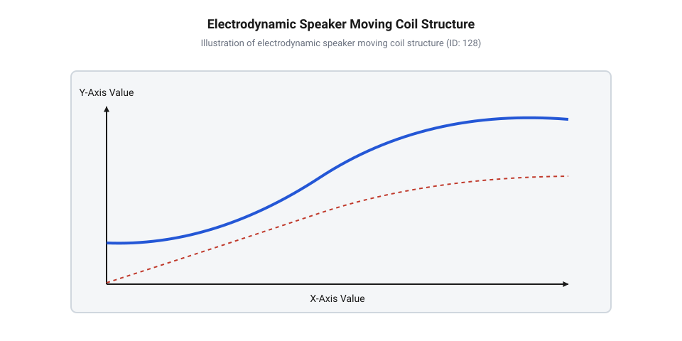
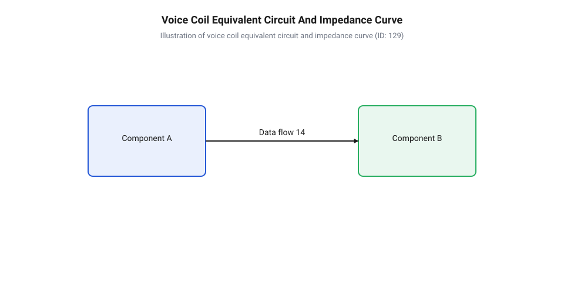
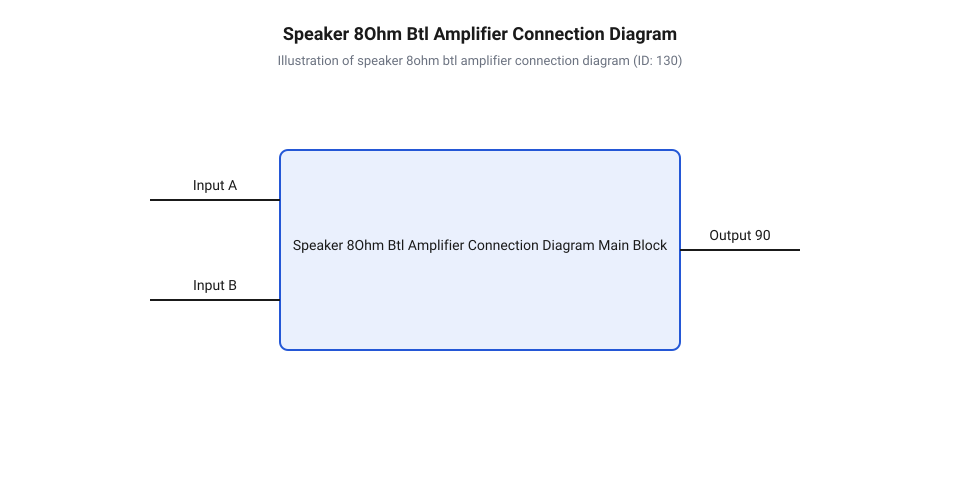
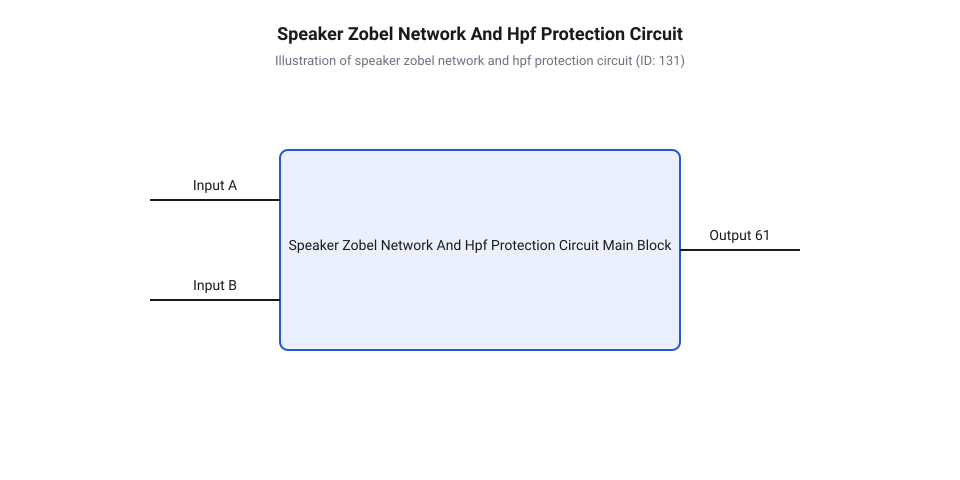
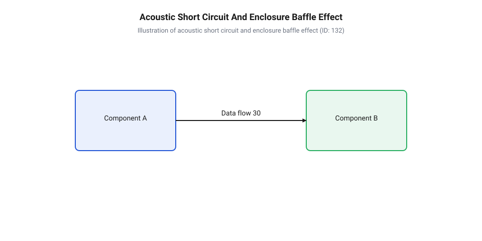
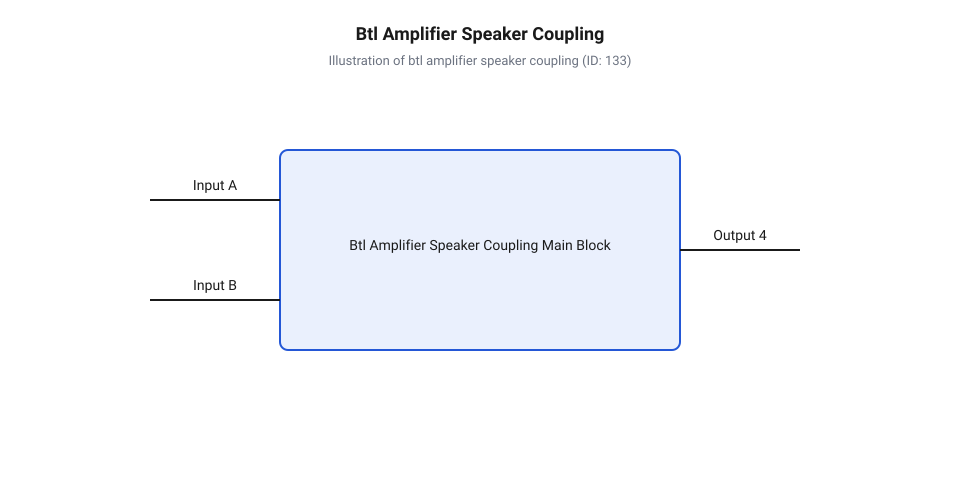
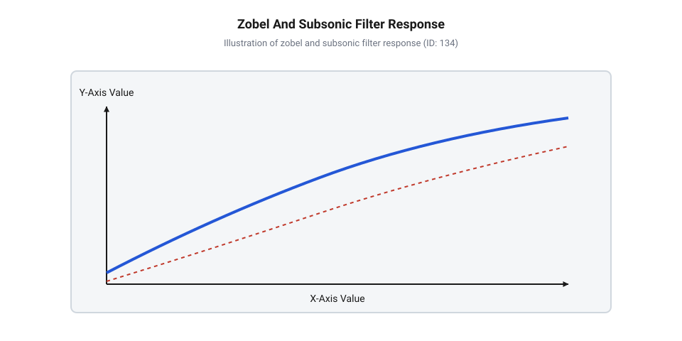

# Динаміки 5 Вт / 8 Ом

<preknowlist>
- [XPT8871 — моно-підсилювач 5 Вт](root:cat-hw-actuators/audio-amp-xpt8871) — принципи роботи монофонічних мостових підсилювачів низької частоти потужністю 5 Вт та особливості розкачки 8-омного динаміка
- [Стереофонічний аудіопідсилювач PAM8403](root:cat-hw-actuators/pam8403-stereo-amp) — параметри мостових каскадів класу D та вимоги до номінального імпедансу навантаження
- [Зумер (окремий)](root:cat-hw-actuators/buzzer-standalone) — базові принципи звукоутворення та відмінності між спрощеними тональними випромінювачами і деталізованими електродинамічними динаміками
</preknowlist>

## Чому підключений динамік звучить спотворено

Спроба подати звуковий сигнал безпосередньо з виводу мікроконтролера або лінійного джерела на компактний 8-омний 5-ватний динамік часто завершується розчаруванням. Замість чистого й виразного звуку з випромінювача чути лише тихе, хрипке гарчання, дифузор майже не рухається, а вихідний транзистор підсилювача чи вивід мікросхеми починає загрозливо нагріватися. У такій ситуації легко припустити, що динамік зіпсований, має занизький опір або неналежну якість. Намагаючись виправити становище, розробники посилюють амплітуду або подають цифровий @@en|меандр@@ (від назви звивистої річки Меандр у Малій Азії), що лише погіршує ситуацію та загрожує термічним виходом з ладу обмотки.

Справжня причина спотворень полягає у фундаментальному нерозумінні того, як саме @@el|електродинамічний@@ (від грецьких слів *elektron* — бурштин та *dynamis* — сила) гучномовець перетворює електричну енергію на механічні коливання та звукові хвилі. На відміну від статичних навантажень на кшталт резисторів чи світлодіодів, динамік є складним механіко-електричним перетворювачем зі зворотним зв'язком.


*Підпис:* Фізична структура електродинамічного гучномовця демонструє розташування звукової котушки у зазорі постійного магніту та її зв'язок із дифузором і елементами підвісу.

Основою конструкції гучномовця є звукова котушка — циліндрична обмотка з тонкого ізольованого дроту, закріплена на легкому каркасі. Котушка занурена у вузький кільцевий зазор магнітопроводу, усередині якого створене сильне постійне магнітне поле за допомогою постійного магніту. Коли крізь обмотку протікає змінний електричний струм, навколо неї виникає власне змінне магнітне поле. У результаті взаємодії двох магнітних полів на кожен виток котушки починає діяти @@la|сила Лоренца@@ (від імені нідерландського фізика Хендріка Лоренца):

```
F = B · I · L
```

тут `F` — механічна сила, що діє на котушку (в ньютонах), `B` — індукція постійного магнітного поля у зазорі (в теслах), `I` — миттєве значення струму в обмотці (в амперах), а `L` — ефективна довжина дроту котушки, розташованого у зазорі (в метрах).

Зміна напрямку струму змінює напрямок сили `F` на протилежний. Звукова котушка жорстко з'єднана з @@la|дифузором@@ (від латинського *diffundere* — розливати, поширювати) — конусоподібною або банеподібною мембраною з паперу, композиту чи полімеру. Для забезпечення строго осьового зміщення котушки без бічного тертя об стінки магнітного зазору застосовують підвіс (верхнє еластичне кільце) та гофровану центруючу шайбу. Рухаючись уперед і назад під дією сили Лоренца, дифузор стискає та розріджує прилеглі шари повітря, створюючи акустичні хвилі звукового тиску.

Спотворення та перегрів при прямому підключенні виникають з трьох основних причин:

1. **Нестача струму та невідповідність вихідного опору джерела.** Цифровий вивід мікроконтролера має внутрішній опір і обмеження струму на рівні 20–40 мА. Спроба розкачати ним 8-омну котушку призводить до просідання напруги джерела, зрізання верхівок сигналу та виникає @@en|кліпінг@@ (від англійського *clipping* — обрізання). 2. **Постійна складова зміщення (DC offset).** Якщо у звуковому сигналі присутня постійна напруга (наприклад, при прямому виході з ЦАП без розділювального конденсатора), крізь котушку постійно протікає значний омічний струм. Цей струм не створює звукових хвиль, але зміщує звукову котушку з нейтрального положення вбік, викликаючи нелінійну асиметрію ходу та швидкий перегрів обмотки у вузькому зазорі. 3. **Плутанина між зумерами та динаміками.** Часто плутають тональні звуковипромінювачі та динамічні гучномовці. Якщо [пасивний зумер](root:cat-hw-actuators/ky-006-buzzer) або [активний зумер](root:cat-hw-actuators/ky-012-buzzer) побудовані на базі п'єзокерамічної пластини або високоомного електромагнітного капсуля, то [окремий зумер](root:cat-hw-actuators/buzzer-standalone) оптимізований виключно для вузької резонансної частоти сповіщення. Натомість широкосмуговий 8-омний динамік потребує чистой синусоїдальної формації струму та високої потужності.

Історія створення електродинамічного гучномовця сягає 1920-х років, коли американські інженери Честер Райс та Едвард Келлог із компанії General Electric патентно оформили класичну конструкцію з рухомою котушкою та конічним дифузором. До цього в звуковідтворенні панували важкі рупорні випромінювачі та примітивні електромагнітні капсулі з рухомим залізним якорем, які мали катастрофічно вузький частотний діапазон і величезні спотворення. Поява потужних постійних магнітів (спочатку сплавів альніко, а згодом феритів та неодиму), гнучких крайових підвісів і гофрованих центруючих шайб дозволила котушці здійснювати поршневий хід великої амплітуди без перекосів у зазорі. Масовий розвиток лампових, а пізніше транзисторних підсилювачів вимагав уніфікації електричного навантаження, що й зумовило формування стандартного ряду номінальних імпедансів (зокрема 8 Ом) та норм вимірювання розсіюваної потужності.

Для правильної побудови схеми розкачки та захисту обладнання використовують спеціальні каскади. Повну принципову схему та електричні характеристики висвітлює [залізний інтерфейс динаміка](root:cat-hw-actuators/speakers-8ohm/api-5w-8ohm-speaker-hardware-interface.md), а програмну генерацію та цифрове обмеження сигналів дає [програмний інтерфейс DSP](root:cat-hw-actuators/speakers-8ohm/api-speaker-audio-dsp-and-limiter-software-interface.md).

---

## Електричний імпеданс звукової котушки динаміка

Підключивши звичайний мультиметр у режимі вимірювання опору постійному струму до клем 8-омного 5-ватного динаміка, розробник отримує результат `Re ≈ 6.5–7.2 Ом`. Виникає логічне замішання: чому прилад показує значення, менше за задекларовані 8 Ом? Може здатися, що маркування помилкове або динамік має браковану обмотку.

Помилка полягає у тотожності між активним опором постійному струму та повним опором змінному струму. Мультиметр вимірює виключно омічний опір мідного чи алюмінієвого дроту обмотки `Re` (від англійського *resistance*). Проте під час відтворення звуку котушка живиться змінним струмом, де виникають додаткові реактивні та механічні ефекти. Повний опір котушки змінному струму називається @@la|імпедансом@@ (від латинського *impedio* — перешкоджати) і позначається літерою `Z`.

Оскільки звукова котушка являє собою згорнутий у спіраль провідник навколо сталевого керна магнітопроводу, вона має власну @@la|індуктивність@@ (від латинського *inductio* — наведення) `Le`. Із підвищенням частоти сигналу `f` індуктивний опір котушки зростає пропорційно частоті:

```
X_L = 2 · π · f · Le
```

Окрім суто електричної індуктивності, у динаміку діє зворотний електромеханічний зв'язок. Під час руху котушки у постійному магнітному полі в ній, згідно з законом Фарадея, індукується проти-ЕРС (протилежно спрямована електрорушійна сила). На частоті механічного @@la|резонансу@@ (від латинського *resono* — лунати у відповідь) рухомої системи `fs` (де маса дифузора та котушки резонує з пружністю підвісу та шайби) амплітуда зміщення дифузора стає максимальною. Зворотна ЕРС на частоті `fs` досягає пікового значення й компенсує значну частину зовнішньої напруги підсилювача. У результаті споживаний струм різко падає, що на графіку імпедансу виглядає як високий резонансний пік.


*Підпис:* Частотна крива імпедансу показує пік на частоті резонансу fs, мінімум Zmin та індуктивне зростання опору на високих частотах.

Взаємодію електричних і механічних чинників описує еквівалентна електрична схема звукової котушки. У ній послідовно з'єднані активний опір `Re` та індуктивність `Le`, а паралельно до них включено електричний аналог механічного резонансу (паралельний контур із ємності механічної гнучкості `Cmes`, індуктивності маси `Lces` та активного опору механічних втрат `Rces`).

Формула розрахунку частотної залежності імпедансу `Z(f)` має такий вигляд:

```
Z(f) = Re + j · 2 · π · f · Le + Zmech(f)
= Re + j · 2 · π · f · Le + (Rces / (1 + j · Qm · (f/fs - fs/f)))      [врахування механічного резонансу]
```

де `Qm` — механічна добротність рухомої системи на частоті резонансу `fs`, а `j` — уявна одиниця.

Аналіз частотної кривої `Z(f)` дозволяє виділити три характерні зони:

1. **Зона механічного резонансу (`fs`).** У діапазоні 80–150 Гц (для компактних 5-ватних динаміків) імпеданс зростає до 20–40 Ом і більше. На цій частоті струм мінімальний, а зміщення дифузора максимальне. 2. **Зона мінімуму імпедансу (`Zmin`).** У діапазоні 200–500 Гц після резонансного піку зворотна ЕРС спадає, а індуктивний опір `Le` ще незначний. Тут імпеданс досягає свого найнижчого значення `Zmin ≈ 6.8–7.5 Ом`. Саме `Zmin` визначає максимальне струмове навантаження на підсилювач. За міжнародними стандартами IEC, номінальний імпеданс 8 Ом призначається пристроям, чий `Zmin` не просідає нижче ніж на 20% від номіналу (тобто `Zmin ≥ 6.4 Ом`). 3. **Індуктивна зона підвищених частот.** На частотах вище 1 кГц домінує опір індуктивності `Le`, і імпеданс монотонно зростає до 12–20 Ом на частоті 20 кГц.

Розрахувати точні значення параметрів Тіля — Смолла та сформувати еквівалентні схеми допомагає [математична модель імпедансу](root:cat-hw-actuators/speakers-8ohm/math-speaker-impedance-and-thiele-small-calc.md).

Розуміння найнижчого опору `Zmin` необхідне для того, щоб не перевантажити вихідні каскади підсилювача за струмом. Підбираючи підсилювачі класу D, такі як [моно-підсилювач XPT8871](root:cat-hw-actuators/audio-amp-xpt8871) або [стереофонічний підсилювач PAM8403](root:cat-hw-actuators/pam8403-stereo-amp), потрібно розраховувати піковий струм саме за мінімальним імпедансом `Zmin`. Повний цикл проєктування корпусу та підсилювача висвітлює практичний [проєкт акустичної системи](root:cat-hw-actuators/speakers-8ohm/proj-5w-8ohm-speaker-enclosure-and-amplifier-system.md).

## Теплові й механічні обмеження потужності

Підключення підсилювача звукової частоти до @@el|електродинамічний@@ (від грец. *elektron* — бурштин та грец. *dynamis* — сила) гучномовця номінальною потужністю 5 Вт та імпедансом 8 Ом створює ситуацію, де необережне збільшення гучності або поява постійної напруги на виході швидко призводить до незворотного пошкодження пристрою. Динамік перестає випромінювати чистий звук, починає хрипіти, з його магнітного зазору відчувається запах горілого лаку, а згодом рухома система повністю німіє. Щоб запобігти такій аварії, необхідно розібратися в фізичних обмеженнях перетворення електричної енергії в механічні коливання та тепло.

@@la|електродинамічний@@ гучномовець має дуже низький коефіцієнт корисної дії. Лише від 0.2% до 1% електричної потужності, яку підсилювач подає на вихідні клеми, перетворюється на корисне акустичне випромінювання звукового тиску. Решта 99% енергії виділяється у вигляді чистого тепла на обмотці, якою виконана @@sl|звукова котушка@@ (від праслов. *zvukъ* — звук). Активний опір постійному струму @@la|активний опір@@ (від лат. *activus* — дієвий) `R_e` (який для 8-омного динаміка зазвичай становить 6.5–7.2 Ом) виступає головним джерелом омічних втрат.

При подачі електричного сигналу діюча потужність `P_el` визначається співвідношенням квадрата діючої напруги підсилювача та модуля повного електричного імпедансу @@la|імпеданс@@ (від лат. *impedio* — перешкоджати) `|Z(f)|`. Оскільки @@sl|звукова котушка@@ розміщена у вузькому @@la|магнітний зазор@@ (від лат. *magnes* — магніт), її маса та площа поверхні вкрай малі. Для 5-ватного динаміка маса мідного чи алюмінієвого дроту котушки вимірюється частками грама, тому її теплова ємність мізерна. Збільшення електричного струму понад допустиму межу викликає стрибок температури обмотки до 150–200 °C усього за кілька секунд. При цьому захисний емалевий лак на витках розм'якшується й обуглюється, виникає міжвиткове коротке замикання, @@la|активний опір@@ `R_e` падає ще нижче, а струм зростає до повного перегорання дроту.

Особливо небезпечним для пристрою є @@en|кліпінг@@ (від англ. *clipping* — обрізання) вихідного сигналу підсилювача. Коли @@la|амплітуда@@ (від лат. *amplitudo* — величина) вхідного звукового сигналу перевищує напругу живлення підсилювального каскаду, верхівки синусоїди зрізаються, перетворюючи її на прямокутний @@el|меандр@@ (від грец. *Maiandros* — звивиста річка).


*Діаграма мостового підключення BTL, що ілюструє подвоєний розмах напруги на 8-омному динаміку та відсутність проміжних вихідних конденсаторів.*

У разі використання підсилювальних каскадів типу @@en|BTL@@ (від англ. *Bridge-Tied Load* — мостове навантаження), які часто застосовуються в пристроях на кшталт [мостових підсилювачах низької частоти](root:cat-hw-actuators/audio-amp-xpt8871) або [стереофонічних мостових каскадах класу D](root:cat-hw-actuators/pam8403-stereo-amp), навантаження підключається безпосередньо між двома протифазними виходами без розділювальних конденсаторів. Якщо підсилювач заходить у глибокий @@en|кліпінг@@, на @@la|звукова котушка@@ тривалий час діє майже постійна напруга живлення.

При прямокутному сигналі діюче значення напруги дорівнює амплітудному, що подвоює теплову потужність порівняно з синусоїдою тієї ж амплітуди. Крім того, під час сплощення вершини сигналу @@la|дифузор@@ (від лат. *diffusio* — поширення) зупиняється у крайньому висунутому або втягнутому положенні, припиняючи рух повітря крізь @@la|магнітний зазор@@. Втрата природного обдування рухомою системою прискорює термічну руйнацію обмотки.

Поряд із тепловою потужністю існує механічна межа ходу рухомої системи. Сила Лоренца виштовхує або втягує котушку пропорційно струму. Проте рівномірне магнітне поле існує лише в межах висоти @@la|магнітний зазор@@. Максимальний лінійний хід `X_max` визначає амплітуду зсуву, при якій усі витки котушки ще перебувають у стабільному магнітному полі. Якщо вимушений хід перевищує `X_max`, сила виштовхування різко зменшується, з'являються сильні нелінійні спотворення, а гнучкий підвіс та центруюча шайба натягуються до межі. При подальшому збільшенні струму котушка здійснює надмірний зсув `X_mech` і фізично вдаряється об задній фланець магнітопроводу (явище боттомінгу, від англ. *bottoming* — досягнення дна), що призводить до деформації каркаса котушки чи відриву @@la|дифузор@@ від підвісу.

Низькі частоти створюють найбільшу загрозу для механічної цілісності. Зі зниженням частоти @@la|імпеданс@@ @@la|звукова котушка@@ падає до значення @@la|активний опір@@ `R_e`, а необхідне зміщення @@la|дифузор@@ для збереження звукового тиску зростає обернено пропорційно квадрату частоти. Розрахунок діючої електричної потужності `P_el`, що виділяється на навантаженні з повним імпедансом `Z(f)` при амплітуді напруги підсилювача `U_peak`, виглядає так:

```
P_el = U_rms² / |Z(f)|
     = (U_peak / √2)² / Z(f)      [перехід від пікової напруги до діючої RMS]
     = U_peak² / (2 · Z(f))       [піднесення до квадрата та спрощення]
```

З виразу видно, що при появі @@en|кліпінг@@, коли синусоїда перетворюється на прямокутний @@en|меандр@@ з діючою напругою `U_rms = U_peak`, розсіювана потужність зростає вдвічі порівняно з неспотвореним сигналом: `P_square = U_peak² / Z(f)`.

**Розрахунок теплового режиму 8-омного динаміка при кліпінгу підсилювача BTL 5 Вт**

Розглянемо вихідний каскад мостового підсилювача з напругою живлення 5.0 В. Враховуючи залишковий спад напруги на насичених ключах, амплітудне значення напруги на 8-омному динаміку становить `U_peak = 4.2 В`. Активний опір котушки дорівнює `R_e = 6.8 Ом`, а номінальний імпеданс `Z = 8 Ом`.

```
P_sine = U_peak² / (2 · Z)
       = (4.2)² / (2 · 8)          [підстановка напруги BTL та імпедансу]
       = 17.64 / 16                [обчислення квадрата напруги]
       = 1.10 W                    [діюча потужність синусоїдального сигналу]

P_clipped = U_peak² / R_e
          = (4.2)² / 6.8           [підстановка напруги меандру та активного опору Re]
          = 17.64 / 6.8            [обчислення потужності на постійній токовій полиці]
          = 2.59 W                 [потужність теплового перегріву при глибокому кліпінгу]
```

Отже, при переході підсилювача в глибокий @@en|кліпінг@@ теплове навантаження на обмотку зростає у 2.35 раза при тому самому розмаху живлення.

Для захисту звукової котушки від електричних та механічних перевантажень у схемотехніку впроваджують пасивні та активні фільтри.


*Пасивна корекція імпедансу ланцюгом Цобеля та відсікання постійної складової і низьких частот для захисту рухомої системи.*

Індуктивність котушки @@la|індуктивність@@ (від лат. *inductio* — наведення) `L_e` викликає зростання імпедансу на високих частотах, що погіршує стабільність підсилювача. Паралельно динаміку підключають @@en|ланцюг Цобеля@@ (англ. *Zobel network*, на честь Отто Цобеля), який складається з послідовно з'єднаних резистора `R_z ≈ R_e` та конденсатора `C_z ≈ L_e / R_e²`. Цей ланцюг шунтує індуктивний опір котушки на високих частотах, вирівнюючи @@la|імпеданс@@ на рівні `R_e`.

Для виключення небезпечного суб-резонансного ходу @@la|дифузора@@ на вхід підсилювача додають фільтр верхніх частот @@en|HPF@@ (від англ. *High-Pass Filter* — фільтр верхніх частот) з частотою зрізу, налаштованою трохи вище або на рівні резонансу @@la|резонанс@@ (від лат. *resono* — відгукуватися) `f_s` (наприклад, 70–90 Гц). Фільтр відсікає @@la|інфразвук@@ (від лат. *infra* — нижче, під), який не сприймається на слух, але викликає руйнівний амплітудний хід `X_max`.

Математичний апарат аналізу імпедансу можна розібрати в [детальному розрахунку параметрів Тіля — Смолла](root:cat-hw-actuators/speakers-8ohm/math-speaker-impedance-and-thiele-small-calc.md). Детальні схеми підключення наведено у [довіднику схемотехнічного узгодження](root:cat-hw-actuators/speakers-8ohm/api-5w-8ohm-speaker-hardware-interface.md), а програмні методы цифрової обробки описано в [інструкції лімітування сигналу](root:cat-hw-actuators/speakers-8ohm/api-speaker-audio-dsp-and-limiter-software-interface.md).

## Акустичне коротке замикання та роль корпусу

Увімкнувши 5-ватний 8-омний динамік без будь-якого корпусу прямо на робочому столі й подавши низькочастотний сигнал 100 Гц, читач зустрінеться з дивним ефектом: @@la|дифузор@@ коливається з величезною @@la|амплітуда@@, але звук виходить дуже тихим, пласким і повністю позбавленим басу. Якщо ж прикрити динамік щільним аркушем картону з отвором під дифузор, гучність низьких частот миттєво зростає у кілька разів. Цей дослід демонструє фундаментальне фізичне явище — @@de|акустичне коротке замикання@@ (від нім. *akustischer Kurzschluss*).

Дифузор гучномовця є поршнем подвійної дії. Під час руху вперед передня поверхня дифузора стискає повітря, створюючи область підвищеного тиску (фаза стиснення). У той самий момент тильна поверхня дифузора рухається в тому ж напрямку, залишаючи позаду область зниженого тиску (фаза розрідження). Отже, передня та тильна звукові хвилі випромінюються в абсолютно протилежних фазах — зі зсувом 180°.


*Фізичний механізм акустичного короткого замикання у відкритому просторі та його ліквідація ізоляцією тильної хвилі за допомогою закритого корпусу.*

У вільному повітрі без захисного екрану стиснуте повітря з переднього боку не прямує до слухача, а огинає краї диффузоротримача (кошика) і миттєво перетікає в область зниженого тиску з тильного боку. Молекули повітря здійснюють локальне перетікання навколо країв динаміка, повністю компенсуючи різницю тисків. В результаті протифазні хвилі складаються й взаємно знищують одна одну, не створюючи пружної хвилі звукового тиску у навколишньому просторі.

Інтенсивність цього погашення залежить від співвідношення довжини звукової хвилі `λ` та фізичного габариту динаміка `d`. Довжина звукової хвилі в повітрі обчислюється як `λ = c / f`, де `c ≈ 343 м/с` — швидкість звуку. Для низької частоти 100 Гц довжина хвилі досягає `λ = 3.43 м`. Якщо діаметр 5-ватного динаміка становить близько 8 см (0.08 м), він виявляється набагато меншим за півдовжини хвилі `λ / 2 = 1.71 м`. За таких умов повітря встигає повністю перетекти з фронту на тил за час кожного півперіоду коливання, спричиняючи спад звукового тиску зі крутизною 12 дБ на октаву нижче граничної частоти `f_c ≈ c / (2 · π · d)`.

Для усунення протифазного самопогашення застосовують акустичний корпус або @@en|бафл@@ (від англ. *baffle* — перегородка). Найпростіший flat @@en|бафл@@ — це плоский щит, який фізично збільшує шлях, який мусить подолати тильна хвиля, щоб зустрітися з фронтальною. Проте для низьких частот розміри щита мають вимірюватися метрами.

Практичним розв'язком є герметичний закритий ящик. Ворсистий або суцільний корпус повністю ізолює тильне випромінювання всередині замкненого об'єму, не дозволяючи йому виходити назовні. Повітря, заперте всередині закритого корпусу, працює як додаткова пружна повітряна пружина, яка збільшує жорсткість підвісу рухомої системи. Це підвищує резонансну частоту динаміка з вільного значення `f_s` до значення в корпусі `f_tc`.

Іншим поширеним типом акустичного оформлення є @@el|фазоінвертор@@ (від грец. *phasis* — фаза та лат. *inverto* — повертати). У корпус вмонтовують трубку розрахованої довжини та перерізу. Маса повітря в трубі разом із пружністю повітря в корпусі утворюють акустичний резонансний коливальний контур Гельмгольца. На частоті налаштування фазоінвертора `f_p` фаза тильної хвилі розвертається на 180°, завдяки чому випромінювання з отвору труби виходить назовні у фазі з фронтальним випромінюванням дифузора, підсилюючи низькі частоти.

Однак у фазоінверторному корпусі на частотах нижче `f_p` повітря в трубі втрачає пружний опір і вільно рухається, перетворюючи корпус на відкритий отвір. На цих інфразвукових частотах @@de|акустичне коротке замикання@@ відновлюється, а @@la|дифузор@@ втрачає демпфування й здійснює дикі амплітудні коливання. З цієї причини використання @@en|HPF@@ на вході підсилювача є обов'язковою умовою збереження рухомої системи пристрою.

Нижче наведено приклад обробки звукового сигналу для мікроконтролера, який поєднує цифровий @@en|HPF@@ (Biquad HPF) для відсікання інфразвуку та жорсткий піковий @@en|лімітер@@ (від англ. *limiter* — обмежувач) для захисту 5-ватного 8-омного динаміка від @@en|кліпінгу@@ та термічного перегріву.

:::tabs
:::code speakers-8ohm-d/c/esp-idf/biquad-hpf-init.c
:::code speakers-8ohm-d/cpp/arduino/speakerprotector.cpp
:::

Повний розрахунок об'єму корпусу та геометрії портів деталізовано в [практичному проєкті акустичної системи](root:cat-hw-actuators/speakers-8ohm/proj-5w-8ohm-speaker-enclosure-and-amplifier-system.md).

## Узгодження динаміка з аудіопідсилювачем

Безпосереднє підключення електродинамічного гучномовця з номінальним імпедансом 8 Ом та потужністю 5 Вт до аналогових або цифрових виходів мікроконтролера є неможливим через низьку навантажувальну здатність цифро-аналогових перетворювачів та виходів широтно-імпульсної модуляції. Спроба подати звуковий сигнал безпосередньо з мікроконтролерного виводу призводить до просідання напруги, перевантаження периферійних транзисторів і появи постійного струму зміщення, який викликає небезпечне теплове нагрівання звукової котушки. Для повноцінної розкачки динаміка необхідний спеціалізований аудіопідсилювач низької частоти, здатний віддавати необхідний струм та амплітуду напруги. Однак вибір архітектури вихідного каскаду підсилювача визначає, чи зможе 5-ватний динамік розвинути свою номінальну потужність при стандартних напругах живлення портативної пристроєвої електроніки.

Класична схема підключення навантаження з одним вихідним транзисторним плечем зветься однополярним каскадом (від англійського @@en|Single-Ended@@). У цій схемі один вивід звукової котушки динаміка підключено до спільної шини землі, а другий — до виходу підсилювача через послідовний розділювальний конденсатор. Конденсатор необхідний для відсікання постійної складової напруги живлення, яка дорівнює половині напруги джерела. При однополярному живленні напругою 5 В максимальний піковий розмах змінної напруги на навантаженні від піку до піку обмежений величиною напруги живлення, тобто пікова амплітуда `U_{peak}` становить лише половину напруги джерела живлення:

```
U_peak = U_cc / 2
= 5 / 2              [ділення напруги живлення навпіл]
= 2.5                [обчислення пікової амплітуди в однополярному режимі]
```

Для синусоїдального аудіосигналу середньоквадратичне значення напруги `U_{RMS}` (від англійського @@en|Root Mean Square@@, скорочено @@en|RMS@@) розраховується через ділення пікової амплітуди на квадратний корінь з двох. Розрахунок максимальної електричної потужності `P_{RMS}`, яку підсилювач у такому режимі здатен передати в 8-омне навантаження, демонструє значне обмеження:

```
P_RMS = U_RMS² / Z_nom
= (2.5 / 1.414)² / 8  [підстановка пікової напруги та розрахунок RMS]
= 1.768² / 8          [обчислення квадрата RMS напруги]
= 3.125 / 8           [піднесення до квадрата]
= 0.39               [ділення на номінальний імпеданс]
```

Як видно з обчислення, при однополярному живленні 5 В від однотактного підсилювача на 8-омному динаміку можна отримати не більше 0.39 Вт акустично-електричної потужності. Це менше ніж 10% від паспортного потенціалу 5-ватного гучномовця. Для подолання цього обмеження без підвищення напруги живлення використовують мостове включення (від англійського @@en|Bridge-Tied Load@@, скорочено @@en|BTL@@).


*Схема мостового підключення навантаження BTL із протифазною розкачкою котушки від двох підсилювальних каскадів.*

У мостовій схемі @@en|BTL@@ обидва виводи звукової котушки динаміка підключаються між виходами двох окремих підсилювачів потужності, які працюють у протифазі: коли перший підсилювач формує на своєму виході позитивний пік напруги `+U_{cc}`, другий підсилювач одночасно формує від'ємний потенціал 0 В. Завдяки протифазній роботі максимальна пікова напруга на виводах динаміка подвоюється порівняно з однополярною схемою і досягає повної величини напруги живлення `U_{cc}`. Завдяки цьому постійна складова напруги на обох виводах однакова й компенсується сама по собі, що повністю усуває потребу в громіздкому розділювальному конденсаторі. Електрична потужність при мостовому включенні від того самого джерела 5 В розраховується наступним чином:

```
P_RMS = U_RMS² / Z_nom
= (5 / 1.414)² / 8    [підстановка повної напруги живлення в мостовому режимі]
= 3.535² / 8          [обчислення RMS напруги]
= 12.5 / 8            [піднесення до квадрата]
= 1.56                [ділення на номінальний імпеданс]
```

Застосування мостової топології @@en|BTL@@ дозволяє збільшити вихідну потужність у чотири рази при тій самій напрузі живлення, досягаючи 1.56 Вт на 8-омному динаміку від стандартного 5-вольтового джерела. Щоб розкачати гучномовець до його повної номінальної потужності 5 Вт при номінальному імпедансі 8 Ом, необхідно розрахувати потрібні значення напруги та струму. Необхідна середньоквадратична напруга `U_{RMS}` обчислюється з формули потужності:

```
U_RMS = √(P_RMS × Z_nom)
= √(5 × 8)            [підстановка номінальної потужності та імпедансу]
= √40                 [перемноження величин]
= 6.32                [добування квадратного кореня]
```

Для забезпечення середньоквадратичної напруги 6.32 В амплітуда пікової напруги синусоїди `U_{peak}` на навантаженні має становити:

```
U_peak = U_RMS × √2
= 6.32 × 1.414        [перемноження на піковий коефіцієнт синусоїди]
= 8.94                [обчислення необхідної пікової напруги]
```

Оскільки в мостовому режимі @@en|BTL@@ пікова амплітуда напруги дорівнює напрузі живлення за вирахуванням падіння напруги на відкритих ключах вихідного транзисторного каскаду (що становить приблизно 0.5–0.8 В для польових транзисторів @@en|MOSFET@@), мінімальна напруга живлення джерела `U_{cc}` для отримання 5 Вт на 8 Ом повинна становити не менше 9.5–10 В.

При розрахунку вихідного струму підсилювача критично враховувати не лише номінальний імпеданс 8 Ом, але й мінімальний повний опір котушки `Z_{min}` у робочій смузі частот. Активний опір постійному струму `R_e` для 8-омного динаміка становить приблизно 6.5–6.8 Ом, а мінімум імпедансу `Z_{min}` виникає трохи вище частоти механічного резонансу `f_s`. Піковий струм `I_{peak}`, який підсилювач повинен віддавати в навантаження під час максимального відхилення сигналу, обчислюється саме для мінімального імпедансу:

```
I_peak = U_peak / Z_min
= 8.94 / 6.8          [підстановка пікової напруги та мінімального імпедансу]
= 1.31                [ділення]
```

Вихідний каскад підсилювача та блоки живлення мусять розраховуватися на віддачу пікового струму понад 1.31 А без просідання напруги та без спрацьовування внутрішніх захистів від перевантаження за струмом. При виборі схемотехніки підсилювача важливу роль відіграє його енергоефективність та тепловиділення. Лінійні підсилювачі класу AB, такі як [мостовий підсилювач XPT8871](root:cat-hw-actuators/audio-amp-xpt8871), мають коефіцієнт корисної дії близько 60–65%, перетворюючи решту енергії на тепло, що вимагає належного тепловідведення від корпусу мікросхеми. Натомість імпульсні підсилювачі класу D, такі як [стереофонічний підсилювач PAM8403](root:cat-hw-actuators/pam8403-stereo-amp), забезпечують ККД понад 85–90%, мінімізуючи нагрівання й дозволяючи будувати компактні пристрої.

Повний опис принципів фізичного узгодження вихідних каскадів, вибору фільтрів та підключення провідників наведено у [залізному інтерфейсі підключення](root:cat-hw-actuators/speakers-8ohm/api-5w-8ohm-speaker-hardware-interface.md), а теоретичну базову модель частотної залежності викладено у матеріалі з [математичним моделюванням імпедансу](root:cat-hw-actuators/speakers-8ohm/math-speaker-impedance-and-thiele-small-calc.md).

## Захисна фільтрація та лімітування сигналу

Надійність експлуатації 5-ватного 8-омного динаміка в складних акустичних системах залежить від захисту його рухомої системи та звукової котушки від трьох основних деструктивних чинників: високочастотного зростання імпедансу через власну індуктивність котушки `L_e`, низькочастотного перевантаження по ходу дифузора на частотах нижче механічного резонансу `f_s` та теплового пробою від кліпінгу аудіосигналу підсилювачем.

Високочастотна проблема зумовлена тим, що з підвищенням частоти сигналу індуктивний опір звукової котушки зростає за законом `X_L = 2 × π × f × L_e`. Внаслідок цього повний імпеданс динаміка на частотах понад 2–5 кГц значно перевищує номінальне значення 8 Ом, досягаючи 15–20 Ом і більше. Для імпульсних підсилювачів класу D це створює розбалансування вихідного @@en|LC@@-фільтра, викликає паразитно резонансні сплески напруги, погіршує коефіцієнт гармонічних спотворень (від англійського @@en|Total Harmonic Distortion@@, скорочено @@en|THD@@) та створює радіозавади. Для стабілізації імпедансу паралельно виводам динаміка підключають пасивний ланцюг Цобеля (від німецького @@de|Zobel-Glied@@, англійською @@en|Zobel network@@ або @@en|Boucherot cell@@).


*Вплив пасивного ланцюга Цобеля на стабілізацію імпедансу та дія ФВЧ для обмеження суб-резонансної амплітуди дифузора.*

Ланцюг Цобеля складається з послідовно з'єднаних резистора `R_z` та конденсатора `C_z`. На низьких частотах конденсатор має високий опір і не впливає на роботу динаміка. На високих частотах конденсатор відкривається, і резистор `R_z` підключається паралельно індуктивному опору котушки, компенсуючи його зростання та утримуючи загальний опір навантаження на рівні близько 8 Ом. Значення елементів розраховуються за формулою:

```
C_z = L_e / R_z²
= 0.0005 / 8²         [підстановка індуктивності 0.5 мГн та опору 8 Ом]
= 0.0005 / 64         [піднесення до квадрата]
= 0.0000078125        [ділення]
= 7.81                [переведення значення в мікрофаради, мкФ]
```

Практично для 5-ватного 8-омного динаміка з індуктивністю котушки `L_e \approx 0.5\text{ мГн}` обирають резистор `R_z = 8.2\text{ Ом}` потужністю 1–2 Вт та плівковий конденсатор `C_z = 6.8\text{ мкФ}` або `10\text{ мкФ}`.

Другою загрозою є суб-резонансне механічне перевантаження. На частотах нижче власного механічного резонансу `f_s` (або частоти налаштування акустичного корпусу `f_b`) пружність повітря й підвісу перестає стримувати рух дифузора. Оскільки зсув дифузора `X(f)` для підтримки однакового звукового тиску зростає пропорційно `1 / f²`, подача навіть невеликої напруги на частотах нижче `f_s` призводить до катастрофічного зростання амплітуди коливань. Дифузор долає межу лінійного ходу `X_{max}`, виникає удар котушки об магнітопровід (механічний сокетний удар), розрив гнучких виводів та гофрованого підвісу.

Для усунення цієї загрози застосовують активний або цифровий фільтр верхніх частот (від англійського @@en|High-Pass Filter@@, скорочено @@en|HPF@@ або @@en|subsonic filter@@). Частоту зрізу ФВЧ встановлюють рівною або трохи вищою за частоту резонансу динаміка `f_s` (зазвичай у межах 70–90 Гц для 5-ватних динаміків). Застосування фільтра з крутістю зрізу 12 або 24 дБ/октаву ефективно послаблює інфразвукові частоти, які динамік все одно не здатний ефективно випромінювати в акустичну хвилю через обмежені розміри акустичного корпусу.

Третя загроза — це тепловий перегрів через кліпінг сигналу (від англійського @@en|clipping@@). Коли вхідний амплітудний сигнал перевищує можливості живлення підсилювача, верхівки синусоїди зрізаються, перетворюючи сигнал на прямокутний меандр. Середньоквадратична потужність прямокутного сигналу при тій самій піковій напрузі `U_{peak}` удвічі перевищує потужність синусоїди:

```
P_square = U_peak² / Z_nom
= 2 × P_sine           [співвідношення потужностей прямокутного та синусоїдального сигналів]
```

Якщо підсилювач здатний видавати пікову напругу 8.94 В (що відповідає 5 Вт чистого синусоїдального сигналу), то в режимі глибокого кліпінгу потужність, яка виділяється на звуковій котушці, досягає 10 Вт. Це у два рази перевищує межу теплового розсіювання 5-ватного динаміка й призводить до швидкого обвуглювання ізоляційного лаку дротів та короткого замикання витків. Для запобігання кліпінгу в тракті обробки аудіо використовують піковий лімітер (від англійського @@en|peak limiter@@).

Лімітер відстежує амплітуду аудіосигналу й динамічно зменшує коефіцієнт підсилення, якщо амплітуда перевищує безпечний поріг `U_{th} = 8.94\text{ В}`. На відміну від простих звукових випромінювачів, таких як [пасивний зумер KY-006](root:cat-hw-actuators/ky-006-buzzer), [активний зумер KY-012](root:cat-hw-actuators/ky-012-buzzer) або [окремий зумер](root:cat-hw-actuators/buzzer-standalone), які працюють лише на фіксованій тональній частоті, електродинамічний гучномовець вимагає постійної обробки всього спектра частот.

Нижче наведено практичну реалізацію DSP-конвеєра фільтрації ФВЧ та пікового лімітера мовами C та C++ для використання в мікроконтролерних системах з виведенням аудіо через шину @@en|I2S@@ або @@en|DAC@@.

:::tabs
:::code speakers-8ohm-d/c/esp-idf/biquad-hpf-init-2.c
:::code speakers-8ohm-d/cpp/arduino/speakeraudiodsp.cpp
:::

Докладний опис програмного інтерфейсу налаштування цифрових фільтрів розкрито у матеріалі про [програмний інтерфейс DSP](root:cat-hw-actuators/speakers-8ohm/api-speaker-audio-dsp-and-limiter-software-interface.md), а практичний приклад побудови повної звукової системи викладено у керівництві з [проєктуванням акустичної системи](root:cat-hw-actuators/speakers-8ohm/proj-5w-8ohm-speaker-enclosure-and-amplifier-system.md).