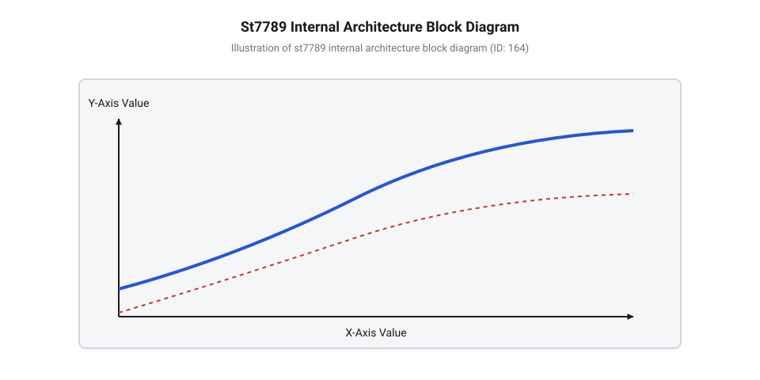
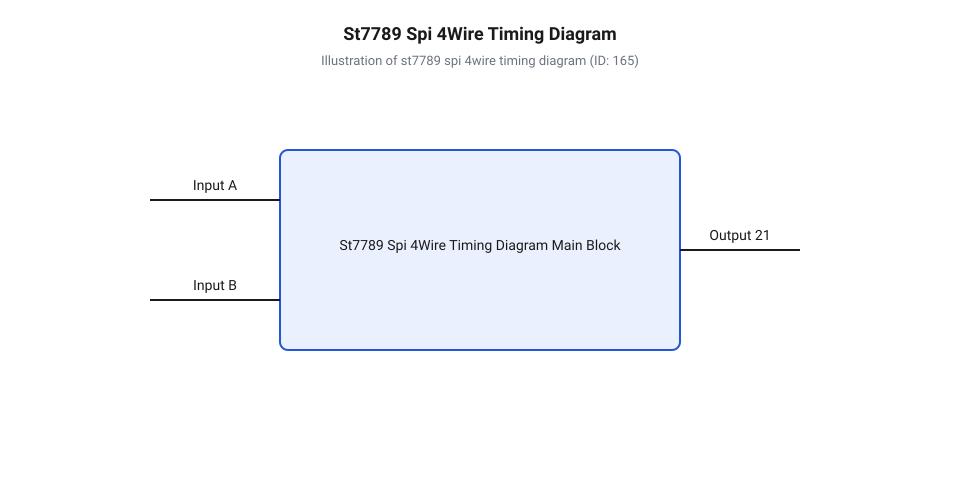
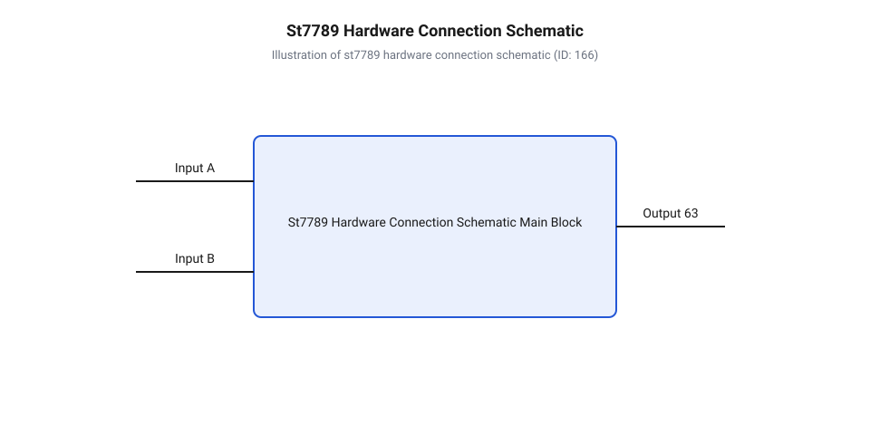
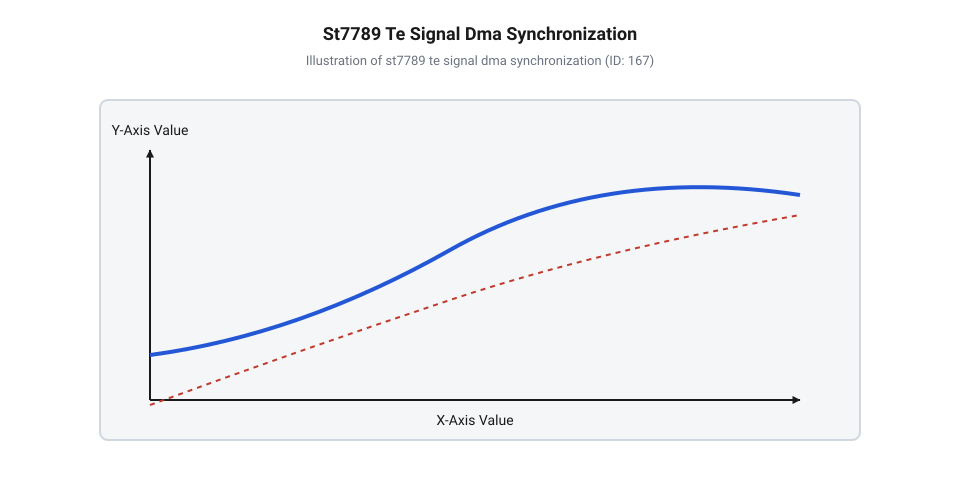
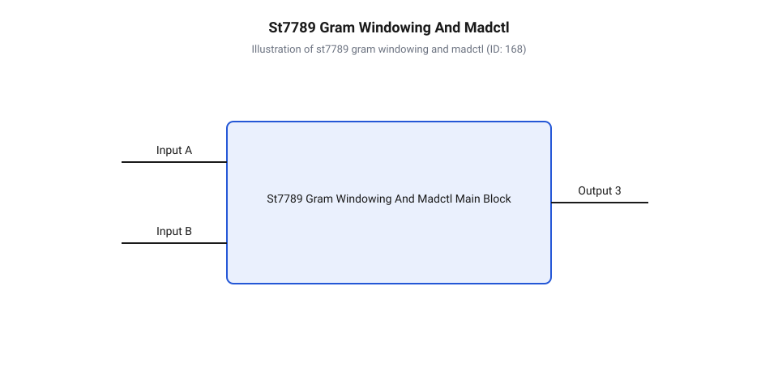

# Дисплеї родини ST7789 (огляд лінійки та контролерів)

<preknowlist>
- [IPS 1.3″ 240×240 (SPI, ST7789)](root:cat-hw-actuators/ips-st7789) — базові навички підключення та практичної експлуатації компактних дисплейних модулів на базі ST7789 через шину SPI
- [TFT 1.77″ 128×160 (SPI, ST7735S)](root:cat-hw-actuators/tft-st7735s) — розуміння архітектури попереднього покоління драйверів Sitronix, принципу командного керування та колірного формату RGB565
- [OLED-дисплей 0.96″ SSD1306 (I2C, 128×64)](root:cat-hw-actuators/oled-ssd1306) — загальне поняття про графічні контролери, командну конфігурацію та внутрішню відеопам'ять
</preknowlist>

## Проблема високої роздільності мобільних дисплеїв

Спроба виведення повнокольорової растрової графіки безпосередньо з мікроконтролера на рідкокристалічну матрицю швидко впирається у жорсткі фізичні обмеження обсягу оперативної пам'яті та обчислювальної потужності процесора. Розглянемо розрахунок пам'яті для дисплея з роздільністю `240 × 320` пікселів (від англійського @@en|picture element@@ — елемент зображення). Якщо для кожного пікселя використовується кодування кольору @@en|RGB565@@ із глибиною `16 біт` (`2 байти` на піксель), то повний кадровий буфер (від англійського @@en|frame buffer@@ — проміжна пам'ять кадру) вимагає суттєвого обсягу пам'яті:

```
N_pixels = 240 × 320 = 76800 пікселів      [обчислення загальної кількості пікселів]
V_frame = 76800 × 2 байти = 153600 байтів [обчислення обсягу кадру RGB565]
```

Якщо ж матриця використовує рідний колірний простір контролера @@en|RGB666@@ із глибиною `18 біт` (який при передачі послідовною шиною пакується у `3 байти` на піксель), необхідний обсяг кадрового буфера зростає до `230 400 байтів` (`225 КБ`). Більшість популярних 8-бітних та 32-бітних мікроконтролерів мають у своєму розпорядженні лише від `2 КБ` до `64 КБ` внутрішньої оперативної пам'яті (від англійського @@en|RAM@@ — пам'ять довільного доступу). Утримувати цілісний кадровий буфер у системному ОЗП за таких умов фізично неможливо. На відміну від [простіших знакосинтезуючих екранів](root:cat-hw-actuators/lcd-1602) або [монохромних графічних матриць](root:cat-hw-actuators/oled-ssd1306), растрові кольорові панелі вимагають передачі величезного масиву графічної інформації при будь-якому оновленні зображення.

Другий критичний аспект полягає у фізиці функціонування рідких кристалів та необхідності безперервної регенерації кадру. Рідкокристалічна матриця позбавлена власного ефекту апаратної пам'яті: під дією прикладеної напруги орієнтація нематичних молекул змінюється, звертаючи площину поляризації світла, однак після зняття електричного поля кристали швидко релаксують у початковий стан. Щоб людське око сприймало монолітне зображення без мерехтіння, напругу на кожному пікселі потрібно поновлювати із частотою не менше ніж `60 Гц`. Якби мікроконтролер власноруч послідовно опитував кожен із `76 800` пікселів і формував керуючі строби `60` разів на секунду, процесорне ядро вимушене було б генерувати `4 608 000` подій оновлення на секунду. Це повністю заблокувало б процесор, унеможливлюючи виконання програмного коду, опитування датчиків чи роботу комунікаційних протоколів.

Ефективним розв'язком цієї апаратної проблеми стало створення спеціалізованих однокристальних контролерів-драйверів (від англійського @@en|driver@@ — керуючий вузол), яскравим представником яких є родина мікросхем @@en|ST7789@@. Контролер об'єднує на одному напівпровідниковому кристалі масив внутрішньої графічної відеопам'яті @@en|GRAM@@ (від англійського @@en|Graphic RAM@@ — графічне ОЗП) обсягом `240 × 320 × 18 біт` (`172.8 КБ`), автономний внутрішній генератор тактової частоти, систему регенерації зображення та високовольтні ключі адресації. Завдяки такій архітектурі мікроконтролеру більше не потрібно утримувати фреймбуфер у своєму ОЗП чи витрачати ресурси на регенерацію. Процесор передає шиною лише змінені фрагменти зображення або окремі кодові команди, після чого контролер @@en|ST7789@@ автономно зчитує даний масив із пам'яті @@en|GRAM@@ і формує керуючі сигнали на рідкокристалічну панель.


*Внутрішня структура однокристального чипа ST7789: вхідний шинний інтерфейс зберігає графічні дані у внутрішній GRAM, з якої автономні драйвери стовпчиків та рядків формують керуючі аналогові сигнали на матрицю.*

Для безпосереднього керування рідкокристалічними комірками внутрішня схема @@en|ST7789@@ містить потужні драйвери стовпчиків (від англійського @@en|source driver@@ — драйвер джерел) та драйвери рядків (від англійського @@en|gate driver@@ — драйвер затворів). Вони перетворюють цифрові кодові значення кольорів із пам'яті @@en|GRAM@@ на аналогові рівні напруги. Оскільки для швидкого повертання рідкокристалічних молекул потрібні потенціали, що значно перевищують стандартну напругу живлення цифрової логіки `3.3 В`, у чип інтегровано помпи заряду (від англійського @@en|charge pump@@ — помповий підвищувач напруги). Вони генеративно формують високі позитивні напруги `VGH` (до `+15 В`) для відкриття тонкоплівкових транзисторів (від англійського @@en|TFT@@ — тонкоплівковий транзистор), негативні напруги `VGL` (до `-10 В`) для їхнього надійного запирання, а також змінну напругу загального електрода `VCOM`. Постійна зміна полярності напруги `VCOM` запобігає деградації та електролітичному розкладанню рідких кристалів під дією постійного струму.

Сучасні дисплейні модулі на основі чипів @@en|ST7789@@ зазвичай працюють із рідкокристалічними матрицями технології @@en|IPS@@ (від англійського @@en|In-Plane Switching@@ — перемикання у площині) в оптичному режимі @@en|normally black@@ (за замовчуванням чорний). У знеструмленому стані молекули рідких кристалів орієнтовані паралельно підкладці дисплея та перпендикулярно до кутів поляризації зовнішніх поляризаційних плівок. Завдяки цьому світловий потік від світлодіодного підсвічування повністю поглинається поляризаційним фільтром, забезпечуючи глибокий чорний колір екрана. Під дією електричного поля, створеного драйвером @@en|source driver@@ у площині комірки, молекули повертаються на заданий кут, пропускаючи чітко розраховану частку світла через відповідні колірні світлофільтри субпікселів. Це дає високу контрастність та широкі кути огляду до `178°` без інверсії відтінків, що вигідно відрізняє ці модулі від [застарілих TFT-матриць на контролерах ST7735S](root:cat-hw-actuators/tft-st7735s).

Еволюція однокристальних дисплейних контролерів компанії @@en|Sitronix@@ пройшла тривалий шлях від мікросхем типу @@en|ST7735@@ та @@en|ST7735S@@, орієнтованих на дешеві екрани з матрицями @@en|TN@@ (від англійського @@en|Twisted Nematic@@ — скручений нематик), до сучасної родинної лінійки @@en|ST7789@@. Поява нових ревізій чипів була зумовлена необхідністю підвищення частоти оновлення кадрів, зменшення енергоспоживання портативних пристроїв та підтримки високої щільності пікселів у компактних індикаторах. Базова версія @@en|ST7789V@@ заклала основу для швидкісної послідовної та паралельної адресації відеопам'яті. Модифікація @@en|ST7789VI@@ отримала оптимізовані часові затримки для роботи з високочастотними шинами та покращені алгоритми зсуву рівня для низьковольтних мікроконтролерів. Ревізія @@en|ST7789H2@@ була спеціально розроблена для мініатюрних матриць із нестандартною геометричною роздільністю, надаючи гнучкі налаштування помп заряду та знижене споживання струму в режимі глибокого сну.

Завдяки повній автономності збереження зображення у пам'яті @@en|GRAM@@ та високій якості передачі кольорів чипи @@en|ST7789@@ стали стандартом для [компактних IPS дисплейних модулів 1.3″](root:cat-hw-actuators/ips-st7789). Детальний опис карти регістрів та підключення чипа можна знайти у [довіднику апаратного інтерфейсу ST7789](root:cat-hw-actuators/st7789-family/api-st7789-hardware-interface.md).

## Апаратні інтерфейси та синхронізація сигналів

Внутрішньо контролер @@en|ST7789@@ комутує сотні аналогових ліній адресації рідкокристалічної матриці, однак для взаємодії з керуючим мікроконтролером розроблено гнучку систему шинних інтерфейсів. Чип підтримує паралельні 8-бітні та 16-бітні шини (від англійського @@en|MCU parallel interface@@ — паралельний інтерфейс мікроконтролера), які забезпечують максимальну швидкість перезапису відеопам'яті, проте вимагають від `12` до `20` виводів процесора. Для більшості компактних пристроїв та вбудованих систем таке витрачання виводів мікроконтролера є неприпустимим, тому основними стандартними інтерфейсами підключення є 4-провідний та 3-провідний послідовні інтерфейси @@en|SPI@@ (від англійського @@en|Serial Peripheral Interface@@ — послідовний периферійний інтерфейс).

У практичному застосуванні найпопулярнішим є 4-провідний послідовний інтерфейс (від англійського @@en|4-line serial interface@@). Для його повноцінного функціонування використовуються чотири сигнали зв'язку:

* `CS` (від англійського @@en|Chip Select@@ — вибір чипа): лінія вибору пристрою з активним низьким рівнем (`0`). Низький рівень активує вхідний шинний автомат @@en|ST7789@@ та дозволяє прийом тактових імпульсів. * `SCLK` (від англійського @@en|Serial Clock@@ — тактовий сигнал): лінія тактування шини, за зростаючим фронтом якої контролер зчитує логічні рівні з лінії даних. * `SDA` або `MOSI` (від англійського @@en|Serial Data@@ — послідовні дані): однонапрямлена лінія передачі байтів команд та масивів пікселів від мікроконтролера до дисплея. * `DC` або `RS` (від англійського @@en|Data/Command@@ — дані/команда): додаткова лінія розрізнення типу переданої інформації. Рівень `0` вказує контролеру, що поточний байт є командним кодом конфігурації, а рівень `1` — що байт є графічними даними для запису у пам'ять @@en|GRAM@@.


*Часова діаграма 4-провідного SPI: стан лінії DC визначається до першого зростаючого фронту SCLK, встановлюючи режим інтерпретації прийнятого байта як команди або даних.*

Альтернативним варіантом є 3-провідний послідовний інтерфейс (від англійського @@en|3-line serial interface@@), у якому лінія `DC` відсутня. У цьому режимі замість окремого провідника використовується додатковий `9-й біт`, який передається перед кожним `8-бітним` байтом. Якщо `9-й біт` дорівнює `0`, контролер сприймає наступний байт як команду; якщо `1` — як дані. Хоча це дає змогу зекономити один вивід мікроконтролера, 3-провідна схема вкрай рідко застосовується на практиці. Апаратні периферійні блоки @@en|SPI@@ більшості мікроконтролерів оперують виключно 8-бітними або 16-бітними словами, тому передача `9-бітних` посилок вимагає програмного емулювання шини (від англійського @@en|bit-banging@@ — програмне перемикання виводів), що призводить до катастрофічного падіння швидкості оновлення екрана.

Окрім шини даних, апаратне обв'язування дисплейного модуля включає лінії системного керування та синхронізації:

* `RES` або `RESET` (від англійського @@en|Reset@@ — скидання): лінія апаратного скидання чипа з активним низьким рівнем. Імпульс низького рівня тривалістю від `10 мкс` переводить регістри @@en|ST7789@@ у початковий стан. * `TE` (від англійського @@en|Tearing Effect@@ — ефект розриву): вихідний сигнал контролера, що випромінює короткий строб під час кадрового гасильного імпульсу (від англійського @@en|vertical blanking interval@@ — інтервал вертикального затемнення), коли внутрішній блок регенерації тимчасово припиняє зчитування пам'яті @@en|GRAM@@. * `BLK` або `LED` (від англійського @@en|Backlight@@ — підсвічування): лінія керування затвором польового транзистора світлодіодного підсвічування. Підключення цього виводу до виходу широтного-імпульсного модулятора (від англійського @@en|PWM@@ — широтно-імпульсна модуляція) дає змогу регулювати яскравість екрана.


*Принципова схема узгодження рівнів: 8-контактний модуль дозволяє керувати лінією CS та сигналами синхронізації, тоді як 7-контактні плашки мають апаратно заземлений CS.*

Під час вибору практичного модуля слід зважати на схемотехнічні особливості плашок. На 8-контактних плашках виведено всі керуючі лінії, включаючи `CS`, що дозволяє розміщувати дисплей на спільній шині @@en|SPI@@ разом із зовнішньою флеш-пам'яттю чи датчиками. У 7-контактних плашках лінія `CS` часто апаратно з'єднана з грою (`GND`) безпосередньо на друкованій платі модуля, тому такий дисплей має бути єдиним пристроєм на шині @@en|SPI@@. Для надійного підключення модуля до мікроконтролерів із п'ятивольтовою логікою (`5 В`) необхідно використовувати швидкісні резистивні дільники напруги або двонапрямлені буферні мікросхеми зсуву рівнів (наприклад, `74HC4050`). Докладно практичні схеми розглянуто у матеріалі про [модуль узгодження рівнів ST7789](root:cat-hw-actuators/st7789-family/proj-st7789-hardware-interface-module.md).

Критичним фактором забезпечення стабільного обміну даними на граничних частотах шини @@en|SPI@@ є часові затримки перемикання лінії `DC`. Контролер @@en|ST7789@@ здатен приймати дані на частотах `SCLK` до `62.5 МГц`. При частоті шини `40 МГц` період одного тактового імпульсу складає лише `25 нс`:

```
t_period = 1 / f_SCLK        [обчислення періоду тактового сигналу]
t_period = 1 / 40000000 Гц
t_period = 25 нс
```

Згідно зі специфікацією @@en|ST7789@@, час передчасного встановлення (від англійського @@en|setup time@@, `t_DCST`) і час утримання (від англійського @@en|hold time@@, `t_DCHT`) логічного рівня лінії `DC` відносно зростаючого фронту `SCLK` має становити не менше `10 нс`. Якщо програмний код мікроконтролера перемикає лінію `DC` із запізненням через несвоєчасний виклик функцій @@en|GPIO@@ без урахування стану апаратного буфера @@en|SPI@@, рівень `DC` може змінитися прямо під час фіксації останнього біта попереднього байта.

У результаті такої фазової помилки внутрішній автомат станів @@en|ST7789@@ помилково інтерпретує графічний байт кольору як кодову команду конфігурації (або навпаки). Це призводить до зсуву координат малювання, хаотичного забарвлення пікселів, появи кольорового шуму на матриці або повного зависання дисплея.


*Синхронізація виведення кадру: імпульс TE ініціює фоновий обмін через DMA, гарантуючи, що перезапис GRAM не перетинеться із зоною зчитування скан-лінії.*

Щоб повністю усунути ефект розриву кадру (від англійського @@en|tearing effect@@ — ефект розриву), при якому на екрані одночасно відображаються фрагменти старого та нового кадрів, застосовують апаратну синхронізацію за виходом `TE`. Згенерований імпульс `TE` подається на вхід зовнішнього переривання мікроконтролера, запускаючи фонову передачу кадрового буфера через прямий доступ до пам'яті (від англійського @@en|DMA@@ — прямий доступ до пам'яті). Детальний математичний апарат обчислення швидкості оновлення кадрів розкрито у матеріалі про [математику пропускної здатності SPI](root:cat-hw-actuators/st7789-family/math-st7789-bandwidth-and-framerate.md), а приклад побудови апаратно-ізольованого драйвера наведено у статті про [високопродуктивний драйвер ST7789 з DMA](root:cat-hw-actuators/st7789-family/proj-st7789-dma-display-driver.md). Опис усіх регістрів і команд керування містить [програмний довідник протоколу ST7789](root:cat-hw-actuators/st7789-family/api-st7789-command-protocol.md).

## Адресація відеопам'яті та колірні режими

При безпосередньому оновленні кадру на дисплеях високої роздільної здатності мікроконтролер стикається з серйозним обмеженням обчислювальних ресурсів. Для передачі повного кадру 240 × 320 пікселів у 16-бітному колірному режимі через послідовний інтерфейс необхідно прокачати 153 600 байт даних. Якщо пристрою потрібно оновити лише невеличкий графічний елемент — наприклад, один символ годинника розміром 16 × 24 пікселі чи іконку статусу, — повне переписування всього кадру створює надмірне навантаження на шину та заблокує процесор. Для розв'язання цієї проблеми контролер ST7789 містить апаратний механізм прямої адресації довільного прямокутного вікна всередині інтегрованої відеопам'яті @@en|GRAM@@ (англ. @@en|Graphic RAM@@ — графічна оперативна пам'ять).

Внутрішній масив пам'яті ST7789 має фізичний обсяг 240 × 320 × 18 біт, що дорівнює 1 382 400 біт (172.8 КБ). Контролер організує доступ до цієї пам'яті через двовимірну систему координат, де стовпчики індексуються від 0 до 239, а рядки — від 0 до 319. Обмеження області оновлення виконується за допомогою двох системних команд: `CASET` (англ. @@en|Column Address Set@@, код `0x2A`) та `RASET` (англ. @@en|Row Address Set@@, код `0x2B`). Команда `CASET` приймає чотири параметри у вигляді старшого та молодшого байтів початкового стовпчика `XS` і кінцевого стовпчика `XE`. Аналогічно команда `RASET` задає межі рядків від `YS` до `YE`.

Далі команда `RAMWR` (англ. @@en|Memory Write@@, код `0x2C`) активує режим запису пікселів у виділене прямокутне вікно. Внутрішній лічильник адреси ST7789 автоматично встановлюється на початкову позицію `(XS, YS)`. З кожним отриманим байтом коду кольору лічильник стовпчика інкрементується. Коли поточна координата досягає правої межі `XE`, лічильник стовпчика скидається до `XS`, а лічильник рядка збільшується на одиницю. Після досягнення нижнього правого кута `(XE, YE)` адресація закольцовується назад у початкову точку `(XS, YS)`. Детальний опис системних регістрів містить [програмний протокол команд ST7789](root:cat-hw-actuators/st7789-family/api-st7789-command-protocol.md).


*Принцип мапування координат CASET/RASET на фізичну пам'ять GRAM та трансформація напрямку адресації за допомогою бітів MADCTL.*

Фізична рідкокристалічна матриця керується внутрішніми цифро-аналоговими перетворювачами @@en|DAC@@ (англ. @@en|Digital-to-Analog Converter@@ — цифро-аналоговий перетворювач) з розрядністю 6 біт на кожен колірний канал (Червоний, Зелений, Синій), що забезпечує апаратне відображення 262 144 відтінків (18 біт на піксель). Проте формат передачі даних через зовнішню шину можна гнучко налаштовувати за допомогою регістру `COLMOD` (англ. @@en|Interface Pixel Format@@, команда `0x3A`):

- **16-бітний режим (RGB565, `COLMOD = 0x55`)**: Кожен піксель кодується 5 бітами червоного, 6 бітами зеленого та 5 бітами синього кольорів (65 536 відтінків). Через шину SPI передаються рівно два байти на піксель. Контролер ST7789 автоматично доповнює 5-бітні канали червоного та синього до внутрішніх 6-біт DAC шляхом дублювання старшого розряду у молодший. Це найбільш поширений режим для мікроконтролерів, оскільки він економить 33% обсягу RAM і трафіку шини порівняно з 18-бітним режимом. - **18-бітний режим (RGB666, `COLMOD = 0x66`)**: Кожен канал отримує повноцінні 6 біт інформації. При послідовній передачі через SPI кожен піксель упаковується у три байти: `[R5..R0 0 0]`, `[G5..G0 0 0]`, `[B5..B0 0 0]`, де два молодші біти кожного байта є заповнювальними нулями. Цей режим дає максимально точну передачу градацій сірого та плавних градієнтів, але збільшує обсяг переданих даних на 50%. - **24-бітний режим (RGB888)**: Приймає по повному байту (8 біт) на кожен колірний канал через трибайтну послідовність. ST7789 відкидає два молодші біти кожного байта для узгодження з внутрішньою 18-бітною матрицею пам'яті.

Математичне оцінювання впливу обраного колірного режиму на швидкість оновлення екрана деталізовано в матеріалі [обчислення пропускної здатності SPI](root:cat-hw-actuators/st7789-family/math-st7789-bandwidth-and-framerate.md).

Конфігурація напрямку зчитування пам'яті та орієнтації зображення виконується через регістр `MADCTL` (англ. @@en|Memory Data Access Control@@, команда `0x36`). Бітові прапори цього регістру визначають апаратне дзеркалення та обертання кадру:
- `MY` (Page Address Order, біт 7): При значеннях `0` розгортка рядків іде зверху вниз, при `1` — знизу вгору (вертикальне дзеркалення). - `MX` (Column Address Order, біт 6): При `0` стовпчики адресуються зліва направо, при `1` — справа наліво (горизонтальне дзеркалення). - `MV` (Page/Column Selection, біт 5): При `0` використовується книжкова (вертикальна) орієнтація. При `1` відбувається взаємна заміна осей X та Y, що переводить дисплей у альбомну (горизонтальну) орієнтацію. - `ML` (Vertical Refresh Order, біт 4): Визначає фізичний напрямок сканування драйверів затворів (gate drivers). - `RGB` (Panel RGB/BGR Order, біт 3): Перемикає послідовність колірних фільтрів. Значення `0` відповідає схемі Червоний-Зелений-Синій, а `1` перемикає її на Синій-Зелений-Червоний (BGR), що необхідно для модулів із дзеркальним розташуванням фізичних світлофільтрів на склі.

Окремою інженерною задачею є робота з плашками різної фізичної роздільної здатності. Оскільки чип ST7789 розрахований на матрицю 240 × 320, при використанні квадратних панелей 240 × 240 у [компактних дисплеїв ST7789](root:cat-hw-actuators/ips-st7789) або прямокутних індикаторів 135 × 240 частина масиву GRAM лишається невидимою. Залежно від того, до яких саме виводів кристала під'єднано фізичне скло, видима область може починатися не з координати `(0, 0)`, а мати просторовий зсув (англ. offset). Наприклад, для матриці 240 × 240 початковий рядок у GRAM може відповідати `Y = 80` або `Y = 0`. При зміні орієнтації через біт `MV` осей X та Y програмний драйвер повинен динамічно перераховувати ці зсуви перед відправкою команд `CASET` та `RASET`, як це робилося і в драйверах попередніх поколінь [TFT-контролерів ST7735S](root:cat-hw-actuators/tft-st7735s).

Розрахунок фактичних координат для вікна `(X_user, Y_user)` шириною `W` та висотою `H` здійснюється за формулами:

```
XS_actual = X_user + X_offset
XE_actual = XS_actual + W - 1
YS_actual = Y_user + Y_offset
YE_actual = YS_actual + H - 1
```

Для формування високих напруг керування рідкими кристалами ST7789 використовує внутрішні помпи заряду (англ. @@en|charge pumps@@). Зі стандартної напруги живлення `VDD` (1.65..3.3 В) помпи генерують позитивну напругу відкривання відносних транзисторів `VGH` (+12..+15 В), негативну напругу запирання `VGL` (-7..-10 В) та опорну напругу спільного електрода `VCOM`.

Керування енергоспоживанням здійснюється через системні режими:
- `SLPIN` (Sleep In, `0x10`): Вимикає внутрішній тактовий генератор та помпи заряду. Споживання чипа знижується до величини менше ніж 10 мкА, але вміст GRAM повністю зберігається. - `SLPOUT` (Sleep Out, `0x11`): Запускає генератор і помпи. **Критична вимога**: після відправки команди `SLPOUT` керуючий мікроконтролер повинен витримати паузу щонайменше 120 мілісекунд перед відправкою наступних команд увімкнення екрана `DISPON` (`0x29`). Цей час необхідний для повного встановлення переходів внутрішніх каскадів помпи заряду та стабілізації напруг `VGH` і `VGL`. - `DISPOFF` (`0x28`) та `DISPON` (`0x29`): Відключають чи вмикають вихідні ключі драйверів без зупинки генераторів та без втрати даних у відеопам'яті. - `INVOFF` (`0x20`) та `INVON` (`0x21`): Керують інверсією сигналу керування рідкими кристалами, що є обов'язковим для матриць @@en|normally black@@ IPS-типу для отримання правильних кольорів.

## Схемотехнічне підключення та узгодження рівнів

Після засвоєння командного протоколу та адресації GRAM інженер переходить до фізичного інтегрування дисплейного модуля в електронну схему пристрою. На ринку масово представлені плашки з різною кількістю виводів та різними варіантами розпіновки, що вимагає чіткого розуміння електричних характеристик сигнальних ліній та правил їхнього узгодження з керуючими мікроконтролерами з живленням 3.3 В та 5 В.

Фізично дисплейні модулі на базі ST7789 поділяються на дві основні категорії:

1. **8-контактні модулі**: Містять лінії `GND`, `VCC` (3.3 В), `SCL` (`SCLK`), `SDA` (`MOSI`), `RES` (`RESET`), `DC` (Data/Command), `CS` (Chip Select) та `BLK` (Backlight). Наявність виводу `CS` дає змогу повноцінно шинувати послідовний інтерфейс SPI разом з іншими периферійними пристроями (наприклад, SPI flash-пам'яттю чи датчиками). Коли лінія `CS` перебуває у високому логічному стані, контролер ST7789 повністю ігнорує будь-які імпульси на лініях `SCLK` та `SDA`. 2. **7-контактні модулі**: У цих плашках вивід `CS` відсутній на зовнішньому роз'ємі, оскільки він апаратно припаяний до шини заземлення `GND` безпосередньо на друкованій платі модуля. - *Перевага*: Заощаджується один GPIO-вивід мікроконтролера, що важливо для чипів із малим корпусом. - *Недолік*: Дисплей постійно перебуває в активному стані слухача шини. До цієї ж шини SPI неможливо підключити жоден інший пристрій, оскільки передача даних для нього буде сприйнята ST7789 як сміттєві команди або дані відеопам'яті. Крім того, будь-яка завада на лінії `SCLK` під час подачі живлення може збити 8-бітну фазировку байтів у ST7789, після чого чип почне хибно інтерпретувати межі команд і даних.

Повний перелік сигнальних виводів та електричних параметрів наведено у довіднику [цокольовка та карта регістрів](root:cat-hw-actuators/st7789-family/api-st7789-hardware-interface.md).

Номінальна напруга живлення цифрового ядра та інтерфейсу ST7789 становить `VDD` / `VDDIO` = 1.65..3.3 В. Максимально припустима напруга на вході сигнальних ліній (`SCLK`, `SDA`, `DC`, `RES`, `CS`) обмежена специфікацією на рівні `VDDIO + 0.3 В` (близько 3.6 В). Пряме підключення таких ліній до 5-вольтних мікроконтролерів (наприклад, на базі ATmega328P у платах Arduino Uno чи старих 8051) призводить до відкриття захисних вхідних діодів чипа, їхнього перегріву та неминучого деградаційного виходу з ладу вхідних тригерів Шмітта.

Для безпечного узгодження логічних рівнів використовують два основні схемотехнічні підходи:

**1. Резистивні дільники напруги**:
Найпростіший спосіб полягає у встановленні дільника з двох резисторів у розрив кожної сигнальної лінії. Резистор R1 = 1 кОм включається послідовно між виводом 5 В мікроконтролера та входом ST7789, а резистор R2 = 2 кОм ставиться між входом ST7789 та заземленням `GND`.

Розрахунок вихідної напруги дільника:

```
V_out = V_in × R2 ÷ (R1 + R2)
      = 5.0 × 2000 ÷ (1000 + 2000)      [закон Ома для послідовного кола]
      = 3.33 В                          [результат узгоджений із VDDIO]
```

*Обмеження резистивного дільника*: Паразитна ємність монтажних доріжок друкованої плати та вхідних виводів модуля (Cp ≈ 15..30 пФ) разом із еквівалентним опором дільника Req = R1 || R2 ≈ 667 Ом утворює аналоговий фільтр низьких частот із частотою зрізу fc = 1 / (2π Req Cp) ≈ 8..15 МГц. При спробі підняти частоту SPI понад 10 МГц прямокутні фронти імпульсів закруглюються, викликаючи помилки тривалості установки (англ. @@en|setup time@@) та утримання (англ. @@en|hold time@@) сигналу.

**2. Активні буферні мікросхеми**:
Для забезпечення роботи шини SPI на максимальних частотах 30–60 МГц застосовують спеціалізовані активні буфери без інверсії з живленням 3.3 В (наприклад, `74HC4050`, `74LVC245` або `74LVC1T45`). Вхідні каскади цих мікросхем у серії `LVC` переносять напругу до 5.5 В на входах навіть при живленні ядра від 3.3 В. Вони формують круті фронти сигналів із часом наростання менше ніж 2–3 наносекунди, що забезпечує кришталево чисту осцилограму на граничних частотах тактування.

Готові принципові схеми обв'язки подано в проєкті [схема узгодження рівнів ST7789](root:cat-hw-actuators/st7789-family/proj-st7789-hardware-interface-module.md).

Світлодіодне підсвічування IPS-панелей складається з паралельної або послідовної збірки білих світлодіодів, яка споживає струм від 15 до 60 мА при прямому падінні напруги 3.0..3.2 В.

Пряме підключення виводу підсвічування `BLK` (або `LEDA`) до виводу GPIO мікроконтролера є грубою помилкою, оскільки більшість сучасних мікроконтролерів мають допустимий струм на один вивід не більше ніж 10–20 мА. Перевантаження спричиняє просідання внутрішньосистемного живлення та термічне деградування вихідного каскаду мікроконтролера.

Для безпечного керування підсвічуванням застосовують електронний ключ на базі N-канального MOSFET-транзистора (наприклад, `2N7002` або `BSS138`) або NPN біполярного транзистора (`2N3904`, `BC847`):
- Стік (Drain) MOSFET-транзистора підключається до катода підсвічування `BLK`, Витік (Source) — до `GND`. - Затвор (Gate) підключається до GPIO мікроконтролера через струмообмежувальний резистор 100 Ом, а також шунтується на `GND` резистором 10 кОм для гарантованого запирання транзистора при скиданні мікроконтролера.

Для плавного регулювання яскравості на ключ подається сигнал широтно-імпульсної модуляції @@en|PWM@@ (англ. @@en|Pulse-Width Modulation@@ — широтно-імпульсна модуляція). Частота PWM повинна обиратися в діапазоні від 1 кГц до 20 кГц. Нижчі частоти викликають помітне миготіння екрана, тоді як надто високі частоти призводять до акустичного писку керамічних конденсаторів у колі живлення.

Побудова надійної схемотехніки з правильним розв'язуванням по живленню (керамічний конденсатор 100 нФ та танталовий 10 мкФ безпосередньо біля виводу `VCC` модуля) та активним узгодженням рівнів створює фізичний фундамент для передачі відеоданих без втрат.

Наступним кроком є побудова програмного драйвера, який поєднує командну адресацію `CASET`/`RASET` з фоновим обміном через апаратний контролер @@en|DMA@@ (англ. @@en|Direct Memory Access@@ — прямий доступ до пам'яті) та синхронізацією за лінією `TE` (Tearing Effect), що детально розібрано в практичній розробці [драйвер з підтримкою DMA](root:cat-hw-actuators/st7789-family/proj-st7789-dma-display-driver.md).

## Ініціалізація та адаптація роздільної здатності

Подача живлення на модуль дисплея ще не означає появи зображення на екрані. У перший момент після ввімкнення внутрішній контролер перебуває в режимі глибокого сну (@@en|Sleep Mode@@, англ. *sleep mode* — режим сну), його власні генератори високої напруги вимкнені, а графічна оперативна пам'ять містить довільне сміття. Якщо відразу відправити масив пікселів на рідкокристалічну панель, екран лишиться темним або відобразить зашумлені смуги. Щоб рідкі кристали зреагували на електричне поле, а кристалічний драйвер узгодив роботу внутрішніх помп заряду та логіки, мікроконтролер повинен виконати чітко регламентовану послідовність апаратного скидання та ініціалізаційних команд.

Скидання починається з фізичного сигналу на лінії `RES` (від англ. *reset* — скидання). Мікроконтролер встановлює низький рівень на цій лінії принаймні на 10 мкс, ініціюючи очищення внутрішніх регістрів контролера ST7789. Після повернення лінії `RES` до високого рівня внутрішньому осцилятору потрібен час для виходу на робочу частоту. Пауза тривалістю не менше 120 мс перед наступною командою є критичною: у цей інтервал мікрокоманди чипа зчитують заводські калібрувальні коефіцієнти з одноразово програмованої пам'яті (@@en|One-Time Programmable memory@@, англ. *one-time programmable memory* — пам'ять з одноразовим програмуванням, OTP).

Першою програмною командою є вихід зі сну `SLPOUT` (`0x11`). Команда запускає генератори внутрішньої помпи заряду, які формують високовольтні рівні живлення для затворів рідкокристалічних ключів. Тільки після повторної примусової паузи у 120 мс, потрібної для стабілізації напруг, можна відправляти команди налаштування режиму колірності `COLMOD` (`0x3A`) та конфігурації напрямку розгортки `MADCTL` (`0x36`), узгоджені з [командним протоколом драйвера](root:cat-hw-actuators/st7789-family/api-st7789-command-protocol.md).

Матриці типу @@en|In-Plane Switching@@ (англ. *in-plane switching* — перемикання в площині, IPS) у родині ST7789 майже завжди працюють у фізичному режимі @@en|Normally Black@@ (англ. *normally black* — звичайно чорний). Це означає, що за відсутності електричного поля між електродами молекули рідких кристалів не повертають поляризацію світла, і світло від підсвічування повністю блокується вихідним поляризатором, даючи глибокий чорний колір. Для коректного відображення градацій кольорів на таких матрицях необхідно обов'язково активувати режим інверсії кольору за допомогою команди `INVON` (`0x21`). Без виконання цієї команди зображення на екрані буде негативним: чорний колір стане білим, а червоний — блакитним. На завершення послідовності подається команда увімкнення дисплея `DISPON` (`0x29`), яка дозволяє вихідним ключам драйвера подавати напругу безпосередньо на електроди пікселів.

Внутрішній масив пам'яті GRAM контролера ST7789 фізично розрахований на роздільну здатність 240×320 пікселів із глибиною 18 біт на піксель. Однак на ринку широко поширені компактні дисплейні модулі з меншими фізичними матрицями: квадроподібні на 240×240 пікселів (наприклад, у [компактних модулях IPS](root:cat-hw-actuators/ips-st7789)) чи прямокутні міні-панелі 135×240 або 172×320 пікселів. Оскільки фізична рідкокристалічна матриця підключена лише до частини виходів кристала ST7789, виникає зсув координат (@@en|offset@@, від англ. *off* + *set* — зміщення).

Зсув координат виникає через те, що перший фізичний піксель меншої матриці підключений не до нульового стовпчика чи рядка масиву GRAM, а до проміжного. Якщо при виведенні кадру не враховувати цей зсув, малюнок вийде за межі видимої області екрана, а на протилежному боці з'являться смуги "сміття" з неуживаних осередків пам'яті.

Математичний розрахунок меж вікна адресації при використанні команд `CASET` (`0x2A`, від англ. *column address set* — встановлення адреси стовпчиків) та `RASET` (`0x2B`, від англ. *row address set* — встановлення адреси рядків) виконується за формулами:

```text
X_start = X_user + X_offset
X_end   = X_user + width - 1 + X_offset
Y_start = Y_user + Y_offset
Y_end   = Y_user + height - 1 + Y_offset
```

Де `X_user` та `Y_user` — логічні координати всередині робочої області додатка, `width` та `height` — ширина й висота прямокутника виводу, а `X_offset` та `Y_offset` — апаратні зсуви для конкретної ревізії модуля.

Значення зсувів змінюються при обертанні екрана через регістр `MADCTL`. Наприклад, для матриці 240×240 пікселів у книжковій орієнтації зсув по осі Y дорівнює 0 (`Y_offset = 0`), а при повороті на 180 градусів матриця зміщується до нижньої межі GRAM, через що виникає зсув `Y_offset = 80` (оскільки `320 - 240 = 80`). Для прямокутних матриць 135×240 пікселів апаратний зсув становить `X_offset = 52`, `Y_offset = 40` у книжковому режимі. Точна відповідність фізичних виводів перевіряється через [довідник залізних сигналів](root:cat-hw-actuators/st7789-family/api-st7789-hardware-interface.md) та карту регістрів контролера.

:::tabs
:::code st7789-family-d/c/esp-idf/st7789-set-window.c
:::code st7789-family-d/cpp/arduino/st7789display.cpp
:::

## Високопродуктивний вивід та усунення розривів

Спроба оновити повнокадрове зображення на дисплеї ST7789 шляхом послідовного опитування шини SPI центральним процесором мікроконтролера швидко впирається у два бар'єри: катастрофічне падіння частоти кадрів та появу горизонтальних розривів зображення. При програмній передачі байтів процесор витрачає 100% своїх тактів на очікування прапорців готовності буфера SPI, залишаючи нуль ресурсів для обчислення логіки додатка чи рендерингу графіки. Понад те, якщо процесор описує пам'ять GRAM у той самий момент, коли внутрішній сканатор драйвера виводить відповідний рядок на рідкі кристали, на екрані виникає характерний артефакт — розрив кадру (@@en|Tearing Effect@@, англ. *tearing* — розрив, від *to tear* — рвати). Верхня частина екрана показує новий кадр, а нижня — попередній.

Для подолання цієї проблеми необхідно спершу математично розрахувати фізичні межі пропускної здатності послідовної шини. Розглянемо приклад виведення кадру на матрицю роздільною здатністю 240×240 пікселів у форматі колірності RGB565 (2 байти або 16 біт на піксель).

Обсяг даних одного кадру `V_frame` визначається як добуток кількості пікселів на розмір одного пікселя в байтах:

```text
V_frame = 240 × 240 × 2
        = 115 200 байт      [обсяг кадру в байтах]
        = 921 600 біт       [множення на 8 біт/байт]
```

Якщо шина SPI працює на тактовій частоті `f_SPI = 40 МГц` (40 000 000 біт/с), максимальна теоретична частота оновлення кадрів `FPS_max` становить:

```text
FPS_max = 40 000 000 ÷ 921 600
        ≈ 43.4 кадрів/с     [ділення частоти шини на обсяг кадру]
```

При підвищенні частоти SPI до 62.5 МГц (максимальна частота послідовного інтерфейсу ST7789V) гранична частота кадрів зростає до 67.8 FPS. Однак реальна швидкість при програмному опитуванні рідко перевищує 12–15 FPS через накладні витрати на обробку переривань і паузи між байтами. Детальні формули з урахуванням службових тактів адресації наведено в матеріалах для [розрахунку пропускної здатності шини](root:cat-hw-actuators/st7789-family/math-st7789-bandwidth-and-framerate.md).

Рішенням для розвантаження центрального процесора є використання прямого доступу до пам'яті (@@en|Direct Memory Access@@, DMA, від англ. *direct memory access* — прямий доступ до пам'яті). Контролер DMA пересилає масив пікселів із системної оперативної пам'яті (SRAM) безпосередньо в SPI-периферію в фоновому режимі, звільняючи процесор для паралельних обчислень.

Оскільки повнокадровий буфер для матриці 240×240 потребує 115.2 КБ RAM (що перевищує обсяг пам'яті багатьох бюджетних мікроконтролерів, на відміну від [попереднього покоління ST7735S](root:cat-hw-actuators/tft-st7735s), де роздільна здатність була меншою), на практиці застосовують технологію рядочного подвійного буферизування (@@en|line double buffering@@). Створюються два невеликі буфери (наприклад, по 16 рядків = 7680 байт кожен). Поки DMA відправляє перший буфер у GRAM, процесор рендерить наступні 16 рядків у другий буфер.

Для повного усунення артефактів розриву кадру використовують керуючу лінію `TE` (від @@en|Tearing Effect@@). Контролер ST7789 генерує на цій лінії імпульс під час гасіння кадрової розгортки (перехід від останньої строчки розгортки до першої, так званий @@en|vertical blanking porch@@).

Команда `TEON` (`0x35`) з параметром `0x00` вмикає вихід `TE` у режимі кадрової синхронізації (V-Blanking). Коли сканатор матриці закінчує виведення 320-го рядка GRAM на рідкі кристали, лінія `TE` переходить у високий стан. Мікроконтролер фіксує цю подію через зовнішнє апаратне переривання (@@en|external interrupt@@, GPIO EXTI) і негайно запускає передачу нового кадру через DMA. Завдяки цьому запис у пам'ять GRAM завжди йде паралельно з фізичним зчитуванням матриці, ніколи не перетинаючи активний рядок розгортки. При схемотехнічному [розрахунку вузла узгодження](root:cat-hw-actuators/st7789-family/proj-st7789-hardware-interface-module.md) сигналу TE необхідно забезпечити мінімальну паразитну ємність лінії для збереження крутизни фронту.

При виборі конкретної модифікації ST7789 та організації графічного тракту інженер опирається на три основні компроміси:
1. **Частота оновлення проти обсягу SRAM**: Повнокадровий буфер у RAM дає ідеальну плавність та усунення розривів, але вимагає мікроконтролерів рівня ESP32 або STM32F4/H7. Рядочний буфер економить RAM, але вимагає суворого дотримання таймінгів DMA. 2. **Пропускна здатність проти довжини провідників SPI**: Частоти SPI вище 40 МГц вимагають коротких провідників друкованої плати та узгодження імпедансу lines. 3. **Енергоспоживання проти контрастності**: Зниження частоти кадрової розгортки внутрішнього регістру `FRCTR2` (`0xB3`) знижує струм споживання помпи заряду, але може викликати помітне мерехтіння на яскравих статичних зображеннях.

Практична реалізація подібного підходу детально описана в проєкті [реалізації драйвера з підтримкою DMA](root:cat-hw-actuators/st7789-family/proj-st7789-dma-display-driver.md).

:::tabs
:::code st7789-family-d/c/esp-idf/st7789-te-gpio-isr-handler.c
:::code st7789-family-d/cpp/arduino/dmatedisplaydriver.cpp
:::