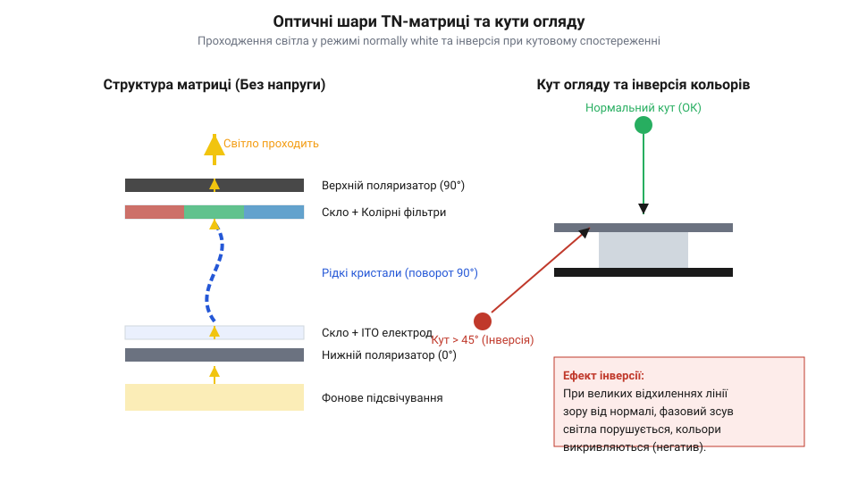
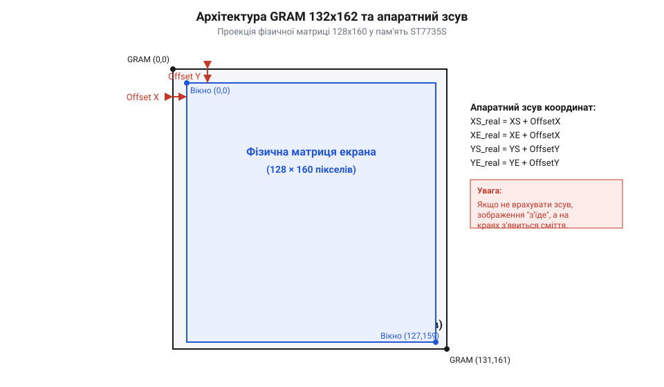
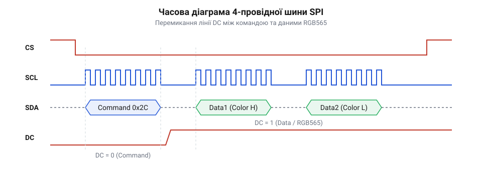
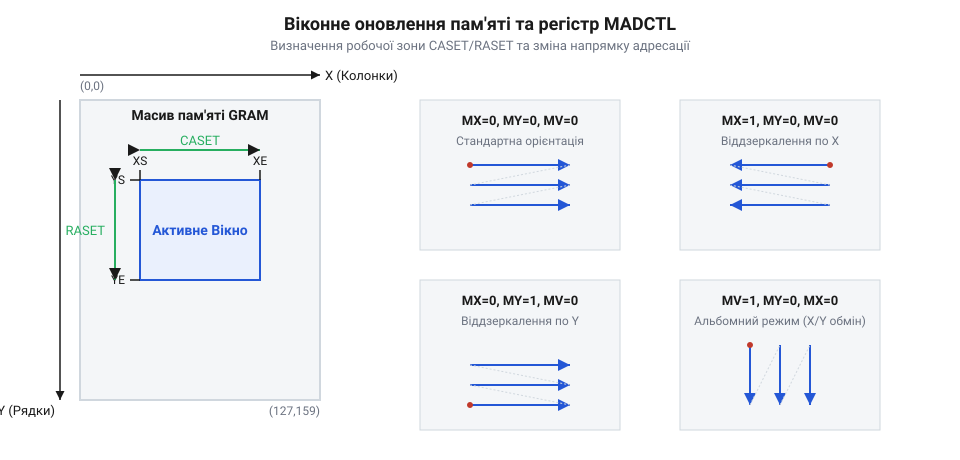
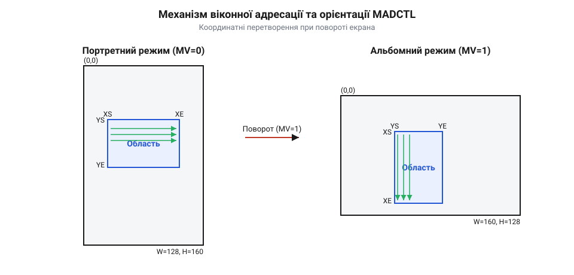

# TFT 1.77″ 128×160 (SPI, ST7735S)

<preknowlist>
- [OLED-дисплей 0.96″ SSD1306 (I2C, 128×64)](root:cat-hw-actuators/oled-ssd1306) — принципи графічної адресації та організації локальної пам'яті дисплейних контролерів
- [IPS 1.3″ 240×240 (SPI, ST7789)](root:cat-hw-actuators/ips-st7789) — базові принципи швидкісної передачі графічних даних через послідовний інтерфейс SPI
- [Дисплеї родини ST7789 (огляд лінійки та контролерів)](root:cat-hw-actuators/st7789-family) — системна архітектура та логіка командного керування дисплейних контролерів Sitronix
</preknowlist>

## Обмеження монохромних екранів у графічних інтерфейсах

Побудова зручного та інтуїтивно зрозумілого інтерфейсу користувача в автономних приладах часто починається з найпростіших засобів візуалізації. Використання таких компонентів, як [прості символьні індикатори LCD 1602](root:cat-hw-actuators/lcd-1602) або їхня модифікація, що використовує [спеціалізований I2C-адаптер PCF8574](root:cat-hw-actuators/i2c-lcd-adapter), забезпечує відображення лише базових текстових рядків та статичних цифрових значень. Коли виникає потреба в побудові графіків чи простих піктограм стану, розробники звертаються до графічних індикаторів, серед яких значну популярність здобули [компактні OLED-екрани SSD1306](root:cat-hw-actuators/oled-ssd1306). Проте за спроби створити складний прилад із багаторівневим меню, колірним кодуванням критичних станів (наприклад, червоний колір для тривоги, жовтий для попередження та зелений для норми) та багатими графічними віджетами монохромні технології демонструють нездолані фізичні та архітектурні обмеження.

Головна проблема монохромних рідкокристалічних та світлодіодних матриць полягає в бінарній природі їхнього елементарного візуального осередку. У таких екранах кожен @@en|pixel@@ (англ. *picture element* — елемент зображення) може перебувати лише у двох станах: увімкнений або вимкнений, що відповідає значенню 1 або 0 в одному біті відеопам'яті. Навіть якщо монохромна матриця здатна передавати відтінки сірого за допомогою динамічної модуляції яскравіших спалахів @@en|PWM@@ (Pulse-Width Modulation: англ. *pulse-width modulation* — широтно-імпульсна модуляція), вона позбавлена можливості формувати зоровий акцент за рахунок насиченості та колірного тону. Закони зорового сприйняття людини свідчать, що людський мозок обробляє колірний тон у підкіркових структурах значно швидше, ніж аналізує форму літер або текстові підписи. У складних операторських панелях відсутність колірної ієрархії суттєво уповільнює реакцію на аварійні події: оператор змушений вчитуватися у текстові повідомлення замість миттєвого розпізнавання стану за забарвленням візуального елемента.

Друге фундаментальне обмеження лежить у площині архітектури пам'яті мікроконтролера та організації кадрового буфера. При використанні монохромних індикаторів, серед яких поширені [монохромні дисплеї 0.91 дюйма](root:cat-hw-actuators/oled-091-128x32), локальний кадровий буфер має обсяг лише 512 байтів (для роздільної здатності 128×32 пікселі при 1 біті на піксель). Такий масив даних легко розміщується у внутрішній оперативній пам'яті @@en|SRAM@@ (Static Random-Access Memory: англ. *static random-access memory* — статична оперативна пам'ять) навіть найпростішого 8-бітного мікроконтролера. Кожен байт кадрового буфера монохромного екрана кодує стан одразу 8 вертикальних або горизонтальних пікселів, що робить бітові операції оновлення швидкими та невибагливими до ресурсів.

Однак спроба перейти до повноколірної графіки високої роздільної здатності створює колосальне навантаження на обчислювальній платформі. У кольоровому графічному дисплеї кожен @@en|pixel@@ має передавати широкий спектр відтінків. Стандартом для компактних модулів є колірне кодування @@en|RGB565@@ (англ. *Red-Green-Blue 565* — 16-бітна колірна модель з 5 бітами на червоний, 6 бітами на зелений та 5 бітами на синій канал). Вибір саме 6 бітів для зеленого каналу зумовлений біологічною особливістю людського ока, яке має найвищу чутливість до спектральної області зеленого світла завдяки перекриттю спектрів поглинання колбочок сітківки. Отже, один @@en|pixel@@ вимагає 16 бітів, тобто 2 байти пам'яті.

Якщо розробник спробує сформувати повноколірний кадровий буфер для матриці з роздільною здатністю 128×160 пікселів безпосередньо у пам'яті мікроконтролера, потрібний обсяг оперативності становитиме:

N_bytes = 128 × 160 × 2
        = 40960 байтів      [множення роздільної здатності на глибину кольору]
        = 40 КБ              [переведення в кілобайти]

Для більшості класичних мікроконтролерів із ресурсом @@en|SRAM@@ від 2 до 8 КБ таке завдання є абсолютно нездійсненним: спроба виділити 40 КБ під масив кадрового буфера призведе до негайного переповнення пам'яті та краху системи.

Еволюція компактних кольорових TFT-дисплеїв пройшла шлях від простих матриць без власної пам'яті до високоінтегрованих систем на кристалі. Перші кольорові рідкокристалічні панелі вимагали постійної подачі потоку графічних даних із зовнішнього відеоконтролера, що займало десятки паралельних ліній зв'язку та виснажувало обчислювальні ресурси центрального процесора. Прорив у галузі мобільних інтерфейсів відбувся завдяки розробці спеціалізованих мікросхем керування фірми @@en|Sitronix@@, яскравим представником яких став кристалічний контролер @@en|ST7735S@@. Інженери об'єднали на єдиному кремнієвому кристалі масив відеопам'яті @@en|GRAM@@ (Graphic Display Data RAM: англ. *graphics random-access memory* — графічна оперативна пам'ять) розміром 132×162 пікселі, високовольтні драйвери рядків і стовпчиків, а також інтелектуальний командний інтерфейс. Це дало змогу кардинально змінити парадигму взаємодії: мікроконтролер більше не повинен безперервно регенерувати зображення на екрані. Замість цього він надсилає лише зміни чи окремі прямокутні ділянки графіки через швидкісний 4-провідний послідовний інтерфейс @@en|SPI@@ (Serial Peripheral Interface: англ. *serial peripheral interface* — послідовний периферійний інтерфейс), скоротивши кількість необхідних виводів керування до 4–5 ліній та вивільнивши оперативну пам'ять мікроконтролера. Огляд цієї еволюції допомагає зрозуміти архітектурні компроміси між швидкістю оновлення екрана та економією пінів у сучасних вбудованих системах.

Використання технології монтажу кристала на скло @@en|COG@@ (Chip-on-Glass: англ. *chip-on-glass* — кристал на склі) дозволило розмістити контролер @@en|ST7735S@@ безпосередньо на скляній підкладці дисплейного модуля. Всі високовольтні перетворювачі напруги, необхідні для формування сигналів керування рідкими кристалами, вбудовані всередину мікросхеми. Завдяки цьому мікроконтролер звільняється від виконання низькорівневих часових процедур регенерації кадру. Для взаємодії з екраном використовується мінімальний набір виводів @@en|GPIO@@ (General-Purpose Input/Output: англ. *general-purpose input/output* — виводи загального призначення), що робить повноколірний графічний інтерфейс доступним навіть для пристроїв на базі найпростіших 8-бітних та 32-бітних мікроконтролерів.

Отже, перехід до кольорового модуля @@en|TFT@@ (Thin-Film Transistor: англ. *thin-film transistor* — тонкоплівковий транзистор) розміром 1.77″ із роздільною здатністю 128×160 пікселів повністю знімає проблеми монохромних екранів. Розробник отримує повноцінну палітуру з 65 536 кольорів для побудови наочних ієрархічних інтерфейсів, а наявність вбудованої відеопам'яті @@en|GRAM@@ у контролері @@en|ST7735S@@ ліквідує дефіцит оперативності на боці керуючого мікроконтролера.

## Оптична структура TN-матриці та ефекти інверсії

Щоб зрозуміти фізичні та оптичні властивості модуля TFT 1.77″, необхідно детально розглянути будову рідкокристалічної матриці типу @@en|TN@@ (Twisted Nematic: англ. *twisted nematic* — скручений нематик). Конструктивно кольоровий дисплей являє собою складений оптичний сендвіч, кожна деталь якого виконує чітко визначену роль перетворення неполяризованого світла на кольорове зображення.

На найнижчому рівні розташований модуль фонового підсвічування @@en|backlight@@ (англ. *backlight* — фонове підсвічування). Він складається з декількох яскравих білих світлодіодів, світловодної акрилової пластини з мікрорельефом для рівномірного розсіювання світла та світловідбиваючої плівки. Підсвічування створює суцільний плоский потік білого неполяризованого світла, спрямований вгору крізь скляні шари матриці.

Безпосередньо над підсвічуванням розміщений перший (нижній) поляризаційний фільтр. Його функція полягає у відсіканні світлових хвиль усіх напрямків, крім одного: крізь фільтр проходить лише лінійно поляризоване світло із заданим вектором коливань електричного поля.

Серцем матриці є герметичний проміжок між скляними підкладками товщиною всього від 2 до 4 мікрометрів, у якому містяться рідкі кристали нематичної фази. Спеціальні мікроскопічні пластикові кульки — спейсери (дистанційні прокладки) — рівномірно розподілені по всій площі матриці для суворого утримання однакової товщини рідкокристалічного шару. Це запобігає появі оптичних спотворень та «кілець Ньютона» при механічному натисканні на поверхню модуля. На внутрішні поверхні скляних підкладок нанесені прозорі електроди з оксиду індію-олова @@en|ITO@@ (Indium Tin Oxide: англ. *indium tin oxide* — оксид індію-олова) та орієнтувальні плівки з полііміду. Поверхня полііміду піддається механічному натиранню в одному напрямку, що створює мікроскопічні канавки. Молекули рідкого кристала, контактуючи з канавками, орієнтуються паралельно до них із невеликим кутом початкового нахилу @@en|pre-tilt@@ (англ. *pre-tilt* — початковий нахил) в 1°–3°, який визначає однозначний напрямок розвороту кристалів при появі електричного поля.

У матрицях типу @@en|TN@@ напрямки натирання верхньої та нижньої скляних підкладок повернуті одна відносно одної чітко під кутом 90°. Через це у знеструмленому стані довгі молекули рідкого кристала формують плавну гвинтову спіраль, повертаючись шар за шаром на загальний кут 90° між нижньою та верхньою підкладками.

Над скляним капіляром розташована плівка колірних світлофільтрів. Вона ділить кожен фізичний @@en|pixel@@ на три прямокутні субпікселі з червоним, зеленим та синім колірними пігментами. Завершує оптичний тракт другий (верхній) поляризаційний фільтр — аналізатор. Його вісь поляризації встановлена суворо перпендикулярно (під кутом 90°) до осі нижнього поляризаційного фільтра.


*Будова оптичного сендвіча TN-матриці: проходження поляризованого світла крізь рідкокристалічну спіраль у режимі normally white та зміщення колірних координат при кутовому спостереженні.*

Розглянемо фізичний механізм проходження світла в режимі @@en|normally white@@ (англ. *normally white* — звичайно білий, просвітлений у знеструмленому стані). За відсутності напруги на електродах субпікселя (різниця потенціалів дорівнює нулю) лінійно поляризоване світло від нижнього поляризатора входить у рідкокристалічний шар. Оскільки товщина шару та оптична анізотропія кристалів задовольняють умову режим Могена, гвинтова структура спіралі повертає площину поляризації світлової хвилі рівно на 90°. В результаті світлова хвиля підходить до верхнього аналізатора, маючи напрямок поляризації, який чітко збігається з віссю пропускання цього аналізатора. Світло вільно проходить назовні крізь колірний фільтр, і даний субпіксель світиться із максимальною яскравістю. Саме тому матриця типу @@en|TN@@ у разі відсутності живлення або вимкнених управляючих сигналів має прозорий, яскраво-білий вигляд.

Коли контролер @@en|ST7735S@@ подає управляючий сигнал, ключ на тонкоплівковому транзисторі @@en|TFT@@ відкривається і прикладає різницю потенціалів між прозорим електродом субпікселя та спільним електродом @@en|VCOM@@ (Common Voltage: англ. *common voltage* — спільна напруга електрода). З міркувань довговічності рідких кристалів керування здійснюється методом @@en|AC drive@@ (Alternating Current drive: англ. *alternating current drive* — керування змінною напругою). Постійна напруга швидко знищила б кристали через процес електролізу та міграцію іонів, тому полярність сигналу на електродах постійно змінюється відносно рівню @@en|VCOM@@ у кожному кадрі.

Виникле перпендикулярне електричне поле створює крутильний момент, що діє на молекули рідкого кристала. Повертаючись уздовж силових ліній поля, молекули починають вибудовуватися перпендикулярно до скляних пластин, руйнуючи гвинтову спіраль. Чим вища прикладена напруга, тим більше молекул шикується уздовж поля і тим меншим стає кут розвороту площини поляризації. При максимальній напрузі спіраль повністю зникає: світло проходить крізь рідкі кристали без зміни своєї початкової поляризації. Дійшовши до верхнього аналізатора, розташованого під кутом 90°, вертикально поляризоване світло повністю поглинається ним. Субпіксель стає абсолютно темним (чорним). Проміжні значення напруги дозволяють точно регулювати прозорість кожного субпікселя, формуючи багату палітру колірних відтінків.

Однак оптичній структурі @@en|TN@@ притаманний фундаментальний фізичний недолік — суттєва залежність прозорості від кута огляду та явище інверсії кольорів. Фізична причина цього ефекту пов'язана з оптичною анізотропією (подвійним променезаломленням) рідкокристалічних молекул, які мають витягнуту циліндричну форму. Оптичні властивості молекули вздовж її довгої осі суттєво відрізняються від властивостей у поперечному напрямку.

Коли спостерігач дивиться на екран перпендикулярно до поверхні (вздовж нормалі), фазовий зсув світлової хвилі відповідає номінальній товщині рідкокристалічного шару. Але коли лінія зору відхиляється від нормалі, світловий промінь долає шар рідких кристалів під кутом. При цьому ефективний показник заломлення змінюється залежно від кута спостереження.

Найбільш критична деградація зображення відбувається при відхиленні лінії зору у вертикальній площині. У напрямку нижнього кута огляду (так званий сектор інверсії 6 годин, тобто при погляді на екран знизу) фазовий зсув змінюється немонотонно відносно прикладеної напруги. Внаслідок цього темні півтони починають пропускати більше світла і стають світлішими, а яскраві півтони, навпаки, втрачають яскравість і темніють. При відхиленні погляду на кут понад 45°–50° виникає повна інверсія контрасту: зображення перетворюється на негатив, а колірна гама викривляється до невпізнаваності.

Ця особливість вимагає від розробника ретельного врахування орієнтації монтажу модуля TFT 1.77″ в корпусі пристрою. На відміну від технологічно досконаліших панелей, які демонструють [сучасні IPS-панелі ST7789](root:cat-hw-actuators/ips-st7789) або розглядає огляд, що описує [широкої родини ST7789](root:cat-hw-actuators/st7789-family) (де кристали повертаються суто в площині екрана й забезпечують широкі кути огляду до 178° без інверсії), бюджетні @@en|TN@@-матриці вимагають компоновочного компромісу. Розробник має розміщувати екран так, щоб сектор вертикальної інверсії опинявся з того боку, з якого користувач найменше дивитиметься на прилад під гострим кутом.

## Архітектура контролера ST7735S та відеопам'ять GRAM

Управління кольоровою матрицею рідких кристалів роздільною здатністю `128 × 160` пікселів вимагає постійного відновлення заряду на кожному з `61440` окремих субпікселів (по три колірних комірки R, G, B на кожен піксель). Якби мікроконтролер керував цими субпікселями напряму через свої власні виводи, йому знадобилися б тисячі фізичних ліній зв'язку та безперервне обчислення аналогових напруг у реальному часі. Щоб звільнити керувальний процесор від цієї задачі, безпосередньо на скляну підкладку рідкокристалічної панелі монтують спеціалізований кремнієвий кристал `@@en|ST7735S@@` від компанії `@@en|Sitronix@@` за технологією `@@en|COG@@` (від `@@en|chip-on-glass@@` — кристал на склі). Цей контролер містить у собі вбудований графічний буфер оперативної пам’яті `@@en|GRAM@@` (від `@@en|graphic random-access memory@@` — графічна оперативна пам’ять), генератор тактової частоти, цифро-аналогові перетворювачі `@@en|DAC@@` (від `@@en|digital-to-analog converter@@`), а також потужні драйвери рядків та стовпчиків, які формують аналогові сигнальні напруги для мобілізації рідкокристалічних затворів.

Внутрішня архітектура графічної пам'яті `@@en|ST7735S@@` побудована на статичній комірковій матриці `@@en|SRAM@@` (від `@@en|static random-access memory@@` — статична оперативна пам'ять) і має фізичний розмір `132 × 162` пікселі. Кожна точкова комірка цієї пам'яті здатна зберігати `18 біт` колірної інформації (`6 біт` на червоний, `6 біт` на зелений та `6 біт` на синій субпікселі), що становить `384912 біт` (або `48.11 кілобайта`) загального обсягу вбудованого кристала. Водночас стандартна оптична панель TFT 1.77″ має фізичну матрицю розміром `128 × 160` точок. Таке неспівпадання пояснюється тим, що `@@en|ST7735S@@` розроблявся як універсальний кристал-драйвер для цілого сімейства компактних екранів із різними розмірами скла.

Коли виробник дисплейного модуля інтегрує рідкокристалічну панель `128 × 160` із мікросхемою `@@en|ST7735S@@`, фізичні електроди стовпчиків і рядків підключаються не з першого елемента пам’яті, а з певним зсувом координат (`@@en|hardware offset@@`). Наприклад, у популярних модулях 1.77″ матриця пікселів може починатися з `2-ї` колонки та `1-го` рядка всередині загального масиву пам'яті `132 × 162`. Якщо мікроконтролер записуватиме графічні дані, вважаючи, що координата `(0, 0)` відповідає нульовій комірці `@@en|GRAM@@`, зображення на екрані зміститься на кілька пікселів убік, а на протилежних краях з'являться смуги з невизначеними сміттєвими даними. Розуміння цього апаратного зсуву є вирішальним при налаштуванні координатних меж адресації екрана.


*Організація масиву графічної оперативної пам'яті GRAM та прив'язка фізичної матриці дисплея з урахуванням зсувів.*

Механізм перетворення цифрового коду кольору з пам'яті `@@en|GRAM@@` на фізичне світіння субпікселів працює шляхом циклічного сканування. Внутрішній таймер контролера `@@en|ST7735S@@` послідовно активує рядки через драйвери `@@en|gate drivers@@` (від `@@en|gate line drivers@@` — драйвери затворів TFT-транзисторів). Коли відкривається певний рядок матриці, драйвери стовпчиків `@@en|source drivers@@` (від `@@en|source line drivers@@` — драйвери джерел) зчитують відповідні значення коду з `@@en|GRAM@@` та подають їх на вбудовану схему гамма-корекції та цифро-аналогові перетворювачі `@@en|DAC@@`. Ці перетворювачі формують точні аналогові напруги на прозорих електродах із оксиду індію-олова `@@en|ITO@@` (від `@@en|indium tin oxide@@`). Різниця потенціалів між електродами субпікселя та спільним електродом `@@en|VCOM@@` (від `@@en|common voltage@@`) створює електричне поле, яке повертає молекули рідких кристалів у режимі `@@en|normally white@@` на заданий кут, регулюючи проходження світла від підсвічування `@@en|backlight@@`. Щоб запобігти деградації та електролізу рідких кристалів, подача напруги здійснюється за принципом `@@en|AC drive@@` (зміна полярності напруги з частотою відновлення кадрів).

З точки зору розробника вбудованих систем, наявність вбудованої пам'яті `@@en|GRAM@@` у контролері `@@en|ST7735S@@` принципово змінює вимоги до ресурсів мікроконтролера. Якщо мікроконтролер зберігає повну копію зображення у власній оперативній пам'яті `@@en|SRAM@@` (локальний кадровий буфер `@@en|framebuffer@@`), обсяг потрібної пам'яті для 16-бітного режиму кодування кольору `@@en|RGB565@@` обчислюється наступним чином.

Спочатку знайдемо загальну кількість пікселів `N_pixels` активної матриці `128 × 160`, помноживши її ширину `W` на висоту `H`:

```
N_pixels = W × H
= 128 × 160               [помножити ширину на висоту]
= 20480                   [загальна кількість пікселів]
```

Тепер обчислимо загальний обсяг кадрового буфера `S_framebuffer` у байтах та кілобайтах, виходячи з того, що на кожен піксель у режимі `@@en|RGB565@@` припадає `2 байти` (`B_pixel = 2`):

```
S_framebuffer = N_pixels × B_pixel
= 20480 × 2               [2 байти на піксель у режимі RGB565]
= 40960                   [розмір у байтах]
= 40960 ÷ 1024            [переведення в кілобайти]
= 40                      [розмір кадрового буфера в кілобайтах]
```

З отриманого розрахунку видно, що для збереження повнокадрового зображення розміром `128 × 160` у режимі `@@en|RGB565@@` потрібно `40 кілобайт` оперативної пам'яті. Для більшості 8-бітних мікроконтролерів (наприклад, `@@en|ATmega328P@@`, де є лише `2 кілобайти` `@@en|SRAM@@`) виділення такого буфера є фізично неможливим. Завдяки тому, що `@@en|ST7735S@@` бере зберігання кадру на себе, мікроконтролер може надсилати дані попіксельно або невеликими графічними примітивами прямо у `@@en|GRAM@@`, взагалі не витрачаючи власний кадровий буфер.

Для поглибленого вивчення оптимізації математичних обчислень при упакуванні колірних каналів скористайтеся матеріалом про [розрахунок масиву пам’яті](root:cat-hw-actuators/tft-st7735s/math-st7735s-framebuffer-math.md), де детально показано колірне перетворення. Детальний розподіл виводів та опис вбудованих функцій міститься у матеріалі про [опис апаратних регістрів](root:cat-hw-actuators/tft-st7735s/api-st7735s-hardware-pinout-registers.md). Окрім цього, корисно [порівняти з архітектурою SSD1306](root:cat-hw-actuators/oled-ssd1306), де графічна пам'ять організована сторінковим способом, або розглянути, як влаштована [ієрархія чіпів Sitronix](root:cat-hw-actuators/st7789-family) у вищих серіях дисплеїв.

## Апаратне розрізнення команд і даних шини SPI

Стандартна послідовна шина `@@en|SPI@@` (від `@@en|Serial Peripheral Interface@@` — послідовний периферійний інтерфейс) передає суцільний потік байтів без вбудованого розрізнення службових інструкцій та корисного навантаження. Для кольорового графічного дисплея це створює критичну проблему: контролер `@@en|ST7735S@@` повинен безпомилково відрізняти конфігураційний байт регістра (наприклад, зміну напрямку розгортки кадру) від байта коду кольору пікселя, що спрямовується у пам'ять `@@en|GRAM@@`. Щоб забезпечити миттєве апаратне розрізнення без ускладнення послідовного протоколу накладними байтами-заголовками, у 4-провідному варіанті шини `@@en|SPI@@` використовується додаткова керувальна лінія `@@en|DC@@` (від `@@en|Data/Command@@` — дані/команда, також відома як `@@en|RS@@` — `@@en|Register Select@@`).

Повний 4-провідний інтерфейс підключення `@@en|ST7735S@@` містить п'ять фізичних сигнальних ліній:
- `@@en|CS@@` (`@@en|Chip Select@@`): лінія вибору мікросхеми (активний низький рівень `0`). Вона дозволяє контролеру дисплея приймати дані з шини. - `@@en|SCL@@` (`@@en|Serial Clock@@`, також `@@en|SCK@@`): лінія тактування послідовної шини. - `@@en|SDA@@` (`@@en|Serial Data@@`, `@@en|MOSI@@`): лінія передачі даних від мікроконтролера до дисплея. - `@@en|DC@@` (`@@en|Data/Command@@`): лінія апаратного сегрегування типу байта. Низький рівень (`0`) означає, що по шині передається байт команди; високий рівень (`1`) вказує на передачу даних (параметрів команди або масиву кольорів `@@en|RGB565@@`). - `@@en|RES@@` (`@@en|RESET@@`): лінія апаратного скидання контролера (активний низький рівень `0`).

Фізичний механізм розрізнення працює на рівні вбудованої логіки `@@en|ST7735S@@`: під час прийому кожного 8-бітного байта по спадному чи зростаючому фронту тактового сигналу `@@en|SCL@@`, внутрішній тригер фіксує стан лінії `@@en|DC@@` у момент зчитування останнього, 8-го біта. Якщо `@@en|DC@@` знаходився у стані `0`, байт декодується командним процесором і направляється в регістр інструкцій `@@en|IR@@` (від `@@en|Instruction Register@@`). Якщо ж `@@en|DC@@` перебував у стані `1`, байт безпосередньо потрапляє у зсувний регістр даних `@@en|DR@@` (від `@@en|Data Register@@`) і записується за поточною адресою у `@@en|GRAM@@`.


*Часове співвідношення сигналів CS, SCL, SDA та DC при виконанні командних записів і масової передачі піксельних даних.*

Швидкість роботи послідовного інтерфейсу є головним вузьким місцем при оновленні зображення на кольоровому TFT-екрані. Згідно з специфікацією вбудованого кристала `@@en|ST7735S@@`, мінімальний період тривалості тактового циклу запису `@@en|tWC@@` (`@@en|serial clock write cycle time@@`) становить `66 нс`. Це встановлює суворе фізичне обмеження на граничну частоту тактування шини `@@en|SPI@@`.

Розглянемо покроковий розрахунок граничної частоти `f_max` та теоретично максимальної частоти оновлення кадрів `FPS_max` для дисплея `128 × 160` пікселів у режимі `@@en|RGB565@@`.

Спочатку визначимо максимально допустиму частоту тактування `@@en|SPI@@` `f_max` через обернену величину від мінімального періоду `tWC` (`66 нс = 66 × 10⁻⁹ с`):

```
f_max = 1 ÷ tWC
= 1 ÷ (66 × 10⁻⁹)        [підстановка мінімального періоду запису 66 нс]
= 15151515                [значення частоти у герцах]
≈ 15.15                   [гранична частота шини в мегагерцах]
```

Тепер знайдемо загальну кількість байтів `B_frame` у повному кадрі розміром `128 × 160` при 16-бітному кодуванні (`2 байти` на піксель):

```
B_frame = W × H × 2
= 128 × 160 × 2           [розрахунок кількості байтів у повному кадрі RGB565]
= 40960                   [байтів на один кадр]
```

Переведемо обсяг кадру в біти `N_bits`, помноживши кількість байтів на `8`:

```
N_bits = B_frame × 8
= 40960 × 8               [переведення байтів у біти]
= 327680                  [біт на один кадр]
```

Насамкінець обчислимо граничну частоту кадрів `FPS_max`, розділивши реальну робочу частоту шини `15 МГц` (`15000000 Гц`) на кількість бітів у кадрі:

```
FPS_max = f_SPI ÷ N_bits
= 15000000 ÷ 327680       [розподіл частоти шини 15 МГц на обсяг кадру в бітах]
≈ 45.77                   [максимальна теоретична частота оновлення кадрів]
```

На практиці частота тактування шини `@@en|SPI@@` обирається у межах `8–15 МГц`. Перевищення частоти понад `15 МГц` призводить до порушення часів утримання `@@en|tDH@@` (`@@en|data hold time@@`) та встановлення `@@en|tDS@@` (`@@en|data setup time@@`), що викликає випадіння бітів, викривлення кольорів або повне "замирання" зображення.

Для мінімізації накладних витрат при передачі зображень у `@@en|ST7735S@@` застосовується протокол віконної адресації (`@@en|window addressing@@`). Замість того щоб передавати координати кожного пікселя окремо, мікроконтролер один раз задає прямокутну область у пам'яті `@@en|GRAM@@`, а потім безперервним потоком надсилає масив байтів кольору.

Протокол запису у вікно складається з трьох послідовних команд:
1. `@@en|CASET@@` (`@@en|Column Address Set@@`, код `0x2A`): задає початкову `XS` та кінцеву `XE` колонки активного прямокутника. Після байта команди надсилається `4 байти` даних: `XS[15..8]`, `XS[7..0]`, `XE[15..8]`, `XE[7..0]`. 2. `@@en|RASET@@` (`@@en|Row Address Set@@`, код `0x2B`): задає початковий `YS` та кінцевий `YE` рядок. Також супроводжується `4 байтами` даних: `YS[15..8]`, `YS[7..0]`, `YE[15..8]`, `YE[7..0]`. 3. `@@en|RAMWR@@` (`@@en|Memory Write@@`, код `0x2C`): переводить контролер у режим потокового запису в пам’ять. Після цієї команди лінія `@@en|DC@@` переводиться в низький стан лише для наступних команд, а для пікселів піднімається у високий стан (`1`), і всі наступні байти записуються в `@@en|GRAM@@`. Внутрішній лічильник адреси контролера автоматично інкрементує колонку від `XS` до `XE`, після чого скидається на `XS` і збільшує рядок до досягнення `YE`.

Керування орієнтацією екрана та порядком зчитування колірних каналів здійснюється через регістр `@@en|MADCTL@@` (`0x36` — `@@en|Memory Data Access Control@@`). Прапорці цього регістра визначають напрямок розгортки:
- `@@en|MY@@` (Bit 7, `@@en|Row Address Order@@`): дзеркальне відображення по осі Y. - `@@en|MX@@` (Bit 6, `@@en|Column Address Order@@`): дзеркальне відображення по осі X. - `@@en|MV@@` (Bit 5, `@@en|Row/Column Exchange@@`): взаємне транспонування осей X та Y (перемикання між портретним та альбомним режимами). - `@@en|RGB@@` / `@@en|BGR@@` (Bit 3): визначення фізичного порядку субпікселів у каналі даних (`0` для `@@en|RGB@@`, `1` для `@@en|BGR@@`).

Інші важливі системні регістри конфігурації включають `@@en|SWRESET@@` (`0x01` — `@@en|Software Reset@@`), який виконує програмне скидання стану регістрів (вимагає паузи `120 мс` для стабілізації внутрішніх джерел напруги), `@@en|SLPOUT@@` (`0x11` — `@@en|Sleep Out@@`), який виводить внутрішній генератор із режиму сну (вимагає паузи `120 мс`), та `@@en|COLMOD@@` (`0x3A` — `@@en|Interface Pixel Format@@`), де значення `0x05` задає 16-бітний формат `@@en|RGB565@@`.


*Принцип визначення робочої зони у GRAM за допомогою лімітів CASET/RASET та зміна напрямків адресації пікселів під впливом прапорців MY, MX, MV.*

Нижче наведено практичний приклад реалізації низькорівневих функцій відправки команд та встановлення вікна адресації для мікроконтролерів мовами C та C++.

:::tabs
@tab C (ESP-IDF)
:::code tft-st7735s-d/c/esp-idf/st7735s-send-cmd.c
@tab C++ (Arduino)
:::code tft-st7735s-d/cpp/arduino/st7735sdriver.cpp
:::

Для більш детального знайомства з програмною та схемотехнічною реалізацією рекомендуємо звернутися до практичних проєктів. Ви можете вивчити практичну розробку в матеріалі про [створенні програмного драйвера дисплея](root:cat-hw-actuators/tft-st7735s/proj-st7735s-spi-display-driver.md) або переглянути схемотехніку в матеріалі про [безпечне узгодження логічних рівнів](root:cat-hw-actuators/tft-st7735s/proj-st7735s-schematic-integration.md) між 5V МК та 3.3V контролером. Повний список команд та опис регістрів міститься у розділі про [довідник програмного інтерфейсу](root:cat-hw-actuators/tft-st7735s/api-st7735s-driver-software-interface.md), а порівняти тактування можна з більш високою [шини дисплея ST7789](root:cat-hw-actuators/ips-st7789).

## Протокол віконної адресації та конфігурація MADCTL

Уявіть ситуацію: на кольоровому графічному екрані роздільною здатністю 128×160 пікселів необхідно постійно оновлювати лише цифрові покази годинника у невеликому прямокутнику розміром 40×16 точок. Якщо при кожній зміні секунди перезаписувати всю внутрішню пам'ять @@en|GRAM@@ (від англ. @@en|Graphic Random Access Memory@@; @@en|graphic@@ — графічний, @@en|random access@@ — довільний доступ, @@en|memory@@ — пам'ять) контролера @@en|ST7735S@@, мікроконтролер буде змушений щоразу передавати через послідовну шину 40 960 байтів кольорових даних @@en|RGB565@@. При частоті тактування шини @@en|SPI@@ (від англ. @@en|Serial Peripheral Interface@@; @@en|serial@@ — послідовний, @@en|peripheral@@ — периферійний, @@en|interface@@ — інтерфейс) 15 МГц повна передача кадру триває понад 21 мілісекунду. Це призводить до марного витрачання обчислювальних ресурсів процесора, перевитрати енергії та появи візуальних затримок. На відміну від [монохромних оледовських матриць](root:cat-hw-actuators/oled-ssd1306), де графічна пам'ять розбита на фіксовані восьмибітові сторінки, контролер @@en|Sitronix@@ @@en|ST7735S@@ пропонує механізм віконної адресації. Він дозволяє строго обмежити область оновлення потрібними координатами й передавати виключно ті пікселі, які змінили свій колір.

Механізм адресації прямокутного вікна спирається на дві системні команди: @@en|CASET@@ (від англ. @@en|Column Address Set@@; @@en|column@@ — стовпчик, @@en|address@@ — адреса, @@en|set@@ — встановити) та @@en|RASET@@ (від англ. @@en|Row Address Set@@; @@en|row@@ — рядок, @@en|address@@ — адреса, @@en|set@@ — встановити). Команда @@en|CASET@@ (код `0x2A`) приймає послідовно чотири байти даних, які задають початкову `XS` та кінцеву `XE` координати стовпчиків. Команда @@en|RASET@@ (код `0x2B`) так само приймає чотири байти, що визначають початковий `YS` та кінцевий `YE` рядки прямокутної області.

Оскільки кожен параметр адреси є 16-бітним числом, він розбивається на старший та молодший байти:

```
XS_HIGH = XS >> 8
XS_LOW  = XS & 0xFF
XE_HIGH = XE >> 8
XE_LOW  = XE & 0xFF
```

При розрахунку [координатної сітки екрана](root:cat-hw-actuators/tft-st7735s/math-st7735s-framebuffer-math.md) важливо враховувати апаратний зсув матриці. Фізичний кристал контролера @@en|ST7735S@@ містить відеопам’ять розміром 132×162 точки, тоді як дисплейний модуль має роздільну здатність 128×160 пікселів. Залежно від конкретної модифікації модуля (наприклад, з червоним чи зеленим ярликом на захисній плівці), видима область може бути зміщена відносно нульового елемента пам’яті на 1, 2 або 26 пікселів. Отже, реальні координати, що надсилаються в регістри контролера, підсумовуються із відповідними зміщеннями `OFFSET_X` та `OFFSET_Y`:

```
XS_real = XS + OFFSET_X
XE_real = XE + OFFSET_X
YS_real = YS + OFFSET_Y
YE_real = YE + OFFSET_Y
```

Після фіксації меж вікна мікроконтролер надсилає команду запису пам’яті @@en|RAMWR@@ (від англ. @@en|Memory Write@@; @@en|memory@@ — пам’ять, @@en|write@@ — писати) з кодом `0x2C`. Цей виклик скидає внутрішні вказівники лічильників адреси контролера на точку `(XS_real, YS_real)`. З цього моменту лінія @@en|DC@@ (від англ. @@en|Data/Command@@; @@en|data@@ — дані, @@en|command@@ — команда) переводиться у високий логічний рівень, і мікроконтролер починає потоковий вивід 16-бітних значень кольорів.

Внутрішній автомат контролера @@en|ST7735S@@ працює за принципом автоінкременту: після приймання кожної пари байтів (старшого та молодшого байта кольору @@en|RGB565@@) лічильник стовпчиків автоматично збільшується на одиницю. Коли лічильник сягає значення `XE_real`, він скидається до `XS_real`, а лічильник рядків збільшується на одиницю. Передавати повторні координати чи команди під час оновлення вікна не потрібно.

Загальний обсяг даних у байтах, який необхідно передати для заповнення встановленого вікна, визначається добутком його розмірів на кількість байтів на піксель:

```
W_win = XE - XS + 1         [ширина прямокутного вікна в пікселях]
H_win = YE - YS + 1         [висота прямокутного вікна в пікселях]
N_bytes = W_win × H_win × 2 [загальний обсяг даних кольору RGB565 у байтах]
```


*Принцип обмеження зони запису у графічній пам’яті GRAM та координатні перетворення при повороті екрана.*

Окрім вибору активної області виводу, розробнику необхідно керувати орієнтацією зображення та порядком зчитування колірних субпікселів. За цей механізм відповідає конфігураційний регістр @@en|MADCTL@@ (від англ. @@en|Memory Data Access Control@@; @@en|memory@@ — пам’ять, @@en|data@@ — дані, @@en|access@@ — доступ, @@en|control@@ — керування) з кодом `0x36`. Байт конфігурації @@en|MADCTL@@ містить кілька критично важливих бітів:

- Біт 7 (`MY` — @@en|Page Address Order@@): керує напрямком адресації рядків. Значення `0` розгортає рядки зверху вниз, а `1` — знизу вгору (віддзеркалення по вертикалі). - Біт 6 (`MX` — @@en|Column Address Order@@): керує напрямком адресації стовпчиків. Значення `0` розгортає стовпчики зліва направо, а `1` — справа наліво (віддзеркалення по горизонталі). - Біт 5 (`MV` — @@en|Page/Column Selection@@): міняє місцями рядки та стовпчики. Значення `0` зберігає портретну орієнтацію, а `1` транспонує матрицю в альбомний режим (горизонтальна орієнтація). - Біт 3 (`BGR` — @@en|Color Selector@@): перемикає порядок передачі колірних каналів між @@en|RGB@@ та @@en|BGR@@. Як і в багатьох [іпс екранах високої роздільності](root:cat-hw-actuators/ips-st7789), фізичне розташування світлофільтрів на рідкокристалічній панелі модуля 1.77″ часто вимагає встановлення біта `BGR` у значення `1`. Якщо цього не зробити, червоні та сині відтінки на екрані поміняються місцями.

Як описує [карта регістрів контролера](root:cat-hw-actuators/tft-st7735s/api-st7735s-hardware-pinout-registers.md), комбінування бітів `MY`, `MX` та `MV` дозволяє реалізувати чотири фундаментальні кути повороту екрана (0°, 90°, 180° та 270°). Програмна реалізація встановлення вікна адресації та налаштування орієнтації наведено у прикладах нижче.

:::tabs
@tab C (ESP-IDF)
:::code tft-st7735s-d/c/esp-idf/st7735s-send-cmd-2.c
@tab C++ (Arduino)
:::code tft-st7735s-d/cpp/arduino/st7735sdisplay.cpp
:::

## Послідовність ініціалізації контролера та оптимізація кадрів

Подача живлення на модуль TFT 1.77″ залишає внутрішні аналогові підсилювачі, генератори високої напруги та рідкокристалічний шар у нестабільному, невизначеному стані. Спроба негайно вивести зображення одразу після ввімкнення подачі живлення призведе лише до білого екрана або хаотичного шуму пікселів. Щоб матриця працювала коректно та без візуальних артефактів, контролер @@en|ST7735S@@ має пройти строго впорядковану послідовність апаратного скидання, програмного виходу зі сну, конфігурування напруг та активації вихідних драйверів.

Початковий крок старту — апаратне скидання за допомогою лінії @@en|RES@@ (від англ. @@en|Reset@@; @@en|reset@@ — скидання). Мікроконтролер встановлює низький логічний рівень на лінії @@en|RES@@ щонайменше на 10 мікросекунд, після чого повертає її у високий стан. Цей імпульс очищує внутрішні регістри керування @@en|ST7735S@@. Після підняття лінії @@en|RES@@ розробник зобов’язаний витримати часову затримку тривалістю не менше 120 мілісекунд. За цей час стабілізуються внутрішні опорні джерела струму та генератори тактової частоти контролера.

Після апаратного скидання виконується послідовність подачі системних команд:

1. Програмне скидання @@en|SWRESET@@ (від англ. @@en|Software Reset@@; @@en|software@@ — програмний, @@en|reset@@ — скидання) з кодом `0x01`. Команда повертає конфігураційні параметри до замовчуваних значень. Після її відправки необхідна затримка 120 мс для перезапуску внутрішнього автомата. 2. Вихід із режиму сну @@en|SLPOUT@@ (від англ. @@en|Sleep Out@@; @@en|sleep@@ — сон, @@en|out@@ — вихід) з кодом `0x11`. У режимі сну аналогова частина контролера (включаючи каскади підсилювачів та помпу накопичення заряду) вимкнена задля економії енергії. Команда @@en|SLPOUT@@ запускає внутрішні генератори напруги. Затримка перед наступними діями становить 120 мс. 3. Вибір колірної глибини @@en|COLMOD@@ (від англ. @@en|Color Mode@@; @@en|color@@ — колір, @@en|mode@@ — режим) з кодом `0x3A`. Для 16-бітного режиму кодування @@en|RGB565@@ контролеру передається байт `0x05`. Це вказує кристалу @@en|ST7735S@@, що кожна точка зображення описується 2 байтами через шину @@en|SPI@@. 4. Конфігурування частоти кадрів @@en|FRMCTR1@@ (код `0xB1`) та режимів керування живленням @@en|PWCTR1@@, @@en|PWCTR2@@, @@en|PWCTR3@@ (коди `0xC0`–`0xC2`). Ці регістри задають рівні робочих напруг для генерації змінної напруги на електроді @@en|VCOM@@, що захищає рідкокристалічну матрицю від деградації. 5. Увімкнення дисплея @@en|DISPON@@ (від англ. @@en|Display On@@; @@en|display@@ — дисплей, @@en|on@@ — увімкнено) з кодом `0x29`. Ця команда підключає виходи джерельних та рядкових драйверів до керуючих електродів рідких кристалів.

Коли розробляється [драйвер дисплея](root:cat-hw-actuators/tft-st7735s/proj-st7735s-spi-display-driver.md), важливо правильно організувати таблицю ініціалізації у флеш-пам'яті мікроконтролера, щоб уникнути блокування основного потоку виконання. Як свідчить досвід розробки [схеми підключення модуля](root:cat-hw-actuators/tft-st7735s/proj-st7735s-schematic-integration.md), невиконання часових затримок після @@en|SWRESET@@ та @@en|SLPOUT@@ призводить до того, що наступні команди ігноруються контролером, а екран залишається у напівпрозорому або білому стані.

Після завершення ініціалізації постає завдання оптимізації потокового виводу графіки. При оновленні кадрового буфера через шину @@en|SPI@@ з частотою 15 МГц вузьким місцем стає не лише швидкість самого інтерфейсу, а й накладні витрати мікроконтролера на перемикання ліній @@en|CS@@ (від англ. @@en|Chip Select@@; @@en|chip@@ — мікросхема, @@en|select@@ — вибір) та @@en|DC@@.

Щоб досягти максимальної частоти оновлення без візуального розриву кадрів (ефект @@en|tearing effect@@; від англ. @@en|tearing@@ — розрив), застосовують такі оптимізаційні підходи:

- **Групове утримання лінії CS**: під час передачі великого блоку пікселів вікна лінія @@en|CS@@ опускається у низький стан один раз перед командою @@en|RAMWR@@ і утримується активною протягом усього масиву колірних даних. Перемикання @@en|CS@@ на кожен байт сповільнює вивід у 2–3 рази. - **Використання прямого доступу до пам’яті (DMA)**: модуль @@en|DMA@@ (від англ. @@en|Direct Memory Access@@; @@en|direct@@ — прямий, @@en|memory@@ — пам’ять, @@en|access@@ — доступ) дозволяє передавати графічний буфер з оперативної пам’яті мікроконтролера безпосередньо в периферійний контролер @@en|SPI@@ без участі ядра процесора. - **Подвійна буферизація строчок або вікон**: створення двох невеликих буферів в @@en|SRAM@@ (наприклад, по 16 рядків) дозволяє процесору рендерити наступну частину зображення в першому буфері, поки @@en|DMA@@ передає другий буфер на дисплей.

Деталі будови [програмного інтерфейсу](root:cat-hw-actuators/tft-st7735s/api-st7735s-driver-software-interface.md) та загальна архітектура командних таблиць контролерів Sitronix також відображені в [огляді лінійки ст7789](root:cat-hw-actuators/st7789-family). Приклад реалізації послідовності ініціалізації та потокового виводу даних наведено нижче.

:::tabs
@tab C (ESP-IDF)
:::code tft-st7735s-d/c/esp-idf/st7735s-hardware-reset.c
@tab C++ (Arduino)
:::code tft-st7735s-d/cpp/arduino/initst7735sdisplay.cpp
:::