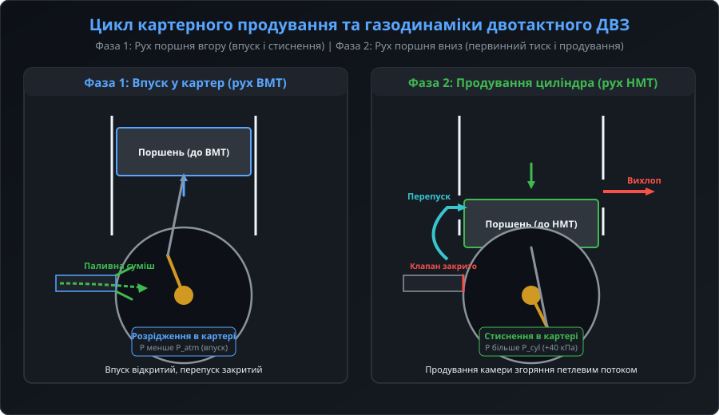
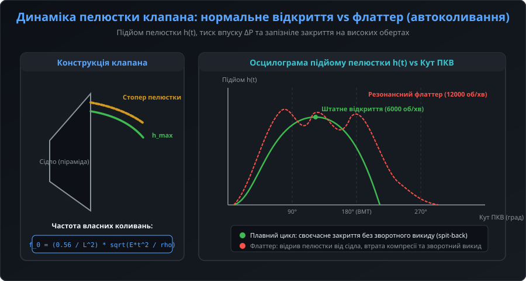
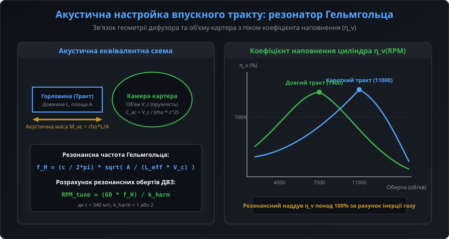
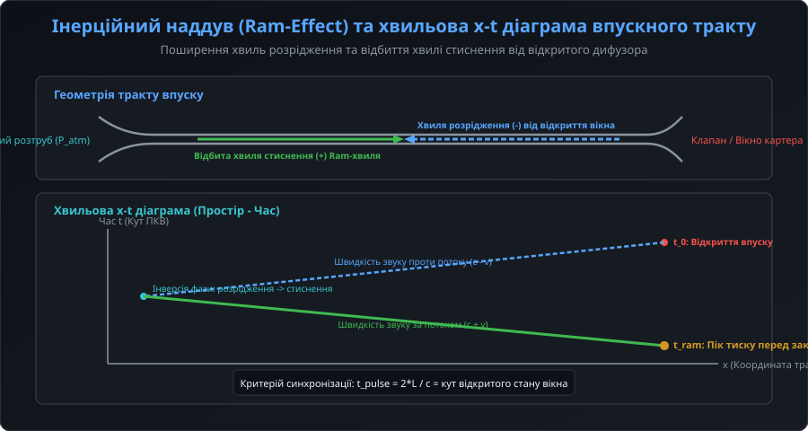
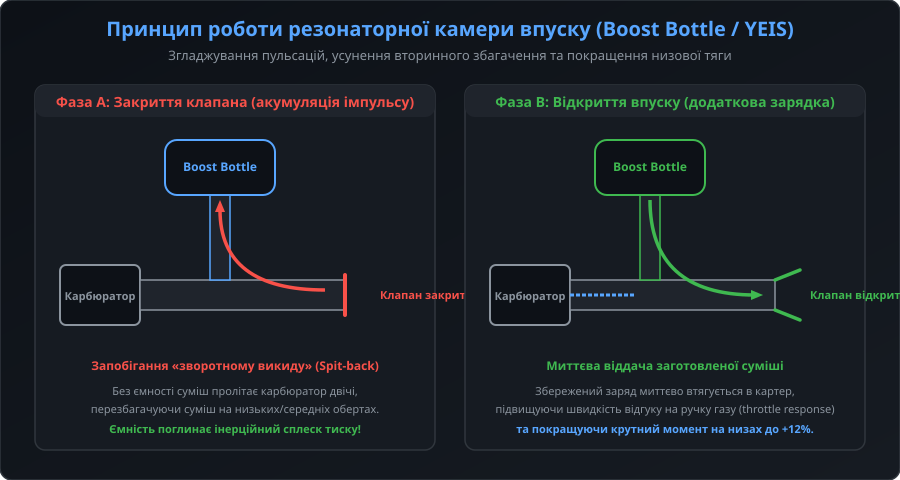

# Динаміка газообміну у впускному тракті двотактного двигуна: прикладна теорія та інженерний розрахунок

Газодинамічні процеси у впускних трактах двотактних двигунів та високопродуктивних газових актуаторів належать до класу нестаціонарних одновимірних течій стисливого газу з рухомими деформівними границями та розривними хвилями тиску. Картер ДВЗ функціонує як об'ємний поршневий компресор витіснювальної дії з кривошипно-камерним продуванням. Оптимізація наповнення такого компресора вимагає сумісного розв'язання рівнянь динаміки пружної пластини клапана, нелінійної акустики резонаторів і розрахунку хвильових діаграм методом характеристик.

## 1. Термодинаміка картерного компресора та індикаторні діаграми продування

Процес зміни стану робочого тіла в картері описується системою балансових рівнянь маси та енергії для відкритої термодинамічної системи змінного об'єму:

dM_c / dt = m_in - m_out

d(M_c * u_c) / dt = m_in * h_in - m_out * h_out - P_c * (dV_c / dt) + dQ / dt

де:
- M_c — поточна маса заряду в картері;
- V_c(alpha) — кінематичний об'єм картера як функція кута повороту колінчастого вала alpha;
- m_in, m_out — масові витрати через впускний клапан та перепускні канали відповідно;
- h_in, h_out — ентальпія потоків газу;
- P_c — миттєвий тиск у картері;
- dQ / dt — теплообмін зі стінками картера та картером колінвала.

Ступінь первинного стиснення картера визначається геометричним співвідношенням об'ємів:

epsilon_crank = V_c_max / V_c_min = (V_dead + V_disp) / V_dead

де V_disp — робочий об'єм циліндра, а V_dead — так званий «мертвий» (залишковий) об'єм картера, що включає зазори щік колінчастого вала та об'єм впускного патрубка до площини клапана. Зниження мертвого об'єму картера (за рахунок встановлення полімерних або легкосплавних витіснювачів у щоки колінвала) збільшує ступінь стиснення до epsilon_crank = 1.35...1.55, що підвищує тиск початку продування до 45...60 кПа та прискорює швидкість витіснення суміші через перепускні вікна.

## 2. Математична модель пелюсткового клапана та умови виникнення флаттера

Впускний пелюстковий клапан моделюється як пружна консольна пластина змінної або постійної товщини, що обтікається потоком газу. Диференціальне рівняння поперечних згинальних коливань пелюстки під дією розподіленого аеродинамічного навантаження має вигляд:

D_p * (d^4 w / dx^4) + rho_p * h_p * (d^2 w / dt^2) + c_d * (dw / dt) = Delta P(x, t) * b(x)

де:
- w(x, t) — прогин пелюстки на відстані x від лінії затиснення;
- D_p = (E * h_p^3) / (12 * (1 - nu^2)) — циліндрична жорсткість пластини;
- E, nu, rho_p — модуль Юнга, коефіцієнт Пуассона та густина матеріалу пелюстки відповідно;
- h_p — товщина пелюстки (зазвичай 0.25...0.45 мм для карбонових композитів);
- c_d — коефіцієнт структурного та гідродинамічного демпфування;
- Delta P(x, t) — локальний перепад статичного тиску по обидва боки пелюстки;
- b(x) — ширина пластини.

Перша власна частота незавантаженої консольної пелюстки довжиною L розраховується як:

f_0 = (0.56 / L^2) * sqrt(E * h_p^2 / rho_p)

На високих частотах обертання колінчастого вала (n > 10 000 об/хв) виникає динамічний зрив потоку з вільної кромки пелюстки. Умова гідропружної нестійкості (флаттера) визначається досягненням критичного безрозмірного числа Струхаля:

St_crit = (f_0 * h_max) / v_gas < 0.15...0.20

де v_gas — швидкість потоку у щілині клапана (що досягає 120...180 м/с), а h_max — граничний зазор до обмежувача ходу. При виникненні флаттера затримка закриття клапана (reed float) досягає 25...40 градусів ПКВ після проходження поршнем ВМТ, викликаючи зворотний викид до 20% заряду назад у карбюратор. Застосування прогресивних карбонових пелюсток із багатошаровою орієнтацією волокон під кутами 0°/±45° підвищує крутильну жорсткість і запобігає асиметричному флаттеру.

## 3. Акустична настройка Гельмгольца та оптимізація перерізів

У припущенні зосереджених акустичних параметрів впускний колектор розглядається як коливальний контур другого порядку. Еквівалентна довжина впускного тракту розраховується з урахуванням кінцевих імпедансних поправок Релея:

L_eff = L_geom + 0.6 * r_in + 0.8 * r_out

де r_in та r_out — гідравлічні радіуси вхідного розтруба та вікна кріплення клапана відповідно.

Резонансна кутова частота системи omega_H = 2 * pi * f_H зв'язана з параметрами тракту:

omega_H = c * sqrt(A_runner / (L_eff * V_c_mean))

Для двотактного двигуна, впускний період якого триває приблизно 130...160 градусів ПКВ (theta_in), умова максимального дозаряду досягається, коли чверть або половина періоду коливань резонатора укладається в час відкритого стану клапана:

T_in = theta_in / (6 * n_rpm)

n_tune = (theta_in * f_H) / (6 * k_harm)

де k_harm = 0.5, 1.0 або 1.5 — порядок резонансної гармоніки. На практиці тракт розраховують під першу гармоніку (k_harm = 1) для вузького спортивного діапазону (11 000...13 000 об/хв) або під вторинну гармоніку для розширення робочого плато крутного моменту цивільних двигунів (6000...8500 об/хв).

## 4. Одновимірне хвильове моделювання методом характеристик та інерційний наддув

Для детального аналізу хвильових процесів уздовж поздовжньої координати x застосовується система одновимірних нестаціонарних рівнянь газодинаміки Ейлера для стисливого газу:

d(rho * A) / dt + d(rho * v * A) / dx = 0

d(rho * v * A) / dt + d( (rho * v^2 + P) * A ) / dx = P * (dA / dx) - rho * A * F_fric

d(rho * e_0 * A) / dt + d(rho * v * h_0 * A) / dx = q_heat * A

де F_fric — сила тертя об стінки, а e_0, h_0 — повна питома енергія та ентальпія газу.

Рівняння розв'язуються за методом характеристик Рімана вздовж характеристичних ліній C+ та C-:

dx / dt = v + c  ->  J+ = (2 / (gamma - 1)) * c + v = const

dx / dt = v - c  ->  J- = (2 / (gamma - 1)) * c - v = const

Коли потік газу у впускному вікні раптово переривається клапаном у момент часу t_close, кінетична енергія рухомого стовпа газу перетворюється на стрибок статичного тиску за формулою Жуковського для стисливих середовищ:

Delta P_ram = rho_gas * c * v_gas_mean

Для типових швидкостей впуску v_gas_mean = 70...110 м/с і густини повітря rho_gas = 1.2 кг/м^3 цей стрибок тиску досягає Delta P_ram = 28...45 кПа. Правильно розрахований час повернення відбитої хвилі стиснення t_wave = 2 * L_eff / c забезпечує динамічний підпір безпосередньо у фазі закриття клапана, що збільшує підсумкове наповнення картера на 14...18%.

## 5. Розрахунок та налаштування резонансних камер розширення (Boost Bottle)

Камера Boost Bottle розраховується як вторинний паралельний резонатор Гельмгольца, підключений до основного впускного патрубка через сполучну трубку (neck). Її функція — демпфування зворотного імпульсу та усунення стоячих хвиль у карбюраторі.

Розрахунок геометрії пляшки базується на частоті зворотного викиду:

f_bottle = (c / (2 * pi)) * sqrt(A_tube / (L_tube_eff * V_bottle))

Інженерні рекомендації щодо проектування системи:
- **Об'єм камери**: V_bottle вибирається в діапазоні 1.2...1.8 від робочого об'єму циліндра V_disp. При надмірному об'ємі (> 2.5 V_disp) система стає занадто інерційною та затримує реакцію на зміну положення дросельної заслінки.
- **Діаметр сполучної трубки**: D_tube повинен становити 0.35...0.45 від діаметра дифузора карбюратора.
- **Точка врізки**: штуцер підключення розміщується на верхній стінці колектора якомога ближче до основи пелюсткового клапана (на відстані 15...25 мм від площини посадки клапана), щоб уловлювати хвилю стиснення до її відбиття в дифузор.

Застосування камери Boost Bottle дозволяє згладити нерівномірність паливоподачі, зменшити питому витрату палива на часткових навантаженнях на 5...9% та повністю ліквідувати характерний для двотактних двигунів «провал» кривої крутного моменту в діапазоні 4000...6500 об/хв.
