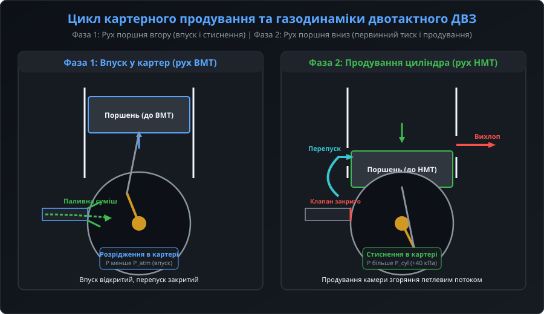
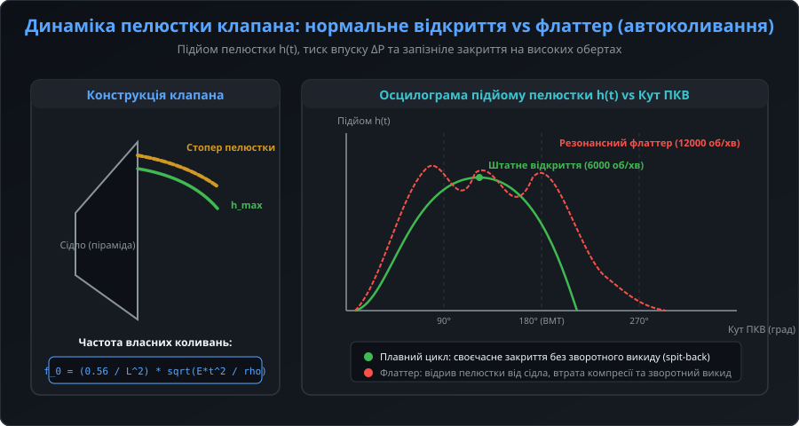
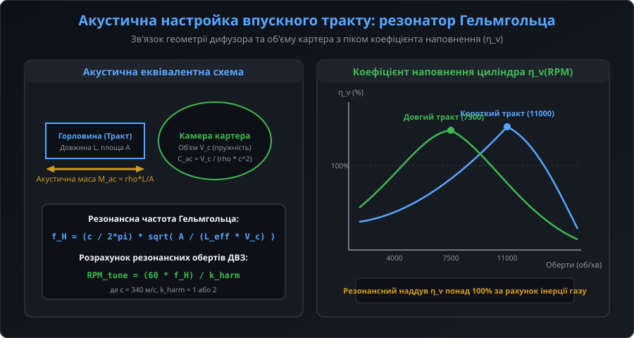
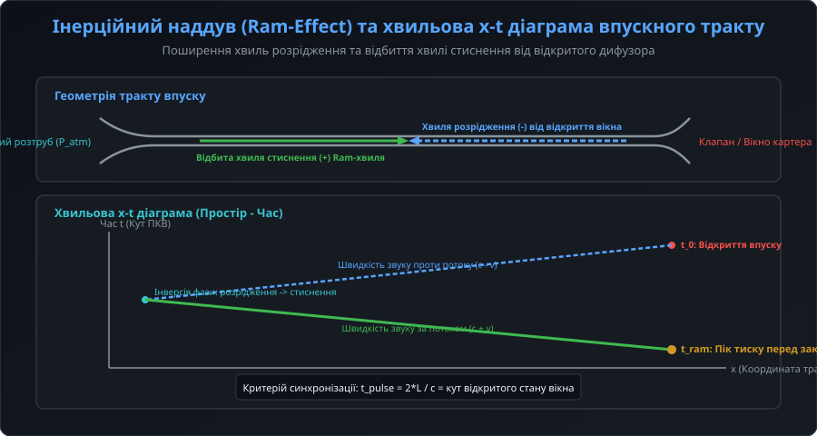
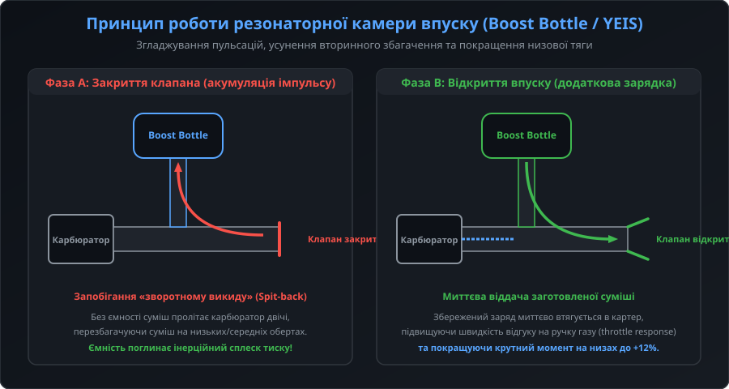

# Динаміка газообміну у впускному тракті двотактного двигуна

Впускний тракт двотактного двигуна внутрішнього згоряння (ДВЗ) або пневматичного поршневого актуатора виконує функцію первинного компресорного ступеня. На відміну від чотиритактних машин, де впуск відбувається безпосередньо в циліндр за рахунок розрідження від руху поршня, у двотактному циклі свіжий заряд повітряно-паливної суміші або газу спочатку всмоктується в герметичний підпоршневий простір — картер. Ефективність наповнення циліндра (volumetric efficiency, η_v) критично залежить від узгодження газодинамічних та акустичних явищ у впускному колекторі з фазами руху кривошипно-шатунного механізму.

## 1. Принцип картерного продування та роль впускного тракту

Під час руху поршня від нижньої мертвої точки (НМТ) до верхньої мертвої точки (ВМТ) під поршнем утворюється зона глибокого розрідження (тиск падає нижче атмосферного на 15...30 кПа). Завдяки різниці тисків відкривається впускний клапан, і свіжий заряд газу спрямовується через дифузор у картерну камеру.

Коли поршень досягає ВМТ і після займання робочої суміші починає рух униз до НМТ, об'єм картера зменшується. Це призводить до стиснення заряду в картері (первинне нагнітання тиску до +30...+50 кПа). Під дією надлишкового тиску впускний клапан герметично закривається, перешкоджаючи зворотному викиду суміші назад у карбюратор чи дросельний патрубок. У нижній частині ходу поршень відкриває перепускні канали, через які стиснений заряд виштовхується в камеру згоряння, витісняючи відпрацьовані вихлопні гази через випускне вікно за схемою петлевого продування Шнюрле.

## 2. Газодинаміка та автоколивання пелюсткового клапана

Впускний пелюстковий клапан (reed valve) функціонує як пасивний самодіючий зворотний клапан. Пружні пластини (пелюстки) виготовляються з високоміцної вуглецевої сталі, склотекстоліту або багатошарового карбонового композиту. Рушійною силою відкриття пелюстки є перепад тиску між атмосферою та внутрішнім об'ємом картера:

ΔP = P_intake - P_crankcase

На низьких і середніх обертах пелюстка плавно відхиляється до механічного стопера (обмежувача ходу) і вчасно сідає на еластомірне сідло в момент вирівнювання тиску. Проте на надвисоких обертах (понад 10 000...12 000 об/хв) виникає явище клапанного флаттера (reed flutter) — високочастотних автоколивань пелюстки під дією турбулентних пульсацій потоку. 

Якщо частота збурення потрапляє в резонанс із власною частотою згинальних коливань пелюстки f_0, клапан втрачає синхронізацію: пелюстка починає «плавати» й відскакувати від сідла. Це викликає зворотний викид заряду (spit-back), різке падіння компресії в картері та термічну деградацію пелюсток.

## 3. Акустичний резонанс Гельмгольца у впускному тракті

Впускний тракт (патрубок, дифузор, дросельна заслінка) у комбінації з об'ємом картера формує акустичну коливальну систему, еквівалентну резонатору Гельмгольца. Стовп газу всередині впускного патрубка діє як інерційна акустична маса M_ac, а стисливий об'єм картера діє як акустична пружність C_ac.

Резонансна частота впускної системи f_H розраховується за формулою:

f_H = (c / (2 * π)) * sqrt(A / (L_eff * V_c))

де:
- c — швидкість звуку в робочому середовищі (приблизно 340 м/с для повітря при нормальних умовах);
- A — ефективна площа поперечного перерізу впускного тракту;
- L_eff — еквівалентна акустична довжина впускного тракту з урахуванням кінцевих поправок розтруба;
- V_c — середній динамічний об'єм картерної порожнини.

Правильний підбір довжини та діаметра впускного патрубка дозволяє узгодити пік резонансу Гельмгольца з робочим діапазоном обертів двигуна. Це забезпечує коефіцієнт наповнення циліндра η_v понад 100% за рахунок резонансного нагнітання.

## 4. Хвильові процеси та інерційний наддув (Ram-Effect)

Окрім загального акустичного резонансу порожнини, у довгому впускному колекторі розвиваються дискретні нестаціонарні хвильові процеси стиснення та розрідження. У момент початку відкриття впускного вікна біля клапана формується локальна хвиля розрідження (негативний імпульс тиску), яка зі швидкістю звуку (c - v) рухається назустріч вхідному потоку в напрямку вхідного розтруба (airbox).

Досягнувши відкритого розтруба колектора, хвиля розрідження відбивається від середовища з постійним атмосферним тиском з інверсією фази — перетворюючись на хвилю стиснення (позитивний імпульс тиску). Відбита хвиля стиснення повертається назад до картера зі швидкістю (c + v). 

Якщо довжина впускного тракту налаштована точно під цільові оберти двигуна, позитивна хвиля стиснення приходить до пелюсткового клапана безпосередньо перед моментом його закриття. Цей ефект динамічного підпору (ram-effect або інерційний дозаряд) створює короткочасне підвищення тиску у впускному вікні, буквально «заштовхуючи» додаткову порцію свіжого заряду в картер.

## 5. Резонаторні камери впуску (Boost Bottle) та оптимізація

При роботі двигуна на низьких і середніх обертах, коли фази відкриття клапана ще не потрапляють у резонанс із довгим впускним трактом, швидке закриття пелюсток спричиняє гідравлічний удар у повітряному стовпі. Стовп газу різко гальмується перед закритим клапаном і відбивається назад до карбюратора. 

У класичних карбюраторних системах цей зворотний потік вдруге захоплює паливо з розпилювача (явище подвійної карбюрації), викликаючи критичне перезбагачення робочої суміші, провали тяги на низьких обертах і димний вихлоп.

Для усунення цієї проблеми між карбюратором і пелюстковим клапаном встановлюють резонаторну камеру — так званий Boost Bottle (система YEIS — Yamaha Energy Induction System):
- **Фаза гальмування потоку**: імпульс надлишкового тиску відбитого газу вільно спрямовується у пружну камеру розширення пляшки, поглинаючи кінетичну енергію та запобігаючи поверненню заряду крізь карбюратор.
- **Фаза повторного розрідження**: під час наступного такту впуску картерне розрідження миттєво відкачує заготовлений заряд з пляшки безпосередньо в двигун, забезпечуючи миттєвий відгук на дросель (throttle response) та підвищення крутного моменту на 8...12% у підрезонансній зоні.
