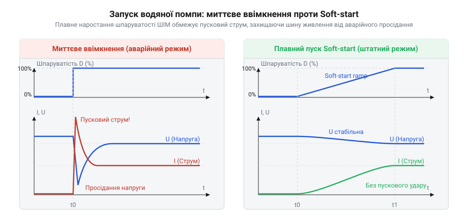
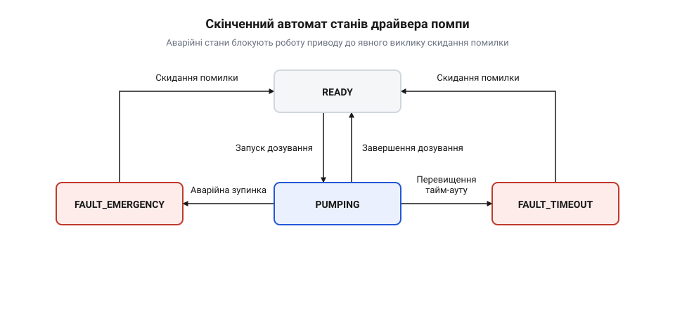

# Програмний C/C++ інтерфейс бібліотеки керування водяною помпою

<preknowlist>
- [Колекторний двигун типорозміру 130](root:cat-hw-actuators/dc-motor-130) — електрофізичні властивості колекторного двигуна постійного струму: індуктивний характер навантаження, регулювання швидкості обертання вала зміною шпаруватості ШІМ та виникнення значних пускових струмів під час різкої подачі напруги.
</preknowlist>

## Пастки наївного керування водяною помпою

Спроба перекачати рідину найпростішим шляхом — замкнути силове коло помпи через польовий транзистор логічним сигналом мікроконтролера й утримати його викликом `delay()` — у першу ж секунду призводить до апаратної аварії. У момент подачі напруги нерухомий ротор, який обертає [колекторний двигун постійного струму](root:cat-hw-actuators/dc-motor-130), не створює проти-ЕРС, а електричний опір його обмотки становить лічені оми. Виникає колосальний пусковий струм (@@en|inrush current@@; від англійського *inrush* — раптовий наплив), амплітуда якого сягає 2.5–3 А при номінальному струмі споживання лише 0.3–0.5 А.

Цей імпульсний стрибок миттєво перевантажує джерело живлення: напруга на спільній живильній шині різко просідає нижче критичного порогу, спрацьовує вбудований апаратний детектор зниження напруги (BOR), і мікроконтролер циклічно перезавантажується. Одночасно стрибок крутного моменту передається крильчатці, створюючи різкий фронт тиску в гідравлічній магістралі — гідроудар (@@en|water hammer@@; від англійського *water hammer* — водяний молот). Ударна хвиля зриває еластичні трубки зі штуцерів, розбиває пластикові втулки та зношує сальники насосної камери.

Друга прихована загроза криється в заморожуванні виконання програми. Блокувальна затримка (@@en|blocking delay@@; від англійського *block* — перешкоджати) на зразок `delay(3000)` змушує процесор марнувати мільйони тактів у холостих циклах, роблячи систему сліпою до подій реального світу. Якщо за цей час переповниться дозувальний резервуар, відпаде шланг або оператор натисне кнопку аварійної зупинки, мікроконтролер не зреагує, доки затримка не завершиться.

Керування помпою потребує виділеного програмного рівня — драйвера (@@en|driver@@; від англійського *driver* — водій, погонич). Він абстрагує апаратні таймери широтно-імпульсної модуляції (@@en|PWM@@; від латинського *modulatio* — розміреність), організовує плавне наростання струму та веде точний облік відміряного об'єму виключно в неблокуючому фоновому режимі.

## Конфігурація драйвера та калібрування витрати

Електромеханічна помпа не здатна перекачувати рідину за довільно малих значень напруги. Щоб крильчатка рушила з місця, магнітне поле статора повинно подолати тертя спокою в ущільнювачах вала та гідростатичний опір стовпа рідини. Ця зона нечутливості приводу зветься мертвою зоною (@@en|deadband@@; від англійського *dead band* — мертва смуга). Якщо шпаруватість (@@en|duty cycle@@; від англійського *duty cycle* — робочий цикл) менша за поріг рушання `D_deadband` (типово 25–35%), мотор лише безпорадно гріється та пищить, але не обертається. Детальна методика калібрування мінімальної шпаруватості рушання ротора розглядається у статті про [компенсацію мертвої зони ШІМ](root:hw-motion/pwm-deadband-compensation).

Щойно поріг подолано, витрата рідини `Q` (мл/с) лінійно залежить від перевищення шпаруватості `D` над порогом рушання аж до максимального значення `D_max`:

```text
Q = k_flow · (D - D_deadband)    [лінійна калібрувальна модель витрати]
```

де `k_flow` — коефіцієнт гідравлічної продуктивності в мілілітрах за секунду на одиницю шпаруватості, визначений шляхом стендового наливання мірного об'єму за фіксований інтервал часу.

Для опису параметрів заліза та гідравліки створюється конфігураційна структура драйвера:

:::tabs
:::code api-pump-controller-driver/c/snippet-1.c
:::code api-pump-controller-driver/cpp/pumpconfig.cpp
:::

Функція `pump_init()` спершу валідує вхідні поля: повертає код помилки, якщо номери виводів некоректні, поріг рушання перевищує максимум або коефіцієнт витрати дорівнює нулю. Далі функція налаштовує вивід GPIO в гарантований рівень логічного нуля ще до активації таймера ШІМ, унеможливлюючи довільний ривок приводу під час старту системи, після чого зберігає калібрувальну модель у дескриптор пристрою.

Для первинного заповнення полів `deadband_duty` та `flow_rate_max_ml_s` конфігураційної структури інженер спирається на експериментальні діапазони, типові для поширених малопотужних помп:

| Модель і живлення | Тип механізму | Поріг зрушення `deadband_duty` | Номінальна витрата `flow_rate_max_ml_s` | Особливості гідравлічного калібрування |
|---|---|---|---|---|
| Заглибна міні-помпа 5 В (JT-DC3W) | Відцентрова крильчатка | 25–35% (64–90) | 15–25 мл/с (0.9–1.5 л/хв) | У приводах на базі [колекторного двигуна 130](root:cat-hw-actuators/dc-motor-130) тертя спокою мінімальне, проте продуктивність різко спадає зі зростанням висоти водяного стовпа. |
| Шестеренчаста помпа 12 В (RS-360SH) | Самовсмоктувальні шестерні | 20–30% (50–75) | 25–35 мл/с (1.5–2.1 л/хв) | Пряме зчеплення шестерень створює високий тиск, але тертя в сухому механізмі збільшує стартову шпаруватість. |
| Діафрагмова помпа 12 В (R385) | Мембрана зі зворотними клапанами | 30–40% (75–100) | 20–30 мл/с (1.2–1.8 л/хв) | Жорсткість зворотно-поступальної діафрагми суттєво розширює @@en|deadband@@, а вихідний потік рідини має виражену пульсацію. |

Табличні межі задають базові орієнтири для захисної перевірки параметрів у `pump_init()`, проте точну лінійну характеристику `k_flow` обов'язково калібрують практичним проливанням рідини через змонтовану гідравлічну магістраль. Стендова методика визначення залежності витрати мініатюрних помп від шпаруватості ШІМ наведена у матеріалі про [калібрування об'ємної витрати рідини](root:hw-motion/fluid-flow-calibration).

## Плавний пуск і динамічне регулювання

Ступінчасте подання навіть відкаліброваної шпаруватості спричиняє механічний удар у крильчатці та різкий спад напруги на виводах мікроконтролера. Для усунення цих явищ драйвер реалізує алгоритм плавного пуску (@@en|soft-start@@; від англійського *soft start* — м'який пуск): замість миттєвого стрибка напруги шпаруватість плавно зростає від порогу рушання `D_deadband` до цільового значення `D_target` за час наростання `t_ramp` (типово 150–300 мс).

Лінійна траєкторія наростання (@@en|рампінг@@; від англійського *ramp* — плавний підйом) змінює шпаруватість зі сталою швидкістю. Проте на початку розгону швидкість зміни сигналу стрибає від нуля до фіксованого значення. Крильчатка намагається рушити з різким прискоренням і штовхає нерухомий стовп рідини в магістралі. Інерція води створює пусковий сплеск гідродинамічного тиску на штуцери та ущільнювачі. S-подібна крива (@@en|S-curve@@; від англійського *S-curve* — крива у формі літери S) третього порядку усуває цей сплеск завдяки нульовій швидкості наростання на старті й фініші. Кубічний поліном плавно нарощує прискорення крильчатки, тому тиск у гідравлічному контурі зростає без імпульсних ударів. Проте розрахунок такого полінома потребує обчислень із рухомою комою або виділення пам'яті під таблиці пошуку (@@en|lookup table@@). Ці операції надмірно навантажують прості мікроконтролери без апаратного співпроцесора. Через це в базових драйверах застосовують простішу лінійну траєкторію. Поточна шпаруватість `D(t)` у момент часу `t` від початку пуску обчислюється за формулою лінійного @@en|рампінгу@@:

```text
D(t) = D_deadband + (D_target - D_deadband) · (t / t_ramp)    [лінійне наростання ШІМ]
```

Поступове підвищення напруги дає змогу якорю двигуна своєчасно розігнатися. Наведена в обмотках проти-ЕРС врівноважує прикладену напругу та самостійно обмежує якірний струм, запобігаючи небезпечним імпульсним просіданням живильної шини.


*Порівняння перехідних процесів прямого пуску та плавного розгону soft-start: лінійне наростання шпаруватості усуває просідання напруги живлення мікроконтролера та виключає виникнення гідроудару.*

Динамічне керування швидкістю перекачування забезпечує функція `pump_set_flow_rate(flow_ml_s)`. Вона перераховує необхідну продуктивність у відповідну шпаруватість згідно з калібруванням і передає її диспетчеру. Якщо помпа вже обертається, контролер плавно змінює шпаруватість від поточного рівня до нового значення без зупинки двигуна, забезпечуючи плавне регулювання подачі рідини на льоту.

## Неблокувальне порційне дозування рідини

Видача точних порцій рідини не повинна зупиняти роботу решти підсистем пристрою. Драйвер реалізує асинхронне дозування за об'ємом `pump_dose_volume_ml()` або за часом `pump_dose_time_ms()`. Тривалість роботи помпи `t_work` для видачі заданого об'єму `V_dose` за поточної витрати `Q` визначається з урахуванням динаміки розгону:

```text
t_work = (V_dose / Q) + t_corr    [тривалість роботи з динамічною поправкою]
```

де `t_corr` — поправка на фазу розгону (за час @@en|soft-start@@ середня швидкість ротора нижча за номінальну, тому фактичний вилив дещо менший за стаціонарний).

Функції запуску дозування не виконують пауз у коді: вони лише валідують запит, обчислюють тривалість сесії, фіксують системний час старту та переводять привід в активний режим:

:::tabs
```c
// Функції запуску дозування та фонової диспетчеризації на C
pump_err_t pump_dose_volume_ml(float volume_ml, float flow_ml_s);
pump_err_t pump_dose_time_ms(uint32_t duration_ms, uint8_t duty);

// Неблокуючий обробник: викликається в головному циклі програми
void pump_process(uint32_t now_ms);
```
```cpp
// Інтерфейс асинхронного дозування на C++
class WaterPump {
public:
    Error doseVolume(float volumeMl, flowMlS);
    Error doseTime(uint32_t durationMs, uint8_t duty);

    // Періодичне фонове оновлення стану приводу
    void process(uint32_t nowMs);
};
```
:::

Фонове супроводження дозування покладено на функцію `pump_process()`, яка регулярно викликається в кожній ітерації головного циклу. Вона відстежує плин системного часу, оновлює наростання шпаруватості на етапі пуску та підсумовує вилиту кількість рідини. Щойно відведений інтервал `t_work` закінчується, функція автоматично знеструмлює силовий ключ і сповіщає програму про завершення дози через зареєстровану функцію зворотного виклику (@@en|callback@@; від англійського *callback* — зворотний виклик).

## Захисні тайм-аути та аварійна зупинка

Навіть ідеально відкалібрований дозатор ризикує вийти з ладу в разі вичерпання рідини в резервуарі, протікання трубопроводу чи зависання керуючої логіки. У мініатюрних помпах проточна рідина виконує роль теплоносія та мастила для вала. Робота без води — сухий хід (@@en|dry run@@; від англійського *dry run* — робота насухо) — викликає швидке фрикційне нагрівання крильчатки й ущільнювачів. Водночас [колекторного двигуна](root:cat-hw-actuators/dc-motor-130) RS-360SH позбавлено зовнішнього охолодження: сухе тертя сальників вала додається до електричних втрат, через що найуразливішим елементом стає щітковий вузол. Температурна крива нагрівання щіток критично залежить від шпаруватості ШІМ. За максимальної шпаруватості (100%) якір обертається з граничною швидкістю, викликаючи інтенсивне іскріння на ламелях колектора: крива підіймається за стрімкою експонентою, і вже за 45–60 секунд температура вузла сягає 90–100 °C, а до кінця другої хвилини перетинає критичні 125–130 °C. За такої температури розм'якшуються термопластові щіткотримачі, пружини втрачають загартування, щітки перекошуються і спричиняють коротке замикання та заклинювання ротора. Зниження шпаруватості до 40–50% лише зменшує початкову крутизну кривої, розтягуючи прогрівання до 50–60 °C на першу хвилину, проте через відсутність обдуву тепло продовжує акумулюватися, і за 3–4 хвилини температура все одно дістається руйнівної межі, плавлячи ізоляцію обмоток і деформуючи пластиковий корпус помпи.

Для захисту від термічного руйнування драйвер використовує граничний тайм-аут безперервного ввімкнення `max_continuous_ms`. Якщо будь-яка сесія прокачування триває довше за встановлений поріг безпеки, фонова функція `pump_process()` негайно знеструмлює привід і блокує роботу, фіксуючи стан аварії за тайм-аутом.

Окремий рівень захисту забезпечує функція негайної аварійної зупинки `pump_emergency_stop()`, призначена для обробки сигналів аварійних кнопок, поплавкових датчиків затоплення чи втрати зв'язку. Вона має найвищий пріоритет: миттєво записує нульову шпаруватість в апаратні регістри ШІМ в обхід будь-яких процедур плавного гальмування, очищає чергу дозування та переводить драйвер у заблокований стан. Усі подальші спроби ввімкнення помпи жорстко відхиляються драйвером до з'ясування причин інциденту.

## Діагностика статусів і відновлення роботи

Детерміновану взаємодію між приводом і програмою забезпечує скінченний автомат станів (@@en|finite-state machine@@, FSM; від латинського *finitus* — визначений, обмежений). Драйвер послідовно проходить через чотири фіксовані стани: готовність до роботи (`READY`), активне прокачування рідини (`PUMPING`), аварія за перевищенням часу роботи (`FAULT_TIMEOUT`) та апаратне аварійне блокування (`FAULT_EMERGENCY`).


*Скінченний автомат керування водяною помпою: штатні переходи дозування блокуються при спрацьовуванні захистів, а повернення до роботи можливе виключно через скидання аварії.*

Для контролю процесу дозування застосунок викликає функцію опитування стану:

:::tabs
:::code api-pump-controller-driver/c/snippet-3.c
:::code api-pump-controller-driver/cpp/pumpstate.cpp
:::

Протокол безпеки забороняє автоматичний вихід із аварійних станів. Якщо спрацював захист від сухого ходу чи аварійна кнопка, помпа не відновить роботу, доки керуюча програма не викличе `pump_reset_fault()`. Ця функція перевіряє, що силове коло знеструмлене, очищає прапори аварій, обнуляє лічильники та переводить драйвер у стан `READY`, гарантуючи безпечний повторний запуск гідравлічного вузла.
