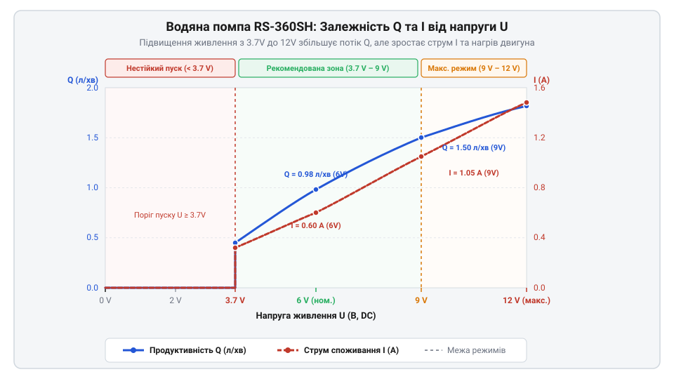
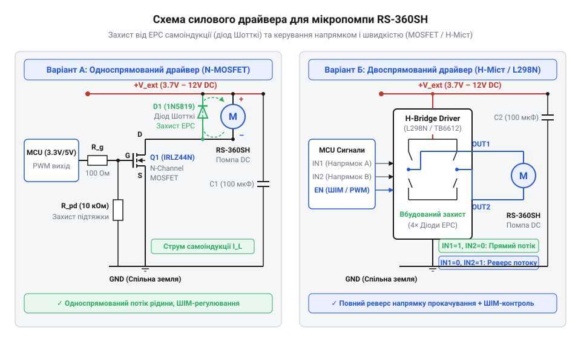

# Апаратний довідник електричних, механічних та гідравлічних інтерфейсів помпи RS-360SH

<preknowlist>
- [Колекторний двигун типорозміру 130](root:cat-hw-actuators/dc-motor-130) — принципи керування колекторними ДПС, залежність обертів і струму від напруги та навантаження
</preknowlist>

## Неконтрольована циркуляція рідини в замкнених контурах

Пряме перекачування рідини у приладах дрібної автоматики, автономних системах крапельного поливу та замкнених контурах охолодження часто стає джерелом прихованих механічних та гідравлічних аварій. Намагаючись побудувати найпростішу систему циркуляції, розробники нерідко покладаються на самоплив (@@en|gravity feed@@, від англ. *gravity feed* — подача самопливом під дією гравітації) або використовують довільно обрані помпи (помпи, від фр. @@fr|pompe@@) без попереднього апаратного розрахунку. За подачі самопливом об'ємна витрата рідини прямо залежить від різниці рівнів стовпа води в резервуарі та точці скидання:

```
Q = A × √(2 × g × Δh)      [формула Торрічеллі для швидкості та витрати витоку]
```

У міру спорожнення бака гідростатичний тиск падає, через що витрата рідини `Q` неминуче знижується. Це унеможливлює точне мікродозування та викликає температурну нестабільність у теплообмінниках.

З іншого боку, застосування надлиштово потужного або нерозрахованого помпового вузла призводить до протилежних проблем. Надмірний тиск вихідного потоку створює високе навантаження на з'єднання патрубків (патрубок, від нім. @@de|Passrohr@@ — прохідна труба), що викликає витоки (@@en|leaks@@) та розрив шлангів. Якщо ж гідравлічний опір контуру виявиться занадто високим для помпи з малим крутним моментом, потік рідини зупиняється. Без циркуляції теплоносія силова електроніка або світлодіодні матриці миттєво переходять у стан перегріву (@@en|overheating@@).

Для побудови надійного керованого контуру циркуляції необхідний компактний привід із передбачуваними електричними та гідродинамічними параметрами. Саме таким вузлом є мікропомпа @@en|RS-360SH@@. Вона поєднує в собі колекторний двигун постійного струму (@@en|DC motor@@) та компактну насосну камеру із самовсмоктувальним механізмом. Щоб безпечно інтегрувати пристрій у схему під керуванням мікроконтролера, необхідно чітко визначити межі робочої напруги, струму споживання, продуктивності, а також умови механічної герметизації та теплового захисту.

## Електричні та гідравлічні параметри помпи RS-360SH

В основі помпи @@en|RS-360SH@@ лежить двополюсний колекторний двигун постійного струму типорозміру 360, привідна частина якого конструктивно споріднена з пристроями класу [Колекторний двигун типорозміру 130](root:cat-hw-actuators/dc-motor-130), але володіє підвищеним крутним моментом та розширеним діапазоном живлення. Номінальна напруга живлення двигуна становить від `3.7 В` до `12 В DC`.

Електричні та гідравлічні характеристики пристрою знаходяться у прямій залежності: підвищення напруги живлення збільшує швидкість обертання вала двигуна та внутрішнього імпелера (імпелер, від англ. @@en|impeller@@ — від @@en|impel@@, штовхати), що підвищує тиск та об'ємну витрату рідини. Проте разом із цим пропорційно зростає струм споживання та тепловиділення на обмотках ротора:

- При живленні `3.7 В` (типовий рівень одного елемента @@en|Li-Ion@@): струм холостого ходу становить близько `0.2 А`, струм під прокачуванням рідини — `0.35 А`–`0.4 А`, а продуктивність перекачування досягає `0.6`–`0.8 л/хв`. - При живленні `6.0 В`: струм під навантаженням зростає до `0.5 А`–`0.7 А`, а об'ємна витрата досягає `1.1`–`1.3 л/хв`. - При живленні `12.0 В`: помпа працює в режимі максимальної продуктивності — витрата становить `1.8`–`2.0 л/хв`, робочий струм досягає `0.9 А`–`1.2 А`, а пусковий або піковий струм при заклинюванні вала може сягати `2.5 А`.


*Підпис: Графік залежності продуктивності перекачування та споживаного струму від робочої напруги помпи RS-360SH.*

Гідравлічна потужність вихідного потоку рідини `P_hyd` обчислюється як добуток об'ємної витрати `Q` та створюваного тиску `p`:

```
P_hyd = Q × p
```

Розрахуємо гідравлічний та електричний ККД (коефіцієнт корисної дії) помпи при напрузі живлення `12 В`:

**Умова обчислення**: Витрата `Q = 1.8 л/хв` (`3 × 10⁻⁵ м³/с`), створюваний тиск `p = 0.05 МПа` (`50 000 Па`), споживаний струм `I = 1.0 А` при напрузі `U = 12 В`.

```
P_hyd = (3 × 10⁻⁵ м³/с) × 50 000 Па
      = 1.5 Вт                           [корисна гідравлічна потужність]

P_elec = 12 В × 1.0 А
       = 12.0 Вт                         [споживана електрична потужність]

η = (P_hyd ÷ P_elec) × 100%
  = (1.5 Вт ÷ 12.0 Вт) × 100%
  = 12.5%                                [підсумковий ККД мікропомпи]
```

Низьке значення ККД (близько `12.5%`–`20%`) пояснюється високим механічним тертям у сальникових ущільненнях вала та гідродинамічними втратами в мікрокамері. Понад `80%` споживаної енергії перетворюється на тепло, яке розсіюється на корпусі двигуна.

Важливим фактором є поляризація виводів живлення (@@en|polarity@@). На відміну від звичайного вентилятора чи компресора, зміна поляризації подачі напруги на клемник @@en|RS-360SH@@ змінює напрямок обертання ротора на протилежний. Оскільки помпа належить до шестеренчасто-шелинових або відцентрово-реверсивних механізмів, зміна поляризації змінює напрямок прокачування рідини: вхідний патрубок стає вихідним, і навпаки.

## Механічне з'єднання та гідродинамічні обмеження

Для забезпечення герметичності та мінімізації гідравлічних втрат необхідно враховувати геометрію вхідного та вихідного штуцерів помпи @@en|RS-360SH@@. Зовнішній діаметр металевих або пластикових патрубків становить `6.0 мм`, а на кінцях штуцерів виконано конусне розширення до `6.5 мм` для надійної фіксації шланга.

Підбір патрубків вимагає використання силіконових шлангів (силікон, від лат. @@la|Silicium@@ — кремній) з внутрішнім діаметром (@@en|Inner Diameter@@, @@en|ID@@) `4.0 мм` або `5.0 мм`. Силіконовий шланг з внутрішнім діаметром `4.0 мм` щільно натягується на штуцер `6.0 мм`, забезпечуючи первинне самоущільнення за рахунок еластичної деформації матеріалу. Використання шлангів із жорсткого ПВХ (полівінілхлорид, @@en|PVC@@) не рекомендується, оскільки з часом вони втрачають еластичність під дією температури, що призводить до утворення мікрощілин та протікання.

Втрати тиску в підвідних лініях описуються рівнянням Дарсі-Вейсбаха (@@en|Darcy-Weisbach equation@@):

```
Δp = f × (L ÷ D) × (ρ × v² ÷ 2)
```

де `f` — коефіцієнт гідравлічного тертя, `L` — довжина шланга, `D` — внутрішній діаметр шланга, `ρ` — густина рідини (для води `1000 кг/м³`), `v` — швидкість потоку. Оскільки швидкість потоку `v` обернено пропорційна квадрату діаметра (`v = 4Q ÷ (π × D²)`), спад тиску `Δp` зростає обернено пропорційно п'ятому ступеню внутрішнього діаметра шланга (`Δp ∝ 1/D⁵`):

```
Δp ∝ L ÷ D⁵      [залежність втрат тиску від геометрії труби]
```

Зменшення внутрішнього діаметра шланга з `5 мм` до `2.5 мм` збільшує гідравлічний опір контуру в 32 рази, що катастрофічно зменшує витрату рідини та перевантажує двигун помпи. Для розрахунку гідравлічного опору магістралей, вибору радіаторів та розширювальних бачків дивіться матеріал про [гідродинамічний розрахунок дрібногабаритних контурів рідинного охолодження](root:ph-mechanics/liquid-cooling-loop-hydraulics).

Гідродинамічні межі помпи @@en|RS-360SH@@ характеризуються двома ключовими показниками:
1. **Висота всмоктування** (@@en|suction head@@, `h_suction`): максимальна відстань по вертикалі від поверхні рідини в нижньому резервуарі до вхідного патрубка помпи. Для @@en|RS-360SH@@ цей показник становить від `1.5 м` до `2.0 м` за умови попереднього зволоження робочої камери. 2. **Висота підйому стовпа рідини** (@@en|discharge head@@, `h_lift`): максимальна висота вертикального стовпа води, яку помпа здатна утримувати при напрузі `12 В`. Для даної моделі межа становить від `2.5 м` до `3.0 м` (що відповідає вихідному тиску близько `0.03 МПа`).

Для захисту від зісковзування шлангів під тиском з'єднання обов'язково фіксуються металевими черв'ячними хомутами або затискними нейлоновими стяжками. Оскільки колекторний двигун @@en|RS-360SH@@ під час роботи генерує механічну вібрацію, корпус помпи слід монтувати через еластичний гумовий підвіс (хомут-демпфер). Це запобігає передачі вібрацій на корпус приладу та захищає нарізні й штуцерні з'єднання від саморозгвинчування та розгерметизації.

## Схеми силового керування та зміна напрямку

Підключення помпи @@en|RS-360SH@@ до виходів мікроконтролера вимагає застосування силового транзисторного ключа або інтегрального драйвера, оскільки виводи мікроконтролера не здатні забезпечити робочий струм понад `20`–`40 мА`.

Для однонапрямленого перекачування застосовується схема на N-канальному польовому транзисторі (@@en|MOSFET@@, від англ. *Metal-Oxide-Semiconductor Field-Effect Transistor*) з керованим логічним рівнем (@@en|Logic-Level MOSFET@@, наприклад @@en|IRLZ44N@@ або @@en|AO3400@@). Оскільки обмотки двигуна помпи мають високу індуктивність `L`, у момент вимкнення транзистора виникає сплеск ЕРС самоіндукції (@@en|back-EMF@@):

```
V_spike = L × (di ÷ dt)      [напруга індуктивного сплеску при розмиканні]
```

Цей сплеск напруги може досягати сотень вольт і миттєво пробити проміжок сток-витік транзистора. Для гасіння індуктивних сплесків паралельно клемам помпи встановлюється захисний шунтувальний діод зворотного ходу (@@en|flyback diode@@, наприклад діод Шотткі @@en|1N5819@@ або @@en|SS34@@). Діод підключається катодом до позитивної шини живлення `+V_pump`, а анодом — до стоку MOSFET.


*Підпис: Схема силового ключа на MOSFET та H-мості з захисним діодом для керування помпами RS-360SH.*

Регулювання продуктивності перекачування здійснюється за допомогою широтно-імпульсної модуляції (ШІМ, @@en|PWM@@, від англ. *Pulse-Width Modulation*). При виборі частоти ШІМ слід враховувати два фактори:
- **Частота ШІМ**: при частоті менше `1 кГц` обмотки двигуна видають виразний акустичний писк, а в потоці рідини виникають механічні пульсації тиску. Оптимальний діапазон частот становить від `8 кГц` до `20 кГц`. - **Мінімальний робочий цикл** (@@en|duty cycle@@): через наявність механічного тертя в сальниках та початкового моменту рушення двигуна, помпа починає обертатися лише при коефіцієнті заповнення ШІМ не менше `25%`–`30%`.

Якщо застосунок вимагає реверсування потоку (наприклад, для відкачування рідини назад у резервуар), керування виконується через реверсивний H-міст (@@en|H-bridge@@, наприклад мікросхеми @@en|L298N@@, @@en|DRV8871@@ або @@en|TB6612FNG@@). H-міст змінює напрямок струму через обмотки двигуна, перемикаючи внутрішні транзистори за діагоналями.

Порівняно з іншими приводами автоматики, такими як [28BYJ-48 — кроковий мотор (5V)](root:cat-hw-actuators/28byj-48-stepper), який забезпечує точне дискретне позиціонування, або механічні позиціонери на основі [N20 мікромотор з редуктором](root:cat-hw-actuators/n20-motor) та [Мотор-редуктор 6 В (100 і 600 об/хв)](root:cat-hw-actuators/gearmotor-6v), помпа @@en|RS-360SH@@ перетворює обертову енергію безпосередньо у кінетичний потік рідкого середовища, вимагаючи безперервного силового керування струмом.

## Запобігання сухому ходу та перегріву

Найнебезпечнішим аварійним режимом для мікропомпи @@en|RS-360SH@@ є робота без рідини — так званий сухий хід (@@en|dry run@@). У нормальному режимі перекачувана рідина виконує не лише функцію робочого тіла, але й відіграє роль змащувального та охолоджувального середовища для внутрішніх деталей насосної камери: пластикового імпелера (імпелер, від англ. @@en|impeller@@ — від @@en|impel@@, приводити в рух), осі ротора та гумових сальників (сальник, від пол./рос. *сальник* — ущільнювач вала).

При виникненні сухого ходу тертя сухого ущільнення об обертову вісь протягом `30`–`60 секунд` викликає локальне нагрівання до температур понад `100°C`. Це призводить до:
1. Термічної деформації та розплавлення лопатей імпелера. 2. Руйнування та затвердіння еластомерних сальників з подальшою втратою герметичності. 3. Заклинювання ротора двигуна та швидкого вигорання колекторних щіток.

Температура перекачуваного теплоносія також має жорсткі обмеження. Максимально припустима тривала температура рідини становить `60°C` (короткочасно до `80°C`). Перевищення цієї межі викликає розм'якшення термопластикового корпусу помпи та різко прискорює процес кавітації (кавітація, від лат. @@la|cavitas@@ — порожнеча). Кавітація виникає в зоні зниженого тиску на вході імпелера, де рідина закипає з утворенням парових бульбашок. При попаданні бульбашок у зону високого тиску відбувається їх вибухоподібне схлопування, що руйнує внутрішні поверхні камери та лопатей.

Для тривалої безперебійної експлуатації необхідно дотримуватися часового режиму роботи (@@en|duty cycle limit@@). При максимальній напрузі `12 В` безперервний цикл роботи помпи не повинен перевищувати `15`–`20 хвилин`, після чого необхідна пауза для охолодження корпуса двигуна. При роботі від напруги `6 В` тривалість циклу може бути збільшена до `45`–`60 хвилин`.

Захист від сухого ходу організовується апаратно та програмно:
- **Апаратний захист**: встановлення у резервуарі поплавкового або оптичного датчика рівня рідини, вихід якого блокує подачу сигналу керування на MOSFET або H-міст. - **Програмно-струмовий захист**: вимірювання струму споживання через аналоговий вхід мікроконтролера. При роботі на суху опір рідини відсутній, тому струм споживання помпи падає на `40%`–`50%` порівняно з номінальним робочим струмом (`I_dry ≈ 0.2 А` проти `I_work ≈ 0.5 А` при `6 В`). При виявленні такого падіння струму протягом більше `2 секунд` програма контролера має негайно зняти ШІМ-сигнал та видати помилку аварії. Детальніше про апаратні та програмні методи виявлення відсутності рідини дивіться у матеріалі про [захист та моніторинг сухого ходу в мікропомпових системах](root:sf-devices/rs360sh-dry-run-protection).

На відміну від повністю герметичних занурювальних помп, побудованих на базі [Безколекторний мотор (модуль)](root:cat-hw-actuators/bldc-motor-module) з магнітною муфтою, де вал двигуна взагалі не виходить за межі ізольованого корпусу, помпа @@en|RS-360SH@@ вимагає постійного контролю стану ущільнень. Проте за умови належного захисту від сухого ходу та дотримання температурного режиму @@en|RS-360SH@@ є вкрай ефективним та доступним рішенням для локальних систем охолодження, де застосування класичних охолоджувачів, таких як [5V безколекторні вентилятори](root:cat-hw-actuators/fan-5v), є недостатнім через високу щільність теплового потоку.