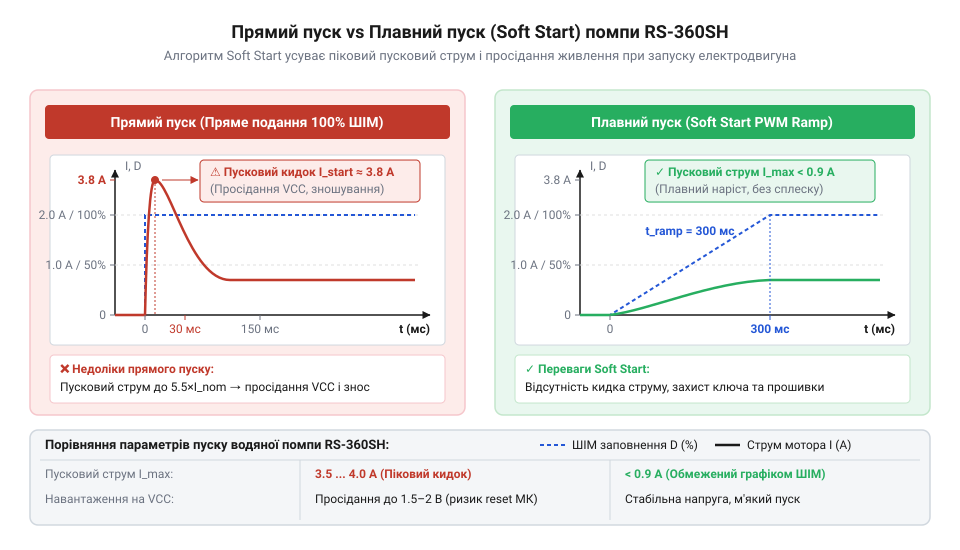
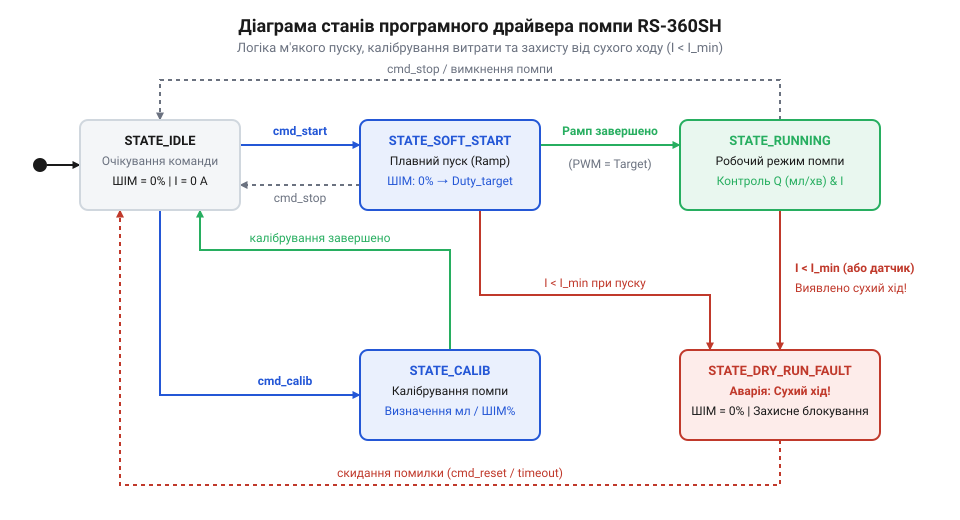

# Програмний довідник API драйвера керування та діагностики помпи RS-360SH

<preknowlist>
- [Колекторний двигун типорозміру 130](root:cat-hw-actuators/dc-motor-130) — принципи ШІМ-керування колекторними двигунами постійного струму та роботу силових ключів керування напругою
</preknowlist>

## Небезпеки прямого керування водяною помпою

Подання повної напруги живлення на колекторний мотор водяної помпи RS-360SH шляхом простого замикання силового ключа чи реле створює серйозні ризики для надійності вбудованої системи. Помпа цієї категорії є приводом із високим рівнем інерційності рідини та обмоток двигуна, який за принципом роботи близький до [колекторного двигуна 130](root:cat-hw-actuators/dc-motor-130). Під час подачі живлення на нерухомий ротор електричний опір обмотки залишається мінімальним, через що виникає пусковий кидок струму (@@en|inrush current@@, від англ. *inrush* — кидок, *current* — струм). Цей піковий струм може у 4–6 разів перевищувати номінальне значення, що призводить до просідання напруги на шині живлення мікроконтролера й виклику аварійного перезавантаження за низькою напругою (@@en|brown-out reset@@). Для вивчення схемотехніки силових ключів та реверсивного керування двигунами дивіться матеріал про [драйвер силового H-мосту для двигунів постійного струму](root:cat-hw-drivers/h-bridge-motor-driver-circuits).

Другою важливою проблемою є ґідравлічний удар (@@en|water hammer@@, від англ. *water* — вода, *hammer* — молот). Миттєвий розгін крильчатки насоса передає імпульс сили нестисливому об'єму рідини в магістралі. Різке зростання тиску створює ударну хвилю в трубах, що призводить до зіскакування силіконових шлангів із патрубків, руйнування з'єднань та підвищеного зносу механічних сальників помпи.

Третя й найнебезпечніша загроза — це сухий хід (@@en|dry running@@). Насос RS-360SH розрахований на роботу з рідиною, яка виконує роль не лише робочого тіла, а й мастила та охолоджувача для внутрішніх трущих поверхонь і підшипників ковзання. Якщо помпа вмикається за відсутності води в резервуарі, сухотермальне тертя локально розігріває деталі до температур, що перевищують точку розм'якшення термопласту. Це викликає заклинювання крильчатки та термічне руйнування ізоляції обмоток ротора за лічені секунди.

Для запобігання цим явищам прямолінійне дискретне керування замінюють програмним шаром абстракції драйвера (@@en|driver@@). Програмний драйвер реалізує регулювання коефіцієнта заповнення широтно-імпульсної модуляції (@@en|PWM@@, від англ. *pulse-width modulation*), алгоритм плавного нарощування потужності та безперервний програмно-апаратний моніторинг параметрів споживання струму й наявності рідини.

## Ініціалізація та конфігурація периферії драйвера

Надійне керування помпою вимагає чіткого розмежування низькорівневих налаштувань апаратури мікроконтролера та високорівневої логіки керування витратою. Драйвер оперує конфігураційною структурою `rs360_config_t`, яка об'єднує параметри апаратних каналів, таймерів та часових інтервалів захисту.

Для запобігання похибкам конфігурації всі параметри передаються у функцію ініціалізації `rs360_init()`, яка перевіряє цілісність даних, налаштовує виходи @@en|GPIO@@ (англ. *general-purpose input/output*) та каналу таймера ШІМ, а також повертає непрозорий дескриптор (@@en|handle@@) екземпляра пристрою.

:::code api-rs360sh-pump-control-driver-api/c/rs360-dev.c

Під час виконання `rs360_init()` здійснюється перевірка частоти ШІМ. Для моторів RS-360SH рекомендована частота лежить у діапазоні від 15 до 25 кГц. Вибір частоти понад 20 кГц переносить акустичний шум перемикання обмоток поза межі чутності людського вуха, а також мінімізує пульсації струму за рахунок власної індуктивності мотора. Якщо вказана частота поза допустимими межами або вказівник на конфігурацію нульовий, функція негайно повертає код `RS360_ERR_INVALID_ARG` без модифікації реєстрів периферії. Після успішного валідування драйвер налаштовує таймер мікроконтролера, дотримуючись суворого порядку конфігурації преддільника (@@en|prescaler@@, від англ. *pre-* — до, перед та *scale* — шкала) `PSC` та реєстру періоду (@@en|auto-reload register@@) `ARR`. Спочатку обраховується та записується значення преддільника `PSC`, яке знижує базову тактову частоту таймера `f_CLK` до робочої частоти лічильника. Для збереження максимальної дискретності ШІМ дільник `PSC` прагнуть зробити мінімальним (зазвичай `PSC = 0`). На наступному кроці обчислюється значення періоду `ARR` за формулою `ARR = f_CLK / ((PSC + 1) · f_PWM) - 1`. Якщо розраховане значення `ARR` перевищує розрядність лічильника (наприклад, 65535 для 16-бітного таймера), драйвер покроково збільшує `PSC` і повторно обчислює `ARR`. Лише після запису `PSC` та `ARR` у відповідні реєстри таймера конфігурується канал порівняння для забезпечення заданої тривалості імпульсу.

## Регулювання продуктивності та плавний пуск

Для усунення пускових струмів та гідравлічних ударів драйвер використовує програмний алгоритм плавного пуску (@@en|Soft Start@@, від англ. *soft* — м'який, *start* — пуск). Замість миттєвої установки заданого коефіцієнта заповнення ШІМ, драйвер поступово інкрементує поточне значення ШІМ від нульового рівня до цільового протягом інтервалу `soft_start_ms`.


*Зміна коефіцієнта заповнення ШІМ та струму споживання мотора RS-360SH під час прямого ввімкнення та при застосуванні алгоритму Soft Start.*

Встановлення продуктивності помпи здійснюється через дві функції: прямого задавання потужності у відсотках `rs360_set_power_percent()` та задавання об'ємної витрати в мл/хв `rs360_set_flow_rate()`.

```c
// Встановлення потужності від 0.0% до 100.0%
rs360_error_t rs360_set_power_percent(rs360_handle_t dev, float percent);

// Встановлення бажаної об'ємної витрати рідини (мл/хв)
rs360_error_t rs360_set_flow_rate(rs360_handle_t dev, float flow_ml_min);

// Періодична функція оновлення стану та плавного розгону (викликається в таймері/петлі)
rs360_error_t rs360_update_ramp(rs360_handle_t dev, uint32_t delta_ms);
```

Функція `rs360_update_ramp()` розраховує крок приросту коефіцієнта заповнення ШІМ для кожного виклику. Якщо цільова потужність `P_target` перевищує поточну `P_current`, приріст визначається виразом:

```
ΔP = (100.0 / soft_start_ms) × delta_ms
P_next = min(P_target, P_current + ΔP)
```

де `delta_ms` — час, що пройшов з моменту попереднього виклику оновлення, `soft_start_ms` — повний час розгону від 0 до 100%, а `P_next` — нове значення коефіцієнта заповнення ШІМ. Завдяки такому лінійному рампу струм споживання двигуна зростає плавно без пікових викидів, а тиск у гідравлічній магістралі наростає без ударних хвиль. Подібний підхід застосовується й під час зниження продуктивності або повної зупинки: алгоритм реалізує програмну деселерацію (@@en|Soft Stop@@, від англ. *soft* — м'який, *stop* — зупинка), розраховуючи `P_next = max(P_target, P_current - ΔP)` для заданого інтервалу `soft_stop_ms`. При раптовій відсічці ШІМ інерція рухомого стовпа рідини викликає відрив потоку від лопатей помпи, що створює локальне розрядження тиску та кавітаційні порожнини у вихідному патрубку. Після вичерпання кінетичної енергії рідина повертається зворотною хвилею, спричиняючи гідравлічний удар по сальниках. Контрольоване зменшення [обертів колекторного двигуна](root:cat-hw-actuators/dc-motor-130) гальмує ротор узгоджено зі сповільненням потоку, що утримує стабільний тиск у магістралі й запобігає розриву гідравлічного ланцюга.

## Калібрування об'ємної витрати рідини помпи

Залежність продуктивності водяної помпи (об'ємної витрати у мл/хв) від коефіцієнта заповнення ШІМ не є строго лінійною. На це впливають три основні фактори:
1. Порогове значення напруги зрушення: при коефіцієнті заповнення ШІМ нижче 20–25% моменту двигуна недостатньо для подолання статичного тертя сальників та гідростатичного тиску, тому витрата дорівнює нулю. 2. Нелінійність проти-ЕРС колекторного двигуна під навантаженням. 3. Гідравлічний опір сполучених трубок та висота підйому стовпа рідини.

Для точного дозування в прошивці використовується таблиця калібрування (@@en|look-up table@@, або @@en|LUT@@), яка складається з опорних точок співвідношення «коефіцієнт заповнення ШІМ (%) — реальна витрата (мл/хв)».

:::code api-rs360sh-pump-control-driver-api/c/snippet-2.c

Перетворення заданої витрати `Q_target` у коефіцієнт заповнення ШІМ `D_target` здійснюється за допомогою шматочно-лінійної інтерполяції між двома суміжними калібрувальними точками `(D_i, Q_i)` та `(D_{i+1}, Q_{i+1})`. Якщо задана витрата лежить у межах відрізка `Q_i ≤ Q_target ≤ Q_{i+1}`, розрахунковий коефіцієнт заповнення обчислюється так:

```
slope = (D_{i+1} - D_i) / (Q_{i+1} - Q_i)
D_target = D_i + slope × (Q_target - Q_i)
```

Якщо `Q_target` менша за мінімально виміряну витрату трогання `Q_0`, драйвер автоматично повертає `D_target = 0.0%`, вимикаючи помпу для запобігання неефективному нагріву обмоток без руху рідини.

## Діагностика сухого ходу та захисні зупинки

Безпечна експлуатація помпи передбачає постійний аналіз зворотного зв'язку від апаратних датчиків. Драйвер помпи реалізує автомат станів (@@en|state machine@@), який обробляє показники струму споживання з @@en|ADC@@ (англ. *analog-to-digital converter*) та стан дискретного датчика рівня/потоку. Детальніше про конструкцію, фізичні принципи роботи та схеми підключення зовнішніх сенсорів наявності рідини читайте у статті про [апаратні датчики сухого ходу та потоку рідини](root:cat-hw-sensors/liquid-level-sensor).


*Автомат станів програмного драйвера помпи RS-360SH з відстеженням аварійних режимів та безпечним вимкненням.*

Під час роботи помпи на повній потужності з рідиною вбудований колекторний мотор зазнає механічного опору прокачуваного середовища, створюючи номінальний струм споживання (наприклад, 0.6–1.0 А). При потраплянні повітря у насосну камеру (сухий хід) опір ротору різко падає, через що струм споживання знижується нижче порога `min_current_amps` (наприклад, менше 0.25 А). І навпаки, при механічному заклинюванні крильчатки стороннім предметом струм зростає понад `max_current_amps`.

:::code api-rs360sh-pump-control-driver-api/c/snippet-3.c

Функція `rs360_process_diagnostics()` перевіряє стан аналогових та дискретних ліній. Якщо виявлено зниження струму нижче `min_current_amps` або розмикання контакту датчика `dry_run_gpio_pin`, драйвер не реагує миттєво на поодинокий шум, а запускає таймер затримки `dry_run_timeout_ms`. Це виключає хибні спрацьовування при проходженні поодиноких бульбашок повітря крізь магістраль. Якщо після закінчення таймауту стан не нормалізувався, драйвер переводить автомат станів у `RS360_STATE_ERROR_DRY_RUN`, негайно скидає ШІМ до 0% та генерує аварійний сигнал для зовнішнього ПЗ.

Для критичних ситуацій передбачена функція `rs360_emergency_stop()`. Вона миттєво обнуляє коефіцієнт заповнення ШІМ у реєстрах таймера МК, оминаючи стадію деселерації, переводить силові ключі у розімкнений стан та переводить пристрій у стан `RS360_STATE_EMERGENCY_STOP`.