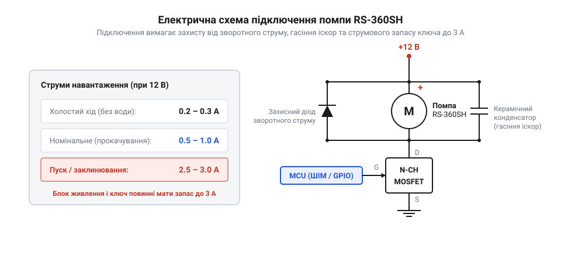
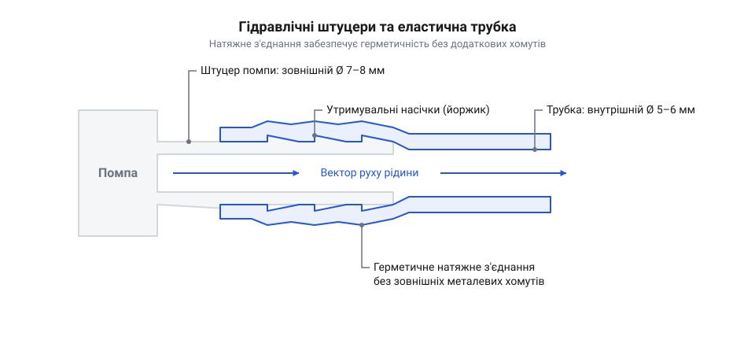

# Залізний інтерфейс водяної помпи RS-360SH: електричні клеми, гідравлічні штуцери та монтаж

<preknowlist>
- [Колекторний двигун типорозміру 130](root:cat-hw-actuators/dc-motor-130) — принцип роботи двополюсного колекторного двигуна постійного струму, зміна напрямку обертання вала реверсом полярності живлення та залежність струму споживання від механічного навантаження на валу.
</preknowlist>

## Пастки підключення помпи RS-360SH

Автоматичне перекачування рідини у саморобному поливі чи дозаторі часто починається зі спаленого мікроконтролера або залитого водою столу. Малогабаритна помпа @@en|RS-360SH@@ зовні нагадує герметичну капсулу, тому розробники нерідко опускають її на дно резервуара з водою. Таке занурення миттєво нищить привід: помпа побудована на базі відкритого [колекторного двигуна](root:cat-hw-actuators/dc-motor-130). Через вентиляційні отвори у металевому корпусі статора вода заповнює колекторний вузол, спричиняє електрохімічне коротке замикання між мідними ламелями та спалює контактні щітки. Помпа @@en|RS-360SH@@ є суто зовнішнім агрегатом, який встановлюють виключно на сухому майданчику поруч із баком.

Друга пастка криється у спробі заживити помпу від порту @@en|USB@@ або вбудованого стабілізатора плати керування. Поки ротор стоїть, опір його обмоток мінімальний, тому в момент увімкнення пусковий струм стрибає у кілька разів вище допустимого навантаження слабкого джерела. Напруга живлення логічної частини просідає, викликаючи циклічне апаратне скидання мікроконтролера.

Навіть за надійного живлення помпа відмовляється качати воду, якщо на її штуцери натягнути жорсткі пластикові трубки. Твердий матеріал не обтискає конічні насічки, утворює мікроскопічні щілини й труїть повітря. Помпа марно захоплює повітряні бульбашки, зриває розрідження на вході й торохтить усуху.

Нарешті, жорстке прикручування металевого фланця помпи саморізами до стінок пластикового або металевого корпусу створює нестерпний гул. Робочий вузол перетворює панелі пристрою на акустичний резонатор. Щоб помпа працювала надійно, безшумно та ефективно, їй потрібен узгоджений силовий ключ із власним живленням, герметичні еластичні трубки та демпферне кріплення.

## Електричне живлення, струми та комутація

Двигун помпи розрахований на живлення постійним струмом у діапазоні від 6 В до 12 В із номінальною робочою точкою 12 В. За напруги 12 В характер споживання струму залежить від опору середовища на крильчатці. Без рідини помпа споживає струм холостого ходу `I_idle = 0.2–0.3 А`, який іде лише на подолання тертя у підшипниках та колекторі. Коли робоча камера заповнюється водою, механічний опір зростає, і номінальний робочий струм під навантаженням підвищується до `I_nom = 0.5–1.0 А`. Найнебезпечнішим режимом є пусковий момент або механічне заклинювання ротора стороннім сміттям. За повної зупинки вала зворотна електрорушійна сила зникає, струм блокування (англ. @@en|stall current@@, від @@en|stall@@ — глушити, зупиняти) `I_stall` сягає 2.5–3.0 А й обмежується лише омічним опором мідного дроту обмоток.

На задній ізоляційній кришці двигуна виведено дві пелюсткові клеми. Біля однієї з них нанесено знак `+` або червону крапку фарби. Ця мітка вказує на полярність підключення для прямого напрямку обертання вала, який жене воду від осьового впускного штуцера до бічного випускного. Якщо переплутати клеми й подати зворотну полярність, напрямок руху рідини порушується або прокачування повністю зривається через конструктивну асиметрію робочої камери.

Вихідний порт мікроконтролера видає не більше 20–40 мА, тому керувати помпою можна лише через зовнішній комутатор нижнього плеча (англ. @@en|low-side switch@@, від @@en|low side@@ — нижній бік, та @@en|switch@@ — перемикач) на базі [польового транзистора](root:cat-hw-drivers/n-channel-power-mosfet) (англ. @@en|MOSFET@@, від @@en|metal-oxide-semiconductor field-effect transistor@@ — польовий транзистор зі структурою метал-оксид-напівпровідник). Щоб уникнути теплового пробою транзистора під час пуску чи зупинки вала, його допустимий тривалий струм стоку `I_ds` розраховують із двократним коефіцієнтом запасу надійності `k_safe = 2` відносно максимального струму блокування `I_stall = 3.0 А`.

Розрахунок мінімального струму стоку силового польового транзистора:
```
I_ds
= k_safe · I_stall                       [вимога двократного запасу за струмом блокування]
= 2 · 3.0                                [підстановка коефіцієнта запасу k_safe = 2 та I_stall = 3.0 А]
= 6.0 А                                  [мінімальний безперервний струм стоку транзистора]
```

Отримане значення показує, що силовий ключ мусить витримувати щонайменше 6 А без перегріву; на практиці обирають транзистор із запасом струму від 10 А (наприклад, IRLZ44N), що гарантує надійне відкривання від логічного рівня 3.3 В чи 5 В.

Паралельно клемам двигуна обов'язково встановлюють [захисний зворотний діод](root:cat-hw-drivers/inductive-flyback-protection) (англ. @@en|flyback diode@@, від @@en|flyback@@ — зворотний хід), спрямований катодом до шини `+12 В`. У мить закриття польового ключа індуктивність обмоток генерує імпульс ЕРС самоіндукції амплітудою в десятки вольт, який замикається через діод і захищає кристал транзистора від пробою. Додатковий керамічний конденсатор ємністю 100 нФ між пелюстками помпи шунтує високочастотне іскріння на колекторі двигуна, блокуючи радіозавади на лініях керування.


*Принципова схема силового контуру помпи @@en|RS-360SH@@: комутація нижнього плеча польовим транзистором із захисним діодом і фільтрувальним конденсатором на клемах живлення.*

Блок живлення системи зобов'язаний витримувати пікові струми не менше 3.0–3.5 А при напрузі 12 В, інакше динамічне падіння напруги в момент пуску мотора спричинятиме перезавантаження керівної електроніки.

## Гідравлічні штуцери та вибір трубок

На передній торцевій кришці гідравлічної камери помпи розташовано два пластикові штуцери зовнішнім діаметром 7–8 мм. Центральний осьовий патрубок є впускним штуцером, через який рідина всмоктується всередину робочої камери. Бічний радіальний патрубок є випускним штуцером, куди рідина нагнітається під тиском. Обидва штуцери мають профільовані конічні розширення — утримувальні насічки (англ. @@en|barb@@ — зазублина, гачок), форма яких полегшує насування трубки та перешкоджає її зворотному сповзанню під дією тиску води.

Надійність гідравлічного контуру тримається на пружній деформації матеріалу трубки. Для монтажу використовують еластичні трубки з медичного силікону або м'якого полівінілхлориду з внутрішнім діаметром 5–6 мм. Оскільки внутрішній просвіт трубки на 1.5–2.5 мм менший за максимальний діаметр конуса штуцера, під час монтажу стінки шланга радіально розтягуються. Завдяки залишковій пружності еластомер безперервно стискає циліндричну основу штуцера за конічною насічкою, створюючи самогерметизоване натяжне з'єднання без металевих гвинтових хомутів.


*Креслення штуцерів помпи @@en|RS-360SH@@ та щільна посадка силіконової трубки внутрішнім діаметром 5–6 мм із радіальним натягом.*

Використання трубок іншої геометрії чи жорсткості неминуче призводить до аварії гідролінії. Шланги з жорсткого поліуретану чи товстого поліетилену не здатні рівномірно обтягнути конічну насічку. На стику виникають поздовжні мікрощілини, через які впускний тракт підсмоктує повітря, що повністю зупиняє прокачування. Якщо ж узяти зашироку трубку з внутрішнім діаметром 7–8 мм, вона вільно ковзає по насічках і за першого гідравлічного удару злітає з випускного патрубка, заливаючи електроніку водою.

## Гідродинамічні характеристики та робочий напір

Помпа @@en|RS-360SH@@ належить до категорії самовсмоктувальних агрегатів (англ. @@en|self-priming@@, від @@en|self@@ — сам, та @@en|prime@@ — первинно заливати). Завдяки щільному приляганню робочих елементів помпа здатна створити початкове розрідження в абсолютно сухій магістралі й підняти воду з глибини до 1.5 м без попереднього заповнення трубок рідиною. Ця властивість дозволяє розміщувати помпу на верхній кришці резервуара над рівнем рідини, виключаючи самовільний самоплив води через систему у вимкненому стані.

За номінальної напруги живлення 12 В об'ємна продуктивність помпи становить `Q = 1.0–1.8 л/хв`. Конкретна швидкість прокачування визначається гідравлічним опором трубок і висотою підйому рідини. Максимальний гідравлічний напір становить `H_max = 2.0–2.5 м` водяного стовпа, що відповідає надлишковому тиску близько 0.20–0.25 бар. Якщо кінцева точка виливу піднята на висоту 2.5 м над помпою, потік рідини практично припиняється, а весь струм двигуна витрачається на підтримку статичного водяного стовпа.

Зниження напруги живлення до 6–9 В пропорційно сповільнює частоту обертання вала двигуна. За напруги 9 В продуктивність падає приблизно до 0.8–1.2 л/хв, а за 6 В знижується до 0.4–0.6 л/хв, водночас висота підйому скорочується до 1.0–1.2 м. Подавати напругу нижче 5 В недоцільно: крутного моменту двигуна не вистачає для подолання опору клапанної системи, і мотор зупиняється під навантаженням.

Для дозування фіксованих порцій рідини контролер задає тривалість імпульсу увімкнення `t_pump`. Обчислення часу роботи помпи для подачі води об'ємом `V_target = 0.25 л` за середньої продуктивності `Q = 1.5 л/хв`:
```
t_pump
= V_target / Q                           [співвідношення дозованого об'єму та швидкості подачі]
= 0.25 / (1.5 / 60)                      [переведення подачі в літри за секунду: 1.5 / 60 = 0.025 л/с]
= 0.25 / 0.025                           [ділення об'єму на секундну продуктивність]
= 10 с                                   [час роботи силового ключа]
```

Отримані 10 секунд роботи гарантують точне відмірювання об'єму за умови, що гідравлічний опір магістралі та висота підйому залишаються стабільними в процесі дозування.

## Демпферний монтаж і теплові обмеження

Під час прокачування води ексцентриковий механізм помпи створює пульсуючі коливання тиску та високочастотну механічну вібрацію ротора. Якщо притягнути металевий корпус помпи жорсткими сталевими скобами безпосередньо до перегородки корпусу приладу, коливання передаються на стінки конструкції. Виникає структурний резонанс, через який малопотужний пристрій починає видавати гучний деренчливий звук. Для віброізоляції використовують [еластичні демпферні хомути](root:ph-waves/elastomeric-vibration-damping). М'яка полімерна оболонка охоплює циліндричний статор двигуна й поглинає зсувні коливання, перетворюючи механічну енергію вібрації на розсіяне тепло всередині еластомеру та знижуючи рівень акустичного шуму на 15–20 дБ.

Корпус двигуна помпи @@en|RS-360SH@@ має клас захисту (англ. @@en|IP00@@, від @@en|Ingress Protection@@ — захист від проникнення): захист від пилу та крапель вологи повністю відсутній. Помпа категорично не призначена для занурення в рідину. Будь-які краплі води чи конденсат, що стікають зі штуцерів або трубок на корпус, можуть затекти крізь вентиляційні щілини біля колекторного вузла. Це призводить до електролізу, прискореної корозії мідних деталей і короткого замикання під напругою 12 В. З цієї причини помпу монтують гідравлічною головкою вниз або розміщують під штуцерами захисний лоток, який відводить аварійні краплі повз корпус двигуна.

Двигун помпи позбавлений вбудованої крильчатки охолодження, тому надлишкове тепло від обмоток відводиться виключно пасивною конвекцією через металевий корпус статора. Під час тривалої безперервної роботи номінальний струм до 1 А розігріває мідні обмотки до температури понад 85 °C вже за 15–20 хвилин. Перегрів викликає деградацію ізоляційного лаку дроту, заклинювання підшипників ковзання та втрату магнітних властивостей феритових статорів.

Щоб запобігти тепловій аварії, привід експлуатують у повторно-короткочасному режимі з обмеженням робочого циклу (англ. @@en|duty cycle@@, від @@en|duty@@ — служба, робота, та @@en|cycle@@ — цикл). Безперервне прокачування не повинно перевищувати 10–15 хвилин, після чого помпі потрібна пауза тривалістю не менше 10–15 хвилин для повного охолодження до температури довкілля. Для безперервної цілодобової роботи помпа @@en|RS-360SH@@ непридатна: її ресурс оптимізовано для періодичного поливу рослин, циклічного наповнення ємностей або імпульсного дозування рідких компонентів.
