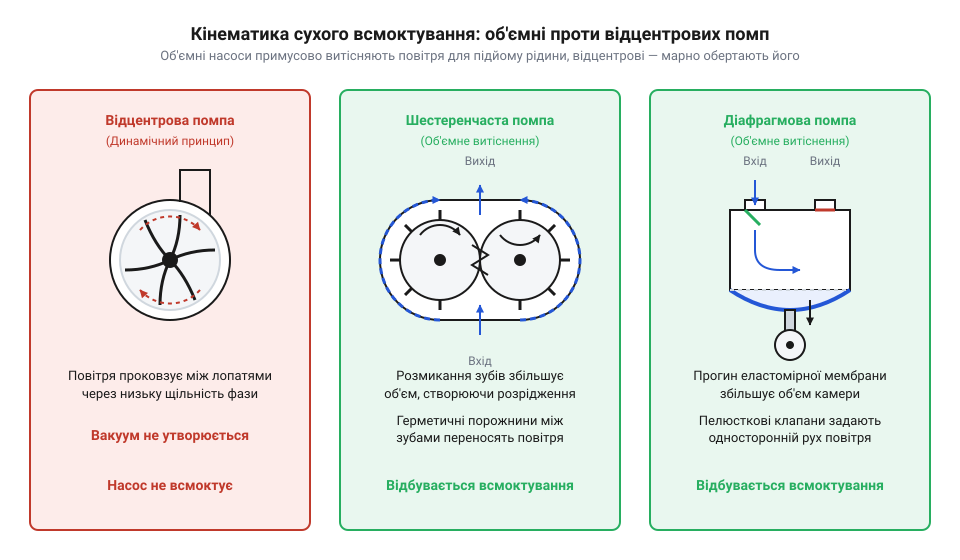
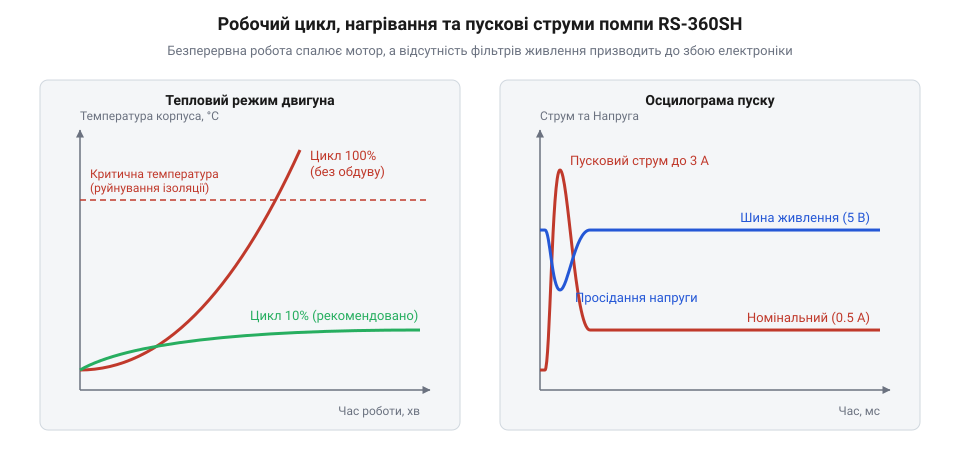

# Еволюція мініатюрних колекторних водяних помп: від автомобільних систем до мікрогідравліки вбудованих пристроїв

<preknowlist>
- [Колекторний двигун типорозміру 130](root:cat-hw-actuators/dc-motor-130) — Базове розуміння електродинаміки колекторного двигуна постійного струму: принцип дії триполюсного якоря, феритові магніти статора, природа пускових надструмів та обмежений ресурс щіткового вузла.
- [Мотор-редуктор 6 В (100 і 600 об/хв)](root:cat-hw-actuators/gearmotor-6v) — Уявлення про кінематику зубчастих коліс та властивості деталей із литих термопластів (поліацеталь POM), їхню зносостійкість і схильність до стирання під навантаженням.
</preknowlist>

## Глухий кут вакуумних і ручних омивачів

Рух мокрою трасою позаду вантажівки миттєво закидає вітрове скло шаром рідкої багнюки. Якщо водій не змиє бруд за кілька секунд, видимість падає до нуля. У сучасних автомобілях рідину подає електрична помпа після дотику до важеля, проте в 1950–1960-х роках такого компактного вузла не існувало.

Подачу води забезпечував водій власною мускульною силою або енергією двигуна. У першому варіанті на панелі приладів стояла гумова груша, або на підлозі поруч із педаллю зчеплення монтували ножний плунжер. Щоби бризнути на скло, водій мусив відволікатися від кермування й качати грушу рукою або незручно тиснути ногою на додаткову педаль. Під час швидкісного руху це загрожувало втратою контролю над автомобілем.

Прагнучи автоматизації, конструктори створили вакуумний омивач вітрового скла (англ. @@en|windshield washer@@). Його привід під'єднували до впускного колектора (від лат. @@la|collector@@ — збирач) бензинового двигуна. Робота помпи спиралася на різницю тисків: вакуум (від лат. @@la|vacuus@@ — порожній) у колекторі тягнув пружну мембрану, закачуючи порцію рідини, а зворотна пружина виштовхувала її на скло крізь форсунки.

Ця схема містила критичну ваду. Глибоке розрідження у 60–70 кПа виникало в колекторі лише тоді, коли дросельна заслінка була прикрита — на холостому ходу або під час гальмування двигуном. Щойно водій тиснув на педаль газу, аби піти на обгін чи подолати затяжний підйом, заслінка відкривалася. Потік атмосферного повітря вривався в циліндри, і розрідження падало майже до нуля. Саме тоді, коли з-під коліс сусідніх машин летіла найгустіша багнюка, вакуумний омивач повністю вимикався. Спроба розв'язати проблему електричним приводом тоді впиралася у відсутність компактних двигунів: промислові насоси й паливні помпи важили кілограми, живилися від мереж високої напруги й коштували занадто дорого для бортової 12-вольтової мережі легкового авто.

## Мотори Mabuchi трьохсотої серії та уніфікація

Щоб відмовитися від ненадійного вакууму, автовиробникам був потрібен автономний низьковольтний рушій. Традиційні електродвигуни постійного струму середини XX століття будували за важкими промисловими схемами: вони мали масивні литі корпуси, електромагнітні обмотки збудження та вимагали ручного збирання. Такий мотор важив сотні грамів і коштував надто дорого для простого бачка омивача.

Виробничий прорив на межі 1960–1970-х років здійснила японська компанія @@ja|Mabuchi Motor@@. Вона вже опанувала масове виробництво недорогих приводів для побутової техніки та іграшок, де успішно застосовувався [колекторний двигун типорозміру 130](root:cat-hw-actuators/dc-motor-130). Проте потужності 130-го двигуна не вистачало для подолання гідравлічного опору довгих трубок і форсунок.

Відповіддю Mabuchi стала стандартизована 300-та серія, вершиною якої став двигун @@en|RS-360SH@@. Замість дорогого литого корпусу інженери застосували тонкостінний стакан діаметром 27.5 мм зі штампованої низьковуглецевої сталі. Цей стакан водночас виконував роль опорного каркаса та замкненого магнітопроводу. У статор (від лат. @@la|stator@@ — нерухомий) вклеїли сегментні постійні магніти з фериту (від лат. @@la|ferrum@@ — залізо), повністю відмовившись від мідних обмоток збудження. Трьохполюсний ротор (від лат. @@la|rotare@@ — обертати) виготовляли на повністю автоматизованих намотувальних лініях, а струм підводив надійний вузол щіток.

Двигун @@en|RS-360SH@@ важив близько 50 грамів, живився від 12 В бортової мережі, розвивав до 10 000 об/хв і видавав до 10 Вт механічної потужності. Повна уніфікація геометрії та автоматизація виробництва знизили собівартість одиниці до лічених десятків центів. Автомобільні заводи отримали стандартну платформу, здатну прокачувати рідину за будь-якого режиму їзди.

## Інженерні термопласти та сухе самовсмоктування

Поява потужного мотора @@en|RS-360SH@@ відкрила шлях до електрифікації омивача, але інженери зіткнулися з новою фізичною перешкодою. Найпростіший гідравлічний робочий орган — відцентрова крильчатка — виявився безпорадним у сухому трубопроводі.

Різниця тисків `Δp`, яку здатне створити відцентрове колесо з лінійною швидкістю лопаток `u`, прямо залежить від густини середовища `ρ`:

```
Δp
= (1 / 2) · ρ · u²                           [теоретичний напір крильчатки за теоремою Ейлера]
```

Тиск прямо пропорційний густині середовища, що заповнює насосну камеру. Для води з густиною 1000 кг/м³ колесо легко формує напір у кілька метрів водяного стовпа. Проте коли бачок спорожнів або насос щойно встановили на конвеєрі, камера заповнена повітрям із густиною 1.2 кг/м³ — у вісімсот разів меншою за воду. Розрідження, створене крильчаткою в повітрі, не перевищує кількох десятків паскалів. Щоби підняти воду з дна бачка на висоту двадцять сантиметрів, потрібно подолати гідростатичний тиск у дві тисячі паскалів. Відцентрова помпа не має сухого самовсмоктування (англ. @@en|self-priming@@): вона ганяє повітря по колу, вимагаючи попереднього заповнення магістралі водою або занурення самого насоса всередину бачка.

Виходом став перехід до [помп об'ємного витіснення](root:hw-motion/positive-displacement-pumps) (англ. @@en|positive displacement pump@@). Такі механізми перекачують середовище не за рахунок кінетичної енергії струменя, а шляхом циклічної зміни геометричного об'єму герметичної камери. Проте виготовлення мікроскопічних герметичних камер із металу вимагало прецизійного шліфування та мастила, яке змивалося водою.

Технологічний прорив 1970–1980-х років забезпечило прецизійне лиття інженерних термопластів (від грец. @@grc|θερμός@@ — теплий, гарячий, та @@grc|πλαστός@@ — сформований). Деталі насосних головок почали відливати з поліацеталю (від грец. @@grc|πολύς@@ — численний, та лат. @@la|acetum@@ — оцет; @@en|POM@@) та нейлону (поліаміду @@en|PA66@@). Поліацеталь мав наднизький коефіцієнт тертя й не набрякав у воді — ці властивості вже довели свою надійність у [мотор-редукторах на 6 вольтів](root:cat-hw-actuators/gearmotor-6v). Нейлон гарантував хімічну стійкість до спиртів зимових рідин, а точність лиття сягала десяти мікрометрів без додаткової механічної обробки.

На вал @@en|RS-360SH@@ почали встановлювати два типи мініатюрних пластикових головок: шестеренчасті та діафрагмові.


*Кінематика сухого самовсмоктування: об'ємне витіснення герметичними камерами створює перепад тиску навіть на повітряній фазі, на відміну від відцентрової крильчатки.*

У шестеренчастій помпі пара зубчастих коліс із @@en|POM@@ обертається всередині щільної камери. У зоні впускного штуцера зуби виходять із зачеплення, збільшуючи вільний об'єм між западинами. Утворюється локальний вакуум до 40–50 кПа, який висмоктує повітря з впускної трубки та підіймає за ним стовп рідини. Вода захоплюється западинами зубів уздовж стінок корпусу, а в зоні нагнітання зуби знову входять у зачеплення, витісняючи рідину у вихідний штуцер.

У діафрагмовій помпі обертання вала через ексцентрик коливає пружну мембрану — діафрагму (від грец. @@grc|διάφραγμα@@ — перегородка). Рух мембрани назад розширює замкнену камеру: випускний пелюстковий клапан захлопується, а впускний відкривається під дією глибокого розрідження. Зворотний рух стискає об'єм, закриває впуск і виштовхує середовище назовні під тиском понад півтори атмосфери.

Об'ємне витіснення на базі інженерних термопластів розв'язало проблему сухого пуску: помпа з мотором @@en|RS-360SH@@ тепер могла розташовуватися у будь-якій точці моторного відсіку вище рівня бачка й підіймати рідину самостійно за частку секунди.

## Експансія в побутові прилади та мікрогідравліку

У 1980–1990-х роках світова автомобільна індустрія щорічно потребувала десятків мільйонів бачків омивача. Цей стабільний попит створив повністю автоматизовані конвеєри, які мільйонними партіями штампували двигуни @@en|RS-360SH@@ і прецизійно відливали пластикові деталі гідроголовок. Масове виробництво знизило собівартість готового вузла до лічених доларів, забезпечивши надійну повторюваність вузлів.

Конструктори споживчої техніки та засобів автоматизації зіткнулися з потребою компактного перекачування рідин. Традиційні промислові насоси змінного струму вимагали високої напруги 220 В, мали великі габарити й спричиняли сильну вібрацію. Спеціалізовані плунжерні диспенсери (від лат. @@la|dispensare@@ — розподіляти) були занадто дорогими для серійних товарів. Автомобільна помпа запропонувала готову комбінацію: безпечне 12-вольтове живлення, малі розміри, сухе самовсмоктування та гідравлічний тиск понад 1.5 бара.

На межі 1990–2000-х років фабрики в Китаї опанували масовий випуск уніфікованих моторів 300-ї серії та пластикових корпусів. Автомобільний вузол перетворився на доступний товарний модуль, започаткувавши розвиток вбудованої мікрогідравліки (від грец. @@grc|μικρός@@ — малий, та @@grc|ὑδраυλικός@@ — водяний). Помпи на базі @@en|RS-360SH@@ стали штатними вузлами еспресо-кавоварок, безконтактних санітарних дозаторів мила, лабораторних приладів автоматичного промивання кювет та акваріумних систем доливання води.

Коли в середині 2000-х років комп'ютерні сервери вперше вперлися в теплову межу повітряного охолодження, перші компактні рідинні контури конструювали саме на цих доступних насосах. Щоправда, там, де потрібне надточне мікродозування реагентів без контакту рухомих частин із рідиною, шестеренчасті головки поступалися [лабораторним перистальтичним насосам](root:hw-motion/peristaltic-dosing-pumps) під керуванням [крокового мотора 28BYJ-48](root:cat-hw-actuators/28byj-48-stepper). Проте за критерієм «напір і швидкість на одиницю вартості» помпа на базі @@en|RS-360SH@@ закріпилася як головний виконавчий елемент масової гідравліки.

## Міфи робототехніки та реальні експлуатаційні межі

З поширенням платформ швидкого прототипування на зразок @@it|Arduino@@ інтернет-майданчики почали масово продавати автомобільні помпи як «навчальні водяні модулі». Серед розробників вбудованих пристроїв виникло хибне враження, ніби цей механізм спроєктовано спеціально для мейкерських систем, кімнатних водограїв чи автоматичних гідропонних ферм. Спроба використати таку помпу для безперервного цілодобового перекачування рідини призводить до її швидкої відмови.

Автомобільне призначення помпи диктує жорсткі часові рамки. Вона створювалася для розпилення омивача імпульсами тривалістю 2–5 секунд із паузами в кілька хвилин або годин. Її безпечний робочий цикл (англ. @@en|duty cycle@@) — частка часу активної роботи у повному періоді — не має перевищувати 10%.

Корпус мотора @@en|RS-360SH@@ виготовлено зі штампованої сталі без вентиляційних прорізів і внутрішнього обдуву, який використовують [5V безколекторні вентилятори](root:cat-hw-actuators/fan-5v). Під час безперервної роботи тепловтрати в мідному дроті якоря не встигають розсіюватися: уже через 8–10 хвилин температура статора перевищує 90 °C. Перегрів викликає руйнування ізоляційного лаку обмоток, розм'якшення пластикових тримачів щіток і швидке стирання графіту. Зубчасті колеса гідроголовки з @@en|POM@@ охолоджуються лише рухомою водою; під час сухого ходу тертя нагріває поліацеталь вище температури плинності, і зуби зрізаються за лічені хвилини. Для цілодобової циркуляції середовища застосовують помпи з магнітною муфтою на базі [безколекторних моторів](root:cat-hw-actuators/bldc-motor-module).


*Теплове навантаження та струмовий стрибок: закритий статор без вентиляції перегрівається понад 90 °C за вісім хвилин безперервної роботи, а початковий імпульс струму до 3 А спричиняє аварійне перезавантаження мікроконтролера.*

Друга небезпека полягає в електричному перехідному процесі. У момент подачі напруги живлення `U` ротор нерухомий, проти-ЕРС відсутня, а пусковий надструм (англ. @@en|inrush current@@) `I_start` обмежується виключно омічним опором обмотки якоря `R_arm`:

```
I_start
= U / R_arm                      [закон Ома для нерухомого якоря]
= 12 В / 4 Ом                    [паспортні параметри двигуна RS-360SH]
= 3 А                            [піковий пусковий надструм]
```

Цей імпульс у шість разів перевищує робоче споживання 0.5 А. Якщо помпу живити від однієї шини з мікроконтролером без фільтрації, стрибок струму викликає просідання напруги нижче порогу скидання (англ. @@en|brownout reset@@), що призводить до циклічного перезавантаження керуючої плати. Для безпечної роботи необхідні комутація через [захисний драйвер двигуна](root:hw-motion/dc-motor-driver) або силовий транзистор, захисний зворотний діод паралельно індуктивному навантаженню та буферний електролітичний конденсатор ємністю від 470 мкФ на лінії живлення.
