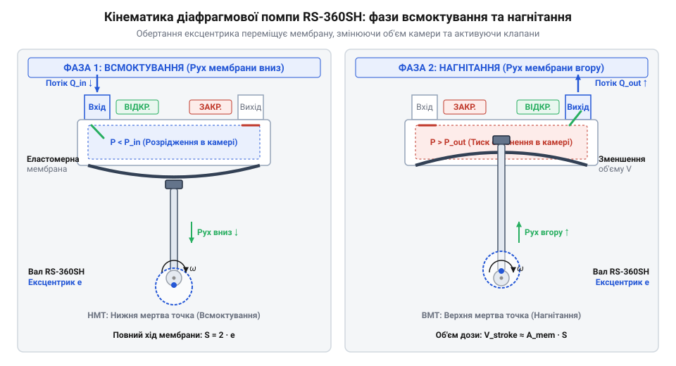
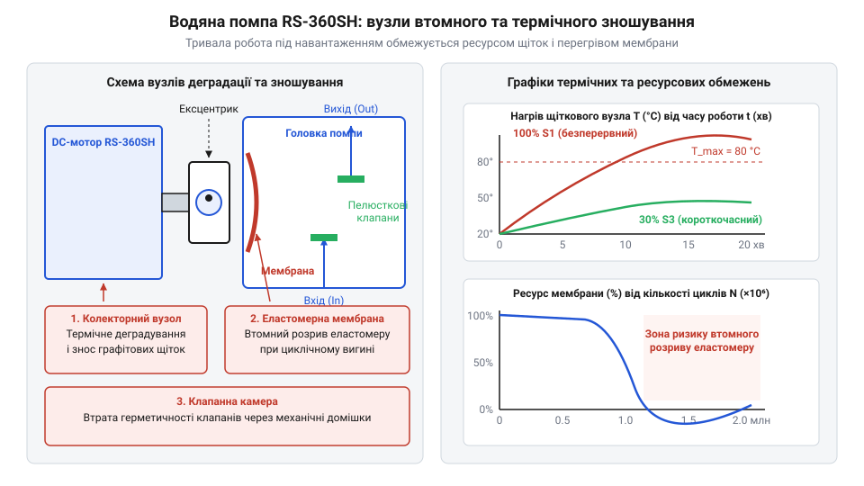

# Історія та еволюція мікропомп: від класичних об'ємних насосів до RS-360SH

<preknowlist>
- [Колекторний двигун типорозміру 130](root:cat-hw-actuators/dc-motor-130) — Принцип роботи колекторно-щіткового вузла DC-двигуна, залежність обертів від напруги живлення та механічне зношування щіток.
</preknowlist>

## Обмеження класичних насосів у малій техніці

Перекачування рідини у великогабаритних промислових агрегатах історично вирішували поршневими чи відцентровими насосами. Проте середина XX століття вимагала малогабаритних пристроїв для побутової автоматики, медичного та лабораторного обладнання з дозованою подачею малих об'ємів рідини. Спроба просто зменшити лінійні розміри поршневого насоса зайшла в тупик: маса кінематичного вузла (циліндр, поршень із кільцями, кривошипно-шатунний механізм) залишалася високою, а відносні втрати на тертя стрімко зростали зі зменшенням діаметра поршня.

Найгострішим бар'єром стали динамічні ущільнення вала. Для передачі обертання від двигуна до робочої камери вал проходив крізь її стінку, а зазор герметизували через @@uk|сальник@@ (від праслов. *sadlo — «сало», через просочування прядива салом для змащення) або @@lat|сальникове ущільнення@@ (@@en|stuffing box@@). У малій техніці при діаметрах вала 2–5 мм тертя в сальнику повністю блокувало малопотужний двигун. Послаблення притиску спричиняло витоки, а змащення забруднювало середовище, що унеможливлювало перекачування питної води та хімікатів.

Альтернатива — відцентрові помпи із замкненим @@uk|робочим колесом@@ — розбивалася об гідродинамічні обмеження. Відцентрова сила пропорційна радіусу, тому зменшення колеса до 10–20 мм вимагало надвисоких обертів приводу, спричиняючи кавітацію та падіння ККД через в'язке тертя на малих числах Рейнольдса. До того ж такі помпи не мають здатності до @@uk|сухого всмоктування@@ (@@en|self-priming@@): потрапляння повітря в патрубок блокувало робочий цикл без попереднього заповнення лінії рідиною. Детальніше про принцип функціонування робочого колеса та фізичні обмеження його масштабування у мікрогідравліці читайте у статті про [відцентрові насоси](root:cat-hw-actuators/centrifugal-pumps).

Кризу поглиблювала відсутність довговічних еластомерів. Натуральний @@uk|каучук@@ (від кечуа *k'awchu — «дерево, що плаче») швидко деградував від циклічних деформацій, озону й тепла, вкриваючись тріщинами після кількох тисяч циклів. Створення компактної помпи з герметичною ізоляцією механіки від рідини та сухим всмоктуванням вимагало фундаментального перегляду як матеріалознавчої бази, так і архітектури приводу.

## Прорив еластомерів та стандартизація моторів

Вихід із конструктивного тупика став можливим у другій половині XX століття завдяки синергії хімії полімерів та мікроелектроприводу. Першим вирішальним кроком став промисловий синтез штучних каучуків — @@en|EPDM@@ (етилен-пропілен-дієновий каучук) та силіконового каучуку. Новий клас матеріалів — @@grc|еластомер@@ (грец. *elastos* — гнучкий, розтяжний + *meros* — частина) — витримував десятки мільйонів циклів знакозмінної деформації без втомного руйнування. Це дозволило відмовитися від сальників і замінити жорсткий поршень на гнучку @@lat|мембрану@@ (лат. *membrana* — плівка, перегородка), або @@grc|діафрагму@@ (грец. *diaphragma* — перегородка). Гнучка мембрана статично затискається по периметру корпусу, повністю ізолюючи механічну частину приводу від рідинної камери, що виключило ризик витоків та забруднення мастилом.

Другим компонентом прориву стала стандартизація дешевих приводів постійного струму. У 1950–1970-х роках японська компанія @@en|Mabuchi Motor@@ під керівництвом Кен'ічі Мабучі розробила технологію масового випуску уніфікованих колекторних двигунів. Мотори серії 300 та 360, зокрема @@en|RS-360SH@@, за рахунок штампованих сталевих корпусів, автоматизованого мотання роторів та мідно-графітових щіток забезпечили високу потужність за мізерної собівартості. Вони працювали безпосередньо від 6–12 В без складних трансмісій, на відміну від таких рішень, як [компактні мотор-редуктори](root:cat-hw-actuators/gearmotor-6v). Стандартизований [колекторний двигун 130-го типорозміру](root:cat-hw-actuators/dc-motor-130) та його сородичі серії 360 стали універсальним серцем малогабаритної побутової техніки.

Поєднання мотора @@en|RS-360SH@@ із мембранним вузлом породило класичну архітектуру діафрагмової мікропомпи. Завдяки замкненому робочому об'єму така система є об'ємним насосом і створює розрядження навіть на сухому повітрі, що забезпечує @@uk|сухе всмоктування@@ без попередньої заливки. Усунення рухомих ущільнень вала у поєднанні з високоавтоматизованим збиранням @@en|RS-360SH@@ зробило діафрагмову мікропомпу найдешевшим і найнадійнішим рішенням для мікрогідравліки — від автоматичних тонометрів та кавоварок до DIY-проєктів. Докладніше про принципи класифікації та конструктивну будову насосів об'ємної дії йдеться у матеріалі про [мембранні мікропомпи](root:cat-hw-actuators/diaphragm-micro-pumps).

## Механіка та герметичність серії RS-360SH

Перетворення обертового руху вала двигуна на зворотно-поступальний рух у мембранній помпі виконує механізм із @@la|ексцентриком@@ (лат. *ex* — поза + *centrum* — центр). На валу закріплено диск із пальцем, вісь якого зміщена на відстань ексцентриситету `e`. Під час обертання вала з частотою `n` палець описує коло радіуса `e` і рухає головку @@en|шатуна@@ (англ. @@en|connecting rod@@), перетворюючи обертання на лінійне коливання з ходом `S = 2 · e`.

Протилежний кінець шатуна з'єднаний із центром гнучкої еластомерної @@lat|мембрани@@ (лат. *membrana* — плівка). Її краї герметично затиснуті між корпусом приводу та головкою помпи. Завдяки цьому рідинна камера повністю ізольована від мотора, що усуває потребу в динамічних ущільненнях вала.


*Кінематичне перетворення обертання вала двигуна на зворотно-поступальний рух мембрани та фази роботи вхідного й вихідного пелюсткових клапанів.*

Напрямок потоку задають самодіючі @@en|пелюсткові клапани@@ (англ. @@en|reed valves@@) із силікону або @@en|EPDM@@, які перекривають вхідний і вихідний канали:

1. **Фаза всмоктування:** шатун відтягує мембрану, збільшуючи робочий об'єм камери `V_chamber`. Тиск у камері падає нижче атмосферного, що піднімає вхідну пелюстку від сідла. Вихідна пелюстка під тиском у нагнітальному патрубку притискається до сідла, запобігаючи зворотному току. 2. **Фаза нагнітання:** шатун штовхає мембрану вперед, зменшуючи `V_chamber`. Тиск зростає, вхідний клапан закривається, а вихідний відгинається, виштовхуючи рідину в патрубок.

Еластомерні пелюстки притискаються до сідла з мінімальним зусиллям, тому помпа здатна відкачувати повітря з порожнього шланга. Це створює розрядження `P_vacuum`, достатнє для @@uk|сухого всмоктування@@ (англ. @@en|self-priming@@) без попереднього заливання камери. Детальніший аналіз функціонування та матеріалознавства пасивних еластомерних клапанів наведено у статті про [пелюсткові клапани мікрогідравліки](root:cat-hw-actuators/reed-valves).

Дійсну об'ємну подачу помпи `Q` розраховують через робочий об'єм камери `V_stroke`, частоту обертання ротора `n` та об'ємний коефіцієнт корисної дії `η_v`, який враховує пружну деформацію камери та затримку клапанів.

**Розрахунок об'ємної продуктивності мікропомпи RS-360SH**

Дано: робочий об'єм камери `V_stroke = 0.35` мл, частота обертання вала `n = 4500` об/хв, об'ємний ККД `η_v = 0.75`.

```text
Q = V_stroke · n · η_v
  = 0.35 · 4500 · 0.75  [підстановка робочого об'єму камери, обертів вала та об'ємного ККД]
  = 1181.25 мл/хв       [розрахунок теоретичної об'ємної подачі на хвилину]
  ≈ 1.18 л/хв           [переведення значення у літри за хвилину]
```

Отримане значення відповідає нульовому протитиску. Зростання опору лінії зменшує оберти `n` і знижує ККД `η_v` через зворотне мікроперетікання рідини крізь клапани, що зменшує реальну подачу.

## Інженерні компроміси та ресурсно-термічні межі

Висока питома продуктивність помпи @@en|RS-360SH@@ досягається ціною обмеженого ресурсу, визначеного втомою матеріалів та зносом електроприводу. На відміну від промислових агрегатів, мікропомпи цього класу є компромісним рішенням із невеликим напрацюванням на відмову.

Головним механічним вузлом зносу гідравлічної частини є еластомерна @@grc|діафрагма@@. При роботі помпи на частотах 75–100 Гц циклічні деформації вигину викликають @@en|втомне руйнування@@ (англ. @@en|fatigue failure@@) полімерної сітки @@en|EPDM@@ або силікону. У зонах концентрації напружень — біля шатуна та лінії затиску корпусу — зароджуються мікротріщини. Під дією тиску й температури вони розростаються до наскрізного розриву мембрани, що спричиняє протікання рідини у внутрішню порожнину двигуна, корозію та коротке замикання.


*Основні локалізації втомного руйнування еластомерної мембрани, механічного стирання мідно-графітових щіток та термічного перегріву ротора.*

Другим обмеженням виступає ресурсно-термічний потенціал колекторно-щіткового вузла @@en|RS-360SH@@. На відміну від безщіткових систем, як-от [безколекторні мотори приводу](root:cat-hw-actuators/bldc-motor-module) чи [вентилятори постійного струму](root:cat-hw-actuators/fan-5v), де відсутні тертя й іскріння, щітковий вузол зазнає інтенсивного абразивно-дугового зносу. Графітові щітки повністю стираються після 200–500 годин роботи, зупиняючи мотор.

Перегрів ускладнюється відсутністю внутрішньої вентиляції: сталевий корпус не має крильчатки й розсіює Джоулеве тепло лише зовні. При роботі під напругою 12 В температура ротора перевищує 80–100 °C, що руйнує міжвиткову ізоляцію дроту та деформує пластиковий тримач щіток і клапани.

Для запобігання передчасному виходу мікропомпи з ладу дотримуються граничних режимів експлуатації:

* **Режим переривчастої роботи (@@en|робочий цикл@@):** коефіцієнт тривалості включення (англ. @@en|duty cycle@@) не має перевищувати 25–30% (3–5 хвилин роботи з перервою на 10–15 хвилин для охолодження). * **Обмеження протитиску:** опір лінії не повинен перевищувати 0.2–0.25 МПа (2–2.5 бар). Вищий опір спричиняє пружне здуття мембрани без переміщення рідини, викликаючи стрибок струму та перегрів обмоток. * **Зниження напруги живлення:** робота при 6–9 В замість 12 В знижує тепловиділення в 1.5–2 рази, продовжуючи ресурс щіток до 1000 годин.

## Розвінчання міфів та межі застосування

Доступність і низька вартість мікропомпи @@en|RS-360SH@@ породили низку технічних ілюзій, які призводять до помилок під час проєктування гідравлічних систем.

**Міф 1: Помпа RS-360SH належить до відцентрових насосів.**
Округла пластикова головка часто створює помилкове враження, проте @@en|RS-360SH@@ є класичним об'ємним насосом (англ. @@en|positive displacement pump@@) мембранного типу. Відцентровий насос створює напір динамічним прискоренням рідини робочим колесом і не здатний до сухого засмоктування. Натомість @@en|RS-360SH@@ переміщує ізольовані порції середовища за рахунок зміни об'єму робочої камери. Вона створює жорстку залежність подачі від обертів двигуна, генерує пульсуючий потік та здатна самостійно створювати вакуум у порожній магістралі.

**Міф 2: Помпа хімічно та механічно універсальна й може перекачувати будь-які рідини.**
Пелюсткові клапани надзвичайно чутливі до чистоти середовища: навіть поодинокі абразивні мікрочастинки, потрапивши у клапанну камеру, застрягають між еластомерною пелюсткою та її сідлом. Це порушує герметичність змикання, позбавляючи помпу здатності створювати розрядження. Крім того, еластомери (@@en|EPDM@@ або силікон) вибірково стійкі до хімікатів: вони працюють із чистою водою та слабкими спиртовими розчинами, але швидко набухають і руйнуються від нафтопродуктів, технічних олив або агресивних розчинників.

**Міф 3: Мікропомпа придатна для безперервної промислової експлуатації.**
Використання @@en|RS-360SH@@ у системах цілодобової циркуляції неминуче призводить до відмови протягом кількох тижнів через зношування щіток та перегрів. Для інших режимів застосовують спеціалізовані приводи: Про будову та принцип дії таких пристроїв для точного дозування рідин дізнайтеся з публікації про [перистальтичні насоси](root:cat-hw-actuators/peristaltic-pumps).

* Для точного об'ємного дозування слугує [кроковий двигун для дозування](root:cat-hw-actuators/28byj-48-stepper), який керує перистальтичними вузлами. * Для низькообертового приводу використовують [компактний мікромотор з редуктором](root:cat-hw-actuators/n20-motor). * У тривалих або потужніших приладах застосовують [потужніші мотор-редуктори](root:cat-hw-actuators/gearmotor-6v) або [колекторний двигун 130-го типу](root:cat-hw-actuators/dc-motor-130).

Сфера застосування @@en|RS-360SH@@ обмежується пристроями з періодичним та короткочасним включенням: дозаторами рідкого мила, кавоварками, портативними тонометрами та дощувальними мікросистемами.

Для надійної роботи мікропомпи в реальних конструкціях слід дотримуватися обов'язкових інженерних правил:

1. **Вхідна фільтрація:** встановлення сітчастого фільтра (100–150 мкм) на всмоктувальному патрубку обов'язкове для захисту клапанів від домішок. 2. **Захист від замикання лінії:** заборонено перекривати вихідний шланг під час роботи помпи без запобіжного клапана або магістралі @@en|байпас@@. 3. **Регулювання напруги:** застосування широтно-імпульсної модуляції (ШІМ) або зниженого живлення дозволяє адаптувати продуктивність без термічного перевантаження колекторного вузла.