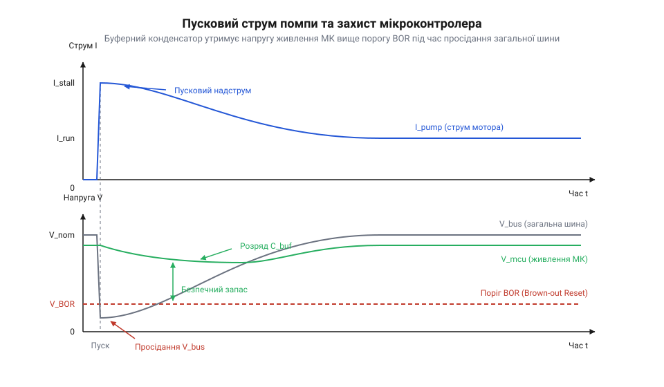
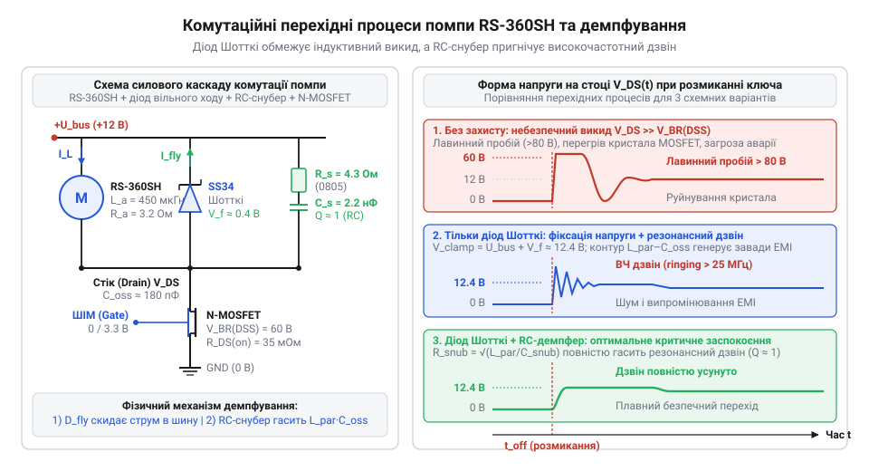

# Електромеханічна модель приводу: пусковий надструм, просідання напруги та індуктивні викиди

<preknowlist>
- [Колекторний двигун типорозміру 130](root:cat-hw-actuators/dc-motor-130) — Фізична будова колекторно-щіткового вузла двигуна постійного струму, наявність омічного опору мідних обмоток якоря та виникнення внутрішньої проти-ЕРС при обертанні ротора в магнітному полі статора.
- [Мотор-редуктор 6 В (100 і 600 об/хв)](root:cat-hw-actuators/gearmotor-6v) — Квазістаціонарна електромеханіка колекторного привода, поняття струму блокування вала та базові принципи комутації індуктивного навантаження напівпровідниковими ключами.
</preknowlist>

## Пастка пускового струму та викидів

Керування мініатюрною водяною помпою RS-360SH від джерела 12 В за допомогою мікроконтролера та силового комутаційного ключа виглядає простою інженерною задачею. За паспортом помпа під час прокачування води споживає номінальний робочий струм близько 1 А. Виходячи зі стаціонарного закону Ома, розробник обирає імпульсний блок живлення на 12 В із запасом до 2 А та польовий транзистор (@@en|MOSFET@@, від англ. @@en|metal-oxide-semiconductor field-effect transistor@@) з допустимим струмом 5 А і напругою 30 В. Проте перше ж тестове вмикання призводить до подвійної апаратної аварії.

Під час подачі логічної одиниці на затвор транзистора помпа не встигає зробити й оберту: мікроконтролер миттєво потрапляє в нескінченний цикл перезавантажень (@@en|bootloop@@, від англ. @@en|boot@@ — початкове завантаження та @@en|loop@@ — петля), а цифрова шина зв'язку зависає. Причина криється у спрацьовуванні апаратного [захисту від просідання живлення](root:sf-devices/mcu-brown-out-reset) (@@en|Brown-out Reset@@, BOR — від англ. @@en|brownout@@ — просідання напруги та @@en|reset@@ — скидання). У момент пуску ротор нерухомий, його внутрішня генерація відсутня, і струм визначається виключно малим омічним опором міді, як і в простих [колекторних двигунах постійного струму](root:cat-hw-actuators/dc-motor-130). Стрибок струму до 3.5–4 А спричиняє глибоке падіння напруги на внутрішньому опорі джерела, шина живлення просідає нижче порогу працездатності ядра, процесор скидається, закриває ключ, напруга повертається до норми — і за мить усе повторюється знову.

Якщо ж під'єднати потужне лабораторне джерело, здатне утримати напругу під час старту, аварія настає в момент вимкнення привода: транзистор миттєво пробивається та виходить із ладу. Обрив струму котушок із власною індуктивністю породжує високовольтний викид напруги самоіндукції амплітудою в десятки чи сотні вольт, що перевищує напругу пробою ключа. Статичний закон Ома не здатний передбачити ці збої, оскільки повністю ігнорує електромеханічні перехідні процеси привода.

## Диференціальне рівняння балансу напруг якоря

Щоб розрахувати амплітуду пускового струму та напругу викидів, двигун помпи RS-360SH розглядають не як звичайний резистор, а як динамічну електромеханічну систему. Еквівалентна схема якірного кола складається з трьох послідовно з'єднаних елементів: активного опору мідного дроту обмоток `R` (від лат. @@la|resisto@@ — чинити опір), індуктивності котушок ротора `L` (від лат. @@la|inductio@@ — наведення) та керованого джерела внутрішньої проти-ЕРС (електрорушійної сили; @@en|back-EMF@@, від англ. @@en|back electromotive force@@) `e`, яка виникає під час обертання провідників у магнітному полі статора. Величина проти-ЕРС прямо пропорційна кутовій швидкості обертання вала `ω` через електричний коефіцієнт двигуна `K_e`: `e = K_e · ω`.

За другим законом Кірхгофа прикладена напруга живлення `U` врівноважується сумою спаду напруги на активному опорі, спаду напруги на індуктивності та проти-ЕРС обертання ротора:

```
U
= U_R + U_L + e                 [другий закон Кірхгофа]
= I · R + L · (dI/dt) + K_e · ω  [підстановка компонентів кола якоря]
```

У цьому рівнянні `I` позначає струм якірного контуру, `dI/dt` — швидкість зміни струму в часі, а доданок `K_e · ω` пов'язує електричний стан кола з механічним рухом. Одночасно струм якоря створює електромагнітний рушійний момент `M_em = K_t · I`, де `K_t` — коефіцієнт крутного моменту. Рівняння динаміки обертання визначає кутове прискорення ротора з моментом інерції `J` під дією різниці рушійного моменту та моменту навантаження помпи:

```
J · (dω/dt)
= M_em - M_нав(ω)               [рівняння динаміки обертання]
= K_t · I - M_нав(ω)            [підстановка електромагнітного моменту]
```

На відміну від систем із сухим тертям редуктора, якими відрізняються промислові [мотор-редуктори 6 В](root:cat-hw-actuators/gearmotor-6v), у водяній помпі опір середовища має виражену гідродинамічну природу. Момент навантаження крильчатки `M_нав(ω)` зростає пропорційно квадрату швидкості: `M_нав(ω) = M_0 + k_h · ω²`, де `M_0` — момент тертя ущільнювачів, а `k_h` — коефіцієнт гідродинамічного демпфування рідини.

Швидкість перебігу процесів в електричній і механічній частинах кардинально відрізняється. Електрична стала часу якірного контуру `τ_e = L / R` для помпи RS-360SH з індуктивністю `L ≈ 1.2 мГн` та опором `R ≈ 3.2 Ом` становить:

```
τ_e
= L / R                         [електрична стала часу]
= 1.2 · 10⁻³ Гн / 3.2 Ом        [підстановка параметрів якоря RS-360SH]
= 0.375 · 10⁻³ с                [обчислення]
= 0.375 мс                      [значення електричної сталої]
```

Механічна стала часу розгону ротора з крильчаткою у воді `τ_m = (J · R) / (K_t · K_e)` становить 50–120 мс. Оскільки `τ_m` перевищує `τ_e` більш ніж у сто разів, перехідний процес природно розпадається на дві окремі часові фази: надшвидке наростання струму в майже нерухомому роторі та подальший плавний механічний розгін помпи.

## Пусковий надструм та розгін ротора

У перший момент після вмикання ключа ротор помпи залишається нерухомим через механічну інерцію (`ω = 0`). За нульової швидкості проти-ЕРС дорівнює нулю (`K_e · ω = 0`), тому рівняння балансу напруг зводиться до перехідного процесу в простому RL-колі. Струм наростає за експоненційним законом від нуля до стаціонарного значення заблокованого ротора:

```
I(t)
= (U / R) · (1 - e^(-t / τ_e))    [розв'язок рівняння якоря при ω = 0]
```

За час `t ≈ 3 · τ_e` (близько 1.1 мс) струм досягає свого пікового пускового максимуму (@@en|stall current@@, від англ. @@en|stall@@ — зупинка, зрив).

**Розрахунок амплітуди пускового струму заблокованого ротора RS-360SH від джерела 12 В:**

```
I_stall
= U / R                         [закон Ома для нерухомого якоря]
= 12 В / 3.2 Ом                 [параметри двигуна помпи]
= 3.75 А                        [піковий пусковий струм]
```

Амплітуда 3.75 А майже вчетверо перевищує усталене споживання помпи під навантаженням. Одночасно максимальний струм створює максимальний початковий обертальний момент `M_start = K_t · I_stall`, під дією якого вал починає прискорюватися. Оскільки електричні процеси перебігають значно швидше за механічні (`τ_e ≪ τ_m`), струм у кожний момент механічного розгону квазістаціонарно слідує за зміною швидкості: `I(t) ≈ (U - K_e · ω(t)) / R`.

Підставляючи вираз струму в рівняння руху, отримуємо динаміку набору обертів крильчатки:

```
J · (dω/dt)
= (K_t / R) · (U - K_e · ω) - M_нав(ω)  [динамічне рівняння розгону]
```

На початковому етапі розгону швидкість `ω` мала, тому проти-ЕРС незначна, а гідродинамічний опір води `k_h · ω²` ще не чинить відчутної протидії. Ротор швидко набирає оберти, в обмотках зростає проти-ЕРС `K_e · ω`, що знижує різницю потенціалів на активному опорі та зменшує струм `I(t)`. Проте в міру розгону опір води стрімко зростає через квадратичну залежність; специфіку руху рідини в робочій камері описує [гідродинаміка дозувальних помп](root:cat-hw-actuators/water-pump-rs360sh/math-pump-hydraulics-and-dosing.md). Цей опір гальмує набір швидкості, розтягуючи час виходу привода на усталений режим `t_start` до 80–120 мс замість 15–20 мс на холостому ході.

Коли рушійний момент двигуна зрівнюється з моментом опору рідини, прискорення падає до нуля (`dω/dt = 0`), а швидкість фіксується на номінальній позначці `ω_nom`. За робочої швидкості проти-ЕРС компенсує близько 8.8 В із 12 В живлення, і споживаний струм спадає до усталеного рівня:

```
I_nom
= (U - K_e · ω_nom) / R         [усталений струм навантаження]
= (12 В - 8.8 В) / 3.2 Ом       [підстановка робочої проти-ЕРС]
= 3.2 В / 3.2 Ом                [падіння напруги на омічному опорі]
= 1.0 А                         [номінальний струм прокачування]
```

Отже, пусковий процес створює струмовий імпульс амплітудою 3.75 А, який триває не мілісекунду, а близько 100 мс до завершення гідродинамічного розгону ротора. Саме ця тривалість струмового перевантаження визначає глибину просідання шини живлення.

## Просідання живлення та захист від BOR

Спільне живлення чутливої мікроконтролерної логіки та силового привода помпи від одного джерела стикається з омічним опором з'єднувальних провідників і внутрішнім імпедансом самого джерела. Коли комутаційний транзистор вмикає помпу, пусковий струм заблокованого ротора сягає пікової амплітуди `I_stall = 3.75 А`. Цей струм протікає крізь внутрішній опір джерела живлення `R_src` та активний опір монтажних дротів `R_wire`. На сумарному внутрішньому опорі лінії `R_int = R_src + R_wire` виникає стрибкоподібне падіння напруги:

```
ΔU_bus
= I_stall · R_int                [омічний спад напруги на імпедансі лінії]
= 3.75 А · 0.8 Ом                [параметри лінії та пусковий надструм]
= 3.0 В                          [амплітуда просідання напруги шини]
```

Отримане падіння напруги означає, що за номінальних 12 В напруга на спільній шині живлення під час пуску мотора просідає до 9.0 В. Якщо мікроконтролер живиться від цієї ж лінії через лінійний стабілізатор або імпульсний перетворювач, падіння вхідної напруги нижче мінімального робочого порогу стабілізатора передається на шину живлення обчислювального ядра `V_cc`.

Коли напруга живлення логіки опускається нижче апаратного порогу Brown-out Reset (BOR) `V_BOR`, внутрішній супервізор скидає процесор. Мікроконтролер вимикає комутаційний ключ, струм помпи падає до нуля, і напруга шини повертається до норми. Процесор знову завантажується, відкриває транзистор — і потрапляє в нескінченне циклічне перезавантаження.

Щоб розірвати це замкнене коло, лінію живлення мікроконтролера відокремлюють від моторної шини за допомогою розв'язувального діода `D_iso` та накопичувального буферного конденсатора `C_buf`. Коли напруга на загальній шині живлення просідає через пусковий надструм, діод зміщується у зворотному напрямку та фізично відсікає конденсатор від силової магістралі. Протягом усього часу розгону помпи `t_start` мікроконтролер зі струмом споживання `I_mcu` живиться виключно електричним зарядом, накопиченим у буферному конденсаторі.

Напруга на буферному конденсаторі під час живлення навантаження постійним струмом зменшується лінійно. Для стабільної роботи напруга на конденсаторі не повинна впасти нижче мінімально допустимого рівня `V_min`, який визначається порогом спрацьовування захисту `V_BOR` і запасом стійкості від завад `V_margin`:

```
C_buf
≥ (I_mcu · t_start) / ΔV_allow   [визначення мінімальної ємності накопичувача]
= (I_mcu · t_start) / (V_in - V_f - V_min)  [урахування спаду діода та порогу]
```

У цьому співвідношенні `V_in` позначає початкову напругу лінії до моменту просідання, `V_f` — спад напруги на відкритому розв'язувальному діоді, а `ΔV_allow` — допустиме вікно розряду конденсатора.

**Розрахунок ємності буферного конденсатора на шині 12 В перед стабілізатором:**
Для мікроконтролерної плати зі стабілізатором напруги, яка споживає сумарний струм `I_mcu = 30 мА`, за тривалості розгону помпи `t_start = 100 мс`, прямому падінні напруги на діоді Шотткі `V_f = 0.3 В` та мінімальній працездатній напрузі на вході стабілізатора `V_min = 6.5 В` мінімальна необхідна ємність становить:

```
C_buf
≥ (0.03 А · 0.1 с) / (12 В - 0.3 В - 6.5 В)  [підстановка параметрів системи]
= 0.003 Кл / 5.2 В              [розрахунок заряду та вікна розряду]
≈ 5.77 · 10⁻⁴ Ф                 [мінімальна теоретична ємність]
≈ 580 мкФ                       [найближчий стандартний номінал]
```

Встановлення конденсатора ємністю 680–1000 мкФ на вході стабілізатора гарантує автономне живлення логіки під час пуску мотора. Істотно зменшити розрахункову ємність дозволяє програмний [плавний ШІМ-пуск помпи](root:cat-hw-actuators/water-pump-rs360sh/api-pump-controller-driver.md), який розбиває струмовий сплеск на серію коротких імпульсів.


*Пусковий стрибок струму викликає омічне просідання спільної лінії живлення нижче порогу аварійного скидання ядра, а діодна розв'язка з буферним конденсатором утримує живлення мікроконтролера в зоні безпечного запасу.*

## Енергія індуктивного викиду та розмикання

Під час вимикання помпи комутаційний ключ обриває струм якірного кола. За законом комутації струм в індуктивності не може змінитися стрибком, оскільки це вимагало б нескінченної напруги джерела.

Стрімкий спад струму з похідною `dI/dt < 0` породжує на індуктивності обмоток ротора `L` електрорушійну силу самоіндукції (@@en|inductive kickback@@, від англ. @@en|inductive@@ — індуктивний та @@en|kickback@@ — зворотний удар):

```
V_L
= -L · (dI/dt)                  [закон електромагнітної індукції Фарадея]
```

Оскільки швидкість зміни струму від'ємна, знак мінус у законі Фарадея робить полярність наведеної ЕРС прямо протилежною до полярності під час стаціонарної роботи. Котушка намагається підтримати спадний струм і спрямовує його в ту саму точку, перетворюючись на послідовне джерело енергії. На нижньому контакті помпи, під'єднаному до стоку закриваного транзистора, виникає позитивний сплеск потенціалу. Сумарна напруга сток-витік `V_DS` закритого ключа складається з напруги джерела живлення `U_bus` та наведеної ЕРС самоіндукції:

```
V_DS
= U_bus + |V_L|                 [баланс напруг на розімкненому стоці ключа]
= U_bus + L · (|ΔI| / t_off)    [лінійне наближення спаду струму закриття]
```

У виразі `|ΔI|` позначає величину розриваного струму, а `t_off` — тривалість закриття транзистора.

**Розрахунок теоретичної амплітуди індуктивного сплеску без демпфування:**
Для номінального струму прокачування `I_load = 1.0 А`, індуктивності обмоток помпи RS-360SH `L = 1.2 мГн` та типового часу вимикання силового польового транзистора `t_off = 100 нс` (10⁻⁷ с) похідна струму становить:

```
|dI/dt|
= 1.0 А / 10⁻⁷ с                [швидкість обриву якірного струму]
= 10⁷ А/с                       [похідна струму розмикання]
```

Звідси амплітуда перенапруги сягає колосального значення:

```
|V_L|
= 1.2 · 10⁻³ Гн · 10⁷ А/с       [підстановка параметрів індуктивності]
= 12 000 В                      [теоретичний пік нездемпованого сплеску]
```

У реальній схемі напруга не досягає дванадцяти кіловольт, оскільки швидкість зростання обмежується паразитною ємністю друкованого монтажу та настанням пробою напівпровідникової структури транзистора. Щойно напруга `V_DS` перевищує паспортну напругу пробою сток-витік `V_(BR)DSS`, ключ переходить у режим керованого зворотного пробою (@@en|avalanche breakdown@@, від англ. @@en|avalanche@@ — лавина та @@en|breakdown@@ — пробій). Транзистор примусово відкривається та розсіює накопичену в магнітному полі котушок енергію `E_L` у вигляді тепла всередині власного кремнієвого кристала:

```
E_L
= 0.5 · L · I_load²             [магнітна енергія котушки зі струмом]
= 0.5 · 1.2 · 10⁻³ Гн · (1.0 А)² [параметри помпи RS-360SH]
= 6.0 · 10⁻⁴ Дж                 [обчислення запасу енергії]
= 0.6 мДж                       [енергія одиничного комутаційного викиду]
```

Якщо транзистор працює в режимі високочастотної широтно-імпульсної модуляції з частотою комутації `f_pwm = 20 кГц`, середня теплова потужність лавинних втрат досягає значної величини:

```
P_av
= E_L · f_pwm                   [середня потужність лавинного нагріву]
= 0.6 · 10⁻³ Дж · 20 000 с⁻¹    [множення енергії на частоту перемикань]
= 12 Вт                         [потужність теплових втрат на кристалі]
```

Виділення 12 Вт тепла на крихітному кристалі призводить до миттєвого теплового пробою напівпровідника. Захистити комутатор дозволяє обмеження перенапруги ще до того, як транзистор увійде в [лавинний пробій польових транзисторів](root:ph-condensed/mosfet-avalanche-breakdown).

## Розрахунок демпферного діода та снубера

Для захисту комутаційного ключа енергію магнітного поля котушок відводять у безпечний розрядний контур. Класичним рішенням є антипаралельне підключення діода вільного ходу (@@en|freewheeling diode@@, від англ. @@en|freewheel@@ — вільний хід). Діод приєднують безпосередньо до клем помпи: анодом до стоку комутаційного транзистора, а катодом — до позитивної шини живлення `+U_bus`.

Коли транзистор відкритий, на катоді діода діє напруга живлення, а на аноді — нульовий потенціал землі, тому діод надійно закритий. Щойно транзистор вимикається, наведена в обмотках ЕРС самоіндукції миттєво зміщує діод у прямому напрямку. Якірний струм підхоплюється діодом і замикається в контурі «обмотка двигуна — діод вільного ходу», плавно спадаючи за експонентою до нуля. Напруга на стоці транзистора при цьому обмежується рівнем:

```
V_DS(max)
= U_bus + V_f                   [фіксація напруги демпферним діодом]
```

де `V_f` позначає прямий спад напруги на відкритому діоді.

Інженерний вибір діода вільного ходу базується на трьох обов'язкових параметрах:
1. Максимальна повторювана зворотна напруга `V_RRM ≥ 1.5 · U_bus` (для 12-вольтової шини обирають діод з запасом не менше 30–40 В).
2. Піковий імпульсний прямий струм `I_FSM ≥ I_stall = 3.75 А`, оскільки аварійне вимкнення ключа може відбутися безпосередньо під час блокування ротора.
3. Час зворотного відновлення (@@en|reverse recovery time@@, `t_rr`): кремнієві випрямні діоди серії 1N400x мають `t_rr ≈ 2–5 мкс`. Якщо транзистор знову відкриється до того, як діод встигне закритися, виникає наскрізний струм короткого замикання шини живлення на землю. Тому для комутації застосовують виключно бар'єрні діоди Шотткі (наприклад, SS34), у яких неосновні носії відсутні, а час відновлення прямує до одиниць наносекунд. Подібне демпфування застосовують для будь-яких котушкових приводів, від мініатюрних [N20 мікромоторів з редуктором](root:cat-hw-actuators/n20-motor) до потужних насосів.

Попри фіксацію постійної напруги діодом, паразитна індуктивність монтажних доріжок `L_par` разом із вихідною ємністю закритого транзистора `C_oss` утворюють паразитний коливальний контур. Швидке замикання діода породжує високочастотний резонансний дзвін (@@en|ringing@@, від англ. @@en|ring@@ — дзвеніти) та різкий сплеск `dV/dt`, що викликає радіозавади. Для придушення коливань паралельно ключу або обмоткам мотора встановлюють демпфувальний ланцюжок (@@en|snubber@@, від англ. @@en|snub@@ — різко спиняти, осадити), що складається з послідовно з'єднаних резистора `R_snub` та конденсатора `C_snub`.

Ємність конденсатора снубера обирають у 2–4 рази більшою за паразитну ємність вузла стоку (`C_snub ≈ 1–4.7 нФ`). Для усунення коливального процесу контур налаштовують на режим критичного заспокоєння, коли добротність контуру прямує до одиниці:

```
R_snub
≈ √(L_par / C_snub)             [умова критичного заспокоєння контуру]
```

Для типової паразитної індуктивності друкованих провідників `L_par ≈ 40 нГн` та ємності `C_snub = 2.2 нФ` необхідний опір демпфувального резистора становить:

```
R_snub
≈ √(40 · 10⁻⁹ Гн / 2.2 · 10⁻⁹ Ф) [розрахунок характеристичного опору]
≈ √18.18 Ом²                    [обчислення під коренем]
≈ 4.3 Ом                        [номінал резистора снубера]
```

Потужність втрат, що розсіюється на резисторі снубера за частоти ШІМ `f_pwm = 20 кГц`, визначається енергією циклічного заряду конденсатора:

```
P_snub
= C_snub · U_bus² · f_pwm       [потужність розсіювання на резисторі снубера]
= 2.2 · 10⁻⁹ Ф · (12 В)² · 20 000 с⁻¹  [підстановка параметрів режиму]
≈ 6.3 · 10⁻³ Вт                 [розрахунок потужності]
≈ 6.3 мВт                       [підсумкова потужність втрат]
```

Виділення 6.3 мВт надійно розсіюється звичайним резистором типорозміру 0805. Схемотехнічне поєднання силового ключа, діода Шотткі та RC-демпфера детально демонструє [драйвер нижнього ключа помпи](root:cat-hw-drivers/proj-low-side-pump-controller).


*Схема підключення комутаційного каскаду та часові графіки напруги на стоці: діод Шотткі усуває небезпечну перенапругу індуктивного викиду, а паралельний RC-демпфер повністю гасить високочастотний резонансний дзвін.*
