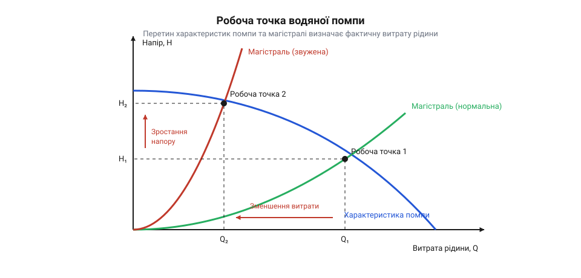

# Гідравлічна модель водяної помпи: витрата, тиск та розрахунок дозування об'єму

<preknowlist>
- [Колекторний двигун типорозміру 130](root:cat-hw-actuators/dc-motor-130) — Принцип роботи мініатюрного колекторного двигуна постійного струму: залежність частоти обертання ротора від прикладеної напруги, спадання обертів під навантаженням та зростання споживаного струму під час збільшення механічного моменту на валу.
</preknowlist>

## Пастка наївного розрахунку часу дозування

Коли розробник автоматичного дозатора, системи поливу або лабораторного змішувача вперше підключає мініатюрну помпу (нім. @@de|Pumpe@@) RS-360SH, виникає спокуса порахувати час роботи за найпростішою арифметичною пропорцією. У паспорті пристрою зазначено номінальну продуктивність — об'ємну витрату (@@en|flow rate@@) `Q_ном = 1.2 л/хв` (тобто `20 мл/с`). Здається очевидним: щоби налити в мензурку порцію об'ємом `V_дози = 50 мл`, достатньо ввімкнути живлення на час `t`:

```
t
= V_дози / Q_ном
= 50 / 20
= 2.5 с
```

Проте на практиці цей наївний розрахунок зазнає цілковитого краху. Замість очікуваних 50 мл у ємності виявляється лише 30–35 мл — систематичний недолив сягає 30–40%. Якщо ж вихідний резервуар розмістити на полиці вище за рівень сопла дозатора, помпа навпаки переливає рідину, а після вимкнення мотора потік не зупиняється через спонтанний сифонний ефект (грец. @@el|siphon@@ — трубка). Ще драматичніша ситуація виникає під час дозування мікропорцій по 5 мл: помилка об'єму може перевищувати 50% через крапання залишків або затримку набору швидкості двигуном.

Причина таких розбіжностей полягає в тому, що паспортна витрата вимірюється виробником у тепличних умовах так званого вільного виливу — без підключених трубок, звужень сопла та геодезичного підйому висоти. Насправді помпа не видає фіксовану витрату, а створює гідравлічний тиск (лат. @@la|pressura@@ — тиснення), який проштовхує рідину крізь зовнішню магістраль. Фактичний потік нелінійно визначається трьома фізичними чинниками: внутрішнім зворотним перетіканням через зазори робочої камери під навантаженням, гідродинамічним опором трубок і фітингів, а також електромеханічною інерцією розгону та зупинки вала.

> 🔧 **Навіщо це.**
> Паспортна продуктивність `Q_ном` — це абстрактний максимум на вільному виливі, а не стала константа для таймера дозатора. Спроба керувати помпою за наївною формулою `V = Q · t` робить точне відмірювання рідини неможливим без повноцінного гідравлічного розрахунку робочої точки контуру.

## Витрата помпи та об'ємний ККД

Усередині робочої камери помпи обертові елементи під час кожного повного оберту вала витісняють фіксовану порцію рідини — робочий об'єм витіснення камери `q_об` (в см³/об або мл/об). Вал помпи приводить у рух колекторний електродвигун постійного струму, подібний за внутрішньою будовою до [колекторного двигуна типорозміру 130](root:cat-hw-actuators/dc-motor-130). Частота обертання вала `n` (об/с) пропорційна прикладеній напрузі живлення `U`. За відсутності будь-якого гідравлічного опору теоретична подача помпи визначається простим добутком:

```
Q_теор
= q_об · n                          [об'єм витіснення за одиницю часу]
```

Однак рідина зазнає протидії під час руху крізь випускний канал. Помпа змушена створювати перепад тиску нагнітання `Δp` між вихідним і вхідним штуцерами, щоби проштовхнути потік. Між рухомими робочими органами помпи та нерухомими стінками корпусу неминуче існують мікроскопічні технологічні зазори. Під дією створюваного високого тиску на виході частина рідини вичавлюється назад у зону всмоктування. Це зворотне витікання `Q_вит` зростає пропорційно перепаду тиску:

```
Q_вит
= k_вит · Δp                        [ламінарний зворотний витік крізь зазори]
```

де `k_вит` — коефіцієнт (лат. @@la|coefficiens@@ — спільний чинник) гідравлічної провідності внутрішніх щілин помпи. Реальна витрата рідини на виході помпи `Q` завжди менша за теоретичну на величину зворотного витоку:

```
Q
= Q_теор - Q_вит                   [баланс об'ємних потоків у камері]
= Q_теор - k_вит · Δp              [підстановка моделі витоків]
```

Міру гідродинамічної досконалості робочої камери кількісно описує об'ємний коефіцієнт корисної дії `η_v`:

```
η_v
= Q / Q_теор
= 1 - (Q_вит / Q_теор)             [частка корисної подачі від теоретичної]
```

Якщо штуцер повністю відкритий на вільний вилив (`Δp ≈ 0`), зворотні витоки прямують до нуля, а об'ємний ККД сягає свого максимуму (`η_v ≈ 0.85–0.90`). Але якщо перекривати вихідний вентиль, тиск `Δp` невпинно зростає. Витоки `Q_вит` збільшуються настільки, що зрівнюються з теоретичною подачею `Q_теор`. У цій точці настає повне гідравлічне блокування: `Q = 0`, а `η_v = 0`. Оскільки гідростатичний напір стовпа рідини `H` пов'язаний із тиском через густину води `ρ` (1000 кг/м³) та прискорення вільного падіння `g` (`H = Δp / (ρ · g)`), власна характеристика помпи `H(Q)` є спадною лінією від максимального напору блокування `H_max` до максимальної витрати вільного виливу `Q_max`:

```
H(Q)
= H_max · (1 - Q / Q_max)          [лінійна напірно-витратна характеристика помпи]
```

> 🔧 **Навіщо це.**
> Зі зростанням вихідного тиску реальна продуктивність помпи неминуче деградує через щілинні витоки. Щоби знати витрату, не можна розглядати помпу окремо від трубок: необхідно знайти тиск, який створить підключена гідравлічна мережа.

## Гідравлічний опір магістралі та робоча точка

Коли до штуцера помпи приєднують трубопровід, рухома рідина зазнає опору в'язкого тертя об внутрішні стінки трубки та витрачає енергію на подолання сили тяжіння під час підйому. Згідно з [рівнянням Бернуллі](root:ph-mechanics/hydraulic-bernoulli-equation), загальний гідравлічний напір магістралі `H_маг`, який помпа повинна розвинути для прокачування рідини, складається зі статичної висоти підйому `Δz` та динамічних втрат напору на тертя `h_тр`:

```
H_маг
= Δz + h_тр                         [гідравлічний баланс напору магістралі]
```

Втрати напору на тертя вздовж прямої круглої трубки описуються [формулою Дарсі–Вейсбаха](root:ph-mechanics/darcy-weisbach-equation) (франц. @@fr|Darcy@@, нім. @@de|Weisbach@@):

```
h_тр
= λ · (L / d) · (v² / (2 · g))      [формула Дарсі-Вейсбаха для втрат на тертя]
```

де `L` — довжина трубки, `d` — її внутрішній гідравлічний діаметр, `g = 9.81 м/с²` — прискорення вільного падіння, `λ` — безрозмірний коефіцієнт гідравлічного тертя, а `v` — середня лінійна швидкість потоку. Виразимо швидкість потоку `v` через об'ємну витрату `Q` та площу поперечного перерізу трубки `A = π · d² / 4`:

```
v
= Q / A
= 4 · Q / (π · d²)                  [швидкість потоку через об'ємну витрату]
```

Підставивши вираз для швидкості у формулу Дарсі–Вейсбаха, отримуємо квадратичну залежність втрат напору від витрати:

```
h_тр
= λ · (L / d) · [ (4 · Q / (π · d²))² / (2 · g) ]
= [ 8 · λ · L / (π² · g · d⁵) ] · Q²
= R_гідр · Q²                       [квадратичний опір гідравлічного тракту]
```

де `R_гідр = 8 · λ · L / (π² · g · d⁵)` — еквівалентний опір магістралі. Зверніть увагу на знаменник: опір обернено пропорційний п'ятому степеню діаметра трубки `d⁵`! Якщо замінити трубку з внутрішнім діаметром 6 мм на тонку трубку діаметром 4 мм (`6 / 4 = 1.5`), гідравлічний опір тертю зросте в `1.5⁵ ≈ 7.6` раза. Навіть незначне звуження шланга створює колосальний гідравлічний запір.

Фактичний усталений режим роботи системи визначається єдиною точкою рівноваги — робочою точкою (@@en|operating point@@). У цій точці створюваний помпою напір точно дорівнює напору опору магістралі: `H(Q_роб) = H_маг(Q_роб)`.


*Графік перетину спадної напірної характеристики помпи H(Q) та квадратичної кривої опору трубопроводу: робоча точка визначає фактичну витрату Q_роб, яка різко зміщується ліворуч при звуженні трубки через зростання опору в степені d⁵.*

Алгебрично робоча точка знаходиться розв'язанням квадратного рівняння:

```
H_max · (1 - Q_роб / Q_max)
= Δz + R_гідр · Q_роб²              [рівняння рівноваги напору помпи й магістралі]
```

Звідси знаходиться точна усталена робоча витрата `Q_роб`, яка завжди помітно менша за паспортну величину `Q_max`.

> 🔧 **Навіщо це.**
> Розрахунок робочої точки показує розробнику, що звуження або подовження шланга драматично душить продуктивність помпи через закон `d⁵`. Для стабільного дозування завжди слід обирати трубки максимально допустимого діаметра (внутрішній діаметр не менше 5–6 мм для штуцерів помпи RS-360SH).

## Розрахунок часу дозування та регулювання ШІМ

Знайшовши усталену витрату `Q_роб` у підключеному гідравлічному контурі, можна розрахувати час подачі живлення на помпу для відмірювання заданого об'єму рідини `V_дози`. Для тривалих доз, коли часом перехідних процесів можна знехтувати, базове рівняння дозування має вигляд:

```
t_дози
= V_дози / Q_роб                    [розрахунок тривалості імпульсу за усталеною витратою]
```

**Приклад розрахунку:** Потрібно дозувати порцію `V_дози = 50 мл`. Розрахунок гідравлічного контуру з урахуванням трубки довжиною 1 м і підйому на 0.5 м дав робочу витрату `Q_роб = 15 мл/с` (замість паспортних 20 мл/с на вільному виливі). Необхідний час увімкнення помпи:

```
t_дози
= 50 / 15
≈ 3.33 с                            [номінальний час роботи за робочої витрати]
```

Якщо ж потрібно відмірювати малі дози або зменшити швидкість витікання струменя для запобігання піноутворенню й розбризкуванню, продуктивність помпи регулюють за допомогою широтно-імпульсної модуляції (@@en|Pulse-Width Modulation@@, ШІМ) напруги живлення двигуна через силовий транзисторний ключ (наприклад, [нижній ключ на польовому транзисторі MOSFET](root:cat-hw-drivers/low-side-mosfet-switch)).

Шпаруватість (@@en|duty cycle@@) ШІМ `D` (де `0 ≤ D ≤ 1` або `0–100%`) задає середню еквівалентну напругу на обмотках двигуна: `U_екв = D · U_жив`. Оскільки частота обертання ротора `n` прямо пропорційна прикладеній напрузі, максимальна витрата помпи масштабується пропорційно коефіцієнту заповнення: `Q_max(D) ≈ D · Q_max`. Робоча витрата `Q_роб(D)` відповідно зменшується, що дозволяє сповільнити потік у кілька разів.

Проте інженер стикається з фізичною межею — зоною нечутливості за шпаруватістю `D_min`. Щоби ротор двигуна зрушив з місця, створюваний електромагнітний момент повинен подолати статичне тертя спокою у підшипниках і гумових сальниках помпи, а також статичний гідростатичний підпір стовпа рідини `Δz`. Пусковий струм і пусковий момент двигуна пропорційні прикладеній напрузі. Якщо шпаруватість опускається нижче порогу `D_min` (для помпи RS-360SH це типово `25–35%`), електродвигун не обертається: він тихо гуде, якір заблокований, струм нагріває обмотки, а рідина взагалі не тече.

> 🔧 **Навіщо це.**
> Для надійного регулювання подачі робочий діапазон ШІМ обмежують знизу порогом `D_min`. Щоби гарантувати впевнений старт помпи на низькій шпаруваності, застосовують алгоритм короткочасного початкового імпульсу: перші 50–100 мс подають `D = 100%` для подолання тертя спокою, після чого скидають шпаруватість до заданого робочого значення.

## Компенсація інерції розгону й вибігу привода

Формула `t_дози = V_дози / Q_роб` спирається на абстрактне припущення, що потік рідини миттєво вмикається на повну швидкість і миттєво обривається до нуля. У реальності ротор двигуна має власний механічний момент інерції (лат. @@la|inertia@@ — бездіяльність, непорушність), а стовп рідини в трубках має гідравлічну масу.

Під час подачі напруги відбувається фаза розгону. Витрата зростає від нуля до усталеного значення `Q_роб` за експоненційним законом із постійною часу розгону `τ_пуск` (типово 80–150 мс): `Q(t) = Q_роб · (1 - e^(-t / τ_пуск))`. Через затримку набору швидкості виникає дефіцит об'єму дози на старті `ΔV_пуск`, який чисельно дорівнює площі дефіциту під графіком: Детальний розрахунок цих затримок і вибір захисних компонентів наведено в матеріалі про [електромеханічні перехідні процеси колекторної помпи](root:cat-hw-actuators/water-pump-rs360sh/math-dc-pump-electromechanics-and-transients.md).

```
ΔV_пуск
= ∫₀^∞ [Q_роб - Q(t)] dt
= Q_роб · τ_пуск                    [об'ємний дефіцит на етапі розгону приводу]
```

Після вимкнення живлення виникає протилежний процес — механічний вибіг приводу. Зняття напруги не зупиняє мотор миттєво: запасена в обертанні ротора та русі води кінетична енергія підтримує обертання вала. Витрата спадає з постійною часу гальмування `τ_зуп` за законом `Q(t) = Q_роб · e^(-t / τ_зуп)`. На цьому етапі в резервуар надходить додатковий паразитарний об'єм вибігу `ΔV_вибіг`:

```
ΔV_вибіг
= ∫₀^∞ Q(t) dt
= Q_роб · τ_зуп                     [надлишковий об'єм на етапі вибігу приводу]
```

Сумарна динамічна похибка відміряного об'єму `ΔV` дорівнює різниці між надлишком вибігу та дефіцитом пуску:

```
ΔV
= ΔV_вибіг - ΔV_пуск
= Q_роб · (τ_зуп - τ_пуск)          [сумарна динамічна похибка об'єму]
```

У простих схемах керування з вільним вибігом двигун зупиняється виключно за рахунок сил тертя, тому час зупинки довший за час пуску під повною напругою (`τ_зуп > τ_пуск`). У результаті помпа систематично переливає рідину (`ΔV > 0`). Якщо ж використовується схема активного динамічного гальмування (@@en|dynamic braking@@) із замиканням клем двигуна накоротко силовим транзистором, ротор гальмується проти-ЕРС значно швидше за розгін (`τ_зуп < τ_пуск`), і тоді виникає систематичний недолив (`ΔV < 0`). Докладніше про фізичний механізм швидкої зупинки ротора й розсіювання енергії читайте у статті про [динамічне електромеханічне гальмування колекторних двигунів](root:cat-hw-actuators/dc-motor-dynamic-braking).

Для ідеального дозування застосовують математичну предиктивну компенсацію (лат. @@la|compensatio@@ — врівноваження). Фактично вилитий об'єм за час керувального імпульсу `t_імп` становить `V_факт = Q_роб · t_імп + ΔV`. Прирівнявши `V_факт = V_дози`, знаходимо точну скориговану тривалість імпульсу:

```
t_кориг
= (V_дози - ΔV) / Q_роб
= (V_дози / Q_роб) - (τ_зуп - τ_пуск)
= t_дози - Δt_поправка              [скоригована тривалість керувального імпульсу]
```

де `Δt_поправка = τ_зуп - τ_пуск` — стала часова поправка приводу, яка залежить лише від динаміки електромеханіки і не залежить від розміру порції. Якщо для помпи RS-360SH експериментально визначено `τ_зуп = 180 мс`, а `τ_пуск = 110 мс`, часова поправка становить `Δt_поправка = 180 - 110 = 70 мс`. Від номінально розрахованого часу кожного ввімкнення мікроконтролер має віднімати рівно 70 мс.

> 🔧 **Навіщо це.**
> Динамічна поправка `Δt_поправка` усуває систематичну похибку інерції розгону та вибігу приводу. Без цієї компенсації дозування малих порцій (до 10–20 мл) має похибку від 20% до 80%, тоді як внесення часового зсуву повертає похибку в межі часток відсотка навіть на коротких імпульсах.
