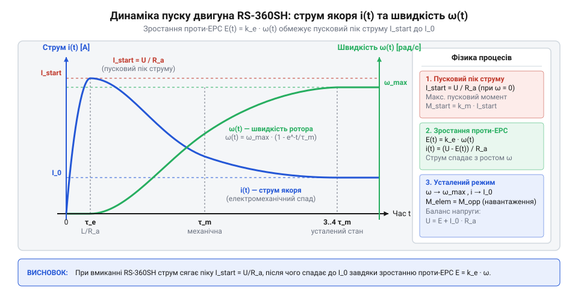
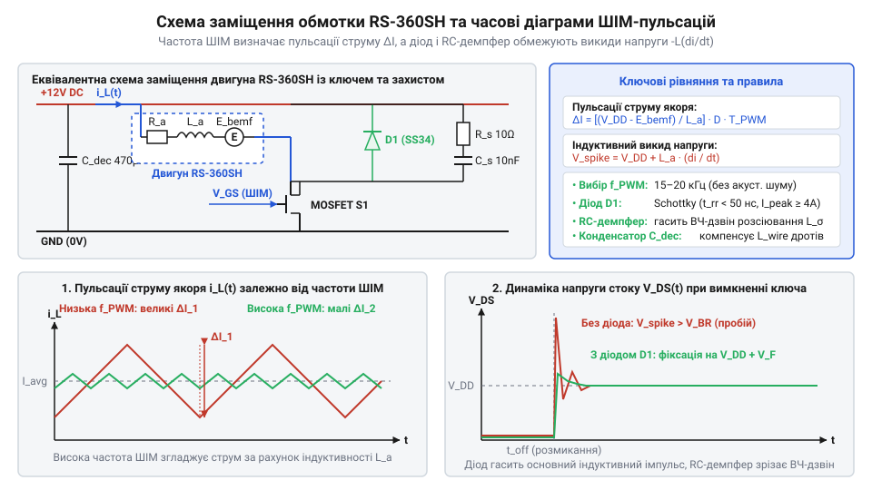

# Електромеханічні розрахунки: пускові струми, індуктивність обмоток та ШІМ-регулювання RS-360SH

<preknowlist>
- [Колекторний двигун типорозміру 130](root:cat-hw-actuators/dc-motor-130) — Принцип дії колекторного двигуна постійного струму, еквівалентну схему якоря з опором R_a та індуктивністю L_a, а також виникнення проти-ЕРС при обертанні.
</preknowlist>

## Прямий пуск та перезавантаження мікроконтролера

Пряме підключення @@la|колекторного@@ (латин. @@la|collector@@ — збирач) двигуна RS-360SH до силового ключа під управлінням мікроконтролера призводить до збоїв. При вмиканні мотора мікроконтролер перезавантажується, а при вимиканні ключовий @@en|транзистор@@ (англ. @@en|transfer resistor@@ — перехідний резистор) виходить з ладу. Як і [колекторний двигун типорозміру 130](root:cat-hw-actuators/dc-motor-130), RS-360SH створює жорсткі перехідні процеси в силовому колі.

Причина збоїв під час пуску полягає у фізиці статичного @@nl|якоря@@ (нідерл. @@nl|anker@@ — якір). Поки @@la|ротор@@ (латин. @@la|rotare@@ — обертатися) нерухомий, кутова швидкість дорівнює нулю, тож @@uk|проти-ЕРС@@ (українськ. @@uk|проти-електрорушійна сила@@) відсутня. Єдиним обмежником струму є опір обмотки `1.5 Ω`. Це викликає сплеск пускового струму до `7–8 A`, який на внутрішньому @@la|імпедансі@@ (латин. @@la|impedio@@ — перешкоджаю) джерела й дротів викликає просідання напруги. Якщо вона падає нижче порогу схеми скидання (@@en|Brown-Out Reset@@), мікроконтролер перезапускається.

При розмиканні ключа накопичена в обмотці магнітна енергія не зникає миттєво. Стрімке спадання струму на її @@la|індуктивності@@ (латин. @@la|inductio@@ — наведення) викликає високовольтний індуктивний імпульс протилежної полярності, що спричиняє лавинний пробій @@en|MOSFET@@-транзистора. Для запобігання цим явищам необхідний розрахунок перехідних процесів, застосування керованої @@uk|ШІМ@@ (українськ. @@uk|широтно-імпульсна модуляція@@). @@uk|широтно-імпульсна модуляція@@) та @@de|демпферів@@ (німецьк. @@de|Dämpfer@@ — глушник).

## Опір якоря та піковий пусковий струм

У момент пуску (`t = 0`) ротор двигуна RS-360SH нерухомий, тому напруга проти-ЕРС `e(0) = 0`. Його еквівалентна схема зводиться до послідовно з'єднаних активного опору обмотки якоря `R_a` та індуктивності `L_a`, а початковий струм обмежується лише активним опором кола.

На відміну від [N20 мікромотора з редуктором](root:cat-hw-actuators/n20-motor) з опором у десятки Ом, RS-360SH має низький опір обмотки `R_a ≈ 1.5 Ω`. Рівняння електричної рівноваги силового кола за другим законом Кірхгофа:

V_cc = i(t) · R_a + i(t) · R_wire + i(t) · R_ds_on + L_a · (di/dt) + e(t)

Індуктивність `L_a` лише затримує наростання струму на десятки мікросекунд, тому піковий пусковий струм `I_stall` виникає до початку обертання ротора:

I_stall = V_cc / (R_a + R_wire + R_ds_on)

де `V_cc` — напруга джерела живлення (В), `R_a` — опір обмотки @@nl|якоря@@ (Ом), `R_wire` — опір підвідних ліній (Ом), `R_ds_on` — опір відкритого каналу силового @@en|транзистора@@ (Ом).

Струм `I_stall` викликає падіння напруги на дротах `ΔV_line = I_stall · R_wire` та імпульсне нагрівання ключа `P_mosfet = I_stall² · R_ds_on`.

**Обчислення на прикладі**
**Умова:** Мотор RS-360SH живиться від `V_cc = 12.0 V`. Активний опір обмотки `R_a = 1.5 Ω`, опір дротів `R_wire = 0.2 Ω`, опір відкритого каналу @@en|MOSFET@@ `R_ds_on = 0.05 Ω`. Обчислити піковий струм `I_stall`, просідання напруги `ΔV_line` та втрати потужності `P_mosfet`.

I_stall = V_cc / (R_a + R_wire + R_ds_on)
        = 12.0 / (1.5 + 0.2 + 0.05)    [підстановка параметрів кола]
        = 12.0 / 1.75                  [сумування опорів]
        = 6.857 A                      [обчислення пікового струму]

ΔV_line = I_stall × R_wire
        = 6.857 × 0.2                  [підстановка струму й опору дротів]
        = 1.371 V                      [падіння напруги на лінії]

P_mosfet = I_stall² × R_ds_on
         = (6.857)² × 0.05             [підстановка струму й опору каналу]
         = 47.018 × 0.05               [піднесення струму до квадрата]
         = 2.351 W                     [пікова теплова потужність]

**Висновок:** За номінального робочого струму ~`0.6 A` пусковий струм сягає `6.86 A`. Просідання `1.37 V` на з'єднувальних лініях здатне спричинити збій цифрової логіки, а тепловий імпульс `2.35 W` вимагає вибору ключа з достатнім запасом за імпульсною потужністю.

## Електромеханічний розгін та наростання проти-ЕРС

Після подачі напруги пусковий струм створює електромагнітний момент `M_e(t) = k_m · i(t)`, що розганяє @@la|ротор@@ і крильчатку помпи. Зі зростанням кутової швидкості `ω(t)` в обмотці @@nl|якоря@@ наводиться @@uk|проти-ЕРС@@ `e(t) = k_e · ω(t)`, яка протидіє напрузі джерела й зменшує струм.

Динаміка розгону RS-360SH описується рівнянням руху механічної системи (на відміну від [крокового мотора 28BYJ-48](root:cat-hw-actuators/28byj-48-stepper) чи [мотор-редуктора на 6 В](root:cat-hw-actuators/gearmotor-6v)):

J · (dω/dt) = k_m · i(t) - M_load(ω)

де `J` — сумарний момент інерції ротора та рідини (кг·м²), `k_m` — коефіцієнт моменту (Н·м/А), `M_load(ω)` — момент опору (Н·м).

Підстановка струму `i(t) = (V_cc - k_e · ω(t)) / R_a` при малому навантаженні (`M_load ≈ 0`) визначає електромеханічну часову константу `τ_m`:

τ_m = (J · R_a) / (k_e · k_m)

де `R_a` — опір обмотки (Ом), `k_e` — коефіцієнт @@uk|проти-ЕРС@@ (В·с/рад, у системах SI `k_e = k_m`).

Кутова швидкість `ω(t)` та струм `i(t)` змінюються за експоненціальним законом:


*Графіки перехідних процесів струму якоря та кутової швидкості ротора показують експоненціальне згасання струму та розгін двигуна з часовою константою τ_m.*

ω(t) = ω_max · (1 - exp(-t / τ_m))

i(t) = I_no_load + (I_stall - I_no_load) · exp(-t / τ_m)

Інтегрування теплової потужності за час розгону `t → ∞` визначає сумарні втрати в обмотці `E_heat`:

```
E_heat = ∫₀^∞ i(t)² · R_a dt
       = I_stall² · R_a · (τ_m / 2)     [інтегрування квадрата експоненціального струму]
```

Втрати `E_heat` прямо пропорційні константі `τ_m`. Більша інерція крильчатки `J` подовжує розгін і збільшує нагрів мотора при кожному пуску.

## Частота ШІМ та пульсації обмоточного струму

Широтно-імпульсна модуляція регулює продуктивність помпи, але її ефективність визначає співвідношення між періодом комутації `T_pwm = 1 / f_pwm` та електричною часовою константою якоря `τ_e`.

Електрична константа якоря виражає швидкість зміни струму:

τ_e = L_a / R_a

де `L_a` — @@la|індуктивність@@ якоря (Гн), `R_a` — опір якоря (Ом). Для RS-360SH при `L_a ≈ 250 μH` та `R_a = 1.5 Ω` константа `τ_e = 0.00025 / 1.5 = 166.7 μs`.

При прямому ШІМ-управлінні колекторним мотором — на відміну від [безколекторного мотора з модулем](root:cat-hw-actuators/bldc-motor-module) чи [безколекторного вентилятора на 5V](root:cat-hw-actuators/fan-5v) — низька частота викликає режим переривчастого струму (англ. @@en|Discontinuous Current Mode@@, @@en|DCM@@). У ньому струм щоперіоду спадає до нуля, спричиняючи пульсації моменту й шум.

Для неперервного режиму струму (англ. @@en|Continuous Current Mode@@, @@en|CCM@@) потрібна умова `T_pwm << τ_e`. Амплітуда пульсацій `ΔI_p-p` залежить від коефіцієнта заповнення `D = t_on / T_pwm`:

ΔI_p-p = (V_cc / (L_a · f_pwm)) · D · (1 - D)

Максимум пульсацій виникає при `D = 0.5`:

ΔI_max = V_cc / (4 · f_pwm · L_a)


*Еквівалентна схема підключення RS-360SH з елементами захисту та часові діаграми пульсацій струму якоря при ШІМ-регулюванні.*

**Обчислення на прикладі**
**Умова:** Обмотка RS-360SH (`L_a = 250 μH`, `V_cc = 12.0 V`). Розрахувати максимальні пульсації струму при частотах `f_pwm1 = 1 kHz` та `f_pwm2 = 20 kHz` для `D = 0.5`.

ΔI_max_1kHz = V_cc / (4 × f_pwm1 × L_a)
            = 12.0 / (4 × 1000 × 0.00025)     [підстановка 1 кГц та L_a]
            = 12.0 / 1.0                      [знаменник]
            = 12.0 A                          [амплітуда без урахування R_a]

ΔI_max_20kHz = V_cc / (4 × f_pwm2 × L_a)
             = 12.0 / (4 × 20000 × 0.00025)   [підстановка 20 кГц]
             = 12.0 / 20.0                    [знаменник]
             = 0.6 A                          [амплітуда пульсацій]

**Висновок:** При `1 кГц` пульсації `12.0 A` спричиняють режим @@en|DCM@@ і пищання обмоток. Перехід на `20 кГц` зменшує пульсації до `0.6 A`, переводячи мотор у режим @@en|CCM@@ і роблячи роботу безшумною.

## Демпфування комутаційних викидів та розв'язка живлення

При розмиканні силового MOSFET-ключа в паузах ШІМ (`t_off`) струм обмотки якоря індуктивністю `L_a` не зупиняється миттєво. Без зворотного шляху він заряджає паразитні ємності, викликаючи перенапругу `V_spike = V_cc + L_a · (di/dt)`.

Для захисту ключа паралельно мотору підключають зворотний @@el|діод@@ (грец. @@el|δί-@@ — дво- + @@el|ὁδός@@ — шлях). Він шунтує струм обмотки (англ. @@en|freewheeling current@@) через себе. Використовують діоди Шотткі з низьким падінням напруги `V_F ≈ 0.35–0.4 V` та нульовим часом відновлення.

Паразитна індуктивність дротів `L_parasitic` та вихідна ємність транзистора `C_oss` утворюють контур, що спричиняє високочастотне дзвеніння (англ. @@en|ringing@@). Для його гасіння паралельно ключу ставлять RC-@@de|демпфер@@ з параметрами на основі хвильового опору:

```
R_snubber = √(L_parasitic / C_oss)
C_snubber = 3 · C_oss
```

де `R_snubber` і `C_snubber` — опір та ємність демпфера. Для детального математичного аналізу та оптимізації демпфуючих ланцюгів дивіться матеріал про [розрахунок та оптимізацію RC-демпферів для індуктивних навантажень](root:hw-power/rc-snubber-calculation).

Щоб захистити шину живлення від просідання напруги `ΔV_bus`, біля ключа встановлюють розв'язувальний @@la|конденсатор@@ (латин. @@la|condensare@@ — згущувати):

```
C_decoupling = (I_peak · D · (1 - D)) / (f_pwm · ΔV_bus)
```

де `I_peak` — піковий струм, `D` — скважність ШІМ, `f_pwm` — частота ШІМ.

**Обчислення на прикладі**
**Умова:** Помпа RS-360SH живиться від `V_cc = 12.0 V` при `f_pwm = 20 kHz` та `D = 0.5`. Струм `I_peak = 1.5 A`, допустиме просідання `ΔV_bus = 0.1 V`. Обчислити ємність `C_decoupling`.

```
C_decoupling = (I_peak × D × (1 - D)) / (f_pwm × ΔV_bus)
             = (1.5 × 0.5 × 0.5) / (20000 × 0.1)      [підстановка параметрів]
             = 0.375 / 2000.0                         [обчислення виразу]
             = 0.0001875 F                            [ємність у Фарадах]
             = 187.5 μF                               [переведення у мікрофаради]
```

**Висновок:** Встановлюють електролітичний конденсатор ємністю від `220 μF` паралельно з керамічним `0.1 μF` біля силового ключа. Для поглибленого вивчення схемотехніки й методики вибору ємностей фільтрів перегляньте матеріал про [проектування та розрахунок розв'язувальних конденсаторних фільтрів шини живлення](root:hw-power/power-supply-decoupling).