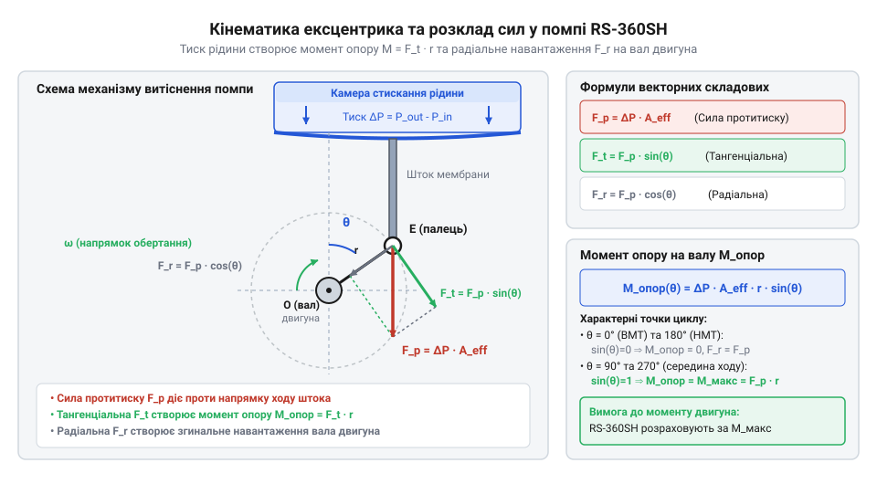
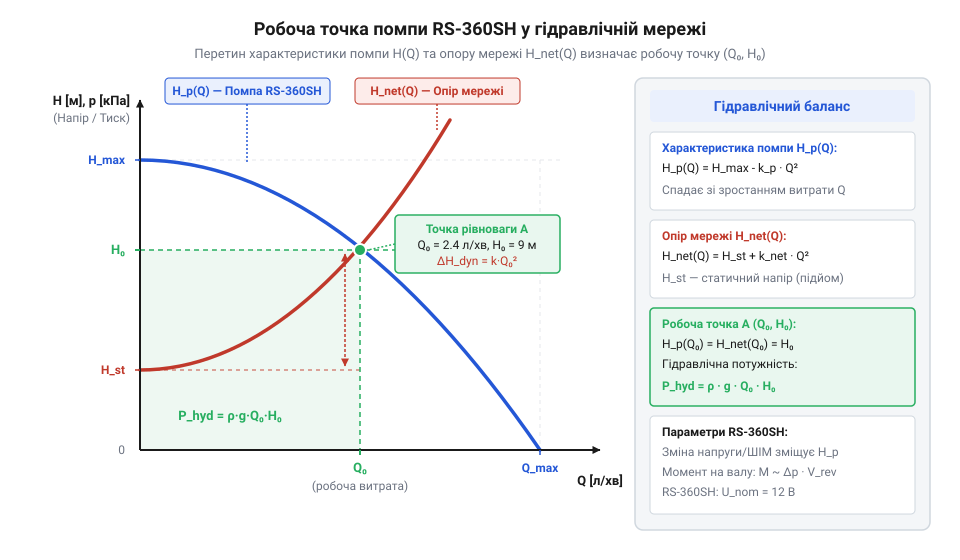
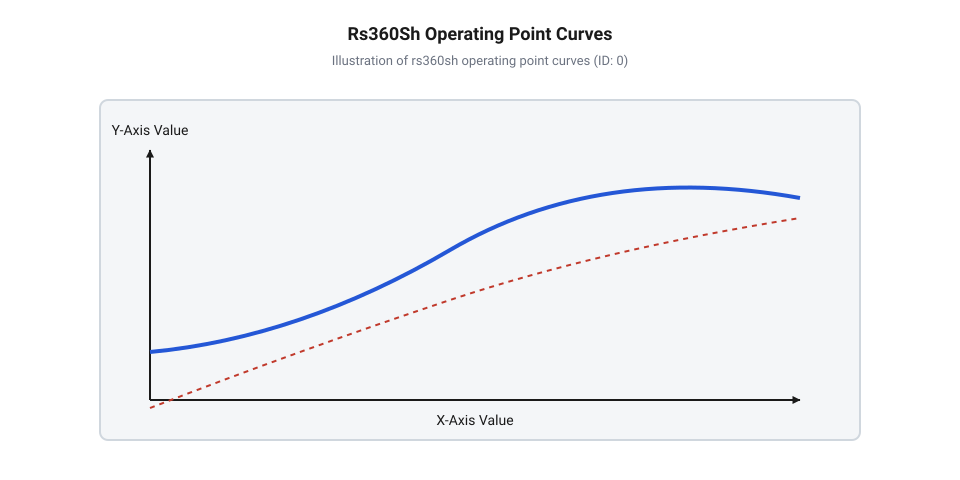

# Гідродинаміка та розрахунок моменту опору діафрагмової помпи RS-360SH

<preknowlist>
- [Колекторний двигун типорозміру 130](root:cat-hw-actuators/dc-motor-130) — Механічні характеристики колекторних двигунів постійного струму та залежність моменту опору від швидкості обертання валу
</preknowlist>

## Перевантаження мотора через нераховану гідродинаміку

Уяви, що ти збираєш систему автономного охолодження або пристрій дозованої подачі рідини на базі компактної діафрагмової помпи з @@en|RS-360SH@@. Під час першого тестуванння на робочому столі, коли помпа перекачує воду з однієї відкритої ємності в іншу через коротку широку трубку, мотор працює тихо, впевнено тримає високі оберти й споживає скромний струм близько `0.2 A`–`0.3 A`.

Проте варто підключити до виходу помпи вузьку силіконову магістраль, фільтр тонкого очищення або підняти водяний шланг на висоту кількох метрів, як поведінка приводу кардинально змінюється. Тон звучання мотора падає, корпус швидко нагрівається за лічені хвилини, а струм споживання зростає в рази, наближаючись до граничних значень. Якщо залишити такий режим без уваги, обмотки ротора перегріються, ізоляційний лак розплавиться, і двигун просто згорить.

Чому це відбувається? Звичайний [колекторний двигун типорозміру 130](root:cat-hw-actuators/dc-motor-130) або @@en|RS-360SH@@ перетворює електричну енергію в механічне обертання відповідно до своєї електромеханічної характеристики: обертовий момент `M` пропорційний струму ротора `I`, а швидкість обертання `n` лінійно спадає зі зростанням навантаження. У холостому режимі опір обертанню визначається лише власним механічним тертям у підшипниках та аеродинамікою ротора.

Коли помпа починає рухати рідину, на перше місце виходить гідродинаміка. Вода є практично @@la|нестисливою рідиною@@ (від лат. *in-* — не та *compressio* — стиснення) з високою густиною `ρ ≈ 1000 kg/m³`. Для продавлювання рідини крізь гідравлічний контур помпа повинна створити перепад тиску `Δp` між вхідним та вихідним патрубками.

Цей перепад тиску `Δp` тисне на гнучку поверхню еластомерної мембрани насосної камери, породжуючи гідростатичну силу протитиску:

```
F_p = Δp · S_eff
```

де `Δp` — перепад тиску в паскалях (`Pa`), а `S_eff` — ефективна площа робочої поверхні діафрагми в квадратних метрах (`m²`).

Через внутрішній важільний механізм ця сила передається на @@la|ексцентрик@@ (від лат. *ex* — поза та *centrum* — центр) валу двигуна. Ексцентрик перетворює лінійну силу протитиску в механічний момент опору `M_res`:

```
M_res = F_p · e · sin(θ) + M_f
```

де `e` — радіус ексцентриситету в метрах (`m`), `θ` — кут повороту валу, а `M_f` — момент внутрішнього механічного тертя.

Якщо гідравлічна мережа чинить високий опір (наприклад, через малий діаметр трубок, де втрати тиску зростають квадратично залежно від витрати), необхідний момент опору `M_res` стрімко зростає. На відміну від систем, де встановлено [мотор-редуктор 6 В](root:cat-hw-actuators/gearmotor-6v) із великим передаточним числом для гасіння навантаження, прямий ексцентриковий привід RS-360SH передає весь гідростатичний опір безпосередньо на вал мотора.

При зростанні моменту опору `M_res` робоча точка двигуна зміщується: оберти `n` падають, проти-ЕРС ротора зменшується, що призводить до стрибка струму `I`. Електрична потужність, яка виділяється у вигляді тепла на обмотках ротора, зростає квадратично від струму:

```
P_heat = I² · R_a
```

де `I` — струм ротора в амперах (`A`), а `R_a` — електричний опір обмотки ротора в омах (`Ω`).

Саме тому спроба керувати діафрагмовою помпою «наосліп» без розрахунку гідравлічного навантаження призводить або до термічного виходу з ладу мотора, або до зриву потоку через @@en|кавітаційні явища@@ на вході. Щоб забезпечити надійну роботу, необхідно навчитися розраховувати об'ємну продуктивність насосного вузла та узгоджувати момент опору рідини з механічною характеристикою приводу.

## Об'ємна продуктивність діафрагмового насосного вузла

Перекачування рідини в діафрагмовій помпі ґрунтується на принципі об'ємного витіснення (@@en|positive displacement pump@@). На валу двигуна @@en|RS-360SH@@ закріплено ексцентриковий підшипник із радіусом ексцентриситету `e`. При обертанні валу цей ексцентрик надає зворотно-поступального руху плунжерам, які приєднані до `N = 3` еластомерних мембран (діафрагм), розташованих симетрично по колу насосної головки.

Кожен повний оберт валу складається з двох фаз для кожної камери:
1. Фаза всмоктування: ексцентрик відтягує мембрану назад, збільшуючи об'єм камери. Тиск у камері падає нижче атмосферного, вхідний @@en|зворотний клапан@@ (від англ. @@en|check valve@@ — зворотний клапан) відкривається, і рідина заповнює камеру. 2. Фаза витіснення: ексцентрик штовхає мембрану вперед, зменшуючи об'єм камери. Вхідний клапан закривається, вихідний клапан відкривається під дією зростаючого тиску, і рідина витискається у напірну магістраль.

Повний хід плунжера `S` дорівнює подвійному радіусу ексцентриситету:

```
S = 2 · e
```

Оскільки краї гнучкої мембрани жорстко затиснуті в корпусі помпи, а рухається лише її центральна частина, ефективна площа витіснення `S_eff` є меншою за повну геометричну площу диска мембрани. Для затиснутої кругової еластомерної мембрани ефективну площу обчислюють через ефективний діаметр `d_eff`:

```
S_eff = π · (d_eff / 2)²
```

де `d_eff` — ефективний діаметр рухомої зони мембрани в метрах (`m`).

Теоретичний об'єм рідини `V_stroke`, витіснюваний однією камерою за один хід, становить:

```
V_stroke
= S · S_eff                [визначення об'єму ходу камери]
= 2 · e · S_eff            [підстановка довжини ходу S = 2·e]
```

Для помпи з `N` робочими камерами сумарний теоретичний робочий об'єм `V_rev`, що витісняється за один повний оберт валу двигуна, дорівнює:

```
V_rev
= N · V_stroke             [сумарний об'єм витіснення N камер]
= 2 · N · e · S_eff        [підстановка теоретичного об'єму однієї камери]
```

Якщо вал двигуна обертається з частотою `n` обертів за хвилину (об/хв), частота обертання в секундах становить `f = n / 60`. Теоретична об'ємна витрата рідини `Q_th` (в кубічних метрах за секунду або літрах за хвилину) визначається множенням робочого об'єму на частоту обертання:

```
Q_th
= V_rev · (n / 60)         [переведення обертів за хвилину у частоту обертання]
= 2 · N · e · S_eff · (n / 60) [розгортання виразу об'ємного витіснення]
```

У реальних умовах дійсна об'ємна витрата `Q_act` завжди менша за теоретичну `Q_th`. Співвідношення між ними визначається коефіцієнтом заповнення або об'ємним ККД `η_v` (@@en|fill factor@@):

```
Q_act = η_v · Q_th
```

Коефіцієнт заповнення `η_v` (для помп RS-360SH він зазвичай лежить у межах `0.75`–`0.90`) враховує три основні гідродинамічні фактори:
1. Інерційність та затримку спрацьовування зворотних клапанів, через яку частина рідини витікає назад (@@en|backflow@@) у момент перемикання фаз. 2. Гідравлічний опір та в'язке тертя вхідних каналів, що заважають повному заповненню камери на високих обертах. 3. Стисливість мікроскопічних бульбашок повітря, розчинених у рідині або присутніх у мертвому об'ємі камери.

Розглянемо практичний приклад розрахунку об'ємної продуктивності помпи RS-360SH.

**Умова розрахунку:**
- Кількість робочих камер: `N = 3`
- Радіус ексцентрика: `e = 1.5 mm = 0.0015 m`
- Ефективний діаметр мембрани: `d_eff = 14 mm = 0.014 m`
- Частота обертання валу двигуна: `n = 3000 об/хв` (`50 Гц`)
- Коефіцієнт заповнення камери: `η_v = 0.85`

**Покрокове обчислення:**

```
S_eff
= 3.14159 · (0.014 / 2)²  [площа ефективної кругової поверхні мембрани]
= 3.14159 · 0.000049
= 0.00015394 m²           [ефективна площа однієї мембрани]

V_rev
= 2 · 3 · 0.0015 m · 0.00015394 m² [теоретичний робочий об'єм помпи за один оберт]
= 0.009 m · 0.00015394 m²
= 0.0000013854 m³/об      [або 1.3854 мл за один оберт валу]

Q_th
= 0.0000013854 m³/об · (3000 / 60) [перемноження робочого об'єму на частоту обертання]
= 0.0000013854 m³/об · 50 с⁻¹
= 0.00006927 m³/с         [теоретична об'ємна витрата в кубічних метрах за секунду]
= 0.00006927 · 60000 L/min
= 4.156 L/min             [теоретична об'ємна витрата в літрах за хвилину]

Q_act
= 0.85 · 4.156 L/min      [урахування коефіцієнта заповнення камери]
= 3.533 L/min             [дійсна об'ємна продуктивність помпи]
```

**Висновок:** При 3000 об/хв валу приводу помпа RS-360SH забезпечує реальну об'ємну подачу `3.53 L/min`. Для зміни продуктивності можна регулювати частоту обертання валу `n` (наприклад, за допомогою ШІМ-сигналу драйвера), проте з ростом обертів слід враховувати можливе зниження коефіцієнта заповнення `η_v`.

## Момент опору на валу двигуна

Розрахувавши об'ємну продуктивність, необхідно з'ясувати, який саме механічний момент очікує на валу двигуна @@en|RS-360SH@@ під час витіснення рідини під тиском.

Коли помпа працює проти гідравлічного опору магістралі, у напірній камері виникає надлишковий тиск `Δp = p_out - p_in`. Цей тиск тисне на мембрану із силою `F_p = Δp · S_eff`. Під час обертання валу на кут `θ` ця сила передається на ексцентриковий підшипник з радіусом `e` і розкладається на дві складові:
1. Радіальна сила `F_rad = F_p · cos(θ)`, яка стискає підшипник валу двигуна і створює додаткове навантаження на втулки кочення. 2. Тангенціальна сила `F_tan = F_p · sin(θ)`, яка діє перпендикулярно до плеча ексцентрика і створює миттєвий момент опору обертанню.


*Кінематика ексцентрикового механізму помпи RS-360SH та розкладання сил тиску на валу приводу.*

Для трикамерної помпи миттєвий момент на валу пульсує із частотою потрійного перемикання фаз. Проте для розрахунку тривалого теплового та механічного навантаження двигуна використовують середній гідравлічний момент опору `M_hyd`.

Його математичний вивід найпростіше виконати через закон збереження енергії (@@la|conservation of energy@@). Механічна робота, виконана валом двигуна за один повний оберт `W_mech = 2 · π · M_hyd`, у системі без втрат дорівнює гідравлічній роботі з стиснення та витіснення рідини `W_hyd = Δp · V_rev`:

```
2 · π · M_hyd = Δp · V_rev
```

Звідси виводимо середній гідравлічний момент опору `M_hyd`:

```
M_hyd
= (Δp · V_rev) / (2 · π)    [визначення середнього гідравлічного моменту]
= (Δp · 2 · N · e · S_eff) / (2 · π) [підстановка виразу робочого об'єму V_rev]
= (Δp · N · e · S_eff) / π  [скорочення двійки у чисельнику та знаменнику]
```

Окрім гідравлічного опору рідини, двигун повинен долати механічне тертя в ексцентриковому вузлі, деформаційний опір вигину еластомеру мембрани та в'язке тертя рідини у звужених каналах клапанів. Усі ці втрати об'єднують механічним ККД насосної головки `η_m` (зазвичай `0.70`–`0.85`) та моментом сухого тертя `M_f`.

Сумарний момент опору на валу двигуна `M_res` становить:

```
M_res
= M_hyd / η_m + M_f        [сумарний момент опору з урахуванням механічного ККД та тертя]
= (Δp · V_rev) / (2 · π · η_m) + M_f [розгортання через гідравлічний момент]
```

Корисна гідравлічна потужність `P_hyd`, передана потоку рідини, дорівнює добутку тиску на дійсну об'ємну витрату:

```
P_hyd = Δp · Q_act = Δp · η_v · Q_th
```

Механічна потужність `P_mech`, яку двигун повинен підводити до валу з кутовою швидкістю `ω = 2 · π · n / 60`, обчислюється як:

```
P_mech = M_res · ω = M_res · (2 · π · n / 60)
```

Загальний ККД насосного вузла `η_total` є відношенням корисної гідравлічної потужності до механічної потужності валу:

```
η_total
= P_hyd / P_mech           [визначення загального ККД насосної камери]
= (Δp · η_v · Q_th) / (M_res · ω) [підстановка гідравлічної та механічної потужностей]
```

Проведемо розрахунок моменту опору та механічної потужності для помпи RS-360SH при робочому тиску `2.0 bar` (`200000 Pa`).

**Умова розрахунку:**
- Перепад тиску в системі: `Δp = 200000 Pa` (`2.0 bar`)
- Робочий об'єм помпи: `V_rev = 1.3854 × 10⁻⁶ m³/об`
- Механічний ККД ексцентрика: `η_m = 0.75`
- Момент сухого тертя: `M_f = 0.002 N·m` (`2 mN·m`)
- Частота обертання: `n = 3000 об/хв` (`ω = 314.16 рад/с`)

**Покрокове обчислення:**

```
M_hyd
= (200000 Pa · 0.0000013854 m³) / (2 · 3.14159) [обчислення середнього гідравлічного моменту]
= 0.27708 N·m / 6.28318
= 0.0441 N·m              [гідравлічний момент опору, 44.1 мН·м]

M_res
= (0.0441 N·m / 0.75) + 0.002 N·m [урахування механічного ККД та моменту тертя]
= 0.0588 N·m + 0.002 N·m
= 0.0608 N·m              [повний момент опору на валу, 60.8 мН·м]

P_mech
= 0.0608 N·m · (2 · 3.14159 · 3000 / 60) [обчислення необхідної механічної потужності]
= 0.0608 N·m · 314.16 rad/s
= 19.10 W                 [необхідна механічна потужність двигуна]
```

**Висновок:** Для створення тиску `2.0 bar` при 3000 об/хв двигун RS-360SH повинен розвивати на валу момент `60.8 mN·m` та механічну потужність `19.1 W`.

Однак у реальній системі тиск `Δp` не є довільною фіксованою величиною — він визначається опором гідравлічної мережі (трубок, фітингів, звужень). Відповідно до @@la|рівняння Дарсі-Вейсбаха@@ (від нім. *Darcy-Weisbach*), втрати тиску на тертя в магістралі зростають квадратично залежно від витрати рідини:

```
Δp_net = R_hyd · Q²
```

де `R_hyd` — коефіцієнт гідравлічного опору мережі в `Pa·s²/m⁶`.

Водночас зі зростанням навантаження оберти двигуна `n` падають, через що власна напірна характеристика помпи `Δp_pump(Q)` знижується при збільшенні витрати.

Усталений режим роботи системи визначається робочою точкою (@@en|operating point@@) — точкою перетину напірно-витратної кривої помпи та квадратичної характеристики опору мережі.


*Пошук робочої точки помпи RS-360SH на перетині гідравлічної характеристики мережі та напірно-витратної кривої приводу.*

Якщо опір магістралі `R_hyd` занадто великий (крута парабола на графіку), робоча точка зміщується вліво — у зону малого об'єму `Q_op` і високого тиску `Δp_op`. Це змушує двигун працювати в режимі високого моменту та низьких обертів із низьким ККД і сильним нагріванням обмоток. Збільшення внутрішнього діаметра трубок і зменшення кількості гострих поворотів робить характеристику мережі більш пологою, зміщуючи робочу точку праворуч у зону максимальної механічної ефективності приводу @@en|RS-360SH@@.

## Гідравлічний опір мережі та потужність

Коли діафрагмова помпа витісняє рідину з робочої камери, потік не рухається вільно: стінки трубопроводу, повороти магістралі, звуження та клапани спричиняють опір руху. Молекули рідини зазнають @@en|в'язке тертя@@ (від англ. @@en|viscous friction@@) об внутрішні поверхні каналів, утворюючи реактивний протитиск. Чим швидше помпа намагається проштовхнути рідину крізь гідравлічний тракт, тим сильніше зростає цей опір.

Повний протитиск `p_tot`, який долає помпа, складається з двох компонентів: статичного перепаду тиску `Δp_st` та динамічних втрат `Δp_dyn`. Статичний тиск виникає через геометричну висоту підйому рідини `H` проти сили тяжіння:

    Δp_st = ρ · g · H

де `ρ` — густина рідини (для чистої води `ρ = 1000` кг/м³), `g = 9.81` м/с² — прискорення вільного падіння.

Динамічний протитиск зумовлений тертям рідини в трубі. За рівнянням Дарсі-Вейсбаха втрати тиску на тертя пропорційні квадрату швидкості потоку `v`. Для круглої труби діаметром `d` та довжиною `L` швидкість потоку виражається через об'ємну витрату `Q` як `v = 4 · Q / (π · d²)`. Підставивши це співвідношення у рівняння втрат напірно-витратного тракту, отримуємо залежність протитиску від витрати:

    Δp_dyn = (8 · λ · L · ρ / (π² · d⁵)) · Q²
    = R_h · Q²      [введення коефіцієнта гідравлічного опору]

Величина `R_h` називається @@en|гідравлічний опір мережі@@ (від англ. @@en|hydraulic resistance@@) і вимірюється у Па·с²/м⁶. Безрозмірний коефіцієнт тертя `λ` залежить від режиму течії. Коли рідина рухається повільно, спостерігається @@la|ламінарний потік@@ (від лат. @@la|lamina@@ — пластинка), де шари рідини ковзають паралельно, а `λ` залежить лише від в'язкості. Зі зростанням швидкості виникає @@la|турбулентний потік@@ (від лат. @@la|turbulentus@@ — бурхливий), у якому вихори різко збільшують втрати енергії, роблячи протитиск суворо квадратичним відносно витрати `Q`. Для детального розрахунку втрат на тертя та місцевих опорів у рідинних магістралях дивіться матеріал про [гідравлічний опір та втрати тиску в трубопроводах](root:ph-mechanics/fluid-dynamics-pipe-pressure-loss).

Для проштовхування рідини крізь опір траси помпа виконує корисну роботу. Передана рідині @@en|гідравлічна потужність@@ `P_h` (від англ. @@en|hydraulic power@@) визначається як добуток повного протитиску на об'ємну витрату:

    P_h = p_tot · Q
    = (Δp_st + R_h · Q²) · Q
    = Δp_st · Q + R_h · Q³      [розкриття дужок для оцінки впливу витрати]

Формула показує, що при подоланні гідродинамічного опору потрібна потужність зростає пропорційно кубу витрати `Q³`.

Щоб забезпечити цю гідравлічну потужність, вал мотора RS-360SH повинен передавати на ексцентрик відповідну @@en|механічна потужність@@ `P_m` (від англ. @@en|mechanical power@@), яка дорівнює добутку обертального моменту `M` на кутову швидкість `ω`. Через механічне тертя в підшипниках та об'ємні витоки крізь клапани камери частина енергії втрачається. Загальний @@en|коефіцієнт корисної дії@@ `η_tot` помпи пов'язує ці потужності:

    P_m = P_h / η_tot

**Обчислення потужності для типового контуру**
Розрахуємо необхідну механічну потужність приводу RS-360SH для подачі води `ρ = 1000` кг/м³ з витратою `Q = 1.2` л/хв (`2.0 × 10⁻⁵` м³/с) через силіконову трубку довжиною `L = 1.5` м та внутрішнім діаметром `d = 4` мм (`0.004` м) на висоту `H = 0.5` м при коефіцієнті тертя `λ = 0.03` та ККД помпи `η_tot = 0.45`:

    R_h = 8 · 0.03 · 1.5 · 1000 / (3.1416² · (0.004)⁵)
    = 360 / (9.8696 · 1.024 × 10⁻¹²)      [обчислення знаменника]
    = 3.56 × 10¹³ Па·с²/м⁶                [гідравлічний опір трубопроводу]

    Δp_dyn = 3.56 × 10¹³ · (2.0 × 10⁻⁵)²
    = 3.56 × 10¹³ · 4.0 × 10⁻¹⁰
    = 14240 Па                            [динамічний протитиск тертя]

    Δp_st = 1000 · 9.81 · 0.5
    = 4905 Па                             [статичний гідростатичний тиск]

    p_tot = 14240 + 4905
    = 19145 Па                            [повний протитиск траси]

    P_h = 19145 · 2.0 × 10⁻⁵
    = 0.383 Вт                            [корисна гідравлічна потужність]

    P_m = 0.383 / 0.45
    = 0.851 Вт                            [необхідна механічна потужність валу]

З розрахунку видно, що навіть при незначному статичному підйомі основними споживачами потужності стають динамічні втрати у вузькій трубці. Оскільки електродвигун помпи функціонує як звичайний [колекторний двигун постійного струму](root:cat-hw-actuators/dc-motor-130), обчислене значення `P_m` визначає необхідне механічне навантаження на його валу.

## Пошук робочої точки помпи та мережі

Рідина в гідравлічній системі не може рухатися із довільною швидкістю: реальні параметри потоку визначаються рівновагою між можливістю помпи створювати тиск та спроможністю мережі цей тиск пропускати. Напірно-витратна характеристика помпи відображає залежність створюваного тиску `p_pump` від об'ємної витрати `Q`. Для діафрагмового насоса RS-360SH ця крива має спадний характер. При нульовому протитиску помпа забезпечує максимальну витрату `Q_max` (режим вільного виливу). У міру зростання протитиску зростає механічний момент опору на валу двигуна, через що оберти ротора лінійно знижуються, а витіснення рідини сповільнюється аж до повного зупинення потоку при максимальному тиску блокування `p_max`.

Характеристика мережі `p_net(Q)`, навпаки, є зростаючою параболою `p_net = Δp_st + R_h · Q²`. Графічний перетин цих двох кривих визначає унікальний стан системи, який називається @@en|робоча точка@@ (від англ. @@en|operating point@@). У цій точці тиск, який розвиває помпа, точно дорівнює протитиску, який чинить гідравлічна траса при даній витраті.


*Суміщення кривих тиску помпи при різній напрузі та квадратичної кривої опору траси для визначення робочої точки.*

Аналітичний пошук робочої точки зводиться до розв'язання рівняння рівноваги тисків:

    p_pump(Q) = p_net(Q)

Якщо апроксимувати власну характеристику помпи лінійною залежністю `p_pump(Q) = p_max · (1 - Q / Q_max)`, рівняння робочої точки набуває квадратного вигляду відносно `Q`:

    p_max · (1 - Q / Q_max) = Δp_st + R_h · Q²
    = R_h · Q² + (p_max / Q_max) · Q + (Δp_st - p_max) = 0      [зведення до стандартного квадратного рівняння]

Зміна напруги живлення `U` двигуна RS-360SH зсуває напірно-витратну криву помпи. Оскільки швидкість холостого ходу колекторного мотора та момент блокування пропорційні напрузі, підвищення живлення (наприклад, від 6 В до 12 В) паралельно піднімає та розширює криву `p_pump(Q)`. Робоча точка при цьому зміщується вгору вздовж параболи мережі, збільшуючи і тиск, і об'ємну витрату.

На відміну від приводів, де використовується [мотор-редуктор 6 В](root:cat-hw-actuators/gearmotor-6v) з великим передаточним числом і високим жорстким моментом, прямий привід RS-360SH дуже чутливий до зміни протитиску. Якщо траса заблокується або її опір `R_h` стрімко зросте (наприклад, через засмічення фільтра чи перегин трубки), робоча точка зміститься в область малих витрат та високого тиску. У цьому режимі більша частина електричної потужності обмоток витрачається не на перекачування рідини, а на нагрів арматури через великий @@en|струм блокування@@ (від англ. @@en|stall current@@), що загрожує тепловим пробоєм ізоляції.

Оптимальний режим експлуатації помпи RS-360SH лежить у зоні максимального загального ККД `η_tot`, який зазвичай досягається при протитиску в межах 30–60% від `p_max`. Обираючи напругу живлення та діаметр трубопроводу, систему проектують так, щоб робоча точка потрапляла саме в цей інтервал, запобігаючи як холостому гонінню рідини, так і перевантаженню приводу.