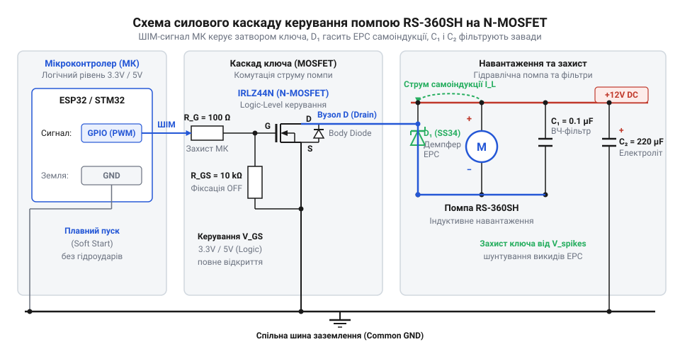
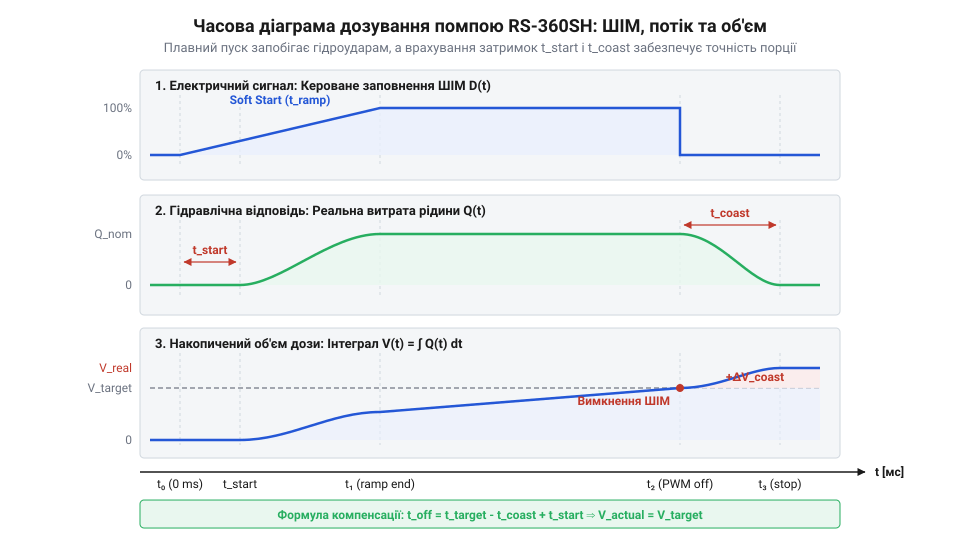
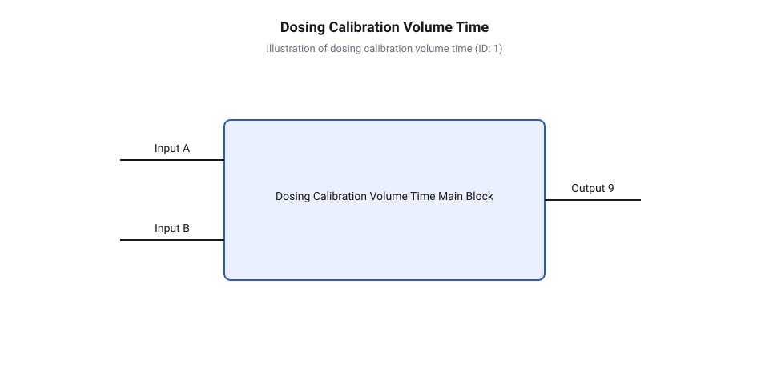
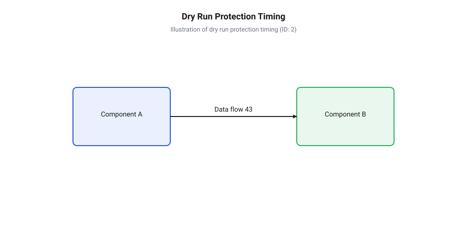

# Автоматизована система дозування рідини на мікроконтролері з помпою RS-360SH

<preknowlist>
- [Колекторний двигун типорозміру 130](root:cat-hw-actuators/dc-motor-130) — принципи роботи мотора постійного струму, комутація колектора та природа індуктивних викидів при вимкненні
- [Мотор-редуктор 6 В (100 і 600 об/хв)](root:cat-hw-actuators/gearmotor-6v) — механіка обертового руху під навантаженням та інерція вибігу ротора
</preknowlist>

## Проблема неконтрольованого дозування рідини

У багатьох автоматизованих пристроях — від медичних лабораторних дозаторів та акваріумних систем внесення добрив до автоматичних напоєроздавальних апаратів — виникає потреба подавати чітко відміряний об'єм рідини. На перший погляд, для цього достатньо взяти звичайну помпу постійного струму, таку як @@en|RS-360SH@@, і вмикати її на заданий час за допомогою електромеханічного реле або механічного тумблера. Проте спроба прямим поданням живлення отримати стабільне дозування одразу наражається на серйозні фізичні обмеження.

Коли на нерухомий колекторний мотор помпи миттєво подається повна номінальна напруга, виникає потужний кидок пускового струму. Оскільки ротор ще не обертається, проти-ЕРС (зворотна електрорушійна сила) дорівнює нулю, і струм у колі обмежується лише низьким омічним опором обмотки якоря:

```
I_start = V_supply / R_armature
```

Для помпи @@en|RS-360SH@@ пусковий струм `I_start` може сягати кількох ампер. Такий імпульс спричиняє просідання напруги на загальній лінії живлення, що призводить до збоїв та хаотичних перезавантажень мікроконтролера.

Одночасно з електричним сплеском у гідравлічній магістралі виникає @@en|hydraulic hammer@@ (гідроудар, від англ. hydraulic — гідравлічний, hammer — молот). Різке прискорення крильчатки помпи стрибкоподібно збільшує тиск у заповненій рідиною трубі. Нестислива рідина створює хвилю підвищеного тиску, яка здатна зірвати з'єднувальні штуцери, пошкодити ущільнювачі та спричинити хаотичне розбризкування рідини на початку дозування.

Ще більша похибка об'єму виникає в момент вимкнення помпи. Коли контакти реле розмикаються, електричне живлення припиняється, але ротор мотора та крильчатка продовжують обертатися за рахунок накопиченої кінетичної енергії. На відміну від систем з [малогабаритними мотор-редукторами](root:cat-hw-actuators/gearmotor-6v), де високе передавальне число шестеренчастої передачі забезпечує самогальмування, помпа @@en|RS-360SH@@ має привід із мінімальним механічним опором. Механічний вибіг ротора триває від десятків до сотень мілісекунд, протягом яких помпа продовжує прокачувати рідину в магістраль.

Сумарний об'єм поданої рідини `V_total` під час одного циклу складається з трьох складових:

```
V_total = V_start + V_steady + V_coast
```

Де `V_start` — об'єм, пропущений під час турбулентного розгону, `V_steady` — об'єм стабільної подачі, а `V_coast` — об'єм нестабільного вибігу. Оскільки час вибігу та коефіцієнт тертя в підшипниках залежать від температури рідини, зносу щіток мотора та поточного тиску в резервуарі, величина `V_coast` постійно плаває. При дозуванні малих порцій (наприклад, 20–50 мл) похибка від вибігу ротора та турбулентного пуску може перевищувати 20–30% від заданого об'єму.

Порівнюючи з [звичайними колекторними двигунами](root:cat-hw-actuators/dc-motor-130) без гідравлічного навантаження, помпа потребує урахування реакції рідини. Для досягнення високої відтворюваності дозування автоматизована система повинна виконувати чотири базові вимоги:
1. Електронне силове безконтактне перемикання з можливістю регулювання швидкості. 2. Програмне формування профілю плавного розгону (@@en|Soft Start@@, від англ. soft — м'який, start — запуск) для запобігання гідроударам та реактивним сплескам струму. 3. Програмну компенсацію інерційного вибігу ротора шляхом своєчасного зниження обертів перед зупинкою (@@en|Soft Stop@@, від англ. soft — м'який, stop — зупинка). 4. Точний невикликовий таймінг керування та захист від аварійних режимів роботи.

## Силовий каскад та індуктивний захист

Сформульовані вимоги до живильного струму та швидкості комутації унеможливлюють використання механічних реле. Для керування помпою @@en|RS-360SH@@ застосовують силовий електронний ключ на базі N-канального польового транзистора @@en|MOSFET@@ (від англ. Metal-Oxide-Semiconductor Field-Effect Transistor — польовий транзистор зі структурою метал-оксид-напівпровідник). Проте індуктивний характер обмоток мотора створює ризики миттєвого виходу транзистора з ладу без спеціального кола захисту.

Під час розмикання силового ключа струм в обмотці мотора не може припинитися миттєво через явище самоіндукції. Індуктивність обмотки прагне підтримати струм, що протікав через неї, викликаючи різке зростання напруги на стоці (@@en|Drain@@) MOSFET-ключа. Ця зворотна ЕРС (електрорушійна сила) обчислюється за формулою:

```
V_spike = -L × (di / dt)
```

Оскільки час закриття транзистора `dt` становить одиниці мікросекунд, амплітуда індуктивного викиду `V_spike` може досягати десятків і сотень вольт, що перевищує пробійну напругу сток-витік `V_DS_max` і призводить до незворотного лавинного пробою транзистора.

Для придушення високовольтних викидів паралельно виводам помпи підключають демпферний діод (@@en|flyback diode@@, від англ. flyback — зворотний хід, diode — діод від грец. δίς — два та ὁδός — шлях). Діод вмикається у зворотному напрямку відносно напруги живлення: катод підключається до позитивної шини `+V_pump`, а анод — до стоку MOSFET. Під час роботи помпи діод закритий. Коли MOSFET розмикається, накопичена в індуктивності мотора енергія змушує струм протікати через демпферний діод у замкненому контурі мотора, поступово розсіюючись на активному опорі обмоток у вигляді тепла. Для детального розрахунку та поглибленого вивчення принципів роботи схем придушення зворотної ЕРС перегляньте матеріал про [демпферний діод та захист від зворотної ЕРС](root:hw-power/flyback-diodes-protection).

Крім того, для стабільної роботи затвора (@@en|Gate@@) транзистора від виводу мікроконтролера встановлюють затворний резистор `R_gate` (типово 47–220 Ом) та стягувальний резистор `R_pull` (10 кОм). Затворний резистор обмежує піковий струм заряджання вхідної ємності затвора `C_iss` при високій частоті @@en|PWM@@ (Pulse-Width Modulation, широтно-імпульсна модуляція), захищаючи вихідний буфер мікроконтролера та пригнічуючи високочастотні паразитні коливання. Стягувальний резистор гарантує надійний закритий стан MOSFET під час скидання або ініціалізації мікроконтролера, коли GPIO перебуває у високоімпедансному стані.

Подібно до схем керування [компактними вентиляторами](root:cat-hw-actuators/fan-5v), силовий каскад потребує розділення силового та логічного контурів живлення.


*Схема силового каскаду керування помпою RS-360SH на MOSFET із демпферним діодом, затворним резистором та фільтруючими конденсаторами.*

Для придушення електромагнітних завад від колекторного вузла помпи безпосередньо на її виводи запаюють керамічний конденсатор `C_motor` ємністю 0.1 мкФ. Паралельно шині живлення помпи встановлюють електролітичний конденсатор `C_bulk` ємністю 220–470 мкФ, який компенсує локальні просідання напруги під час пускових струмових піків.

Розрахунок робочого струму демпферного діода виконується за умовою, що його прямий піковий струм `I_F_max` повинен бути не меншим за максимальний робочий струм помпи під навантаженням:

```
I_F_max ≥ I_pump_peak
```

Використання діода Шотткі (наприклад, 1N5819 або SS34) є перевагою завдяки малому часу відновлення та низькому прямому падінню напруги `V_F ≈ 0.3-0.4 В`, що знижує нагрів елемента під час високочастотної ШІМ-комутації.

## Плавний пуск та гальмування інерції

Апаратне забезпечення силового каскаду створює основу для точного керування, але сама по собі лінійна передача напруги не вирішує проблему гідравлічного удару та інерційного вибігу. Для досягнення прецизійного дозування програмне забезпечення повинно формувати трапецеїдальний профіль коефіцієнта заповнення @@en|Duty Cycle@@ (від англ. duty — робочий, cycle — цикл) ШІМ-сигналу.

Процес дозування розбивається на три послідовні фази:
1. @@en|RampUp@@ (плавний пуск): Коефіцієнт заповнення ШІМ плавно зростає від мінімального значення `D_min` (поріг подолання сухого тертя ротора) до цільового значення `D_target` за час `t_ramp_up`. Це виключає стрибок тиску та гідроудар. 2. @@en|Dosing@@ (стабільна подача): Помпа працює на постійній швидкості з витратою `Q_steady = Q_max × D_target`. 3. @@en|RampDown@@ (плавне гальмування): Перед досягненням заданого об'єму ШІМ плавно знижується від `D_target` до 0 за час `t_ramp_down`. Це гасить кінетичну енергію ротора і ліквідує вибіг.


*Часова діаграма роботи помпи, що показує профіль ШІМ плавного пуску, фазу стабільного потоку та вибіг мотора після вимкнення.*

Обчислення часу стабільної фази `t_steady` для дозування заданого об'єму `V_target` базується на інтегруванні витрати за часом. Об'єм, поданий під час фази плавного пуску `V_ramp_up` та фази гальмування `V_ramp_down`, виражається площею під кривою витрати:

```
V_ramp_up = 0.5 × Q_max × D_target × (t_ramp_up / 1000)
V_ramp_down = 0.5 × Q_max × D_target × (t_ramp_down / 1000)
V_ramp_total = V_ramp_up + V_ramp_down
```

Якщо цільовий об'єм `V_target` більший за `V_ramp_total`, залишковий об'єм `V_remaining = V_target - V_ramp_total` прокачується під час фази стабільного дозування. Час цієї фази в мілісекундах обчислюється як:

```
t_steady = (V_remaining / (Q_max × D_target)) × 1000       [розрахунок тривалості стабільної фази]
```

Для реалізації цього алгоритму в реальному часі без заблокування (невикликовий таймінг, @@en|non-blocking timing@@) застосовується скінченний автомат державних машин (@@en|Finite State Machine@@). Уся логіка дозатора інкапсульована в об'єктно-орієнтованому драйвері C++.

Програмний комплекс складається з низькорівневого абстракційного шару апаратури @@en|HAL@@ (Hardware Abstraction Layer), вищого рівня драйвера помпи та безпечної обгортки @@en|RAII@@ (Resource Acquisition Is Initialization), яка гарантує знеструмлення ключа при виході з області видимості.

Нижче наведено структуру та реалізацію модуля ШІМ-абстракції:

:::code proj-rs360sh-automated-liquid-dosing-system/cpp/include/mosfet_pwm_hal.hpp
:::code proj-rs360sh-automated-liquid-dosing-system/cpp/src/mosfet_pwm_hal.cpp

Низькорівневий клас `MosfetPwmHal` забезпечує безпечну роботу з апаратним ШІМ-таймером, надаючи метод `emergencyShutdown()` для миттєвого скидання сигналу на затворі MOSFET при виявленні аномалій.

Логіку плавного розгону, точного підрахунку поданого об'єму та діагностику відсутності рідини (@@en|dry run@@, сухий хід, від англ. dry — сухий, run — біг) інкапсульовано в класі `RS360SHPumpDriver`:

:::code proj-rs360sh-automated-liquid-dosing-system/cpp/include/rs360sh_pump_driver.hpp
:::code proj-rs360sh-automated-liquid-dosing-system/cpp/src/rs360sh_pump_driver.cpp

Драйвер помпи регулярно викликає метод `update()`, у якому на основі різниці часу `dt` обчислюється наростаючий об'єм прокачаної рідини `dosed_volume_ml_`. Якщо під час роботи при працюючій ШІМ показання датчика наявності рідини або датчика потоку вказують на відсутність руху рідини понад заданий таймаут `dry_run_timeout_ms`, автомат негайно переходить у стан `PumpState::FaultDryRun` і знеструмлює помпу для запобігання перегріву й зносу підшипників.

Головний демонстраційний модуль ілюструє використання завадостійкого дозування з автоматичним підтвердженням за допомогою `DosingGuard`:

:::code proj-rs360sh-automated-liquid-dosing-system/cpp/src/main.cpp

На відміну від [прецизійних крокових моторів](root:cat-hw-actuators/28byj-48-stepper), які точно відраховують кроки ротора без датчика потоку, помпа постійного струму з профілем плавного пуску та програмною компенсацією інерції забезпечує високу об'ємну точність дозування при кардинально нижчій вартості та вищій продуктивності.

## Калібрування витрати та зворотний зв'язок

Зафіксувавши часовий інтервал увімкнення помпи, ви швидко виявите, що щоразу отримуєте різний об'єм дозованої рідини. Причиною цього є мінливість гідростатичного тиску (від грецького @@el|hydro@@ — вода та @@el|statikos@@ — той, що зупиняє), який визначається висотою рідини в резервуарі. Коли ємність повна, високий стовп рідини створює додатковий тиск на вхідному патрубку, полегшуючи заповнення робочої камери. У міру випорожнення резервуара гідростатичний стовп зменшується, і помпі доводиться долати більший опір. Крім того, механічне зношування крильчатки, зміна в'язкості рідини від температури та просідання напруги живлення [колекторних моторів постійного струму](root:cat-hw-actuators/dc-motor-130) призводять до того, що номінальна об'ємна витрата постійно відхиляється від розрахункового значення.

Для компенсації цих дрейфів застосовують калібрування (від арабського @@ar|qālib@@ — форма, мірка). У найпростішому випадку виконують гравіметричний (від латинського @@la|gravis@@ — важкий та грецького @@el|metron@@ — міра) вимір: дозатор вмикають на фіксований час, після чого вимірюють масу виданої рідини на точних вагах. Для автоматичних систем використовують [імпульсні датчики витрати](root:cat-hw-sensors/water-flow-sensor) на ефекті @@en|Hall@@, які генерують електричні імпульси (від латинського @@la|impulsus@@ — поштовх) пропорційно об'єму, що пройшов через камеру. Отримані дані дозволяють розрахувати реальну об'ємну витрату `Q_steady` у мілілітрах за секунду та оновити конфігурацію дозатора в режимі реального часу (від англійського @@en|real-time@@).


*Динаміка швидкості потоку та накопичення об'єму рідини з урахуванням фаз плавного розгону та гальмування*

Обчислення тривалості роботи помпи ускладнюється наявністю фаз плавного розгону та гальмування. Під час розгону `t_ramp_up` та гальмування `t_ramp_down` коефіцієнт заповнення @@en|PWM@@ змінюється лінійно, тому середня витрата на цих ділянках становить половину від усталеної `Q_steady`. Загальний об'єм `V_ramp`, пройдений за фази розгону й гальмування, обчислюється наступним чином:

```
V_ramp = 0.5 × Q_steady × (t_ramp_up + t_ramp_down) / 1000
```

Якщо цільовий об'єм `V_target` перевищує `V_ramp`, залишковий об'єм `V_steady = V_target - V_ramp` прокачується на постійній швидкості `Q_steady`. Час усталеної фази `t_steady` обчислюється так:

```
t_steady = (V_steady / Q_steady) × 1000
= ((V_target - V_ramp) / Q_steady) × 1000      [підстановка залишкового об'єму]
```

Загальна тривалість дозування складає `T_total = t_ramp_up + t_steady + t_ramp_down`.

У C++ драйвері цей алгоритм розрахунку тривалості фаз інкапсульовано у методі `startDosingVolume`, який приймає цільовий об'єм і автоматично обчислює часові інтервали для скінченного автомата.

:::code proj-rs360sh-automated-liquid-dosing-system/cpp/include/rs360sh_pump_driver.hpp 31-48
:::code proj-rs360sh-automated-liquid-dosing-system/cpp/src/rs360sh_pump_driver.cpp 49-74

Коли дані вимірювання показують відхилення реальної витрати від номінальної, виклик `setFlowRateCalibration` коригує значення `max_flow_rate_ml_per_sec`, забезпечуючи високу точність порційної подачі незалежно від поточного рівня рідини в баку.

:::code proj-rs360sh-automated-liquid-dosing-system/cpp/src/rs360sh_pump_driver.cpp 251-255

## Діагностика аномалій та захист помпи

Відкалібрована система дозування залишається вразливою до аварійних режимів роботи. Найнебезпечнішим із них є сухий хід (від англійського @@en|dry run@@) — стан, коли помпа працює за відсутності рідини в подавальному трубопроводі. Оскільки рідина виконує роль мастила та теплоносія для ущільнень ротора помпи RS-360SH, робота насухо спричиняє швидкий перегрів та руйнування сальників. З іншого боку, заклинювання крильчатки або перетискання трубки призводить до зупинки двигуна під навантаженням. Струм через обмотки зростає до пускового максимуму, створюючи ризик перегріву силового @@en|MOSFET@@-ключа, де електричні й механічні навантаження подібні до заклинювання у [малогабаритних мотор-редукторах](root:cat-hw-actuators/gearmotor-6v).

Для надійного виявлення аномалій (від грецького @@el|anomalia@@ — нерівність, відхилення) застосовують комплексний аналіз показань датчика наявності рідини `DryRunSensorData` та лічильника потоку `FlowSensorData`. Якщо силова частина подає робочий ШІМ-сигнал (`current_pwm_duty_ >= min_operating_duty`), але датчик сигналізує про відсутність рідини або витрата падає до нуля, система фіксує аварійний стан. Щоб запобігти помилковим спрацьовуванням від випадкових повітряних пробок, застосовують часовий таймаут (від англійського @@en|timeout@@) `dry_run_timeout_ms`.


*Часова послідовність виявлення сухого ходу, відліку таймауту та аварійного знеструмлення силового MOSFET-ключа*

У разі перевищення таймауту скінченний автомат негайно переходить у стан `PumpState::FaultDryRun`, викликом функції `emergencyShutdown()` знеструмлює затвор транзистора та блокує подальшу роботу до явного виклику самодіагностики (від грецького @@el|diagnostikos@@ — здатний розпізнавати) та скидання помилки.

:::code proj-rs360sh-automated-liquid-dosing-system/cpp/src/rs360sh_pump_driver.cpp 198-228

Для захисту від неконтрольованого прокачування при виняткових ситуаціях або розриві виконання впроваджено @@en|RAII@@-обгортку `DosingGuard`. У своєму деструкторі вона перевіряє стан прапорця `armed_` і, якщо дозування не було підтверджено викликом `dismiss()`, автоматично вимикає помпу.

:::code proj-rs360sh-automated-liquid-dosing-system/cpp/src/rs360sh_pump_driver.cpp 5-35
:::code proj-rs360sh-automated-liquid-dosing-system/cpp/src/main.cpp 55-86

Відновлення працездатності драйвера після усунення причини аварії виконується функцією `clearFault()`, яка скидає прапорці помилок і повертає систему в стан очікування `Idle`.

:::code proj-rs360sh-automated-liquid-dosing-system/cpp/src/rs360sh_pump_driver.cpp 257-265