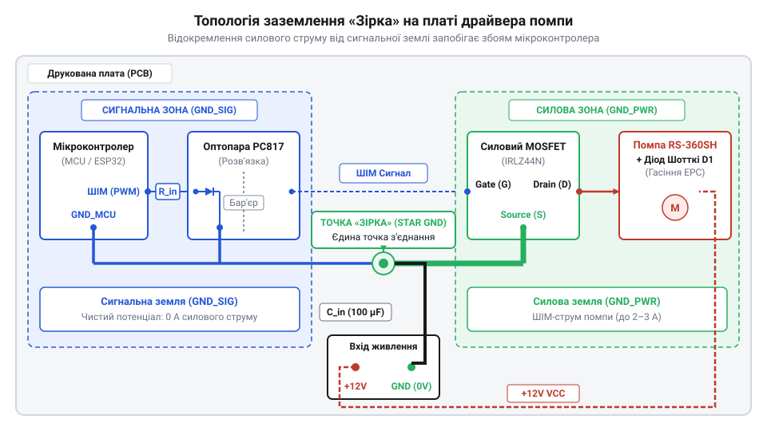
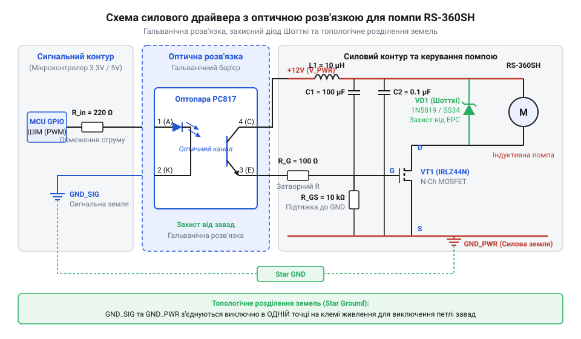
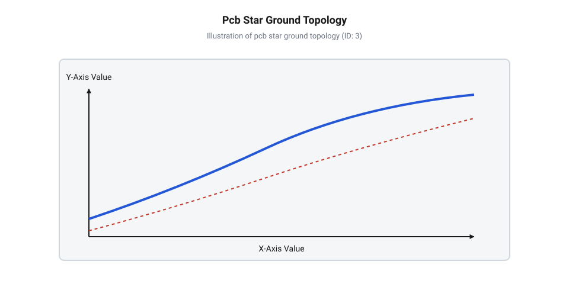

# Проєктування та збірка силового MOSFET-драйвера з PWM-керуванням та гальванічною розв'язкою для помпи RS-360SH

<preknowlist>
- [Колекторний двигун типорозміру 130](root:cat-hw-actuators/dc-motor-130) — Фізику роботи колекторно-щіткового вузла та причини виникнення ЕРС самоіндукції під час комутації обмоток.
</preknowlist>

## Загрози від прямого підключення помпи

Спроба підключити водяну помпу RS-360SH напряму до виводів мікроконтролера або до простого транзисторного ключа без захисних кіл майже завжди завершується раптовим зависанням, хаотичним перезавантаженням управляючої плати або фізичним виходом з ладу кремнієвих кристалів. На відміну від низькострумових навантажень, таких як [5V безколекторні вентилятори](root:cat-hw-actuators/fan-5v) чи малопотужний [мотор-редуктор 6 В](root:cat-hw-actuators/gearmotor-6v), електродвигун помпи помпового типу RS-360SH є важким індуктивним та динамічним навантаженням.

За своєю будовою водяна помпа RS-360SH містить колекторний електродвигун постійного струму. Подібно до того, як працює класичний [колекторний двигун типорозміру 130](root:cat-hw-actuators/dc-motor-130), обмотки ротора помпи постійно перемикаються під час обертання за допомогою скользячих графітових або мідних щіток. Переривання струму в індуктивності обмоток під час механічного ковзання щіток супроводжується інтенсивним мікроіскрінням. Цей процес породжує широкосмугові високочастотні завади — @@en|brush commutation@@ (колекторна комутація, від лат. *commutatio* — зміна), які поширюються як по провідниках живлення, так і у вигляді електромагнітного випромінювання.

Другим і ще більш небезпечним чинником є індуктивна ЕРС самоіндукції — @@en|back EMF@@ (ЕРС самоіндукції, від англ. *back electromotive force*, корінь *electric* / *motion*). Обмотки електродвигуна мають власну індуктивність `L_motor`. Згідно з законом електромагнітної індукції Фарадея, при швидкому розмиканні ключа струм у колі не може змінитися миттєво. Накопичена у магнітному полі ротора енергія викликає стрибок напруги зворотної полярності на виводах двигуна:

```
U_spike = U_supply + (L_motor × (di ÷ dt))
```

Оскільки час закривання транзистора `dt` становить наносекунди, амплітуда імпульсу перенапруги `U_spike` може досягати десятків і сотень Вольт. Така імпульсна перенапруга миттєво пробиває p-n перехід транзистора або проникає через паразитні ємності у сигнальні лінії мікроконтролера.

Крім того, під час пуску помпи та комутації великих струмів (пусковий струм RS-360SH досягає 3.5–5 А) виникає ефект @@en|ground bounce@@ (підйоми потенціалу спільної шини / землі). Високочастотні кидки струму протікають через власний опір та індуктивність друкованих провідників заземлення, створюючи різницю потенціалів між «землею» мікроконтролера та силовою «землею» джерела живлення. В результаті чутливі внутрішні регістри мікроконтролера фіксують помилкові логічні рівні, що призводить до спрацьовування системи @@en|Brown-out Reset@@ (скидання мікроконтролера при просіданні живлення) та зупинки виконання програми. Для забезпечення надійної роботи системи вимагається повне фізичне та електричне відокремлення сигнальної частини від силової.

## Гальванічна розв'язка сигнального контуру драйвера

Для захисту чутливих виводів мікроконтролера від високовольтних викидів напруги та струмових завад силової шини застосовують електричну ізоляцію контурів. Основним елементом такого захисту виступає оптичний ізолятор — @@en|optocoupler@@ (оптопара, від грец. *optikos* — зоровий та англ. *coupler* — з'єднувач). Усередині герметичного корпусу оптопари містяться інфрачервоний світлодіод і фоточутливий напівпровідник, яким найчастіше є @@en|phototransistor@@ (фототранзистор, від грец. *phos* — світло та лат. *transitus* — перехід). Прямий електричний контакт між вхідними та вихідними виводами повністю відсутній, а керувальний сигнал передається виключно потоком фотонів через діелектричний проміжок з напругою пробою понад 2.5 кВ.

Принцип роботи оптичного бар'єра полягає у послідовному перетворенні електричного струму GPIO-виводу у світловий потік ІЧ-світлодіода, який відкриває фототранзистор на вихідній стороні. Щоб забезпечити надійне перемикання оптопари без перевантаження виходу мікроконтролера, необхідно розрахувати вхідний струмообмежувальний резистор `R_in`.

Щоб знайти необхідний опір вхідного струмообмежувального резистора `R_in`, застосовуємо закон Ома для послідовного кола живлення світлодіода оптопари від виводу мікроконтролера. Від значення напруги логічної одиниці мікроконтролера `U_mcu` віднімаємо прямий спад напруги на внутрішньому світлодіоді `V_F`, після чого ділимо результат на робочий струм світлодіода `I_F`:

```
R_in = (U_mcu - V_F) ÷ I_F
     = (3.3 - 1.2) ÷ 0.010      [підстановка параметрів U_mcu = 3.3 В, V_F = 1.2 В, I_F = 10 мА]
     = 2.1 ÷ 0.010              [обчислення різниці напруг на світлодіоді]
     = 210                      [значення опору в Омах]
```

Значення 210 Ом є розрахунковим, тому обираємо найближчий стандартний номінал із ряду E24, який становить 220 Ом. При цьому струм через ІЧ-світлодіод становить близько 9.5 мА, що гарантує впевнене відкривання фототранзистора з урахуванням коефіцієнта передачі струму @@en|CTR@@ (коефіцієнт передачі струму, від англ. @@en|Current Transfer Ratio@@). Детальніші нюанси підбору оптичних ізоляторів описано у статті про [оптоелектронну розв'язку силових ключів](root:hw-power/optocoupler-driver-isolation).

На вихідній стороні оптопари колектор фототранзистора підключається до силової шини живлення +12 В через підтягувальний резистор `R_pull`. Значення `R_pull` обирається у межах від 1 кОм до 4.7 кОм. Занадто великий опір уповільнює розряд ємності затвора силового транзистора, збільшуючи динамічні втрати під час ШІМ-регулювання, а занадто малий опір викликає зайве нагрівання оптопари у відкритому стані.

Гальванічна розв'язка втрачає сенс, якщо заземлення мікроконтролера та силового драйвера об'єднані хаотично. Силовий та сигнальний контури заземлення повинні розділятися топологічно на друкованій платі та з'єднуватися виключно за схемою @@en|star ground@@ (схема заземлення зіркою) в одній точці безпосередньо біля клем клемника живлення.


*Топологічне відокремлення силового контуру помпи від логічного заземлення мікроконтролера у єдиній точці за допомогою оптопари.*

Завдяки такій топології імпульсні струми помпи амплітудою в кілька Ампер замкнені у силовому контурі й фізично не можуть протікати через загальну шину сигнальної плати.

## Розрахунок силового ключа та захисту

Для безпосереднього керування живленням двигуна помпи RS-360SH застосовується силовий N-канальний польовий транзистор — @@en|MOSFET@@ (польовий транзистор з ізольованим затвором, від англ. *Metal-Oxide-Semiconductor Field-Effect Transistor*). Оскільки керування виконується через оптопару від шини 12 В, затвор ключа отримує достатню напругу для повного відкриття каналу.

Вибір силового MOSFET здійснюється за трьома основними електричними параметрами:
1. Максимальна допустима напруга сток-витік `U_ds_max`: повинна перевищувати напругу живлення помпи (12 В) щонайменше у 2.5 раза для запасу по перенапрузі (`U_ds_max` ≥ 30 В). 2. Максимальний струм стоку `I_d_max`: повинен перевищувати струм заклинювання ротора помпи (3.5–5 А) щонайменше у 2–3 рази (`I_d_max` ≥ 10–15 А). 3. Опір відкритого каналу `R_ds_on`: чим менший цей опір, тим менше теплової потужності виділяється на корпусі транзистора.

Статична потужність втрат на нагрів MOSFET `P_cond` обчислюється за законом Джоуля-Ленца через ефективний струм навантаження `I_rms` та опір відкритого каналу `R_ds_on`:

```
P_cond = I_rms² × R_ds_on
       = 2.0² × 0.020           [підстановка струму I_rms = 2.0 А та опору каналу R_ds_on = 0.020 Ом]
       = 4.0 × 0.020            [піднесення струму до квадрата]
       = 0.080                  [потужність втрат у Ватах]
```

Виділення потужності 0.08 Вт є мізерним, що дозволяє транзистору працювати без встановлення зовнішнього радіатора охолодження.

У колі затвора MOSFET обов'язково встановлюються два резистори: послідовний антипаразитний резистор `R_G` номіналом 10–47 Ом для придушення високочастотного дзвінкого резонансу з індуктивністю друкованого провідника, та підтягувальний резистор `R_GS` номіналом 10 кОм між затвором і джерелом (Source) для фіксованого закриття транзистора під час стадії ініціалізації мікроконтролера.

Для гасіння імпульсів ЕРС самоіндукції паралельно клемам водяної помпи RS-360SH у зворотному включенні підключається швидкодіючий діод — @@en|flyback diode@@ (зворотний діод гасіння ЕРС самоіндукції). Для цього завдання ідеально підходить @@en|Schottky diode@@ (діод Шотткі, на честь фізика В. Шотткі), оскільки він має мінімальний спад прямої напруги (0.3–0.4 В) та практично нульовий час зворотного відновлення (`t_rr` < 10 нс). У момент закривання MOSFET струм індуктивності помпи продовжує протікати через діод Шотткі, замикаючись у контурі мотора й обмеживши сплеск напруги на стоці рівнем 12.4 В.

Для запобігання проникненню високочастотних завад від колекторного вузла у загальну силову мережу на вході живлення драйвера встановлюється пасивний LC-фільтр. Принцип роботи та варіанти побудови подібних кіл детальніше розглядають [пасивні LC-фільтри живлення](root:hw-analog/lc-power-supply-filter).

Частота зрізу `f_c` — @@en|cutoff frequency@@ (частота зрізу) пасивного LC-фільтра обчислюється на основі резонансної формули Томсона для індуктивності `L` та ємності `C`:

```
f_c = 1 ÷ (2 × π × √(L × C))
    = 1 ÷ (2 × 3.14159 × √(22 × 10⁻⁶ × 220 × 10⁻⁶))     [підстановка L = 22 мкГн, C = 220 мкФ]
    = 1 ÷ (6.28318 × √(4.84 × 10⁻⁹))                   [перемноження ємності та індуктивності]
    = 1 ÷ (6.28318 × 6.957 × 10⁻⁵)                     [добування квадратного кореня]
    = 1 ÷ (4.371 × 10⁻⁴)                               [обчислення знаменника]
    = 2288                                            [частота зрізу в Герцах]
```

Отримана частота зрізу приблизно дорівнює 2.29 кГц, що лежить значно нижче за базову частоту ШІМ 10 кГц і дозволяє повністю придушити високочастотні завади.

Повна схематична організація розрахованого силового модуля драйвера із захисними колами наведена на фігурі нижче.


*Повна принципова схема силового модуля керування водяною помпою RS-360SH із захисними та фільтруючими колами.*

Програмна реалізація керування таймером мікроконтролера спирається на налаштування базових параметрів помпи та розрахунок апаратних регістрів ШІМ:

:::code proj-rs360sh-mosfet-driver-shield/c/include/pump_pwm.h 18-23

Алгоритм розрахунку дільника `PSC` та періоду автоперезавантаження `ARR` для генерування стабільної частоти ШІМ 10 кГц у низькорівневому C-драйвері виконується наступним чином:

:::code proj-rs360sh-mosfet-driver-shield/c/src/pump_pwm.c 44-65

Розрахований силовий модуль разом із низькорівневим програмним забезпеченням забезпечує високу завадостійкість, надійний захист мікроконтролера та плавну регуляцію подачі рідини водяною помпою RS-360SH.

## Топологія друкованої плати та заземлення

Створення принципової схеми є лише першою половиною розробки силового модуля: під час комутації високих струмів фізичне розміщення провідників на @@en|PCB@@ (від англ. *Printed Circuit Board* — друкована плата) визначає, чи буде схема працювати стабільно. Водяна помпа RS-360SH у момент запуску та під час кожного широтно-імпульсного перемикання споживає імпульсні струми амплітудою від 3 до 5 А. Будь-яка мідна доріжка друкованої плати володіє скінченним омічним опором `R` та паразитною індуктивністю `L`. Коли високі струми двигуна протікають через спільний провідник заземлення, швидка зміна струму `dI/dt` викликає імпульсний спад напруги на паразитичних параметрах доріжки. Якщо сигнальна земля (@@en|Signal Ground@@ — `GND`) мікроконтролера об'єднана з силовою землею (@@en|Power Ground@@ — `PGND`) в довільній точці, цей спад створює ефект @@en|ground bounce@@ (від англ. *ground* — земля та *bounce* — підскок). У момент відкривання силового ключа опорний потенціал землі мікроконтролера короткочасно зростає відносно істинної землі джерела живлення. Це призводить до помилкового зчитування логічних рівнів, збоїв тактування або примусового перезавантаження процесора через спрацьовування системи @@en|Brown-out Reset@@ (від англ. *brown-out* — просідання напруги та *reset* — скидання). Особливо гостро ця проблема проявляється під час комутації обмоток [колекторного двигуна типорозміру 130](root:cat-hw-actuators/dc-motor-130), де щітковий вузол генерує додаткові високочастотні завади.

Обчислимо імпульсний стрибок напруги на провіднику заземлення довжиною 5 см з паразитною індуктивністю 20 нГн та опором 50 мОм при перемиканні струму 3 А за 100 нс за формулою індуктивно-омічного спаду:

```
V_spike
= L × (dI / dt) + I × R      [сума індуктивної та омічної складових]
= 20×10⁻⁹ × (3 / 100×10⁻⁹) + 3 × 0.05 [підстановка параметрів доріжки]
= 0.6 + 0.15                  [обчислення доданків]
= 0.75 V                      [підсумковий спад напруги]
```

Отриманий стрибок у 0.75 В на доріжці заземлення легко долає поріг завадостійкості 3.3-вольтової логіки мікроконтролера, змушуючи його сприймати логічний нуль як одиницю або перезапускатися.

Для усунення цього явища топологія плати повинна суворо дотримуватися принципу зіркоподібного заземлення — @@en|star ground@@ (від англ. *star* — зірка та *ground* — земля). Всі заземлювальні провідники розділяються на два незалежні контури: сигнальну землю `GND` (для мікроконтролера, вхідного світлодіода оптопари та чутливих датчиків) та силову землю `PGND` (для виходу оптопари, виводу @@en|Source@@ силового @@en|MOSFET@@, захисного діода Шотткі й мінусового контакту помпи). Ці два контури фізично з'єднуються лише в одній-єдиній точці плати — безпосередньо на негативному виводі вхідного електролітичного конденсатора LC-фільтра живлення. Завдяки цьому потужні імпульсні струми помпи циркулюють виключно всередині силового полігону `PGND` і фізично не можуть створити різницю потенціалів на сигнальній землі `GND`. Крім того, сигнальна доріжка від фототранзистора оптопари до затвора @@en|Gate@@ та зворотний провідник до @@en|Source@@ повинні мати мінімальну довжину і проходить поруч, щоб зменшити площу струмової петлі й запобігти виникненню @@en|gate ringing@@ (від англ. *gate* — затвор та *ringing* — дзвін, паразитні осциляції).


*Топологія друкованої плати модуля силового драйвера з розділенням сигнальної та силової земель.*

## Збірка, ШІМ-керування та тестування

Після виготовлення та монтування компонентів на плату драйвера переходять до налаштування програмного керування та випробувань. Ключовим завданням при роботі з водяною помпою є вибір оптимальної частоти @@en|PWM@@ (від англ. *Pulse-Width Modulation* — широтно-імпульсна модуляція). Якщо частота ШІМ лежить у чутному діапазоні (від 1 до 4 кГц), обмотки та гнучка мембрана помпи RS-360SH починають резонувати, створюючи різкий @@en|acoustic noise@@ (від англ. *acoustic noise* — акустичний шум). Підвищення частоти понад 25–30 кГц усуває шум, проте різко збільшує динамічні втрати на силовому ключі через обмежену швидкість відкривання фототранзистора оптопари. Оптимальним вибором для помпи RS-360SH є частота 10 кГц (`RS360SH_DEFAULT_PWM_FREQ_HZ = 10000U`), яка забезпечує безшумну роботу та високий ККД.

Розрахуємо значення регістрів апаратного таймера мікроконтролера (на прикладі тактування 72 МГц) для отримання частоти ШІМ 10 кГц з роздільною здатністю 900 дискрет:

```
f_pwm
= f_sys / ((PSC + 1) × (ARR + 1))  [частота ШІМ периферійного таймера]
= 72000000 / ((7 + 1) × (899 + 1)) [підстановка параметрів тактування 72 МГц]
= 72000000 / (8 × 900)             [спрощення дільника]
= 10000 Hz                         [підсумкова частота 10 кГц]
```

Значення коефіцієнта заповнення @@en|Duty Cycle@@ регулює середню напругу на двигуні. Однак через сухе тертя гумової мембрани помпа RS-360SH не здатна обертатися при коефіцієнті заповнення менше 20% (`RS360SH_MIN_OPERATIONAL_DUTY_PCT`). Подача ШІМ у діапазоні 1–15% викликає заклинювання ротора: струм протікає через нерухомі обмотки, спричиняючи їх небезпечний перегрів без перекачування рідини. Драйвер повинен програмно обмежувати мінімальний робочий поріг або миттєво вимикати ключ (0% ШІМ). Для запобігання пусковим кидкам струму та гідравлічним ударам — @@en|water hammer@@ (від англ. *water hammer* — гідравлічний удар) у трубопроводі — керування швидкістю реалізується через неблокуючу програмовану рампу @@en|Soft Start@@ (від англ. *soft start* — плавний запуск) та @@en|Soft Stop@@ (від англ. *soft stop* — плавна зупинка).

У низькорівневому C-драйвері керування реалізовано через пряму маніпуляцію реєстрами таймера та структуру скінченного автомата:

:::code proj-rs360sh-mosfet-driver-shield/c/include/pump_pwm.h 36-105

Функція ініціалізації розраховує дільники @@en|Prescaler@@ (`PSC`) та автоперезавантаження @@en|Auto-reload@@ (`ARR`), після чого конфігурує канали порівняння:

:::code proj-rs360sh-mosfet-driver-shield/c/src/pump_pwm.c 17-108

Періодичний виклик неблокуючої функції оновлення розраховує поточний крок рамп розгону та зупинки, захищаючи помпу від заклинювання на низьких обертах:

:::code proj-rs360sh-mosfet-driver-shield/c/src/pump_pwm.c 168-226

Демонстраційний цикл головної програми C ілюструє процес плавної зміни швидкості та зчитування гідравлічної телеметрії:

:::code proj-rs360sh-mosfet-driver-shield/c/src/main.c 22-161

Для складніших проєктів використовується об'єктно-орієнтована C++ архітектура з використанням паттерну @@en|RAII@@ (від англ. *Resource Acquisition Is Initialization* — отримання ресурсу є ініціалізацією) для гарантованого аварійного знеструмлення та захистом від сухого ходу — @@en|dry run@@ (від англ. *dry run* — сухий хід). Низькорівневе керування ключем абстраговано у класі `MosfetPwmHal`:

:::code proj-rs360sh-mosfet-driver-shield/cpp/include/mosfet_pwm_hal.hpp
:::code proj-rs360sh-mosfet-driver-shield/cpp/src/mosfet_pwm_hal.cpp

Високорівневий клас `RS360SHPumpDriver` та RAII-контролер `DosingGuard` гарантують безпеку дозування: якщо під час роботи стається виняток або переривання сеансу, деструктор `DosingGuard` автоматично зупиняє помпу:

:::code proj-rs360sh-mosfet-driver-shield/cpp/include/rs360sh_pump_driver.hpp 63-96
:::code proj-rs360sh-mosfet-driver-shield/cpp/src/rs360sh_pump_driver.cpp 8-39

У кожному тику оновлення драйвер перевіряє показання датчиків протоку та наявності рідини. Якщо рідина відсутня довше таймауту, помпа переходить у стан аварії `FaultDryRun`:

:::code proj-rs360sh-mosfet-driver-shield/cpp/src/rs360sh_pump_driver.cpp 105-237

Головна програма C++ демонструє сеанс точного дозування 60 мл та обробку аварійної ситуації сухого ходу:

:::code proj-rs360sh-mosfet-driver-shield/cpp/src/main.cpp 6-88

Практичне тестування зібраного модуля завершується перевіркою за допомогою осцилографа та термографа. Підключивши щуп осцилографа між затвором @@en|Gate@@ та виводом @@en|Source@@, перевіряють фронти перемикання: час наростання та спаду напруги повинен бути меншим за 1.5 мкс без кілець овершуту завдяки вірно підібраному затворному резистору. Безперервний прогон помпи під повним навантаженням (3 А струму) протягом 15 хвилин показує, що температура корпусу MOSFET не перевищує 50 °C, що підтверджує правильний розрахунок статичних та динамічних втрат ключа.